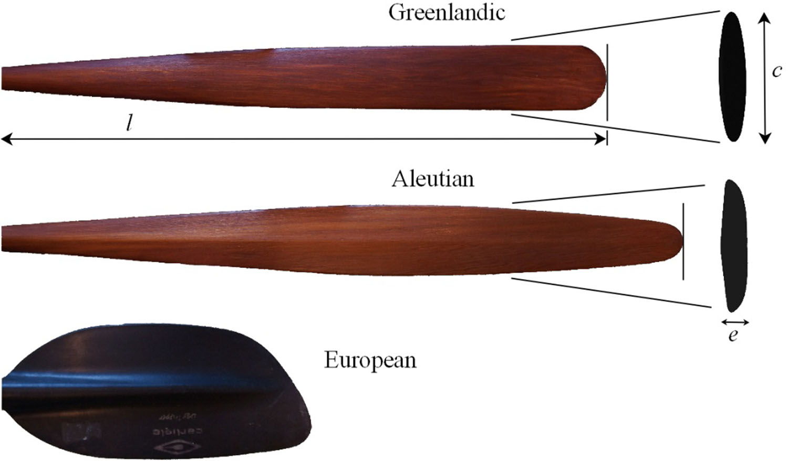
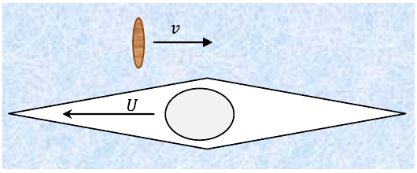
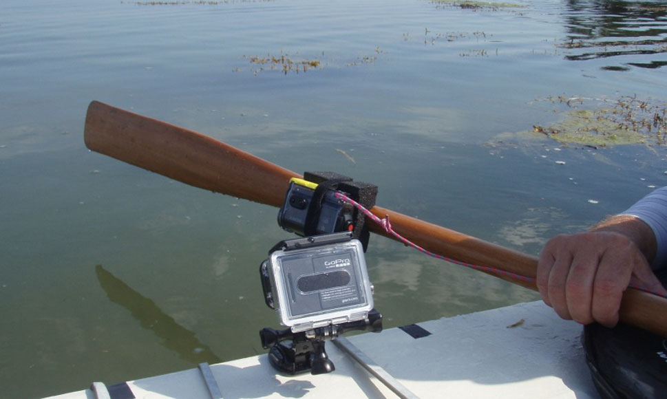
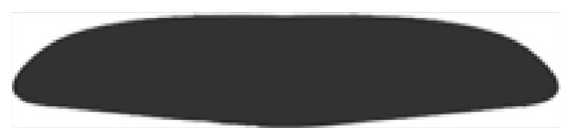
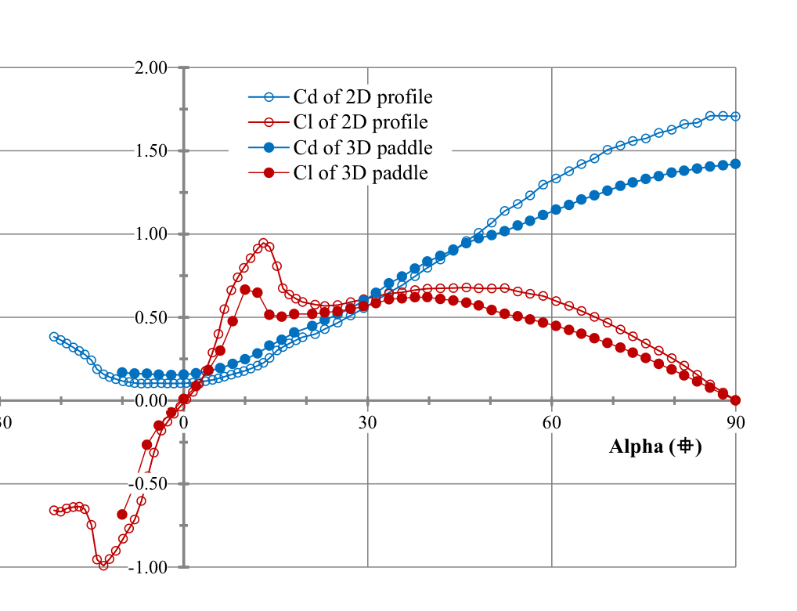
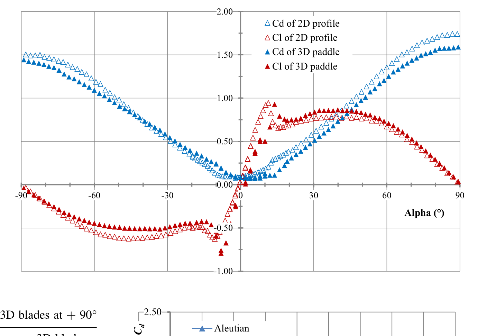
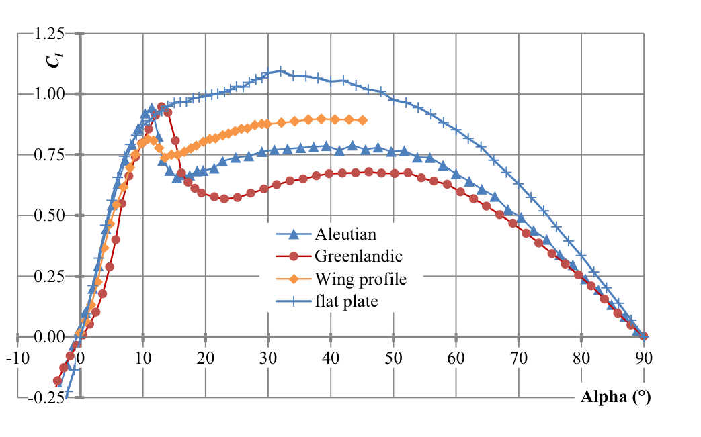
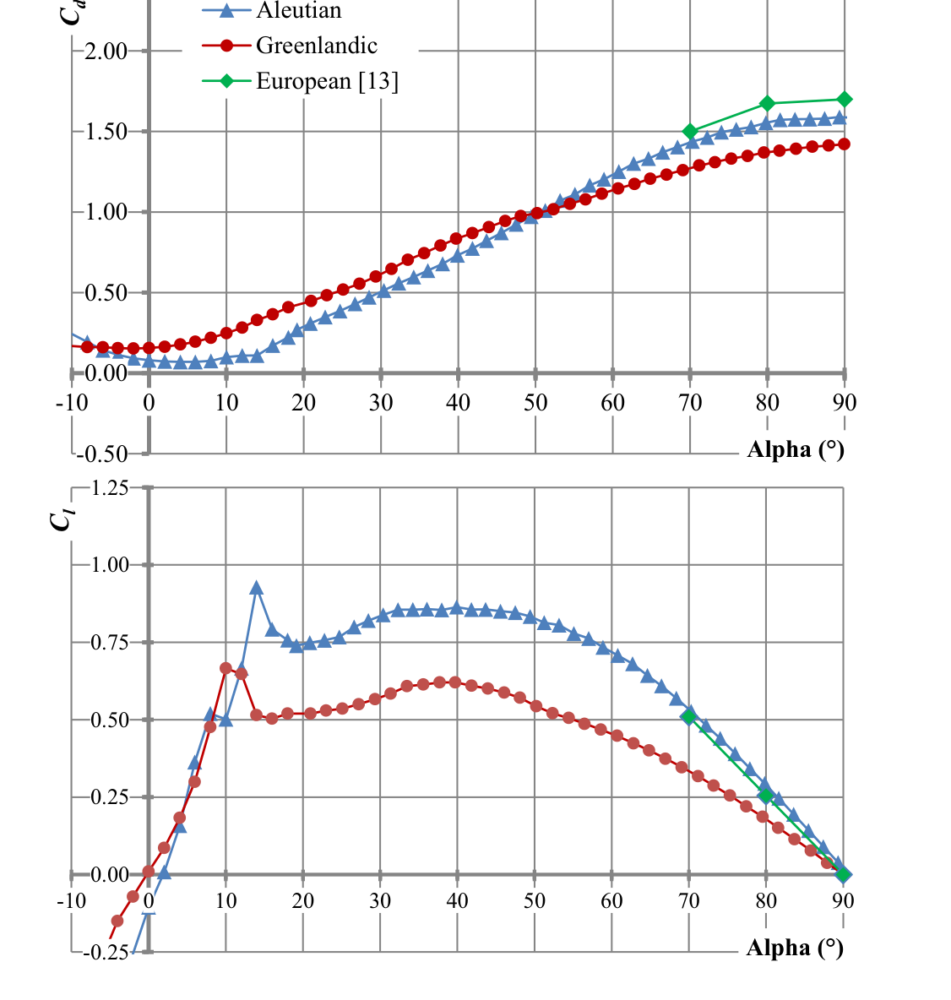
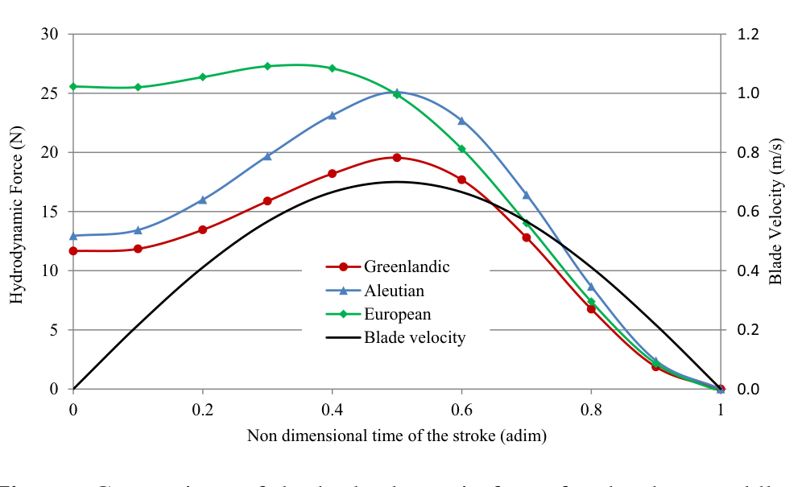

# 海洋皮艇传统桨的水动力特性

**Hydrodynamic characteristics of sea kayak traditional paddles**

Pascal Hémon¹

¹ 法国巴黎综合理工学院 CNRS 水动力学实验室（Hydrodynamics Laboratory, LadHyX, CNRS-Ecole Polytechnique, Palaiseau, France）。pascal.hemon@ladhyx.polytechnique.fr

**原文信息：** Sports Engineering, International Sports Engineering Association, 2017。https://doi.org/10.1007/s12283-017-0262-x（原创论文 ORIGINAL ARTICLE，共 9 页）

---

## 摘要

我们提出一项不考虑划手因素的海洋皮艇桨水动力特性研究。我们聚焦于北极地区使用的传统桨：一支来自格陵兰，一支来自阿留申群岛。研究中还纳入一支基础的现代欧洲式桨用于比较。由于以往研究都针对竞赛场景，我们首先辨识海洋皮艇所特有的划桨参数。文中详细分析桨叶运动产生的水动力：辨识出两个项，一项涉及桨叶开始运动时其周围水体的惯性，第二项是经典的阻力／升力。阻力系数与升力系数在风洞中测得。这些数据可以计算一次划桨过程中的水动力。结果表明，欧洲式桨因具有更小的长宽比、带来更大的惯性效应而比传统桨更有效率。然而，传统桨所获得的力能更好地跟随划手施加的运动，因此在海洋皮艇所从事的长距离旅程中更舒适、更不易疲劳。

**关键词：** 桨（Paddle）；海洋皮艇（Sea kayak）；划桨动作（Paddle stroke）；水动力学（Hydrodynamics）

## 1 引言

皮艇桨的水动力学在过去很少被研究，大多数研究聚焦于生物力学，并考虑运动员的生理因素。本文中我们研究独立于划手之外的桨本身特性。

我们聚焦于北极地区使用的传统桨。皮艇及其所有配套工具，是因纽特人和格陵兰人在数个世纪中发展和改进的 [1]。他们积累了深厚的传统知识，但这些知识尚未得到科学解释或量化。皮划艇作为一项运动、甚至进入奥运会，或作为面向更广泛公众的休闲活动，被传播到北极以外地区。

在后一种背景下，海洋皮艇涵盖一些可能相当不同的活动，从半天的短途旅行到数周的长途探险。一些熟练的参与者希望提高其海洋皮艇技术和安全性。人们对传统桨很感兴趣，认为与设计通常受竞赛实践启发的欧洲式桨相比 [2, 3]，传统桨在超长距离旅行中更易用、更安全、更舒适。

使用桨的方式大致有两种：最简单也更常见的一种是在划桨过程中保持桨叶与来流垂直，这种方式使用的是"阻力桨"（drag paddle），因为所产生的水动力主要是阻力。另一种使用桨的方式是让桨叶具有一个迎角（angle of attack，在划桨过程中可以恒定也可以不恒定），这使桨叶像机翼一样，产生一个垂直于桨叶运动方向的升力。为获得推进，划手必须调整其划桨动作，因此一般仅限于熟练或精英划手 [4]。

人们需要增进对皮艇桨的认识，尤其是在海洋皮艇背景下，而竞赛场景已得到研究 [5]。这里我们聚焦于划桨过程中桨叶上获得的水动力。海洋皮艇桨设计参数的影响尚未被阐明，需要进行细致的水动力研究。

本文结构如下：首先在第 2 节描述各支桨；然后在第 3 节测量一名典型海洋皮艇划手的划桨参数；第 4 节详细分析水动力并进行风洞实验；第 5 节基于一个简化的划桨周期比较各桨的性能。

## 2 格陵兰桨与阿留申桨

传统桨有众多类型，因为北极居民在与其环境的深刻联系中发展其工具，每个社群都有适应当地海况的独特设计。文献 [6–8] 对各种桨作了综述。

不可能研究所有桨型。我们选择两种传统设计：一种是桨叶对称的格陵兰桨（Greenlandic paddle），另一种是桨叶外弧面（extrados）与内弧面（intrados）不同的阿留申桨（Aleutian paddle）。其外弧面尤其具有特征性的平直二面角形状。研究还纳入第三支基础的"欧洲式"桨用于比较。这些桨如图 1 所示。

**图 1　各支桨桨叶的视图，保持相对比例。** 图中给出格陵兰桨叶和阿留申桨叶在半长处的横向剖面形状。

图中标签译注：本图为三支桨桨叶的等比例实物照片对比，自左至右分别为格陵兰桨、阿留申桨和欧洲式桨；下方小图为格陵兰桨叶与阿留申桨叶的横截面（横向剖面）形状。

各支桨的主要特性列于表 1，其中详细给出后文使用的桨叶尺寸：e 为平均厚度，c 为最大宽度或弦长（chord），c_h 为距叶尖 1/3 处的弦长，l 为桨叶长度，S 为桨叶面积（投影面积）。后者用经标定的照片（ImageJ）测得。格陵兰桨与阿留申桨之间存在尺寸差异，这是由于阿留申群岛周围的海况更恶劣。阿留申桨被设计为通过更长的桨杆和更大的桨叶面积获得更大的力。

**表 1　所研究各桨的特性与尺寸**

| 桨 | 质量（kg） | 长度（m） | 桨杆直径（m） | e（m） | c（m） | c_h（m） | l（m） | S（m²） | l/c_h |
|---|---|---|---|---|---|---|---|---|---|
| 格陵兰 | 0.86 | 2.06 | 0.035/0.029 | 0.007 | 0.088 | 0.088 | 0.78 | 0.0560 | 8.9 |
| 阿留申 | 0.94 | 2.30 | 0.0375/0.030 | 0.012 | 0.095 | 0.085 | 0.85 | 0.0644 | 10 |
| 欧洲式 | 0.98 | 2.20 | 0.030 | 0.004 | 0.181 | 0.181 | 0.41 | 0.0597 | 2.3 |

注：e 为桨叶平均厚度；c 为最大宽度（弦长）；c_h 为距叶尖 1/3 处弦长；l 为桨叶长度；S 为桨叶投影面积；l/c_h 为桨叶长度与该处弦长之比。

两支传统桨由北美红柏（western red cedar，Thuja Plicata）制成，比重为 0.37–0.38，杨氏模量在 7900–8800 MPa 范围内。外表面涂油以更好地防水。欧洲式桨叶由塑料制成，桨杆为铝制。

## 3 划桨参数

本文假设皮艇速度已达到一个恒定的稳态值 U，对应巡航状态，见图 2。于是桨在水中的速度 v 存在一个需要阐明的周期。划桨过程中 v 的变化可大致用正弦曲线的半周期来近似 [9]。只需两个参数即可表征这一划桨周期：桨叶浸入水中时划桨的持续时间 T，以及桨叶达到的最大速度 v_max。

**图 2　皮艇速度 U 与桨速度 v 的定义。**

图中标签译注：v 为桨叶相对水的速度（向右）；U 为皮艇（船体）相对水的速度（向左）。二者均以水为参考系，图中为示意顶视图。

在 Caplan 的论文 [9] 中，T 的估计值为 0.4 s，v_max = 1.23 m/s。其他人得到 0.3 < T < 0.59 s [10–12]。文献 [13] 中 v_max = 3 m/s。这些数值针对使用欧洲式桨的精英皮艇运动员，因此将其外推到传统海洋皮艇实践似乎并不合适。

### 3.1 一次划桨的持续时间

测量使用嵌入式摄像机进行：一台固定在皮艇甲板上，另一台固定在桨叶根部的桨杆上，如图 3 所示（60 fps）。摄像机在记录开始时通过一次"击掌声"实现同步。测试在海上进行，地点为法国莫尔比昂湾（Morbihan Gulf），那里具有非常平静的水面条件。

**图 3　固定在皮艇甲板上和固定在桨上的摄像机视图。**

在视频序列中、在船体速度恒定且沿直线行进的巡航条件下，分析了连续十次划桨。测得划桨平均持续时间为 T = 0.73 ± 0.03 s，比其他人使用欧洲式桨测得的结果更长 [10–13]。

### 3.2 桨叶在水中的速度

桨叶在水中的速度使用安装在桨上的流速仪测得，如图 4 所示。流速仪与桨叶之间的横向距离为桨叶宽度的两倍，以避免二者之间的相互干扰。流速仪与桨叶的对准在平整台面上完成。它们用两个拧在桨上的夹箍连接在一起。传感器为 FLOW PROBE 型 FP111，由一个小转子和一台通过轴连接的数字记录仪组成。在 0.1–6.1 m/s 量程内精度为 0.03 m/s。已验证其方向敏感性：在 12° 锥角内可忽略不计。记录仪可显示传感器测到的最大值，该最大值在十次划桨上测得。

**图 4　安装在桨上的流速仪视图。**

测量结果给出：v_max = 0.70 ± 0.1 m/s，小于其他文献报道值 [9, 13]。GPS 测得船体速度约为 4 节（2 m/s），对应常见的巡航速度。

## 4 水动力

Jackson 等人 [5] 通过比较经典的"阻力桨"与"翼形桨"（wing paddle），提出现代欧洲式桨的水动力研究。这里我们聚焦于阻力桨。在巡航状态下，阻力桨保持其桨叶与来流垂直，运动平行于船体轴线，见图 2。施加于桨叶、并通过划手转化为推进力的水动力 [14] 可写为：

$$|F_x| = m_a \sigma(T_e)\,\gamma + \frac{1}{2}\rho S C_d v^2 \qquad (1)$$

式中 γ 和 v 分别为桨叶在水中的加速度和速度，m_a 为附加质量，σ(T_e) 为依赖于建立时间（establishment time）T_e 的权重函数，C_d 为桨叶阻力系数，ρ 为水的密度。

水动力随后被分解为下文详述的两个项。m_a σ(T_e) γ 项源于桨叶必须"推动"的桨叶周围水体的惯性，½ρSC_d v² 项则是经典的阻力／升力。

### 4.1 惯性项

考虑桨叶周围水体惯性有不同的处理途径。Jackson [5] 使用起始涡（starting vortices）概念建立了这一力的表达式。然而该表达式在这里并不完全适用，因为传统桨叶的长度远大于宽度，而建立该表达式所针对的欧洲式桨并非如此。

辨识水体惯性效应的另一种途径是附加质量（added mass）概念，它被广泛用于海洋工程工业中的流—固耦合与振动研究 [15]。附加质量可看作被桨叶带动起来的周围水体的质量。Blevins [15] 针对垂直于来流、具有不同长宽比的平板，给出附加质量的解析表达式：

$$m_a = \frac{\pi}{4}\rho l c_h^2 \qquad (2)$$

在本研究情形中，桨叶并非真正的矩形平板，因此将上式修正为：

$$m_a = \frac{\pi}{4}\rho S c_h \qquad (3)$$

它可以用桨叶的真实面积代替 l c_h。所考虑的三种桨叶的这一附加质量列于表 2。可以看到大弦长带来的效应：它使欧洲式桨具有很大的附加质量。

**表 2　所研究桨叶的附加质量**

| 桨 | c_h（m） | S（m²） | m_a（kg） |
|---|---|---|---|
| 格陵兰 | 0.088 | 0.0560 | 3.87 |
| 阿留申 | 0.085 | 0.0644 | 4.30 |
| 欧洲式 | 0.181 | 0.0597 | 8.49 |

导出式 (3) 的假设之一是结构位移很小，但这在划桨周期中并不成立。根据上面辨识出的参数，桨叶行经的距离约为 0.5 m，几乎是弦长的 5–6 倍；而普遍认为，当位移大于一个弦长时，附加质量表达式不能直接使用。

因此必须进行一项修正，以限制划桨开始阶段附加质量的作用。文献 [16, 17] 发表的实验给出平移平板上的水动力随一个无量纲时间 T_e 的变化，T_e 由下式给出：

$$T_e = \frac{1}{c}\int_{0}^{t} v(\tau)\,\mathrm{d}\tau \qquad (4)$$

这一时间 T_e 被辨识为涡环形成的通用时间尺度 [18]。从某种意义上说，它对应于桨叶行经的、以弦长为单位的距离。力测量表明，当 T_e > 1.8 – 2 时，力在加速阶段之后已达到其恒定值。附加质量效应在此时间之后便可忽略。可以构造一个作用于附加质量的权重函数 σ(T_e)，它在 T_e = 0 时为 1，在 T_e = 1.8 时降为零。本文针对划桨发展了一种简化处理，即为 σ(T_e) 选择最简单的演化形式——线性形式。

### 4.2 桨叶剖面特性

为辨识水动力的第二项，必须量化每支桨叶的阻力系数 C_d。文献 [19] 给出关于不同长度—弦长比矩形平板阻力系数和升力系数的风洞试验。1995 年的一项研究 [20] 给出常见欧洲式桨的结果。更近期，不同设计的欧洲式桨叶也在风洞中进行了测试 [13]。一篇关于格陵兰桨叶的简短报告 [21] 已发表。然而数据并不完整，因此下文给出一套系统的风洞试验计划。

桨叶具有可分别研究的横向剖面和三维形状。进行了两系列试验：一系列采用传统桨叶的二维剖面（见图 2），第二系列采用桨叶的三维模型。在每种情况下，迎角都是试验的可变参数，其常规定义如图 5 所示。

**图 5　阿留申桨叶上迎角的定义。**

图中标签译注：α = +90° 表示桨叶平面与来流垂直（阻力桨工况）；α = 0° 表示桨叶平面与来流平行。

在使用阻力桨的最简单划桨中，关注的是 +90° 时的阻力。不过，测量仍给出阻力系数和升力系数随迎角的变化。

风洞模型基于在真实桨叶上测得的坐标通过三维打印制作。二维剖面模型的缩尺比为 1/2，三维桨叶模型的缩尺比为 1/4。这些模型如图 6 所示。二维剖面在两壁之间进行测试，其长度—弦长比为 4，被认为是可接受的 [22]。

**图 6　二维（上）与三维（下）风洞模型视图。** 左侧为打印模型照片，右侧为计算机模型。

测量在实验室的水平式风洞中进行，借助一个六分力传感器（ATI Industrial Automation 的 NANO 43 型）以及 Muller-BBM 的 PAK 系统采集信号。记录时长 10 s，采样频率 1024 Hz。下文只给出力的时间平均值，其精度优于 5%。迎角通过一个由预先定义程序控制的电动系统获得，精度约为 1°。

其他风洞参数包括参考速度，它通过稳定段与试验段之间的静压差测量获得（KIMO CP303 型）。速度用伯努利方程求出，其中计入了温度和大气压。速度的总体精度优于 1%。三维模型在 90° 朝向时试验段的最大实体堵塞比 β 为 4.8%，二维模型为 6.5%。参考速度通过将原始值乘以系数 (1 + β sin α) 进行修正，以计入模型周围的流动加速。除此之外不作其他修正。

试验的雷诺数为 Re = v c_h / ν = 40 000，其中速度 v 为先前辨识出的桨速度 v_max 的 2/3，ν 为运动黏度（空气中 15×10⁻⁶ m²/s，水中 10⁻⁶ m²/s [22]）。在风洞研究中，雷诺数用于量化缩尺效应和流体性质改变的影响。这里，使用空气和缩尺模型的风洞中雷诺数，与真实桨叶在水中的雷诺数相同。由此二维剖面试验的风洞速度为 v = 15 m/s，三维模型为 30 m/s。

针对另一雷诺数的初步试验表明，所记录阻力演化受到的影响很小，对升力几乎没有影响。注意桨叶模型具有较小的表面粗糙度（< 40 µm），可像真实划桨中一样保证边界层的紊流特性。

格陵兰桨的结果如图 7 所示，阿留申桨如图 8 所示。C_d 为阻力系数，C_l 为升力系数。三维桨叶情形的参考面积为用经标定照片测得的模型投影面积。二维桨叶剖面之间差异不大：两者在 +90° 时的阻力均为 1.74。在相同条件下测得平板阻力系数为 1.94 ± 0.09，与文献 [15, 19] 一致，验证了试验程序。然而对于三维桨叶，差异明显：格陵兰桨为 1.43，阿留申桨为 1.59，即大 10%。阿留申桨叶叶尖更薄的三维形状是有利的。注意阿留申桨因其横向形状而呈现非对称曲线，其在 −90° 时的阻力系数为 1.49。作为比较，文献 [13] 中欧洲式桨叶的阻力系数为 1.70，略大。这些数据汇总于表 3。

**图 7　格陵兰二维剖面和三维桨叶的阻力系数与升力系数随迎角的变化。**

图中标签译注：Cd of 2D profile = 二维剖面阻力系数；Cl of 2D profile = 二维剖面升力系数；Cd of 3D paddle = 三维桨阻力系数；Cl of 3D paddle = 三维桨升力系数；Alpha (°) = 迎角 α（度）。

**图 8　阿留申二维剖面和三维桨叶的阻力系数与升力系数随迎角的变化。**

图中标签译注同图 7；阿留申桨叶因外弧面／内弧面不对称，曲线在正负迎角下不对称（迎角范围 −90° 至 +90°）。

**表 3　二维剖面与三维桨叶在 +90° 时的阻力系数**

| 桨 | 二维剖面 | 三维桨叶 |
|---|---|---|
| 格陵兰 | 1.74 ± 0.09 | 1.43 ± 0.07 |
| 阿留申 | 1.74 ± 0.09 | 1.59 ± 0.08 |
| 欧洲式 [13] | – | 1.70 |

看来阻力系数的差异来自桨叶的三维形状，而不是其横向剖面；横向剖面的影响只体现在升力系数上。当桨不以纯阻力推进方式使用、或用于滚翻动作（rolling maneuvers）时，桨的升力可能很重要。作为比较，图 9 给出平板和常见翼型（NACA 0012）的升力系数以及传统剖面的升力系数。看来在 0–12° 范围内（主要是滚翻动作），各升力系数几乎相同。还应注意平板的良好表现：其升力系数在 15° 附近并不像其他剖面那样出现突然失速。在 ±90° 附近，平板略优于传统剖面，但彼此接近。遗憾的是，无法用这里测试的这种薄平板制造出一支刚度足够的桨。

**图 9　不同二维剖面的升力系数随迎角变化的比较。**

图中标签译注：Aleutian = 阿留申剖面；Greenlandic = 格陵兰剖面；Wing profile = 翼型剖面；flat plate = 平板；纵轴 C_l = 升力系数；横轴 Alpha (°) = 迎角（度）。

三维桨叶阻力系数和升力系数的比较如图 10 所示。看来欧洲式桨叶接近阿留申桨叶。格陵兰桨叶的阻力低于其他桨叶，但其对称形状带来其他优势，尤其是在滚翻动作中——紧急情况下划手对接桨（take over）别无选择时。

**图 10　三支桨叶的阻力系数（上）与升力系数（下）随迎角变化的比较。**

图中标签译注：Aleutian = 阿留申；Greenlandic = 格陵兰；European [13] = 文献 [13] 中的欧洲式桨；上图纵轴为 C_d（阻力系数），下图纵轴为 C_l（升力系数）；横轴 Alpha (°) = 迎角（度）。

## 5 性能比较

本节中我们使用先前确定的特性计算每支桨的水动力。力的测量已在文献 [23] 中发表，但只针对一名精英皮艇运动员，即处于竞赛场景。

这里把划桨简化为一个正弦周期，在此期间假定桨叶在完全进入水中时开始运动，并在水中停止。入水和出水阶段不在此研究。此外，桨叶保持与来流垂直（迎角 +90°），并假定其只有平移运动。这是一种简化的划桨，但它允许在不受划手使用不同长度和类型桨的能力影响的情况下，对不同的桨进行比较。

桨叶运动遵循如下施加的演化规律：

$$v = v_{\max}\sin\left(\pi\frac{t}{T}\right) \qquad (5)$$

相应地，加速度为：

$$\gamma = \frac{\pi}{T}v_{\max}\cos\left(\pi\frac{t}{T}\right) \qquad (6)$$

其中有量纲时间 t 取 0 到 T。利用第 3 节得到的划桨周期各参数和第 4 节的水动力参数，可以计算桨叶上产生的力随时间的演化。这些结果如图 11 所示。

**图 11　三支桨在一次标准划桨过程中的水动力比较。**

图中标签译注：Greenlandic = 格陵兰；Aleutian = 阿留申；European = 欧洲式；Blade velocity = 桨叶速度；左纵轴 Hydrodynamic Force (N) = 水动力（N）；右纵轴 Blade Velocity (m/s) = 桨叶速度（m/s）；横轴 Non dimensional time of the stroke (adim) = 划桨的无量纲时间（无量纲）。

在划桨开始时，力由涉及附加质量的惯性项主导。由于弦长大，欧洲式桨立即呈现更大的力。弦长的影响实际上是双重的：显然附加质量更大，其次持续时间 T_e 更长。对传统桨而言，最大力在划桨中更晚出现，因为力由跟随所施加速度的阻力项主导。

阿留申桨因桨叶面积更大而比格陵兰桨提供更大的力（见表 1）。然而，独立于桨叶面积来比较所有这些桨是有意义的。文献 [24] 给出的无量纲冲量为：

$$I = \frac{\dfrac{1}{T}\displaystyle\int_{0}^{T} F(t)\,\mathrm{d}t}{\dfrac{1}{2}\rho S v_{\max}^{2}} \qquad (7)$$

它提供表征每支桨叶的单一数值结果，列于表 4。不确定度对应阻力系数上最大 ±5% 的误差。于是可以看到，欧洲式桨比传统桨更有效率。我们还观察到阿留申桨略优于格陵兰桨，但优势不如计入桨叶面积的有量纲力所预期的那么大。

**表 4　三支桨的无量纲冲量**

| 桨 | I |
|---|---|
| 格陵兰 | 12.9 ± 0.5 |
| 阿留申 | 13.9 ± 0.5 |
| 欧洲式 | 18.8 ± 0.5 |

## 6 结论

本文提出了一项关于海洋皮艇传统桨上水动力的研究。在真实环境中测量了这项运动特有的划桨参数。桨叶上的水动力被写为一个惯性项与一个阻力项之和。惯性项用附加质量概念建模，其中桨叶宽度（弦长）具有主要影响：弦长越大，所得力越大。各桨叶的阻力／升力系数在风洞中作为迎角的函数被辨识出来。从一个简化划桨周期出发计算了力。

结果表明欧洲式桨比传统桨更有效率。然而，在海洋皮艇长途旅行的背景下，传统桨更舒适，因为力的周期能更好地跟随划手施加的运动周期。传统桨的附加质量比欧洲式桨小得多，因此惯性力更弱、更短促。阿留申桨被发现略比格陵兰桨有效率，但格陵兰桨具有完全对称、更易换手握持接桨的优势。

尽管标准划桨中只使用阻力，但升力也进行了测量，以提供有助于更好地为熟练划手所用划桨动作建模的数据。还可在桨运动的基础上把研究推广到静水竞速。

水动力惯性项可以通过使用实测的、与桨叶三维形状相适应的附加质量来改进，而不是使用本研究所用的解析（且简化的）表达式。

## 致谢

作者感谢 LadHyX 的 Caroline Frot 三维打印风洞模型，感谢 LadHyX 的 Xavier Amandolese 博士提供风洞使用条件并进行力测量。传统桨由 Alain Kerbiriou（http://www.kerlo.fr）制作并提供。

## 参考文献

1. Victor PE, Robert-Lamblin J (1989) La civilisation du phoque. Jeux, gestes et techniques des eskimos d'Ammassalik. Editions Armand Colin, Raymond Chabaud
2. Romain C (2015) Renaissance de la pagaie groenlandaise. Chasse-marée 270:68–79
3. Frédérique et CC, Gilles H, Loïc B (2007) Construire et utiliser les Kayaks de l'Arctique. Le Canotier éditions, Yerville
4. Bernard M, Michel G (2014) Le kayak et la mer. Le Canotier éditions, Yerville
5. Jackson PS, Locke N, Brown P (1992) The hydrodynamics of paddle propulsion. In: 11th Australian Fluid Mechanics Conference, Hobart, 14–18 December, pp 1197–1200
6. Golden H (2015) Kayaks of Alaska. White House Grocery Press, Portland, pp 445–502
7. Golden H (2006) Kayaks of Greenland. White House Grocery Press, Portland, pp 481–529
8. Heath JD, Arima E (2004) Eastern Arctic Kayaks. University of Alaska Press, Fairbanks, pp 45–59
9. Caplan N (2009) The influence of paddle orientation on boat velocity in Canoeing. Intern J Sports Sc Eng 03(03):131–139
10. Mann Ralph V, Kearney Jay T (1980) A biomechanical analysis of the Olympic-style flatwater kayak stroke. Med Sci Sports Exerc 12(3):183–188
11. Aitken David A, Neal Robert J (1992) An on-water analysis system for quantifying stroke forces characteristics during kayak events. Intern J Sport Biomech 8:165–173
12. Jackson PS (1995) Performance prediction for Olympic kayaks. J Sports Sci 13:239–245
13. Sumner D, Sprigings EJ, Bugg JD, Hesltine JL (2003) Fluid forces on kayak paddle blades of different design. Sports Eng 6:11–20
14. Baker J (2012) Biomechanics of paddling. In: 30th annual conference of biomechanics in sports, July 2–6, Melbourne, Australia
15. Blevins RD (2001) Flow-induced vibration. Krieger Publishing Company, Malabar, p 25
16. Ringuette MJ, Milano M, Gharib M (2007) Role of the tip vortex in the force generation of low-aspect-ratio normal flat plates. J Fluid Mech 581:453–468
17. Kim D, Gharib M (2011) Flexibility effects on vortex formation of translating plates. J Fluid Mech 677:255–271
18. Gharib M, Rambod E, Shariff K (1998) A universal time scale for vortex ring formation. J Fluid Mech 360:121–140
19. Eiffel G (1910) La résistance de l'air et l'aviation. Dunod & Pinat, Paris, pp 39–50
20. McCann Barret T, Bowman WJ (1995) Experimental study to determine the aerodynamic characteristics and performance of common kayak paddle designs. AIAA 95–221. In: 26th AIAA fluid dynamics conference, June 19–22, San Diego, USA
21. Farber J, Hamano K, Rockwell M (2010) Analysis of the Greenland paddle. Student report, Department of Mechanical Engineering, University of Rochester, USA
22. Barlow JB, Rae WH, Pope A (1999) Low-speed wind tunnel testing. Wiley, New York
23. Gomes B, Viriato N, Sanders R, Conceição F, Paulo J, Boas V, Vaz M (2011) Analysis of the on-water paddling force profile of an elite kayaker. Port J Sport Sci 11(Suppl 2):259–262
24. Kim D, Gharib M (2011) Characteristics of vortex formation and thrust performance in drag-based paddling propulsion. J Exp Biol 214:2283–2291

---
