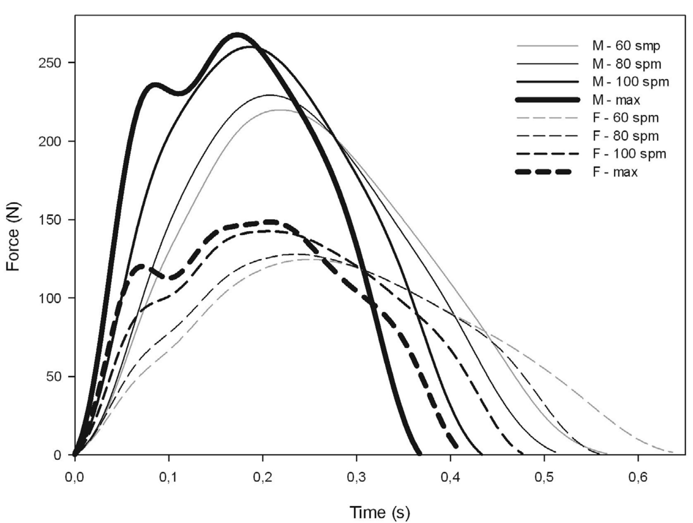
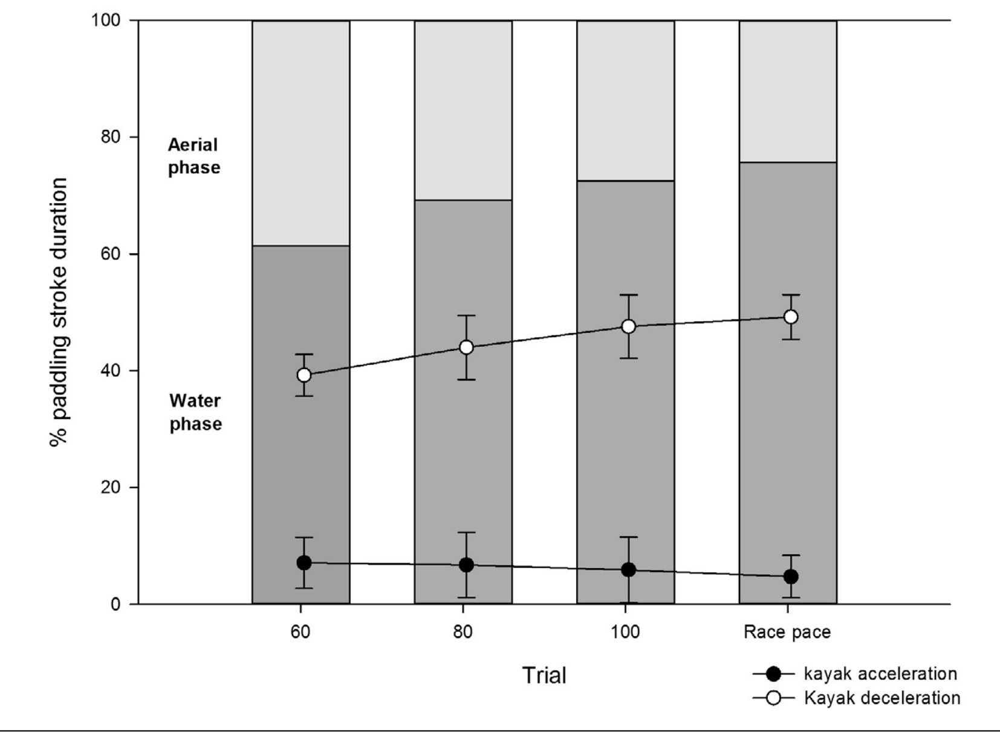

# 精英竞速皮艇运动中不同桨频下的划桨力曲线

**Paddling Force Profiles at Different Stroke Rates in Elite Sprint Kayaking**

Beatriz B. Gomes，¹ Nuno V. Ramos，¹ Filipe A.V. Conceição，¹ Ross H. Sanders，² Mário A.P. Vaz，¹ and João Paulo Vilas-Boas¹

¹ 波尔图大学（University of Porto）；² 悉尼大学（University of Sydney）

**原文信息：** Journal of Applied Biomechanics, 2015, 31, 258–263。http://dx.doi.org/10.1123/jab.2014-0114。© 2015 Human Kinetics, Inc.（原文为原创研究，ORIGINAL RESEARCH，第 258–263 页）

**作者机构：** Beatriz B. Gomes、Filipe A.V. Conceição 与 João Paulo Vilas-Boas 隶属于葡萄牙波尔图大学体育学院、CIFI2D、LABIOMEP。Nuno V. Ramos 与 Mário A.P. Vaz 隶属于葡萄牙波尔图大学工程学院、INEGI、LABIOMEP。Ross H. Sanders 隶属于澳大利亚悉尼大学健康科学学院运动与体育科学系。通讯作者：Beatriz B. Gomes（beatrizgomes@fcdef.uc.pt）。

---

## 摘要

在竞速皮艇（sprint kayaking）运动中，划桨技术在优化桨力以及由此产生的皮艇运动学方面所起的作用仍不清楚。本研究的目的是分析不同桨频（stroke rate）下桨的力—时间曲线的大小与形状，及其对皮艇运动表现的影响。10 名精英皮艇运动员（5 名男性、5 名女性）在完成 2000 米水上测试时接受分析，测试设 4 种不同配速（每分钟 60、80、100 桨，以及比赛配速）。桨和皮艇分别装有应变片和加速度计。对男女两组而言，训练配速下的力—时间曲线呈钟形（bell shape），而比赛配速下的特征为：先出现一个小峰值，随后力略有下降，接着进入一个主平台期。力曲线轮廓（以平均力／峰值力比值表示）随桨频升高而趋于矩形（F[3,40] = 7.87，P < .01）。为获得矩形形状以最大化运动表现，皮艇运动员应追求更有力的水中阶段：桨叶入水后力迅速上升，并在力远低于最大力之前快速出水。在比赛配速训练和比赛中都应追求这一模式。

**关键词：** 生物力学（biomechanics），皮艇，力—时间曲线，划桨曲线特征（stroke profile），加速度

---

## 引言

在竞速皮艇中，由于运动员施加的力的大小发生变化，每次划桨期间皮艇前向加速度存在桨次内变化（intracyclic variation）。为产生前向加速度，运动员必须施加大于空气阻力与水动力阻力（hydrodynamic drag）的力。¹ 因此，运动员产生推进力的效率是成功的关键决定因素。² 所以，从生物力学测试的角度看，施加于桨叶的力应与船速等表现指标一起，成为精英皮艇运动中首要测量的变量。³

桨的力—时间曲线变量的大小和形状决定皮艇的加速度，进而决定皮划艇运动表现。¹,⁴ 尽管这些变量的重要性在皮划艇研究中尚未得到考察，但力—时间曲线形状与运动表现之间的关系已在赛艇（rowing）研究中得到认识。Millward⁵ 表明，通过尽量减小皮艇速度波动，可以实现从桨叶入水到出水期间始终维持接近峰值力（Fpeak）的力。因此，最优的力曲线轮廓是矩形而非三角形。此外，在给定的力作用时间和可达到的最大力条件下（受桨叶正面面积（frontal area of the blade）约束⁶），当力在整个施力期间都处于最大值时（即矩形力曲线轮廓），可获得最大的冲量。

已有研究在皮艇测功仪（kayak ergometer）上对桨力与运动学进行了联合分析，⁷ 但其结论受到限制，因为测功仪上的表现不能完全复制水上条件。已有一些水上划桨动力学研究，³,⁸ 但主要集中在流程与方法上，而非对力曲线轮廓的数据分析与讨论。

训练过程包括使用高桨频（stroke rates，SR）模拟比赛，同时也包括在多种训练配速下训练，配速范围可从每分钟 55 桨（spm）直到 140 spm 或更高。⁹ 在竞速皮艇比赛中，皮艇运动员根据比赛距离（200 m、500 m 或 1000 m）自行选择桨频。桨频是皮艇速度的关键决定因素，¹⁰ 被认为是竞速皮艇表现最好的生物力学预测指标之一。¹¹,¹² 多年来，教练员和运动员一直把桨频用作识别训练区间的变量。⁹ 精英运动员在不同桨频下采用何种形状的力—时间曲线，这一问题仍有待回答。如果矩形施力模式有利于优化比赛表现，那么按逻辑应当在训练中练习这种模式。然而，目前尚不清楚训练配速下采用的模式是否确实与精英皮艇运动员在比赛配速下采用的模式相似。

本研究的目的是分析精英皮艇运动员（男性与女性）在不同强度条件（不同训练配速及比赛配速）下桨的力—时间曲线的大小和形状，及其对运动表现和训练的意义。研究假设：训练配速与比赛配速之间的划桨力曲线轮廓存在差异，且最佳运动表现将由趋于矩形的力—时间曲线实现。

## 方法

### 受试者

10 名精英皮艇运动员（5 名女性、5 名男性）参加了本研究（表 1）。所有皮艇运动员都具有极高的竞技水平。受试者纳入本研究的标准是：入选参加 2012 年奥运会资格赛的国际比赛。10 名皮艇运动员中有 6 名（4 名女性、2 名男性）参加了伦敦奥运会并进入决赛。受试者在数据采集前被充分告知研究性质，并提交了书面知情同意书。本研究获得当地伦理委员会批准，并按照《赫尔辛基宣言》执行。

### 实验程序

皮艇运动员以不同划桨桨频完成 4 次 200 m 测试：60、80、100 spm，以及比赛配速（比赛配速下运动员可自由选择桨频），两次测试之间恢复 5 分钟。按照世界皮划艇静水竞速教练员技术工作组（World Canoe Sprint Coaches Technical Group）的规定，⁹ 这些桨频代表不同的训练区间（从有氧到比赛配速）。受试者被要求在每种桨频条件下追求最佳表现。每次测试开始时皮艇速度为 2.78 ± 0.04 m·s⁻¹（代表极低强度）；听到信号后，运动员开始测试。数据采集在平静水面进行，不受水流影响，风速低于 0.42 m·s⁻¹（相当于蒲福风级中的无风至软风（calm to light air））。¹³ 运动员施加于桨杆的桨力与皮艇加速度被连续采集，采样率为 256 Hz。在需要达到特定桨频的测试中，运动员使用设定为该桨频的声音节拍器装置（TempoTrainerPro，Finis，美国加利福尼亚州利弗莫尔）。GPS 追踪器（Forerunner 310XT，Garmin，美国堪萨斯州奥拉西）用于在每次测试的起点和终点触发记录，并帮助运动员在出发前控制速度，因为出发速度的差异会影响运动员完成 200 m 所用的时间。

### 数据分析与设备

测试前，为每位皮艇运动员的个人装备（桨和皮艇）安装仪器。桨上安装"FPaddle"系统，皮艇内安装三轴加速度计（G-Link-mXRS，Microstrain，美国佛蒙特州威利斯顿），该加速度计置于皮艇内部，固定在中央导轨的压载位置并保持水平（与皮艇座椅平台平行）。

"FPaddle"系统¹⁴由变形传感器、力传感器（force transducer）、发射器与无线电接收器以及信号处理软件（Node Commander 2.4.0，Microstrain，美国佛蒙特州威利斯顿）组成。桨杆上装有 2 枚复合材料用应变片（HBM，德国达姆施塔特），直接粘贴在桨杆上，从而减少可能的错误传感数据。¹⁵ 两枚应变片分别位于桨杆两侧、距两侧桨叶叶尖相同的纵向位置（80 cm），以响应桨杆在平行于桨叶较大表面的平面内的弯曲。此外，应变片通过导线连接到电压节点 V-Link-mXRS（Microstrain，美国佛蒙特州威利斯顿）。增益和偏移由软件自动设置。

系统标定采用静态方式，用标定质量（5 kg 至 30 kg，步长 5 kg）对桨加载。桨的标定按以下步骤进行：(1) 一个支撑点置于运动员握住桨杆的右手握桨位置（以第三根手指为准）；(2) 另一个支撑点置于左侧桨叶中部（假设力作用于桨叶中心——假想的水动力压力中心（hypothetical center of hydrodynamic pressure））⁸,¹⁶；(3) 不同质量悬挂在左手握桨位置（以第三根手指为准）。对桨的两侧都执行了该过程。对于两侧，桨杆手握位置的力（F_S）与四分之一桥电路（惠斯通电桥，Wheatstone bridge）内电阻变化之间均存在很强的线性关系（r = –1.00，P < .00）。由于力数据以很高的采样频率采集，在约 60 spm 至 124 spm 的划桨频率范围内，采样频率不会对动态分析产生显著影响。

基于力矩平衡，用 F_S 确定施加在每侧桨叶上的力（F_B）（式 1），计算时考虑桨叶面积中心到近端握点的距离（d_A）以及两个握点之间的距离（d_B）。¹⁵

$$F_B = F_S \frac{d_B}{(d_A + d_B)} \qquad (1)$$

式 (1) 假设：在整个水中阶段（左、右两侧），桨的纵向瞬时转动中心（桨上的支点）保持静止，并位于推进侧对侧的握点处。"FPaddle"系统在划桨水中阶段测得的桨杆变形综合了上手和下手施加的力，由更靠近下手、且平行于浸没桨叶较大表面的应变片进行分析。

两套设备（G-Link 节点与 V-Link 节点）在无线通信系统中同步工作（节点间同步，极限误差为 ±32 µs），并实时传输至 WSDA-Base（Microstrain，美国佛蒙特州威利斯顿）。力和加速度数据导出至 MatLab R2010a（The MathWorks Inc.，美国马萨诸塞州内蒂克），使用专门为本应用开发的程序进行分析。采用截止频率为 20 Hz 的四阶低通巴特沃斯滤波器（Butterworth filter）平滑数据并去除随机误差。¹⁷ 截止频率的选择基于对很宽截止频率范围内滤波与未滤波信号之差的残差分析，使用方差解释百分比（percentage variance accounted，VAF）¹⁸ 估计最佳截止频率。对于所采用的截止频率，平均 VAF 为 98.87 ± 1.03%，意味着滤波信号与未滤波信号之间的差异小于 2%。

划桨技术分析采用 McDonnell 等人¹⁹提出的两阶段模型，该模型把单次划桨分为水中阶段（water phase，从桨叶入水到桨叶出水）和空中阶段（aerial phase，从桨叶出水到另一侧桨叶入水的时刻）。在本研究中，桨入水和出水的定义对应于施力的开始与结束。²⁰ 软件程序通过识别施力的起点和终点自动检测每次划桨的水中阶段。对各桨次进行目视检查，以确保数据选择正确。200 m 过程中完成的所有桨次，从皮艇运动员达到所要求桨频的时刻起，全部纳入分析。

**表 1　各组受试者的身体特征，均值 ± 标准差**

| 变量 | 男性皮艇运动员（n = 5） | 女性皮艇运动员（n = 5） |
|---|---|---|
| 年龄（岁） | 24.17 ± 2.39 | 25.80 ± 3.81 |
| 体质量（kg）** | 86.42 ± 4.11 | 63.52 ± 3.46 |
| 身高（cm）** | 183.10 ± 3.53 | 165.70 ± 3.66 |
| 坐高（cm）** | 97.72 ± 2.84 | 88.75 ± 1.30 |

\*\* P < .01，两性之间差异高度显著。

对每次划桨计算：Fpeak（每次划桨中的力最高点）、达到 Fpeak 所需时间（从水中阶段开始到峰值力的时间）、Fmean（按桨次计算的水中阶段各力值的均值）以及冲量（计算为力—时间曲线水中阶段的积分）。计算 Fmean/Fpeak 比值以反映力曲线轮廓。该比值以百分数表示：若力为矩形（恒力），则为 100%；若为三角形，则为 50%。²¹ 由于该比值不受力量差异影响，男性和女性运动员的结果合并进行统计分析。为对男性和女性精英皮艇运动员在不同桨频下的力—时间轮廓进行图形分析，每个桨频内的力—时间曲线数据按水中阶段时长的中位数进行时间归一化。由于每个桨频下施力时长在测试过程中有所变化，按中位数时间进行时间归一化使力曲线轮廓的比较有效。针对每次不同桨频测试，分析水上力变量和力—时间曲线形状（由 Fmean/Fpeak 比值并结合检查力—归一化时间图的特征来表示）。

皮艇平均速度根据完成 200 m 的时间确定。基于力—时间曲线分析的时间变量包括：单次划桨时长，以及水中阶段和空中阶段的时长（后两者分别以占划桨时长的百分数表示）。整个测试的平均桨频按平均划桨时长的倒数计算。

结合同步的力数据分析整个划桨周期的皮艇加速度曲线，以确定对应正加速度开始和皮艇开始减速时刻的时间点，两者均以占划桨时长的百分数表示。

### 统计

使用 SPSS 12.0 for Macintosh（IBM，Inc.，美国伊利诺伊州芝加哥）统计分析桨频对 Fpeak/Fmean 比值、水中阶段和空中阶段时长、达到 Fpeak 所需时间以及 Fpeak、Fmean 和冲量的影响。数据分别用 Shapiro-Wilk 检验和 Levene 检验检查分布正态性和方差齐性（homoscedasticity）。测试间比较采用单因素重复测量方差分析（repeated-measures one-way ANOVA；所考虑的因素为桨频，含 4 个水平：60、80、100 及比赛配速频率）；两两比较采用 Bonferroni 事后检验（post hoc）程序。变量间的相关采用 Pearson 积矩相关系数（Pearson moment correlation coefficient）获得。所有检验的显著性水平设为 .05。

## 结果

两组的水上力—时间轮廓均随桨频升高而在大小和形状上发生变化（图 1）。女性力曲线的变异系数从 60 spm 时的 19.55 到比赛配速时的 42.78；男性从 60 spm 时的 25.08 到比赛配速时的 44.90。随桨频升高，水中阶段开始时力—时间曲线的斜率增大（表现为达到 Fpeak 所需时间缩短），施力时间减少。对两组而言，比赛配速下的力—时间曲线均表现为先出现一个峰值，随后在主峰值力之前有一个小幅下降。平均速度与 Fpeak（r = .663，P < .001）和 Fmean（r = .804，P < .001）之间存在显著的测试间相关。各测试间比较时冲量值变化不显著（F[3,40] = .09，P = .966）。然而，测试内相关表明，每次测试中平均冲量更高的运动员获得了更高的平均速度（60 spm，r = .888，P < .01；80 spm，r = .896，P < .001；100 spm，r = .823，P > .01；比赛配速，r = .847，P < .01）。

**图 1　各性别和各划桨桨频下的平均力—时间曲线。** 每条数据曲线代表平均归一化曲线（在每分钟 60、80、100 桨（spm）及比赛配速（max）下，分别由两侧合计 270、300、330 和 360 个桨次得到）。M = 男性；F = 女性。

图中标签译注：M-60/80/100 spm = 男性 60/80/100 桨次/分钟；M-max = 男性比赛配速；F-60/80/100 spm = 女性 60/80/100 桨次/分钟；F-max = 女性比赛配速；纵轴 Force (N) = 力（N）；横轴 Time (s) = 时间（s）。

各桨频之间的 Fmean/Fpeak 比值存在显著差异（分析中两个低桨频（60 和 80 spm）与两个较高桨频（100 spm 和比赛配速）之间差异高度显著）（表 2）。力—时间轮廓的形状（由 Fmean/Fpeak 比值表示）随桨频升高而更趋矩形（F[3,40] = 7.87，P < .01），并与平均速度正相关（r = .416，P < .01）（表 2）。

从皮艇开始减速的时刻到水中阶段结束之间的时间（以占划桨时长的百分数表示）随桨频升高而减少（F[3,40] = 4.80，P = .008）。此外，力—时间轮廓可观察到的特征连同 Fmean/Fpeak 比值表明，随桨频升高存在从三角形向矩形形状的转变。

随桨频升高，水中阶段和空中阶段的时长均减少。当这些阶段以占划桨时长的百分数表示时，男女两组都表现出水中阶段相对空中阶段时长增加的趋势（表 2；图 2）。此外，随桨频升高，皮艇加速时长占总划桨时长的百分数增加。

Fmean/Fpeak 比值与施力开始到皮艇开始加速之间的延迟之间存在中等程度的负相关（r = –.453，P = .008）。

**表 2　各性别划桨力—时间曲线变量的均值 ± 标准差，以及总样本的 Fmean/Fpeak**

| 项目 | 性别 | 60 | 80 | 100 | 比赛配速 |
|---|---|---|---|---|---|
| 桨频（spm） | 男 | 63 ± 5 | 81 ± 3 | 99 ± 6 | 124 ± 7 |
|  | 女 | 60 ± 3 | 79 ± 6 | 100 ± 6 | 112 ± 3 |
| 完成 200 m 时间（s） | 男 | 54.35 ± 2.29 | 47.85 ± 2.00 | 43.67 ± 1.88 | 38.68 ± 0.83 |
|  | 女 | 61.35 ± 0.95 | 53.76 ± 1.73 | 48.08 ± 2.36 | 44.94 ± 1.21 |
| 200 m 平均速度（m·s⁻¹） | 男 | 3.68 ± 0.15 | 4.18 ± 0.18 | 4.58 ± 0.20 | 5.17 ± 0.11 |
|  | 女 | 3.26 ± 0.05 | 3.72 ± 0.12 | 4.16 ± 0.16 | 4.45 ± 0.12 |
| 水中阶段时长（s） | 男 | 0.56 ± 0.03 | 0.50 ± 0.04 | 0.43 ± 0.03 | 0.37 ± 0.03 |
|  | 女 | 0.64 ± 0.03 | 0.55 ± 0.02 | 0.48 ± 0.01 | 0.43 ± 0.02 |
| 空中阶段时长（s） | 男 | 0.40 ± 0.05 | 0.24 ± 0.03 | 0.18 ± 0.04 | 0.14 ± 0.03 |
|  | 女 | 0.35 ± 0.01 | 0.23 ± 0.05 | 0.17 ± 0.05 | 0.12 ± 0.02 |
| 达到 Fpeak 时间（s） | 男 | 0.22 ± 0.03 | 0.21 ± 0.02 | 0.19 ± 0.02 | 0.16 ± 0.02 |
|  | 女 | 0.26 ± 0.03 | 0.24 ± 0.03 | 0.21 ± 0.02 | 0.20 ± 0.01 |
| Fpeak（N） | 男 | 225 ± 31 | 234 ± 32 | 266 ± 33 | 274 ± 35 |
|  | 女 | 126 ± 11 | 130 ± 8 | 146 ± 7 | 153 ± 11 |
| Fmean（N） | 男 | 118 ± 16 | 128 ± 18 | 157 ± 18ᵃ | 171 ± 18 |
|  | 女 | 72 ± 6 | 80 ± 9 | 92 ± 13ᵃ | 99 ± 15 |
| 冲量（N·s） | 男 | 66.3 ± 7.3 | 63.9 ± 7.3 | 67.7 ± 9.5 | 63.2 ± 8.4 |
|  | 女 | 46.5 ± 5.9 | 44.1 ± 5.5 | 44.2 ± 6.3 | 42.3 ± 6.6 |
| Fmean/Fpeak 比值（%） | 总样本 | 53.3 ± 3.3ᵇ,ᶜ,ᵈ | 57.2 ± 3.9ᵃ,ᶜ,ᵈ | 61.0 ± 3.8ᵃ,ᵇ,ᵈ | 64.8 ± 3.7ᵃ,ᵇ,ᶜ |

注：男性 n = 5，女性 n = 5。每个桨频均进行了分析，均值 ± 标准差。spm = 每分钟桨次（strokes per minute）。
ᵃ P < .05，与 60 spm 差异显著。
ᵇ P < .05，与 80 spm 差异显著。
ᶜ P < .05，与 100 spm 差异显著。
ᵈ P < .05，与比赛配速差异显著。

**图 2　水中阶段与空中阶段时长，以及水中阶段内皮艇开始加速和开始减速的时刻。** 全部以占单次划桨时长的百分数表示（均值 ± 标准差）。

图中标签译注：纵轴 % paddling stroke duration = 占划桨时长的百分比；Aerial phase = 空中阶段；Water phase = 水中阶段；横轴 Trial = 测试（60、80、100、Race pace 比赛配速）；kayak acceleration = 皮艇加速（实心圆点线）；Kayak deceleration = 皮艇减速（空心圆点线）。柱体下沿至实心点为水中阶段内开始加速时刻，空心点为开始减速时刻。

## 讨论

本研究的目的是分析不同桨频下的划桨力曲线轮廓和力—时间曲线变量，及其对皮艇运动表现的意义。尽管很少有研究关注皮划艇中的桨力分析，但许多作者鉴于桨力分析在赛艇技术分析中的重要性，已经分析了赛艇中与技术相关的桨力（oar force）。¹,²²⁻²⁴ 与力曲线轮廓形状相关的变量，如力曲线下面积（冲量）和 Fmean/Fpeak 比值，已在赛艇中得到研究。⁵,²¹,²² 类似地，皮划艇中的这类分析有可能帮助皮艇运动员和教练员朝着成功表现努力。

桨杆的变形与力相关，计算力时假设桨的支点保持在上手位置（式 1）。尽管这一假设在水中阶段的某些部分可能高估所产生的力，但已有报道指出，精英皮艇运动员倾向于使上手的水平位移较小、下手的水平位移较大，从而维持较高的桨支点。²⁵

在本研究中，Fmean/Fpeak 比值随桨频和平均速度的升高而增大，表明力曲线轮廓向矩形转变。这种矩形形状应当更有效率，因为它在给定可达到的 Fpeak 下使力—时间曲线下面积最大化，同时尽量缩短施力时间以实现高桨频。已知高桨频与皮划艇良好表现相关。¹⁰,²⁵,²⁶

研究还观察到，随 Fmean/Fpeak 比值随桨频升高而增大，施力开始与皮艇加速开始之间的延迟减小。这一事实表明水中阶段开始处趋于出现垂直斜率并快速达到 Fpeak，这被认为是划桨效率的一个指标。¹

在水中阶段接近结束时，皮艇减速开始与施力结束之间的延迟随桨频升高而减小。这一结果提示，在低桨频下，水中阶段末期仍把桨叶留在水中可能会使皮艇减速。在划桨的这一部分所产生的力，看来不足以克服桨叶在水中产生的阻力增加。

对男女两组而言，前 3 次测试中的力—时间曲线呈钟形。在比赛配速测试中，随施力速率提高，运动员力求快速增力并在水中阶段早期达到平台期。在力—时间曲线顶部形成平台期，可在给定可达到的 Fpeak 和水中阶段时长下使冲量最大化，并反映出力—时间曲线趋于矩形轮廓以改善表现的倾向。²²

比赛配速测试中的力—时间曲线形状特征为：先出现一个小峰值，随后力小幅下降，接着进入主平台期。初始上升之后力立即下降，可能部分可由桨杆因其刚度大小而产生的弹性响应来解释；这种响应很可能开始于皮艇运动员试图缩短空中阶段时长、加速划桨使其尽快入水之时。提高桨杆刚度可能使力更快上升至平台期并减小力的"弹跳"（force 'bounce'），从而更恒定地维持高力，而不会在主平台期之前出现小幅力下降。如今，桨的制造商提供具有不同刚度等级的桨杆，由运动员负责选择其认为能带来更好表现的桨杆。应当研究使用不同桨杆刚度划桨，以理解其对划桨力形状的影响。即使发现提高桨杆刚度会减小力的"弹跳"，仍需进一步研究以确定刚度对功率输出、肌肉协调和损伤风险的影响。

每次桨频测试中冲量与平均速度之间的相关高度显著，表明如果力—时间曲线下面积增大且桨频维持不变，皮艇速度将会提高。平均速度与 Fmean 的相关性强于与 Fpeak 的相关性。不同作者⁵,⁷提出，在整个水中阶段把力维持在 Fpeak 附近，对表现的重要性高于 Fpeak 本身，因为在 Fpeak 相同的情况下，力的模式可以从近似三角形变化到矩形。²²

促成矩形力曲线轮廓的另一个因素是：随桨频升高（意味着划桨时长缩短），划桨开始处的斜率增大，尽管由于 Fpeak 之后水中阶段时长百分比下降，达到峰值的时间占水中阶段时长的百分比反而增加。因此，随桨频升高以及皮艇运动员追求更高表现，在水中划桨的无效部分花费的时间减少。Kendal 和 Sanders¹¹在分析精英皮艇运动员的划桨技术时观察到类似结果。由于 Fpeak 出现在桨接近垂直的时刻附近，¹¹,²⁵ 只有当力能维持在接近峰值力水平时，把水中阶段延长到该时刻之后才有价值。Kendal 和 Sanders¹¹发现，较长的向后回拉幅度（long paddle backward reach）虽然有助于延长水中阶段，但并不会带来更高的平均速度，且产生的轮廓趋于三角形而非矩形。因此，本研究中运动员力求在达到桨叶垂直位置后不久即起桨出水，以迅速开始下一次划桨，并不令人意外。

总之，结果表明力曲线轮廓随桨频和表现提高而更趋矩形。结果提示，当 Fmean 接近 Fpeak（即 Fmean/Fpeak 比值接近 1.0，反映矩形形状）时可达到最佳表现。

划桨技术在皮划艇表现中起基础性作用。力—时间曲线变量和力曲线轮廓的分析应成为技术分析的首要目标。在本研究中，力曲线轮廓随桨频升高而更趋矩形。为获得矩形力曲线轮廓，运动员需要在推进力仍接近峰值力的时刻附近把桨叶提出水面，而不是在低效率部分延长划桨。这可在高桨频下实现最优推进冲量。此外，皮艇运动员应追求桨叶入水后力迅速上升。在比赛配速训练和比赛中都应追求这一模式。

## 致谢

本研究由葡萄牙科学技术基金会（Portuguese Foundation for Science and Technology）资助（资助编号：SFRH/BD/69823/2010）。作者也感谢葡萄牙皮划艇联合会（Portuguese Canoe Federation）及各位皮艇运动员的友好合作。

## 参考文献

1. Michael JS, Smith R, Rooney KB. Determinants of kayak paddling performance. Sports Biomech. 2009;8(2):167–179. PubMed doi:10.1080/14763140902745019
2. Brown MB, Lauder M, Dyson R. Notational analysis of sprint kayaking: Differentiating between ability levels. Int J Perform Analy Sport. 2011;11:171–183.
3. Sperlich J, Baker J. Biomechanical testing in elite canoeing. Book of Abstracts, 20th International Symposium on Biomechanics in Sport, Extremadura, Spain; 2002.
4. Jackson PS. Performance prediction for Olympic kayaks. J Sports Sci. 1995;13:239–245. PubMed doi:10.1080/02640419508732233
5. Millward A. A study of the forces exerted by an oarsman and the effect on boat speed. J Sports Sci. 1987;5:93–103. PubMed doi:10.1080/02640418708729769
6. Sprigings E, McNair P, Mawston G, et al. A method for personalising the blade size for competitors in flatwater kayaking. Sports Eng. 2006;9(3):147–153. doi:10.1007/BF02844116
7. Michael JS, Rooney KB, Smith R. The dynamics of elite paddling on a kayak simulator. J Sports Sci. 2012;30(7):661–668. PubMed doi:10.1080/02640414.2012.655303
8. Aitken DA, Neal RJ. An on-water analysis system for quantifying stroke force characteristics during kayak events. Int J Sport Biomech. 1992;8(2):165–173.
9. WC Sprint Coaches Technical Group. Canoe Racing Training Zones, 2001. http://www.kayaksport.net/downloads/TrainingZones.pdf. Accessed 25 February 2013.
10. Mononen H, Viitasalo J. Stroke parameters and kayak speed during 200m kayaking. Book of Abstracts, 15th Congress of the International Society in Biomechanics. 1995;632–633.
11. Kendal SJ, Sanders RH. The technique of elite flatwater kayak paddlers using the wing paddle. Int J Sport Biomech. 1992;8:233–250.
12. McDonnell LK, Hume PA, Nolte V. Place time consistency and stroke rates required for success in K1 200-m sprint kayaking elite competition. Int J Perform Analy Sport. 2013;13:38–50.
13. Saucier W. Principles of Meteorological Analysis. New York: Dover Phoenix Editions; 2003.
14. Gomes B, Viriato N, Sanders R, et al. Analysis of the on-water paddling force profile of an elite kayaker In: Vilas-Boas JP, Machado L, Wangdo K, Veloso AP (eds.), Biomechanics in Sports, Portuguese J Sport Sci. 2011;11(Suppl. 2): 255–258.
15. Sturm D. Wireless Multi-Sensor Feedback System for Sports Performance and Monitoring. Doctoral thesis. Stockholm: KTH, Technology and Health, 2012.
16. Sturm D, Yousaf K, Eriksson M. A kayak training system force measurement on-water. Book of Abstracts, 28th Conference of the International Society of Biomechanics in Sports, Michigan, USA. 2010;712–713.
17. Winter DA. Biomechanics and Motor Control of Human Movement. 4th ed. New York: John Wiley & Sons; 2009. doi:10.1002/9780470549148
18. Moorhouse KM, Granata K. Role of reflex dynamics in spinal stability. Intrinsic muscle stiffness alone is insufficient for stability. J Biomech. 2007;40:1058–1065. PubMed doi:10.1016/j.jbiomech.2006.04.018
19. McDonnell LK, Hume PA, Nolte V. An observational model for biomechanical assessment of sprint kayaking technique. Sports Biomech. 2012;11(4):507–523. PubMed doi:10.1080/14763141.2012.724701
20. Baker J. Evaluation of biomechanical performance related factors with on-water tests. Book of Abstracts, International Seminar on Kayak-Canoe Coaching and Science, International Canoe Federation, Ghent, Belgium, 1998.
21. Kleshnev V. Parameters of rowing force curve. Rowing Biomechanics. 2008;8(83). http://www.biorow.com/RBN_en_2008.htm. Accessed March 1, 2013.
22. Hill H. Dynamics of coordination within elite rowing crews: evidence from force pattern analysis. J Sports Sci. 2002;20:101–117. PubMed doi:10.1080/026404102317200819
23. Smith RM, Spinks W. Discriminant analysis of biomechanical differences between novice, good and elite rowers. J Sports Sci. 1995;13:377–385. PubMed doi:10.1080/02640419508732253
24. Smith R, Spinks W, Torode M. Biomechanical factors in the analysis of rowing capacity and skill. Book of Abstracts, Congress of the Australian Sports Medicine Federation, Cumberland College of Health Sciences, Sydney, Australia, 1988.
25. Plagenhoef S. Biomechanical analysis of Olympic flatwater kayaking and canoeing. Res Qt. 1979;50:443–459. PubMed
26. Sanders RH, Kendal SJ. A description of Olympic flatwater kayak stroke technique. Aust J Sci Med Sport. 1992;24(1):25–30.

---

## 校订备注

- 原文摘要称进行 2000 m 水上测试，方法、结果和表 2 则为四次 200 m 测试；两处数据均按原文保留。
- 原文“统计”小节写 $F_{peak}/F_{mean}$，全文其他位置使用 $F_{mean}/F_{peak}$；另有 100 spm 相关检验的 $P > .01$ 和标定检验的 $P < .00$，均按原文保留，解读统计结果时需核对原始数据。
