# 皮艇桨叶—船体水动力相互作用：面向自航模拟的体力等效法

**原文：** Kayak blade–hull interactions: A body force approach for self-propelled simulations

**期刊：** Proc IMechE Part P: J Sports Engineering and Technology，2014，Vol. 228(1) 49–60，© IMechE 2013
**DOI：** 10.1177/1754337113493847
**文章类型：** Original Article（原创研究论文）

**作者：** Joseph Banks、Alexander B Phillips、Stephen R Turnock、Dominic A Hudson 和 Dominic J Taunton

**作者机构：** Fluid Structure Interactions Research Group, Faculty of Engineering and the Environment, University of Southampton, Southampton, UK（英国南安普顿大学工程与环境学院流体—结构相互作用研究组）

**通讯作者：** Joseph Banks，Performance Sports Engineering Laboratory, Faculty of Engineering and the Environment, University of Southampton, Building 28, University Road, Southampton SO17 1BJ, UK. Email: J.Banks@soton.ac.uk

**收稿日期：** 2012 年 12 月 10 日；**录用日期：** 2013 年 5 月 24 日

---

## 摘要

竞速皮艇由于桨的局部作用而处于非定常流动状态。然而，皮艇设计通常针对稳态裸艇体阻力（naked hull resistance）进行优化。为确定非定常划桨效应是否需要纳入皮艇设计，本文采用计算流体动力学（computational fluid dynamics，CFD）评估了皮艇桨与船体之间的水动力相互作用。利用桨叶微元法（blade element approach）建立了一种阻力型划桨（drag-based paddle stroke）的体力模型（body force model），并利用实验数据进行了验证。该模型无需完整解析运动桨叶几何周围的细致流场，即可对桨诱导的局部速度进行模拟。与裸艇体模拟相比，计算成本增加 8%。本文开展了一项算例研究，考察不同划桨技术对作用于自航皮艇的水动力的影响。观察到自航阻力相差 0.23%，而据估计另有 0.5% 的额外增加可归因于桨诱导的吃水增加。对阻力微小变化如何影响比赛时间的估算表明，即便是零点几个百分点的阻力降低也值得追求，这提示所建立的方法在未来可能成为一种有用的设计工具。

**关键词：** 皮艇，桨，计算流体动力学，非定常流动，桨—船体水动力相互作用，运动表现

---

## 引言

竞速皮艇比赛中奖牌名次之间的差距常常小到十分之几秒甚至百分之几秒。¹ 运动员的航速由桨产生的推力与皮艇船体阻力之间的平衡决定。阻力由表面摩擦阻力（源于黏性边界层）和压力阻力（pressure resistance，包含形状阻力与兴波阻力）组成。² 为了帮助皮艇设计者获得运动表现的提升，必须使阻力最小化，从而在相同推进功率下达到更高航速。

Jackson³ 估算了作用于竞速皮艇的各阻力分量以及划手产生的推力，以识别可能提升表现的领域。竞速皮艇和划艇的设计主要聚焦于优化船体线型，使静水阻力最小。这一目标通过基于经验数据和薄船方法（thin ship approach）⁴'⁵，以及利用计算流体动力学（CFD）和水池试验⁶ 得以实现。赛艇船体的纵向平移速度已得到数值和实验两方面的研究，结果表明非定常运动对总阻力有显著影响。⁷ 该研究的结论是：船体纵向平移运动的良好再现可以在拖曳水池中复现，因此可用于进一步最小化赛艇和皮艇船体设计的非定常阻力。

桨类运动中的桨叶设计也已有研究，包括实验、解析和 CFD 研究。⁸⁻¹⁰ 不同 CFD 方法之间缺乏一致性，这被归因于 CFD 模拟中缺少自由表面。自由表面效应和非定常运动对桨叶受力的重要性，已通过赛艇桨叶的 CFD 和实验模拟得到证明。¹¹'¹² 研究发现黏性的影响非常有限。

尽管已分别对船体设计和桨的推进开展了研究，但尚无人研究二者之间的流动相互作用。皮艇桨在靠近船体侧面的位置运作，产生很大的局部速度，这可能对船体水动力产生影响。然而，由于这类桨诱导相互作用从未被评估过，尚不清楚它们是否需要纳入船体优化过程。

本文采用一种体力方法（body force methodology），类似于 Phillips 等人¹³'¹⁴ 用于模拟螺旋桨—船体相互作用、以及 Turnock 等人¹⁵ 用于潮汐涡轮机阵列的方法，用以模拟单次划桨对运动皮艇周围流体的影响。该方法能够模拟自由表面和非定常划桨运动的效应，同时忽略桨叶边界层细致的局部黏性效应。因此，CFD 模拟中可以使用刚性网格，同时仍能首次评估桨对水动力的随时间变化的影响。本文建立了桨叶受力的数学表达，并利用实验数据加以验证。通过执行自航皮艇模拟考察了这种方法用于未来船体优化的可行性；同时，一项算例研究能量化划桨技术和靠近程度对水动力的潜在影响。

## 数值方法

皮艇和桨周围的流体域采用有限体积法（finite volume method），通过非定常不可压缩雷诺平均 Navier–Stokes（Reynolds-averaged Navier–Stokes，RANS）方程建模，方程写为

$$
\frac{\partial(\rho U_i)}{\partial t}+\frac{\partial(\rho U_i U_j)}{\partial x_j}=-\frac{\partial P}{\partial x_i}+\frac{\partial}{\partial x_j}\left[\mu\left(\frac{\partial U_i}{\partial x_j}+\frac{\partial U_j}{\partial x_j}\right)\right]-\frac{\partial}{\partial x_j}\left(\rho\overline{u_i'u_j'}\right)+f_i \tag{1}
$$

以及

$$
\frac{\partial U_i}{\partial x_i}=0 \tag{2}
$$

分别对应动量方程和质量连续方程。施加于流体的外力（例如桨的影响）用动量源项 $f_i$（单位体积受力）表示。

自由表面采用流体体积法（volume of fluid approach，VOF）处理，体积分数输运方程写为

$$
\frac{\partial \varphi}{\partial t}+\frac{\partial(\varphi U_j)}{\partial x_j}=0 \tag{3}
$$

其中 $\varphi$ 是体积分数，计算为给定网格单元中水所占的体积分数。¹⁶ 流体密度 $\rho$ 和黏度 $\mu$ 可分别计算为

$$
\rho=\rho_{air}(1-\varphi)+\rho_{water}\varphi \tag{4}
$$

和

$$
\mu=\mu_{air}(1-\varphi)+\mu_{water}\varphi \tag{5}
$$

湍流的效应在方程 (1) 中由雷诺应力张量 $\rho\overline{u_i'u_j'}$ 表示，并采用开源 CFD 软件包 OpenFOAM-2.01 中包含的 k-omega 剪切应力输运（shear stress transport，SST）湍流模型建模。¹⁷ SST 模型在边界层内部混合使用一种 k-omega 模型变体，在边界层外部和自由来流中混合使用经过变换的 k-epsilon 模型。¹⁸ 已证明该模型在复现船尾周围流动方面优于 k-epsilon、单方程模型和零方程模型等较简单的模型。¹⁹'²⁰

## 体力等效桨模型

若要模拟在船体旁侧运动的实际桨叶几何，其计算代价会很高昂，原因在于：解析桨叶周围局部流动需要很高的网格分辨率；为保持时间精度需要很小的时间步长；并且需要大量网格变形或重叠网格（overset meshes）。通过在计算域中加入动量源（由随时间变化的桨力计算得到）来表征桨对流体的作用，可以把计算成本降至最低。

考察 Kendal 和 Sanders²¹ 给出的划桨数据可以看到，桨叶叶尖在纵向平面内沿近似圆形的路径运动，同时向外平移。对现代划桨技术的观察似乎表明，划桨存在一个明显的阻力型阶段，在此阶段桨叶沿船体向后运动。随后出现一个单独的升力阶段，桨叶在出水之前向外平移。由于桨叶在划桨的阻力阶段距船体很近，桨叶—船体水动力相互作用在该阶段很可能更强。因此，本研究将忽略桨叶的平移，只模拟靠近船体的阻力型划桨阶段。如果模拟得到的桨叶—船体水动力相互作用显著，则未来可以纳入完整的三维桨叶运动学模型。

所建立的桨受力模型基于桨绕一个固定点作纯转动，角速度为 $\dot\theta$；该固定点以进速 $U_0$ 运动，$U_0$ 等于皮艇的速度（见图 1）。这忽略了皮艇船体对周围流体速度的影响。不过，由于船体线型细长，这些影响仅限于距船体表面几厘米的狭窄边界层内。因此，只要桨在该区域之外运作，这一假设就是成立的。转动角 $\theta$ 从水平方向起量，并在整个划桨过程中增大。

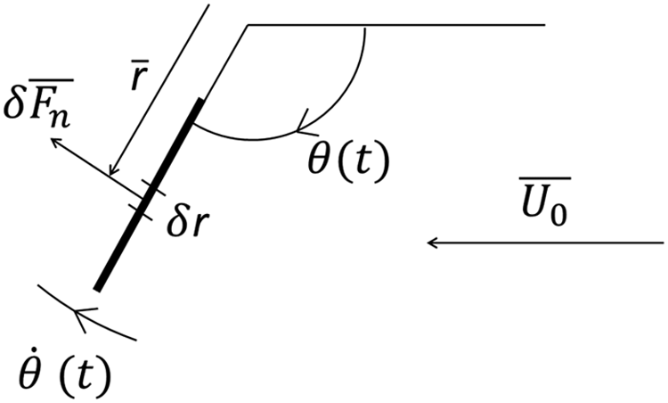

**图 1.** 皮艇参考系中桨力模型的自由体受力图。

图中标签译注：$\bar r$ 为桨叶微元的半径矢量；$\delta r$ 为微元长度；$\delta\overline{F_n}$ 为微元所受法向力；$\theta(t)$ 为随时间变化的桨角；$\dot\theta(t)$ 为角速度；$\overline{U_0}$ 为来流（皮艇）速度。

利用桨叶微元法，桨叶被划分为一系列长度为 $\delta r$ 的 $n$ 个微元，可对每个微元计算局部桨力。

对于半径矢量为 $\bar r$ 的桨叶微元，其遇到的法向速度由下式给出

$$
V_n=(\dot\theta\times\bar r-\overline{U_0})\cdot\hat n \tag{6}
$$

其中 $\hat n$ 是垂直于桨叶的单位矢量，计算为

$$
\hat n=\widehat{\dot\theta}\times\hat r \tag{7}
$$

由此，作用在桨叶上的水动力矢量和力矩矢量分别由下式给出

$$
\overline{F_n}=\sum_{i=1}^{n}\delta\overline{F_n}=\sum_{i=1}^{n}\frac{1}{2}\rho{V_n}^{2}C_d c\,\delta r\cdot\hat n \tag{8}
$$

和

$$
\bar Q=\sum_{i=1}^{n}\delta\overline{F_n}\times\bar r \tag{9}
$$

其中 $\rho$ 是水的密度，$C_d$ 是桨叶剖面的阻力系数，$c$ 是桨叶弦长。

桨力被施加到一个推进域（propulsive domain）上，该域表征在该时间步内桨所作用的流体区域。它被定义为桨扫掠过的一段圆弧，其在时间上的位置由桨的旋转中心和转角 $\theta(t)$ 给出。其尺寸由桨长（或半径）$R$、弦长 $c$ 和弧角（或称扫掠角）$\delta\theta$ 导出。推进域随后被划分为长度为 $\delta r$ 的若干扇区（sector），并设置内半径以计入桨杆握把的长度（见图 2）。

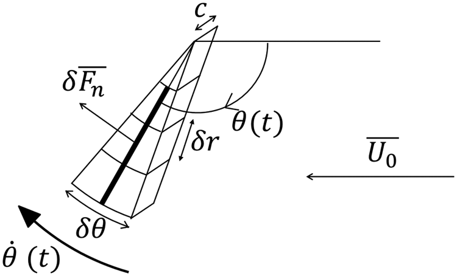

**图 2.** 被划分为若干扇区的桨推进域示意。

图中标签译注：$c$ 为弦长；$\delta\theta$ 为扫掠角；其余符号同图 1。

流体域内每个网格单元的坐标都根据桨的旋转中心计算，由此确定哪些单元位于推进域的给定扇区内，并给出准确的扇区体积。

模拟中的当前时间用于计算桨的位置，其依据是整个单次划桨周期内预先给定的桨角时间历程以及定义好的桨频。桨的角速度根据上一时间步的桨位置计算。每个桨叶微元的桨力（$\delta F_n$）根据扇区的长度和弦向尺寸计算。该扇区内每个单元的动量源项计算为

$$
f_i=\frac{\delta F_n\varphi}{V_s} \tag{10}
$$

其中 $\varphi$ 是单元的体积分数，$V_s$ 是扇区体积。因此，源项只在桨处于水中时（$\varphi=1$）施加，从而自动计入动态自由表面。这些源项存储在一个体积矢量场中，推进域之外的每个单元均设为零。每个时间步的总桨力通过把每个单元的源项乘以其单元体积、再在整个推进域上求和来确定。随后将该力矢量投影到皮艇运动方向，即可得到瞬时推力。

## 桨力模型的验证

通过复现一项转动桨实验²² 的实验数据来确定所建立桨模型的有效性：该实验把一片马拉松皮艇桨叶安装在一个仪器化枢轴机构上，该机构连接到拖曳水池测力仪（dynamometer）（图 3）。这样可以随时间记录升力、阻力和转角。通过一个下落重物（dropping weight）对桨施加恒定力矩，从而可以随时间测量桨叶产生的动态力。该实验并不复现划手的技术，但确实提供了与竞速皮艇中相似的非定常旋转流动状态。因此，通过复现该实验，可以评估桨模型模拟此类流动的能力。

桨叶相对来流迎角为 90°（即阻力型划桨）时的实验数据见图 4。

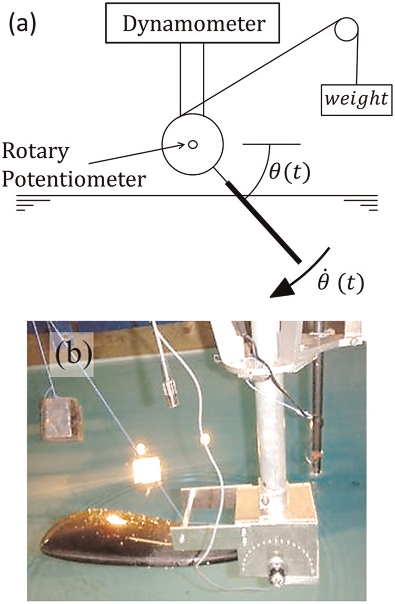

**图 3.** 动态划桨实验的 (a) 示意表示和 (b) 照片。

图中标签译注：Dynamometer 为测力仪；weight 为重物；Rotary Potentiometer 为旋转电位器；$\theta(t)$ 为桨角；$\dot\theta(t)$ 为角速度。

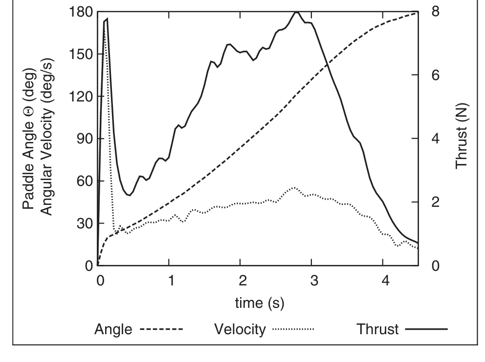

**图 4.** 转动桨的实验数据。

图中标签译注：左纵轴 Paddle Angle Θ (deg) 为桨角 Θ（度）；左轴靠内 Angular Velocity (deg/s) 为角速度（度/秒）；右纵轴 Thrust (N) 为推力（N）；横轴 time (s) 为时间（s）。图例：Angle（桨角，虚线）、Velocity（角速度，浅实线）、Thrust（推力，深实线）。

在该实验的体力等效模拟中，桨被表示为长度和弦长相同（分别为 0.54 m 和 0.2 m）的矩形平板。扫掠角（$\delta\theta$）为 20° 的推进域被划分为 8 个径向分区，内半径为 0.1 m。旋转中心置于自由表面以上 0.1 m 处，并使用实验角度数据提供桨在时间上的位置。

在一系列旋转速度下，实验数据由 2.4 的阻力系数得到最佳复现。该值大于稳态平移划桨实验中记录的 1.75⁸，以及平板的 1.2。²³ 这三种模拟工况以及平板的恒定角速度工况见图 5，该图展示了变化的桨速的重要性。非定常阻力系数的增大可能由若干因素造成。首先，变速的非定常效应以及与自由表面的相互作用很可能有显著影响。其次，转动桨周围的流动状态很可能不同于平移桨周围的流动状态。

为检查流体域内的诱导速度是否正确，对包围推进域的控制体执行了动量分析，所得轴向力与计算得到的推力吻合良好。

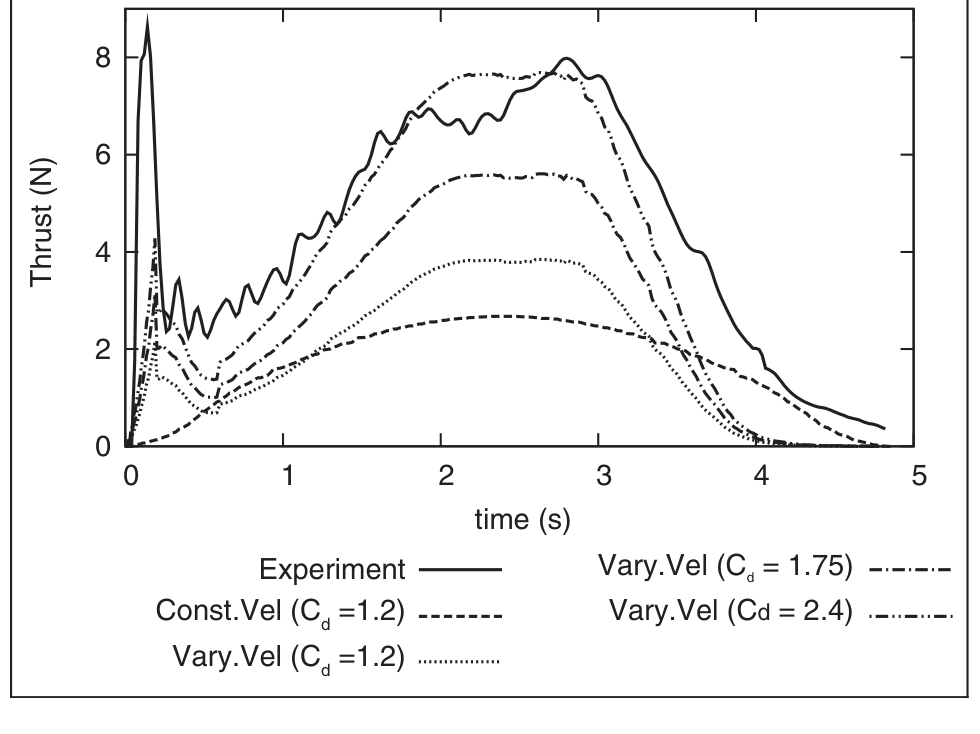

**图 5.** 桨模型产生的推力与实验数据的比较。

图中标签译注：纵轴 Thrust (N) 为推力（N）；横轴 time (s) 为时间（s）。图例：Experiment（实验，实线）；Const.Vel ($C_d$=1.2)（恒定角速度，$C_d$=1.2，点虚线）；Vary.Vel ($C_d$=1.2)（变速，$C_d$=1.2，浅实线）；Vary.Vel ($C_d$=1.75)（变速，$C_d$=1.75，虚线）；Vary.Vel ($C_d$=2.4)（变速，$C_d$=2.4，点划线）。

## 自航皮艇模拟

为评估桨与船体之间相互作用的程度，所建立的体力模型被施加于一艘 K1 竞速皮艇的两侧，左侧桨与右侧桨相位相差 180°。所用皮艇几何取自 Ted Van Dusen 设计的 Eagle 皮艇，该艇是许多现代船体线型的基础。⁶ 其船长、船宽和吃水分别为 5.2、0.38 和 0.12 m，对应的排水量为 80 kg。船体俯仰角固定为零，速度设定为 5 m/s（$F_R=0.7$），该速度是根据女子 K1 200 m 项目比赛时间计算的平均航速。²⁴

### 网格划分技术

利用 OpenFOAM 中的 snappyHexMesh 工具，在皮艇周围生成非结构化六面体网格，计算域尺寸为 20、16 和 12。首先生成粗的块体网格，各方向网格单元尺寸为 0.5 m。随后定义区域，进行最多 6 级各向同性加密（将局部单元尺寸最多缩小至六分之一），在保持单元长宽比约为 1 的同时，逐步提高船体附近的网格密度。垂直于自由表面施加单向加密，以在尽量减小网格规模的同时提供良好的波型分辨率。边界层单元从皮艇表面网格向外生长，使首层单元高度约为 0.0005 m。这使得预测的边界层内约有 10 个单元，估计 $y^+$ 为 40，从而可以利用壁面函数（wall functions）捕捉黏性边界层。²⁵ 所生成的网格结构见图 6。

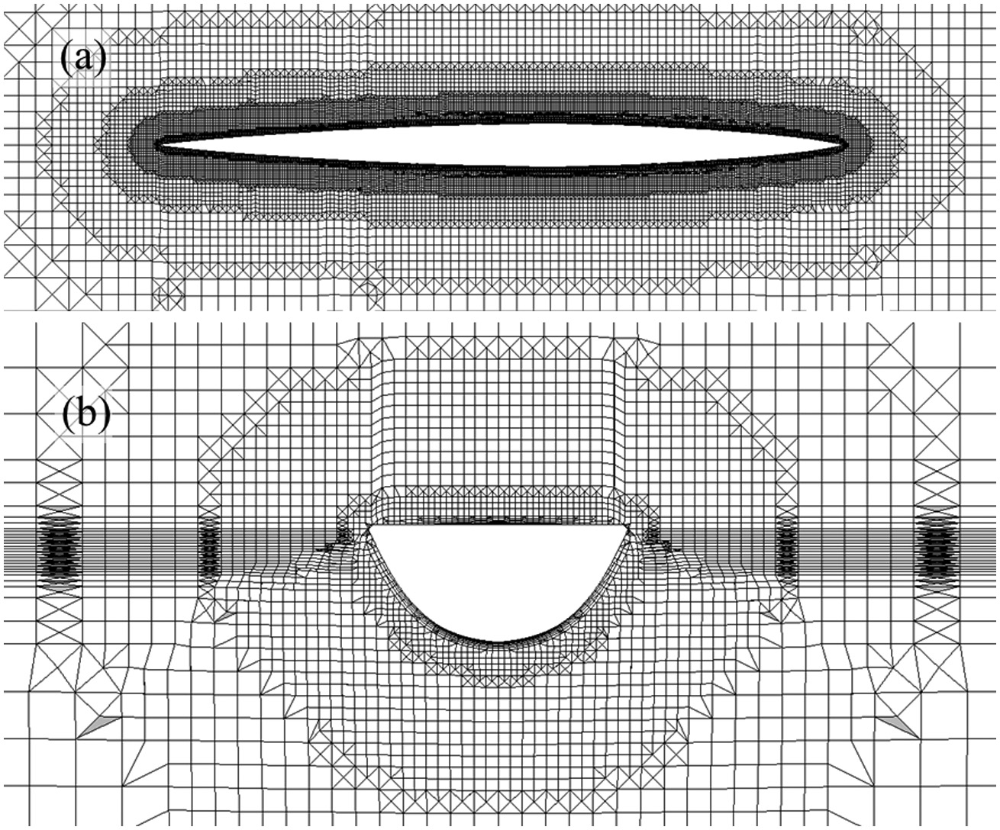

**图 6.** 在 (a) 水线处的水平平面和 (b) 船中处的垂直平面上看到的网格结构。

### 数值模型

求解器设置和模拟参数见表 1。

**表 1.** 数值设置。

| 属性 | 采用的设置 |
|---|---|
| 网格类型 | 非结构化（六面体） |
| 单元数量 | 约 1.2 M（约 120 万） |
| 船体上的 $y^+$ | 约 50 |
| **计算域物理设置** | |
| 流体 | 均质水/空气多相流，k-omega SST 湍流模型 |
| 入口 | 自由来流速度 5 m/s，浮力压力（buoyant pressure），$k=0.1\ \mathrm{m^2\,s^{-2}}$，$\omega=2\ \mathrm{s^{-1}}$ |
| 出口 | $U$ = 零梯度，$P$ = 静压 |
| 底面/侧面 | 壁面，速度设为自由来流值 $U_0$，浮力压力 |
| 顶面 | 开口（Opening） |
| 船体 | 无滑移条件壁面，浮力压力，$k$ 和 $\omega$ 采用壁面函数 |
| **求解器设置（interFoam）** | |
| 瞬态格式 | 一阶 Euler |
| Grad ($U$) 格式 | cellLimited Gauss linear 1 |
| Div ($U$) | Gauss linearUpwind grad($U$) |
| 压力耦合 | PIMPLE |
| 收敛准则 | $P$ 1e−7，$U$ 1e−8，$k$ 1e−8，$\omega$ 1e−8 |
| 多相控制 | 体积分数耦合 |
| 时间步控制 | 最大库朗数 = 0.4，最大体积分数库朗数 = 0.4 |
| **计算参数** | |
| 计算系统 | IRIDIS 高性能计算设施（南安普顿大学） |
| 运行类型 | 并行（24 个分区，运行于 2 × 12 核节点，每个节点配备 22 GB RAM） |
| 实际计算时间 | 裸艇体模拟 19 s 用时 88 h；自航模拟 5.4 s 用时 24 h |

SST：剪切应力输运（shear stress transport）。

## 裸艇体阻力

被动状态皮艇的裸艇体阻力由船体上剪应力和压力的面积分确定，分别给出表面摩擦阻力和压力阻力。这些单独的力分量及其总力列于表 2。表中还利用 1957 年国际拖曳水池会议（International Towing Tank Conference，ITTC'57）相关线²，按 1.692 m² 的静态湿表面积给出了表面摩擦阻力的估算值。压力阻力或称剩余阻力（residuary resistance，形状阻力与兴波阻力之和）也利用从一艘 K2 皮艇实验得到的剩余阻力系数给出。²⁶ 最后，薄船理论（thin ship theory）²⁷ 在势流假设下给出了兴波阻力的数值估算。各阻力分量之间总体一致，为流动得到正确建模提供了一定信心。所得自由表面变形见图 7。

**表 2.** 裸艇体模拟及其他来源给出的阻力分量。

| 阻力 (N) | ITTC'57 | 实验 | 薄船理论 | CFD |
|---|---|---|---|---|
| 表面摩擦阻力 | 55.02 | – | – | 59.06 |
| 压力阻力或剩余阻力（兴波与形状） | – | 14.26 | – | 16.00 |
| 兴波阻力 | – | – | 15.10 | – |
| 总阻力 | – | – | – | 75.05 |

CFD：计算流体动力学；ITTC'57：1957 年国际拖曳水池会议。

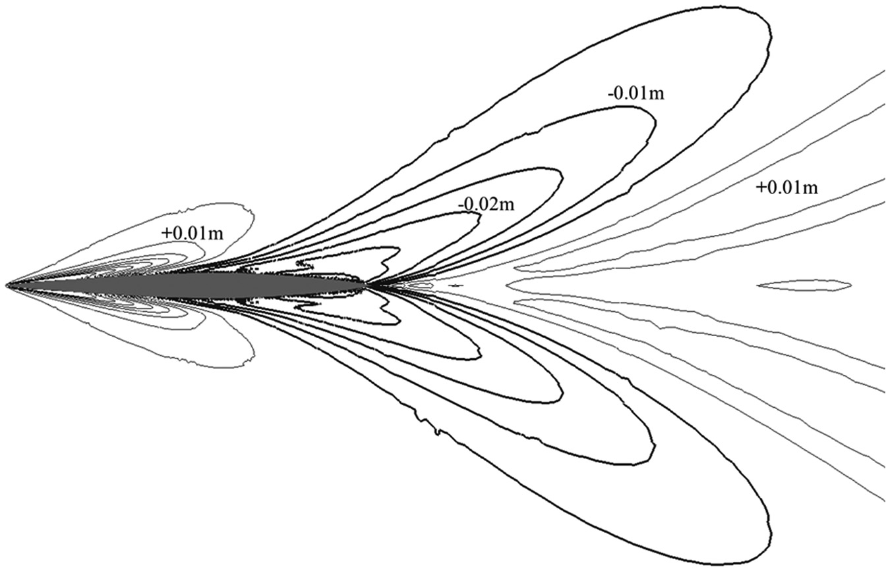

**图 7.** 裸艇体自由表面变形，等值线相对静态自由表面每隔 ±0.005 m 一条（加粗等值线为波谷）。

## 模拟的 K1 划桨技术

为尽可能贴近地表示运动员的划桨技术，桨长和旋转中心取自 Kendal 和 Sanders²¹ 的划桨数据。桨叶尺寸与先前用于验证桨力模型时相同。由此得到的推进域外半径和内半径分别为 0.97 m 和 0.52 m，扫掠角（$\delta\theta$）为 10°。相对于皮艇中心（位于水线上），旋转中心坐标选为 (0，±0.35 和 0.54 m)，以最佳地模拟划桨早期的阻力型阶段。这是基于 Kendal 和 Sanders²¹ 给出的桨叶入水位置，但忽略了桨叶自该点起的横向平移。单片桨叶扫掠过的水体体积见图 8。

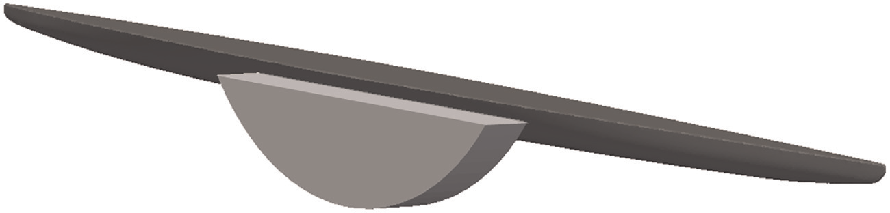

**图 8.** 桨叶沿皮艇船体扫掠过的体积。

基于不同的角速度剖面，模拟了两种不同的划桨技术。划桨剖面 (A) 是一种简化技术，在整个划桨过程中保持恒定角速度。划桨剖面 (B) 则给定变化的角速度，使模拟推力剖面与竞速皮艇运动员在现场实验测试中测得的桨力曲线相匹配。²⁶

为深入认识桨与船体如何相互作用，推进域使用了三个不同的横向位置。桨的中心相对船体中心线的偏置距离分别为 0.35、0.50 和 0.65 m，对应距最大船宽 0.16、0.31 和 0.46 m（见图 9）。

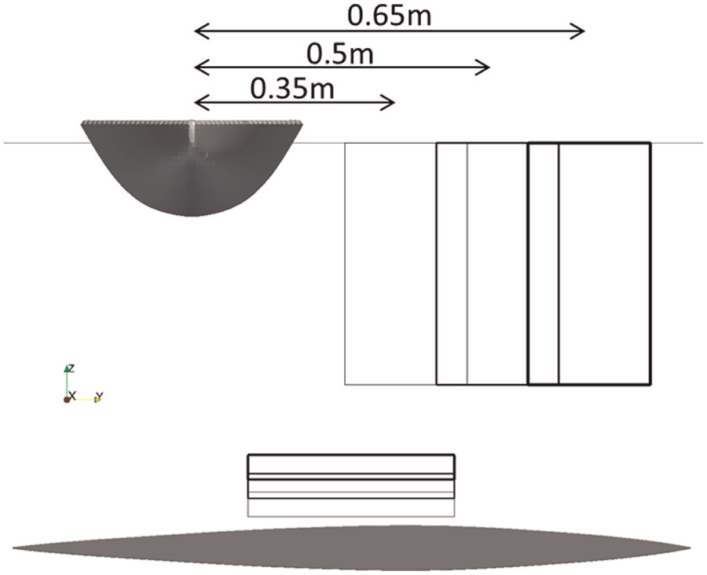

**图 9.** 不同横向间距的推进域所扫掠水体体积的位置，以递增的线型粗细表示。

图中标签译注：上方尺寸标注 0.35 m、0.5 m、0.65 m 为桨中心相对船体中心线的三种偏置距离。

### 桨频

为模拟自航皮艇，桨产生的平均推力必须等于平均船体阻力。所需桨频（即划桨周期 $t_{stroke}$）通过在不带皮艇的情况下、对一系列角速度模拟这两种不同划桨技术来确定，直到平均推力与裸艇体阻力相差在 1 N 以内。由此得到划桨剖面 (A) 和 (B) 的桨频分别为 67 和 60.45 cycles/min（周/分钟），产生的推力约为 74 N 和 76 N。

## 桨叶—船体水动力相互作用

自航模拟从裸艇体的收敛解继续计算。对于给定模拟时间，计算成本增加 8%。

### 桨对局部流动的影响

桨模型对自由表面的影响见图 10。在 $t/t_{stroke}=0.25$ 和 0.75 时，可以分别看到右侧划桨和左侧划桨造成的明显凹陷。这些凹陷随时间向下游传播，形成非定常波型，其外观与在 K1 皮艇后方观察到的波型相似。

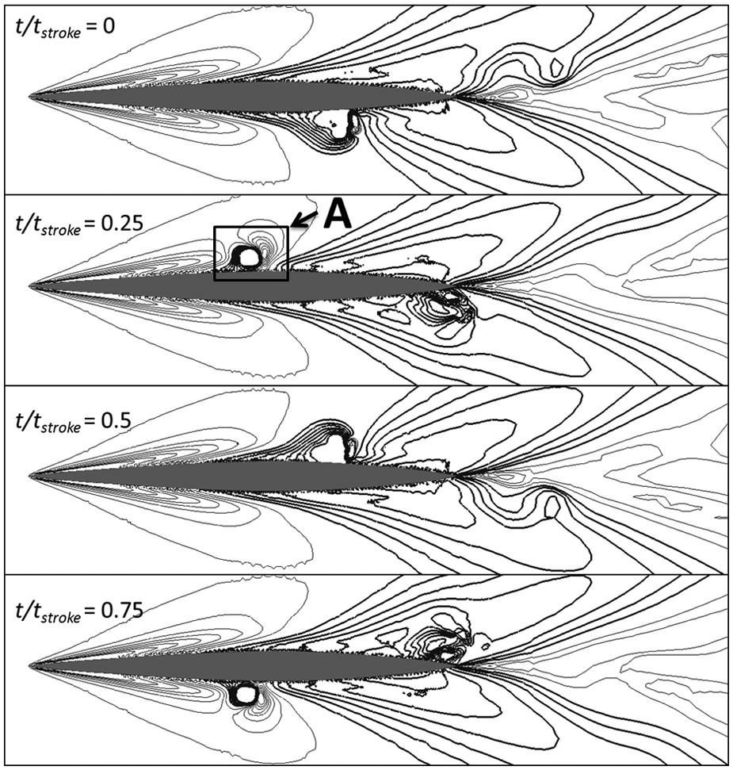

**图 10.** 自航自由表面变形，等值线相对静态自由表面每隔 ±0.005 m 一条（加粗等值线为波谷）；图为划桨剖面 (A)、相对皮艇中心线偏置 0.35 m 时，在不同相对划桨时间（$t/t_{stroke}$）的结果。

图中标签译注：四个子图对应 $t/t_{stroke}=0$、0.25、0.5、0.75；字母 A 标示图 11 取速度数据的位置。

桨对局部速度的影响见图 11。在 0.1 m 深度处，可以看到船体边界层因无滑移边界条件而改变了流速。在桨的上游和下游，靠近船体处的轴向速度增大；然而在桨与船体之间，由于压力差和自由表面高度差，流体实际上绕推进域边缘发生回流。动态自由表面的影响可在图 11(a) 中看到：桨叶后方形成的波谷把流体从两侧吸入。在图 11(b) 中可以看到，在更大深度处这一现象不再发生。

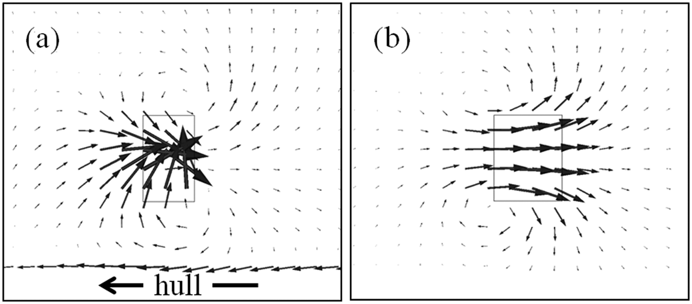

**图 11.** 右侧划桨（$\theta=90°$，$t/t_{stroke}=0.25$）引起的速度相对自由来流值 $U_0$ 的变化。数值取于图 10 中位置 A 处的水平平面，深度分别为 (a) 0.1 m 和 (b) 0.3 m。推进域在各深度的位置以轮廓线示出。

图中标签译注：图中标注“hull”处为船体，左右箭头表示船体相对来流的方向。

### 不同划桨技术的比较

两种不同划桨技术对作用于皮艇的推力和水动力的影响见图 12。在划桨 (A) 的中段，推力下降，原因是当桨处于垂直位置时，皮艇的前进速度降低了垂直于桨叶的局部流体速度。在实际中，运动员不会保持恒定角速度，而会自然地通过在划桨中段加速桨叶来补偿皮艇前进运动的影响。以这种方式改变旋转速度的效果可见于技术 (B)。自由表面与桨模型的相互作用对两种划桨技术所产生平均推力的影响方向相反：相对于“桨频”一节中的数值，(A) 的平均推力减小而 (B) 增大。这表明未来应在自航模拟内部确定桨频。

总阻力的变化很小，相对裸艇体工况最大增加不到 1 N。随着桨使沿船体的流动加速，本可预期摩擦阻力会增加。实际上平均摩擦阻力反而减小，这可能是由于图 11(a) 中所见的船体与桨之间的流体回流，有效地降低了船体附近的自由来流速度。从图 10 的自由表面变形可以清楚看到，桨模型影响了压力场，导致观察到的压力阻力增加。这一增加主要出现在桨叶入水阶段（$t/t_{stroke}=0.125$），但技术 (B) 通过以较低角速度入水使其最小化。

技术 (A) 的净结果是平均自航阻力相对裸艇体工况增加 0.05 N，而技术 (B) 则减小 0.12 N。这表明在某些情况下桨的相互作用可能有助于减小阻力。总体而言，划桨技术 (A) 与 (B) 之间观察到 0.23% 的自航阻力降低。

由压力场变化引起的侧向力和垂向力变化比阻力变化更为显著。随着流体被加速，压力下降，把皮艇向该方向牵拉。这导致侧向力波动相对桨模型滞后约四分之一个划桨周期，原因是加速的流动在桨出水后继续沿船体向后移动。还观察到水动力升力总体下降，唯有桨入水时在其下方形成高压区的情形除外。这些随时间变化的水动力所产生的力矩见图 13。两个自航工况都表现出抬艏（正向）俯仰力矩，原因是加速流动经过船体后半部分，降低了局部压力。

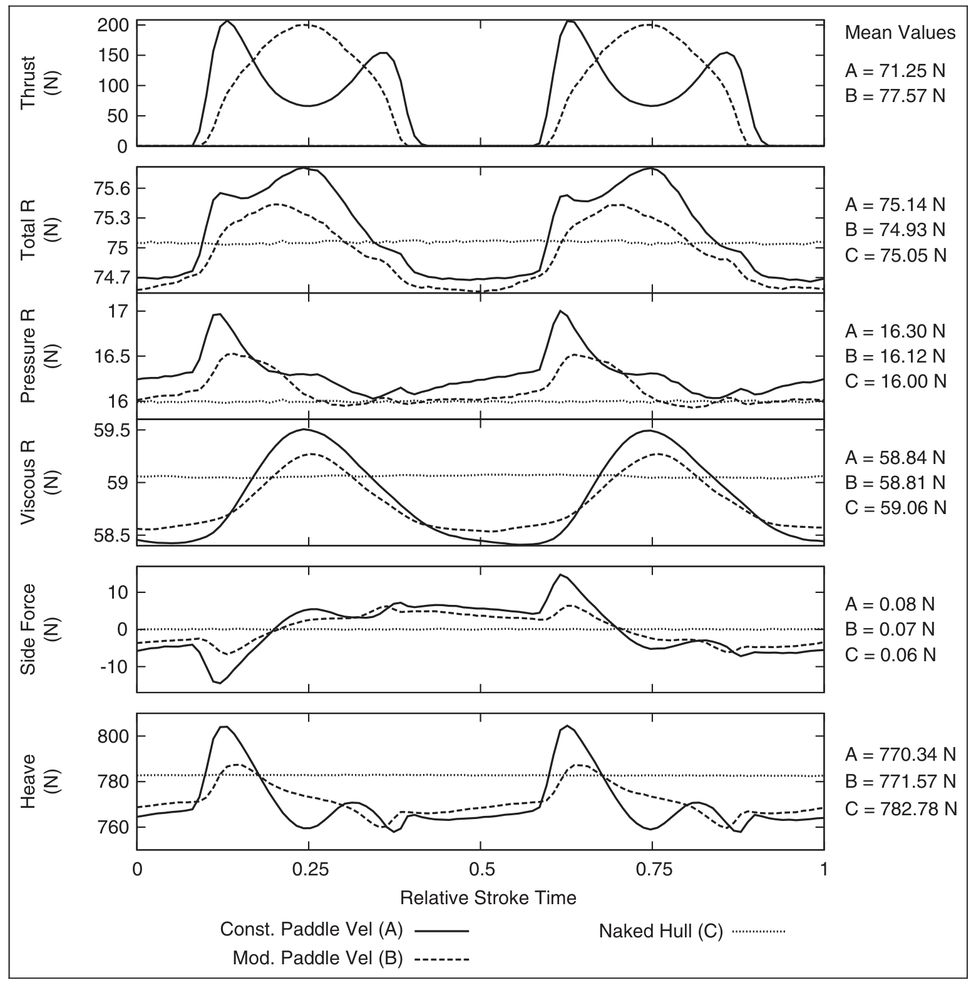

**图 12.** 桨偏置 0.35 m 时，两种采用不同划桨技术的自航皮艇以及裸艇体（拖曳工况）的水动力与静水作用力。

图中标签译注（自上而下）：Thrust (N) 推力（N）；Total R (N) 总阻力（N）；Pressure R (N) 压力阻力（N）；Viscous R (N) 黏性阻力（N）；Side Force (N) 侧向力（N）；Heave (N) 垂向力（N）；横轴 Relative Stroke Time 为相对划桨时间。右侧 Mean Values 为各曲线的平均值。图例：Const. Paddle Vel (A) 恒定桨速 (A)，实线；Mod. Paddle Vel (B) 变速桨速 (B)，虚线；Naked Hull (C) 裸艇体 (C)，点线。

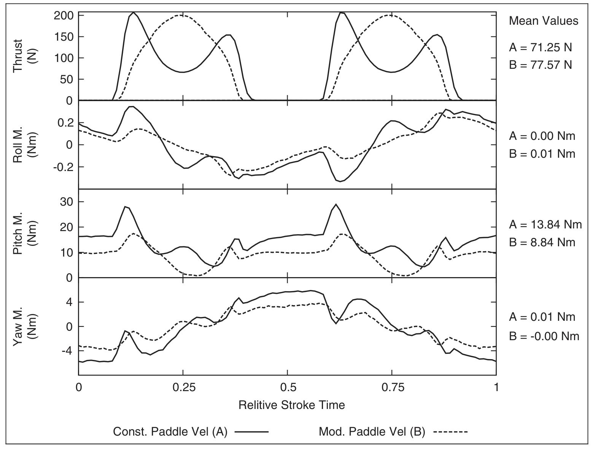

**图 13.** 划桨技术 (A) 和 (B) 相对船体中心线偏置 0.35 m 时，自航水动力矩相对裸艇体工况的变化。

图中标签译注（自上而下）：Thrust (N) 推力（N）；Roll M. (Nm) 横滚力矩（N·m）；Pitch M. (Nm) 俯仰力矩（N·m）；Yaw M. (Nm) 偏航力矩（N·m）；横轴 Relitive Stroke Time 为相对划桨时间（原文拼写如此）。

### 桨偏置距离的影响

从图 14 可以看到，随着桨偏置距离增大，力以及力矩的变化幅度减小。这不仅突显了在划桨过程中正确建模桨叶路径的必要性，也意味着所建立的方法能够让教练和运动员认识其技术如何影响自身阻力。

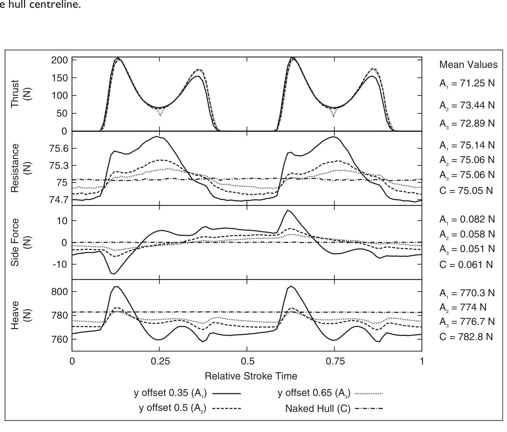

**图 14.** 恒定速度划桨技术 (A) 下，桨的靠近程度对水动力的影响。

图中标签译注（自上而下）：Thrust (N) 推力（N）；Resistance (N) 阻力（N）；Side Force (N) 侧向力（N）；Heave (N) 垂向力（N）；横轴 Relative Stroke Time 为相对划桨时间。图例：y offset 0.35 ($A_1$)、y offset 0.5 ($A_2$)、y offset 0.65 ($A_3$) 分别为偏置 0.35、0.5、0.65 m；Naked Hull (C) 为裸艇体。

### 皮艇姿态固定的影响

由于船体姿态固定，桨对自航阻力的全部影响很可能尚未被捕捉到。可以采用一阶准静态方法，基于静水复原力与测得的水动力值之间的平衡来估算由此产生的垂向平移和俯仰运动。²⁸ 从图 15 可以看到，与运动员身体运动可能引起的运动相比，这些运动相对较小。然而可以容易地推得：对于偏置 0.35 m、以恒定角速度转动的桨，其平均吃水增加为 1.15 mm。这将使湿表面积增加约 0.0124 m²。因此，采用 ITTC'57 表面摩擦阻力系数² 计算的阻力增加约为 0.4 N（占裸艇体阻力的 0.5%）。

由于俯仰变化的幅度很小，它似乎不太可能对阻力产生显著影响；不过，偏航和横向平移运动由于伴随迎角产生的诱导阻力，有可能影响更大。

应当承认，本工作尚未评估皮艇运动的某些非定常方面，包括非定常纵向平移速度以及运动员引起的船体运动。据 Jackson³ 报道，皮艇船体速度的变化可低至 4%，或依运动员不同在 5% 至 14% 之间变化。²¹ 然而，由于赛艇中超过 50% 的速度变化只造成 3% 的阻力增加，²⁹ 皮艇中纵向平移速度的影响很可能较小，但其潜在显著性可能与本文所研究的水动力相互作用相当。目前没有关于运动员引起的垂向平移和横滚运动影响的已发表数据；不过，目视观察表明这些运动也可能显著。

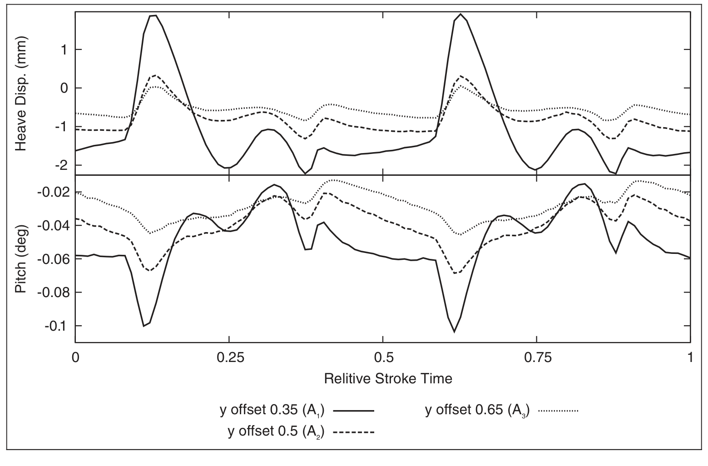

**图 15.** 不同桨偏置距离下，划桨技术 (A) 所估算的桨诱导垂向平移和俯仰运动。

图中标签译注：上图 Heave Disp. (mm) 为垂向平移位移（mm）；下图 Pitch (deg) 为俯仰角（度）；横轴 Relitive Stroke Time 为相对划桨时间（原文拼写如此）。图例同图 14 的三种偏置距离。

## 对比赛时间的潜在影响

本研究中，不同划桨技术 (A) 与 (B) 之间观察到 0.23% 的自航阻力差异，而桨诱导的吃水增加估计可能造成 0.5% 的阻力增加。但是，这些相互作用是否显著到需要在皮艇设计或运动员技术中加以考虑？

Jackson³ 估算，总阻力增加 0.7%（即摩擦阻力的 1%）会使皮艇航速降低 0.27%。若将此应用于由 2012 年奥运会获胜时间计算的平均航速，则 200、500 和 1000 m 皮艇项目的比赛时间分别增加约 0.1、0.3 和 0.5 s。由于奖牌名次之间的差距常常小到十分之几秒甚至百分之几秒，¹ 看来即便是零点几个百分点的阻力降低也值得追求。

## 结论

在一项非定常、含自由表面的 RANS 模拟中，采用单次划桨的体力等效表示，估算了姿态固定的 K1 皮艇的自航阻力。一个数学模型采用桨叶微元法计算用于模拟桨影响的动量源项，并已利用实验数据验证。这一建立的方法使得首次研究桨与船体之间的非定常相互作用成为可能，而相对静水模拟的计算成本仅增加 8%。非定常自由表面场和压力场被捕捉并向下游传播，从而为认识桨诱导的船体受力提供了新的视角。

本文开展了一项算例研究，考察桨叶—船体水动力相互作用如何随不同划桨技术和桨的横向位置而变化，以评估这些相互作用对运动表现的潜在影响。桨诱导力的大小与桨—船体靠近程度之间的强关系表明，所建立的方法可用于研究不同划桨技术对水动力的影响。这可以通过在当前方法中纳入桨叶平移和升力来实现，以提供更贴近实际的划桨表示。

桨的相互作用产生的阻力瞬时变化最大约为裸艇体阻力的 1.6%，但平均阻力变化仅为 0.16%。然而，不同划桨技术之间观察到 0.23% 的自航阻力差异，而加速流动的低压区引起的吃水增加估计可能造成 0.5% 的阻力增加。对阻力微小变化如何影响比赛时间的估算表明，即便是零点几个百分点的阻力降低，也可能决定奥运会上奖牌名次的归属。

尽管桨对阻力的影响很小，但计算成本的增加微乎其微，因此所建立的方法（未来还可能纳入运动员引起的运动）有望成为一种设计工具，用于针对比赛中出现的非定常流动条件优化皮艇船体线型。

## 致谢

作者感谢 UK Sport 和南安普顿大学对使用 IRIDIS 高性能计算设施的支持，并感谢 Tomasz Bulgalski 提供皮艇几何。

## 利益冲突声明

作者声明不存在利益冲突。

## 资助

Banks 感谢 UKSport、EPSRC 和南安普顿大学在其博士研究项目期间提供的资助，本工作即在该期间完成。

## 参考文献

1. London 2012. Canoe sprint results from London 2012 Olympic Games, http://www.london2012.com/canoe-sprint/schedule-and-results (2012, accessed 10 August 2012).
2. Molland AF, Turnock SR and Hudson DA. Ship resistance and propulsion: practical estimation of ship propulsive power. Cambridge University Press, 2011. New York
3. Jackson PS. Performance prediction for Olympic kayaks. J Sport Sci 1995; 13(3): 239–245.
4. Lazauskas L and Tuck E. Low drag racing kayaks. Adelaide, SA, Australia: Department of Applied Mathematics, The University of Adelaide, 1996.
5. Lazauskas L and Winters J. Hydrodynamic drag of some small sprint kayaks John Winters' sprint kayak. Adelaide, 1997.
6. Bugalski TJ. Development of the new line of sprint canoes for the Olympic Games. In: Proceedings of the 10th international conference on fast sea transportation (FAST 2009), 2009, pp.1039–1049. Athens: FAST Organizing Committee. Athens, Greece: October 5–8, 2009.
7. Day A, Campbell I, Clelland D, et al. Realistic evaluation of hull performance for rowing shells, canoes, and kayaks in unsteady flow. J Sport Sci 2011; 29(10): 1059–1069.
8. Sumner D, Sprigings EJ, Bugg JD, et al. Fluid forces on kayak paddle blades of different design. Sports Eng 2003; 6: 11–19.
9. Ritchie AC, Faizal M and Selamat B. Comparison of blade designs in paddle sports. Sports Tech 2010; 3(2): 141–149.
10. Morgoch D and Tullis S. Force analysis of a sprint canoe blade. Proc IMechE, Part P: J Sports Engineering and Technology 2011; 225(4): 253–258.
11. Leroyer A, Barré S, Kobus J-M, et al. Influence of free surface, unsteadiness and viscous effects on oar blade hydrodynamic loads. J Sport Sci 2010; 28(12): 1287–1298.
12. Sliasas A and Tullis S. The dynamic flow behaviour of an oar blade in motion using a hydrodynamics-based shell-velocity-coupled model of a rowing stroke. Proc IMechE, Part P: J Sports Engineering and Technology 2010; 224(1): 9–24.
13. Phillips A, Furlong M and Turnock S. Accurate capture of rudder-propeller interaction using a coupled blade element momentum-RANS approach. Ship Tech Res 2010; 57(2): 128–139.
14. Phillips AB, Turnock SR and Furlong ME. Evaluation of manoeuvring coefficients of a self-propelled ship using a blade element momentum propeller model coupled to a Reynolds averaged Navier Stokes flow solver. Ocean Eng 2009; 36(15–16): 1217–1225.
15. Turnock SR, Phillips AB, Banks J, et al. Modelling tidal current turbine wakes using a coupled RANS-BEMT approach as a tool for analysing power capture of arrays of turbines. Ocean Eng 2011; 38(11–12): 1300–1307.
16. Peric M and Ferziger JH. Computational methods for fluid dynamics. 3rd ed. Springer, 2002. Verlag Berlin Heidelberg.
17. OpenFOAM. OpenFOAM – the open source CFD toolbox: user guide (version 2.01). 2011. [This user guide is provided by the OpenFOAM Foundation from www.openfoam.org].
18. Menter FR. Two-equation eddy-viscosity turbulence models for engineering applications. AIAA J 1994; 32(8): 269–289.
19. Larsson L, Stern F and Bertram V. Benchmarking of computational fluid dynamics for ship flows: the Gothenburg 2000 workshop. J Ship Res 2003; 47: 63–81.
20. Hino T. In: CFD workshop Tokyo 2005, Tokyo, Japan, 2005. March 9-11, National Maritime Research Institute.
21. Kendal SJ and Sanders RH. The technique of elite flatwater kayak paddlers using the wing paddle. Int J Sport Biomech 1992; 8: 233–250.
22. Ellison W and Turnock SR. Investigation into the effect of the kayak paddle stroke on elite kayak performance. 3rd year Research Project, University of Southampton, UK, 2010.
23. Hoerner SF. Fluid-dynamic drag. 3rd–16th ed. Midland Park, NJ: Published by the author, 1965.
24. International Canoe Federation. Results from ICF Canoe Sprint World Championships, http://results.digicorp.hu/competition/16777217/races.
25. WS Atkins Consultants. Best practice guidelines for marine applications of computational fluid dynamics. 2003. Published by MARNET-CFD, accessable from https://pronet.wsatkins.co.uk/marnet/publications/bpg.pdf
26. Wolfson Unit for Marine Technology and Industrial Aerodynamics (WUMTIA). Confidential experimental test data. University of Southampton, UK. (This has not been published in the public domain).
27. Insel M, Molland AF and Wellicome JF. Wave resistance prediction of a catamaran by linearised theory. In: Fifth international conference on computer aided design, manufacture and operation (CADMO'94), Southampton, UK, September 13-15, 1994.
28. Comstock JP. Principles of naval architecture. New York: The Society of Naval Architects and Marine Engineers, 1976.
29. Day A, Campbell I, Clelland D, et al. An experimental study of unsteady hydrodynamics of a single scull. Proc IMechE, Part M: J Engineering for the Maritime Environment 2011; 225(3): 282–294.

## 附录 1

### 符号表

| 符号 | 含义（原文单位照录） |
|---|---|
| $c$ | 桨叶弦长 (m) |
| $C_D$ | 桨叶剖面的阻力系数 |
| $f_i$ | 动量源项 ($\mathrm{N\,m^{-3}}$) |
| $F_R$ | 弗劳德数（Froude number） |
| $\overline{F_n}$ | 垂直于桨叶的力矢量 ($\mathrm{N\,m}$) |
| $k$ | 湍动能 ($\mathrm{m^2\,s^{-2}}$) |
| $n$ | 桨叶微元数量 |
| $\hat n$ | 垂直于桨叶的单位矢量 |
| $P$ | 压力 ($\mathrm{N\,m^{-2}}$) |
| $\bar Q$ | 力矩矢量 ($\mathrm{N\,m}$) |
| $R$ | 桨长或半径 (m) |
| $\bar r$ | 桨叶微元的半径矢量 (m) |
| $\hat r$ | 径向单位矢量 |
| $t$ | 时间 (s) |
| $t_{stroke}$ | 划桨周期（完成一个完整划桨周期所需时间）(s) |
| $u'$ | 相对均值的瞬时速度脉动 ($\mathrm{m\,s^{-1}}$) |
| $U_i$ | $x$、$y$ 或 $z$ 方向的速度 ($\mathrm{m\,s^{-1}}$) |
| $U_0$ | 自由来流速度/皮艇速度 ($\mathrm{m\,s^{-1}}$) |
| $V_n$ | 垂直于桨叶的速度 ($\mathrm{m\,s^{-1}}$) |
| $V_s$ | 扇区体积 ($\mathrm{m^3}$) |
| $y^+$ | 穿过边界层的首层单元无量纲距离 |
| $\theta$ | 桨的转角 (rad) |
| $\dot\theta$ | 桨的角速度 ($\mathrm{rad\,s^{-1}}$) |
| $\delta r$ | 桨叶微元长度 (m) |
| $\delta\theta$ | 推进域弧角（或称扫掠角）(rad) |
| $\delta\overline{F_n}$ | 垂直于桨叶微元的力矢量 (N) |
| $\mu$ | 动力黏度 ($\mathrm{N\,s\,m^{-2}}$) |
| $\rho$ | 流体密度 ($\mathrm{kg\,m^{-3}}$) |
| $\varphi$ | 体积分数 |

## 校订备注

- 原文式（1）的黏性项写为 $\partial U_j/\partial x_j$，与常见 RANS 形式不一致；附录将力矢量 $\overline{F_n}$ 的单位标为 N·m。译文照录原式和原单位，使用公式前宜核对期刊原版或作者资料。
- 原文网格描述估计 $y^+$ 约为 40，表 1 则列约为 50；译文分别保留。
