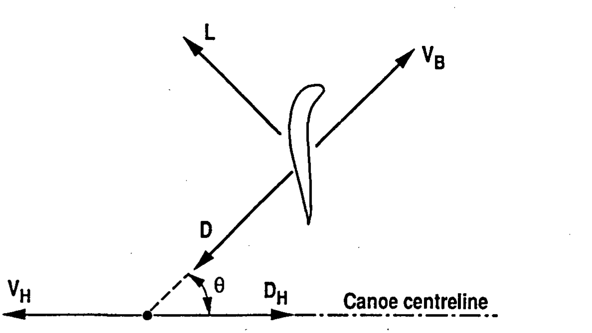
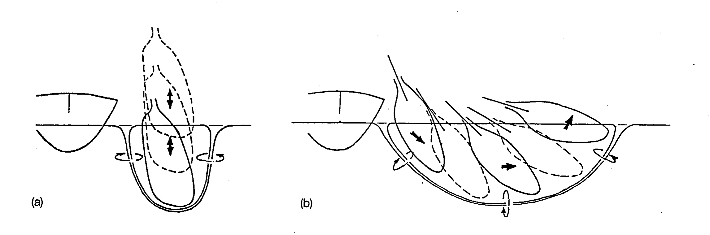
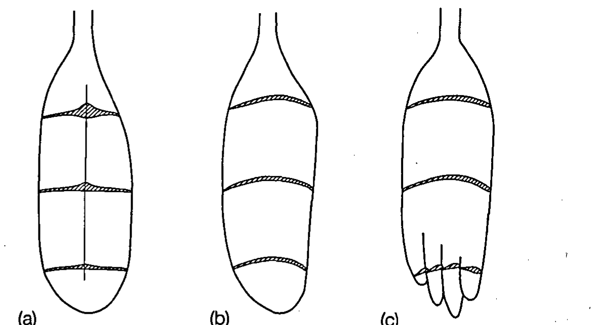

# 奥运会皮艇的性能预测

**Performance prediction for Olympic kayaks**

P.S. JACKSON

新西兰奥克兰大学机械工程系（Department of Mechanical Engineering, University of Auckland, Auckland, New Zealand）

1994 年 11 月 7 日录用（Accepted 7 November 1994）

**原文信息：** *Journal of Sports Sciences*, 1995, 13, 239–245。0264-0414/95 © 1995 E. & F.N. Spon。DOI: 10.1080/02640419508732233（共 8 页，其中第 1 页为 Taylor & Francis 下载封面，正文页码 239–245）

---

## 出版方下载封面信息（PDF 第 1 页，原文照译）

本文由 [麦吉尔大学图书馆（McGill University Library）] 于 2015 年 2 月 3 日 00:19 下载。

出版方：Routledge。Informa Ltd，在英格兰和威尔士注册，注册号 1072954；注册地址：Mortimer House, 37-41 Mortimer Street, London W1T 3JH, UK。

期刊：*Journal of Sports Sciences*；出版详情（含作者须知和订阅信息）：http://www.tandfonline.com/loi/rjsp20

**Performance prediction for Olympic kayaks（奥运会皮艇的性能预测）**，P.S. Jackson（a），a 新西兰奥克兰大学机械工程系。在线发表：2008 年 2 月 1 日。

引用格式：P.S. Jackson (1995) Performance prediction for Olympic kayaks, *Journal of Sports Sciences*, 13:3, 239–245, DOI: 10.1080/02640419508732233。本文链接：http://dx.doi.org/10.1080/02640419508732233

请向下滚动阅读文章（PLEASE SCROLL DOWN FOR ARTICLE）。

Taylor & Francis 尽一切努力确保本平台出版物中全部信息（"内容"）的准确性。但是，Taylor & Francis 及其代理人和许可方对内容的准确性、完整性或对任何用途的适用性不作任何形式的陈述或保证。本出版物中表达的任何意见和观点均为作者本人的意见和观点，不代表 Taylor & Francis 的观点，也未经 Taylor & Francis 认可。不应依赖内容的准确性，应使用主要信息来源独立加以核实。对于因使用内容而直接或间接引起、与之相关或由之产生的任何损失、行为、索赔、诉讼、请求、费用、支出、损害赔偿及其他责任，Taylor & Francis 概不负责。

本文可用于研究、教学和个人学习目的。明确禁止以任何形式向任何人进行实质性或系统性的复制、再分发、转售、出租、再许可、系统供应或分发。访问和使用条款见 http://www.tandfonline.com/page/terms-and-conditions 。

---

## 摘要

本文阐明决定竞速皮艇与划艇速度的各种因素的影响，旨在识别最有可能带来改进的环节。首先以船体参数描述船体阻力的摩擦、兴波和空气三个分量，以便把推进功率准确地预测为艇速的函数。随后通过涡环尾流（vortex-ring wakes）的力学描述划桨产生推力的过程，以便用描述桨叶和划桨动作的参数确定推进效率（propulsive efficiency）。令推力与阻力相等，即可可靠估计划手实际输出的机械功率。在此前分析的基础上，得到一个以描述船体和桨叶性能的全部参数表示艇速的预测模型。用该模型确定艇速对各参数微小变化的敏感性，从而识别出最重要的因素。论文最后讨论近年来实际出现的各种皮艇改进，并用此前的分析解释和预测由此产生的速度变化。

**关键词：** 划艇（Canoe）；水动力学（hydrodynamics）；桨（paddle）；性能（performance）。

## 引言

本文的目的是勾画出影响竞速皮艇性能的各种因素，并提供一种方法，用以判断哪些因素值得加以开发。这些因素可以分为：分别影响船体、桨叶与划桨风格的因素，以及影响划手（皮艇运动员）的因素。

最优船体是这样的船体：在给定总重量和长度下、以固定速度航行时产生最小阻力。利用标准水动力学方法即可很好地估算船体阻力。桨叶和划桨参数对艇速的影响更为划手所关注，但也更难确定。幸运的是，Jackson 等人（1992）最近的一项研究既明确指出了这些参数与艇速之间的关系，也为现代"翼型"桨叶（'wing' blade）优于"阻力型"桨叶（'drag' blade）提供了可靠的水动力学解释。最后，运动员输出的功率是艇速的重要决定因素，而可用功率对艇速的影响也容易给出。除体重外，影响该功率的生理学因素不在本文研究范围之内。

## 皮艇船体阻力的估算

竞速皮艇的尺寸由规则限定，由此形成细长的船体形状，其水下剖面浅而圆。各类艇型的典型长度和船宽（beam），以及相应的船体和划手重量，列于表 1（引自 Toro, 1986）。总阻力由水动力分量和空气动力分量组成，每一个分量都能以相当的精度估算。按照弗劳德假说（Froude's hypothesis），水动力分量可以进一步分为摩擦部分和兴波部分，并假定二者不发生相互作用。

如通常做法，摩擦阻力 $D_f$ 与艇速 $V_H$ 和湿表面积 $A_{wet}$ 的关系为：

$$D_f = \tfrac{1}{2}\rho V_H^{2} A_{wet} c_f$$

摩擦系数 $c_f$ 对雷诺数有弱依赖关系，雷诺数定义为 $Re = V_H L/\upsilon$，其中 $L$ 为水线长，$\rho$ 和 $\upsilon$ 分别为水的密度和运动黏度。这里遇到的 $Re$ 取值范围见表 1（对应水温 13 ℃）。由于这些船体极为细长，用飞机机身的技术来描述其摩擦阻力，很可能比用船型常用关系式更准确。Jobe（1985）概述的方法给出：船体的摩擦阻力比相同湿表面积的平板高约 6%；而平板的摩擦系数（Blevins, 1984）为 $c_f = 0.030\,Re^{-1/7}$。湿表面积 $A_{wet}$ 是这样估算的：在一个能够计算湿表面积的船体生成程序（AUTOYACHT）中生成线型正确的船体；对一系列细长船体线型的计算表明，一个良好的近似是

$$A_{wet} = 2.5\sqrt{\Delta L}$$

其中 $\Delta$ 为艇的体积排水量（volumetric displacement）。

要准确估算兴波阻力则困难得多。此前关于赛艇艇体（rowing shells）的研究往往只是重复 Marchaj（1964）针对帆艇（sailing canoes）的论断，即兴波阻力约占总阻力的 10%，并据此相应增大摩擦阻力。然而，皮艇明显不如单人赛艇（single scull）细长，因此这一假设在这里可能站不住脚。遗憾的是，针对所需形状船体的系统性拖曳水池数据似乎很少；不过，Charlton 等人（1987）给出了一条单人赛艇的拖曳水池测量结果，Tanner（1961）提供了一条帆艇总阻力的数据，Toro（1986）则引用了两种不同排水量下一条 K1 皮艇的拖曳水池结果。在每一组数据中，都可以减去船体的摩擦阻力（用上述方法估算），从而确定剩余兴波阻力 $D_w$；此后它应当只取决于描述船体形状的几何参数和弗劳德数

$$Fr = V_H/\sqrt{gL}$$

Adler（1990）所述方法对这些数据给出了合理的拟合，他给出了剩余阻力系数 $C_w$ 作为 $Fr$ 函数的一条曲线，其中 $C_w$ 定义为：

$$D_w = \frac{1}{2}\rho V_H^{2} C_w\frac{\Delta^{5/3}}{L^{3}}$$

于是，利用 Adler 的 $C_w$ 曲线即可容易地为每条皮艇重构兴波阻力分量，所得结果如表 1 所示。结果发现，兴波阻力对 K1 总阻力的贡献约为 21%，对 K4 约为 12%。

由于船体的非定常运动，兴波阻力可能还存在其他分量，但这里假定它们可以忽略。划桨时，划手质量相对于总体质心（前后方向）几乎静止，因此没有必要考虑划手与船体之间周期性的动量交换——这种动量交换在赛艇中很重要（Pope, 1973）。此外，桨叶浸没在水中的时间占相当大的比例（约 65%），即使桨叶峰值推力达到平均阻力的两倍，也不难证明，此时艇速对其平均值的偏离很小。Marhold 和 Herrmann（1989）的测量表明，艇速围绕平均值变化 4%，因此恒速假设在这里应当是足够的。

**表 1　估算的阻力分量、推进效率和比功率**ª

| 项目（原文单位） | 符号 | K1 男 | K1 女 | K2 男 | K2 女 | K4 男 | K4 女 |
|---|---|---|---|---|---|---|---|
| 速度 Speed（m s⁻¹） | $V_H$ | 4.83 | 4.24 | 5.41 | 4.81 | 5.49 | 5.08 |
| 长度 Length（m） | $L$ | 5.2 | 5.2 | 6.5 | 6.5 | 11.0 | 11.0 |
| 划手质量 Crew mass（kg） | — | 81 | 65 | 162 | 130 | 324 | 260 |
| 艇质量 Canoe mass（kg） | — | 12 | 12 | 18 | 18 | 30 | 30 |
| 排水量 Displacement（m³） | $\Delta$ | 0.093 | 0.077 | 0.180 | 0.148 | 0.354 | 0.290 |
| 空气阻力面积 Air drag area（m²） | $A_a$ | 0.4 | 0.4 | 0.6 | 0.6 | 0.8 | 0.8 |
| $Re\times10^{-7}$ | $Re$ | 2.09 | 1.84 | 2.93 | 2.61 | 5.03 | 4.66 |
| 弗劳德数 Froude number | $Fr$ | 0.68 | 0.59 | 0.68 | 0.6 | 0.53 | 0.49 |
| 湿表面积 Wetted area（m²） | $A_{wet}$ | 1.74 | 1.58 | 2.70 | 2.45 | 4.93 | 4.47 |
| 摩擦系数 Friction factor | $c_f$ | 0.0029 | 0.0029 | 0.0027 | 0.0028 | 0.0025 | 0.0025 |
| 摩擦阻力 Friction drag（N） | $D_f$ | 57.9 | 41.4 | 107.7 | 78.5 | 187.2 | 146.7 |
| 兴波（剩余阻力）系数 Wave coefficient | $C_w$ | 10.8 | 12.2 | 10.8 | 12.0 | 14.0 | 14.0 |
| 兴波阻力 Wave drag（N） | $D_w$ | 17.1 | 10.9 | 33.0 | 20.9 | 28.1 | 17.2 |
| 空气阻力 Air drag（N） | $D_a$ | 5.6 | 4.3 | 10.5 | 8.3 | 14.5 | 12.4 |
| 总阻力 Total drag（N） | $D_H$ | 80.6 | 56.5 | 151.2 | 107.7 | 229.8 | 176.3 |
| 阻力面积 Drag area（m²） | $A_H$ | 0.0069 | 0.0063 | 0.0103 | 0.0093 | 0.0152 | 0.0137 |
| 划桨时长 Stroke time（s） | $T$ | 0.46 | 0.48 | 0.50 | 0.52 | 0.50 | 0.52 |
| 桨叶面积 Blade area（m²） | $A_B$ | 0.063 | 0.054 | 0.069 | 0.057 | 0.069 | 0.057 |
| 效率 Efficiency | $\eta$ | 0.89 | 0.88 | 0.83 | 0.82 | 0.77 | 0.75 |
| 比功率 Specific power（W） | $P$ | 438 | 271 | 490 | 316 | 409 | 301 |

ª 表中需要输入的尺寸参数以斜体标示（原文排版）。这些数据全部来自 Toro（1986），但 $A_a$ 和 $A_B$ 除外，二者为作者本人的估计。

最后一项阻力是空气造成的风阻（windage drag）。空气阻力被假定全部来自划手和水线以上船体部分所受的非流线型物体阻力（bluff-body drag），在无风条件下由下式给出：

$$D_a = \frac{1}{2}\rho_a V_H^{2} A_a$$

其中阻力面积 $A_a$ 是皮艇与划手（水线以上部分）的迎风面积（frontal area）与适用于非流线型物体的阻力系数之积（后者例如可取自 Blevins, 1984），$\rho_a$ 为空气密度。对 K1，假定空气阻力面积为 0.4 m²，其依据是迎风面积 0.4 m²、阻力系数 1.0。对于多人艇，最靠后的划手必然受到一定程度的气流遮挡，但其程度难以估计——因此表 1 中 K2 和 K4 的空气阻力结果精度较差。表中假定没有风；不过如下文将要看到的，空气阻力在逆风（head wind）中会迅速增大。

现在可以为每个艇别计算总阻力，如表 1 所示；并可由此利用下列定义导出总阻力面积 $A_H$：

$$D_H = \frac{1}{2}\rho V_H^{2} A_H \tag{1}$$

可以把这一阻力面积想象成这样一块板的阻力面积：当该板沿垂直于板面的方向被拖过水时，其总阻力与皮艇及其乘坐者的总阻力相同。用阻力乘以艇速、再除以划手人数，即得到船体阻力所消耗的人均比功率（specific power per person）。

然而，这并不是所需的全部功率：对桨做功还会在水中产生额外的扰动，这部分也必须计入，为此需要考察推进机理及其效率。Jackson 等人（1992）已对皮艇桨作了相当详细的阐述，因此这里只收录他们工作的概要。

## 划桨推进的效率

图 1 给出一支以速度 $V_B$ 相对水运动、并与船体中心线成 $\theta$ 角的桨叶。作用在桨上的合力照例分解为阻力（$D$）和升力（$L$）两个分量，分别平行和垂直于（相对水的）桨叶运动方向。在艇速恒定的条件下，桨叶作用力沿船体运动方向分量的平均值必须等于船体总阻力：

**图 1　皮艇（船体）与桨叶的力矢量和速度矢量。**

图中标签译注：水平虚线为船体中心线（Canoe centreline）；$V_H$ 为艇速（箭头向左，表示船体向左航行），$D_H$ 沿中心线向右（与艇运动方向相反）；$V_B$ 为桨叶相对水的速度；$D$ 为桨叶阻力（与桨叶相对水的运动方向相反），$L$ 为桨叶升力；$\theta$ 为桨叶运动方向与船体中心线的夹角。

$$D_H = \frac{1}{T}\int_{0}^{T_i}(D\cos\theta + L\sin\theta)\,\mathrm{d}t \tag{2}$$

其中 $T_i$ 为桨叶浸没在水中的时间，$T$ 为划桨总时长。然而，划手做功的速率（$P$）等于桨叶相对划手的速度与桨叶力在同一方向上的分量之积。由于桨叶相对划手的速度是船体和桨叶相对水速度的矢量和，这一表述可写成：

$$P = D_H V_H + \frac{1}{T}\int_{0}^{T_i} D V_B\,\mathrm{d}t \tag{3}$$

这里第一项显然是克服船体阻力所需的做功速率，即总推进功率中的"有用"分量。第二项中的积分是桨叶对水所做的功——它必然表现为向水的等量能量传递，这些能量随后被留在后方，因而被浪费掉。因此，推力的产生存在固有的低效性，用推进效率 $\eta$ 度量，使得：

$$P = D_H V_H/\eta \tag{4}$$

因此，高效推进显然要求桨叶阻力与速度之积很小，但这一点必须在满足式 (2) 的条件下实现。

$D_H$ 已在上文估算出来，现在需要估算 $\eta$，才能求出划手提供的总功率。只要能够测得一次划桨过程中桨叶速度和力随时间的变化历程，就可以用式 (2) 和式 (3) 达到这一目的。水上力测量已有人尝试（例如 Aitken and Neal, 1992），Jackson 等人（1992）还描述了一种能在拖曳水池中同时测量力和速度的装置。然而，这里首要的需要是把效率与桨叶面积、划桨时长等显而易见的参数联系起来；做到这一点的最好方式，是考察一支桨在水中产生的扰动的性质。

观察表明，桨叶尾流中的主要结构是一个强 U 形涡，其两端终止于水面，如图 2(a) 所示；它可以用一个半圆环涡（semi-circular ring vortex）近似。式 (2) 中积分后的桨叶力正是桨叶力对水的冲量，它必须等于涡的冲量；同样，式 (3) 中积分后的桨叶做功必须等于桨叶尾流中流体运动的能量。如果假定桨叶留下的唯一扰动是一个半圆环涡，则可由 Lamb（1945）导出的环形涡性质求出流体运动的冲量和动能。利用这些结果并代入式 (1)，Jackson 等人（1992）进而证明效率可表示为：

$$\frac{1}{\eta} = 1 + \frac{k}{\cos\phi}\,\frac{A_H}{A_v}\,\frac{TV_H}{\sqrt{A_v}} \tag{5a}$$

其中 $A_v$ 为涡所围的面积，$\phi$ 为涡的运动方向相对船体航迹的方向角。数值系数 $k$ 取决于涡核的相对集中程度，其形式为：

$$k = 0.099\,(0.33 + \ln[R/r]) \tag{5b}$$

其中 $R$ 为涡的半径，$r$ 为涡核的半径。这些结果为设计更好的桨叶和划桨动作提供了有益指导。在船体参数 $A_H$ 和 $V_H$ 固定（因而船体阻力固定）的条件下，划桨付出显然只取决于涡面积、划桨周期、环涡相对船体航迹的倾角以及涡核强度。为获得良好效率，式 (5a) 和式 (5b) 提示：目标应当是尽可能频繁地产生平行于船体运动的大而弥散的涡（在极限情况下，这将形成一根大面积、小尾流速度的连续涡管，正如经典流体推进分析所要求的那样）。

利用 Taylor（1953）关于圆盘脉冲运动所生成涡的性质的结果，可以取得进一步进展。他发现 $r = 0.18R$，并且涡面积 $A_v$ 与桨叶面积 $A_B$ 满足 $A_v = 0.67A_B$。于是式 (5a) 变为：

$$\frac{1}{\eta} = 1 + \frac{0.36}{\cos\phi}\,\frac{A_H}{A_B}\,\frac{TV_H}{\sqrt{A_B}} \tag{6}$$

式 (5a) 还表明，涡面积是影响效率的最重要参数；而在这一点上，这项运动的实践者早已先于理论（这种情况屡见不鲜）。

**图 2　每次划桨形成的涡环示意图：(a) 阻力型桨叶；(b) 翼型桨叶。**

图中标签译注：水平线表示水面；(a) 中桨叶两侧在水面处形成一对旋转方向相反的涡，虚线与实线轮廓表示桨叶运动及半圆环涡的范围，双向箭头表示桨叶相对水的前后运动；(b) 中起始涡与尾随涡相连成一个连续的倾斜环，箭头表示环上各段的运动（旋转）方向，环整体向船体后方倾斜延伸，围成的面积明显大于 (a)。图 (a) 中涡轮廓虚线在原扫描件中即向上伸出画面，并非缺失。

传统划桨使用相当对称的"阻力型"桨叶（见图 3a），它沿船体航迹运动，因此 $\theta$ 和 $\phi$ 都为零。取典型桨叶面积 0.063 m² 以及表 1 中的其他数据，式 (6) 给出 K1 使用这种桨叶时效率为 $\eta = 0.74$。然而，大约在 1986 年，"翼型"桨叶出现，并很快被公认为一种更优越的设计。这类桨叶高度不对称（见图 3b），使用时被赋予一个显著垂直于船体航迹的速度，因为其意图是利用桨叶升力而非阻力来产生推力。因此桨叶脱落出一个起始涡和一个尾随涡，二者形成一个连续环，所得涡面积比以前大得多（见图 2b）。如果假定所形成的涡仍为半圆形、但面积为此前的两倍，则桨叶效率升至 89%。用式 (5a) 和式 (5b) 估计（翼型桨叶的）推进效率，总功率消耗的预测即可完成。

利用根据 Toro（1986）所给尺寸估算的面积（尽管这些面积可能与当前使用的有所不同），人均功率消耗的最终结果仍列于表 1。如上所述，这里假定一次"翼型"桨叶划桨形成的涡面积是一次"阻力型"桨叶划桨所形成涡面积的两倍。各艇之间结果的一致性令人鼓舞，因为对顶级运动员而言，这一数值本应多少是均一的。我不知道有任何可用于比较的直接功率输出测量，但 440 W（男子）和 300 W（女子）的平均值无疑是相当合理的，并且与其他运动项目已知的功率输出相符。

**图 3　(a) 阻力型桨叶、(b) 翼型桨叶和 (c) 指状桨叶（fingered blade）的平面形状与剖面。**

图中标签译注：每片桨叶给出俯视平面轮廓和三个横向剖面（带阴影线者为剖面位置）；(a) 左右对称并带中线；(b) 明显不对称；(c) 叶梢分叉成若干指状叶瓣，图上方细颈为桨杆与桨叶的连接部分。

## 敏感性分析

在本文最后一部分，我们利用上述结果量化各种参数对皮艇速度的影响。从式 (1) 和式 (4) 中消去 $D_H$，得到：

$$P = \frac{1}{2}\frac{\rho V_H^{3} A_H}{\eta}$$

对该式求微分并逐项除以原式，得到：

$$\frac{\mathrm{d}V_H}{V_H} = \frac{\mathrm{d}\eta}{3\eta} - \frac{\mathrm{d}A_H}{3A_H} + \frac{\mathrm{d}P}{3P}$$

因此，例如可用比功率增加 1%，将导致速度增加 0.33%。类似地，利用前述分析可以求出：计算 $A_H$ 和 $\eta$ 所需的每一个输入参数增加 1% 时，$V_H$ 相应发生的变化。结果（男女平均）按艇别列于表 2；例如，K1 长度增加 1%（其他所有因素保持不变）应使速度增加 0.12%，而摩擦阻力增加 1% 应使速度下降 0.27%。表中所示由逆风引起的速度变化，对应于风速为艇速 1% 的风。不出所料，表 2 中最重要的参数是总重量、功率和表面摩擦阻力。

**表 2　性能对各参数的敏感性**ª

| 参数 Parameter | K1 | K2 | K4 |
|---|---|---|---|
| 长度 Length | 0.12 | 0.14 | 0.01 |
| 重量 Weight | −0.26 | −0.28 | −0.25 |
| 摩擦阻力 Friction drag | −0.27 | −0.28 | −0.34 |
| 兴波阻力 Wave drag | −0.08 | −0.08 | −0.05 |
| 空气阻力 Air drag | −0.03 | −0.03 | −0.03 |
| 划桨时长 Stroke time | −0.04 | −0.06 | −0.08 |
| 涡面积 Vortex area | 0.06 | 0.09 | 0.12 |
| 功率 Power | 0.33 | 0.33 | 0.33 |
| 逆风 Head wind | −0.05 | −0.06 | −0.06 |

ª 每个参数增加 1% 时速度的百分比变化。

把这些敏感性数值乘以每个参数有可能实际达到的百分比变化，会得到一幅更有用的图景：由此可求得每个参数对速度的潜在改进量。表 3 所列的可能改进量带有主观性，但其依据如下。

摩擦阻力既可以通过减小湿表面积来降低，也可以通过减小摩擦系数来降低。由于带纹理的表面被禁止使用，降低摩擦系数很困难；而船体线型也已经高度优化，因此摩擦阻力大概不太可能再有明显降低。总重量同等重要，它主要通过对湿表面积的影响起作用，但也因为它对兴波阻力有强烈影响。对于给定的长度和排水量，湿表面积和兴波阻力由船体线型的细节决定，不可能改变其中一个而不影响另一个。因此，关于最优船体线型的任何结论，都必须等到有比本文所用更为精细的兴波阻力预测之后才能作出。尽管如此，这里仍把兴波阻力可能达到的降低量设为一个中等偏高的数值，因为它对总阻力贡献的量级似乎高于以往的认识，照理说它在以往船体开发中所起的作用本应小于其所应得的程度。

空气阻力对总阻力贡献很小，因此对速度影响不大。该阻力主要是形状阻力而非摩擦阻力，所以流线化处理可以实现大幅降低。在 1988 年奥运会上，新西兰队在其船体上展示了"速度整流包"（speed pods），其意图显然是使划手的躯干流线化。尽管它们没有违反任何具体规则，但仍以带来不公平优势为由被禁止（翼型桨叶却未被禁止）。

增大尾涡面积具有显著效果，正如翼型桨叶已经讨论和实现的那样；桨叶形状和划桨风格的改变大概还会带来进一步（较小）的提升。虽然涡核尺寸的敏感性相对较小，但桨叶形状的改进极有可能产生更弥散的涡核。一种可能是"指状"桨叶（图 3c），它已在实验室和现场试验中成功通过测试。

另一个令人关注的问题是划手的最优体重。表 2 表明，总重量增加 1% 只有在功率随之增加 0.8%（＝0.26/0.33）时才是有利的，因此这一问题的解决显然还需要进一步了解体重与功率输出之间的关系。

**表 3　可能的参数变化及由此产生的速度改进**

| 参数 Parameter | 变化 Change（%） | K1 速度变化（%） | K2 速度变化（%） | K4 速度变化（%） |
|---|---|---|---|---|
| 长度 Length | +0 | 0.0 | 0.0 | 0.0 |
| 重量 Weight | −3 | 0.8 | 0.8 | 0.8 |
| 摩擦阻力 Friction drag | −2 | 0.5 | 0.6 | 0.7 |
| 兴波阻力 Wave drag | −5 | 0.4 | 0.4 | 0.2 |
| 空气阻力 Air drag | −20 | 0.5 | 0.6 | 0.6 |
| 划桨时长 Stroke time | −10 | 0.4 | 0.6 | 0.8 |
| 涡面积 Vortex area | +10 | 0.6 | 0.9 | 1.2 |
| 划手功率 Crew power | +3 | 1.0 | 1.0 | 1.0 |

## 结论

船体阻力已用估算摩擦阻力、兴波阻力和空气阻力的标准程序进行了估算，因此其结果预期是可靠的。效率概念在流体推进中同样已有坚实基础；幸运的是，这里得以利用一项较新的结果来演示桨叶效率如何依赖于划桨风格的各个方面。随之即可相当简单地估算由船体和桨的设计改变、划桨风格以及运动表现所获得的速度改进。希望这一关于皮艇性能的解释能对参与这项运动的人们有所助益，增进他们对推进机理本身、以及性能对各影响因素敏感性的理解。

## 参考文献（保留原始可检索形式，不译）

Adler, A. (1990). Written discussion of Larsson, L., Kim, K.J. and Zhang, D.H. (1990). A method for resistance and flow prediction in ship design. *Society of Naval Architects and Marine Engineers Transactions*, 98, 532.

Aitken, D.A. and Neal, R.J. (1992). An on-water analysis system for quantifying stroke force characteristics during kayak events. *International Journal of Sport Biomechanics*, 8, 165–173.

Blevins, R.D. (1984). *Applied Fluid Dynamics Handbook*. New York: Van Nostrand Reinhold.

Charlton, G., Denman, C.P.R. and Millward, A. (1987). An investigation into the feasibility of a human powered rowing hydrofoil. *International Ship Building Progress*, 391, 54–62.

Jackson, P.S., Locke, N. and Brown, P. (1992). The hydrodynamics of paddle propulsion. In *Proceedings of the 11th Australasian Fluid Mechanics Conference* (edited by M.R. Davis and G.J. Walker), pp. 1197–1200. Hobart: University of Tasmania.

Jobe, C.E. (1985). Prediction and verification of aerodynamic drag. In *Thrust and Drag: Its Prediction and Verification*, Vol. 98, Progress in Astronautics and Aeronautics (edited by E.E. Covert, C.R. James, W.F. Kinzey, G.K. Richey and E.C. Rooney), pp. 121–171. New York: AIAA.

Lamb, H. (1945). *Hydrodynamics*. New York: Dover.

Marchaj, C.A. (1964). *Sailing Theory and Practice*. New York: Dodd, Mead.

Marhold, G. and Herrmann, H. (1989). Elaboration, utilization and changes of sport-technical ideals from the biomechanical point of view. In *Proceedings of the 1st IOC World Congress on Sport Sciences*, pp. 259–264. Colorado Springs, CO: US Olympic Committee.

Pope, D.L. (1973). On the dynamics of men and boats and oars. In *Mechanics and Sport* (edited by J.L. Bleustein), pp. 113–130. New York: ASME.

Tanner, T. (1961). Full-scale tank tests of an international 10 sq metre class canoe. *Transactions of Royal Institution of Naval Architects*, 103, 25–29.

Taylor, G.I. (1953). Formation of a vortex ring by giving an impulse to a circular disc and then dissolving it away. *Journal of Applied Physics*, 24, 104–105.

Toro, A. (1986). *Canoeing: An Olympic Sport*. Olympian Graphics.
