# 充气皮艇开发的水动力性能评价方法

原文：Jae-Seok Ki、Chong-Ku Hah、Ho-Yun Jang，*Hydrodynamic Evaluation Method for Developing the Inflatable Kayak*，Journal of the Korean Society of Marine Engineering，36(5)，627–634，2012。DOI：10.5916/jkosme.2012.36.5.627。原稿收到日期：2012 年 6 月 14 日；修订日期：6 月 29 日；审稿完成日期：7 月 10 日。

作者机构：1 仁川大学产业工程系；2 韩国体育诊所与工程研究所；通讯作者 Ho-Yun Jang，中小造船研究院海洋休闲装备开发中心。

## 摘要

本文介绍为评价一款已开发充气皮艇的水动力性能而进行的水槽试验及其结果。研究人员在海洋工程水槽中，对开发艇和一款海外产品的实艇进行了倾斜试验与转弯试验；在循环水槽中，使用缩尺模型进行了阻力试验。依据这些性能评价方法，研究比较了开发艇与海外产品各自的优点和不足。

关键词：水槽模型试验；水动力评价；倾斜试验；充气皮艇；转弯试验。

## 1. 引言

当时的体育休闲文化正从“观赏体育”转向“参与体育”。作者认为，随着社会日益复杂，主动通过休闲活动缓解社会生活压力的人群正在增加。休闲活动过去以陆上和室内活动为主，如今参与水上休闲运动的情况有所增加。在韩国的无动力水上休闲领域，皮艇、独木舟和划桨艇类被认为是最普及的产品之一[1–3]。

皮艇和独木舟长期用于内陆水域与海域的短途交通。近年由于运输和使用方便，也广泛用于运动、游览、垂钓和探察。作者指出，部分国家较早发展水上休闲运动，相关产业也较成熟；相比之下，韩国近海和河流作为水上休闲运动空间的使用仍较有限，因而难以形成需求[4]。

文中引用的产业资料称，与 2005 年相比，游艇与船艇产业规模增长了 43%；2005 年海洋旅游市场规模为 173,739 百万欧元，年均增长约 3%，游艇和船艇产业年均增长约 7%[5]。作者据此预测韩国的水上休闲运动需求和供给市场也将扩大，但认为当时韩国水上船艇制造商约 20 家，规模较小、技术竞争力不足，对日本进口二手休闲船艇有所依赖。相关的船艇、通信和垂钓装备产业也较薄弱，因此需要开发具有竞争力的休闲船艇。

作者称，当时上市的皮艇多由塑料或复合材料制成，具有轻便、坚固的优点，但也存在受冲击损坏的风险，且运输时质量和体积较大，通常需要车辆。相比之下，充气皮艇在运输时质量轻、体积小；文中引用资料称，充气产品市场每年持续增长约 15%[6]。

研究在海洋工程水槽和循环水槽中，将韩国正在开发的充气皮艇 RPO-2 与作者所称市场份额超过 60% 的海外产品——Hobie 塑料皮艇 KONA——作船体线型比较。对两款实艇进行了倾斜试验和转弯试验，并制作模型艇，在循环水槽中估算阻力性能，以比较其水动力表现。

## 2. 充气皮艇设计

### 2.1 船体线型设计

开发艇的设计参考了皮划艇动作的运动力学分析。根据现场测试发现的问题，研究团队征求专家意见修改设计，并持续改进质量，形成 RPO-2（RD-PK-Optima-2）：座位宽 380 mm、总宽 700 mm、全长 3,800 mm、质量 17 kg；底部龙骨宽 110 mm、高 30 mm；侧壁和船底均使用 150 mm 间距的空间织物，船底整体龙骨使用 0.9 mm 船艇面料。

为进行水动力计算与稳性评价，研究人员建立了 RPO-2 的三维模型；又对 Hobie KONA 进行逆向建模，以便比较性能。两款模型分别见图 1 和图 2。

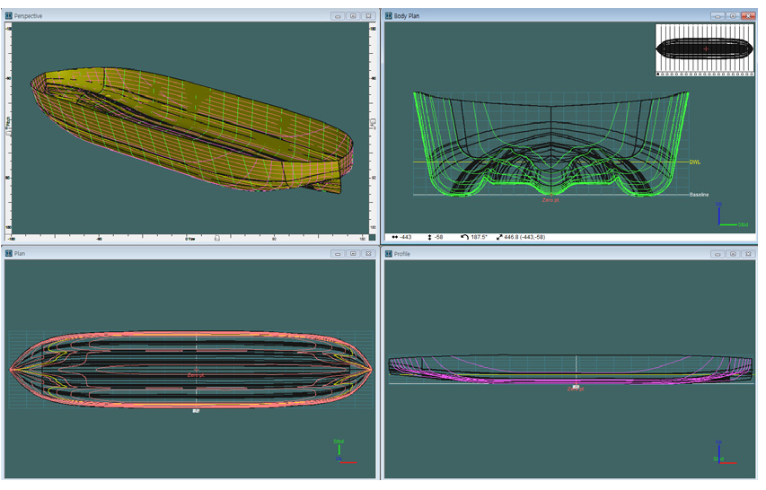

图 1. RPO-2 的三维曲面设计。

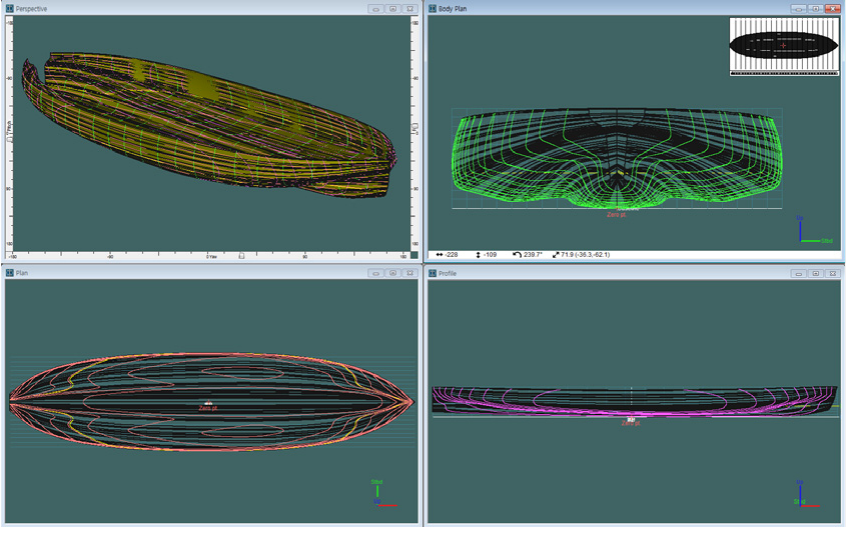

图 2. Hobie KONA 的三维曲面设计。

### 2.2 静水力计算

研究为一名乘员与船体的总质量建立排水量基准，并对不同吃水深度进行静水力计算。RPO-2 和 KONA 的结果分别列于表 1、表 2。随后选取乘员与船体合计 116 kg 的工况，计算吃水及相关系数，用于两艇的水动力性能评价。

表 1. RPO-2 正浮状态的静水力参数。

| 参数 | 单位 | 吃水 86 mm | 吃水 92 mm | 吃水 98 mm | 吃水 104 mm |
|---|---:|---:|---:|---:|---:|
| 排水质量 | kg | 110.8 | 122.4 | 134.2 | 146.2 |
| 水线长 | mm | 3483.8 | 3523.9 | 3527.3 | 3530.3 |
| 水线最大宽 | mm | 678.2 | 680.5 | 682.9 | 685.2 |
| 湿表面积 | mm² | 2339513 | 2406928 | 2475219 | 2542877 |
| 棱形系数 Cp | — | 0.669 | 0.673 | 0.683 | 0.692 |
| 方形系数 Cb | — | 0.504 | 0.514 | 0.529 | 0.542 |
| 浮心纵向位置 LCB | mm | 70.4 | 65.8 | 61.7 | 57.8 |
| 浮心距基线高度 KB | mm | 53.2 | 56.6 | 60 | 63.4 |

表 2. KONA 正浮状态的静水力参数。

| 参数 | 单位 | 吃水 86 mm | 吃水 92 mm | 吃水 98 mm | 吃水 104 mm |
|---|---:|---:|---:|---:|---:|
| 排水质量 | kg | 103.5 | 116 | 128.8 | 141.8 |
| 水线长 | mm | 3467.3 | 3471.4 | 3475.1 | 3478.7 |
| 水线最大宽 | mm | 853.4 | 855 | 856.3 | 857.2 |
| 湿表面积 | mm² | 2207973 | 2281309 | 2351025 | 2418191 |
| 棱形系数 Cp | — | 0.544 | 0.556 | 0.568 | 0.579 |
| 方形系数 Cb | — | 0.397 | 0.415 | 0.431 | 0.446 |
| 浮心纵向位置 LCB | mm | 144.9 | 134.6 | 125.4 | 117 |
| 浮心距基线高度 KB | mm | 56.2 | 59.8 | 63.3 | 66.7 |

### 2.3 稳性计算

皮艇的稳性与乘员安全有关。船体倾斜后恢复直立的能力取决于重量中心和浮力中心在倾斜状态下的相对位置；对应的复原作用可用复原力臂表示。

稳性比较采用相同的 116 kg 排水质量，相当于一名 80 kg 乘员加 36 kg 船体及配重。此时 RPO-2 的吃水为 89 mm，KONA 为 92 mm。计算中，两艇的垂向重心均设在距船底基线 200 mm 处。

计算结果显示，RPO-2 的最大复原力臂 GZ 在倾斜 25.5° 时为 134.3 mm；KONA 的最大值在倾斜 30° 时为 160.7 mm。在 116 kg 排水质量条件下，作者称 KONA 的最大复原力臂比 RPO-2 长约 16.43%。

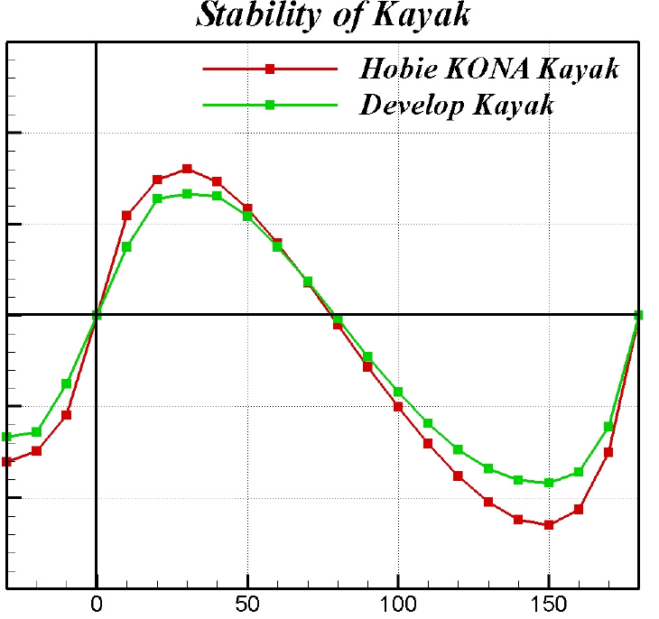

图 3. 复原力臂比较。横轴为向右舷倾斜的角度，纵轴为 GZ（mm）；红线为 Hobie KONA，绿线为开发艇。

## 3. 水槽试验准备

### 3.1 试验概况

研究对 RPO-2 和 KONA 依次进行倾斜试验、转弯试验和阻力试验。前两项采用实艇，在海洋工程水槽中完成；阻力试验则采用缩尺模型，在循环水槽中完成。两种试验设施分别见图 4、图 5。

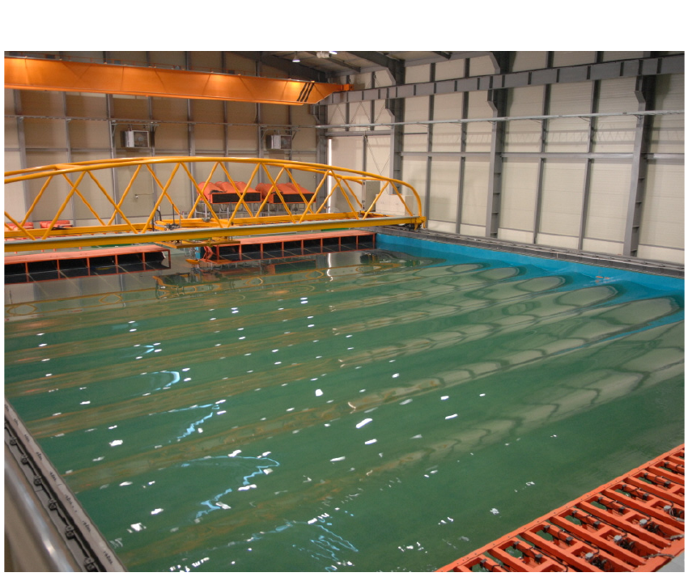

图 4. 海洋工程水槽照片。

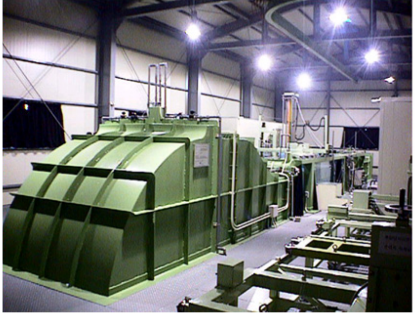

图 5. 循环水槽照片。

### 3.2 倾斜试验准备

为估计两艇在 116 kg 排水质量下的垂向重心 KG，研究人员将船体和配重的总质量调整到目标排水质量，并分配配重，使水面与干舷线保持平行。RPO-2 为充气艇，试验时充气压力为 15 psi；KONA 为硬壳艇，无需充气。

倾斜试验使用 12.3 kg 配重，将其沿横向移动 30 cm，测量相应横倾角，再据此估计垂向重心。

### 3.3 转弯试验准备

在 116 kg 相同排水质量下，研究人员将两艇质量均调整为 36 kg，并以一名 80 kg 成人坐在相同位置的状态为基准。两艇使用形状相同的舵，在 25° 舵角下测量转弯半径。

研究人员从海洋工程水槽上方斜向拍摄视频。拍摄后校正摄像机角度，识别船头位置，将轨迹映射到平面，进而估计转弯半径；校正示意见图 6。

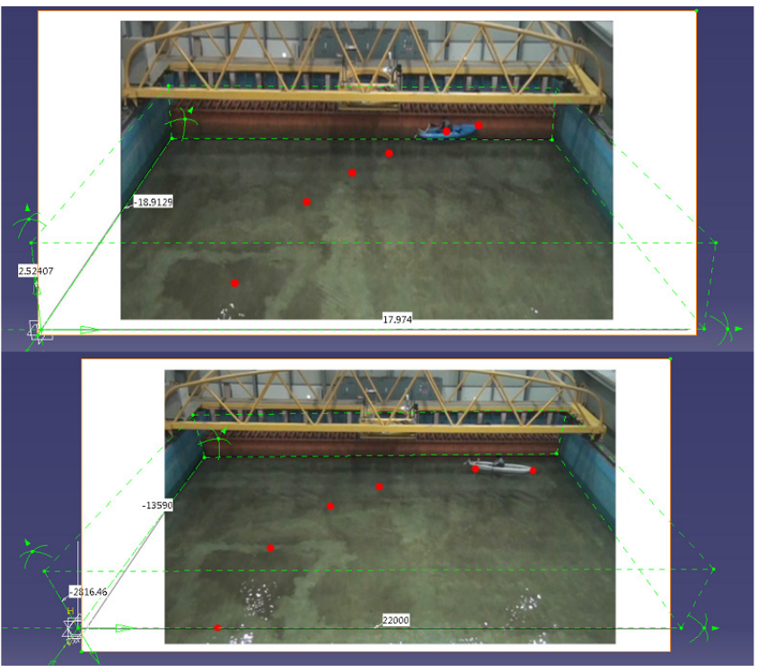

图 6. 各次转弯试验的校正示意。

### 3.4 阻力试验准备

阻力试验按弗劳德相似准则选取模型速度。实艇性能的换算采用以 1978 年 ITTC 解析方法为基础的二维方法，模型与实艇的相关线采用 1957 年 ITTC 方法[7,8]。纵倾和升沉量均以无量纲形式表示。原文给出的阻力系数分解和修正公式如下：

$$
C_{TS}=C_{FS}+C_R+C_A+C_{AA},
$$

$$
C_A=\left[105\left(\frac{k_s}{L_{WL}}\right)^{1/3}-0.64\right]\times10^{-3},
\qquad k_s=150\,\mu\mathrm{m},
$$

$$
C_{AA}=0.001\left(\frac{A_T}{S}\right).
$$

其中，$C_{TS}$ 为总阻力系数，$C_{FS}$ 为摩擦阻力系数（1957 年 ITTC 曲线），$C_R$ 为剩余阻力系数，$C_A$ 为模型—实艇相关修正系数（1978 年 ITTC 方法），$C_{AA}$ 为实艇空气阻力系数；$A_T$ 为水线以上的横向投影面积，$S$ 为湿表面积，$L_{WL}$ 为水线长。

原文还将纵倾系数 $T$ 和升沉量系数 $S$ 写为：

$$
T=(d_A-d_F)\frac{2g}{U^2},
\qquad
S=\left(\frac{d_A+d_F}{2}\right)\frac{2g}{U^2}.
$$

这里 $d_A$ 为船尾升沉量，$d_F$ 为船头升沉量，$U$ 为船速，$g$ 为重力加速度。第二式的符号 $S$ 与前述湿表面积 $S$ 重复，译文按原文保留。

研究人员考虑排水质量，用玻璃纤维增强塑料（FRP）制作两艇的缩尺模型。正文称 RPO-2 与 KONA 的缩尺比分别为 3.543 与 3.543；表 3 对 KONA 列出的比值为 3.514。试验设计速度为 6 kn，另测量该速度上下的若干工况。通过模型试验估算实艇的阻力系数、有效马力（EHP）、升沉量及纵倾；6 kn 时的模型状态见图 7、图 8。

表 3. 阻力试验模型与实艇的主要参数。

| 参数 | 单位 | RPO-2 实艇 | RPO-2 模型 | KONA 实艇 | KONA 模型 |
|---|---:|---:|---:|---:|---:|
| 缩尺比 | — | 3.543 | 1.000 | 3.514 | 1.000 |
| 水线长 | m | 3.513 | 0.992 | 3.471 | 0.980 |
| 水线宽 | m | 0.679 | 0.192 | 0.855 | 0.241 |
| 吃水 | m | 0.089 | 0.025 | 0.092 | 0.026 |
| 湿表面积 | m² | 2.375 | 0.189 | 2.281 | 0.182 |
| $A_{VT}$ | m² | 0.342 | 0.027 | 0.342 | 0.027 |
| 排水体积 | m³ | 0.114 | 0.003 | 0.113 | 0.003 |

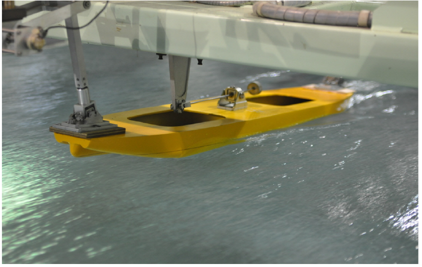

图 7. RPO-2 在 6.0 kn 下的阻力试验。

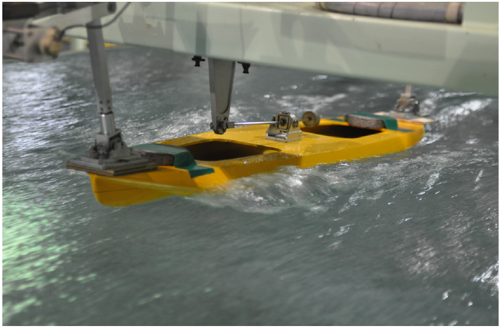

图 8. KONA 在 6.0 kn 下的阻力试验。照片可观察模型航行姿态、造波以及船头附近的水流。

## 4. 水槽试验结果与分析

### 4.1 倾斜试验

研究根据静水力计算得到的浮心高度 KB、稳心高度 KM 和重心高度 KG，对实艇的重心进行最终估算。倾斜试验结果见表 4。作者指出，重心越低，倾斜时的复原力臂越长，并据此称 RPO-2 从稳性角度看更稳定；这一段的判断与前文最大 GZ 的比较不一致，参见文末校订备注。

表 4. 倾斜试验结果，列名与数值按原表保留。

| 船型 | 移动配重（kg） | 横倾角（°） | KB′（m） | B′M′（m） | G′M′（m） | KG′（m） | 实艇 KG（m） |
|---|---:|---:|---:|---:|---:|---:|---:|
| RPO-2 | 12.3 | 4 | 0.058 | 0.532 | 0.410 | 0.180 | 0.1697 |
| KONA | 12.3 | 2.5 | 0.063 | 0.823 | 0.659 | 0.227 | 0.2196 |

### 4.2 转弯试验

两艇转弯轨迹的平面投影见图 9。在相同 25° 舵角下，RPO-2 的转弯半径小于 KONA。作者据此认为 RPO-2 的转弯性能较好，并观察到 KONA 在转弯过程中向转弯圆外侧偏移；作者推测这与其水下船型有关。

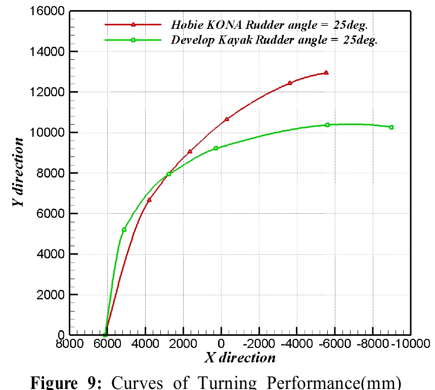

图 9. 转弯性能曲线，坐标单位为 mm；红线为 25° 舵角下的 Hobie KONA，绿线为相同舵角下的开发艇。

### 4.3 阻力试验

图 10 显示，在 6 kn 设计速度下，KONA 实艇的总阻力系数大于 RPO-2；作者由此认为，相同速度下 RPO-2 的阻力较小。图 11 给出了按阻力估算的有效马力，6 kn 时 RPO-2 和 KONA 分别需要 0.769 和 0.975 的有效马力；作者认为这提示 RPO-2 的推进性能较好。

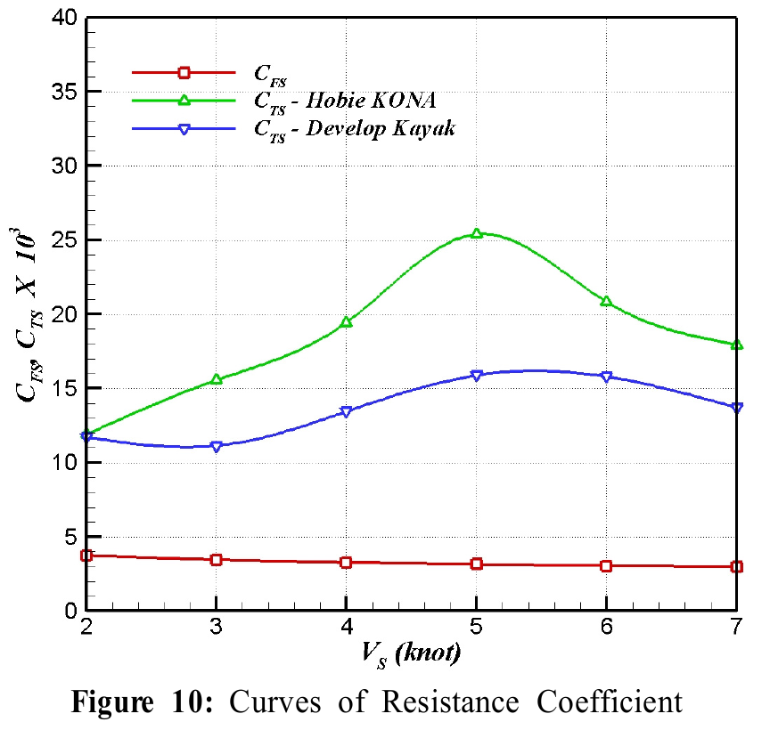

图 10. 阻力系数曲线。横轴为速度（kn），纵轴为阻力系数乘以 $10^3$；图中另绘有摩擦阻力系数。

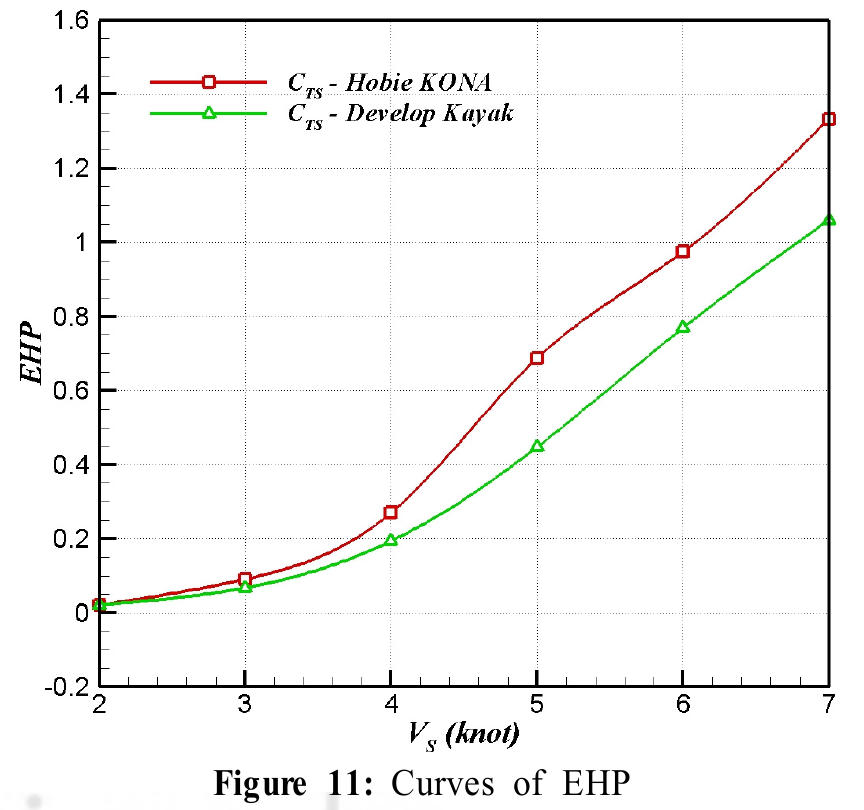

图 11. 有效马力（EHP）随速度变化的曲线；红线为 KONA，绿线为开发艇。

约 2 kn 时，两艇阻力相同；随后速度提高，阻力差逐渐增大，5 kn 以上趋于保持较稳定的差距。作者称，在 5–7 kn 范围内，阻力差平均为 25%。

在图 12 中，设计速度 6 kn、弗劳德数 0.520 时，KONA 的升沉量为负，RPO-2 为正。作者据此推断，RPO-2 在约 6 kn 开始滑航（planing）；KONA 直到试验最高速度 7 kn 仍为负值。随速度增加，RPO-2 的纵倾角也比 KONA 大，且作者认为其船头上抬幅度大于船尾下沉幅度。

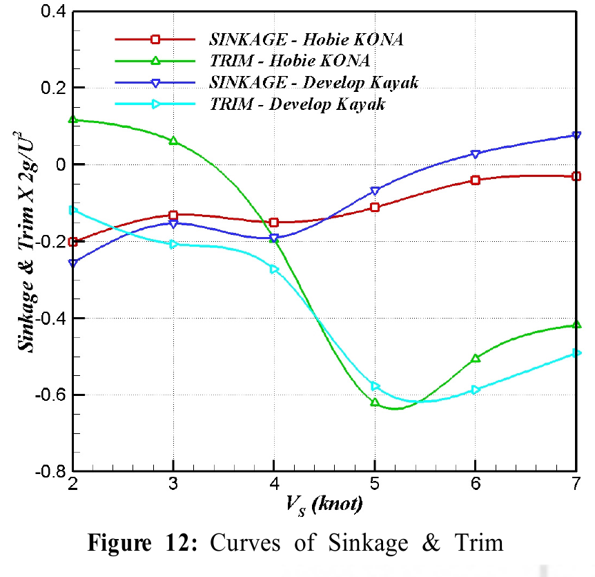

图 12. 升沉量与纵倾曲线。横轴为速度（kn）；原图纵轴标为升沉与纵倾乘以 $2g/U^2$。原图红、蓝线分别表示 KONA 与开发艇的升沉，绿、青线分别表示 KONA 与开发艇的纵倾。

## 4. 结论

作者根据 RPO-2 与 Hobie KONA 的船舶计算和水槽试验，总结了五点。第一，KONA 的最大复原力臂比 RPO-2 长约 16.43%，作者认为这提示 KONA 的稳性较好。第二，以船底为基准，RPO-2 的垂向重心位置比 KONA 低 22.7%。第三，RPO-2 的转弯半径较小。第四，在 6 kn 设计速度下，RPO-2 的阻力系数和有效马力较小。第五，KONA 的升沉量在试验速度范围内均为负，而 RPO-2 为正；作者推测 RPO-2 在约 6 kn 开始滑航。

总体上，作者认为 KONA 的稳性较好但重心较高，RPO-2 的回转与阻力性能更有利，因此还需权衡并改进重心和稳性，并在后续检查相关设计因素。

## 致谢

本研究受韩国文化体育观光部 2011 年体育产业技术开发项目及国民体育振兴公团的国民体育振兴基金资助。作者感谢上述机构的支持。

## 参考文献

[1] C. H. An. *Research on the Activation Plan of Marine Resorts*. Unpublished Master's Dissertation, Graduate School of Mokpo University, 2003.

[2] S. G. Kim. “Merchandizing Strategy for Ocean Tourism.” Korea Maritime Institute, 2001.

[3] B. H. An, C. H. Hwang, and K. W. Kang. “Analysis on the actual conditions in water leisure sports industry.” Korea Sports Promotion Foundation, Korea Institute of Sport Science, 2004.

[4] H. J. Lee. *Developement of Mulitipurpose Compact Protable Kayak based on Sports Science*. Progressive Report (1st year) on Technology Development in Sports Industry, 2012.

[5] Douglas-Westwood. “World Marine Markets,” 2005.

[6] H. J. Lee. *Development of Hybrid Propulsive Inflatable Kayak for Two Persons*. Final Report on Technology Development Promotion for Small & Medium Business, 2010.

[7] C. H. Park, H. Y. Jang, J. W. Jeong, B. S. Lee, and H. H. Chun. “A study on the ship resistance and moment prediction for running attitude of 30 feet catamaran sailing yacht.” *Journal of the Society of Naval Architects of Korea*, 47(3), 321–327, 2010 (in Korean).

[8] H. Y. Jang, C. H. Park, H. W. Kim, B. S. Lee, and I. W. Lee. “A study on the sail force prediction method for hull hydrodynamic force measurement of 30feet catamaran sailing yacht.” *Journal of the Society of Naval Architects of Korea*, 47(4), 477–483, 2010 (in Korean).

## 校订备注

- 原文 2.3 节的计算结果与结论均称 KONA 的最大复原力臂更长，但 4.1 节又据较低重心称 RPO-2 在稳性方面更稳定。两处判断没有在原文中得到协调，译文分别保留。
- 制模段正文给 KONA 的缩尺比 3.543，表 3 为 3.514；同时，原文阻力公式和纵倾／升沉式均使用 $S$ 表示不同物理量。译文分别照录，不代作者改写。
