# 充气皮艇开发的水动力性能评价

原文：Chong-Ku Hah、Lee-Young Lim、Jae-Seok Ki，*Hydrodynamic evaluation for developing the inflatable kayak*，Journal of the Korean Society of Marine Engineering，37(6)，623–630，2013。DOI：10.5916/jkosme.2013.37.6.623。收稿：2013 年 8 月 20 日；修订：9 月 12 日；审稿完成：9 月 26 日。

作者机构：1 韩国体育诊所与工程研究所；2 Woosung I.B. 公司；通讯作者 Jae-Seok Ki，仁川大学产学合作基金会。本研究得到韩国文化体育观光部 2011 年体育产业技术开发项目及国民体育振兴基金支持。

## 摘要

为评价既有充气皮艇 RPO-2 和新开发的充气皮艇 RD-FK-11、RD-FK-12 的水动力性能，研究人员在海洋工程水槽中进行倾斜试验和转弯试验，并在循环水槽中使用缩尺模型进行阻力试验。综合各艇的试验结果，韩文摘要称 KONA 在稳性方面更有利，RD-FK-12 在转弯和重心位置方面表现较好，RD-FK-11 的阻力性能优于 KONA 和 RPO-2。原文英文摘要对 RD-FK-11、RD-FK-12 的转弯与阻力归属表述不同，见文末校订备注。

英文摘要另称：本研究比较海外产品、既有开发的充气皮艇与新开发艇的水动力性能。倾斜试验和转弯试验在海洋工程水槽进行，阻力试验使用循环水槽内的缩尺模型。英文摘要称 KONA 的稳性最大、RD-FK-12 的阻力系数和重心表现显著、RD-FK-11 的转弯性能优于 KONA 与 RD-FK-12；这些对象归属与韩文摘要及正文并不一致。

关键词：水槽模型试验；水动力评价；倾斜试验；充气皮艇；转弯试验。

## 1. 引言

作者认为，随着韩国家庭收入增长，水上休闲文化的参与面正在扩大。自 2009 年首个爱好者团体成立以来，2012 年 3 月登记的皮艇俱乐部成员约为 10,000 人；计入非俱乐部划手，总人数估计为 15,000–20,000 人。皮艇参与人数与露营人数密切相关。韩国休闲运动协会据当时露营人数已超过 100 万，预计家庭休闲皮艇和中长距离旅行皮艇的需求会增加[1]。作者称当时韩国皮艇市场约为 450 亿韩元，消费者倾向于选用进口装备，并将其归因于市场仍处于起步阶段及本土装备企业技术积累不足。

据文中统计，韩国休闲船艇制造企业约 20 家，仅占全部 1,325 家船舶及船艇建造企业的 1.5%；从业者约 184 人，约占该行业 104,224 名从业者的 0.2%。作为对照，含大型商船在内的船舶建造业在 2006 年约有 1,305 家企业和 104,000 名从业者[2]。

作者引用美国资料称，休闲船艇及使用桨的运动（皮艇、独木舟和充气筏）参与人数约为 7,000 万。2005–2006 年，美国独木舟销量增长 23%，皮艇增长 11%，动力船下降 5%[3]。文中将这种趋势与露营结合的划桨运动及其相对于机动船较低的污染联系起来。

作者称，塑料或复合材料皮艇轻且坚固，但存在受冲击损坏的风险，运输时质量和体积也较大；充气皮艇在质量、收纳体积、运输便利性、安全性和价格方面对初学者有吸引力。文中引用资料称，充气产品市场以每年约 15% 的速度增长[4]。

在 2012 年的前项研究中，作者比较了韩国开发的充气皮艇 RPO-2（Woosung）与美国 Hobie 塑料皮艇 KONA 的水动力性能[5]。本研究在此基础上开发 RD-FK-11 和 RD-FK-12，并通过稳性计算、倾斜试验、转弯试验和水槽模型试验，比较各艇的稳性、重心、转弯半径及阻力系数。

## 2. 充气皮艇设计

### 2.1 船体线型设计

两款新艇用于解决此前 RPO-2 评价中提出的问题。团队制作样艇、多次进行现场测试，听取专家意见后修改设计，并对 RD-FK-11 和 RD-FK-12 进行逆向建模，以建立用于静水力与稳性计算的三维模型。RD-FK-11 有内部框架，RD-FK-12 没有内部框架；原文分别称为“R&D Frame Kayak 11th”和“R&D Frame Kayak 12th”。

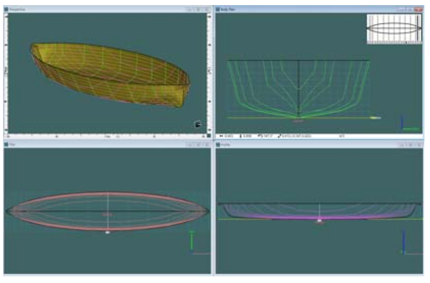

图 1. RD-FK-11（带内部框架）的三维设计。

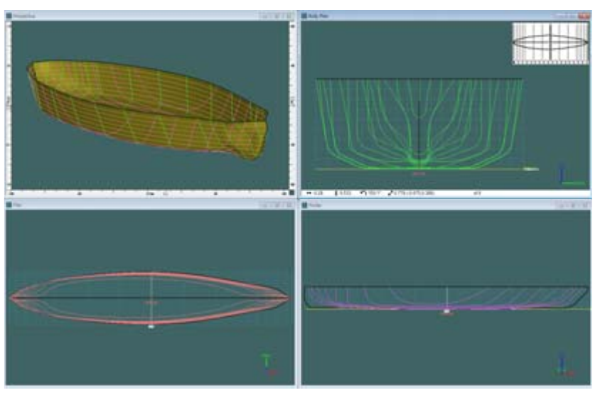

图 2. RD-FK-12（不带内部框架）的三维设计。

### 2.2 静水力计算

为建立一名乘员与船体合计 116 kg 的排水质量基准，研究人员使用 Maxsurf Hydromax 17.04 三维船型程序，计算两艇在设计载重水线及不同吃水下的排水质量、浮心高度 KB、湿表面积等静水力参数。RD-FK-11 和 RD-FK-12 的结果分别见表 1 和表 2。

研究人员从原三维形状数据重新构造船底曲面，并尽可能简化船头和船尾。作者认为，简化可能稍微改变静水力计算结果，但占主要浮力的船体中央约 80%–95% 长度范围与设计形状一致；船头和船尾的简化可能导致约 1%–2% 的结果误差，作者将其视为常见计算误差范围。

表 1. RD-FK-11 不同吃水下的静水力参数；水线前向为正。原表所有数值按原顺序保留。

| 参数 | 单位 | 1 | 2 | 3 | 4 | 5 | 6 | 7 | 8 | 9 |
|---|---:|---:|---:|---:|---:|---:|---:|---:|---:|---:|
| 排水质量 | kg | 103.7 | 116 | 128.3 | 140.6 | 152.9 | 165.2 | 177.5 | 189.8 | 202.1 |
| 吃水 | mm | 87.6 | 93.5 | 99.2 | 104.8 | 110.3 | 115.7 | 121.1 | 126.4 | 131.6 |
| 水线长 | mm | 4080.2 | 4092.6 | 4103.4 | 4113.1 | 4121.8 | 4129.9 | 4137.4 | 4144.4 | 4151 |
| 水线最大宽 | mm | 706.4 | 716.1 | 722.7 | 727.8 | 731.8 | 735.3 | 738.4 | 741.3 | 744.1 |
| 湿表面积 | mm² | 2139444 | 2215998 | 2283780 | 2346200 | 2403979 | 2458947 | 2511857 | 2563224 | 2613135 |
| 棱形系数 Cp | — | 0.626 | 0.631 | 0.637 | 0.642 | 0.646 | 0.651 | 0.655 | 0.659 | 0.662 |
| 方形系数 Cb | — | 0.401 | 0.413 | 0.426 | 0.437 | 0.448 | 0.459 | 0.468 | 0.477 | 0.485 |
| 最大横剖面面积系数 Cm | — | 0.640 | 0.654 | 0.668 | 0.681 | 0.694 | 0.705 | 0.715 | 0.724 | 0.732 |
| 水线面系数 Cwp | — | 0.700 | 0.708 | 0.716 | 0.722 | 0.728 | 0.732 | 0.736 | 0.739 | 0.742 |
| 浮心纵向位置 LCB（以零点为准） | mm | 0 | 0 | 0 | 0 | 0 | 0 | 0 | 0 | 0 |
| 水线面形心纵向位置 LCF（以零点为准） | mm | 0 | 0 | 0 | 0 | 0 | 0 | 0 | 0 | 0 |
| 浮心高度 KB | mm | 57.4 | 61 | 64.3 | 67.6 | 70.8 | 74 | 77.1 | 80.1 | 83.1 |

表 2. RD-FK-12 不同吃水下的静水力参数；水线前向为正。

| 参数 | 单位 | 1 | 2 | 3 | 4 | 5 | 6 | 7 | 8 | 9 |
|---|---:|---:|---:|---:|---:|---:|---:|---:|---:|---:|---:|
| 排水质量 | kg | 103.7 | 116 | 128.3 | 140.6 | 152.9 | 165.2 | 177.5 | 189.8 | 202.1 |
| 吃水 | mm | 71.5 | 77.5 | 83.4 | 89.2 | 95 | 100.7 | 106.3 | 112 | 117.5 |
| 水线长 | mm | 4145.7 | 4158.4 | 4170 | 4180.8 | 4190.8 | 4200.2 | 4209.1 | 4217.3 | 4224.8 |
| 水线最大宽 | mm | 695.9 | 702.8 | 707.8 | 711.8 | 714.9 | 717.5 | 719.8 | 721.8 | 723.8 |
| 湿表面积 | mm² | 2123722 | 2189329 | 2249501 | 2306259 | 2360977 | 2414294 | 2466637 | 2518298 | 2569358 |
| 棱形系数 Cp | — | 0.596 | 0.603 | 0.609 | 0.614 | 0.619 | 0.623 | 0.626 | 0.629 | 0.632 |
| 方形系数 Cb | — | 0.491 | 0.500 | 0.509 | 0.517 | 0.524 | 0.531 | 0.538 | 0.543 | 0.549 |
| 最大横剖面面积系数 Cm | — | 0.829 | 0.835 | 0.841 | 0.847 | 0.852 | 0.858 | 0.863 | 0.867 | 0.871 |
| 水线面系数 Cwp | — | 0.687 | 0.691 | 0.694 | 0.697 | 0.698 | 0.700 | 0.701 | 0.703 | 0.704 |
| 浮心纵向位置 LCB（以零点为准） | mm | −146.7 | −146.5 | −146.2 | −146 | −145.7 | −145.5 | −145.3 | −145.1 | −144.9 |
| 水线面形心纵向位置 LCF（以零点为准） | mm | −145.9 | −144.2 | −143.2 | −143 | −142.5 | −142.3 | −142.5 | −142.3 | −142 |
| 浮心高度 KB | mm | 41.9 | 45.3 | 48.7 | 52 | 55.2 | 58.4 | 61.5 | 64.6 | 67.6 |

### 2.3 稳性计算

两艇的稳性评价采用相同的 116 kg 排水质量，相当于一名 80 kg 成人加 36 kg 船体及配重。该工况下 RD-FK-11 吃水 93.5 mm，RD-FK-12 吃水 77.5 mm。计算中，两艇的垂向重心均设在船底基线上方 200 mm。

## 3. 水槽试验

### 3.1 试验准备

两艇充气压力与前项研究的 RPO-2 相同，均为 15 psi。研究依次开展倾斜试验、转弯试验和阻力试验。前两项在海洋工程水槽中用实艇完成；阻力试验使用缩尺模型，在循环水槽中完成。设施照片见图 3、图 4。

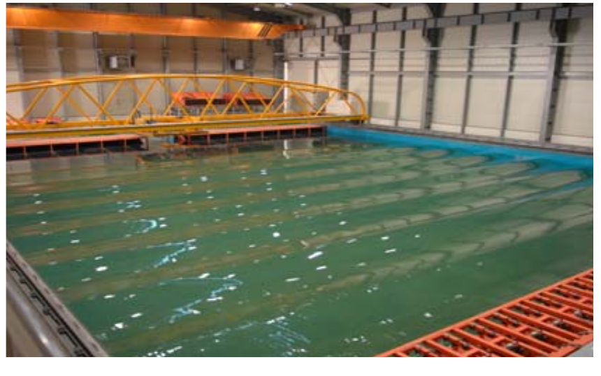

图 3. 海洋工程水槽，原文注明经 Ki（2012）许可转载。

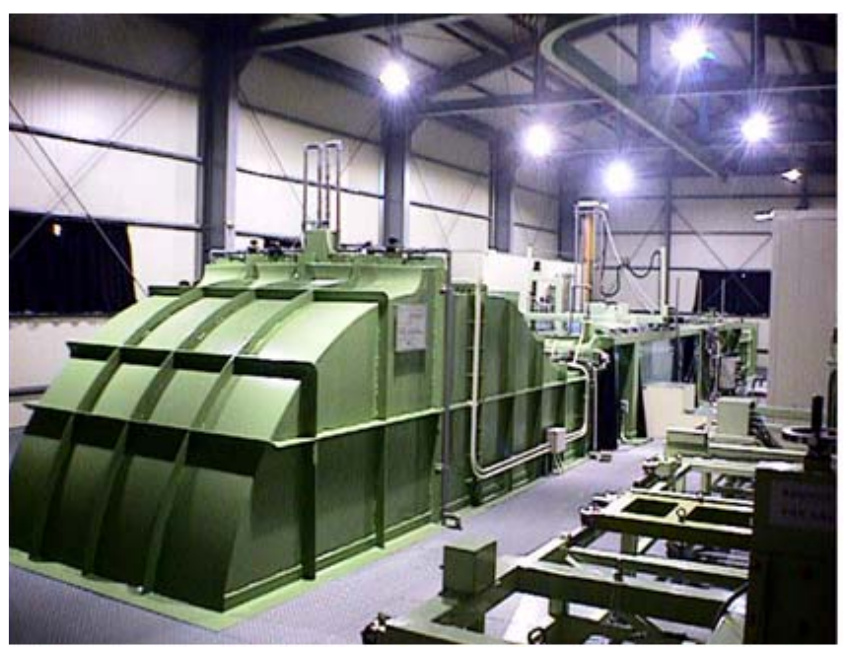

图 4. 循环水槽，原文注明经 Ki（2012）许可转载。

### 3.2 倾斜试验

为估计 RD-FK-11 与 RD-FK-12 在 116 kg 相同排水质量下的垂向重心 KG，研究人员调整船体及配重总质量，并分配配重，使船体干舷与水面平行。试验使用 12.3 kg 配重，横向移动 30 cm 后测量横倾角，据此估计重心高度。

### 3.3 转弯试验

转弯试验将两艇质量均调整为 31.4 kg，并以一名 80 kg 成年男性乘坐为基准。两艇采用相同的舵，舵角设为 25°；轨迹校正过程见图 5。此处的质量之和为 111.4 kg，原文没有解释其与前述 116 kg 排水质量基准的差异。

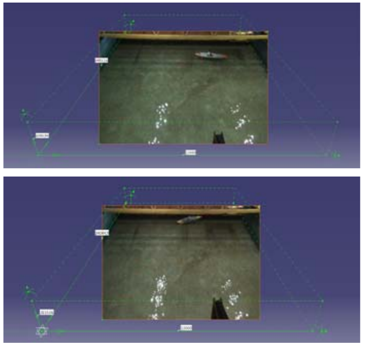

图 5. 每次转弯试验的轨迹校正。

### 3.4 阻力试验

阻力试验只针对 RD-FK-11；原文明确说 RD-FK-12 是超出原定研究计划增加的模型，因此没有纳入这项试验。试验按弗劳德相似准则选取模型速度，用以 1978 年 ITTC 方法为基础的二维方法换算阻力，并把纵倾和升沉量表示为无量纲数。公式与前项研究相同：

$$
C_{TS}=C_{FS}+C_R+C_A+C_{AA},
$$

$$
C_A=\left[105\left(\frac{k_s}{L_{WL}}\right)^{1/3}-0.64\right]\times 10^{-3},
\qquad k_s=150\,\mu\mathrm{m},
$$

$$
C_{AA}=0.001\left(\frac{A_T}{S}\right).
$$

其中，$C_{TS}$ 为总阻力系数，$C_{FS}$ 为按 1957 年 ITTC 曲线确定的摩擦阻力系数，$C_R$ 为剩余阻力系数，$C_A$ 为模型—实艇相关修正系数，$C_{AA}$ 为实艇空气阻力系数；$A_T$ 为水线以上横向投影面积，$S$ 为湿表面积，$L_{WL}$ 为水线长。原文又以 $S$ 表示无量纲升沉系数，译文保留这一重复用法：

$$
T=(d_A-d_F)\frac{2g}{U^2},
\qquad
S=\left(\frac{d_A+d_F}{2}\right)\frac{2g}{U^2},
$$

其中 $T$ 是无量纲纵倾系数，$d_A$ 和 $d_F$ 分别为船尾与船头的升沉量，$U$ 为船速，$g$ 为重力加速度。

研究人员制作 RD-FK-11 的模型，在中小造船研究院的循环水槽内测量阻力，按目标载重调整模型吃水。实艇设计速度为 6.0 kn，试验还包括设计速度上下的工况。循环水槽参数见表 3，6.0 kn 时的试验照片见图 6。阻力数据仍按 ITTC 二维方法分析；采用玻璃纤维增强塑料（FRP）制作的模型缩尺比为 4.558，外形见图 7。

表 3. 循环水槽规格。

| 项目 | 原文规格 |
|---|---|
| 主体长 × 宽 × 高 | 17.6 × 3.1 × 6.40 m |
| 观察段长 × 宽 × 高 | 6.0 × 2.0 × 1.55 m |
| 水容量 | 90 t |
| 电机 | 约两套直流 30 kW |
| 叶轮 | 两套直径 800 mm、每套 5 叶片的立式循环叶轮 |
| 模型皮艇长度 | 1.0–2.0 m |
| 水流速度范围 | 0.1–3.0 m/s |

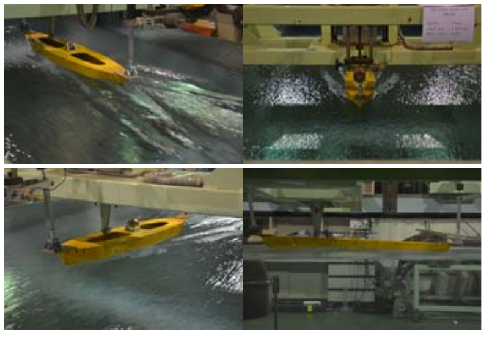

图 6. RD-FK-11 在 6.0 kn 下的阻力试验照片。

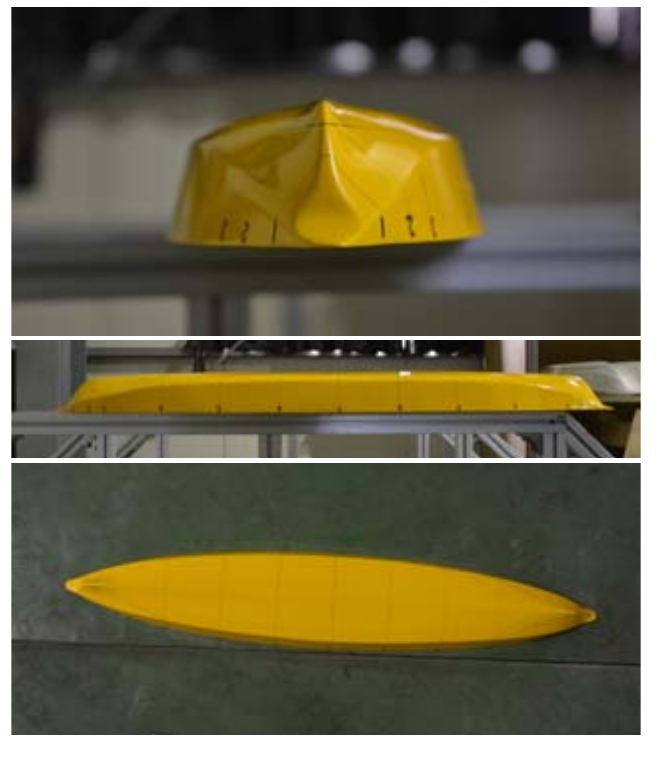

图 7. RD-FK-11 缩尺模型。

## 4. 水槽试验结果与分析

### 4.1 倾斜试验

依据静水力和稳性计算，在 30° 横倾角下，RD-FK-11 的复原力臂 GZ 比 RD-FK-12 大约 14.93%。四艇在相同的 116 kg 排水质量下比较，KONA 的稳性表现最好，RD-FK-12 最差。重心高度按表 4 从高到低为 RD-FK-11 ＞ KONA ＞ RPO-2 ＞ RD-FK-12。图 8 给出各艇复原力臂曲线。

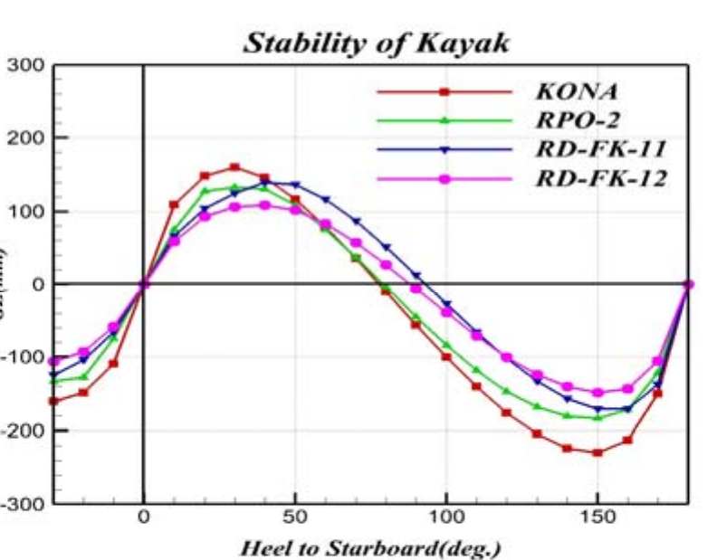

图 8. 复原力臂比较；横轴为向右舷倾斜角，纵轴为 GZ（mm）。

表 4. 倾斜试验结果。原表前三行中 RPO-2 与 KONA 的实艇 KG 值按三位小数列示。

| 船型 | 移动配重（kg） | 横倾角（°） | KB′（m） | B′M′（m） | G′M′（m） | KG′（m） | 实艇 KG（m） |
|---|---:|---:|---:|---:|---:|---:|---:|
| RPO-2 | 12.3 | 4 | 0.058 | 0.532 | 0.410 | 0.180 | 0.170 |
| KONA | 12.3 | 2.5 | 0.063 | 0.823 | 0.659 | 0.227 | 0.220 |
| RD-FK-11 | 12.3 | 5.0 | 0.064 | 0.552 | 0.329 | 0.287 | 0.274 |
| RD-FK-12 | 12.3 | 4.0 | 0.049 | 0.501 | 0.411 | 0.139 | 0.129 |

### 4.2 转弯试验

四艇的转弯结果见图 9。在相同 25° 舵角下，RD-FK-12 的转弯半径最小；Hobie KONA 和 RD-FK-11 的转弯半径较大，二者整体上有向转弯轨迹外侧偏移的趋势。

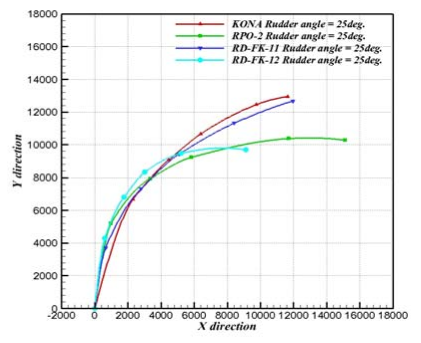

图 9. 转弯性能曲线；图例给出四艇的 25° 舵角，坐标单位为 mm。

### 4.3 阻力试验

图 10 中总阻力系数的大小顺序为 KONA ＞ RPO-2 ＞ RD-FK-11。作者称，与 KONA 和 RPO-2 相比，RD-FK-11 的总阻力系数分别改善约 39.62% 和 19.36%。图 11 给出的 6 kn 有效马力从高到低同样为 KONA、RPO-2、RD-FK-11，数值分别为 0.975、0.769、0.540 hp；作者据此认为 RD-FK-11 的推进性能最好。

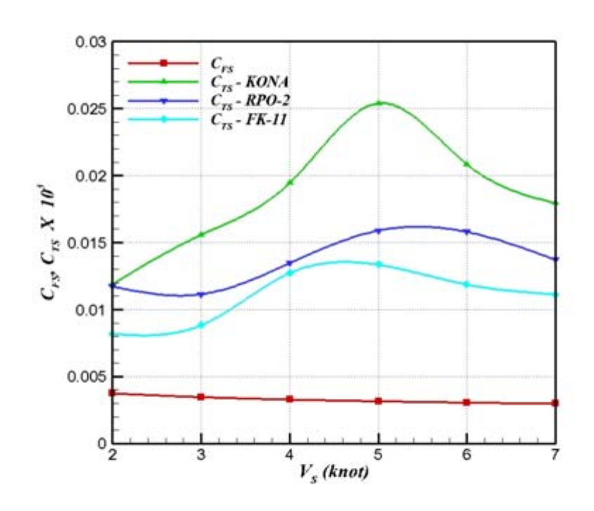

图 10. 阻力系数随速度变化；图中比较 KONA、RPO-2、RD-FK-11 的总阻力系数及共同的摩擦阻力系数。

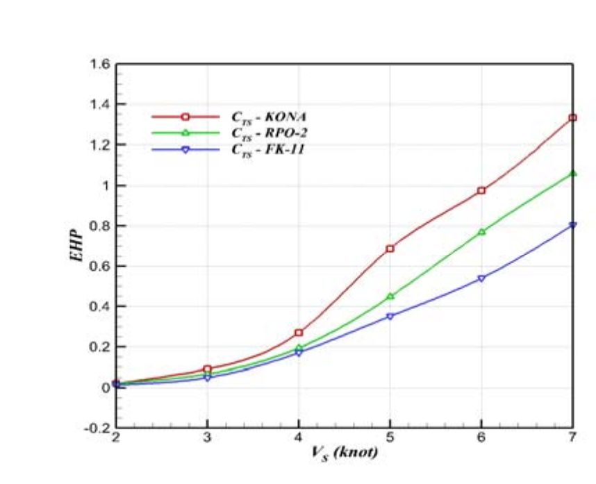

图 11. 三艇的有效马力（EHP）随速度变化。

图 12 显示，在 6 kn、弗劳德数约 0.520 时，仅 RPO-2 的升沉系数转为正值；KONA 与 RD-FK-11 仍为相近的负值。作者推测 RPO-2 在约 6 kn 开始滑航，而另外两艇到 7 kn 仍未上抬。6 kn 时纵倾量的大小顺序为 RD-FK-11 ＞ KONA ＞ RPO-2，继续加速后趋势相同；作者认为船头上抬比船尾下沉更明显。

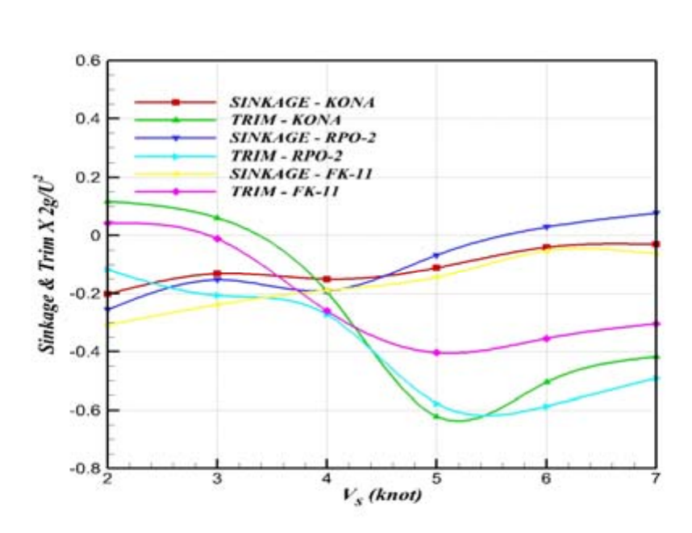

图 12. 三艇的无量纲升沉量与纵倾随速度变化。

## 5. 结论

与 RPO-2、KONA 相比，两款新艇显示出不同取舍。KONA 的稳性最大，RD-FK-12 最小。RD-FK-11 的总阻力系数相对于 KONA 和 RPO-2 分别改善约 39.62% 和 19.36%。RD-FK-11 的重心最高，RD-FK-12 最低；RD-FK-12 的转弯半径最小，KONA 与 RD-FK-11 的半径较大且出现向外偏移。作者总结称，KONA 在稳性方面更有利，RD-FK-12 在转弯和重心位置方面较好，RD-FK-11 在阻力性能方面优于 KONA 与 RPO-2。

## 致谢

本研究受韩国文化体育观光部 2011 年体育产业技术开发项目和国民体育振兴基金支持。

## 参考文献

[1] Hankyung Magazine. *Travel & Spend*, 83, 2012 (in Korean).

[2] Statistics Korea. *Report of the Census on Establishment*, 2006 (in Korean).

[3] T. Mangione, A. Johnson, M. Sawyer, B. Greenwald, A. Pelletier, J. Gilchrist, and J. E. Tongren. “Paddle sports fatalities—Maine, 2000–2007.” *Morbidity and Mortality Weekly Report*, 57(19), 525–527, 2008.

[4] H. J. Lee. *Development of Hybrid Propulsive Inflatable Kayak for Two Persons*. Final Report on Technology Development Promotion for Small & Medium Business, 2010.

[5] J. S. Ki, C. K. Hah, and H. Y. Jang. “Hydrodynamic evaluation method for developing the inflatable kayak.” *Journal of the Korean Society of Marine Engineering*, 36(5), 627–634, 2012 (in Korean).

## 校订备注

- 韩文摘要、结果与结论将最小转弯半径归于 RD-FK-12，将较低阻力归于 RD-FK-11；英文摘要却把转弯优势归于 RD-FK-11，并把阻力系数和重心表述为 RD-FK-12 的优势。译文主体依据韩文正文及图表，未合并两套互相矛盾的说法。
- 稳性和倾斜试验使用 116 kg 排水质量基准；转弯试验写两艇质量各为 31.4 kg、乘员 80 kg，合计 111.4 kg。原文没有说明两者差额，译文保留各段数字。
