# 新型充气皮艇开发的水动力性能评价

原文：Chong-Ku Hah、Ho Kim、Lee-Young Lim、Jae-Suk Ki，*Hydrodynamic Evaluation for Developing the New Inflatable Kayak*，Journal of the Korean Society of Marine Engineering，39(3)，334–341，2015。DOI：10.5916/jkosme.2015.39.3.334。收稿：2014 年 8 月 18 日；修订：11 月 28 日；接受：2015 年 2 月 9 日。

作者机构：1 韩国体育诊所与工程研究所；2 仁川技术园区；3 Woosung I.B. 公司；通讯作者 Jae-Suk Ki，祥明大学。

## 摘要

本研究评价三种新型充气皮艇的水动力性能，为新产品开发提供依据。研究人员进行了静水力计算，并在海洋工程水槽和循环水槽中开展试验。韩文摘要称，V 形船底皮艇的复原力臂最大，为 132.4 mm，转弯半径最小；针形窄底皮艇的阻力最小，为 71 N，重心最低，为 0.128 m，但整体有侧滑趋势。作者据此认为，V 形船底艇在稳性和转弯方面较好，针形窄底艇在重心位置和阻力方面较好。英文摘要也说明比较对象是框架艇、针形窄底艇和 V 形船底艇；实艇在海洋工程水槽中进行倾斜与转弯试验，缩尺模型在循环水槽中进行阻力试验。

关键词：充气皮艇；水动力评价；水槽模型试验；循环水槽试验。

## 符号

$C_{TS}$：总阻力系数；$C_{FS}$：1957 年 ITTC 曲线给出的摩擦阻力系数；$C_R$：剩余阻力系数；$C_A$：模型—实艇相关修正系数；$C_{AA}$：实艇空气阻力系数；$A_T$：水线以上横向投影面积；$S$：湿表面积，亦在另一公式中用于无量纲升沉系数；$L_{WL}$：水线长；$T$：无量纲纵倾系数；$U$：船速；$g$：重力加速度；$d_A$：船尾升沉量；$d_F$：船头升沉量。

## 1. 引言

作者以“乘皮艇到车辆难以抵达的地方露营”为例，介绍露营者寻找较安静、独立活动空间的趋势。文中认为，皮艇运动让人们在湖泊、河流与海上接触自然，是韩国逐渐发展的划桨运动；与机动船相比，它与露营相结合时不会产生相同形式的机动污染。韩国休闲协会据 2012 年约 100 万露营人口，预计家庭休闲皮艇和中长距离旅行皮艇需求将增加[1]。

文中引用美国资料称，前三年划桨运动参与人数为 1,920 万；原文将 6.6%、6.8%、6.7% 分别标为“2010 年、2011 年、2010 年”的增长值。皮艇参与人数达到 1,030 万，另将 3.0%、3.5%、3.6% 标为“2010 年、2011 年、2010 年”的增长值。所引资料称，皮艇参与者中 25–44 岁者占 38%，白人占 80%，年收入超过 100,000 美元者占 35%，大学以上学历者占 49%，每年平均划艇 8 天[2]。原文两组年份均重复了 2010 年，译文未自行推定应为何年。

作者指出，韩国当时多数划桨运动企业以代工生产为主，设计技术和自主型号开发不足；东南亚与中国企业进入市场后，国际竞争进一步加剧。文中认为皮艇市场主要分为可大批量生产的塑料艇与充气艇，国外塑料艇厂家也开始进入充气艇市场。充气艇充气后使用、放气后可折叠运输，文中引用资料称相关市场每年增长约 15%[3]。作者主张以已有制造技术为基础，发展船体设计和生产自动化，提高韩国本土产品竞争力。

韩国当时有包括 Woosung I.B. 在内约两三家企业生产、销售可用桨推进的 1–3 人艇。2012 年的研究比较了 RPO-2 与 Hobie KONA 的水动力性能[4]；2013 年的后续研究又比较了 RPO-2、KONA、RD-FK-11 与 RD-FK-12[5]。团队根据这些结果，于 2014 年开发一款带内部框架的皮艇和两款不带框架的充气皮艇，本文比较这三款新艇的水动力性能。

## 2. 充气皮艇设计

本研究的三种艇分别是带内部框架的框架艇（frame kayak，Type 1）、无内部框架的针形窄底艇（needle knife kayak，Type 2），以及无内部框架的 V 形船底艇（v-hull kayak，Type 3）。以下均使用 Type 1、Type 2、Type 3 指代。

### 2.1 船体线型设计

研究人员为三种艇建立三维船体表面模型，用于船舶静水力计算和稳性评价。图 1、3、5 分别展示三艇的实物外观及前、侧、上／下视角；图 2、4、6 展示通过逆向建模获得的三维形状。

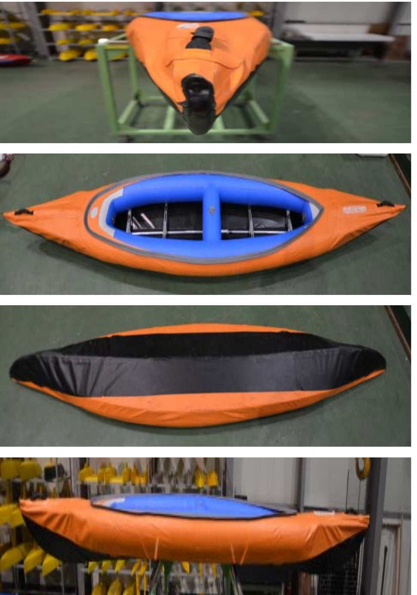

图 1. 带内部框架的皮艇（Type 1）。

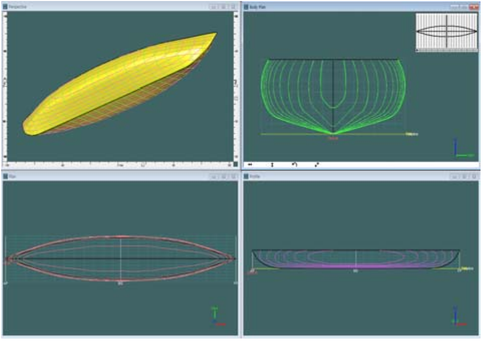

图 2. Type 1 三维曲面设计。

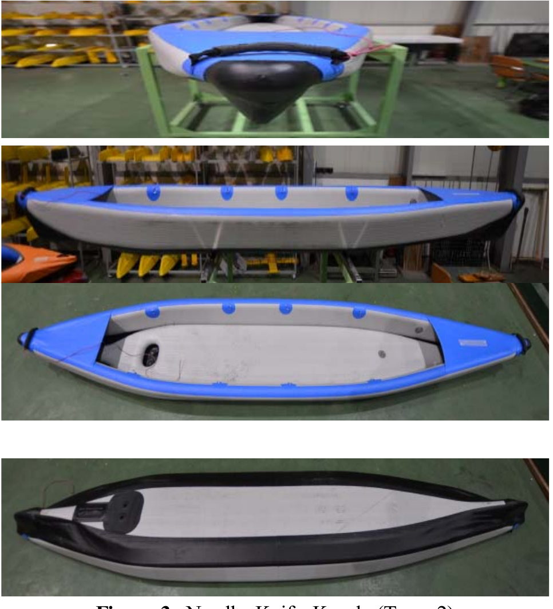

图 3. 针形窄底艇（Type 2）。

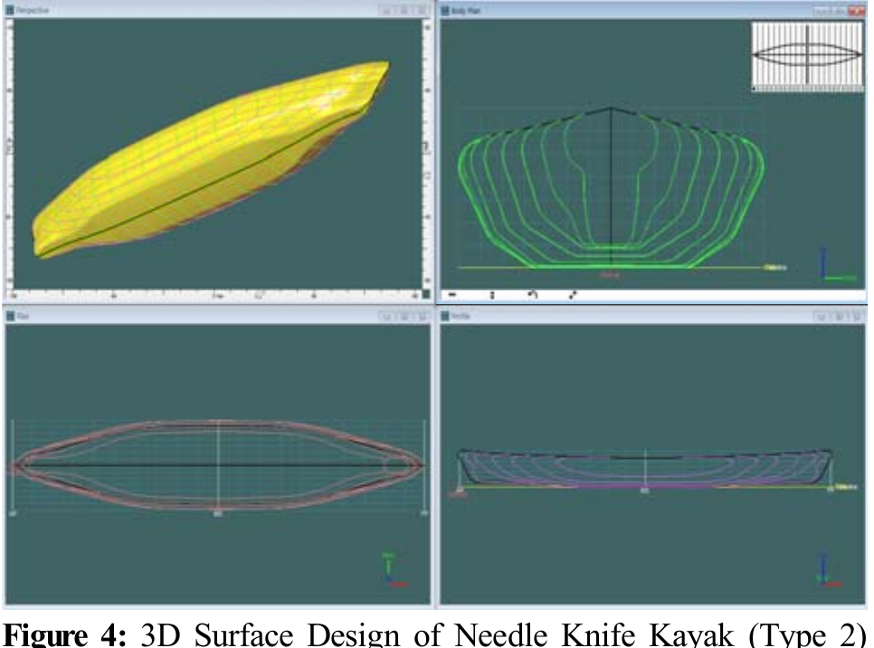

图 4. Type 2 三维曲面设计。

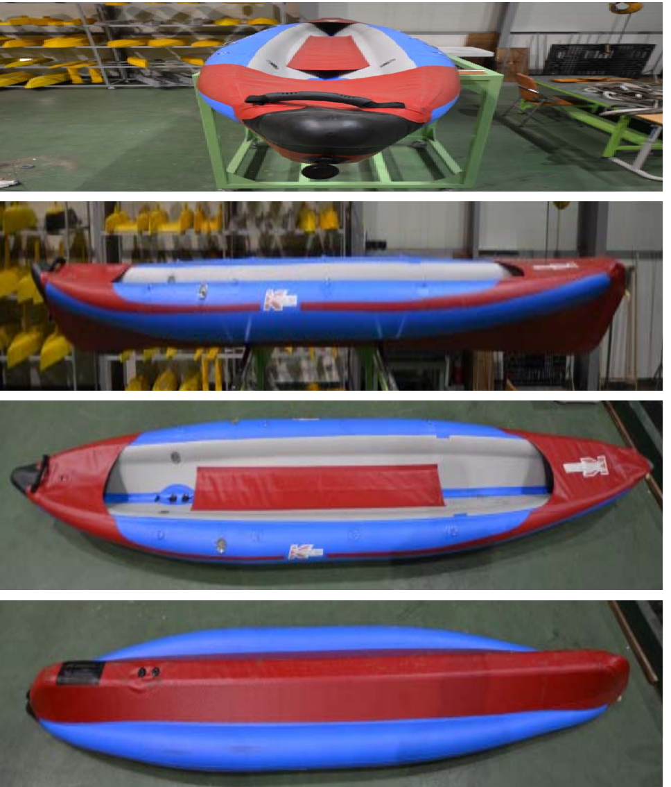

图 5. V 形船底艇（Type 3）。

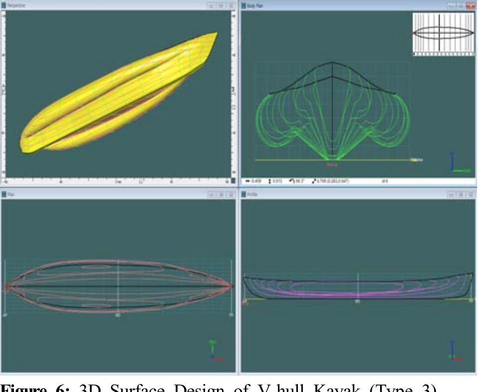

图 6. Type 3 三维曲面设计。

### 2.2 静水力计算

研究使用 Maxsurf Hydromax 17.04，计算三艇的排水质量、浮心位置 KB、湿表面积等参数，以及各艇设计载重水线处的特征值。吃水是水面到船体浸没最低点的垂直距离；不同吃水对应的静水力结果见表 1、2、3。表中每列对应一组排水质量与吃水，不同艇的相同列序号对应相同排水质量。

表 1. Type 1 在 67.1–131.8 mm 吃水范围内的静水力参数。

| 参数 | 单位 | 1 | 2 | 3 | 4 | 5 | 6 | 7 | 8 | 9 |
|---|---:|---:|---:|---:|---:|---:|---:|---:|---:|
| 排水质量 | kg | 60.0 | 77.5 | 95.0 | 112.5 | 130.0 | 147.5 | 165.0 | 182.5 | 200.0 |
| 吃水 | mm | 67.1 | 76.8 | 85.7 | 94.0 | 102.0 | 109.7 | 117.2 | 124.6 | 131.8 |
| 水线长 | mm | 4085.6 | 4131.4 | 4171.3 | 4207.0 | 4239.2 | 4268.5 | 4295.1 | 4319.5 | 4342.2 |
| 水线最大宽 | mm | 567.4 | 622.9 | 658.5 | 681.1 | 697.1 | 710.1 | 720.8 | 730.2 | 738.5 |
| 湿表面积 | mm² | 1740442 | 1951521 | 2120356 | 2248926 | 2352281 | 2443014 | 2526002 | 2604272 | 2678753 |
| 水线面面积 | mm² | 1651565 | 1845514 | 1996388 | 2103608 | 2181451 | 2243324 | 2294967 | 2339821 | 2378966 |
| 棱形系数 Cp | — | 0.699 | 0.695 | 0.694 | 0.694 | 0.695 | 0.695 | 0.696 | 0.697 | 0.697 |
| 方形系数 Cb | — | 0.376 | 0.382 | 0.393 | 0.407 | 0.420 | 0.432 | 0.443 | 0.453 | 0.461 |
| 最大横剖面面积系数 Cm | — | 0.539 | 0.550 | 0.568 | 0.588 | 0.607 | 0.624 | 0.640 | 0.653 | 0.664 |
| 水线面系数 Cwp | — | 0.712 | 0.717 | 0.727 | 0.734 | 0.738 | 0.740 | 0.741 | 0.742 | 0.742 |
| 浮心纵向位置 LCB（前向为正） | mm | 2354.5 | 2354.7 | 2354.9 | 2355.0 | 2355.1 | 2355.1 | 2355.1 | 2355.1 | 2355.1 |
| 水线面形心纵向位置 LCF（前向为正） | mm | 2355.0 | 2355.6 | 2356.0 | 2355.6 | 2355.4 | 2355.0 | 2354.9 | 2355.0 | 2355.2 |
| 浮心高度 KB | mm | 43.9 | 50.2 | 55.9 | 61.2 | 66.2 | 70.9 | 75.4 | 79.8 | 84.0 |

表 2. Type 2 在 57.6–138.7 mm 吃水范围内的静水力参数。

| 参数 | 单位 | 1 | 2 | 3 | 4 | 5 | 6 | 7 | 8 | 9 |
|---|---:|---:|---:|---:|---:|---:|---:|---:|---:|
| 排水质量 | kg | 60.0 | 77.5 | 95.0 | 112.5 | 130.0 | 147.5 | 165.0 | 182.5 | 200.0 |
| 吃水 | mm | 57.6 | 69.0 | 79.8 | 90.2 | 100.3 | 110.2 | 119.9 | 129.4 | 138.7 |
| 水线长 | mm | 3685.2 | 3717.6 | 3739.0 | 3757.3 | 3771.1 | 3781.6 | 3791.7 | 3801.6 | 3811.5 |
| 水线最大宽 | mm | 574.9 | 591.3 | 603.1 | 614.3 | 625.3 | 636.2 | 646.7 | 657.0 | 667.2 |
| 湿表面积 | mm² | 1531375 | 1662632 | 1772014 | 1867825 | 1956642 | 2041726 | 2124629 | 2205102 | 2284027 |
| 水线面面积 | mm² | 1448312 | 1544528 | 1612945 | 1664108 | 1706545 | 1744775 | 1780903 | 1815407 | 1848693 |
| 棱形系数 Cp | — | 0.574 | 0.593 | 0.608 | 0.620 | 0.630 | 0.638 | 0.645 | 0.650 | 0.655 |
| 方形系数 Cb | — | 0.478 | 0.497 | 0.514 | 0.526 | 0.535 | 0.542 | 0.547 | 0.550 | 0.552 |
| 最大横剖面面积系数 Cm | — | 0.833 | 0.839 | 0.846 | 0.849 | 0.850 | 0.849 | 0.848 | 0.846 | 0.844 |
| 水线面系数 Cwp | — | 0.684 | 0.703 | 0.715 | 0.721 | 0.724 | 0.725 | 0.726 | 0.727 | 0.727 |
| 浮心纵向位置 LCB（前向为正） | mm | 1996.4 | 1996.7 | 1996.9 | 1997.1 | 1997.3 | 1997.5 | 1997.6 | 1997.7 | 1997.8 |
| 水线面形心纵向位置 LCF（前向为正） | mm | 1997.5 | 1998.0 | 1998.0 | 1998.6 | 1998.8 | 1998.5 | 1998.4 | 1998.8 | 1999.3 |
| 浮心高度 KB | mm | 33.3 | 40.1 | 46.4 | 52.4 | 58.2 | 63.8 | 69.2 | 74.5 | 79.7 |

表 3. Type 3 在 85.1–151.4 mm 吃水范围内的静水力参数。

| 参数 | 单位 | 1 | 2 | 3 | 4 | 5 | 6 | 7 | 8 | 9 |
|---|---:|---:|---:|---:|---:|---:|---:|---:|---:|
| 排水质量 | kg | 60.0 | 77.5 | 95.0 | 112.5 | 130.0 | 147.5 | 165.0 | 182.5 | 200.0 |
| 吃水 | mm | 85.1 | 96.0 | 105.5 | 114.1 | 122.1 | 129.8 | 137.1 | 144.4 | 151.4 |
| 水线长 | mm | 4304.4 | 4329.4 | 4349.5 | 4365.9 | 4380.5 | 4393.9 | 4406.4 | 4418.2 | 4429.4 |
| 水线最大宽 | mm | 741.9 | 759.4 | 771.1 | 779.7 | 785.1 | 790.1 | 792.4 | 794.8 | 795.1 |
| 湿表面积 | mm² | 1778938 | 2082519 | 2352815 | 2598503 | 2771738 | 2906537 | 3019808 | 3119481 | 3209445 |
| 水线面面积 | mm² | 1464562 | 1694068 | 1890295 | 2068180 | 2188256 | 2275351 | 2342785 | 2396989 | 2440767 |
| 棱形系数 Cp | — | 0.605 | 0.593 | 0.589 | 0.588 | 0.591 | 0.595 | 0.600 | 0.605 | 0.610 |
| 方形系数 Cb | — | 0.215 | 0.240 | 0.262 | 0.283 | 0.302 | 0.319 | 0.336 | 0.351 | 0.366 |
| 最大横剖面面积系数 Cm | — | 0.357 | 0.405 | 0.446 | 0.482 | 0.512 | 0.538 | 0.561 | 0.582 | 0.601 |
| 水线面系数 Cwp | — | 0.459 | 0.515 | 0.564 | 0.608 | 0.636 | 0.655 | 0.671 | 0.683 | 0.693 |
| 浮心纵向位置 LCB（前向为正） | mm | 2251.8 | 2225.6 | 2208.3 | 2196.6 | 2188.5 | 2183.0 | 2179.5 | 2177.3 | 2176.1 |
| 水线面形心纵向位置 LCF（前向为正） | mm | 2141.7 | 2132.3 | 2132.2 | 2134.7 | 2139.1 | 2146.4 | 2153.4 | 2159.6 | 2165.5 |
| 浮心高度 KB | mm | 55.4 | 63.4 | 70.3 | 76.4 | 82.0 | 87.3 | 92.2 | 96.8 | 101.3 |

### 2.3 稳性计算

稳性评价以各艇实艇质量加一名约 80 kg 成年乘员为基准，具体质量与吃水见表 4。作者先给出图 7 所示的复原力臂曲线，再报告各艇的最大复原力臂和对应横倾角：Type 1 为 132.6 mm、43.6°；Type 2 为 96.1 mm、33.6°；Type 3 为 140.1 mm、39.1°。Type 3 最大，Type 1 次之，Type 2 最小。结论部分另比较固定 30° 横倾角时的数值，二者不是同一指标。

表 4. 稳性评价所用的质量与吃水。

| 类别 | 船型 | 实艇质量（kg） | 乘员质量（kg） | 合计质量（kg） | 吃水（mm） |
|---|---|---:|---:|---:|---:|
| Type 1 | 框架艇 | 23.82 | 80 | 103.82 | 90 |
| Type 2 | 针形窄底艇 | 9.98 | 80 | 89.98 | 77 |
| Type 3 | V 形船底艇 | 16.5 | 80 | 96.5 | 106 |

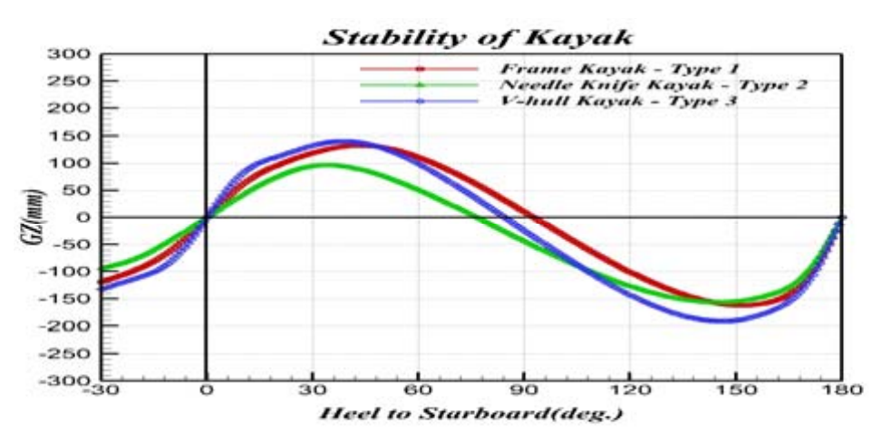

图 7. 三艇复原力臂随向右舷横倾角变化的曲线。

## 3. 水槽试验

### 3.1 试验准备

三艇均充至相同的 15 psi。试验依次包括倾斜试验、转弯试验和阻力试验。前两项使用实艇，在图 8 的海洋工程水槽进行；阻力试验使用缩尺模型，在图 9 的循环水槽进行。图 8、9 的照片经 Ki（2012）许可转载。

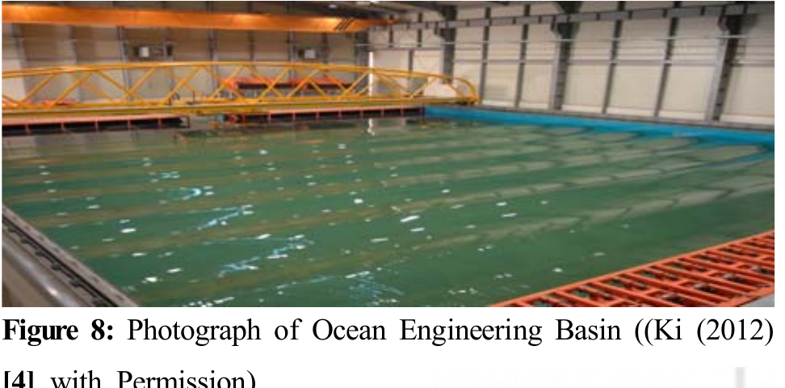

图 8. 海洋工程水槽。

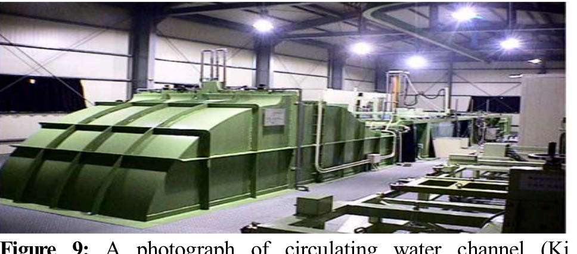

图 9. 循环水槽。

### 3.2 倾斜试验

研究人员对三艇实艇进行倾斜试验，以估计各艇重心高度 KG。配重按每艇规定的排水质量均匀分布；将约 12.5 kg 的配重横向移动 30 cm，测量船体产生的横倾角。再结合静水力计算得到的浮心高度 KB、稳心高度 KM 等，估计实际制作艇的重心位置。

### 3.3 转弯试验

转弯试验以每艇实艇质量加一名 80 kg 成年男性为基准。三艇本身没有舵，因此研究人员另行制作舵，并为三艇统一设置 25° 舵角。图 10 展示每次试验轨迹的校正。

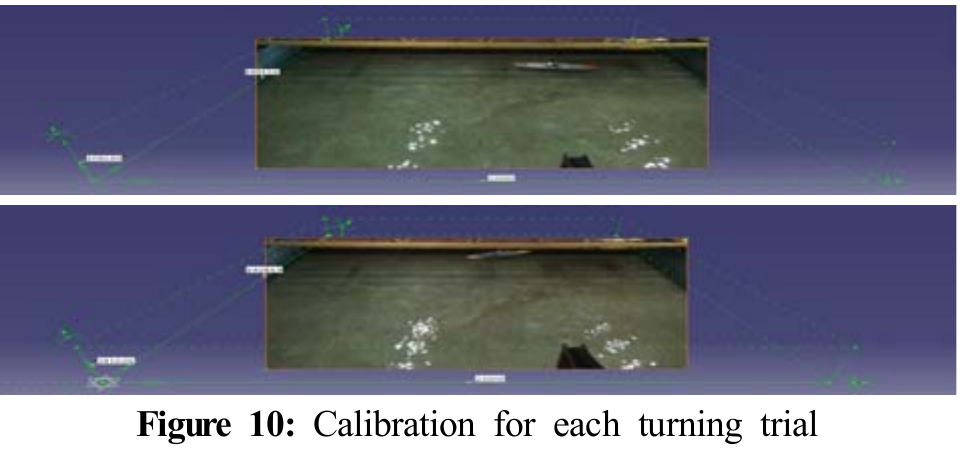

图 10. 各次转弯试验的轨迹校正。

### 3.4 阻力试验

研究人员在表 5 所示的循环水槽中，用 FRP 制作三艇的缩尺模型，三个型号的缩尺比均为 4.558。模型按目标载重调整吃水，外形见图 11–13。在 2–7 kn 的速度范围内测试，目标设计速度为 5.0 kn；图 14 展示 Type 1 在 5.0 kn 下的试验状态。

表 5. 循环水槽参数。

| 项目 | 原文规格 |
|---|---|
| 水槽主体长 × 宽 × 高 | 17.6 × 3.1 × 6.40 m |
| 观察段长 × 宽 × 高 | 6.0 × 2.0 × 1.55 m |
| 水容量 | 90 t |
| 电机 | 约两套直流 30 kW |
| 叶轮 | 两套直径 800 mm、每套 5 叶片的立式循环叶轮 |
| 模型皮艇长度 | 1.0–2.0 m |
| 水流速度范围 | 0.1–3.0 m/s |

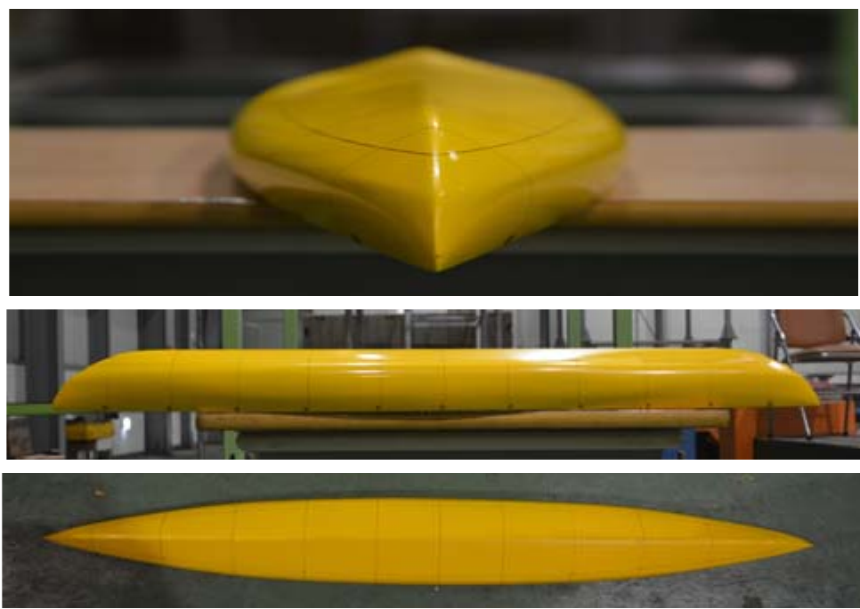

图 11. 框架艇（Type 1）的缩尺模型。

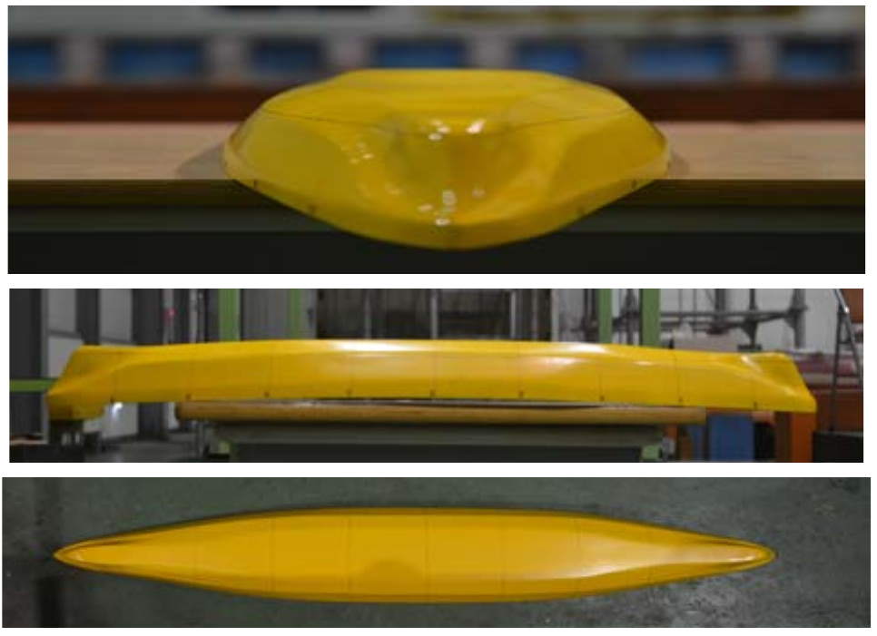

图 12. 针形窄底艇（Type 2）的缩尺模型。

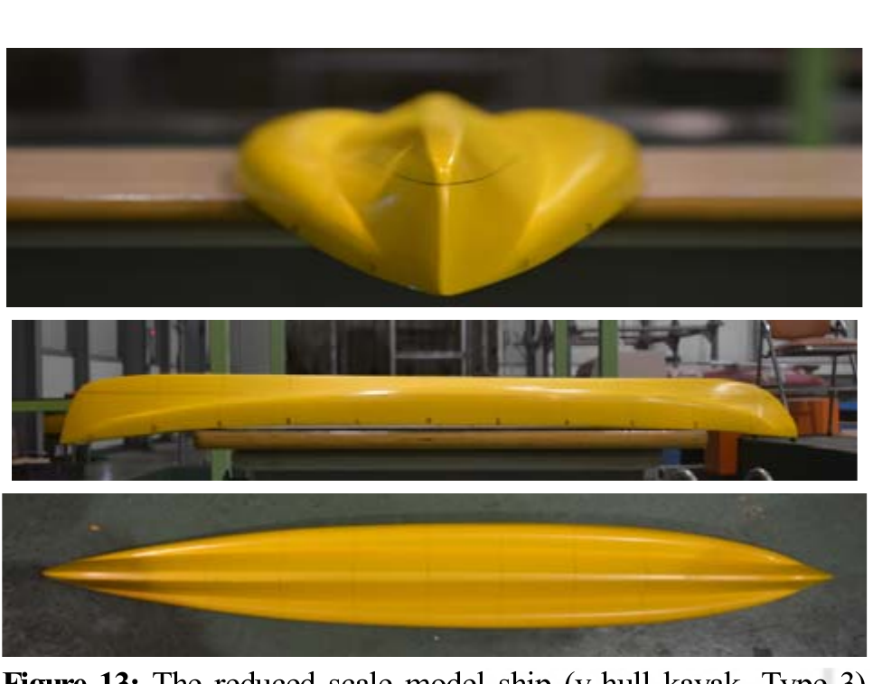

图 13. V 形船底艇（Type 3）的缩尺模型。

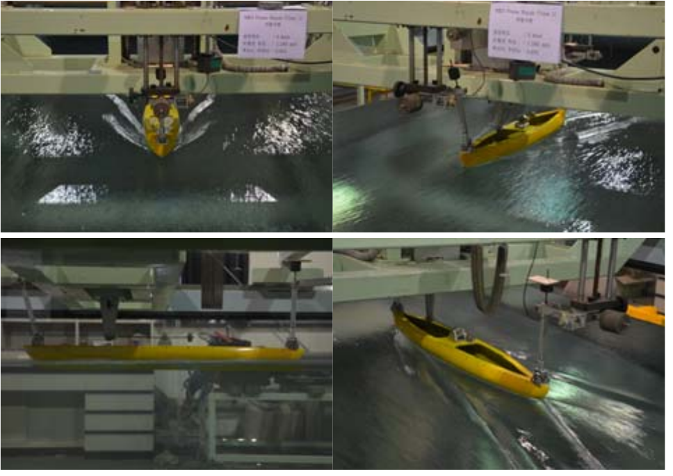

图 14. Type 1 在 5.0 kn 下的阻力试验照片。

试验按弗劳德相似准则选取模型速度，采用以 1978 年 ITTC 方法为基础的二维方法换算实艇阻力。原文给出：

$$
C_{TS}=C_{FS}+C_R+C_A+C_{AA},
$$

$$
C_A=\left[105\left(\frac{k_s}{L_{WL}}\right)^{1/3}-0.64\right]\times10^{-3},
\qquad k_s=150\,\mu\mathrm{m},
$$

$$
C_{AA}=0.001\left(\frac{A_T}{S}\right).
$$

式中各符号见文首符号表；$k_s$ 为采用的船体粗糙度。纵倾和升沉量按下式无量纲化：

$$
T=(d_A-d_F)\frac{2g}{U^2},
\qquad
S=\left(\frac{d_A+d_F}{2}\right)\frac{2g}{U^2}.
$$

## 4. 水槽试验结果与分析

### 4.1 倾斜试验

根据实艇与配重系统的静水力计算，作者用基线至浮心、浮心至稳心、重心至稳心及基线至重心的距离，估计三艇最终的重心高度。表 6 中目标排水质量下的实艇 KG，从高到低为 Type 1（约 0.278 m）、Type 3（约 0.261 m）、Type 2（约 0.128 m）。作者推测，较厚的浮筒使配重位置距船底更高，从而抬高重心。原表数值只保留两位小数，正文给出的三位小数不应由表值反推。

表 6. 倾斜试验结果。

| 类别 | 移动配重（kg） | 横倾角（°） | KB′（m） | B′M′（m） | G′M′（m） | KG′（m） | 实艇 KG（m） |
|---|---:|---:|---:|---:|---:|---:|---:|
| Type 1 | 12.50 | 5.80 | 0.06 | 0.54 | 0.32 | 0.28 | 0.28 |
| Type 2 | 12.50 | 7.30 | 0.05 | 0.38 | 0.28 | 0.15 | 0.13 |
| Type 3 | 12.50 | 3.80 | 0.08 | 0.71 | 0.52 | 0.27 | 0.26 |

### 4.2 转弯试验

三艇在相同 25° 舵角下的转弯轨迹见图 15（原文第 4.2 节误引为图 16）。作者认为，Type 3 的转弯半径略小；Type 2 总体有侧滑趋势，并推测这种滑移可能与其较平的船底形状有关。

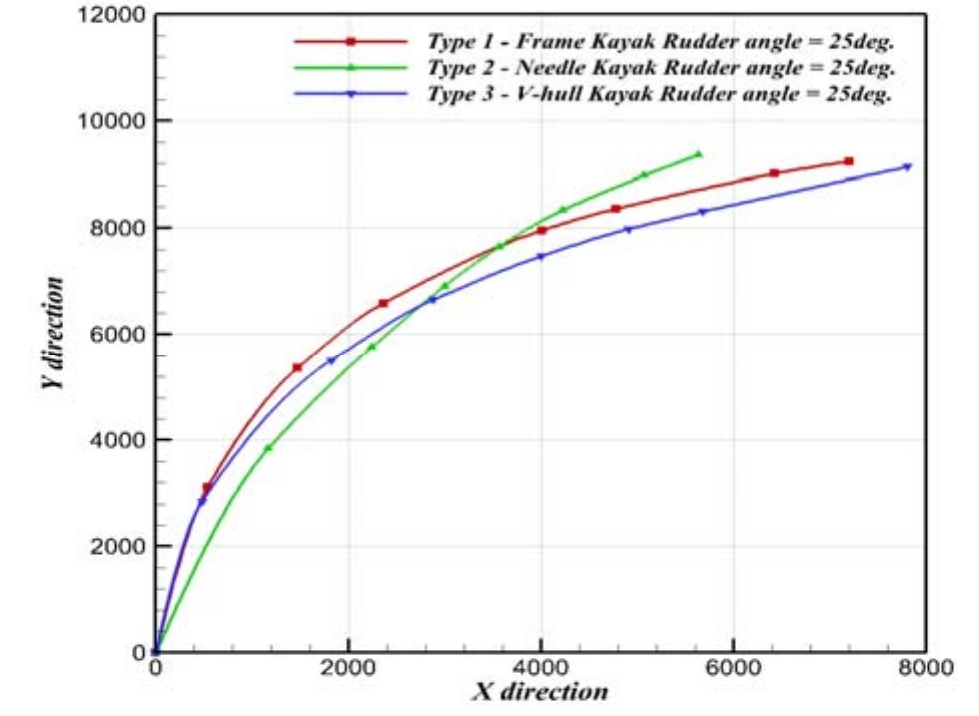

图 15. 三艇的转弯轨迹，坐标单位为 mm。

### 4.3 阻力试验

三艇模型在 5、6、7 kn 下的阻力系数和有效马力见表 7。目标速度 5 kn 时，总阻力系数 $C_{TS}$ 从大到小为 Type 2、Type 3、Type 1，因此 Type 1 按该系数最小。图 16 显示 Type 2 的阻力系数随速度增至约 5 kn 较敏感地上升，而 Type 3 的阻力系数高于 Type 1 且变化趋势相近。

表 7. 阻力性能。原表最后一列标为 EPH (PS)，正文与图 17 使用 EHP；数值按原表保留。

| 类别 | 速度（kn） | $C_{FS}$ | $C_{TS}$ | EPH（PS，原表列名） |
|---|---:|---:|---:|---:|
| Type 1 | 5 | 3.1 | 9.6 | 0.3 |
| Type 1 | 6 | 3.0 | 10.5 | 0.5 |
| Type 1 | 7 | 2.9 | 9.5 | 0.7 |
| Type 2 | 5 | 3.1 | 12.0 | 0.3 |
| Type 2 | 6 | 3.0 | 12.4 | 0.4 |
| Type 2 | 7 | 2.9 | 11.8 | 0.7 |
| Type 3 | 5 | 3.0 | 11.5 | 0.3 |
| Type 3 | 6 | 2.9 | 12.7 | 0.6 |
| Type 3 | 7 | 2.9 | 11.7 | 0.9 |

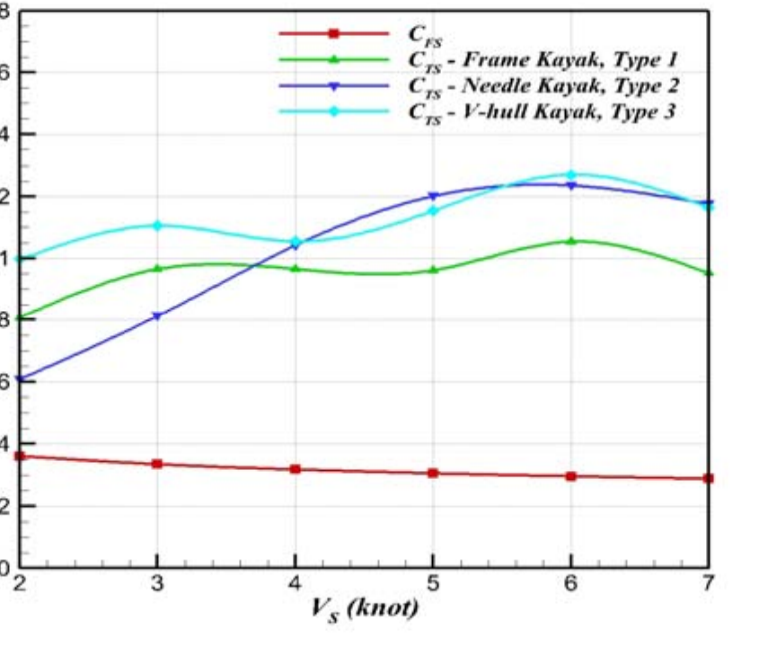

图 16. 三艇总阻力系数及摩擦阻力系数随速度变化的曲线。

模型—实艇性能估算得到，在 5 kn 目标速度下，Type 1、Type 2、Type 3 的总阻力分别为 72、71、93 N。Type 2 的实艇总阻力按牛顿计最小，分别比 Type 1 和 Type 3 低约 1.4% 和 23.7%。Type 1 与 Type 2 的有效马力曲线相近；Type 3 自约 4 kn 起增长较快，作者认为其对速度变化更敏感（图 17）。

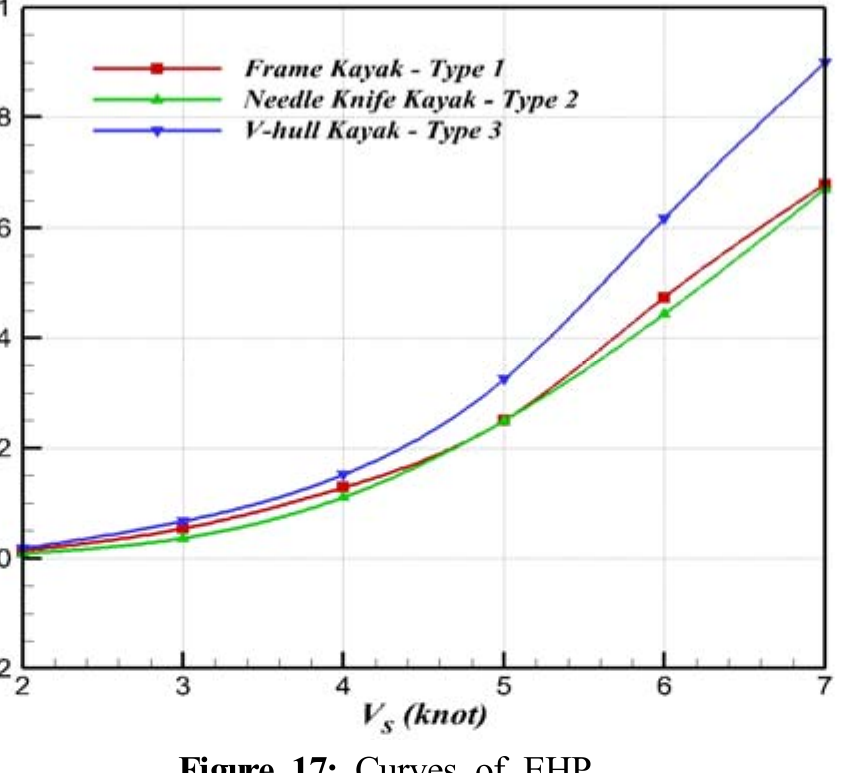

图 17. 三艇有效马力（EHP）随速度变化的曲线。

升沉量与纵倾见表 8、图 18。原文称三艇在 5–7 kn 的升沉值均为负，因此认为尚未开始滑航；其中 Type 1 的升沉量随速度变化较平缓，Type 2 与 Type 3 在 5 kn 时接近，在 6 和 7 kn 时呈相反的排序。原文对“哪个型号升沉量最大”的叙述与表 8 按带符号数值比较的排序不完全一致，译文保留原句结论并把具体数字列于表中。

表 8. 升沉量与纵倾的原表数值；负号按原文保留。

| 类别 | 速度（kn） | 升沉量 | 纵倾 |
|---|---:|---:|---:|
| Type 1 | 5 | −27.2 | −113.1 |
| Type 1 | 6 | −19.9 | −227.9 |
| Type 1 | 7 | −7.5 | −106.2 |
| Type 2 | 5 | −103.8 | −255.0 |
| Type 2 | 6 | −18.9 | −329.4 |
| Type 2 | 7 | −25.4 | −245.7 |
| Type 3 | 5 | −57.6 | −246.7 |
| Type 3 | 6 | −20.0 | −342.6 |
| Type 3 | 7 | −11.2 | −268.6 |

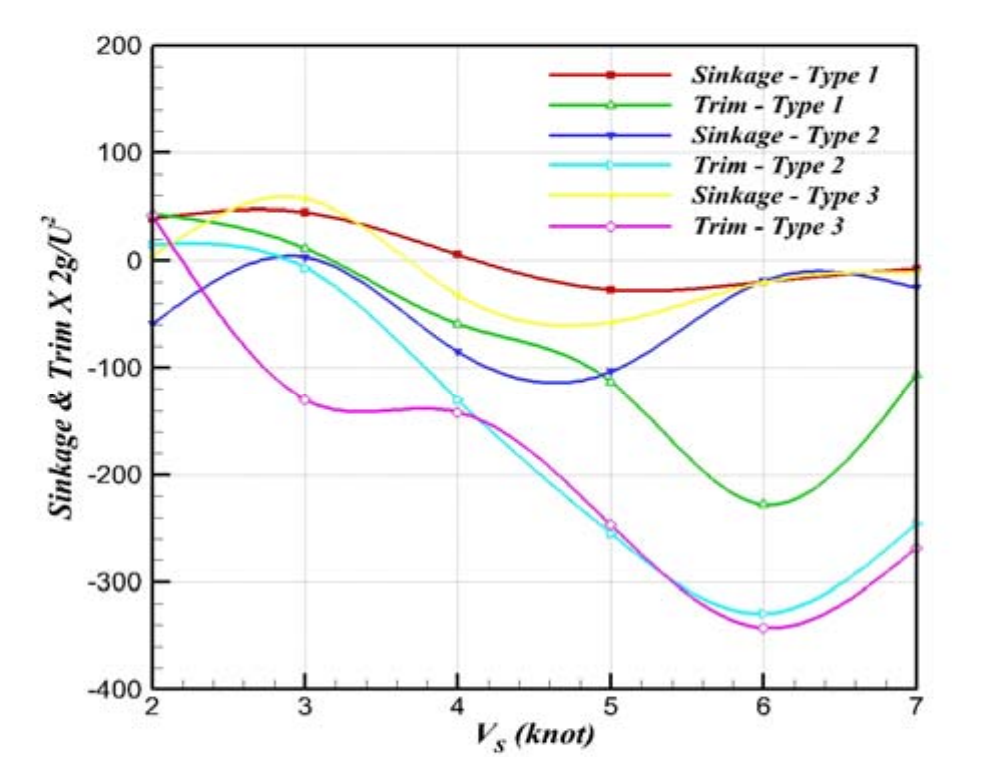

图 18. 三艇升沉量与纵倾随速度变化的曲线。

纵倾在 5 kn 时以 Type 2 的数值幅度最大，在 6、7 kn 时 Type 3 的幅度最大；三艇均在约 6 kn 达到最负的纵倾值。作者称目标速度 5 kn 时各艇的纵倾均为负，并同时写道“船头吃水较大”及“船头上抬多于船尾下沉”；这两种姿态描述难以同时成立，见文末校订备注。

## 5. 结论

作者在固定 30° 横倾角下比较复原力臂，Type 2、Type 1、Type 3 分别为 94.4、119、132.4 mm，认为 V 形船底艇在稳性方面最有利。目标速度 5 kn 下，三艇实艇总阻力分别为 71 N（Type 2）、72 N（Type 1）和 93 N（Type 3），因此 Type 2 按力值最低。目标排水质量下的重心高度分别约为 0.278 m（Type 1）、0.128 m（Type 2）和 0.261 m（Type 3），Type 2 最低。

相同 25° 舵角下，三艇转弯半径总体相近，Type 3 略小；Type 2 有较普遍的侧滑趋势。作者总结认为，V 形船底艇在稳性和转弯方面较有利，针形窄底艇在重心高度与按牛顿计的阻力方面较有利。

## 致谢

本研究由韩国文化体育观光部 2011 年体育产业技术开发项目及国民体育振兴基金资助。

## 参考文献

[1] H. J. Jang. “Kayak, and kayaker.” *Hankyung Magazine*. http://magazine.hankyung.com/money/apps/news?popup=0&nid=02&c1=2005&nkey=2012041800083065932&mode=sub_view. Accessed October 10, 2014 (in Korean).

[2] *2013 Special Report on Paddlesports*. The Coleman Company, Inc. & The Outdoor Foundation. http://www.outdoorfoundation.org/pdf/ResearchPaddlesports2013.pdf. Accessed October 10, 2014.

[3] H. J. Lee. *Development of Hybrid Propulsive Inflatable Kayak for Two Persons*. Final Report on Technology Development Promotion for Small & Medium Business, 2010.

[4] J. S. Ki, C. K. Hah, and H. Y. Jang. “Hydrodynamic evaluation method for developing the inflatable kayak.” *Journal of the Korean Society of Marine Engineering*, 36(5), 627–634, 2012 (in Korean).

[5] C. K. Hah, J. S. Ki, and H. Y. Jang. “Hydrodynamic evaluation for developing the inflatable kayak.” *Journal of the Korean Society of Marine Engineering*, 37(6), 623–630, 2013 (in Korean).

## 校订备注

- 引言中两组美国参与率的年份都写作“2010、2011、2010”，疑有年份误排；数字和原文年份均已保留。
- 在 5 kn 工况，Type 1 的总阻力系数最小，但 Type 2 按实艇总阻力的牛顿数最小。两种量使用的归一化基准不同，不应将“系数最小”与“力最小”混为同一结论。
- 原文表 7 最后一列标题作 EPH，正文和图 17 为 EHP；表 8 的“最大升沉量”文字描述与带符号表值的排序不完全一致。第 4.3 节又同时以“船头吃水较大”和“船头上抬多于船尾下沉”解释负的纵倾值，受力姿态与符号约定不清。译文保留表值及两种原文表述，不自行判定哪种解释正确。
