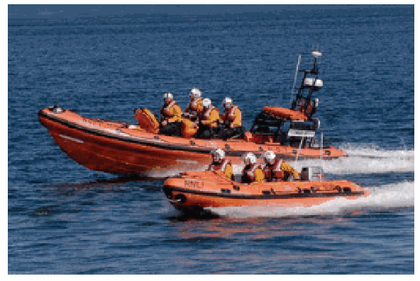
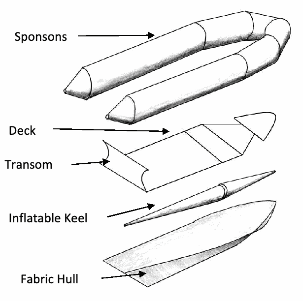
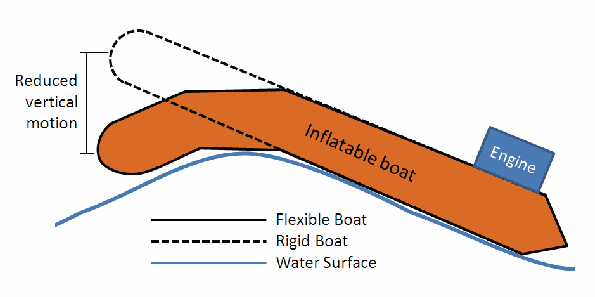
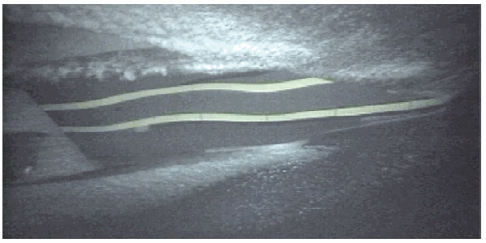
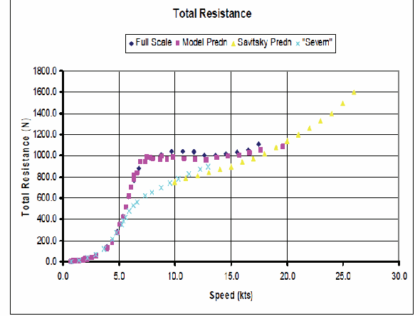
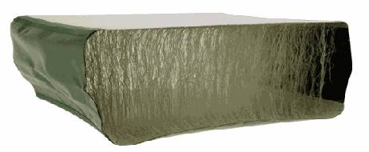
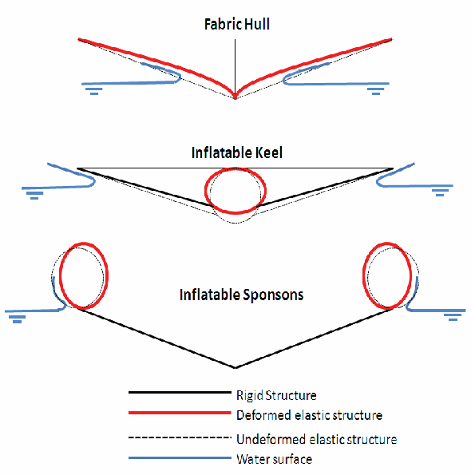
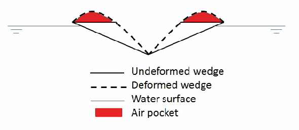
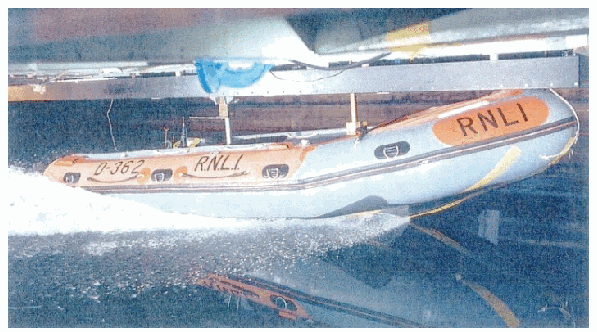
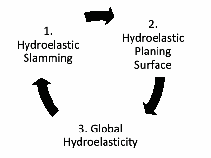

# 水弹性充气艇：相关文献与新的设计考虑

P. K. Halswell、P. A. Wilson、D. J. Taunton（英国南安普顿大学）；S. Austen（英国皇家救生艇协会，RNLI）

技术短文。*Transactions RINA*, Vol. 154, Part B1, *International Journal of Small Craft Technology*, 2012 年 1—6 月，B-39 起。DOI：10.3940/rina.ijsct.2012.b1.125tn。

原文为 12 页 PDF，末页为空白。正文节号沿用原稿，包括重复或错排的节号。图内英文保留，图注与必要标签说明译为中文；参考文献保留原文书目信息。

## 摘要

充气艇比传统金属或复合材料船舶柔软得多。RNLI 开发了一款性能有所改善的充气艇 IB1，这种改善被归因于其柔性或水弹性。目前滑行船的设计方法在预测性能时假定船体为刚性。设计一条整体具有水弹性的船，会带来全新的设计挑战，今后需要新的设计方法。本文探讨如何研究整体具有水弹性的滑行船，以及如何将其分解为可实际处理的问题。考虑水弹性的设计方法，可能通过减小船体运动、降低波浪增阻和尽量减小砰击加速度，进一步改善性能。

本文回顾与硬底充气艇及充气艇有关的文献，并介绍 IB1 的结构。水弹性设计问题被分为三类主要水弹性过程：整体水弹性、水弹性滑行面和水弹性砰击。分别定义各过程、回顾相关文献并讨论可能的优势。本文提出采用水弹性设计循环的设计方法，并简要讨论浮筒相互作用的水动力问题。

## 符号与缩写

| 符号／缩写 | 含义 | 单位 |
|---|---|---|
| $l$ | 悬臂梁长度 | m |
| $p$ | 内部压力 | N m⁻² |
| $P$ | 端部载荷 | N |
| $R$ | 圆柱半径 | m |
| IB | 充气艇（inflatable boat） | — |
| IB1 | 近岸艇 1 型（Inshore Boat 1） | — |
| RIB | 硬底充气艇（rigid inflatable boat） | — |
| RNLI | 英国皇家救生艇协会（Royal National Lifeboat Institution） | — |
| VDV | 振动剂量值（vibration dosage value，原文用词） | m s⁻¹·⁷⁵ |

## 1. 引言

本项目由 RNLI 支持并部分资助。RNLI 是一家慈善机构，旨在英国和爱尔兰沿岸救助海上遇险者。该机构设计、建造、维护并运营可应对几乎各种情况的船舶，拥有英国规模最大的充气艇（IB）及硬底充气艇（RIB）船队。本项目关注近岸水域使用的船，主要是 D 级近岸充气救生艇，又称 IB1，见图 1。

IB1 是一条长五米的充气救生艇，在相当于蒲福风力 2 级的海况下可达 25 kn；在相当于蒲福风力 5 级及更恶劣的海况下，仍可继续安全作业。它由 50 hp 舷外机驱动，总质量为 436 kg，包括所有设备，但不包括船员。艇上通常有三名船员，可至少搭载两名遇险者，或一名俯卧的遇险者。RNLI 在近岸水域使用 IB1，这里的水可能很浅；近岸水深减小，还可能产生高大、陡峭的破碎波。

IB1 与传统高速船或 RIB 的主要区别在于其柔性。它主要使用橡胶涂层织物，可产生相当大的变形。船体和浮筒等主要部件的变形会影响水流，从而产生水弹性相互作用。

图 1. 前景为 IB1，背景为 Atlantic 85 硬底充气艇［1］。

1998 年，RNLI 对 EA16（D 级艇的上一版本）开展可行性研究，将其与七款商用艇比较；这些艇包括 RIB、纯充气艇以及两者结合的艇型［1，原文引号］。结果发现，EA16 的综合性能最好。因此，RNLI 此后通过设计者经验或试错改进其设计和性能，以获得最优的艇。作者称，船员反馈所提供的经验性证据证实，IB1 的柔性或水弹性改善了性能，尤其是在波浪和碎浪中。

与较大的艇和船舶相比，对 RIB 性能的科学认识相对有限，对 IB 性能的认识则更少。它们的设计通常依赖设计者经验或试错。关于 RIB 和 IB 性能的研究很少，原因有多种。一种可能原因是，它们主要用于搜救或军事任务，本身不直接产生利润；产量也小，因此投入研发资金的动力有限。

与几乎所有其他滑行船相比，IB1 因结构高度柔软而具有独特性。它的纵向刚度小得多，还设置了特定甲板接头，以控制纵向变形。纵向弯曲与扭转称为整体水弹性。其滑行面由织物构成，可发生很大变形，称为水弹性滑行面。当船的一个横向切片撞击自由水面时，织物船体还会产生水弹性砰击。

高度柔性使水弹性的重要性更突出，也引入了通常较少考虑的水弹性问题，即水弹性滑行面。水弹性滑行面通过切片理论，将水弹性砰击与整体水弹性联系起来。切片理论用船的横向切片预测滑行性能，因此水弹性砰击过程对应于预测水弹性滑行性能所用的横向切片，水弹性滑行性能随后用于预测波浪中的整体水弹性。这意味着三类水弹性问题必须共同设计，也引出了一个问题：应怎样研究一条整体具有水弹性的滑行船？

目前，水弹性主要用于计算结构中的应力和应变［Price 等，3；Hirdaris 与 Temarel，4］，偶尔也用于研究它对船体运动的影响［Hirdaris 与 Temarel，4；Santos 等，5；Senjanovic 等，6］。IB1 的设计允许调整艇内水弹性，以多种方式影响性能。获得充分认识后，可调校船艇以优化性能。水弹性可能影响以下性能：

- 船体运动，以及由此产生的人体振动暴露；
- 前进速度；
- 波浪增阻；
- 砰击加速度；
- 静止时的稳性。

## 2. 目标

本文的第一个目标是回顾对这类船艇的现有认识，介绍已经开展的 RIB 和 IB 实验及计算研究。

第二个目标是把整体具有水弹性的滑行船分解为可处理的水弹性问题，定义三类主要问题——水弹性砰击、水弹性滑行面与整体水弹性，回顾相关文献，并讨论各类水弹性过程的潜在优势。

第三个目标是向研究界和学术界说明：水弹性船艇可以通过设计，利用传统船舶设计过程目前未考虑的参数改变其性能。

## 3. RIB 与 IB 文献回顾

第一家充气艇制造商是 Zodiac，于 1936 年开始生产［Williams，7］。经过大量试验，RNLI 于 1963 年首次引入 D 级充气救生艇。1964 年，威尔士 Atlantic College 首次将刚性船底粘接到充气艇上，形成第一条 RIB［Williams，7］。1972 年，RNLI 推出了其第一款 RIB，即 Atlantic 21。尽管这类艇已有多年历史，其性能研究仍很少。1981、1998 和 2005 年，英国举办了三次讨论 RIB 设计与发展的国际会议［8—10］。不过，大多数证据来自经验叙述，采用实验或数值方法提供的科学证据很少。会议议题包括历史、发展、建造技术、推进、模型试验问题［57］、自扶正问题、艇型实例、安全、操舵者的影响、电子设备和其他装备。

Dand［11—13］开展了一系列 IB1 性能实验，在模型尺度和实艇尺度测量阻力与耐波性能。Austen 与 Fogarty［14］记录了采用新材料和建造技术的 IB1 开发过程。IB1 投入使用时，因织物船底、通气和空化而出现性能问题，Dand 等［15］通过谨慎的试错过程，将速度从 20 kn 恢复到 25 kn。

Haiping 等［16］通过实验研究了浮筒类型对耐波性的影响。在两种载荷条件下，充气浮筒的垂向平移和俯仰响应幅值算子均低于泡沫浮筒，提示柔性浮筒可改善乘坐舒适性与耐波性。Lewis 等［17］建立了 RIB 计算模型；尽管结果看来有前景，与实验相比，该数值模型高估了船体运动。Townsend 等［18、19］开展多项实验，表征 RNLI Atlantic 75 RIB 的耐波性能。文献［18］研究了速度、压载、波高、遭遇频率以及浮筒压力对 Atlantic 75 船体运动的影响。

## 4. IB1 的设计

了解 IB 的结构十分重要，因为结构说明了船艇为何能够变形。图 2 展示 IB1 的主要部件。IB 的设计会随作业要求、部件材料和建造技术而变化。

图 2. IB1 的主要部件。图中 Sponsons 为浮筒，Deck 为甲板，Transom 为艉板，Inflatable Keel 为充气龙骨，Fabric Hull 为织物船体。

**浮筒：**环绕船艇的充气管，由 Hypalon®／氯丁橡胶涂层聚酯织物制成，充气压力为 206 mbar（3 psi）。

**甲板：**艇上刚度最大的结构部件，由复合材料夹芯板制成。甲板分为四部分，另有艉板，以有意允许柔性变形。各甲板接头因连接类型而具有不同刚度。艉板及前部甲板与浮筒粘接，其余甲板部分嵌装到位。

**充气龙骨：**与织物船体中心线连接的渐缩充气管，由 Hypalon®／氯丁橡胶涂层聚酯织物制成，充气压力为 224 mbar（3.25 psi）。

**织物船体：**由两层 Hypalon®／氯丁橡胶涂层聚酯织物构成的织物片，与浮筒和艉板连接，并在龙骨上张紧。

## 5. 整体水弹性

### 5.1 问题定义

本节把艇作为整体，研究 IB 的整体水弹性，即其纵向弯曲和扭转振动。观察发现，IB1 通过斜向波浪时，甲板会弯曲和扭转，使航行更平顺。这种动态弯扭响应与 Bishop 和 Price［20］提出的理论相似，可视为传统水弹性理论所描述的现象。艇的柔性影响波浪诱发的动力响应，进而影响船体运动。

图 3 说明整体水弹性如何减小可变形船艇的垂向运动。传统船舶跨越波浪、像跷跷板一样运动时，垂向平移与俯仰存在耦合；如果船能够沿波浪弯曲，这种相互作用就会改变。第一个优势是船体运动减小，航行舒适性提高。运动减小意味着推进装置提供的能量中，通过垂向运动消耗的部分减少，从而降低波浪增阻。这可使最高航速提高，或允许采用更小、更轻的推进装置。最后一个优势是，静止时俯仰运动减小，艇在俯仰与垂向平移方面会更稳定。

图 3. 通过整体水弹性减小垂向运动。Rigid Boat、Flexible Boat 分别为刚性艇和柔性艇，Water Surface 为水面。

充气艇有许多相互关联的参数，会影响整体振动，包括甲板特性（材料性质与厚度）、甲板接头（数量、位置和刚度）、浮筒与龙骨特性（材料性质与内部压力）、织物船体特性（材料性质与预张应力）、质量特性（重心与惯性）以及建造技术。作者开展静态挠度实验，发现主导艇体挠度的参数是甲板接头的数量、位置和刚度。

### 4.2 文献回顾

#### 4.2（a）整体水弹性

整体水弹性已有众多作者研究，早期工作包括 Bishop 和 Price［20］。他们建立了描述船舶对称与反对称水弹性的理论，但对象是排水型船舶，而非滑行船。已有数值模型可预测高速船的垂向运动和波浪载荷，例如 Santos 等［5］及 Chiu 与 Fujino［21］。Santos 等［5］模拟了一条具有滑行船体线型的高速巡逻艇，但指出所用方法并不适合滑行船。实艇测量与数值模型结果存在较大差异。据作者所知，尚无数值模型针对水弹性滑行船完成验证。

IB1 设置了明确的甲板接头，允许艇在特定位置像铰接结构一样弯折。这些接头会影响传统整体水弹性理论的适用方式。Newman［22］建立了解析方法，预测铰接驳船的运动；Hamamoto 等［23］采用三维有限元法—边界元法耦合模型，预测模块连接式大型浮体结构的运动。

#### 4.2（b）充气圆柱

现有水弹性模型尚未考虑充气管及边界张紧膜（织物船体）的刚度特性。Comer 与 Levy［24］较早研究了充气圆柱梁的变形，将其与 Euler–Bernoulli 梁比较。较近期且相关的工作由 Wielgosz 等［25］完成，采用 Timoshenko 梁理论计入剪切变形，并利用包含内部压力的刚度矩阵建立有限元模型。

Veldman 等［26］强调，应正确选择膜理论或薄壳理论。一般会预期，很薄的膜与膜理论的对应比与薄壳理论更好；但文献［26］发现，尽管膜仅厚 60 nm，薄壳理论仍比膜理论吻合得更好。Hypalon®／氯丁橡胶涂层聚酯织物究竟应采用哪种理论，尚未确定；这是作者的一个研究方向。

Leonard、Brooks 与 McComb［27］推导了充气圆柱作为悬臂时的最大端部承载能力，见式（1）。该式直观地说明，充气圆柱的承载能力与内部压力 $p$ 成正比。

$$
P=\frac{\pi pR^3}{l}. \tag{1}
$$

## 5. 水弹性滑行面

### 5.1 问题定义

IB 的滑行面通常由织物制成，面外弯曲刚度显著低于传统金属或复合材料船体。因此，滑行面在不同载荷下能够发生较大变形，见图 4。问题在于：确定织物在稳态滑行时的形状，以及这种变形对滑行性能的影响。织物船体的参数包括材料性质和预张应力；它们决定织物的面外弯曲刚度。随着这些参数增大，材料更硬，其行为更接近传统滑行面。更好地理解水弹性滑行面，可能使前进速度提高。

图 4. 从水下观察 IB1 在 19.4 kn 时的船体变形［15］。

Dand［11、12］对 EA16 D 级艇开展实艇与模型尺度实验，测量阻力、升沉和纵倾。实艇具有柔性，织物船体能够变形，缩尺模型则为刚性。总阻力比较见图 5：实尺度柔性艇的阻力略高于刚性缩尺模型。Dand 等［15］将其归因于织物船体变形，在船体后部形成凹形弯曲，从而改变纵倾角。

他们还发现，艇在静水中加速时出现一种不稳定运动，被描述为“压力波”缓慢从船底通过。它主要造成俯仰和垂向平移方向的“脉动”运动。变形是静态还是动态，尚不清楚。

图 5. EA16 D 级艇预测阻力与测量阻力的比较［15］。

第一个限制因素就是 IB1 的“脉动”不稳定运动。一种假设是，船体较低的面外弯曲刚度允许形成凹形弯曲；弯曲形成时，织物预张应力发生变化，船体上的水动力也随之变化。织物应力改变时，变形向船尾移动。变形改变水动力，使操作者感觉到“压力波”。另有报告称，这种“压力波”通过船底时，可观察到浮筒挠曲，提示作用力较大且织物发生运动。当变形到达艉板时，压力释放，循环重新开始。这种运动只出现在静水中，波浪会打断循环。因此，为避免这种不稳定性，织物船体的面外弯曲刚度需要有一个最低限值，且该限值需要量化。

EA16 改进为 IB1 的试错过程支持了这一解释。重新设计时发现，织物已发生永久变形，建造过程中质量控制不足又导致织物张力下降。将这些因素纳入考虑并提高织物张力后，脉动运动消失。

### 5.2 文献回顾

与本问题最相关的是 Makasyeyev［28］建立的解析模型，用于描述二维弹性板的滑行性能。不过，该模型需要验证，而且结构域处理的是传统材料，并非膜或织物。

作者未找到直接研究膜滑行面的文献。但这种流固相互作用可与膜翼型的气动弹性比较，例如帆与膜翼。Newman［29］指出，表面摩擦会改变膜张力；在无黏流中，膜张力则保持不变。Song 等［30］、Rojratsirikul［31］及 Gordnier［32］显示，膜振动频率与涡脱落频率存在强耦合。Gordnier［32］尤其说明，雷诺数使膜翼型的运动由驻波振动变为类似行波的动态振动。上述文献均未包含自由水面，而自由水面对滑行时的流体力至关重要。

许多新的交通艇设计已采用拉丝结构（drop-stitch）技术制造船体。该技术将两层织物在边缘密封连接，再在两层之间织入垂直于织物面的线，以控制充气后的形状，见图 6。两层之间充气后形成刚性较高的板，可与复合材料夹芯板比较［Bagnell，33］。

图 6. 拉丝结构技术［54］。

## 6. 水弹性砰击

### 6.1 问题定义

本节研究水弹性对二维楔形体垂直撞击自由水面时载荷与加速度的影响。IB 在垂向上有三个主要柔性部件：织物船体、充气浮筒与充气龙骨，见图 7。实际中，三者共同作用且相互影响响应；但在初步研究中，可分别研究。

把砰击视为水弹性过程，便有可能改变冲击特征。从船体运动角度，可改变的主要特征是峰值加速度与冲击持续时间。水弹性也会影响结构载荷，但本文不研究这一方面，详见 Faltinsen［34］。船体的新参数为织物材料性质及预张应力，充气龙骨与浮筒的新参数为材料性质及内部压力。改变内部压力，也就改变了预张应力。其他重要变量包括冲击速度、船底斜升角及惯性。

Townsend 等［35］研究了简单的楔形船体冲击，以探索降低高速船垂向加速度的方法。他们有意将船体刚度从 69 GPa（铝）降到 6.9 GPa，以研究影响，发现对加速度的作用很小；但预计织物的等效刚度会显著更低，可能放大对加速度的影响。

图 7. 垂直撞击水面的 IB 内的柔性部件。Fabric Hull 为织物船体，Inflatable Keel 为充气龙骨，Inflatable Sponsons 为充气浮筒；图例区分刚性／变形后的部件及变形前／后的水面。

包括 Natzijl［36］和 Pike［37］在内的多位作者提出，浮筒在砰击运动中吸收能量，但尚未验证。Townsend［38］研究了这一设想，却发现降低内部压力没有作用。应注意，Townsend［38］所研究的 Atlantic 85 船体形状，使浮筒很少接触水，而 IB1 并非如此。作者提出的带浮筒楔形切片实验将回答这一问题，并允许研究材料性质与内部压力的影响。其他影响浮筒吸收能量多少的变量包括浮筒直径、伸出量及连接方式。

### 6.2 文献回顾

Faltinsen 等［39］对这一问题作了较好的综述，并讨论其中的挑战。可能需要考虑的具体效应包括重力、黏性、气垫、气囊、空气形成气泡的过程、水的可压缩性、空气的可压缩性、流动分离及膜的行为。

本问题通常可忽略重力［Faltinsen 等，39］。黏性也常被忽略，但在不存在尖锐转角时，黏性可能影响流动分离，后文还将讨论［Faltinsen 等，39］。早期研究忽略气垫及空气可压缩性，但 Bereznitski［40］说明，将它们纳入考虑很重要，尤其是在船底斜升角较小时。结构很柔软时，织物船体可向上变形，从而形成困气空腔，见图 8。Faltinsen 等［39］指出，需要更好地理解气垫分解成气泡的过程；其影响尚不清楚。

流动分离也是需要考虑的因素。存在硬折角时，可描述分离过程；但 Faltinsen［41］指出，圆舭处的流动分离难以处理，此时可能需要考虑黏性。最后，膜的行为与传统固体显著不同，经纬纱相互作用导致非线性行为［Lewis，42］。

图 8. 困气空腔的形成。Un-deformed wedge 为未变形楔形体，Deformed wedge 为变形楔形体，Water surface 为水面，Air pocket 为困气空腔。

Faltinsen［34］将问题分为两个时间尺度。第一个是结构惯性阶段：大的水动力使质量较小的结构产生较大加速度。与第二个尺度相比，这一阶段很短。第二个尺度对应自由振动阶段，为结构在湿态下的最长固有周期。其行为是结构的自由弹性振动，初始条件取自第一阶段，最大应力出现在自由振动阶段。

Faltinsen［43］以湿梁第一阶固有振动周期与冲击持续时间之比讨论水弹性的重要性，并用无量纲参数量化。Bereznitski［40］采用相同形式的比值，但用干梁的固有振动。Bereznitski［40］指出，若该比值大于 2，水弹性的作用并不显著。增大织物的材料性质参数或预张应力，会改变振动周期，从而影响水弹性的重要性。原文此处所列未编号公式如下；公式与前述比值的文字定义方向不一致，见文末备注。

$$
\text{比值}=\frac{\text{冲击持续时间}}{\text{振动周期}}.
$$

Cooper 等［44］首次研究柔性膜楔形体撞击自由水面时的变形。研究发现，自由振动阶段中，膜的振动频率非常接近其固有频率，而固有频率取决于预张应力。

### 6.3 建模方法评述

二维物体入水问题最早以刚性物体的纯水动力问题进行研究，始于 20 世纪 20—30 年代 Wagner［55］及 von Karman［56］的工作。其后众多研究者推进了这些研究，直到 Kvalsvold 等［45］的工作才考虑局部水弹性效应。

1994 年，Kvalsvold 在工程博士论文中仅用理论研究多体船连接桥底部（wetdeck）砰击诱发的局部应力，并与 Faltinsen 联合发表结果［45］。结构用二维 Timoshenko 梁模拟，流体采用 Wagner 理论；假定流体不可压缩且无旋，未计入困气和空化。该解较复杂，Faltinsen［34］随后将其简化。Faltinsen 等［46］及 Kvalsvold 等［45］的实验结果与这两种理论解均吻合良好。

Faltinsen［43］用 Kvalsvold 与 Faltinsen［45］的数值解研究楔形体入水，计入船的前进速度，并通过四阶 Runge–Kutta 方法求解耦合非线性方程。Korobkin 等［47］说明，可以直接将结构域的有限元法与流体域的 Wagner 理论耦合；与采用梁模型的模态方法比较，结果对应非常好。

Lu 等［48］在流体域采用边界元法（BEM），在结构域采用有限元法（FEM），满足非线性自由水面边界条件，并正确处理射流。结果与 Zhao 和 Faltinsen［49］吻合良好。

Bereznitski［40］发表了一篇研究水弹性在二维砰击中作用的重要论文，用四种方法求解问题。第一种为刚体的 Wagner 解，可与 Faltinsen［34］的弹性体结果比较。另采用自编程序及两个商业程序 MSC Dytran 与 LS-DYNA。Bereznitski 认为，MSC Dytran 或 LS-DYNA 最适合，因为二者都可处理耦合水弹性相互作用，并包含气垫建模。MSC Dytran 与 LS-DYNA 相当类似，水与空气的状态方程相同［40］。Bereznitski［40］、Le Sourne 等［50］及 Stenius［51］均用 LS-DYNA 研究过这一问题。Stenius［51］采用基于多材料任意拉格朗日—欧拉描述的有限元分析和罚函数接触算法，水动力载荷与实验结果吻合良好。

## 7. 水动力学

### 7.1 问题定义

船速增大并越过阻力峰对应的航速（hump speed）后，主要阻力分量由兴波阻力转为喷溅阻力［Payne，52］。对于硬折角滑行船，波浪和喷溅的产生机制已有认识［Savitsky 与 Morabito，53］。不过，IB1 及大多数 IB 没有折角，其波浪和喷溅产生机制仍不十分清楚。图 5 显示 IB1 实测阻力与 Savitsky 预测的差异。因此，问题在于研究具有相互作用浮筒的船，从零速到滑行及更高速度时，周围的波浪和喷溅如何产生。

这未必是水弹性问题，但它是预测 RIB 或 IB 性能的重要一步。现有理论，如切片理论和 Wagner 扩展楔形体理论，未考虑浮筒影响。因此，本节希望定义浮筒周围的水动力问题：只有先理解水动力，才能探索浮筒的水弹性效应。

尽量减小波浪和喷溅的产生，可能提高最高速度与加速度，并减少船行波冲刷造成的环境损害，但可能对船体运动产生不利影响。可将问题视为二维横向切片，研究浮筒对附加质量的影响；也可从纵向研究浮筒对船艇阻力的影响。

### 7.2 文献回顾

Dand［12］在实艇与模型尺度对 IB1 开展阻力实验。未测量波浪和喷溅，但图 9 显示，喷溅沿浮筒附着流动，随后脱离形成喷溅水片。这提示需要考虑表面张力和康达效应（Coandă effect）。

图 9. EA16 在 19.4 kn 时产生的喷溅［12］。

Townsend 等［18］研究了 RIB，尤其是 RNLI Atlantic 85 的船体运动。滑行时，浮筒很少接触水，对高速性能影响很小。因此，某些 RIB 的浮筒对波浪或喷溅产生的影响可忽略，但 IB1 显然不是这种情况。

波浪可用波高仪测量，喷溅测量则不常见；当时 ITTC 尚无喷溅测量或喷溅缩尺处理的推荐程序。还需要测量喷溅水片从浮筒上分离的位置。

## 8. 讨论

### 8.1 人体振动暴露

IB1 等高速船舶存在非线性船体运动，会产生高、低频振动以及较大加速度。2002 年提出了欧洲指令 2002/44/EC，规定劳动者物理振动暴露的最低健康与安全要求。全身振动的暴露行动值为 0.5 m s⁻²（均方根，r.m.s.），或 9.1 m s⁻¹·⁷⁵（VDV）；暴露限值为 1.15 m s⁻²（r.m.s.），或 21 m s⁻¹·⁷⁵（VDV）。Townsend［35］从高速船角度对船体运动和振动作了较充分回顾。

振动既可能使船员长期受伤，也可能降低其在航行中及航行后执行任务的能力。减少人体船体运动暴露的策略包括悬挂座椅、悬挂甲板、主动和被动鳍、纵倾调节板、截流板、陀螺稳定器、柔性船体及弹性体涂层船体。

原文称 Townsend 等［20］显示，当最高三分之一波高的平均值为 0.4 m、平均波周期为 10.6 s 时，RNLI 的 RIB 超过暴露限值；该引文号有误，见文末备注。Dand［13］显示，在实尺度波高为 0.55 m 的规则波中，IB1 刚性缩尺模型的船员位置可能承受最高达 4g 的峰值加速度。

海事领域对于将欧洲指令用于高速船舶的有效性存在相当多的争论，RNLI 正研究如何证明其船员和培训人员的振动暴露能够减轻。恰当利用整体水弹性和水弹性砰击，可能有助于降低船体运动中的垂向加速度，从而减轻使这些高速艇超过暴露限值的因素。

水弹性砰击能改变砰击特征，并可能减少人体振动暴露。作者认为，水弹性会降低峰值砰击加速度，却也会延长冲击持续时间。按照当时对人体振动暴露的认识，尚不清楚峰值加速度与冲击持续时间哪一个更需要降低，才能减小船员伤害。因此，当时仍不能确定水弹性砰击有多大效果。

### 8.2 设计循环

本文已将整体具有水弹性的船分为三类主要水弹性过程。下一步应考虑如何共同设计这三类过程，可按特定顺序使用设计循环，见图 10。

首先需要研究水弹性砰击：它为水弹性滑行面提供附加质量，并为整体水弹性提供波激振动（springing）与砰击振动（whipping）的输入。然后研究水弹性滑行面，得到静水滑行性能。最后考虑整体水弹性，以理解波浪中的滑行性能，以及砰击振动和波激振动的影响。三类过程相互耦合，因此需要设计循环，下节将作说明。

图 10. 水弹性设计循环：1，水弹性砰击；2，水弹性滑行面；3，整体水弹性。

### 8.3 水弹性过程的耦合

整体水弹性可能减小由俯仰与垂向平移耦合产生的垂向运动。但这也可能带来其他问题，例如船的纵向刚度不足，无法达到最佳滑行性能。

柔性滑行面看来会损害性能，刚性表面更适合滑行。然而，IB1 的设计需要柔性船体，才能实现整体水弹性与水弹性砰击的优势。因此，应量化消除不稳定性所需的最低面外弯曲刚度，使整体水弹性和砰击水弹性能够利用尽可能大的柔性。

水弹性砰击可能需要较低横向刚度来改善砰击特征，但这可能降低滑行性能。

## 9. 结论

本文讨论了直接关系到 RIB 和 IB 设计与性能的文献，表明该领域开展的研究很少。不过，其他领域中与本项目研究方法有关的成果提示，水弹性确有改善船艇性能的潜力。

本文介绍了 IB1 的结构，展示其设计中的柔性部位，也由此说明 IB 设计应在哪些方面考虑水弹性。优化水弹性，可能改善船体运动（减少人体振动暴露）、前进速度／加速度、砰击加速度、波浪增阻及静止时的稳性（俯仰和垂向平移）。

首先研究了整体水弹性。现有理论或可通过修改纳入充气管与甲板接头，但当时尚无理论针对水弹性滑行船完成验证。整体水弹性可能改善船体运动、降低波浪增阻。

随后考虑了水弹性滑行面的复杂问题。现有结果提示，柔性表面的滑行性能较差；但为了让其他水弹性过程按预期发挥作用，又必须保留柔性表面。

关于水弹性砰击，本文描述了船体、浮筒和龙骨三类弹性部件。已有计算模型能够预测传统材料结构的砰击加速度和载荷。水弹性砰击可能改变冲击特征，但当时尚不清楚，应怎样改变特征才能减少人体振动暴露。

本文说明了浮筒相互作用的水动力问题，并指出现有船体阻力预测的误差。

最后提出按特定顺序分析三类过程的水弹性设计循环，并研究三者的耦合。水弹性滑行面对整体水弹性和水弹性砰击可采用的纵向、横向刚度形成限制。

## 10. 致谢

本项目由 RNLI 与英国工程和自然科学研究委员会（EPSRC）共同支持并资助。

## 11. 参考文献

题名、作者、年份及出版信息保留英文；仅合并原 PDF 中的排版断行。

1. Website viewed on 22/08/2011, image of IB1 and Atlantic 85. http://www.rnlisunderland.org/information/lifeb oats/pg18.html
2. RNLI, Inshore Boat (IB1) – Feasibility Study Report, Private communication, 1998
3. PRICE, W., SALAS INZUNZA, M., TEMAREL, P., The dynamic behaviour of a mono-hull in oblique waves using two-and three-dimensional fluid structure interaction models, Trans. Royal Institution of Naval Architects 144, pp. 1-26, 2002
4. HIRDARIS, S. E., TEMAREL, P., Hydroelasticity of ships: recent advances and future trends, Proceedings of the Institution of Mechanical Engineers, Part M: Journal of Engineering for the Maritime Environment 223, (3), pp. 305-330, 2009
5. SANTOS, F. M., TEMAREL, P., SOARES, C. G., On the limitations of two- and three- dimensional linear hydroelasticity analyses applied to a fast patrol boat, Proceedings of the Institution of Mechanical Engineers, Part M: Journal of Engineering for the Maritime Environment 223 (3) pp. 457-478, 2009
6. SENJANOVIC, I., MALENICA, S., TOMASEVIC, S., Investigation of ship hydroelasticity, Ocean Engineering 35, (5-6), pp. 523-535, 2008
7. WILLIAMS, S. G., Historical review of 20 years of technical progress of rigid inflatable boats, Int. Conference on rigid bottom inflatable craft, RINA. p. Paper 1, 1981
8. Conference on Rigid Bottom Inflatable Craft- Design, Construction and Handling, RINA Small Craft Group Conference, November 10 and 11, London, 1981
9. International Conference on Rigid Inflatables, RINA, May 14 and 15, Weymouth, UK, 1998
10. International conference on rigid inflatables, RINA, June 2 and 3, Cowes, UK, 2005
11. DAND, I. W., Resistance measurements with an RNLI D-class Lifeboat, Report by BMT SeaTech; Doc No. 3356.02, 2002
12. DAND, I. W., Resistance experiments with an RNLI D-class Model, Report by BMT SeaTech; Doc No. C3356.04, 2003
13. DAND, I. W., RNLI D-class model: Seakeeping measurements in head seas, Report by BMT SeaTech; Doc No. C3356.06, 2004
14. AUSTEN, S., FOGARTY, H. F. J., Design and development of a new inflatable lifeboat, SURV VI, RINA, 2004
15. DAND, I. W., AUSTEN, S., BARNES, J., The speed of fast Inflatable Lifeboats, Int. Journal of Small Craft Technology Vol. 150 Part B2, pp. 23-32, 2008
16. HAIPING, H. E., BRETL, J. P. E., VANSUMEREN, H., SAVANDER, B., TROESCH, A. W., Model tests of a typical rib in waves, Private Communication, 2005
17. LEWIS, S. G., HUDSON, D. A., TURNOCK, S. R., BLAKE, J. I. R., SHENOI, R. A., Predicting motions of high speed RIBs: A Comparison of non-linear strip theory with experiments, Proceedings of the 5th Int. Conference on High Performance Marine Vehicles (HIPER'06) pp. 210-224, 2006
18. TOWNSEND, N. C., WILSON, P. A., AUSTEN, S., Seakeeping characteristics of a model RIB in head seas, Int. Journal of Maritime Engineering 151, (A1), pp. 5-44, 2008
19. TOWNSEND, N. C., WILSON, P. A., AUSTEN, S., What influences rigid inflatable boat motions? Proceedings of the Institution of Mechanical Engineers, Part M: Journal of Engineering for the Maritime Environment 222, (4), pp. 207-217, 2008
20. BISHOP, R. E. D., PRICE, W. G., Hydroelasticity of ships, Cambridge University Press, 1979
21. CHIU, F-C., FUJINO, M., Nonlinear prediction of vertical motions and wave loads of high- speed crafts in head sea, Int. Shipbuilding Progress 36, (406), pp. 193-232, 1988
22. NEWMAN, J. N., Wave effects on deformable bodies, Applied Ocean Research 16, pp. 47-59, 1994
23. HAMAMOTO, T., HAYASHI, T., FUJITA, K., 3D BEM-FEM coupled hydroelastic analysis of irregular shaped, module-linked large floating structures, Int. Offshore and Polar Engineering Conference, Los Angeles, USA May 26-31, 1996
24. COMER, R. L., LEVY, S., Deflection of an inflatable cylindrical cantilever beam, AIAA Journals 1, (7), pp. 1652-1655, 1963
25. WIELGOSZ, C., THOMAS, J. C., LE VAN, A., Mechanics of inflatable fabric beams, ICCES 5, (2), pp. 93-98, 2008
26. VELDMAN, S., BERGSMA, O., BEUKERS, A., Bending of anisotropic inflated cylindrical beams. Thin-Walled Structures 43, (3), pp. 461- 475, 2005
27. LEONARD, R. W., BROOKS, G. W., AND McCOMB, H. G., Structural considerations of inflatable re-entry vehicles, NASA TN D-457, 1960
28. MAKASYEYEV, M., Two-dimensional unsteady planing elastic plate, Workshop on the mathematical challenges and modelling of hydroelasticity, Edinburgh, 21-24 June, 2010
29. NEWMAN, B., Aerodynamic theory for membranes and sails, Progress in Aerospace Sciences 24, (1) pp. 1-27, 1987
30. SONG, A., TIAN, X., ISRAELI, E., GALVAO, R., BISHOP, K., SWARTZ, S., BREUER, K., Aeromechanics of membrane wings with implications for animal flight, AIAA Journal 46, (8), pp. 2096-2106, 2008
31. ROJRATSIRIKUL, P., WANG, Z., GURSUL, I., Unsteady fluid-structure interactions of membrane airfoils at low Reynolds numbers, Experiments in Fluids 46, (5), pp. 859-872, 2009
32. GORDNIER, R., High fidelity computational simulation of a membrane wing airfoil, Journal of Fluids and Structures 25, (5), pp. 897-917, 2009
33. BAGNELL, D., The development of a rigid inflatable vee-bottom boat, Int. Conference on Rigid Inflatables, RINA, May 14 and 15, Weymouth, UK, Paper 3, 1998
34. FALTINSEN, O. M., The effect of hydroelasticity on ship slamming, Phil. Trans. of the Royal Soc. A: Mathematical, Physical and Engineering Sciences 355, (1724), pp. 575-591, 1997
35. TOWNSEND, N. C., COE, T. E., WILSON, P. A., SHENOI, R. A., On the mitigation of human motion exposure on board high speed craft. Strategies and methods, including flexible hull design, Private Communication (submitted for Journals of Ocean Engineering), 2011
36. NATZIJL, P. W., Bringing a 1.0 metre buoyancy tube to sea on a 18.0 metre rigid hull, Int. conference on rigid inflatables; 14-15 May, Weymouth, UK, Paper No. 7, 1998
37. PIKE, D., (2003) Inflatable tubes offer advantages for small craft. Ship and Boat Int., November, pp. 78-82, 2003
38. TOWNSEND, N. C., Influencing and influences of marine vessel motions, EngD. Thesis, University of Southampton, UK, 2008
39. FALTINSEN, O. M., LANDRINI, M., GRECO, M., Slamming in marine applications, Journal of Engineering Mathematics 48, (3/4), pp. 187- 217, 2004
40. BEREZNITSKI, A., Slamming: The role of hydroelasticity, Int. shipbuilding progress 4, (48), pp. 333-351, 2001
41. FALTINSEN, O. M., Hydrodynamics of high- speed marine vehicles, Cambridge University Press, ISBN; 0-521-84568-8, 2005
42. LEWIS, W. J., Tension Structures: Form and Behaviour, Thomas Telford, ISBN: 0-7277- 3236—6, 2003
43. FALTINSEN, O. M., Water entry of a wedge by hydroelastic orthotropic plate theory, Journal of Ship Research 43, (3), pp. 180-193, 1999
44. COOPER, M. D., McCue, L.S., Experimental study on deformation of flexible wedge upon water entry, High speed marine vehicles conference, 25-27 May, Naples, 2011.
45. KVALSVOLD, J., FALTINSEN, O. M., Hydroelastic modelling of wet deck slamming on multihull vessels, Journal of ship research 39, (3), pp. 225-239, 1995
46. FALTINSEN, O. M., KVÅLSVOLD, J., AARSNES, J. V., Wave impact on a horizontal elastic plate, Journal of Marine Science and Technology 2, (2), pp. 87-100, 1997
47. KOROBKIN, A., GUÉRET, R., MALENICA, S., Hydroelastic coupling of beam finite element model with Wagner theory of water impact, Journal of Fluids and Structures 22, (4), pp. 493-504, 2006
48. LU, C., HE, Y., WU, G., Coupled analysis of nonlinear interaction between fluid and structure during impact, Journal of Fluids and Structures 14, (1), pp. 127-146, 2000
49. ZHAO, R., FALTINSEN, O. M., Water entry of two-dimensional bodies, Journal of Fluid Mechanics, 246, pp. 593-612, 1993
50. LE SOURNE, H., COUNTY, N., BESNIER, F., KAMMERER, C., LEGAVRE, H., LS-DYNA Applications in Shipbuilding, In: 4th European LS-DYNA Users Conference pp. 1-16, 2003
51. STENIUS, I., Finite element modelling of hydroelasticity hull-water impacts, Ph.D. thesis, Royal Institute of Technology, KTH, Stockholm, Sweden, 2006
52. PAYNE, P. R., Design of High-Speed Boats – Planing, Fishergate Inc, ISBN: 0-942720-06-07, 1988
53. SAVITSKY, D., MORABITO, M., Origin and characteristics of the spray patterns generated by planing hulls, Davidson Laboratory, Stevens institute of technology, Report No. 2882, 2010
54. Website viewed on the 07/11/2011, image of drop stitch technology www.yakangler.com/articles/news/new- products/boats/item/1126-nrs-brings-the-goods
55. WAGNER, H., Uber stoss-und Gleitvorgange ander Oberflache von Flussikeiten, Zeitschr. f. Angew. Math. Und. Mech., 12, 4, 193–235, 1932
56. VON KARMAN, T., The impact of seaplane floats during landing, NACA TN321, 1929
57. STEVENS, M. J., Model testing of inflatable craft, Conference on rigid bottom inflatable craft, RINA, Paper 2, 1981.

## 校订备注

1. 第 6.2 节先把判据比值定义为“固有振动周期／冲击持续时间”，随后未编号公式却写“冲击持续时间／振动周期”。两者互为倒数，不能直接将“大于 2 时水弹性不显著”的说法同时用于二者；复现判据时须查对应文献。译文分别保留原文文字和公式。
2. 第 8.1 节的 Townsend 等［20］引文号与参考文献不符：［20］是 Bishop 与 Price 的水弹性专著，而非振动暴露实验。第 1 节 1998 年可行性研究所引［1］也是照片网页，参考文献［2］才列出该报告。原文节号还存在两节“5”与“4.2”的错排，本文保留原编号以便对照。
3. 第 6.1 节以 GPa 表示“船体刚度”；此量纲对应材料弹性模量，不能直接当作整艇弯曲刚度或力—位移刚度。译文保留作者用词和数字。
