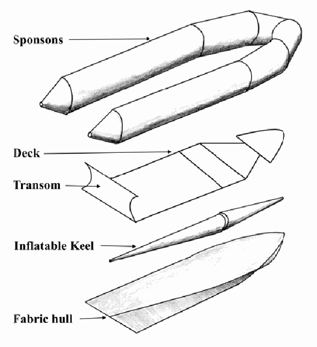
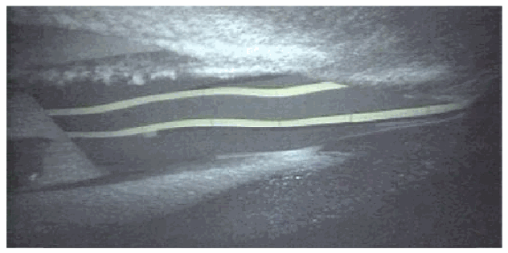
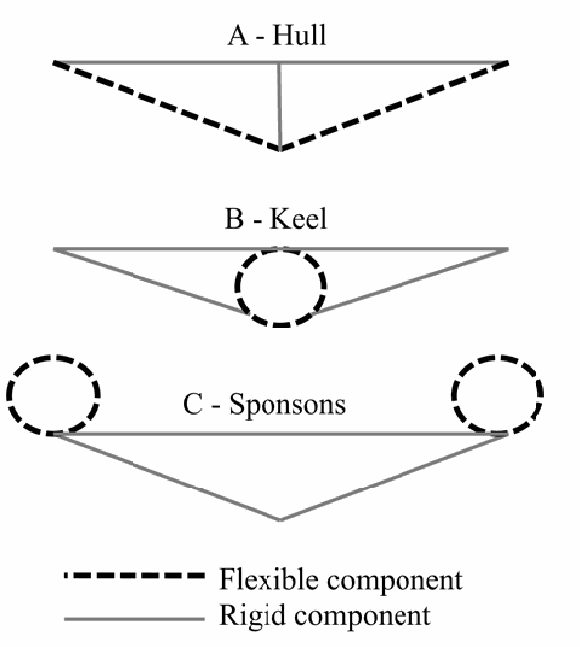
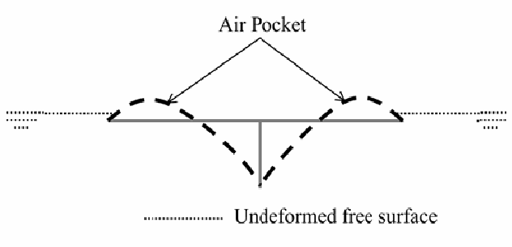
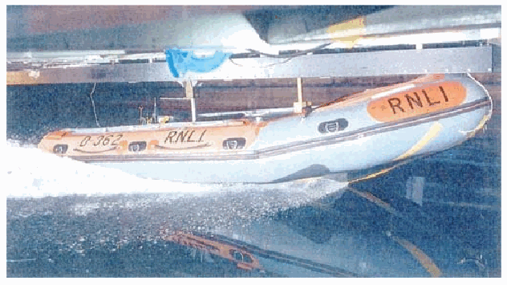

# 充气艇的设计与性能：柔性与环境因素

P. K. Halswell（南安普顿大学工程博士研究生）；P. A. Wilson 教授（南安普顿大学船舶动力学教授）；D. J. Taunton 博士（南安普顿大学讲师）；S. Austen（RNLI 工程支持负责人）。

2011 年会议论文；原 PDF 共 10 页。图内英文保留，图注与必要标签说明译为中文，参考文献保留英文书目信息。

## 摘要

本文研究充气艇的设计与性能。这类艇的结构刚度由充气浮筒和带接头的复合材料夹芯板提供，允许船体线型发生较大变形。经验性证据表明，充气艇（IB）的这种柔性或水弹性改善了性能，尤其是在波浪中。作者希望，通过优化水弹性改善部分性能，包括减小船体运动，从而尽量减少人体振动暴露和波浪增阻。

本文讨论充气艇中各类水弹性问题，定义每个问题，介绍现有文献及可能的研究方法。它们包括整体水弹性、水弹性滑行面和水弹性砰击。本文还讨论带浮筒船艇的波浪与喷溅产生，并联系其对船体运动和阻力的影响。最后讨论这类艇产生的空气传播噪声与水下传播噪声。

## 1. 引言

本项目由英国皇家救生艇协会（RNLI）支持并部分资助。RNLI 是慈善机构，旨在英国和爱尔兰沿岸救助海上遇险者。它设计、建造、维护并运营可用于几乎各种情况的船舶，拥有英国规模最大的充气艇（IB）与硬底充气艇（RIB）船队。本文关注近岸水域用艇，主要是 D 级近岸充气救生艇，即近岸艇 1 型（IB1）。

与较大的艇和船舶相比，对 RIB 性能的科学认识相对有限，对 IB 性能的认识更少。它们的设计通常依赖设计者经验或试错。RIB 性能实验包括 Haiping 等（2005）、Townsend 等（2008a、2008b）的研究；IB 实验包括 Dand 等（2008）、Austen 与 Fogarty（2004）的研究。Lewis 等（2006）建立了 RIB 的计算模型。

IB1 等高速船舶存在非线性船体运动，会产生高、低频振动及较大加速度。2002 年提出的欧洲指令 2002/44/EC 规定劳动者物理振动暴露的最低健康与安全要求。全身振动的暴露行动值为 0.5 m s⁻²（均方根，r.m.s.），或 9.1 m s⁻¹·⁷⁵（振动剂量值，VDV）；暴露限值为 1.15 m s⁻²（r.m.s.），或 21 m s⁻¹·⁷⁵（VDV）。Townsend（2010）从高速船角度充分回顾了船体运动和振动。

振动既可能使船员长期受伤，也可能降低他们在航行中及航行后执行任务的能力。减小人体船体运动暴露的策略包括悬挂座椅、悬挂甲板、主动与被动鳍、纵倾调节板、截流板、陀螺稳定器、柔性船体及弹性体涂层船体。

Townsend 等（2008b）显示，RNLI 的 RIB 会超过暴露限值，原文给出的海况为最高三分之一波高的平均值 0.4 m、平均波周期 10.6 s。Dand（2004）显示，在实尺度波高 0.55 m 的规则波中，IB1 刚性缩尺模型的船员位置可能承受最高达 4g 的加速度。当时 RNLI 正在申请豁免证书，同时研究减轻人体振动暴露的方法。

## 2. 目标

经验性证据表明，IB 的柔性或水弹性改善性能，尤其是在波浪中。因此，本项目的目标是科学地证明水弹性如何及为何改善性能，或证明它并未改善性能。随后应将结果形成设计指南，供 RNLI 未来设计使用。本项目实质上研究高度可变形船艇的水弹性。

目前水弹性主要用于两类研究：计算结构中的应力和应变［Price 等，2002；Hirdaris 与 Temarel，2009］，或研究其对船体运动的影响［Santos 等，2009；Senjanovic 等，2008；Hirdaris 与 Temarel，2009］。恰当利用水弹性，IB 可能经过优化和调校，减小船体运动及振动暴露，并提高前进速度。若俯仰和垂向平移减小，波浪增阻就会降低。因此，本文旨在说明水弹性可用于优化船艇，不仅用于研究其效应；项目将验证这一设想。

本文首先讨论 IB1 的结构，以说明各类水弹性的来源。随后分别讨论整体水弹性、水弹性滑行面与水弹性砰击，对每类问题进行介绍、文献回顾并考察可能的研究方法。这些方法提示了项目后续开展的方向。为进一步理解 RIB 与 IB 性能，本文还讨论波浪与喷溅产生，最后讨论这类小艇的环境噪声。

## 3. IB1 的设计

了解 IB 的结构很重要，因为结构说明艇如何能够变形。图 1 展示 IB1 的主要部件。IB 的设计因作业要求、部件材料与建造技术而异。

图 1. IB1 的主要部件。Sponsons 为浮筒，Deck 为甲板，Transom 为艉板，Inflatable Keel 为充气龙骨，Fabric Hull 为织物船体。

1. **浮筒：**环绕艇体的充气管，由 Hypalon® 涂层聚酯材料制成，充气压力为 206 mbar（3 psi）。
2. **甲板：**主要结构部件，由复合材料夹芯板制成。甲板分为四部分，另有艉板，以有意允许柔性变形。各甲板接头因连接类型而具有不同刚度。艉板及前部甲板与浮筒粘接，其余甲板部分嵌装到位。
3. **充气龙骨：**渐缩充气管，连接到织物船体的中心线。它由 Hypalon® 涂层聚酯材料制成，充气压力为 224 mbar（3.25 psi）。
4. **织物船体：**由两层 Hypalon® 涂层聚酯材料构成的织物片，与浮筒及艉板连接，并在龙骨上张紧。

## 4. 整体水弹性

### 4.1 引言

本节把艇作为整体，研究 IB 的整体水弹性，即纵向弯曲与扭转振动。观察发现，IB1 通过斜向波浪时，甲板弯曲和扭转，使航行更平顺。可将其视为传统水弹性响应，用 Bishop 与 Price（1979）等理论描述。船艇柔性影响波浪诱发的动力响应，进而影响船体运动。

IB 有许多相互关联的参数影响整体振动，包括甲板特性（材料性质和厚度）、甲板接头（数量、位置和刚度）、浮筒与龙骨特性（材料性质及内部压力）、织物船体特性（材料性质及预张应力）、质量特性（纵向重心 LCG 及惯性）与建造技术。作者开展静态挠度实验，发现主导艇体挠度的参数是甲板接头的数量、位置和刚度。

### 4.2 文献回顾

已有数值模型可预测高速船的垂向运动和波浪载荷，例如 Chiu 与 Fujino（1988）及 Santos 等（2009）。但据作者所知，尚无数值模型针对水弹性滑行船完成验证，也未纳入充气织物管的结构特性。Santos 等（2009）模拟了一条具有滑行船体线型的高速巡逻艇，但指出所用方法不适合滑行船，实艇测量与数值结果有较大差异。

Comer 与 Levy（1963）较早研究充气圆柱梁的变形，将其与 Euler–Bernoulli 梁比较。较近期且相关的工作由 Wielgosz 等（2008）完成，用 Timoshenko 梁理论计入剪切变形，并采用包含内部压力的刚度矩阵建立有限元模型。Veldman 等（2005）强调，必须正确选择膜理论或薄壳理论；尽管织物仅厚 60 nm，他们发现薄壳理论吻合得更好。Hypalon® 涂层聚酯应采用哪种理论，尚未确定。

### 4.3 研究方法

#### 4.3.1 实验方法

传统模型尺度实验采用分段模型，但这种方法不适用于 IB1，因为其结构非常规，而且甲板接头允许特定柔性变形。

若采用缩尺模型，需考虑相应相似律。首先是内部压力的缩尺，因为实尺度与模型尺度的大气压力相同。Stevens（1981）提出，可通过波纹管与弹簧组合实现缩尺。织物材料性质的缩尺涉及改变泊松比和杨氏模量。

也可对 IB1 开展实艇实验，主要缺点是环境不可控。可能制造不同甲板特性及接头的 IB，以研究水弹性对船体运动的影响。另一种方法是在各甲板接头上设置弹簧系统，改变接头刚度，从而调整参数。

#### 4.3.2 计算方法

因此，作者认为，当时还不能准确预测滑行船的动态水弹性运动。若开发出织物充气浮筒的建模方法，那么在有了水弹性滑行模型后，便可较容易地将结构域改为适用于 IB1 的形式；可采用与 Wielgosz 等（2008）类似的刚度矩阵。

## 5. 水弹性滑行面

### 5.1 问题定义

IB 的滑行面通常由织物制成，面外弯曲刚度显著低于传统金属或复合材料船体，因此可在不同载荷下发生较大变形，见图 2。问题在于确定织物稳态滑行时的形状，以及变形对滑行性能的影响。

目标是优化织物船体参数，确定柔性滑行面的限制和效应。参数包括材料性质及预张应力；它们决定面外弯曲刚度。随着这些参数增大，材料更硬，其行为更接近传统滑行面。

图 2. IB1 在 19.4 kn 时的船体变形［Dand 等，2008］。

Dand（2002、2003）对 IB1 进行实艇与模型尺度实验，测量阻力、升沉和纵倾。实艇具有柔性，织物船体能够变形，缩尺模型则为刚性。总阻力比较显示，实尺度柔性艇的阻力略高于刚性缩尺模型。Dand 等（2008）将其归因于织物船体变形，在船体后部形成凹形弯曲，改变纵倾角。

艇在静水中加速时还出现不稳定性，被描述为“压力波”缓慢从船底通过，主要造成俯仰与垂向平移方向的“脉动”运动。变形是静态还是动态，尚不清楚。

第一个限制因素是 IB1 的“脉动”不稳定运动。一种假设是，较低的面外弯曲刚度允许船体形成凹形弯曲；弯曲形成时，织物预张应力发生变化，船体上的水动力也随之变化。织物应力改变时，变形向船尾移动。变形导致水动力变化，使操作者感觉到“压力波”。另有报告称，这种“压力波”通过船底时，浮筒可观察到挠曲，提示作用力较大且织物发生运动。变形到达艉板时，压力释放，循环重新开始。这种运动只见于静水，波浪会打断循环。因此，织物船体必须具有最低面外弯曲刚度，以避免不稳定性；目标是量化使这种动态运动停止所需的最低刚度。

Dand 等（2008）显示，柔性会影响滑行面的阻力和纵倾。需进一步研究以量化该影响，并考察尚不清楚的后果，例如升沉变化。

### 5.2 文献回顾

当时没有直接研究膜滑行面的文献。但这种流固相互作用可与帆和膜翼等膜翼型的气动弹性比较。Newman（1987）指出，表面摩擦可改变膜张力；在无黏流中，张力恒定。Song 等（2008）、Rojratsirikul 等（2009）与 Gordnier（2009）显示，膜振动频率与涡脱落频率存在强耦合。Gordnier（2009）尤其显示，雷诺数使膜翼型运动由驻波振动变为类似行波的动态振动。这些文献均不含自由水面，而自由水面对滑行流体力至关重要。

### 5.3 研究方法

#### 5.3.1 实验方法

理想情况下，可开展实尺度拖曳水池试验，但即使可行，也尚不清楚应观察什么。变形是静态还是动态尚不确定；若是静态，最终船体形状也不清楚。因此，应从最基础的平板开始研究。

首先需回答静态还是动态这一问题。不同参数与边界条件，会使织物船体从静态弯曲变为驻波，再变为动态行波。需确认引起这种变化的主要参数是否为材料性质及预张应力，其他因素包括速度和排水量。动态响应可能由 IB1 各部件耦合引起，也可能存在多类不同的织物动态行为。可用水射流撞击斜板来研究，这是滑行船的简单类比。

更好地理解织物滑行面的行为后，可开展更真实的实验。最初可在稳态滑行速度下拖曳织物平板，测量整体形状及阻力、升沉、纵倾。随后测试具有船底斜升角的楔形滑行切片，再逐步发展为静水滑行的完整船体形状。最后可开展一系列波浪实验。缩尺相似律需按第 4.3.1 节讨论加以考虑。

膜变形测量必须同时保证位移精度及采样频率。Jenkins 与 Korde（2006）回顾了膜振动实验文献，并讨论激光测振仪的应用。Arbos-Torrent 等（2011）采用摄影测量法，以每秒 1200 帧测量振动翼型的挠度。

#### 5.3.2 计算方法

可采用计算方法处理，但计算时间和算力需求很大，问题也高度复杂。可能采用与第 6.3、6.4.2 节所述二维计算模型相似的方法，但这些模型仍需实验验证与校核。

## 6. 水弹性砰击

### 6.1 问题定义

本节研究水弹性对二维楔形体垂直撞击自由水面时载荷与加速度的影响。IB 垂向上有三个主要柔性部件：织物船体、充气浮筒与充气龙骨，见图 3。实际中，三者共同作用并相互影响响应，但初步研究可分别进行。

目标是确定最佳参数，尽量降低垂向加速度，从而改变俯仰与垂向平移运动。船体参数包括织物材料性质及预张应力；龙骨与浮筒参数包括材料性质及内部压力。其他重要变量包括冲击速度、船底斜升角与惯性。

Townsend 等（2010）研究简单的楔形船体冲击，探索降低高速船垂向加速度的方法。他们有意将船体刚度从 69 GPa（铝）降到 6.9 GPa，发现对加速度的影响很小。但预计织物的等效刚度会显著更低，从而放大影响。

图 3. 垂直撞击水面的 IB 内的柔性部件。A 为船体，B 为龙骨，C 为浮筒；虚线为柔性部件，实线为刚性部件。

Natzijl（1998）、Pike（2003）等多位作者提出，浮筒在砰击中吸收能量，但尚未验证。Townsend（2008）研究这一设想，发现降低内部压力没有作用。需注意，Atlantic 85 的船体形状使其浮筒很少接触水，而 IB1 不同。作者提出的带浮筒楔形切片实验将回答该问题，并研究材料性质与内部压力的影响。其他影响浮筒吸能的变量包括直径、伸出量和连接方式。

### 6.2 文献回顾

Faltinsen 等（2004）较好地回顾了问题及挑战。可能需考虑的效应包括重力、黏性、气垫、气囊、空气形成气泡的过程、水的可压缩性、空气的可压缩性、流动分离与膜的行为。

通常可忽略重力［Faltinsen 等，2004］。黏性也常被忽略，但在不存在尖锐转角时，黏性可能影响分离，后文再讨论。早期忽略气垫和空气可压缩性，Bereznitski（2001）则显示，纳入它们很重要。结构非常柔软时，可向垂向发生很大变形，越过楔形体转角，形成困气空腔，见图 4。Faltinsen 等（2004）指出，需要更好地理解气垫分解为气泡的过程，其作用尚不清楚。

水可压缩性对应的时间尺度，通常显著小于局部结构响应的时间尺度，因此可假定水不可压缩［Faltinsen 等，2004］。但织物变形的时间尺度尚未确定，因此该假设需验证。硬折角处的流动分离可描述，圆舭处则难以处理，可能需考虑黏性［Faltinsen，2005］。膜行为与传统固体显著不同，经纬纱相互作用带来非线性［Lewis，2003］。

图 4. 困气空腔的形成。Air Pocket 为困气空腔，Un-deformed free surface 为未变形自由水面。

Faltinsen（1997）将问题分为两个时间尺度。第一个为结构惯性阶段，大水动力使质量较小的结构产生大加速度，持续时间远短于第二个尺度。第二个为自由振动阶段，对应结构在湿态下的最长固有周期；结构以第一阶段结果为初始条件发生自由弹性振动，最大应力发生在自由振动阶段。

Faltinsen（1999）用湿梁第一阶固有振动周期与冲击持续时间之比讨论水弹性重要性，并用无量纲参数量化。Bereznitski（2001）采用同样的比值，但用干梁的固有振动，指出比值大于 2 时水弹性作用不显著。增大织物材料性质参数或预张应力，会改变振动周期，进而影响水弹性重要性。原文所列未编号公式如下；与文字比值定义方向相反，见文末备注。

$$
\text{比值}=\frac{\text{冲击持续时间}}{\text{振动周期}}.
$$

### 6.3 建模方法评述

二维物体入水最早作为刚体纯水动力问题研究，始于 20 世纪 20—30 年代 Wagner 和 von Karman 的工作。众多研究者随后推进了研究，直到 Kvalsvold 等（1995）才考虑局部水弹性效应。

1994 年，Kvalsvold 在工程博士论文中通过理论研究多体船连接桥底部（wetdeck）砰击诱发的局部应力，并与 Faltinsen 联合发表结果（1995）。结构用二维 Timoshenko 梁模拟，流体采用 Wagner 理论，假定不可压缩且无旋，未计入困气与空化。该解较复杂，Faltinsen（1997）将其简化。Faltinsen 等（1997）及 Kvalsvold 等（1995）的实验与两种理论解均吻合良好。

Faltinsen（1999）用 Kvalsvold 与 Faltinsen（1995）的数值解研究楔形体入水，计入前进速度，通过四阶 Runge–Kutta 法求解耦合非线性方程。Korobkin 等（2006）说明，可直接将结构域有限元法与流体域 Wagner 理论耦合，结果与采用梁模型的模态方法对应很好。

Lu 等（2000）在流体域用边界元法（BEM）、结构域用有限元法（FEM），满足非线性自由水面边界条件，正确处理射流，与 Zhao 和 Faltinsen（1993）的结果吻合良好。

Bereznitski（2001）研究水弹性在二维砰击中的作用，用四种方法求解：刚体 Wagner 解、自编程序、MSC Dytran 及 LS-DYNA。刚体解可与 Faltinsen（1997）的弹性体结果比较。Bereznitski 认为 MSC Dytran 或 LS-DYNA 最适合，因为两者可处理耦合水弹性相互作用，并包含气垫建模；二者相当类似，水与空气的状态方程相同。

Bereznitski（2001）、Le Sourne 等（2003）、Stenius（2006）及 Stenius 等（2007）用 LS-DYNA 研究过本问题。Stenius 等（2007）采用基于多材料任意拉格朗日—欧拉描述的有限元分析和罚函数接触算法，水动力载荷与实验吻合良好。

### 6.4 研究方法

#### 6.4.1 实验方法

可用缩尺模型落体入水试验研究，但相似律需谨慎考虑。内部压力缩尺可用波纹管与弹簧组合［Stevens，1981］；织物材料性质缩尺涉及改变泊松比与杨氏模量。射流及喷溅形成的缩尺尚不清楚，因为表面张力影响射流破碎为水滴。这涉及改变流体的韦伯数［原文拼作 Webber；Savitsky 等，2010］。另一个缩尺问题是气垫，模型与实尺度试验需保持欧拉数相同［Faltinsen 等，2004］。

相似律表明，实尺度实验更有利。不过，缩尺模型也有优势：较小模型可被强制以恒速垂直入水。

本项目计划用实尺度落体入水试验。可制作实尺度模型，改变材料性质、预张应力、内部压力等参数，以及船底斜升角和冲击速度等变量。可用加速度计、激光或光学设备、声学换能器及惯性测量单元（IMU）等测加速度。测量设备采样频率需至少为 500 Hz［Faltinsen 等，1997］。

还需测量弹性部件形状，这有若干问题。接触式测量不理想，因为会改变部件响应，因此激光或光学设备更适合。

#### 6.4.2 计算方法

第一种可能方法是将膜理论与 Wagner 理论耦合，类似 Kvalsvold 与 Faltinsen（1995）及 Korobkin 等（2006）。还可耦合 BEM 与 FEM 求解，例如 Lu 等（2000）及 ANSYS。最佳方法可能是用 LS-DYNA 进行显式耦合：过去已有应用与验证，而且可纳入大多数需考虑的因素。

## 7. 船行波与喷溅产生

### 7.1 问题定义

船速增大，越过阻力峰对应的航速（hump speed）后，主要阻力分量由兴波阻力转为喷溅阻力［Payne，1988］。硬折角滑行船的波浪和喷溅产生机制已有认识［Savitsky 与 Morabito，2010］，但 IB1 与大多数 IB 无折角，产生机制仍不十分清楚。问题在于研究具有相互作用浮筒的船，从零速到滑行及更高速度时的波浪和喷溅产生。

本研究希望尽量减少带相互作用浮筒的船产生的波浪和喷溅，可能提高最高速度与加速度，并减少船行波冲刷造成的环境损害，但可能不利于船体运动。可从二维横向切片研究浮筒对附加质量的影响，或从纵向研究浮筒对船艇阻力的影响。

本研究与带浮筒二维切片的水弹性砰击有关，但本节研究浮筒对水动力的影响，旨在明确其周围流动。

### 7.2 文献回顾

Dand（2003）在实艇与模型尺度开展 IB1 阻力实验。未测波浪和喷溅，但图 5 显示，喷溅附着于浮筒，随后脱离形成喷溅水片，提示需考虑表面张力和康达效应（Coandă effect）。

图 5. IB1 在 19.4 kn 时的喷溅［Dand，2003］。

Townsend 等（2008a）研究 RIB，尤其是 RNLI Atlantic 85 的船体运动。滑行时浮筒很少接触水，对高速性能影响很小。因此，传统 RIB 浮筒对波浪或喷溅产生的影响可忽略，但 IB1 显然不同。

### 7.3 研究方法

可通过实尺度或缩尺模型拖曳水池试验研究。采用缩尺模型时，需考虑第 6.4.1 节所述相似律。波浪可用波高仪测量，喷溅测量则不常见；当时 ITTC 尚无喷溅测量或模型缩尺的推荐程序，还需测量喷溅水片从浮筒分离的位置。

另一种方法是采用第 6 节所述二维落体入水试验。这排除了前进运动，但可与切片理论比较。

## 8. 环境噪声

环境关注增加，而噪声对野生动物的影响尚不清楚，因此环境噪声也是问题。2003 年实施了欧洲指令 2003/44/EC，规范游艇噪声排放。允许的最大声压级按发动机功率确定，见表 1。

当时已有测量小型游艇空气传播噪声的国际标准：《小艇——动力游艇发出的空气传播噪声》第 1 部分，驶过测量程序（ISO 14509-1:2008）；第 2 部分，利用参考艇评估声音（ISO 14509-2:2006）；第 3 部分，采用计算和测量程序评估声音（ISO 14509-3:2009）。目标是依据这些国际标准测量 IB1 的空气传播噪声，分析数据并发表结果。

与 ISO 14509-3:2009 有关的 SoundBoat 项目找到了预测刚性船体噪声的方法。研究柔性船体对噪声产生的影响会很有意义。

表 1. 最大声压级。功率区间符号按原表照录，存在矛盾，见文末备注。

| 单台发动机功率 $P$（kW） | 最大声压级（dB） |
|---|---:|
| $P>10$ | 67 |
| $10>P>40$ | 72 |
| $P>40$ | 75 |

当时没有针对 IB1 这类小艇水下传播噪声的法规。目标是以 ISO 14509 为基准，按水下效应需要调整方法，测量水下传播噪声。可用频谱分析区分船体噪声和推进噪声，然后发表结果以支持未来研究。

发表结果旨在帮助今后的研究。海洋生物学家可由此了解所产生噪声的频率和幅值，研究哪些噪声危害野生动物；这也有助于 SoundBoat 项目等声学研究者预测不同艇型的噪声。

## 9. 结论

本文首先介绍 IB 的结构，指出 IB1 设计中的柔性部位，由此说明 IB 设计应在哪些方面考虑水弹性。优化水弹性可能改善船体运动（减少人体振动暴露）、前进速度／加速度与波浪增阻。

本文讨论了 IB 的整体水弹性，并说明现有理论可能通过修改纳入充气管和甲板接头，再用于优化整体水弹性。

随后考虑水弹性滑行面的复杂问题。当时计算模型看来还不够准确，不能指示刚性与水弹性滑行面的差异。本文概述了可能的实验研究方法。

本文回顾水弹性砰击，展示不同柔性形式。每种形式可通过计算或实验确定其对垂向加速度的影响。其中一种将验证浮筒在砰击时是否吸收冲击能量，并量化作用。

本文探索相互作用浮筒周围的波浪与喷溅产生，可将其纳入水弹性砰击实验。最后讨论适用于这类、这般尺寸船艇的空气传播噪声法规与标准，以及水下传播噪声这一新研究方向。

## 10. 致谢

本项目由 RNLI 和英国工程和自然科学研究委员会（EPSRC）共同支持并资助。

## 11. 参考文献

题名、作者、年份及出版信息保留英文；仅合并原 PDF 中的排版断行。

- Arbos-Torrent, S., Pang, Z. Y., Ganapathisubramani, B., Palacios, R., (2011) Leading and trailing edge effects on the aerodynamic performance of compliant aerofoils. In: 49th AIAA, No.1118, pp.1-16.
- Austen, S., Fogarty, H. F. J., (2004) Design and development of a new inflatable lifeboat. SURV VI, RINA, March 2004.
- Bereznitski, A., (2001) Slamming: The role of hydroelasticity. Int. shipbuilding progress 4, (48), pp. 333- 351.
- Bishop, R. E. D., Price, W. G., (1979) Hydroelasticity of ships. Cambridge University Press.
- Chiu, F-C., Fujino, M., (1988) Nonlinear prediction of vertical motions and wave loads of high-speed crafts in head sea. Int. Shipbuilding Progress 36, (406), pp. 193-232.
- Comer, R. L., Levy, S., (1963) Deflection of an inflatable cylindrical cantilever beam. AIAA Journals 1, (7), pp. 1652-1655.
- Dand, I. W., (2002) Resistance measurements with an RNLI D-class Lifeboat. Report by BMT SeaTech; Doc No. 3356.02.
- Dand, I. W., (2003) Resistance experiments with an RNLI D-class Model. Report by BMT SeaTech; Doc No. C3356.04.
- Dand, I. W., (2004) RNLI D-class model: Seakeeping measurements in head seas. Report by BMT SeaTech; Doc No. C3356.06.
- Dand, I. W., Austen, S., Barnes, (2008) The speed of fast Inflatable Lifeboats. Int. Journal of Small Craft Technology Vol. 150 Part B2, pp. 23-32.
- Faltinsen, O. M., (1997) The effect of hydroelasticity on ship slamming. Phil. Trans. of the Royal Soc. A: Mathematical, Physical and Engineering Sciences 355, (1724), pp. 575-591.
- Faltinsen, O. M., (1999) Water entry of a wedge by hydroelastic orthotropic plate theory. Journal of Ship Research 43, (3), pp. 180-193.
- Faltinsen, O. M., (2005) Hydrodynamics of high-speed marine vehicles. Cambridge University Press, ISBN; 0-521- 84568-8.
- Faltinsen, O. M., Kvålsvold, J., Aarsnes, J. V., (1997) Wave impact on a horizontal elastic plate. Journal of Marine Science and Technology 2, (2), pp. 87-100.
- Faltinsen, O. M., Landrini, M., Greco, M., (2004) Slamming in marine applications. Journal of Engineering Mathematics 48, (3/4), pp. 187-217.
- Gordnier, R., (2009) High fidelity computational simulation of a membrane wing airfoil. Journal of Fluids and Structures 25, (5), pp. 897-917.
- Haiping, H. E., Bretl, J. P. E., VanSumeren, H., Savander, B., Troesch, A. W., (2005) Model tests of a typical rib in waves. Private Communication.
- Hirdaris, S. E., Temarel, P., (2009) Hydroelasticity of ships: recent advances and future trends. Proceedings of the Institution of Mechanical Engineers, Part M: Journal of Engineering for the Maritime Environment 223, (3), pp. 305- 330.
- Jenkins, C., Korde, U., (2006) Membrane vibration experiments: An historical review and recent results. Journal of Sound and Vibration 295, (3-5), pp. 602-613.
- Korobkin, A., Guéret, R., Malenica, S., (2006) Hydroelastic coupling of beam finite element model with Wagner theory of water impact. Journal of Fluids and Structures 22, (4), pp. 493-504.
- Korobkin, A., Parau, E., Vanden-Broeck, J., (2010) Mathematical challenges and modelling of hydroelasticity. Report on the Workshop, Int. Centre for Mathematical Sciences, 21-24 June, Edinburgh.
- Kvalsvold, J., Faltinsen, O. M., (1995) Hydroelastic modelling of wet deck slamming on multihull vessels. Journal of ship research 39, (3), pp. 225-239.
- Le Sourne, H., County, N., Besnier, F., Kammerer, C., Legavre, H., (2003) LS-DYNA Applications in Shipbuilding. In: 4th European LS-DYNA Users Conference pp. 1-16.
- Lewis, S. G., Hudson, D. A., Turnock, S. R., Blake, J. I. R., Shenoi, R. A., (2006) Predicting motions of high speed RIBs: A Comparison of non-linear strip theory with experiments. Proceedings of the 5th Int. Conference on High Performance Marine Vehicles (HIPER'06) pp. 210-224.
- Lewis, W. J., (2003) Tension Structures: Form and Behaviour. Thomas Telford, ISBN: 0-7277-3236--6.
- Lu, C., He, Y., Wu, G., (2000) Coupled analysis of nonlinear interaction between fluid and structure during impact. Journal of Fluids and Structures 14, (1), pp. 127-146.
- Natzijl, P. W., (1998) Bringing a 1.0 metre buoyancy tube to sea on a 18.0 metre rigid hull. Int. conference on rigid inflatables; 14-15 May, Weymouth, UK, Paper No. 7.
- Newman, B., (1987) Aerodynamic theory for membranes and sails. Progress in Aerospace Sciences 24, (1) pp. 1-27.
- Payne, P. R., (1988) Design of High-Speed Boats - Planing. Fishergate Inc, ISBN: 0-942720-06-07.
- Pike, D., (2003) Inflatable tubes offer advantages for small craft. Ship and Boat Int., November, pp. 78-82.
- Price, W., Salas Inzunza, M., Temarel, P., (2002) The dynamic behaviour of a mono-hull in oblique waves using two-and three-dimensional fluid structure interaction models. Trans. Royal Institution of Naval Architects 144, pp. 1-26.
- Rojratsirikul, P., Wang, Z., Gursul, I., (2009) Unsteady fluid-structure interactions of membrane airfoils at low Reynolds numbers. Experiments in Fluids 46, (5), pp. 859- 872.
- Santos, F. M., Temarel, P., Soares, C. G., (2009) On the limitations of two- and three-dimensional linear hydroelasticity analyses applied to a fast patrol boat. Proceedings of the Institution of Mechanical Engineers, Part M: Journal of Engineering for the Maritime Environment 223 (3) pp. 457-478
- Savitsky, D., Morabito, M., (2010) Origin and characteristics of the spray patterns generated by planing hulls. Davidson Laboratory, Stevens institute of technology, Report No. 2882.
- Senjanovic, I., Malenica, S., Tomasevic, S., (2008) Investigation of ship hydroelasticity. Ocean Engineering 35, (5-6), pp. 523-535.
- Song, A., Tian, X., Israeli, E., Galvao, R., Bishop, K., Swartz, S., Breuer, K., (2008) Aeromechanics of membrane wings with implications for animal flight. AIAA Journal 46, (8), pp. 2096-2106.
- Stenius, I., (2006) Finite element modelling of hydroelasticity hull-water impacts. Ph.D. thesis, Royal Institute of Technology, KTH, Stockholm, Sweden.
- Stenius, I., Rosén, A., Kuttenkeuler, J., (2007) Explicit FE-modelling of hydroelasticity in panel-water impacts. Int. Shipbuilding Progress 54, pp. 111-127.
- Stevens, M. J., (1981) The model testing of inflatable craft. Int. conference on rigid bottom inflatable craft, RINA, Paper 2.
- Townsend, N. C., (2008) Influencing and influences of marine vessel motions. Ph.D. thesis, University of Southampton, UK.
- Townsend, N. C., Coe, T. E., Wilson, P. A., Shenoi, R. A., (2010) On the mitigation of human motion exposure on board high speed craft. Strategies and methods, including flexible hull design. Private Communication.
- Townsend, N. C., Wilson, P. A., Austen, S., (2008a) Seakeeping characteristics of a model RIB in head seas. Int. Journal of Maritime Engineering 151, (A1), pp. 5-44.
- Townsend, N. C., Wilson, P. A., Austen, S., (2008b) What influences rigid inflatable boat motions? Proceedings of the Institution of Mechanical Engineers, Part M: Journal of Engineering for the Maritime Environment 222, (4), pp. 207- 217.
- Veldman, S., Bergsma, O., Beukers, a., (2005) Bending of anisotropic inflated cylindrical beams. Thin-Walled Structures 43, (3), pp. 461-475.
- Wielgosz, C., Thomas, J. C., Le Van, A., (2008) Mechanics of inflatable fabric beams. ICCES 5, (2), pp. 93-98.
- Zhao, R., Faltinsen, O. M., (1993) Water entry of two- dimensional bodies. Journal of Fluid Mechanics 246, pp. 593-612.

## 校订备注

1. 第 6.2 节文字把判据比值定义为“固有振动周期／冲击持续时间”，公式却写成其倒数。不能将“大于 2 时水弹性不显著”同时套用于这两种定义；复现时须查原引文。
2. 表 1 原表第一行写 $P>10$，第二行写 $10>P>40$，最后一行又写 $P>40$。第二行区间不可能成立，首末两行重叠；译文照录，不据此推定合法功率区间或现行噪声要求。
3. 第 6.1 节用 GPa 表示“船体刚度”，量纲实际对应材料弹性模量，不等于整艇弯曲刚度或力—位移刚度。译文保留作者措辞和原始数字。
