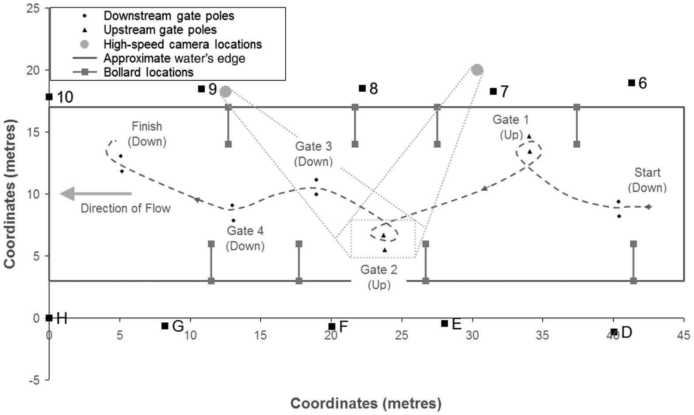
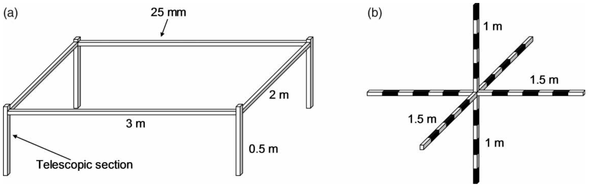
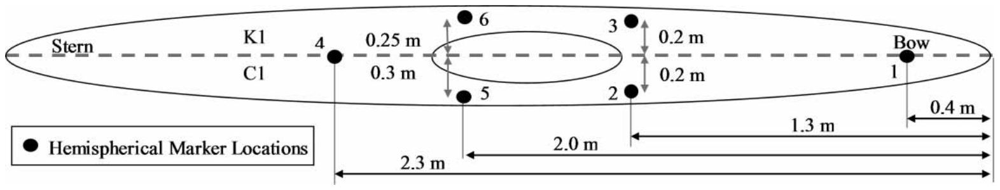
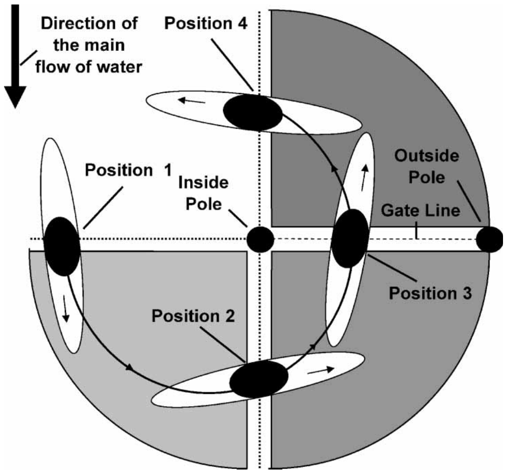
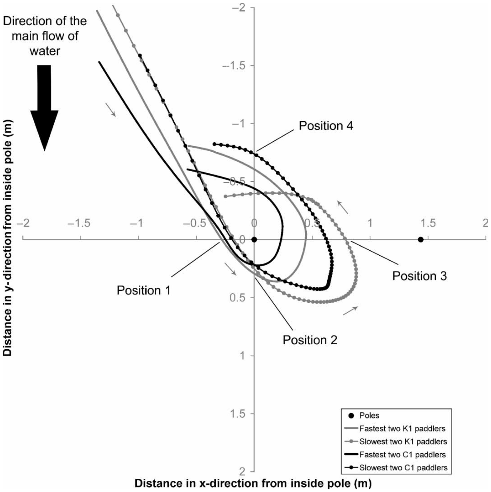
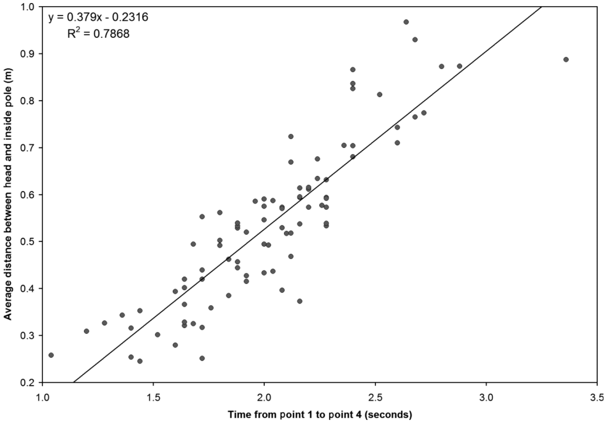
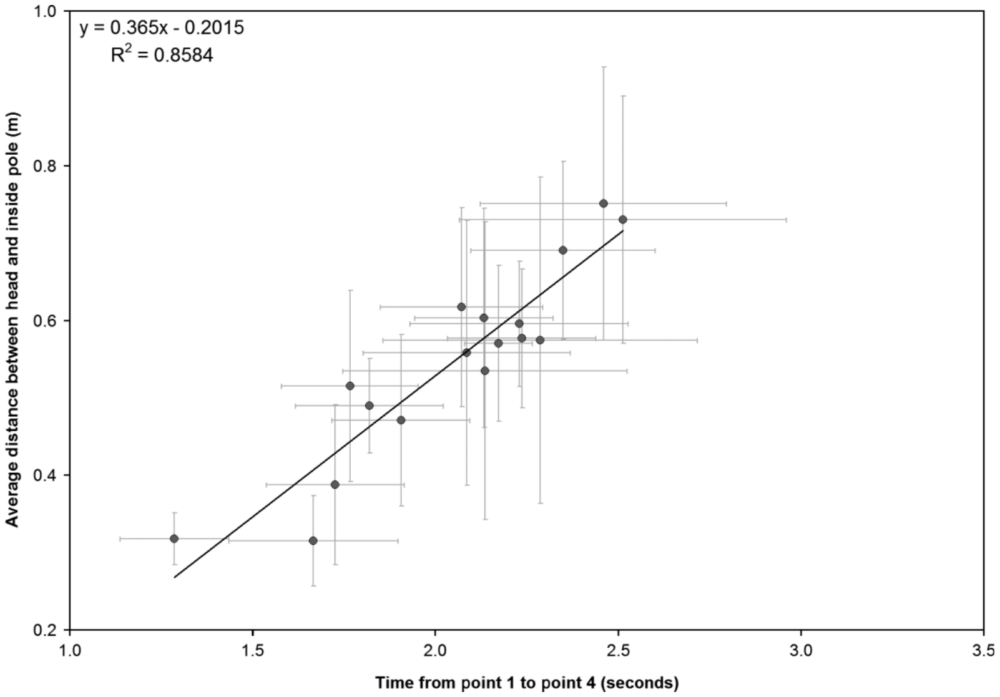

# 皮划艇激流回旋运动员通过逆流门时的船体轨迹

**Canoe slalom boat trajectory while negotiating an upstream gate**

- 作者：Adam Hunter（亚当·亨特）
- 机构：澳大利亚体育学院（Australian Institute of Sport）生物力学与表现分析部门，堪培拉大学，澳大利亚堪培拉
- 期刊：*Sports Biomechanics*（《运动生物力学》），2009 年 6 月，第 8 卷第 2 期，第 105–113 页
- DOI：10.1080/14763140902934837
- 在线发表：2009 年 6 月 12 日
- 收稿：2008 年 11 月 7 日；修回：2009 年 3 月 23 日；录用：2009 年 3 月 25 日
- 通信地址：A. Hunter, Biomechanics and Performance Analysis, Australian Institute of Sport, University of Canberra, PO Box 176, Belconnen, ACT 2616, Australia. E-mail: adam.hunter@ausport.gov.au
- ISSN 1476-3141（印刷版）/ ISSN 1752-6116（在线版）© 2009 Taylor & Francis

> 原 PDF 第 1 页为 Taylor & Francis 在线平台下载封面页，刊载信息如下：刊名 *Sports Biomechanics*；ISSN：1476-3141（印刷版）、1752-6116（在线版）；期刊主页 http://www.tandfonline.com/loi/rspb20 ；引用格式：Adam Hunter (2009) Canoe slalom boat trajectory while negotiating an upstream gate, Sports Biomechanics, 8:2, 105-113, DOI: 10.1080/14763140902934837；文章链接：http://dx.doi.org/10.1080/14763140902934837 ；在线发表日期：2009 年 6 月 12 日；文章浏览量：112。下载方标注：Download by: [Charles University in Prague], [buster@centrum.cz]，Date: 12 December 2016, At: 04:09。

## 摘要

本研究旨在确定优秀激流回旋运动员所选择的路线如何影响其通过一道逆流门所需的时间。对国际级男子单人皮艇（MK1）（*n* = 11）和单人划艇（C1）（*n* = 6）运动员在一道左侧逆流门上的六次试划进行了数字化处理。结果显示，运动员的绝对变异性随其总时间增加而增大（*r* = 0.594），但变异系数保持恒定。船体轨迹与总时间之间存在强相关（每次单独试划 *r* = 0.89；以每名参与者的平均总时间计 *r* = 0.93）。MK1 与 C1 运动员采用相似的策略通过逆流门。最快与最慢运动员的船体轨迹（运动员头部与内侧门杆之间的平均距离）之间存在显著差异（*P* < 0.05）。这些结果提示，若要取得更快的逆流门表现，运动员应把注意力集中在头部与内侧门杆之间的距离上。然而，应当存在一个最佳距离，一旦进一步缩短该距离，反而会妨碍技术发挥和运动表现。

**关键词：** 生物力学；皮艇；运动员；运动表现；三维；白水

## 引言

优秀级别的皮划艇激流回旋比赛大约在 90 s 内决出胜负，顶尖运动员之间的差距往往不足半秒。因此，运动员会寻找能使其相对于竞争对手获得优势的策略或技术。然而，动作执行错误的判罚十分严厉：错误过门将被罚 50 s，触门杆将被罚 2 s。关于能带来优势的策略与技术，科学研究一直局限于对激流回旋运动员的时间—动作分析（Hunter et al., 2007；2008），大多数研究则集中于损伤（Fiore and Houston, 2001）、裁判（Ritter, 1975；Miao and Bi, 2001）、赛道设计（Peters, 1987；Schmidt, 1993）、心理状态（Males et al., 1998），以及对未来可能研究方向的讨论（Knyora, 1976；Sperlich and Klauck, 1992）。

对激流回旋运动员的计时运动分析（lapsed-time motion analysis）已被用于考察优秀激流回旋运动员通过整条赛道的策略（Hunter et al., 2008）。然而，基于计时运动分析的研究在"不干扰比赛环境所能采集的信息"方面存在局限。因此，为更好地理解优秀比赛中所采用的策略，需要采用介入程度更高的数据采集方法。

以往唯一分析运动员及其装备通过门体时运动的研究者（雪上自行车项目）采用电影摄影术测定了运动学参数、所受的力以及转弯的各个阶段（Jelen and Jandová, 1999）。迄今为止，尚无研究考察激流回旋运动表现的运动学。对重复划行进行三维分析，并研究不同生物力学变量如何与通过逆流门所需时间相关联，将为教练员提供关于有利于表现的技术特征的关键信息。因此，本研究的目的是确定优秀激流回旋运动员所选择的路线如何影响其通过逆流门所需的时间。

## 方法

在与优秀激流回旋教练员协商后，于一条白水赛道（澳大利亚彭里斯（Penrith））的上游四分之一段设置了一条含六道门的皮划艇激流回旋赛道，由五台水泵产生 14 m³/s 的白水流。该水流条件即 2005 年皮划艇激流回旋世界锦标赛所使用的条件。赛道包括四道顺流门和两道逆流门（图 1）；本研究的分析集中于 2 号门，这是一道左侧逆流门。

**图 1.** 测试所用赛道与设备的比例示意图。虚线表示运动员从右向左完成赛道时的大致路线。灰色圆点表示两台高速摄像机的位置，摄像机对准 2 号门（点线矩形）。

图中标签译注：Downstream gate poles＝顺流门门杆；Upstream gate poles＝逆流门门杆；High-speed camera locations＝高速摄像机位置；Approximate water's edge＝大致水边线；Bollard locations＝系柱位置；Coordinates (metres)＝坐标（m）；Direction of Flow＝水流方向；Start (Down)＝起点（顺流门）；Finish (Down)＝终点（顺流门）；Gate 1 (Up)＝1 号门（逆流门）；Gate 2 (Up)＝2 号门（逆流门）；Gate 3 (Down)＝3 号门（顺流门）；Gate 4 (Down)＝4 号门（顺流门）。数字 6–10 与字母 D、E、F、G、H 均为场地边线系柱的标识，不是门的编号。

17 名男性参与了本研究：11 名单人皮艇（K1）运动员和 6 名单人划艇（C1）运动员。C1 运动员中，5 名为右手持桨、1 名为左手持桨。该左手持桨运动员的数据与右手持桨运动员的数据合并处理，因为分析表明，就所分析的变量而言，两者采用的策略没有差异。每名参与者使用符合国际皮划艇联合会（International Canoe Federation）规则的自有艇只和桨。皮艇运动员有两片桨叶，坐在艇中；划艇运动员只有单片桨叶，在艇中呈跪姿。所有参与者在 2005 年皮划艇激流回旋项目的世界杯或世界锦标赛中均排名前 40 位。

运动员在赛道上完成六次试划，每次试划约耗时 20 s。运动员有 5 min 时间完成试划并步行返回起点，以确保各次试划之间充分恢复。运动员触碰任意一根门杆的试划被排除在分析之外。

使用两台高速摄像机（Phantom V4.2 colour，固件版本 299；Vision Research Inc.，美国新泽西州）配合 16–100 mm f/1.9 变焦镜头，采集 2 号门的高速影像。影像通过运行 Phantom V630 软件的计算机采集。摄像机采样频率为 100 Hz，分辨率为 512 × 348 像素，快门速度在 1/1000 s 至 1/500 s 之间。摄像机位于水面上方 2.8 m 处，朝向按图 1 所示设置。

**图 2.** 标定架。底架（a）放置于赛道河床内，并利用可伸缩段调平。为标定空间体积，将可移动的"T"形部件（b）依次安装到底架每条支腿上方并调平。

图中标签译注：Telescopic section＝可伸缩段；图中尺寸为 3 m、2 m、0.5 m、25 mm（底架），"T"形部件横、竖臂分段尺寸为 1.5 m、1 m。

定制的便携式标定架由两部分组成：一部分是在无水状态下放于赛道河床内并调平的底架，另一部分是可移动的"T"形部件，该部件依次安装到底架的每个角上并调平（图 2）。为高速摄像机标定的空间体积为 6 × 5 × 1.5 m。分布在该体积内的 20 个标定点被输入商业软件（Ariel Performance Analysis System，美国加利福尼亚州），该软件采用三维直接线性变换，将数字化坐标转换为真实世界坐标。

将柔软的荧光橙色半球形标志点（直径 40 mm）贴在每名运动员的艇只和头盔上，以便在艇上和头部形成易于数字化的可见标志。由于艇宽不同，C1 上 5 号和 6 号标志点的位置比 K1 宽 0.05 m（图 3）。

**图 3.** 贴在每艘艇上的半球形标志点位置。上半部分表示单人皮艇（K1），下半部分表示单人划艇（C1）。

图中标签译注：Stern＝船尾；Bow＝船头；Hemispherical Marker Locations＝半球形标志点位置；K1＝单人皮艇；C1＝单人划艇。尺寸标注单位为 m（含 2.3 m、2.0 m、1.3 m、0.4 m，以及各标志点间距 0.25 m、0.3 m、0.2 m 等）。

对一次试划进行频率分析（快速傅里叶变换）的结果表明，信号的主要成分低于 1 Hz。为便于开展当前研究未涉及的后续分析，使用商业软件（Ariel Performance Analysis System，美国加利福尼亚州）以 25 Hz 对视频影像进行人工数字化，以重建逆流门过门过程中艇只和运动员头部的三维运动学信息。

重复性分析显示：在三次数字化重复中，所有标志点的每个数据点相对于均值的平均绝对差为 0.01 m，最大值为 0.04 m；在三次重复中，所有标志点的每个数据点相对于均值的最大绝对差为 0.07 m。随后，采用五阶双向巴特沃斯（Butterworth）滤波器对原始 x、y、z 坐标进行滤波，截止频率为 2 Hz；该截止频率是根据快速傅里叶变换结果和奈奎斯特频率（带宽的两倍）选取的。

总时间定义为头部从位置 1 运动到位置 4 所需的时间；船体轨迹定义为位置 1 至位置 4 之间运动员头部与内侧门杆之间的平均距离（图 4）。只分析位置 1 与位置 4 之间的数据，因为转弯主要发生在这一区间，而艇只的再加速发生在位置 4 之后。为比较两名最快和两名最慢 K1 运动员、以及两名最快和两名最慢 C1 运动员绕门所采取的路线，计算了每个数据点的平均值。

**图 4.** 所分析的逆流转弯区段为从位置 1 到位置 4。

图中标签译注：Direction of the main flow of water＝主水流方向（图中向下）；Position 1/2/3/4＝位置 1/2/3/4；Inside Pole＝内侧门杆；Outside Pole＝外侧门杆；Gate Line＝门线。黑色弧线箭头表示艇只绕内侧门杆回转的行进顺序（位置 1→2→3→4），艇上小箭头表示艇首朝向变化。

对 C1 与 K1 进行比较，可使运动员优化其所采用的策略时，不只以本类别中的最佳者为依据，而是以两个类别中的最佳者为依据。尽管皮艇与划艇在艇只和桨的设计上存在差异，可能影响策略在两个类别之间可迁移的程度，但通过比较不同皮划艇激流回旋类别在通过障碍物时所采用策略的有效性，可以加深对运动表现的理解。

采用 Pearson 双尾相关分析确定总时间（自变量）与船体轨迹（因变量）之间关系的强度。为确定这种关系是否对每个个体都成立，对每名参与者分别进行 Pearson 双尾相关分析，并计算线性回归方程的参数。将所有受分析试划的总时间与船体轨迹的变异系数和标准差同总时间进行相关分析，以确定试划间变异性是否随总时间增加而增大。对四组运动员（每个类别 K1 和 C1 中的两名最快者与两名最慢者）进行单因素方差分析（ANOVA），以总时间和船体轨迹为因变量，确定在这一群体中最快策略与最慢策略之间是否存在差异。采用事后 Scheffé 检验评估各组之间的差异。

## 结果

对 K1 和 C1 而言，船体轨迹的最大差异都出现在每个类别中最快的两名运动员与最慢的两名运动员之间（图 5）。每个类别中最慢的两名运动员在进入门区时采取更紧凑的路线，但在位置 2 之后，其路线比最快两名运动员更宽。在位置 2 与位置 3 之间，较快运动员头部与内侧门杆之间的距离比较慢运动员更小。

**图 5.** K1 和 C1 中最快两名与最慢两名运动员在 x、y 平面内的平均船体轨迹。

图中标签译注：Direction of the main flow of water＝主水流方向（图中向下）；Position 1/2/3/4＝位置 1/2/3/4；Distance in x-direction from inside pole (m)＝距内侧门杆的 x 方向距离（m）；Distance in y-direction from inside pole (m)＝距内侧门杆的 y 方向距离（m）；Poles＝门杆；Fastest two K1 paddlers＝最快两名 K1 运动员；Slowest two K1 paddlers＝最慢两名 K1 运动员；Fastest two C1 paddlers＝最快两名 C1 运动员；Slowest two C1 paddlers＝最慢两名 C1 运动员。注意纵轴数值自上向下由 −2 增至 2，即图中下方为 y 正方向。

船体轨迹与从位置 1 到位置 4 的总时间之间存在强相关（*r* = 0.89）（图 6，表 I）。当采用每名参与者的船体轨迹与其从位置 1 到位置 4 的平均总时间、而非每次单独试划时，这一关系更强（*r* = 0.93）（图 7）。

**图 6.** 每次试划总时间与船体轨迹之间的相关。

图中标签译注：Time from point 1 to point 4 (seconds)＝从点 1 到点 4 的时间（s）；Average distance between head and inside pole (m)＝头部与内侧门杆之间的平均距离（m）。图内回归式为 *y* = 0.379*x* − 0.2316，*R*² = 0.7868。

每名运动员的船体轨迹与总时间之间的相关程度有所不同，但除一人外全部满足 *r* ≥ 0.69（表 II）。所有运动员均呈正相关，这一点可从全部大于零的斜率中看出。

总时间与试划间总时间的标准差（*r* = 0.594）及船体轨迹的标准差（*r* = 0.657）呈中等程度相关。然而，在试划之间，总时间与总时间的变异系数（*r* = 0.228）之间、以及总时间与船体轨迹的变异系数（*r* = 0.282）之间均未观察到相关（表 I）。

在总时间或船体轨迹方面，最快两名 K1 运动员与最快两名 C1 运动员之间未观察到显著差异。最快两名 C1 运动员与最慢两名 C1 运动员的总时间之间未见显著差异（*P* = 0.06），但船体轨迹存在显著差异（*P* = 0.02）。最快两名 K1 运动员与最慢两名 K1 运动员在总时间（*P* < 0.01）和船体轨迹（*P* = 0.05）方面均存在显著差异。

**表 I.** 与总时间的 Pearson 双尾相关

| 变量 | *r* 值 |
|---|---|
| 船体轨迹（头部与内侧门杆之间的平均距离） | 0.93 |
| 总时间的标准差 | 0.59 |
| 船体轨迹的标准差 | 0.66 |
| 总时间的变异系数 | 0.23 |
| 船体轨迹的变异系数 | 0.23 |

**图 7.** 每名运动员平均总时间与船体轨迹之间的相关（± 标准差）。

图中标签译注：Time from point 1 to point 4 (seconds)＝从点 1 到点 4 的时间（s）；Average distance between head and inside pole (m)＝头部与内侧门杆之间的平均距离（m）。图内回归式为 *y* = 0.365*x* − 0.2015，*R*² = 0.8584。横向、纵向误差线分别为总时间与平均距离的标准差。

**表 II.** 每名参与者总时间与船体轨迹之间的 Pearson 双尾相关及线性回归方程

| 参与者 | 类别 | 试划次数 | *r* 值 | 斜率 | *y* 轴截距 |
|---|---|---|---|---|---|
| 1 | C1（R） | 6 | 0.99 | 0.440 | −0.407 |
| 2 | K1 | 6 | 0.94 | 0.462 | −0.482 |
| 3 | K1 | 6 | 0.97 | 0.589 | −0.670 |
| 4 | K1 | 6 | 0.78 | 0.583 | −0.640 |
| 5 | K1 | 6 | 0.95 | 0.627 | −0.593 |
| 6 | K1 | 6 | 0.91 | 0.534 | −0.547 |
| 7 | C1（L） | 6 | 0.69 | 0.175 | 0.022 |
| 8 | C1（R） | 6 | 0.90 | 0.204 | 0.055 |
| 9 | K1 | 5 | 0.94 | 0.544 | −0.510 |
| 10 | C1（R） | 4 | 0.76 | 0.228 | 0.074 |
| 11 | K1 | 6 | 0.79 | 0.436 | −0.366 |
| 12 | C1（R） | 4 | 0.82 | 0.223 | 0.099 |
| 13 | C1（R） | 4 | 0.71 | 0.325 | −0.073 |
| 14 | K1 | 4 | 0.96 | 0.501 | −0.481 |
| 15 | K1 | 3 | 0.03 | 0.028 | 0.508 |
| 16 | K1 | 5 | 0.96 | 0.474 | −0.478 |
| 17 | K1 | 6 | 0.76 | 0.272 | 0.045 |

表注：C1（R）＝右手持桨的单人划艇运动员；C1（L）＝左手持桨的单人划艇运动员；K1＝单人皮艇运动员。部分参与者试划次数少于 6 次，系因触碰门杆的试划按方法规定被排除。*y* 轴截距列负值已对照原 PDF 逐项核对（文本抽取时负号曾误并为数字"2"）。

## 讨论与启示

本研究旨在确定优秀激流回旋运动员所选择的路线如何影响其通过逆流门所需的时间。总时间与运动员试划间表现变异性之间的关系（以总时间和船体轨迹二者的标准差衡量）表明，较快的运动员相比较慢的运动员具有更小的绝对变异。然而，总时间与总时间、船体轨迹的变异系数之间只有弱关系。这表明优秀运动员各次划行之间的变异占其划行时间的百分比相近，因此划行时间较快者以秒计的变异更小。这提示运动员所具有的变异是相近的，但较快的运动员能够以积极的方式运用其变异，以应对不断变化的环境条件，从而产生更小的绝对变异，并因此取得更快的时间。

当把总时间和船体轨迹一并考虑时，最快两名 C1 运动员与最快两名 K1 运动员采用了相同的策略通过逆流门。这表明，尽管两个类别具有不同的限制条件——皮艇运动员有两片桨叶且取坐姿，而划艇运动员只有单片桨叶且取跪姿——但通过逆流门所采用的方法是相似的（图 5）。因此，对两组运动员的教学要点应当相同。此外，由于皮划艇激流回旋的规则，运动员通常只能观看少数几次赛道示范划行。因此，基于本研究结果可以认为，运动员在观看示范时应当关注所有类别，而不仅仅是自己所属的类别。

最快两名 K1 运动员绕门显著快于最慢两名 K1 运动员，并且所采取的路线也显著不同，这表明即使在优秀群体内部，最快与最慢运动员通过逆流门的方式也存在差异。这一信息有助于教练员和运动员确定通过门群的最佳路线，以及该路线将如何与时间和表现相联系。在 C1 中，最快两名与最慢两名运动员绕门的路线和总时间存在差异，但总时间差异并不显著。这很可能是由于该类别参与者人数较少、他们能力相近，或比较的时间区段较短所致。通过比较左手与右手持桨的 C1 运动员在顺手侧（onside）和反手侧（offside）逆流门上的表现，可以进一步加深对逆流门技术的认识。

本研究发现，在通过逆流门时，尽量缩小运动员头部与内侧门杆之间的距离是一项重要的考虑因素，因为它对表现具有显著影响。无论是以每名个体多次试划的平均值考虑，还是以每次试划单独考虑，总时间与船体轨迹之间都存在关系。因此，就个体运动员而言，其最快成绩出现在头部最接近内侧门杆的那些试划中。此外，在运动员之间进行比较时，最快成绩由那些将这一距离缩至最小的运动员取得。船体轨迹的图示也支持这些结果：图中显示，与最快两名运动员相比，每个类别中最慢两名运动员绕门采取了更宽的路线（图 5）。这一关系并非完美，因此还必须考虑其他因素，例如运动员质量的差异、艇只设计、划桨推进、各次试划之间水流的变化，以及在完成整条六道门赛段的背景下通过该逆流门的战术。由于激流回旋划艇项目的规则，可以预期存在一个最佳距离，一旦超过该点进一步缩短距离，就会因触门风险增加而妨碍表现。逆流门前后各门的位置，以及水流条件、逆流门相对于赛道和水中障碍物的位置，对每条赛道以及赛道内的每道逆流门而言都不相同。因此，在考察运动员绕门所采取的路线时，考虑这些因素十分重要。然而，无论各门自身特征如何，船体轨迹与总时间之间的关系都应当成立。

## 结论

在确定优秀激流回旋运动员如何通过逆流门时发现：运动员的绝对变异性随其技术水平提高（以总时间衡量）而减小，但百分比变异保持恒定。男子 K1（*n* = 11）与 C1（*n* = 6）运动员似乎并未采用不同的策略通过逆流门。此外，即使在这一优秀群体内部，以运动员头部与内侧门杆之间的平均距离衡量，最快两名运动员的路线与最慢两名 K1、C1 运动员的路线也存在显著差异。追求更快逆流门表现的运动员，可以通过集中精力尽量缩小其头部与内侧门杆之间的距离而获得提高。然而，可以预期存在一个最佳距离，一旦进一步缩短该距离，就会因触门风险增加而妨碍技术发挥和运动表现。

## 参考文献

Fiore, D. C., and Houston, J. D. (2001). Injuries in whitewater kayaking. *British Journal of Sports Medicine*, 35, 235–241.

Hunter, A., Cochrane, J., and Sachlikidis, A. (2007). Canoe slalom competition analysis reliability. *International Journal of Sports Biomechanics*, 6, 155–170.

Hunter, A., Cochrane, J., and Sachlikidis, A. (2008). Canoe slalom competition analysis. *International Journal of Sports Biomechanics*, 7, 24–37.

Jelen, K., and Jandová, S. (1999). Results of biomechanical analysis in snowbiking. *Gymnica*, 29, 43–47.

Knyora, R. (1976). Possibilities for utilization of model methods in the training of youth in canoe slalom. *Teorie a praxe telesne vychovy*, 24, 541–547.

Males, J. R., Kerr, J. H., and Gerkovich, M. M. (1998). Metamotivational states during canoe slalom competition: A qualitative analysis using reversal theory. *Journal of Applied Sport Psychology*, 10, 185–200.

Miao, W., and Bi, K. Q. (2001). Umpire system of canoe slalom wild water games over PC control. *Journal of Wuhan Institute of Physical Education*, 35 (5), 25–27.

Peters, J. R. (1987). Design and construction of an artificial canoe slalom course at Holme Pierrepont, Nottingham. *Municipal Engineer*, 4, 317–330.

Ritter, A. (1975). Point tables for elementary rounds and scoring rounds in canoe slalom. *Leistungssport*, 5, 308–312.

Schmidt, K. H. (1993). The development of a computer-aided video analysis for the objective organization of the competition distance in canoe slalom. *Leipziger Sportwissenschaftliche Beitraege*, 34, 102–114.

Sperlich, J., and Klauck, J. (1992). Biomechanics of canoe slalom: Measuring techniques and diagnostic possibilities. In R. Rodano (Ed.), *Proceedings of the 10th Symposium of the International Society of Biomechanics in Sports* (pp. 82–84). Milan: Edi-Ermes.

## 校订备注

- 原文结果段给出总时间与船体轨迹变异系数的相关系数 $r = 0.282$，表 I 则列为 0.23；译文分别照录，未替作者统一。
