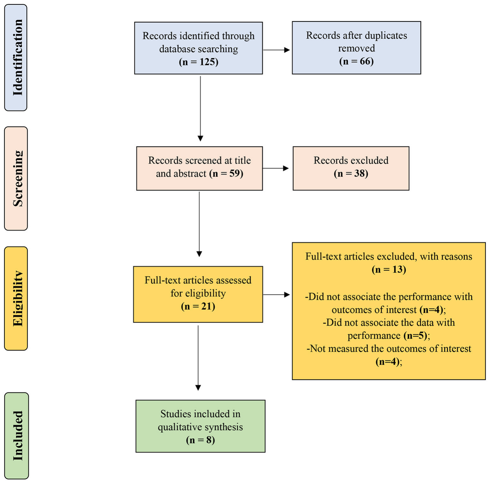

# 力学、生理学与技术参数同皮划艇激流回旋表现之间的关联：一项系统综述

**Association Between Mechanical, Physiological, and Technical Parameters With Canoe Slalom Performance: A Systematic Review**

- 文章类型：系统综述（SYSTEMATIC REVIEW）
- 作者：Leonardo Henrique Dalcheco Messias¹*、Ivan Gustavo Masselli Dos Reis¹、Viktor Bielik²、Ana Luíza Paula Garbuio¹、Claudio Alexandre Gobatto³、Fúlvia Barros Manchado-Gobatto³
- 机构：
  1. 巴西布拉干萨保利斯塔，圣弗朗西斯科大学（São Francisco University）多学科研究实验室
  2. 斯洛伐克布拉迪斯拉发，考门斯基大学（Comenius University）体育与运动学院生物与医学科学系
  3. 巴西利梅拉，坎皮纳斯大学（University of Campinas）应用科学学院应用运动生理学实验室
- 期刊：*Frontiers in Physiology*（《生理学前沿》），2021 年 11 月，第 12 卷，文章号 734806
- DOI：10.3389/fphys.2021.734806
- 发表日期：2021 年 11 月 18 日；收稿：2021 年 7 月 1 日；录用：2021 年 10 月 23 日
- 责任编辑：Hamdi Chtourou（突尼斯斯法克斯大学）
- 审稿人：Morteza Taheri（伊朗伊玛目霍梅尼国际大学）、Christopher Latella（澳大利亚伊迪斯科文大学）
- 通信作者：Leonardo Henrique Dalcheco Messias，leonardo.messias@usf.edu.br
- 专栏：本文投稿至《生理学前沿》"运动生理学"专栏
- 开放获取（OPEN ACCESS）；版权 © 2021 Messias, Reis, Bielik, Garbuio, Gobatto and Manchado-Gobatto；依据知识共享署名许可（CC BY）分发
- 引用格式：Messias LHD, Reis IGMD, Bielik V, Garbuio ALP, Gobatto CA and Manchado-Gobatto FB (2021) Association Between Mechanical, Physiological, and Technical Parameters With Canoe Slalom Performance: A Systematic Review. Front. Physiol. 12:734806. doi: 10.3389/fphys.2021.734806

## 摘要

本研究旨在系统综述那些对激流回旋运动员的表现与力学、生理学及技术参数进行评估和比较的研究。检索 PubMed、SPORTDiscuss 和 Scopus 数据库，时间截至 2021 年 9 月 10 日，不对发表日期作限制。研究筛选遵循《系统综述与荟萃分析优先报告条目》（PRISMA）；质量评价由一名外部评审员使用含 16 个条目的核查表完成。数据库检索共识别出 125 项研究，但仅有 8 项符合纳入标准，总样本为 117 名男性运动员。其中 4 篇报告仅将力学或技术参数与运动员表现相关联；在其余研究中，仅 1 篇对生理学数据作了相关分析，其他研究则把不止一个参数与比赛时间相关联。大多数符合条件的报告显示，力学/生理学成分与激流回旋表现之间存在显著关联。符合条件的研究支持以下观点：激流回旋比赛中高水平的力的产生是与表现相关的重要参数。激流回旋任务对有氧代谢有很高需求，且有氧代谢与比赛时间呈负相关，但它未必能增加赢得奖牌的机会。将皮划艇激流回旋表现与技术成分相关联的报告很少，未来研究应聚焦于这一问题。

**关键词：** 水上运动（MeSH）；功率；力；代谢；生理学；生物力学

## 引言

在北美历史上，划艇曾在商业用途中发挥关键作用；然而，横贯大陆铁路的修建使其黯然失色（Shephard, 1987）。尽管如此，人们对划艇作为一项运动的兴趣仍在持续增长，国际皮划艇联合会（ICF）目前认可十余个划艇项目，其中竞速皮划艇和激流回旋在夏季奥林匹克运动会中设项（ICF, 2021）。竞速皮划艇在静水赛道上进行，而激流回旋项目在天然或人工河道（也称白水）中进行。这一"简单"差异不仅极大地影响了该运动的专项性，也影响了各自科学报告的数量。针对竞速皮划艇运动员已有大量研究（Shephard, 1987；Michael et al., 2008, 2009），而关于皮划艇激流回旋运动员的研究则很少。

激流回旋赛道在障碍物、路线和门群方面并不统一，因而表现的变异性很大（Nibali et al., 2011）。皮划艇激流回旋运动员必须通过最多设 25 道门（含逆流门和顺流门）、长度约 300 m 的赛道。这一挑战所使用的竞赛赛道包含回水区、浪和水洞（stoppers）。因此很明显，皮划艇激流回旋的复杂性是有意设计的，而非偶然。这类因素直接影响旨在理解激流回旋运动员表现相关因素的科学研究。因此，这项运动的科学研究颇具挑战性。此外，奥运会设有 K1（单人皮艇）和 C1（单人划艇）级别；双人划艇（C2）类别则在国际层面设项。在划艇（C1 和 C2 皆然）中，运动员使用单叶桨，双腿保持屈膝并收于身体下方；在皮艇类别中，使用双叶桨，运动员在艇中保持坐姿（ICF, 2021）。

2010 年以前发表的研究引发了关于比赛期间能量代谢的重要讨论（Sidney and Shephard, 1973；Shephard, 1987；Zamparo et al., 2006），也涉及激流回旋运动员的生物力学（Hunter et al., 2007, 2008；Hunter, 2009）和心理学方面（Males et al., 1998；Moran and MacIntyre, 1998；White and Hardy, 1998；MacIntyre et al., 2002；Macintyre and Moran, 2007）。Zamparo 等（2006）证实，有氧代谢和无氧代谢在激流回旋任务中都具有相关性。此外，比赛中完成的划桨动作已得到恰当探讨（Hunter et al., 2007），通过逆流门的策略也得到了详细讨论（Hunter et al., 2008）。然而，在这些研究中，很少有研究把所收集的结果与激流回旋表现进行比较和/或关联（Hunter et al., 2008）。

在后来的一篇叙述性综述中，我们曾就这一问题展开讨论（Messias et al., 2014），但彼时已发表研究的缺乏妨碍了更深入的推断。自那时起，多个研究组一直试图识别与皮划艇激流回旋运动员表现相关联的重要成分。激流回旋任务需要出色的身体素质和精准的技术技能（Messias et al., 2014）。因此，力学、生理学和技术成分在皮划艇激流回旋比赛中都发挥重要作用。然而，尚无系统综述专门说明这些参数中哪些与皮划艇激流回旋表现相关联。有鉴于此，本文旨在系统综述那些对激流回旋运动员的表现与力学、生理学及技术参数进行评估和比较的研究。

## 材料与方法

### 检索策略

检索 PubMed、SPORTDiscuss 和 Scopus 数据库，时间截至 2021 年 9 月 10 日，不对发表日期作限制。对如下术语使用"AND""OR"和"NOT"运算符："canoe slalom OR slalom kayaking OR slalom canoeing" AND "aerobic OR anaerobic OR mechanical OR power OR force OR strength OR velocity OR neuromuscular OR physiological OR technical OR performance"。并手工检索涉及皮划艇激流回旋研究的参考文献列表和引用文献。

### 纳入标准及详尽的纳入/排除标准

采用《系统综述与荟萃分析优先报告条目》（PRISMA）（Moher et al., 2009）指导对"关联或比较激流回旋运动员表现"的研究进行筛选。纳入标准为：(a) 以英文发表的研究；(b) 将皮划艇激流回旋运动员表现与力学、生理学或技术参数相关联的横断面报告；(c) 在设计有技术器械的任务中评估皮划艇激流回旋运动员表现的研究；(d) 按力学、生理学或技术变量比较皮划艇激流回旋运动员在全国和国际比赛中成绩的报告；(e) 在特定条件下（即静水或白水上）测量皮划艇激流回旋运动员表现的研究；以及 (f) 力学、生理学或技术评估的方法学得到恰当呈现和说明的研究。

具有以下情形的已发表研究不予纳入：(a) 仅提供摘要；(b) 缺乏用于关联/比较结果的统计程序信息；(c) 研究纳入了其他划艇项目的运动员，但未仅针对皮划艇激流回旋运动员提供单独分组/分析；以及 (d) 仅对力学、生理学或技术特征作描述，而未将这些变量与表现相关联的报告。

### 数据提取

两名评审员（LM 和 AG）独立筛选稿件。先筛选标题和摘要，随后仅核查通过这一阶段的研究全文。两者之间的分歧提交给第三名评审员（IR），并通过协商解决。提取的数据包括：(a) 样本特征，含人体测量学、身体成分和年龄；(b) 激流回旋类别（K1、C1、C2）；(c) 力学、生理学和技术评估方案；(d) 激流回旋表现任务的细节；以及 (e) 激流回旋运动员之间比较、或表现与力学/生理学/技术变量之间关联的统计结果。与本系统综述目的无关的其他结果不予呈现或讨论。

### 质量评价

已有适用于不同科学报告的系统综述研究质量评价工具（Downs and Black, 1998；CRD, 2009；Wells et al., 2021）。然而，这些工具可能并不适合本综述所纳入的研究——这些研究大多是关于表现与力学、生理学或技术变量之间关联的横断面分析性研究。因此，我们选用了一种含 16 个条目的核查表，该核查表此前曾用于足球领域的系统综述（Sarmento et al., 2018a,b；Low et al., 2020）。该核查表包括：研究目的（1）、恰当的文献背景（2）、合适的设计（3）、样本细节（4）、样本量论证（5）、知情同意（6）、所测结局的可靠性（7）、所测结局的效度（8）、方法细节（9）、以统计学显著性呈现结果（10）、恰当的分析方法（11）、报告实际重要性（12）、脱落情况报告（13）、恰当的结论（14）、实际应用（15）以及研究局限性（16）。每个问题按 0（否）和 1（是）的二分量表评分，唯问题 6 和 13 还包括"若不适用，记为 3"。将所有答案求和，最终得分除以一项研究所能达到的最高分值（即 16），并以百分比表示。质量分级如下：(a) 方法学质量低，指得分 ≤50%；(b) 方法学质量良好，介于 51% 至 75% 之间；(c) 方法学质量优秀，指 >75%（Sarmento et al., 2018a）。考虑到本系统综述的提出者同时也是部分符合条件研究的作者，质量评价由一名具有运动科学领域经验的外部评审员完成。

## 结果

### 检索与质量评价

数据库检索共识别出 125 项研究。去除重复文献（66 项）后，对 59 篇文章在标题和摘要层面进行核查，其中 38 篇被排除。最后对 21 篇全文进行筛选，其中 8 篇（Hunter et al., 2008；Messias et al., 2015；Vieira et al., 2015；Ferrari et al., 2017；Bielik et al., 2019, 2020；Macdermid et al., 2019；Baláš et al., 2020）达到纳入标准（图 1）。符合条件研究的平均质量较高（92.9 ± 2.9%），按 16 条目核查表被评定为方法学质量优秀。

**图 1.** 系统综述与荟萃分析优先报告条目（PRISMA）流程图。

图中标签译注：左侧竖排阶段依次为 Identification＝识别、Screening＝筛选、Eligibility＝资格评估、Included＝纳入。Records identified through database searching (n = 125)＝数据库检索识别出的文献（n = 125）；Records after duplicates removed (n = 66)＝去除重复后的文献（n = 66）；Records screened at title and abstract (n = 59)＝在标题和摘要层面筛选的文献（n = 59）；Records excluded (n = 38)＝排除文献（n = 38）；Full-text articles assessed for eligibility (n = 21)＝接受资格评估的全文（n = 21）；Full-text articles excluded, with reasons (n = 13)＝被排除的全文及原因（n = 13）：Did not associate the performance with outcomes of interest (n=4)＝未将表现与关注结局相关联（n=4）；Did not associate the data with performance (n=5)＝未将数据与表现相关联（n=5）；Not measured the outcomes of interest (n=4)＝未测量关注结局（n=4）；Studies included in qualitative synthesis (n = 8)＝纳入定性综合的研究（n = 8）。

### 运动员特征与激流回旋项目

总体上，共评估了 117 名男性激流回旋运动员，其表现与力学、生理学或技术变量相关联（表 1）。这些皮划艇激流回旋运动员来自欧洲和南美洲，其中斯洛伐克 61 人，其次为巴西 30 人，捷克共和国和新西兰分别为 18 人和 8 人。仅一项研究评估了奥运会奖牌得主（Bielik et al., 2019），其他研究测试的则是优秀级或竞技级皮划艇激流回旋运动员。一项研究评估了 C1 类别的运动员（Baláš et al., 2020），另有四项研究纳入 K1 类别（Messias et al., 2015；Vieira et al., 2015；Ferrari et al., 2017；Macdermid et al., 2019）。其余三项研究分别测试了 K1/C1（Hunter et al., 2008）以及 K1、C1 和 C2（Bielik et al., 2019, 2020）的运动员。87.5% 的纳入研究测量了体质量和身高（72.6 ± 4.8 kg；177.6 ± 3.5 cm），三篇报告计算了体脂率（10.2 ± 1.4%）。75% 符合条件的研究给出了年龄（21 ± 4 岁）。Hunter 等（2008）关注的是男子皮艇、女子皮艇和男子划艇的最快 10 次划行，而非运动员特征。

**表 1.** 符合条件研究的特征

| 研究 | 样本 | 年龄、身体成分或人体测量学 | 激流回旋类别 | 关注结局 |
|---|---|---|---|---|
| Hunter et al. (2008) | * | # | K1, C1 | 技术 |
| Messias et al. (2015) | N = 12 名男性——优秀级（巴西国家队） | 年龄 = 18 ± 2 岁；体质量 = 68.1 ± 0.6 kg；身高 = 174 ± 1 cm；体脂 = 10.3 ± 0.1% | K1 | 力学 |
| Vieira et al. (2015) | N = 6 名男性——高水平（5 人位列巴西皮划艇联合会全国排名前八） | 年龄 = 17 ± 2 岁；体质量 = 68.0 ± 5.0 kg；身高 = 175 ± 6 cm | K1 | 技术、生理学 |
| Ferrari et al. (2017) | N = 12 名男性——优秀级（巴西国家队） | 年龄 = 18 ± 2 岁；体质量 = 68.1 ± 0.6 kg；身高 = 174 ± 1 cm | K1 | 生理学 |
| Bielik et al. (2019) | N = 42 名男性——斯洛伐克国家队的奥运会奖牌得主（N = 6）和非奥运选手（N = 36） | 奥运会奖牌得主：年龄 = 22 ± 1 岁；体质量 = 76.6 ± 1.3 kg；身高 = 181 ± 1 cm；体脂 = 9.6 ± 0.7%。非奥运选手：年龄 = 32 ± 3 岁；体质量 = 82.2 ± 5.9 kg；身高 = 184 ± 9 cm；体脂 = 9.4 ± 2.0% | K1, C1, C2 | 生理学、力学 |
| Macdermid et al. (2019) | N = 8 名男性——竞技级（新西兰激流回旋发展队） | 体质量 = 65.8 ± 6.0 kg；身高 = 173 ± 4 cm | K1 | 力学 |
| Baláš et al. (2020) | N = 18 名男性——来自捷克共和国的国际级高水平优秀运动员（N = 9）和国家级优秀运动员（N = 9） | 高水平：年龄 = 24 ± 7 岁；体质量 = 75.2 ± 5.6 kg；身高 = 180 ± 4 cm。优秀级：年龄 = 19 ± 4 岁；体质量 = 72.5 ± 4.4 kg；身高 = 180 ± 2 cm | C1 | 技术 |
| Bielik et al. (2020) | N = 19 名男性——斯洛伐克国家队中在青年/U23 欧洲锦标赛和世界锦标赛上的奖牌得主（N = 11）和非奖牌得主（N = 8） | 奖牌得主：年龄 = 18 ± 1 岁；体质量 = 75.4 ± 4.6 kg；身高 = 176 ± 4 cm；体脂 = 12.9 ± 2.3%。非奖牌得主：年龄 = 19 ± 1 岁；体质量 = 73.6 ± 6.3 kg；身高 = 179 ± 4 cm；体脂 = 8.9 ± 3.0% | K1, C1, C2 | 生理学、力学 |

表注：* 作者以比赛次数而非运动员作为样本；# 该研究未提供相关数据。K1 = 单人皮艇（kayak single）；C1 = 单人划艇（canoe single）；C2 = 双人划艇（canoe double）。

### 表现测量

三项研究在白水（Messias et al., 2015；Vieira et al., 2015；Ferrari et al., 2017）、两项研究在静水（Macdermid et al., 2019；Baláš et al., 2020）赛道上使用模拟比赛。两项研究（Messias et al., 2015；Ferrari et al., 2017）在白水表现任务中设置了 24 道门（18 道顺流门、6 道逆流门），而 Vieira 等（2015）仅采用 11 道门（8 道顺流门、3 道逆流门）。在静水试划中，Macdermid 等（2019）研究中的激流回旋运动员通过 15 道门，含 11 道顺流门和 4 道逆流门。Baláš 等（2020）所设赛道使用浮标完成 pivot 转弯，而非门。最后，其余研究以 2008 年北京、2012 年伦敦或 2016 年里约夏季奥运会的成绩（Bielik et al., 2019）、2019 年青年/U23 欧洲锦标赛和世界锦标赛成绩（Bielik et al., 2020）以及 2005 年世界锦标赛成绩（Hunter et al., 2008）作为表现指标。

### 力学变量与激流回旋表现

两项研究仅将力学参数与表现相关联（Messias et al., 2015；Macdermid et al., 2019）。Messias 等（2015）的力结果（峰值力、平均力、最小力和冲量）通过在游泳池中进行的 30 s 系留全力测试测得，并观察到这些数据与模拟比赛时间之间存在显著的负相关关系。Macdermid 等（2019）也在一次模拟任务中测量了力参数。然而，尽管观察到比赛时间与峰值力/峰值力发展速率之间存在中等到强的相关，但这些相关并不显著。Bielik 等（2019）比较了斯洛伐克奥运会奖牌得主与非奖牌得主在最大摄氧量（VO2max）下的功率（划桨）和速度（跑步），观察到 2016 年里约奥运会的划桨和 2012 年伦敦奥运会的跑步存在相当大的原始数据差异。同一研究组观察到，在 2018/2019 年青年/U23 欧洲锦标赛和世界锦标赛上，奖牌得主与非奖牌得主之间卧推/卧拉的平均功率以及 VO2max 下速度相近（Bielik et al., 2020）（表 2）。

### 生理学变量与激流回旋表现

Vieira 等（2015）观察到，在模拟任务期间测量的生理学参数（即最大、平均和最小心率）或任务后测量的生理学参数（即血乳酸浓度峰值）与比赛时间之间存在中等到强的负相关，但并不显著。Ferrari 等（2017）在系留测功系统上测量了临界力和最大乳酸稳态强度（MLSS），仅观察到比赛时间与 MLSS 之间存在显著的负相关关系。在 Bielik 等（2019）的研究中，在 2016 年里约和 2012 年伦敦奥运会上，斯洛伐克奖牌得主的有氧功率（即原始数据）始终低于队中其余人员（即非奖牌得主）。此外，在 2018 和 2019 年欧洲锦标赛和世界锦标赛上，斯洛伐克青年/U23 奖牌得主与非奖牌得主之间观察到相近的 VO2max（表 3）。

### 技术变量与激流回旋表现

三项研究将激流回旋运动员的技术数据与其表现相关联（表 4）。Hunter 等（2008）分别证实比赛时间与单次划桨时长、划水行程以及桨叶在水时间之间存在弱、中和强相关。然而，作者并未证明这些关系的显著性。Vieira 等（2015）给出了第一次模拟比赛中逆水划桨次数与比赛时间之间的显著相关。在第二次表现试划中，这些作者观察到总划桨次数、顺水划桨次数、完成的划桨周期数和平均速度与运动员表现之间存在显著相关。Baláš 等（2020）表明，在 40、80 和 200 m 的试划中，国际级高水平优秀激流回旋运动员的表现优于国家级运动员。值得注意的是，200 m 项目上不同水平运动员之间的差异最大。

**表 2.** 将激流回旋表现与力学参数相关联、或在不同激流回旋表现的运动员之间比较力学数据的研究：方法学方面与主要结果

| 研究 | 测试程序 | 力学测量 | 表现任务的具体设置 | 主要结果概览 |
|---|---|---|---|---|
| Messias et al. (2015) | 系留式皮划艇测试系统中的 30 s 全力测试 | 绝对和相对的峰值力、平均力、最小力，以及冲量 | 白水赛道模拟比赛，24 道门（18 道顺流门、6 道逆流门） | (a) 比赛时间与绝对峰值力：*r* = −0.60；*p* = 0.038；(b) 比赛时间与相对峰值力：*r* = −0.71；*p* = 0.008；(c) 比赛时间与绝对平均力：*r* = −0.61；*p* = 0.033；(d) 比赛时间与相对平均力：*r* = −0.73；*p* = 0.006；(e) 比赛时间与绝对冲量：*r* = −0.61；*p* = 0.034；(f) 比赛时间与绝对冲量：*r* = −0.73；*p* = 0.005。 |
| Bielik et al. (2019) | 递增跑步和划桨测试 | VO2max 下的功率和速度 | 2008 年北京、2012 年伦敦和 2016 年里约奥运会成绩 | (a) 2008 年北京奥运会非奖牌得主（146 ± 42 W）与斯洛伐克奖牌得主（155 W）VO2max 下功率的原始差异为 9 W；(b) 2016 年里约奥运会非奖牌得主（136 ± 32 W）与斯洛伐克奖牌得主（110 ± 14 W）VO2max 下功率的原始差异为 26 W；(c) 2012 年伦敦奥运会非奖牌得主（19.4 ± 1.3 km·h⁻¹）与斯洛伐克奖牌得主（18.0 ± 0.0 km·h⁻¹）VO2max 下速度的原始差异为 1.4 km·h⁻¹；(d) 2016 年里约奥运会非奖牌得主（19.1 ± 0.4 km·h⁻¹）与斯洛伐克奖牌得主（19.3 ± 3.5 km·h⁻¹）VO2max 下速度的原始差异为 0.2 km·h⁻¹。 |
| Macdermid et al. (2019) | 使用皮艇功率计的模拟比赛 | 划水行程、冲量、峰值力、达峰值力时间 | 静水模拟比赛，含 15 道门（11 道顺流门、4 道逆流门） | (a) 比赛时间与峰值力斜率：*R*² = 0.40；*p* = 0.091；(b) 比赛时间与峰值力 *y* 轴截距：*R*² = 0.35；*p* = 0.117；(c) 比赛时间与峰值力发展速率斜率：*R*² = 0.41；*p* = 0.084；(d) 比赛时间与峰值力发展速率 *y* 轴截距：*R*² = 0.36；*p* = 0.115。 |
| Bielik et al. (2020) | 最大卧推和卧拉测试及递增跑步测试 | 向心阶段的绝对和相对平均功率，以及 VO2max 下速度 | 2018 和 2019 年青年/U23 欧洲锦标赛和世界锦标赛成绩 | (a) 卧推绝对平均功率：*p* = 0.688；(b) 卧推相对平均功率：*p* = 0.454；(c) 卧拉绝对平均功率：*p* = 0.847；(d) 卧拉相对平均功率：*p* = 0.656；(e) VO2max 下速度：*p* = 0.975。 |

表注：VO2max = 最大摄氧量。Bielik 等（2019）研究中各组之间的原始差异并不代表统计学差异。Bielik 等（2020）的 *p* 值对应双因素方差分析（皮划艇激流回旋奖牌得主 vs 非奖牌得主）的事后分析。

**表 3.** 将激流回旋表现与生理学参数相关联、或在不同激流回旋表现的运动员之间比较生理学数据的研究：方法学方面与主要结果

| 研究 | 测试程序 | 生理学测量 | 表现任务的具体设置 | 主要结果概览 |
|---|---|---|---|---|
| Vieira et al. (2015) | 两次模拟比赛全程及赛后的生理学测量 | 比赛期间心率（HR）和赛后血乳酸浓度 [Lac] | 两次白水模拟比赛，含 11 道门（8 道顺流门、3 道逆流门） | 第一次模拟比赛#：(a) 比赛时间与 [Lac] 峰值：*r* = −0.46；*p* = 0.349；(b) 比赛时间与最大心率：*r* = −0.66；*p* = 0.338；(c) 比赛时间与平均心率：*r* = −0.69；*p* = 0.301；(d) 比赛时间与最小心率：*r* = −0.37；*p* = 0.625。第二次模拟比赛#：(a) 比赛时间与 [Lac] 峰值：*r* = −0.02；*p* = 0.967；(b) 比赛时间与最大心率：*r* = −0.53；*p* = 0.269；(c) 比赛时间与平均心率：*r* = −0.73；*p* = 0.096；(d) 比赛时间与最小心率：*r* = −0.62；*p* = 0.183。 |
| Ferrari et al. (2017) | 系留测功系统上的临界力（CF）测试和 MLSS 方案 | 线性模型和双曲线模型得到的 CF，以及 MLSS 强度 | 白水赛道模拟比赛，24 道门（18 道顺流门、6 道逆流门） | (a) 比赛时间与 MLSS 强度：*r* = −0.67；*p* = 0.016；(b) 比赛时间与线性 CF：*r* = −0.41；*p* = 0.180；(c) 比赛时间与双曲线 CF：*r* = −0.48；*p* = 0.106。 |
| Bielik et al. (2019) | 递增跑步和划桨测试 | VO2max | 2008 年北京、2012 年伦敦和 2016 年里约奥运会成绩 | (a) 2008 年北京奥运会非奖牌得主划桨 VO2max（47.1 ± 7.3 ml·kg⁻¹·min⁻¹）与斯洛伐克奖牌得主（47.8 ml·kg⁻¹·min⁻¹）的原始差异为 0.7 ml·kg⁻¹·min⁻¹；(b) 2016 年里约奥运会非奖牌得主划桨 VO2max（47.6 ± 6.6 ml·kg⁻¹·min⁻¹）与斯洛伐克奖牌得主（43.2 ± 3.1 ml·kg⁻¹·min⁻¹）的原始差异为 4.4 ml·kg⁻¹·min⁻¹；(c) 2012 年伦敦奥运会非奖牌得主跑步 VO2max（60.6 ± 7.1 ml·kg⁻¹·min⁻¹）与斯洛伐克奖牌得主（52.3 ± 1.7 ml·kg⁻¹·min⁻¹）的原始差异为 8.3 ml·kg⁻¹·min⁻¹；(d) 2016 年里约奥运会非奖牌得主跑步 VO2max（60.4 ± 6.2 ml·kg⁻¹·min⁻¹）与斯洛伐克奖牌得主（52.3 ± 6.8 ml·kg⁻¹·min⁻¹）的原始差异为 8.1 ml·kg⁻¹·min⁻¹。 |
| Bielik et al. (2020) | 递增跑步测试 | VO2max | 2018 和 2019 年青年/U23 欧洲锦标赛和世界锦标赛成绩 | 奖牌得主与非奖牌得主之间 VO2max 相近（*p* = 0.609）。 |

表注：# 结果未在已发表研究中呈现，系由作者提供。HR = 心率（heart rate）；[Lac] = 血乳酸浓度（blood lactate concentration）；CF = 临界力（critical force）；MLSS = 最大乳酸稳态（maximal lactate steady state）；VO2max = 最大摄氧量（maximum oxygen uptake）。

**表 4.** 将激流回旋表现与技术参数相关联的研究：方法学方面与主要结果

| 研究 | 测试程序 | 技术测量 | 表现任务的具体设置 | 主要结果概览 |
|---|---|---|---|---|
| Hunter et al. (2008) | 2005 年世界锦标赛半决赛和决赛划行影像 | 单次划桨时长、桨次数、桨叶在水时间* | 2005 年世界锦标赛成绩 | (a) 比赛时间与单次划桨时长：*r* = −0.14；(b) 比赛时间与桨次数：*r* = 0.45；(c) 比赛时间与桨叶在水时间：*r* = 0.72。 |
| Vieira et al. (2015) | 两次模拟比赛全程的技术测量 | 总划桨次数（Total.Paddles）、顺水划桨（Pad.With）、逆水划桨（Pad.Against）、完整划桨周期（Compl.Cycle）、交叉划桨（Cross.Paddling）以及平均速度 | 两次白水模拟比赛，含 11 道门（8 道顺流门、3 道逆流门） | 第一次模拟比赛#：(a) 比赛时间与 Total.Paddles：*r* = 0.55；*p* = 0.257；(b) 比赛时间与 Pad.With：*r* = 0.04；*p* = 0.929；(c) 比赛时间与 Pad.Against：*r* = 0.87；*p* = 0.022；(d) 比赛时间与 Compl.Cycle：*r* = 0.43；*p* = 0.387；(e) 比赛时间与 Cross.Paddling：*r* = 0.36；*p* = 0.477；(f) 比赛时间与平均速度：*r* = −0.68；*p* = 0.132。第二次模拟比赛#：(a) 比赛时间与 Total.Paddles：*r* = 0.86；*p* = 0.025；(b) 比赛时间与 Pad.With：*r* = 0.84；*p* = 0.033；(c) 比赛时间与 Pad.Against：*r* = 0.70；*p* = 0.118；(d) 比赛时间与 Compl.Cycle：*r* = 0.91；*p* = 0.010；(e) 比赛时间与 Cross.Paddling：*r* = 0.28；*p* = 0.589；(f) 比赛时间与平均速度：*r* = −0.84；*p* = 0.036。 |
| Baláš et al. (2020) | 计时划桨测试（3 × 40 m、80 m、200 m），含不同数量的 pivot 转弯 | –§ | 静水 40、80 和 200 m 表现试划，除一次 40 m 试划外，均设置可见浮标用于完成 pivot 转弯 | (a) 40 m 无 pivot 转弯：*p* = 0.047；(b) 40 m 有 pivot 转弯：*p* = 0.001；(c) 80 m 有 pivot 转弯：*p* = 0.005；(d) 200 m 有 pivot 转弯：*p* < 0.001。 |

表注：* 注意该研究还测量了其他技术方面，但仅这些方面与表现作了相关分析。# 结果未在已发表研究中呈现，系由作者提供。§ pivot 技术要素是加入每次试划之中，而非作为被评估对象。变量名 Total.Paddles、Pad.With、Pad.Against、Compl.Cycle、Cross.Paddling 为原研究程序中的变量命名，保留原文并在中文释义中对应。pivot turn 为划艇绕浮标完成的原地/枢轴式转弯，本文暂译"pivot 转弯"（保留英文）。

> 说明：原 PDF 中表 1–4 分别位于第 5–8 页，穿插在讨论部分之间；为便于检索并避免漏项，译文将四张表集中置于结果部分之后，正文中的"（表 X）"引用保持不变。

## 讨论

本系统综述表明，力学、生理学和技术成分可能影响皮划艇激流回旋运动员的表现。尽管如此，尽管过去 7 年间对这项运动的科学兴趣有所增加，仍需更多研究以理解激流回旋试划的需求，并以更高的生态效度改进对这些参数的评估。关于表现测量，在符合条件的研究中识别出赛道、门群和障碍物方面的巨大变异性。这并不令人意外，因为激流回旋锦标赛本就被设计为不统一的，从而对运动员、教练员和研究者都构成巨大挑战。

在力学参数方面，Messias 等（2015）显示比赛时间与最大 30 s 全力测试得到的力（峰值力、平均力和冲量）之间存在负相关。提出该测功系统的目的，是在测量技术和/或生理学参数的同时保留前划动作的特征。此外，系留系统被建议作为一种不受气候条件影响的替代训练工具，因为它可在游泳池中使用。Macdermid 等（2019）在静水赛道上用皮艇桨杆功率计（Macdermid and Fink, 2017）评估激流回旋运动员，并提出峰值力及其发展速率在比赛中具有相关性，尽管这些参数与比赛时间之间的相关并不显著。此外，这些作者观察到，在整个表现任务中，冲量以及每桨发展出峰值力所需的时间保持相近，而峰值力的大小下降。因此，Messias 等（2015）和 Macdermid 等（2019）都印证了较高的单桨力水平对激流回旋比赛表现十分重要。

一些不符合本系统综述纳入条件的研究或可对这些方面有所启发。Sidney 和 Shephard（1973）的早期工作提出，激流回旋过程中躯干肌肉和上肢参与节律性工作，这可能更依赖心肺功率而非力量。我们认为，过去 40 年间皮划艇激流回旋已经发展演变，力量训练的重要性也日益提高，正如在其他运动中所发现的那样（Hebert-Losier et al., 2014, 2017；Styles et al., 2016；Kniffin et al., 2017）。然而，卧拉和卧推的平均功率对皮划艇竞速的影响似乎深于其对激流回旋的影响（Bielik et al., 2020）。皮划艇激流回旋运动员使用更窄的握桨距离，这使得其划桨动作比所报道的顶尖竞速皮划艇更短、更有力，且肘部屈曲更大（Zahalka et al., 2011）。这些运动员较窄的握桨距离使手臂肌肉强烈参与，以产生快速动作。相反，竞速皮划艇运动员的握桨主要使躯干肌肉参与（McKean and Burkett, 2014）。

关于激流回旋运动员生理学参数的研究为教练员和运动员提供了重要数据。除两项研究（Bielik et al., 2019, 2020）中的递增跑步测试外，所有报告都采用了不同的测功设备和工具来评估激流回旋运动员的生理学参数。Vieira 等（2015）关于心率/血乳酸与比赛时间之间较弱且不显著的相关，可由该研究测试的运动员人数较少来解释。Ferrari 等（2017）证实了激流回旋运动员中有氧代谢的重要性，提示氧化系统可能通过提高训练负荷并使各场比赛之间恢复更快而间接影响表现。总之，激流回旋比赛在划桨发力期间需要大量无氧代谢参与，以越过障碍物（Baker, 1982；Messias et al., 2015；Vieira et al., 2015）。另一方面，有氧代谢需求也相当可观（Zamparo et al., 2006），且与表现相关（Ferrari et al., 2017）。然而，根据 Bielik 等（2019, 2020），这些因素未必能增加赢得奖牌的机会。

尽管激流回旋运动员划桨动作的技术方面已得到详细描述（Hunter et al., 2007），但很少有研究评估这些方面与表现的相关性。Hunter 等（2008）在 2005 年世界锦标赛的前 10 名划行中证实，67–71% 的划桨动作朝前进方向完成，而 30% 的划桨动作用于使艇转弯。这些作者还注意到，比赛时间与运动员桨叶在水中的总时间呈正相关，这在预期之内。然而，对于运动员桨叶在水时间所占的百分比，却未观察到同样的现象，这提示无论比赛时间如何，该百分比保持不变。Vieira 等（2015）跟踪了两次模拟比赛中完成的划桨动作，其结果提示，即使在完全相同的赛道上，运动员也可能在各场比赛之间改变策略。这类结果强化了一种观点：这项运动为教练员和运动员提供了一种有意为之的挑战。因此，有必要进一步研究运动员的策略与表现。

Baláš 等（2020）提出了一种替代方法，用以验证某项特定技能对运动员在静水赛道上表现的影响。在 40、80 和 200 m 的计时划桨测试中加入 pivot 转弯。有趣的是，国际级高水平运动员在每一次试划中的成绩都优于国家级运动员。这一结果为前述"教练员在评估表现提高时应考虑哪些测量指标"的讨论提供了补充。这些作者提出的赛道易于复制，未来还需开展研究，建立一组试划，通过测量其他技术技能来提供关于表现的洞见。此外，在模拟试划或反映真实激流回旋条件的情境中识别与这些结果的关联，可增强此类评估的重要性和用途。这些评估应当考虑 ICF 规定的规则，例如最多 25 道门、长度 300 m。在这种情境下，皮划艇激流回旋运动员应在 90–110 s 内完成比赛，除无氧代谢外，还需要出色的力、速度和功率发展能力。

符合条件研究中所评估的运动员大多为男性。只有 Hunter 等（2008）的调查还纳入了女性运动员的激流回旋划行。鼓励未来开展针对女性激流回旋运动员的研究，尤其是因为女子 K1 和 C1 级别在奥运会中设项。本系统综述注意到的另一个有趣事实是，仅有四个国家的激流回旋运动员接受了测试。必须承认，斯洛伐克、捷克共和国和新西兰在上一届夏季奥运会上赢得过奖牌。尽管如此，欧洲和大洋洲的其他国家也在奥运会和世界锦标赛赛事中赢得过奖牌。因此，为增进对激流回旋运动员的科学认识，需要对不同国籍的运动员开展进一步研究。此外，没有一项符合条件的研究对不同级别（即皮艇和划艇）的表现进行深入讨论。Hunter 等（2007）得出结论：C1 类别的运动员在比赛中完成的划桨动作可能少于 K1 运动员，但这并不影响表现时间。本系统综述纳入的研究未在各级别之间比较这些参数，因此无法就此问题进行充分讨论。然而，强烈鼓励未来研究比较各级别的生理学、生物力学和技术方面。

另一点值得讨论的是表现测量的变异性。尽管一些一般特征是强制性的，例如门的最少/最多个数、大致距离以及 90–110 s 的区间时长（ICF, 2021），但各场比赛之间仍存在巨大变异性。因此，我们没有纳入采用特定表现试划的研究。部分符合条件的研究试图在白水（Messias et al., 2015；Vieira et al., 2015；Ferrari et al., 2017）和静水（Macdermid et al., 2019）任务中遵循此类建议；尽管如此，这些研究中也可见相当大的变异性。为这项具有强生态效度的运动建立一套标准表现方案——相同的赛道、障碍物、回水区、浪和水洞——的想法很可能是乌托邦式的，因为皮划艇激流回旋比赛保留了不可预测性（Nibali et al., 2011）。因此，另一些研究选择了不同策略，聚焦于某项特定技术技能（Baláš et al., 2020），或采用激流回旋锦标赛的成绩（Hunter et al., 2008；Bielik et al., 2019, 2020）。总体而言，现在断言或提出评估皮划艇激流回旋表现的最合适策略还为时过早，但如果没有进一步调查，这一问题将无法得到解决。

### 局限性与优势

应结合以下局限性来理解本系统综述的结果。符合条件的研究很少，所呈现的结局必须在未来报告中加以确认。此外，力学、生理学和技术评估大多以男性参与者为对象。Tilden 等（2021）最近的一项研究识别出国际比赛中男性与女性运动员划桨技术的差异。尽管如此，未来仍需评估女性激流回旋运动员的力学、生理学和技术成分及其表现。由于评估力学、生理学和技术参数所采用方案的巨大变异性以及结局的差异，我们没有对这些研究进行荟萃分析；这种变异性本会导致结果的异质性。此外，部分符合条件的研究采用白水和静水赛道上的模拟任务来测量表现，其他研究则采用国际锦标赛数据。顶尖皮划艇激流回旋运动员在过门策略上存在很大差异。这很可能与训练、装备、技术能力、力量、决策技能以及对赛道感知的差异有关（Hunter et al., 2008）。本研究的优势包括：对符合条件报告的高质量评估，以及大多数研究所纳入运动员的高水平。最后，这是在皮划艇激流回旋研究中开展的第一项系统综述。

## 结论

本研究得出结论：力学、生理学和技术因素可能在皮划艇激流回旋表现中发挥重要作用。建议围绕这些问题以及激流回旋表现评估开展进一步研究，表现在标准化和生态效度方面值得高度重视。这些研究共同应能证实所呈现的结局，推进围绕这项运动的科学，在整个训练期间、以及最重要的是在比赛中帮助教练员和运动员。

## 数据可用性声明

支持本文结论的原始数据将由作者在无不当保留的情况下提供。

## 作者贡献

LM：提出想法、研究构思、研究设计、数据获取、解释与分析、撰写正文主体、准备图表。IR 和 AG：数据获取、解释与分析、撰写正文主体、准备图表。VB：撰写正文主体、准备图表。CG 和 FM-G：提出想法、研究构思、数据解释与分析、撰写正文主体。所有作者均对本文作出贡献并批准了提交版本。

## 资助

作者感谢圣保罗州研究资助基金会（Fundação de Amparo à Pesquisa do Estado de São Paulo，FAPESP——Proc. 2012/06355-2、Proc. 2010/17134-1 和 Proc. 2021/12447-6）以及 VEGA（1/0260/21）的资金支持。

## 致谢

作者感谢圣弗朗西斯科大学为研究开展提供的设施与支持。

## 参考文献

Baker, S. J. (1982). Post competition lactate levels in canoe slalomists. *Br. J. Sports Med.* 16, 1–2. doi: 10.1136/bjsm.16.2.112

Baláš, J., Busta, J., Bílý, M., and Martin, A. (2020). Technical skills testing of elite slalom canoeists as a predictor of competition performance. *Int. J. Perform. Anal. Sport* 20, 870–878. doi: 10.1080/24748668.2020.1801200

Bielik, V., Lendvorsky, L., Vajda, M., Lopata, P., Ruzbarsky, P., Masselli Dos Reis, I. G., et al. (2020). Comparison of aerobic and muscular power between junior/U23 slalom and sprint paddlers: an analysis of international medalists and non-medalists. *Front. Physiol.* 11:617041. doi: 10.3389/fphys.2020.617041

Bielik, V., Messias, L. H. D., Vajda, M., Lopata, P., Chudý, J., and Manchado-Gobatto, F. B. (2019). Is the aerobic power a delimitating factor for performance on canoe slalom? An analysis of Olympic Slovak canoe slalom medalists and non-Olympics since Beijing 2008 to Rio 2016. *J. Human Sport Exerc.* 14, 876–892. doi: 10.14198/jhse.2019.144.16

CRD (2009). *Systematic Reviews: CRD's Guidance for Undertaking Reviews in Health Care*. York: Centre for Reviews and Dissemination, University of York.

Downs, S. H., and Black, N. (1998). The feasibility of creating a checklist for the assessment of the methodological quality both of randomised and non-randomised studies of health care interventions. *J. Epidemiol. Commun. Health* 52, 377–384. doi: 10.1136/jech.52.6.377

Ferrari, H. G., Messias, L. H. D., Reis, I. G. M., Gobatto, C. A., Sousa, F. A. B., Serra, C. C. S., et al. (2017). Aerobic evaluation in elite slalom kayakers using a tethered canoe system: a new proposal. *Int. J. Sports Physiol. Perform.* 12, 864–871. doi: 10.1123/ijspp.2016-0272

Hebert-Losier, K., Supej, M., and Holmberg, H. C. (2014). Biomechanical factors influencing the performance of elite Alpine ski racers. *Sports Med.* 44, 519–533. doi: 10.1007/s40279-013-0132-z

Hebert-Losier, K., Zinner, C., Platt, S., Stoggl, T., and Holmberg, H. C. (2017). Factors that influence the performance of elite sprint cross-country skiers. *Sports Med.* 47, 319–342. doi: 10.1007/s40279-016-0573-2

Hunter, A. (2009). Canoe slalom boat trajectory while negotiating an upstream gate. *Sports Biomech.* 8, 105–113. doi: 10.1080/14763140902934837

Hunter, A., Cochrane, J., and Sachlikidis, A. (2007). Canoe slalom–competition analysis reliability. *Sports Biomech.* 6, 155–170. doi: 10.1080/14763140701324842

Hunter, A., Cochrane, J., and Sachlikidis, A. (2008). Canoe slalom competition analysis. *Sports Biomech.* 7, 24–37. doi: 10.1080/14763140701683155

ICF (2021). Available online at: https://www.canoeicf.com/ (accessed June 2013).

Kniffin, K. M., Howley, T., and Bardreau, C. (2017). Putting muscle into sports analytics: strength, conditioning, and ice hockey performance. *J. Strength Cond. Res.* 31, 3253–3259. doi: 10.1519/JSC.0000000000002211

Low, B., Coutinho, D., Goncalves, B., Rein, R., Memmert, D., and Sampaio, J. (2020). A systematic review of collective tactical behaviours in football using positional data. *Sports Med.* 50, 343–385. doi: 10.1007/s40279-019-01194-7

Macdermid, P. W., and Fink, P. W. (2017). The validation of a paddle power meter for slalom kayaking. *Sports Med. Int. Open* 1, E50–E57. doi: 10.1055/s-0043-100380

Macdermid, P. W., Osborne, A., and Stannard, S. R. (2019). Mechanical work and physiological responses to simulated flat water slalom kayaking. *Front. Physiol.* 10:260. doi: 10.3389/fphys.2019.00260

MacIntyre, T., Moran, A., and Jennings, D. J. (2002). Is controllability of imagery related to canoe-slalom performance? *Percept. Mot. Skills* 94(3 Pt 2), 1245–1250. doi: 10.2466/pms.2002.94.3c.1245

Macintyre, T. E., and Moran, A. P. (2007). A qualitative investigation of imagery use and meta-imagery processes among elite Canoe-Slalom competitors. *J. Imag. Res. Sport Phys. Activity* 2, 1–25. doi: 10.2202/1932-0191.1009

Males, J. R., Kerr, J. H., and Gerkovich, M. M. (1998). Metamotivational states during canoe slalom competition: A qualitative analysis using reversal theory. *J. Appl. Sport Psychol.* 10, 185–200. doi: 10.1080/10413209808406387

McKean, M. R., and Burkett, B. J. (2014). The influence of upper-body strength on flat-water sprint kayak performance in elite athletes. *Int. J. Sports Physiol. Perform.* 9, 707–714. doi: 10.1123/ijspp.2013-0301

Messias, L. H. D., Ferrari, H. G., Sousa, F. A., Dos Reis, I. G., Serra, C. C., Gobatto, C. A., et al. (2015). All-out test in tethered canoe system can determine anaerobic parameters of elite kayakers. *Int. J. Sports Med.* 36, 803–808. doi: 10.1055/s-0035-1548766

Messias, L. H. D., Reis, I. G. M., Ferrari, H. G., and Manchado-Gobatto, F. B. (2014). Physiological, psychological and biomechanical parameters applied in canoe slalom training: a review. *Int. J. Perform. Anal. Sport* 14, 24–41. doi: 10.1080/24748668.2014.11868700

Michael, J. S., Rooney, K. B., and Smith, R. (2008). The metabolic demands of kayaking: a review. *J. Sports Sci. Med.* 7, 1–7. https://www.ncbi.nlm.nih.gov/pmc/articles/PMC3763332/

Michael, J. S., Smith, R., and Rooney, K. B. (2009). Determinants of kayak paddling performance. *Sports Biomech.* 8, 167–179. doi: 10.1080/14763140902745019

Moher, D., Liberati, A., Tetzlaff, J., Altman, D. G., and Group, P. (2009). Preferred reporting items for systematic reviews and meta-analyses: the PRISMA statement. *PLoS Med.* 6:e1000097. doi: 10.1371/journal.pmed.1000097

Moran, A., and MacIntyre, T. (1998). 'There's more to an image than meets the eye': a qualitative study of kinaesthetic imagery among elite canoe-slalomists. *Irish J. Psychol.* 19, 406–423. doi: 10.1080/03033910.1998.10558203

Nibali, M., Hopkins, H. G., and Drinkwater, E. (2011). Variability and predictability of elite competitive slalom canoe-kayak performance. *Eur. J. Sport Sci.* 11, 125–130. doi: 10.1080/17461391.2010.487121

Sarmento, H., Clemente, F. M., Araujo, D., Davids, K., McRobert, A., and Figueiredo, A. (2018a). What performance analysts need to know about research trends in association football (2012–2016): a systematic review. *Sports Med.* 48, 799–836. doi: 10.1007/s40279-017-0836-6

Sarmento, H., Clemente, F. M., Harper, L. D., Costa, I. T. D., Owen, A., and Figueiredo, A. J. (2018b). Small sided games in soccer—a systematic review. *Int. J. Perform. Anal. Sport* 18, 1–57. doi: 10.1080/24748668.2018.1517288

Shephard, R. J. (1987). Science and medicine of canoeing and kayaking. *Sports Med.* 4, 19–33. doi: 10.2165/00007256-198704010-00003

Sidney, K., and Shephard, R. J. (1973). Physiological characteristics and performance of the white-water paddler. *Eur. J. Appl. Physiol.* 32, 55–70. doi: 10.1007/BF00422428

Styles, W. J., Matthews, M. J., and Comfort, P. (2016). Effects of strength training on squat and sprint performance in soccer players. *J. Strength Cond. Res.* 30, 1534–1539. doi: 10.1519/JSC.0000000000001243

Tilden, M. L., Oberoi, A. R., and Wakeling, J. M. (2021). Canoe slalom C1 stroke technique during international competitions. *Sports Biomech.* 2021:1–12. doi: 10.1080/14763141.2021.1942968

Vieira, N. A., Messias, L. H. D., Cardoso, M. V., Ferrari, H. G., Cunha, S. A., Terezani, D. R., et al. (2015). Characterization and reproducibility of canoe slalom simulated races: physiological, technical and performance analysis. *J. Human Sport Exerc.* 10, 835–846. doi: 10.14198/jhse.2015.104.01

Wells, G. A., Shea, B., O'Connell, D., Peterson, J., Welch, V., Losos, M., et al. (2021). The Newcastle-Ottawa Scale (NOS) for Assessing the Quality of Nonrandomised Studies in Meta-Analyses. Available online at: http://www.ohri.ca/programs/clinical_epidemiology/oxford.asp (accessed June 2018).

White, A., and Hardy, L. (1998). An in-depth analysis of the uses of imagery by highlevel canoe slalomists and artistic gymnasts. *Sport Psychol.* 12, 387–403. doi: 10.1123/tsp.12.4.387

Zahalka, F., Maly, T., Mala, L., Doktor, M., and Vetrovsky, J. (2011). Kinematic analysis of canoe stroke and its changes during different types of paddling pace—case study. *J. Hum. Kinet.* 29, 25–33. doi: 10.2478/v10078-011-0036-7

Zamparo, P., Tomadini, S., Didone, F., Grazzina, F., Rejc, E., and Capelli, C. (2006). Bioenergetics of a slalom kayak (k1) competition. *Int. J. Sports Med.* 27, 546–552. doi: 10.1055/s-2005-865922

**利益冲突：** 作者声明，本研究是在不存在任何可能被视为潜在利益冲突的商业或财务关系的情况下进行的。

**出版者声明：** 本文所表达的所有主张仅为作者本人的主张，不一定代表其所属机构、出版者、编辑或审稿人的主张。对本文中可能被评估的任何产品，或其制造商可能提出的任何主张，出版者不予保证或背书。

## 校订备注

- 原文 PRISMA 图写“去重后文献 66 篇”，正文却写去除 66 篇重复文献后筛选 59 篇；125 − 66 = 59。图与正文的 66 含义冲突，译文分别照录。
- 原文表 2 中 Messias 等（2015）的 (e)、(f) 两项均标为“绝对冲量”，但给出的相关系数不同；译文按原标签保留，(f) 的变量类型有待原作者确认。
