# 方形明渠侧向凹腔混合界面处的相干紊流结构

**Coherent turbulent structures at the mixing-interface of a square open-channel lateral cavity**

Emmanuel Mignot，Wei Cai，Gaby Launay，Nicolas Riviere，Cristián Escauriaza

1 法国维勒班，F-69621，里昂大学，里昂国立应用科学学院（INSA Lyon），法国国家科学研究中心（CNRS），LMFA UMR5509
2 智利圣地亚哥，智利天主教大学水利与环境工程系（Av. Vicuña Mackenna 4860，7820436 Santiago, Chile），兼智利国家自然灾害研究管理中心（CIGIDEN），圣地亚哥，智利

通信作者邮箱：emmanuel.mignot@insa-lyon.fr

*Physics of Fluids* **28**, 045104 (2016)；doi: 10.1063/1.4945264

（2015 年 10 月 15 日收稿；2016 年 3 月 21 日接受；2016 年 4 月 4 日在线发表）

---

## 摘要

在渠道与侧向凹腔之间的界面上发展起来的自持紊流剪切层（或称混合层），是驱动这类明渠水流中动量与质量输运的主导机制。因此，定量刻画大尺度涡结构与界面处增强的速度脉动之间的相互作用，对于理解决定凹腔与主渠之间交换的物理过程至关重要。在本研究中，我们在一条带有侧向方形凹腔的直形矩形水槽中开展水动力学实验。我们利用粒子图像测速（PIV）测量水平面内的速度场，以研究混合层的动力学特性与统计规律，包括下游角点处逆压梯度的影响。通过将本征正交分解（POD）与一种涡识别技术相结合，我们考察了相干结构的运动并计算了其轨迹的直方图，同时捕捉到涡分裂以及混合层与凹腔内部形成的内涡之间相互作用等附加现象。最后，我们由界面处横向速度的统计规律定量给出了混合层的质量输运能力。© 2016 AIP Publishing LLC. [http://dx.doi.org/10.1063/1.4945264]

---

## I. 引言

绕凹腔的紊流流动出现在空气动力学与水动力学中许多具有重要意义的问题中，包括流致振动、工业制造和声学问题 [1–3]。它们在许多环境水流中同样具有很强的相关性，因为凹腔在河流与溪涧中构成表层储水区，在许多情况下控制着这些水生环境中的沉积物输运、营养盐吸收和污染物输运过程 [4–6]。

凹腔流动具有复杂的流动特征，例如在主流与凹腔之间界面处产生的准周期涡、多个回流区、凹腔内彼此之间以及与壁面之间相互作用的相干涡结构、由流线曲率引起的离心不稳定性的发展等 [7–10]。在矩形几何的实验中，这些流动特征已得到广泛研究，给出了凹腔附近及内部流动拓扑和相干结构动力学的描述。该流动动力学中的主导机制，是自持剪切层的出现：它从凹腔上游角点（涡在此脱落）发展到下游角点（涡在此撞击壁面并在两个区域之间分裂）。这些现象还伴随着发生在不同时间尺度上的附加过程，例如整个剪切层的低频拍动，以及凹腔下游因流向压力梯度导致的自壁面涡通量 [10]。

随凹腔长宽比的不同，流动的特征是形成一个或多个大尺度涡结构；除因涡—壁相互作用而形成的角点结构外，这些大尺度涡结构几乎占据整个凹腔体积。文献中记载的大多数凹腔流动都集中于来流为紊流边界层的二维（2D）几何，此时凹腔构型对应于壁面上的一条狭缝，不受侧向约束。然而在河流流动以及更一般的明渠水力学中，侧向凹腔的一个面朝向大气敞开，相对的面受到河床约束，构成三维（3D）几何。它们或者对应于敞开式侧向凹腔 [4, 9, 11]，或者对应于所谓的丁坝田 [12–14]。近期的实验研究已将注意力转向明渠水流中的侧向凹腔 [9, 11, 15]。不过，即使涡相互作用和大尺度速度脉动构成了控制跨界面质量与动量输运的底层物理机制，这类流动中剪切层的具体特征迄今尚未得到详细描述。

为了进一步理解渠道与侧向凹腔之间界面处相干涡的相互作用及其对质量交换的影响，我们在一种敞开式侧向凹腔流动构型中开展实验：该构型位于矩形水槽内，不存在自由表面振荡（即无假潮条件）。我们关注剪切层涡结构的运动及其统计刻画，具体目标如下：(1) 通过分析瞬时流场、混合层扩张率和流动动力学的基频，理解界面处的动量交换机制。我们重点关注凹腔下游角点所产生逆压梯度的影响；(2) 描述涡脱落与传播的机制，以及它们在剪切层相干结构所产生横向速度脉动方面的后果；(3) 基于跨界面的横向速度，定量给出混合层的质量输运能力。

本文组织如下：第 II 节介绍实验装置以及采用二维粒子图像测速（2D-PIV）系统的测量方法。随后，第 III 节讨论凹腔与剪切层内的平均流动和紊流统计。第 IV 节定量给出剪切层中相干紊流结构的动力学和流动振荡。第 V 节由速度场估算跨混合层的质量交换系数。最后，在第 VI 节结论中总结本研究的发现并讨论未来研究方向。

## II. 实验装置

实验在里昂大学流体力学与声学实验室（Laboratoire de Mécanique des Fluides et d'Acoustique）进行。实验设施为一条长 4.9 m、宽 $b = 0.3$ m 的水平玻璃水槽，断面为矩形；在水槽长度中点处的侧壁上连接一个宽度和长度均等于 $b$ 的方形凹腔，如图 1 所示。水槽进口流量固定为 $Q = 0.0035\ \mathrm{m^3/s}$，由抽水回路中的 Promag 50 流量计（Endress Hauser 公司；精度为 $5 \times 10^{-5}\ \mathrm{m^3/s}$）测量。水槽进口处安装蜂窝整流网，用于稳定和顺直来流；出口处设有锐缘堰，用于将凹腔入口处的水深固定为 $h = 0.07$ m（$\pm 0.15$ mm）。因此主渠内的断面平均流速为 $U_b = Q/(bh) = 0.166$ m/s；以渠道水力直径 $D_h$ 和运动黏度 $\nu$ 表示的流动雷诺数定义为

$$Re = \frac{U_b D_h}{\nu} = \frac{4Q}{\nu(b+2h)} = 3.2 \times 10^{4}.$$

弗劳德数则写为

$$Fr = \frac{U_b}{(gh)^{0.5}} = 0.2.$$

经核实，凹腔内最大自由表面振荡可忽略，其振幅小于 1%。关于实验装置的更多细节可参见此前的研究 [16, 17]。

在水平面内测量时间分辨速度场，分别沿笛卡尔坐标轴 $x$ 和 $y$ 采集速度场的 $u$、$v$ 分量，如图 1 所示。我们在高程 $z_L = 0.05$ m（即 $z_L/h = 0.71$）的平面上进行 PIV 分析，如图 1 所示；该平面距河床足够远，可以认为结果不依赖于测量高程 [9]。水中加入直径 50 μm 的聚酰胺示踪粒子；采用一台 40 mW 连续激光器配合柱面透镜，在该平面高程处产生厚度 1 mm 的水平光层。我们关注的是包含剪切层的流段，即主渠与凹腔的界面，如图 1 所示。在该区域，由置于凹腔上方的摄像机采集图像，连续记录 3000 幅以上的粒子运动图像，分辨率为 1280 × 960 像素，平均空间分辨率为每像素 0.3 mm，拍摄频率为 30 Hz。商用软件 Davis（Lavision 公司）使我们能够校正图像畸变、扣除图像背景，并以 7 mm 的空间分辨率（即每个凹腔长度 $b$ 上 43 个测量点）计算瞬时速度场。为估计速度测量的不确定度，我们首先核实示踪粒子对应的斯托克斯数始终很小，以确保粒子紧密跟随流动。参照以往关于 PIV 测量的工作 [17, 18]，高斯峰值拟合过程产生的估计流动位移不确定度为 0.1 像素；在此之外还须加上其他不确定度来源，主要来自流场中示踪粒子浓度梯度（详见 Jahanmiri [18]）。由于本实验中这些梯度不显著，可以认为第二个误差来源导致的不确定度与峰值拟合过程大致同量级。在本实验中，这使得瞬时速度估计的最终不确定度约为 1.8 mm/s [$2 \times 0.1 \times$ 空间分辨率（0.3 mm/像素）$\times$ 采集频率（30 Hz）]。需要指出的是，我们还将混合层中的速度大小和脉动与声学多普勒测速仪（ADV）的测量结果进行了比较，二者与 PIV 测量吻合良好。

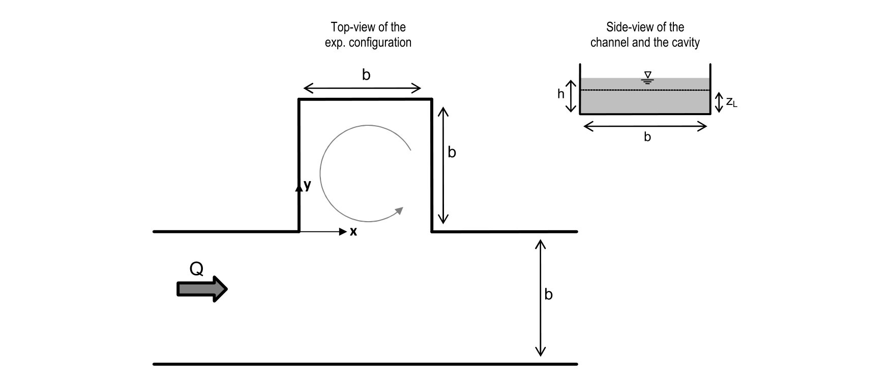

**图 1.** 矩形断面渠道与侧向凹腔的实验构型，其中 $b = 0.3$ m，水深 $h = 0.07$ m。PIV 在高程 $z_L = 0.05$ m 的平面内进行。

图中标签译注：左为实验构型俯视图（Top-view of the exp. configuration），右为渠道与凹腔侧视图（Side-view of the channel and the cavity）；$x$ 轴沿水流方向，$y$ 轴由主渠指向凹腔内部；$Q$ 为来流流量，$z_L$ 为测量平面距河床高度。

## III. 平均流场描述

我们从测量平面内二维流动的时均特征和统计特征入手，展示和讨论剪切层区域的速度场。正如 Tuna 等人 [9] 所指出，凹腔内的平均流动基本上是二维的，只有更靠近河床的区域例外。在图 2 中我们绘出凹腔内的平均流线和速度大小等值线，表明一个回流胞腔几乎占据全部可用体积，这与以往对类似流动的研究结果一致 [19–21]。

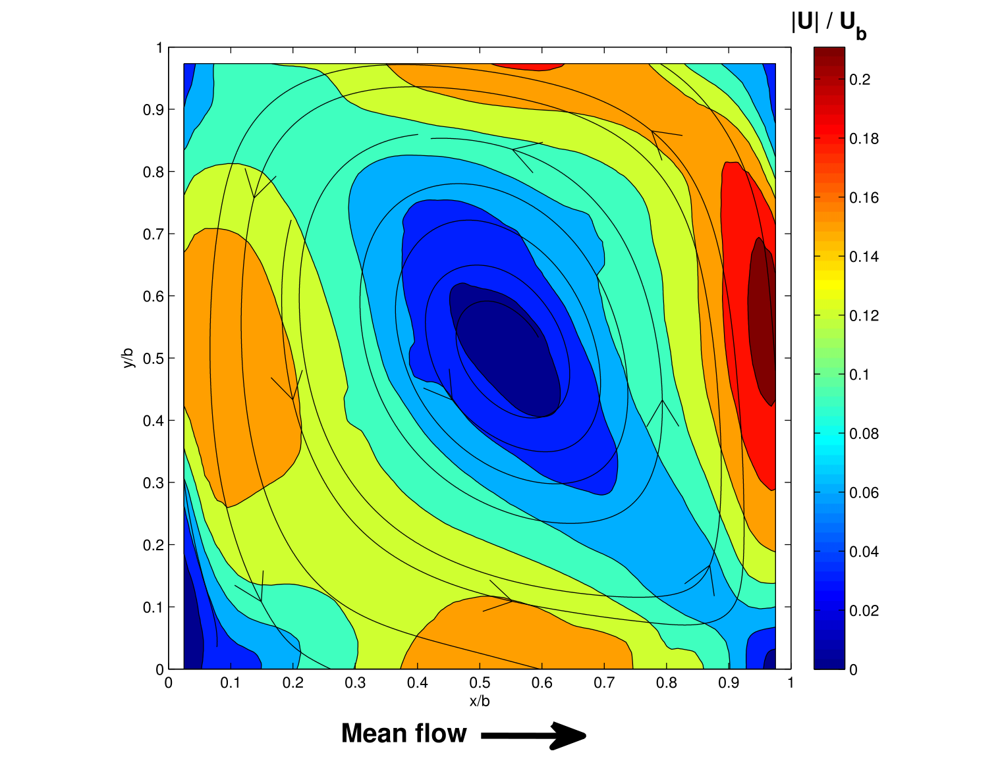

**图 2.** 水平面内的时均流场，显示凹腔内无量纲速度大小的等值线。一个具有竖直轴的大型非对称涡结构占据凹腔的大部分体积。

图中标签译注：横轴为 $x/b$，纵轴为 $y/b$；色标为 $|\mathbf{U}|/U_b$；图下方箭头标注“Mean flow”，表示主流沿 $x$ 正向（指向图右）。

图 2 表明，凹腔内回流胞腔外层的速度大小约为 0.025 m/s，相当于 $0.15U_b$，与 Tuna 等人 [9] 在其近期实验中得到的比值相近。剪切层（或称混合层）由主渠与凹腔之间界面上形成的速度梯度构成 [22, 23]。为显示这一速度差的大小，图 3 中的放大图给出了凹腔上游主渠中的来流速度剖面，以及剪切层位置处凹腔内部的流线和速度等值线。渠道内高速水流的最大流向速度位于 $y/b = -0.3$，并且如图 3(a) 所观察到的，在 $x/b = -1.33$ 到 $-0.66$ 之间沿流向逐渐演变。我们给出侧壁处上游渠道流动的发展情况，因为边界层厚度是刻画绕侧向凹腔流动的参数之一。因此，这一信息对于再现本凹腔流动并将其与其他类似流场进行比较十分重要。

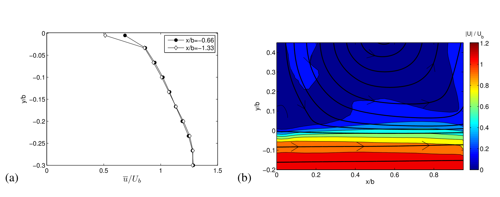

**图 3.** (a) 在 $z_L = 0.05$ m 水平面内、于上游流动中两个位置测得的来流平均流向速度剖面；(b) 在高程 $z_L = 0.05$ m、凹腔界面处测得的流线及时均速度大小。

图中标签译注：(a) 纵轴为 $y/b$，横轴为 $\bar{u}/U_b$，两组剖面分别位于 $x/b=-0.66$ 和 $x/b=-1.33$；(b) 横轴为 $x/b$，纵轴为 $y/b$，色标为 $|\mathbf{U}|/U_b$。

为研究剪切层沿界面向下游的演变，我们在图 4 中绘出界面处时均无量纲流向速度剖面和横向平均速度梯度，分别记为 $\bar{u}/U_b$ 和 $\dfrac{b}{U_b}\dfrac{\partial \bar{u}}{\partial y}$。测量结果表明，该流动与两股平行水流之间出现的自由混合层 [22, 23] 有许多相似之处，也与混合层轴线在几何上被强制规定的实际流动相似，例如：复式断面渠道中流向轴线被约束在两条渠道之间的岸线处 [24]，以及植被或城市冠层中轴线被约束在冠层顶部的流动 [25]。图 4(a) 显示了界面处平均流向速度剖面的发展：随着动量传入凹腔内部，由于水流卷吸导致混合区横向扩展，$y/b > 0$ 处的速度沿下游方向增大。当观察图 4(b) 中的横向速度梯度时这一点更加清楚：在该图中，在凹腔与主渠之间界面的大部分区段上，最大梯度略微偏向主流一侧（$y/b < 0$）。

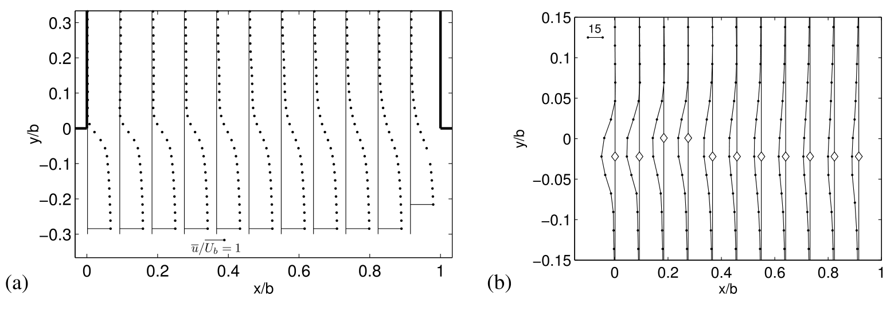

**图 4.** (a) 时均无量纲流向速度 $u$ 的横向剖面；(b) 界面处平均流向速度的无量纲横向梯度 $\dfrac{b}{U_b}\dfrac{\partial \bar{u}}{\partial y}$，其中白色符号标示最大梯度的位置（为便于阅读，流向空间分辨率已作抽稀）。

混合层的扩展通过将其厚度 $\delta$ 表示为界面两侧特征速度尺度之差的函数来分析。我们把每个流向位置 $x$ 处凹腔内部的速度 $U_1(x)$ 和主渠内的速度 $U_2(x)$ 定义为：沿 $y$ 轴、速度梯度绝对值小到可忽略（即低于 $0.5\ \mathrm{s^{-1}}$）位置处的平均流向速度。实测混合层厚度 $\delta_m(x)$ 于是定义为

$$\delta_m(x) = \frac{U_2(x) - U_1(x)}{\left|\partial \bar{u}(x)/\partial y\right|_{max}}, \tag{1}$$

式中 $\left|\partial \bar{u}(x)/\partial y\right|_{max}$ 是沿界面每个位置 $x/b$ 处平均流向速度的最大横向梯度。如图 5 所示，混合层厚度不仅沿下游方向增大，还在界面下游角点附近（$x/b > 0.8$）呈现一个值得注意的特征：该处 $\delta_m$ 因最大速度梯度局部增大而减小。这是凹腔下游角点所产生逆压梯度的后果——剪切层在该处撞击壁面，使压力大小局部升高。

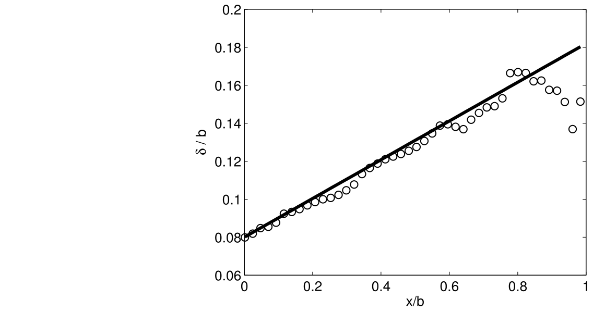

**图 5.** 主渠与凹腔之间界面上混合层实测宽度（$\delta_m$，圆圈）与理论宽度（$\delta_e$，实线）沿流向的演变。

为识别混合层对逆压梯度的敏感性，我们可以将混合层的发展与自由条件下的理论增长进行比较。自由混合层厚度 $\delta_e$ 可利用下述关系近似：

$$\frac{d\delta_e}{dx} = \alpha\frac{\widetilde{U}_2 - \widetilde{U}_1}{(\widetilde{U}_1 + \widetilde{U}_2)/2}, \tag{2}$$

式中 $\widetilde{U}_1$ 和 $\widetilde{U}_2$ 是恒定的速度尺度，分别代表凹腔内部和外部速度场的大小，$\alpha$ 是调节剪切层沿流向增长的常数。按照 Pope [22]，$\alpha$ 的范围在 0.06 至 0.11 之间；而 Lesieur [26] 给出的常数值为 0.085。为与实测数据比较，我们认为主渠外部速度尺度 $\widetilde{U}_2$ 可用流动的断面平均流速表示，即 $\widetilde{U}_2 \approx U_b$；凹腔内速度尺度近似为 $\widetilde{U}_1 \approx 0.15U_b$（如图 2 中所估计）。取混合层增长率系数 $\alpha = 0.069$ 时，$\delta_m(x)$ 的最佳拟合斜率为 0.102，如图 5 所示。假定初始宽度为 $0.08b$，可见逆压梯度只在 $x/b > 0.8$ 处影响混合层厚度，使其偏离线性增长。这是该流动的一个显著特征，因为剪切层在界面上一个很短且受约束的区段内发展。厚度增长保持这一性质，尽管剪切层持续与从凹腔内部出现的涡相互作用（本文稍后讨论这些涡），并受到凹腔下游角点撞击点处所产生的强逆压梯度影响。

跨界面的紊流动量输运可通过雷诺应力张量的主项来定量刻画。图 6 揭示，在每个选定的流向位置 $x$，雷诺剪应力的最大幅值 $|\overline{u'v'}|$ 位于混合层中心线（$y/b \approx 0$）上，并在两侧约 $\pm\delta_m/2$ 的距离处迅速消失；靠近混合层下游末端（$x/b > 0.8$）处例外——如图 5 中已观察到的，随着 $\delta_m$ 突然减小，该处应力向更远处扩展。正如预期，图 6 还表明无量纲最大雷诺剪应力的大小沿下游方向增大，在 $x/b = 0.7$ 附近达到最大，随后因驻点施加的逆压梯度影响而朝下游角点再次减小。总之，主流与凹腔之间界面处的流动呈现出发展中自由混合层的典型特征，即最大速度梯度和最大紊流剪应力都发生在界面附近并沿下游方向扩展。凹腔界面处混合层最重要的特征是对逆压梯度的敏感性：该梯度只在 $x/b > 0.8$ 处影响剪切层的时均特征，使接近下游角点时的宽度和最大雷诺剪应力减小。

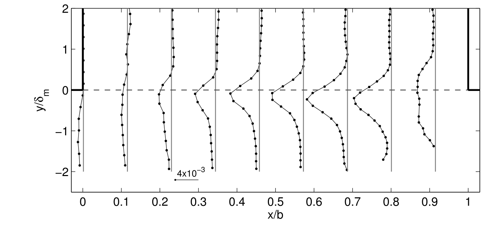

**图 6.** 紊流动量输运由无量纲雷诺剪应力 $-\overline{u'v'}/(U_2 - U_1)^2$ 沿混合层流向的横向剖面演变来定量刻画。

图中标签译注：横轴为 $x/b$，纵轴为 $y/\delta_m$；图中水平虚线为 $y/\delta_m = 0$；$4\times10^{-3}$ 的比例尺标示各剖面横向上应力值的量级。

## IV. 混合层中的相干结构动力学

本节旨在分析混合层中紊流相干结构的时间特征。与 Rockwell 和 Naudascher [1] 的报道类似，我们首先通过绘制界面处横向速度信号 $v$ 的功率谱密度沿流向的演变（如图 7 所示）来识别涡脱落的主导频率。混合层下游区域（$x/b > 0.5$）的主导频率为 $f_p = 0.6$ Hz；在剪切层最初几个区段（$x/b < 0.62$），0.8 Hz 附近也有显著能量。0.6 Hz 的能量峰值在 $x/b = 0.7$ 位置测得，该处横向速度脉动的相干性也最大。剪切层的这些复杂特征表明，绕侧向凹腔的紊流流动具有很强的三维性。然而，本节所分析的剪切层动力学控制机制表明，正如 Tuna 等人 [9] 所讨论的，流动中能量最高的大尺度相干结构基本上是二维的。

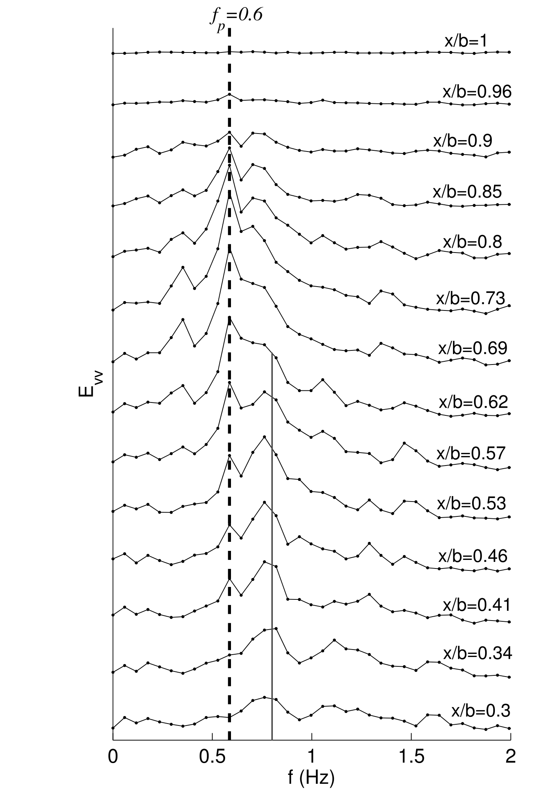

**图 7.** 跨界面横向速度 $v$ 的功率谱密度，绘于不同流向位置。所有谱采用相同的标度。

图中标签译注：横轴为频率 $f$（Hz），纵轴为 $E_{vv}$；各条谱线旁标注对应 $x/b$（自下而上由 0.3 增至 1）；虚线标示 $f_p = 0.6$ Hz。

在第 IV A–IV C 小节中，我们把注意力集中于混合层涡沿界面的二维传播。首先讨论跨界面横向速度的特征，然后利用 Graftieaux 等人 [27] 的识别算法分析涡核，研究在凹腔与主流之间持续脱落的低频大尺度相干结构的演变。

### A. 横向速度的交替变化

界面处产生的涡在传播时，会在凹腔与主流之间造成横向速度分量 $v$ 正负脉动的交替序列。这一振荡运动在图 8 中表示为跨界面正、负横向速度 $v$ 的流向—时间等值线交替。通过这一时空图，我们可以刻画涡的演变，有效地展示混合层的重要物理特征。数据在 0.133 s 上取平均，相当于对前 10 s 数据中连续 4 个以上测量值取平均。以黄色/橙色标示的 $v$ 正值区对应流向凹腔的流动，而以蓝色标示的瞬时 $v$ 负值区对应流向主流的流动。需要着重指出，跨界面横向速度 $v$ 的时均值小到可忽略，这表明涡的发展产生了一列同量级的正负大尺度脉动，二者相互补偿，使平均值接近于零。

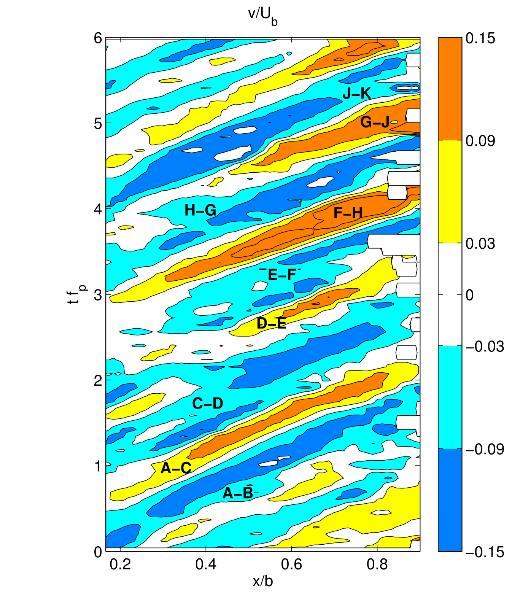

**图 8.** 沿混合层无量纲横向速度分量的流向与时间演变。大写字母对应图 10 中的各结构。

图中标签译注：横轴为 $x/b$，纵轴为无量纲时间 $tf_p$；色标为 $v/U_b$，暖色为正（流向凹腔）、冷色为负（流向主流）；A–K 等字母标注各相干结构之间的区段。

正如图 7 所示谱演变中观察到的，随着涡向下游运动，剪切层逐渐组织起来，这在 $0.3 \leq x/b \leq 0.9$ 范围内可以清楚分辨。最大横向速度大小也沿下游方向增大，在 $x/b = 0.7$–0.8 处达到 $0.15U_b$ 的最大值，随后随着剪切层因逆压梯度减速而减小。该最大值的流向位置与图 7 中在 $x/b = 0.7$ 观察到的谱最大幅值所显示的周期性一致。

由图 8 中正、负 $v$ 等值线交替区域中心线的斜率，还可以估计大尺度涡在界面处向下游运动时的传播速度 $c$。这些彼此平行的中心线给出恒定的传播速度值，等于 $c = 0.094$ m/s $= 0.56U_b$。因此涡传播速度高于沿界面平均的平均流向速度。该速度记为 $U_i$，等于 $U_i = 0.43U_b$，故 $c/U_i \approx 1.3$。这与 Shaw 等人 [28] 的观察相似，他们表明在植被冠层顶部形成的剪切层中，相干结构以等于当地平均速度 2 倍的传播速度被输运；而 Zhang 等人 [29] 估计该比值为 1.6，与本文结果更为吻合。此外，横向速度等值线相邻两个高峰（或低谷）之间的间距对应涡沿 $x$ 轴的波长 $\lambda$，本例中等于

$$\lambda = c/f_p = 0.16\ \mathrm{m} = 0.52b.$$

为进一步理解混合层涡脱落诱发的速度脉动，我们在图 9 中绘出界面上一特定点（对应 $y/b = 0$、$x/b = 0.7$）处速度 $u'$ 和 $v'$ 的时间序列；该点是沿界面 0.6 Hz 频率能量最大的位置，即图 7 谱中的最大峰值点。图 9 表明，在多数情况下，流向脉动的周期时间序列与零均值横向速度同相，即两个脉动速度分量 $u'$ 和 $v'$ 大多同号，不过 $u'$ 的振荡显得更为复杂——这一点将在第 IV B 小节结合图 10 给出的数据深入讨论。在以下各图中，我们利用混合层的主导频率将时间无量纲化，把无量纲时间表示为 $tf_p$。

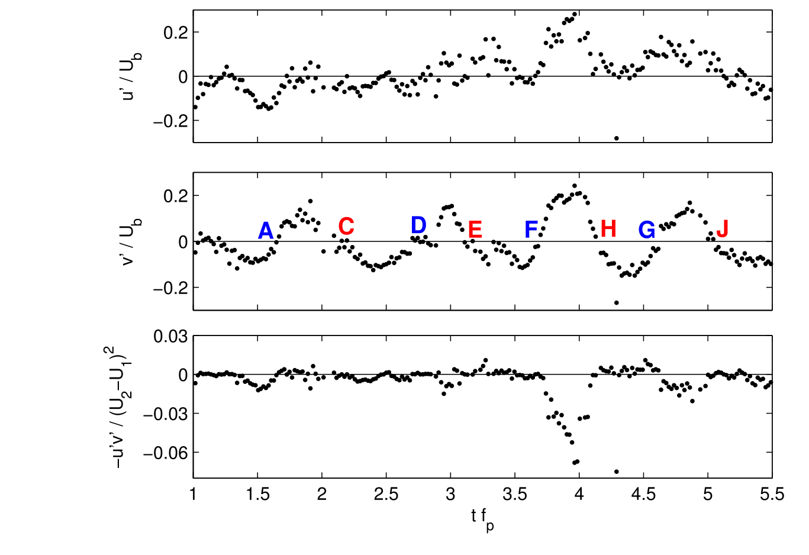

**图 9.** 在 $y/b = 0$、$x/b = 0.7$ 点处，无量纲水平速度脉动 $u'$ 和 $v'$ 以及相关量 $-u'v'$ 值的时间演变。大写字母对应图 10 中的各结构。时间利用混合层主导频率 $f_p$ 无量纲化。

图中标签译注：自上而下三个子图纵轴分别为 $u'/U_b$、$v'/U_b$、$-u'v'/(U_2-U_1)^2$，横轴均为 $tf_p$；A–J 标示各涡结构经过该点的时刻。

在同一点进行的象限分析（本文未给出）证实：有 33% 的时间两个速度脉动均为正，即 $v' > 0$、$u' > 0$，测量点位于第一象限；类似地，有 40% 的总测量时间两个速度脉动均为负，即 $v' < 0$、$u' < 0$，测量点位于第三象限。如图 9 下部子图所示，这些情况导致瞬时紊流应力大多为负，同时也证实了图 6 所描绘的负的时均雷诺剪应力 $-\overline{u'v'}$。横向速度脉动的交替（包含强烈的正、负横向速度事件）很可能是表层储水区实验研究中观察到的主流与凹腔之间被动标量和颗粒物质交换的原因。

### B. 平面内涡的二维时间演变

第 IV A 小节对时间序列的研究展示了界面处混合层的具体特征，这些特征是涡脱落的后果。本节我们进行空间分析，考虑整个测量平面，以揭示产生流向和横向速度大尺度振荡的涡相关机制。我们沿用 Graftieaux 等人 [27] 提出的方法，提取持续脱落并向下游输运的低频大尺度相干结构的中心。该涡识别方法首先采用本征正交分解（POD）[30]，通过线性分解提取流动中能量最高的模态；然后定义一个无量纲标量函数，记为 $\Gamma_1$，用于根据速度场的方向识别涡心。在对剪切层的分析中，我们按以下三个步骤实施涡识别程序：

1. 首先，对总时长 133 s、采样频率 30 Hz 的二维速度脉动场（减去平均流后）进行 POD，从而能够追踪如图 10 所示的各结构轨迹。随后提取特征模态，并用最大的 10 个模态对速度场进行滤波和重构，保留 90% 的平均动能，同时去除很大一部分非相干湍动能（约 60%）和测量噪声。关于 POD 理论基础的更多细节，读者可参阅 Holmes 等人 [30]。
2. 接着，在每个时间步利用重构速度场计算无量纲标量函数 $\Gamma_1$ 的空间分布。对于域内任意点 $P$，该函数可写为

$$\Gamma_1(P) = \frac{1}{S}\int_{M\in S}\frac{(\overrightarrow{PM}\times\overrightarrow{U}(M))\cdot\overrightarrow{z}}{\|\overrightarrow{PM}\|\cdot\|\overrightarrow{U}(M)\|}dS = \frac{1}{S}\int_{M\in S}\sin(\theta_M)\,dS, \tag{3}$$

式中 $S$ 为以 $P$ 为中心的圆面，$M$ 为 $S$ 内一点，$\overrightarrow{U}(M)$ 为点 $M$ 处的速度矢量，$z$ 为前面定义的竖直轴，$\theta_M$ 为矢量 $\overrightarrow{PM}$ 与 $\overrightarrow{U}(M)$ 之间的夹角。由于正弦函数以 1 为界、积分又由积分面积 $S$ 归一化，故 $|\Gamma_1|$ 也以 1 为界。为捕捉紊流结构，积分面积必须与结构的典型伸展尺度相当：本例中我们选取直径 60 mm（$0.2b$）的圆，这与图 10 和图 12 中脉动速度场（黑色箭头）内相干结构尺寸的量级相当。

3. 最后，选取一个 $\Gamma_1$ 阈值，以在强旋转区域内显示涡核。本研究选择 $|\Gamma_1| = 0.55$，因为它看来适合识别图 10 中的相干涡。在以下各图中绘出逆时针涡和顺时针涡的等值线：红色表示逆时针涡（$\Gamma_1 > 0.55$），蓝色表示顺时针涡（$\Gamma_1 < -0.55$）。

需要指出，之所以选择该方法而非基于涡量阈值的方法，是因为：(i) 与涡量不同，$\Gamma_1$ 的大小在纯剪切流动区域保持有限；(ii) 它使我们能够沿混合层的大部分区段追踪每个涡——从能量较弱的上游区域，一直到能量很高的下游区域。

在图 10 中，我们给出 15 个连续时刻的涡动力学序列，从左上子图向右下推进，每隔 0.33 s 显示一次，总时长 5.0 s。图 10 中的时间由剪切层主导频率 $f_p$ 无量纲化，从而可以在涡脱落基本周期的背景下观察涡的动力学。每个子图中以黑色箭头显示瞬时（未滤波）脉动速度场，该场在连续 4 次测量上取平均，使采样频率由 30 Hz 降至 7.5 Hz。涡核以 $\Gamma_1$ 判据 [27] 识别，并依旋转方向为顺时针或逆时针分别以蓝色或红色显示。为分析相干结构随时间的演变，每个涡都用一个字母单独标记，以便观察它们沿混合层被输运时的轨迹。

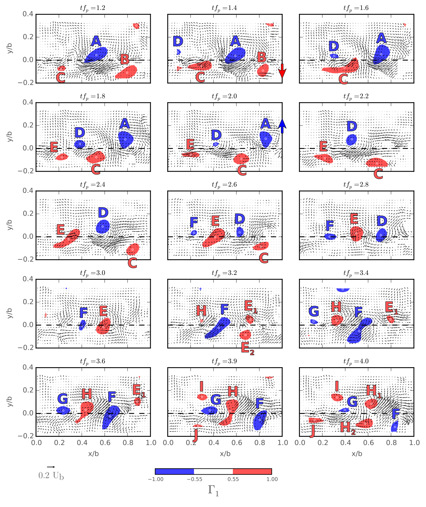

**图 10.** 每隔 $tf_p = 0.2$（0.33 s）的脉动速度场（黑色箭头）与顺时针（蓝色，$\Gamma_1 < -0.55$）和逆时针（红色，$\Gamma_1 > 0.55$）相干涡等值线的时间演变；白色圆圈对应涡心，即 $|\Gamma_1|$ 的局部最大值。虚线表示混合界面 $y/b = 0$。

图中标签译注：各子图标题为对应无量纲时刻 $tf_p$；横轴为 $x/b$，纵轴为 $y/b$；左下箭头给出 $0.2U_b$ 的速度比例尺；色条为 $\Gamma_1$（$-$1.00 至 1.00）；A–J 为作者对各涡的编号，$E_1$、$E_2$、$H_1$、$H_2$ 为分裂后的子涡。

图 10 所示相干结构的演变表明，瞬时流动具有高度动态性，其特征是多个涡的形成与相互作用。在整个平面内可分辨出两个至六个涡结构，它们彼此相互作用，有时发生分裂。必须指出，图 10 二维图中观察的时刻与图 9 所描绘的 $x/b = 0.7$、$y/b = 0$ 处速度序列中的时间一致，因此可将整体涡相互作用与单点测得的速度分量进行比较。

从图 10 中可代表混合层动力学过程的一系列快照可见，三种主要构型控制着界面处的流动：(1) 从 $tf_p = 1.2$ 到 $tf_p = 2.6$，顺时针涡（蓝色）位于凹腔内部（$y/b > 0$），而逆时针涡（红色）位于主流中（$y/b < 0$）。在该构型下，沿界面（$y/b = 0$）出现两个强横向速度区：第一个位于顺时针涡上游，该处 $v' > 0$、$u' \approx 0$（如 $tf_p = 1.8$–2.0、$x/b = 0.7$ 处涡 A 上游所见，另见图 9）；第二个位于顺时针涡下游，该处 $v' < 0$、$u' < 0$（如 $tf_p = 1.4$–1.6、$x/b = 0.7$ 处涡 A 下游所见，另见图 9）。(2) 从 $tf_p = 2.8$ 到 $tf_p = 3.4$，各涡在 $y/b \approx 0$ 处与界面排成一线。在此构型下，$v'$ 仍在正负值之间振荡，但流向分量 $u'$ 呈现更复杂的形态（见 $tf_p = 2.8$–3.4 时 $x/b = 0.7$ 处，另见图 9）。(3) 最后，从 $tf_p = 3.6$ 到 $tf_p = 4.0$，顺时针涡（蓝色）位于主流中（$y/b < 0$），逆时针涡（红色）位于凹腔内部（$y/b > 0$）。沿界面的速度脉动与构型 (1) 行为相反：顺时针涡上游两个速度脉动均为正，即 $v' > 0$、$u' > 0$（如 $tf_p = 3.9$–4.0、$x/b = 0.7$ 处涡 F 上游所见，另见图 9）；顺时针涡下游观察到负横向速度，即 $v' < 0$、$u' \approx 0$（如 $tf_p = 3.6$、$x/b = 0.7$ 处涡 F 下游所见，另见图 9）。

对涡核演变的分析还揭示了流动的其他方面。涡在界面处的成列以及涡分裂等过程，使流向速度的脉动比横向分量更为复杂，正如此前在图 9 时间序列中观察到的。同样如我们的分析所示，脉动速度场的两个分量在大多数时间同号。$u'$ 与 $v'$ 之间的这种正相关产生负的雷诺应力，而且它主要在流向分量绝对值 $|u'|$ 较强时产生。在这些情况下观察到两种主导运动：要么 $u'$、$v'$ 均为正，对应上一段讨论的第三种涡构型；要么 $u'$、$v'$ 均为负，对应第一种构型。Sanjou 和 Nezu [11] 最近也报道了这两种情况，他们把经典的“喷发（ejection）”和“扫掠（sweep）”术语推广到明渠侧向凹腔流动。

如前所述，部分相干结构会经历分裂过程，由剪切层的一个原始结构在界面两侧产生两个分离的同向旋转核。图 10 中 $tf_p = 3.2$ 的涡 E 和 $tf_p = 3.9$ 的涡 H 都观察到这一现象。向下游运动的同向旋转涡对中，其前缘在界面处产生最大的速度脉动，正如图 9 所绘速度时间序列揭示的那样。

当相干涡到达下游角点（剪切层在 $x/b = 1$ 处撞击壁面）时，它们或者进入凹腔（$y/b > 0$），或者继续留在主流中（$y/b < 0$）。把涡位置定义为 $|\Gamma_1| > 0.55$ 所给着色区域的重心（在图 11 中以蓝色空心圆标示），可以观察到：涡心路径主要取决于撞击点上游该中心相对于界面的位置。例如，位于 $y/b > 0$ 的涡 A 和 $E_1$ 被偏向凹腔，而位于 $y/b \leq 0$ 的涡 B、C、$E_2$ 和 F 则继续沿主渠下游运动。

图 11 显示了与前各图相同时段（10 s）内涡心位置的时空演变。我们绘出在 $|y/b| < 0.167$ 区域内、界面附近遇到的所有涡核沿 $x$ 轴的流向位置。图 11 所示相干结构对应我们此前分析中识别的相同涡，即在图 10 中以字母 A 至 J 定义的涡。这些流向位置的时间演变在时空图中呈现近似恒定的斜率，证实了第 IV A 小节报道的混合层相干结构具有恒定的流向传播速度。两个旋转方向相同的结构沿 $x$ 轴通过同一流向位置之间的特征时间尺度所定义的周期等于 $tf_p = 1.0$。

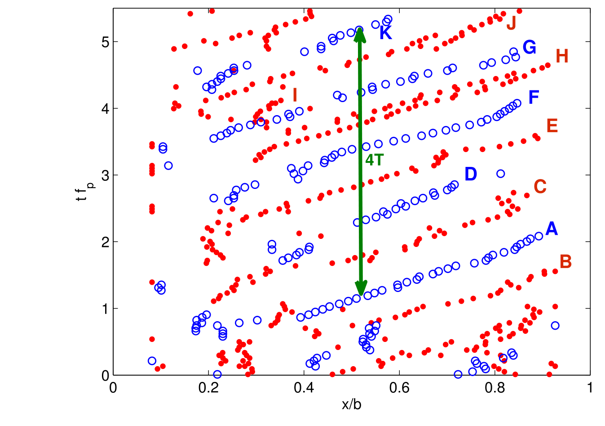

**图 11.** 位于界面附近（$|y/b| < 0.167$）的顺时针（蓝色空心符号）和逆时针（红色实心符号）涡心流向位置的时间演变。绿色箭头标示四个周期。

图中标签译注：横轴为 $x/b$，纵轴为 $tf_p$；A–K 标记各涡的轨迹；绿色双箭头标注“4T”，即四个周期的时间跨度。

### C. 与内涡的相互作用及涡核位置统计

上述涡在上游角点附近产生，并沿主渠与凹腔的界面被输运。这些结构（如前各图中以字母 A 至 J 识别的涡）起源于凹腔前缘 $x/b = 0$ 附近，并以近似恒定的涡传播速度向下游运动。然而，对界面附近涡核的分析表明，凹腔内部产生的附加涡结构能够与混合层的相干结构相互作用。在图 12 中，我们利用 $\Gamma_1$ 判据绘出这些涡强到足以到达界面并与剪切层结构相互作用的短暂时段内涡核的瞬时位置。这些内涡在图 12 中标记为 L（顺时针）和 M（逆时针），直接产生于凹腔内部。导致其出现的过程仍不清楚；一种假设是，它们产生于角点处回流区与占据凹腔大部分体积的大尺度回流胞腔之间形成的较小剪切层（见图 2）。

尽管如此，我们实验中测得的流动动力学表明，这些涡的形成及其在界面处与混合层的相互作用非常零星。在整个测量时间内，分析所识别的相干结构中只有 3% 对应来自凹腔的内涡。当它们接近界面时，主渠较高的速度将这些结构沿斜向拉伸，使其迅速向 $x$ 正方向和 $y$ 负方向运动。在这种情况下，内涡同样经历分裂过程，分离为两个更小的结构：一个（$L_1$ 和 $M_1$）留在凹腔内部，另一个（$L_2$ 和 $M_2$）被输运向混合层，如图 12 所示。

**图 12.** 脉动速度场（黑色箭头）与顺时针（蓝色，$\Gamma_1 < -0.55$）和逆时针（红色，$\Gamma_1 > 0.55$）相干涡等值线的时间演变，用以捕捉起源于凹腔内部并与混合层相互作用的内涡 L 和 M 的动力学。虚线表示混合界面 $y/b = 0$。

图中标签译注：上排四个子图为内涡 M 及其分裂后的 $M_1$、$M_2$（$tf_p = 35.97$–36.23）；下排四个子图为内涡 L 及其分裂后的 $L_1$、$L_2$（$tf_p = 57.62$–57.81）；横轴为 $x/b$，纵轴为 $y/b$；左下箭头给出 $0.2U_b$ 速度比例尺，色条为 $\Gamma_1$。

为证明我们所揭示过程的统计显著性，并证明剪切层主导频率是界面处流动的基本机制，我们在图 13 中给出对横向速度（区域与图 10、图 12 相同）进行 POD 分析的更多细节。图 13(a) 显示 POD 谱，其中两个最大模态占横向速度方差的显著百分比。图 13(b) 所绘这两个模态的频谱表明，两个最大模态在剪切层主导频率 $f_p = 0.6$ Hz 处具有相同峰值。图 13(c) 和 13(d) 显示这两个空间模态，分解中包含构成混合层的大结构。更高阶模态（本文未给出）呈现 3 至 5 个涡结构，它们构成剪切层的基本动力学。从第三到第六模态，POD 捕捉到在界面最初区段与剪切层相互作用的内涡，即此前在图 12 分析中讨论的涡。

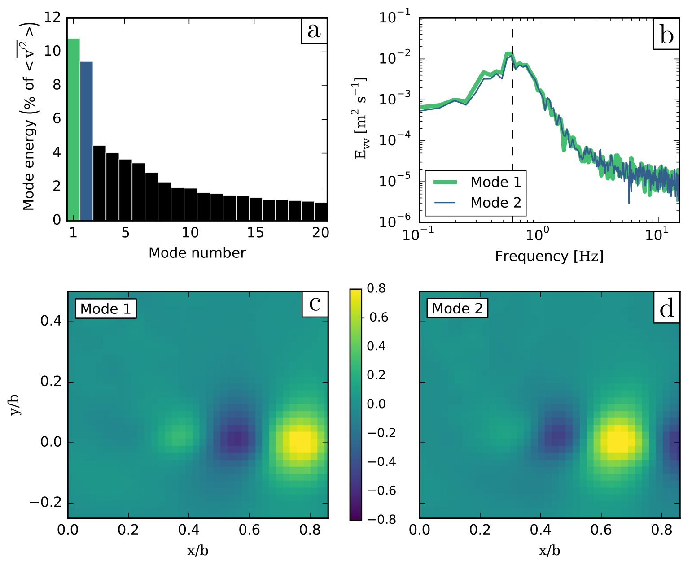

**图 13.** 界面附近横向速度脉动的本征正交分解（POD）。(a) POD 谱，表明两个最大模态占横向速度方差的显著百分比；(b) 前两个模态系数的频谱，表明二者均在 $f_p = 0.6$ Hz 处有峰值（竖直虚线）；(c) 模态 1 的空间分量；(d) 模态 2 的空间分量。

图中标签译注：(a) 纵轴为模态能量（占 $\langle v^2\rangle$ 的百分比），横轴为模态编号；(b) 纵轴为 $E_{vv}$（m² s⁻¹，对数坐标），横轴为频率（Hz，对数坐标），绿线为模态 1、蓝线为模态 2；(c)(d) 横轴为 $x/b$，纵轴为 $y/b$，色条为模态系数（$-$0.8 至 0.8）。

在第 IV A 和 IV B 小节中，我们描述了剪切层内发生的复杂涡动力学与相互作用。为直观显示这些大尺度涡所占据的空间范围，我们在图 14 中绘出界面附近涡核位置的概率密度函数（pdf）：该估计量在整个域内一小块面积上的积分，等于涡心位于该面积内的概率 [31]。二维图显示归一化直方图的等值线，使得顺时针涡核和逆时针涡核这两个 pdf 在所绘域（$0.1 < x/b < 0.9$、$-0.15 < y/b < 0.25$）上的积分之和等于 1。

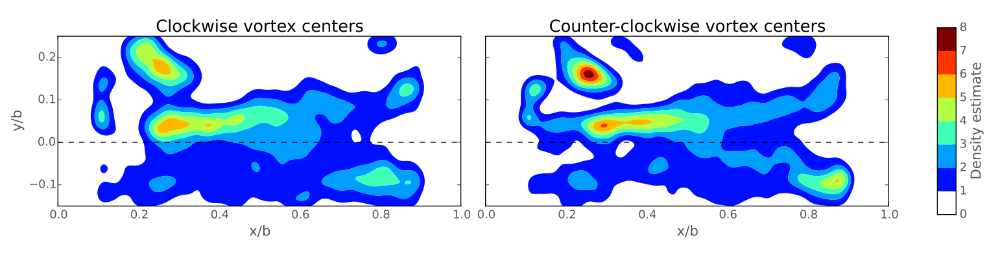

**图 14.** 利用 $\Gamma_1$ 判据识别的、界面附近涡心位置的概率密度函数（pdf）。(a) 顺时针涡位置 pdf；(b) 逆时针涡位置 pdf。注意：在 3000 个样本上共检测到 6632 个顺时针涡和 6423 个逆时针涡，用于绘制本图。

图中标签译注：左图标题“Clockwise vortex centers”（顺时针涡心），右图标题“Counter-clockwise vortex centers”（逆时针涡心）；横轴为 $x/b$，纵轴为 $y/b$；色标“Density estimate”为密度估计值（0–8）；水平虚线为 $y/b = 0$。

图 14 所示 pdf 表明，顺时针和逆时针旋转涡的位置具有几乎相同的统计空间分布。在上游区域（$x/b < 0.3$），可以观察到内涡的高密度区（$y/b \approx 0.15$，如图 12 中的 L 和 M），以及起源于剪切层、略偏凹腔内部的涡核高密度区。再往下游（$0.3 < x/b < 0.7$），涡主要位于界面沿线，略微偏向侧向凹腔一侧（$y/b > 0$）。在下游区域（$x/b > 0.7$），可观察到两条涡位置高密度舌区，因为随着剪切层撞击角点，各结构或者进入凹腔（$y/b > 0$），或者继续进入主流（$y/b < 0$）。图 14 中这两个不同的高密度区域位于 $-0.1 < y/b < 0.1$ 所给范围内，并从 $x/b > 0.8$ 开始出现；该位置对应混合层相对于自由剪切层表现出动力学变化之处，正如第 III、IV 节所讨论的。

## V. 质量交换系数

从混合层持续脱落并沿界面被输运的大尺度涡，造成横向速度正负脉动的周期性交替，如图 9(b) 所示。这些脉动中幅值可达 $0.2U_b$ 的大振幅事件，是侧向凹腔与主流之间质量和动量交换的最重要机制。本节我们通过计算一阶一维模型 [4] 中所用的系数来定量刻画质量交换，该模型表示被动标量跨界面的质量输运。

主渠与表层储水区之间的一维质量交换模型最早由 Valentine 和 Wood [32] 以及 Uijttewaal 等人 [12] 提出；它建立质量交换的一阶关系，假设凹腔内总质量随时间的演变为几何、浓度梯度和界面处速度的函数。因此该关系写为

$$\frac{dM}{dt} = S_{ex}V_{ex}\Delta C(t), \tag{4}$$

式中 $M$ 为时刻 $t$ 凹腔内被动标量的总质量，$S_{ex} = bh$ 为主流与凹腔之间界面断面的面积（见图 1），$V_{ex}$ 为质量交换的速度尺度，即跨界面典型的时间与空间平均交换速度，$\Delta C$ 为跨界面被动标量的浓度差（原文称 concentration gradient）。Valentine 和 Wood [32] 提出把 $V_{ex}$ 与主流断面平均流速联系起来：

$$V_{ex} = kU_b,$$

式中 $k$ 为常数，对应所谓的无量纲质量交换系数。Weitbrecht 等人 [14] 以及后来的 Tuna 等人 [9] 根据沿主流与侧向凹腔界面的横向速度测量，通过对横向速度绝对值的时间平均作面积积分来估算 $V_{ex}$，如下式：

$$V_{ex} = \frac{1}{2S_{ex}}\int_{S_{ex}}\overline{|v(x,z)|}\,dS, \tag{5}$$

式中上划线表示对横向速度绝对值取时间平均。值得注意的是，在计算速度 $V_{ex}$ 时，式（5）中除以 2，原因是横向速度分量的绝对值同时计入了从主流到凹腔以及从凹腔到主流的交换，这实际上是式（4）所指总质量交换的两倍。假设流场基本为二维，质量交换系数的式（5）写为

$$k = \frac{1}{2U_b}\int_{x/b=0}^{x/b=1}\overline{|v(x,z=z_L)|}\,dx. \tag{6}$$

在图 15 中，我们绘出沿凹腔上游角点到下游角点、平均绝对横向速度分量的沿流向演变，该量经过无量纲化，使曲线在 $x/b = 0$ 与 1 之间的平均值等于 $k$。

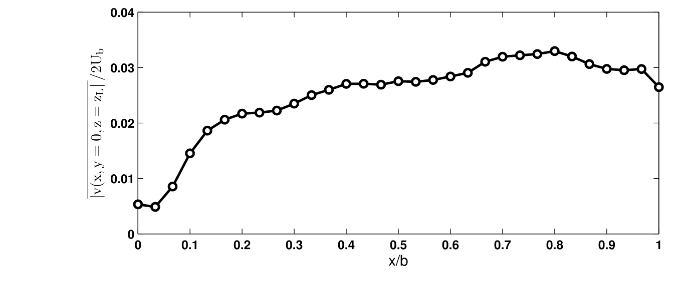

**图 15.** 凹腔与主流之间界面上，平均绝对横向速度分量沿流向的演变。

图中标签译注：横轴为 $x/b$，纵轴为 $\overline{|v(x,y=0,z=z_L)|}/2U_b$。

图 15 所绘变量于是与图 9(b) 中交替横向速度分量的幅值直接相关。该曲线看起来从上游角点向下游增大，在 $x/b \approx 0.7$–0.8 处达到最大幅值，随后朝凹腔下游角点再次减小。$x/b \approx 0.7$–0.8 附近横向速度绝对值的最大值，与第 IV 节在该位置测得的 $f_p$ 谱最大值位置（图 7）及横向速度大小（图 8）吻合良好。

在本例中，质量交换系数得到的值为 $k = 0.0252$，处于文献中无假潮凹腔流动所报道数值的范围内（例如，Tuna 等人 [9] 以及 Sanjou 和 Nezu [11] 最近针对不同凹腔长宽比和平均流动特征得到的 $k$ 量级）。进一步分析需要将该交换系数值与被动标量绕凹腔的输运进行比较。在这种情况下，辅以高分辨率数值模拟可以改进对界面处质量交换的描述。

## VI. 结论

在本研究中，我们分析了用 PIV 在水平面内测过混合层的实验流场；该混合层在一条直形矩形明渠与相邻侧向方形凹腔之间的界面上发展。流动的主要特征是界面上发展的自持剪切层（混合层）的周期动力学。沿混合层被输运的涡撞击凹腔下游角点，剪切层在该处被分开：一部分涡进入凹腔内的回流区，另一部分则继续进入下游主流。

界面处平均速度剖面和速度梯度的发展，以及混合层厚度的增长，都呈现出与文献报道的自由剪切层相同的特征。然而，当剪切层的涡接近凹腔下游角点时，由于逆压梯度，涡的动力学自 $x/b > 0.8$ 起发生显著变化。

流场测量表明，沿界面横向速度呈现零均值的周期信号，而流向分量更为复杂，并受到涡随时间经过的强烈影响。为进一步研究这些相干结构的动力学，我们把 POD 与涡识别技术 [27] 结合，对其运动进行了二维分析，采用由重构速度场计算的标量（记为 $\Gamma_1$）。通过该分析我们证明，剪切层的涡以恒定的涡传播速度运动。我们还识别出涡在接近撞击点时分裂为两个同向旋转结构的现象。次要效应则由混合层与凹腔内部一个较小剪切层中产生的涡之间的相互作用造成。此外，通过 POD 分析我们表明，反向旋转涡的周期性交替，是涡前缘在界面处产生大横向速度脉动的原因。这一脉动横向速度的动力学最终使我们能够估算跨凹腔/水流界面的一维质量交换系数。

在未来工作中，我们旨在把附加实验与高分辨率数值模拟结合起来，以理解混合层和凹腔内部流场随表征流动的各参数（即来流边界层厚度、无量纲水深、雷诺数和凹腔长宽比）的变化。我们将研究自由表面以及凹腔内可能形成的波浪对流动的潜在影响。我们还将关注涡的三维相互作用及其对质量输运的整体效应，以理解能够控制河流中污染物归宿的机制。

## 致谢

本工作得到 ECOS-Conicyt 第 C11E02 号项目和 Fondecyt 第 1130940 号项目资助。我们还感谢 Conicyt/Fondap 第 15110017 号项目的资助，以及中国国家留学基金管理委员会（Chinese Scholarship Council）为 W. Cai 提供的博士奖学金。

## 参考文献（保留原文，供检索）

1. D. Rockwell and E. Naudascher, "Self-sustained oscillations of impinging free shear layers," Annu. Rev. Fluid Mech. 11, 67–94 (1979).
2. D. Rockwell, J.-C. Lin, P. Oshkai, M. Reiss, and M. Pollack, "Shallow cavity flow tone experiments: Onset of locked-on states," J. Fluid Struct. 17, 381–414 (2003).
3. S. C. Morris, "Shear-layer instabilities: Particle image velocimetry measurements and implications for acoustics," Annu. Rev. Fluid Mech. 43, 529–550 (2011).
4. B. L. O'Connor, M. Hondzo, and J. W. Harvey, "Predictive modeling of transient storage and nutrient uptake: Implications for stream restoration," J. Hydraul. Eng. 136, 1018–1032 (2010).
5. T. R. Jackson, R. Haggerty, S. V. Apte, A. Coleman, and K. J. Drost, "Defining and measuring the mean residence time of lateral surface transient storage zones in small streams," Water Resour. Res. 48, W10501, doi:10.1029/2012wr012096 (2012).
6. T. R. Jackson, R. Haggerty, S. V. Apte, and B. L. O'Connor, "A mean residence time relationship for lateral cavities in gravel-bed rivers and streams: Incorporating streambed roughness and cavity shape," Water Resour. Res. 49, 1–9, doi:10.1029/2012WR012444 (2013).
7. J. C. F. Pereira and J. M. M. Sousa, "Experimental and numerical investigation of flow oscillations in a rectangular cavity," J. Fluids Eng. 117, 68–74 (1995).
8. S. Bian, J. F. Driscoll, B. R. Elbing, and S. L. Ceccio, "Time resolved flow-field measurements of a turbulent mixing layer over a rectangular cavity," Exp. Fluids 51, 51–63 (2011).
9. B. Tuna, E. Tinar, and D. Rockwell, "Shallow flow past a cavity: Globally coupled oscillations as a function of depth," Exp. Fluids 54, 1586 (2013).
10. X. Liu and J. Katz, "Vortex-corner interactions in a cavity shear layer elucidated by time-resolved measurements of the pressure field," J. Fluid Mech. 728, 417–457 (2013).
11. M. Sanjou and I. Nezu, "Hydrodynamic characteristics and related mass-transfer properties in open-channel flows with rectangular embayment zone," Environ. Fluid Mech. 13, 527–555 (2013).
12. W. Uijttewaal, D. Lehmann, and A. van Mazijk, "Exchange processes between a river and its groyne fields: Model experiments," J. Hydraul. Eng. 127, 928–936 (2001).
13. A. McCoy, G. Constantinescu, and L. J. Weber, "Numerical investigation of flow hydrodynamics in a channel with a series of groynes," J. Hydraul. Eng. 134, 157–172 (2008).
14. V. Weitbrecht, S. Socolofsky, and G. Jirka, "Experiments on mass exchange between groyne fields and main stream rivers," J. Hydraul. Eng. 134, 173–183 (2008).
15. M. Wolfinger, C. A. Ozen, and D. Rockwell, "Shallow flow past a cavity: Coupling with a standing gravity wave," Phys. Fluids 24, 104103 (2012).
16. E. Mignot, C. Zeng, G. Dominguez, C. Li, N. Riviere, and P. Bazin, "Impact of topographic obstacles on the discharge distribution in open-channel bifurcations," J. Hydrol. 494, 10–19 (2013).
17. E. Mignot, D. Doppler, N. Riviere, I. Vinkovic, J. Gence, and S. Simoens, "Analysis of flow separation using a local frame-axis: Application to the open-channel bifurcation," J. Hydraul. Eng. 140, 280–290 (2014).
18. M. Jahanmiri, "Particle image velocimetry: Fundamentals and its application," Report 2011:03, ISSN: 1652-8549 Chalmers University of Technology, Göteborg, Sweden, 2011.
19. R. Booij, "Exchange of mass in harbours," in 23rd Congress of IAHR, Ottawa: D69-D74 (National Research Council of Canada, Ottawa, 1989).
20. I. Kimura and T. Hosoda, "Fundamental properties of flows in open channel with dead zone," J. Hydraul. Eng. 123(2), 98–107 (1997).
21. K. Mizumura and M. Yamasaka, "Flow in open-channel embayments," J. Hydraul. Eng. 128, 1098–1101 (2002).
22. S. Pope, Turbulent Flows (Cambridge University Press, 2008).
23. P. A. Durbin and B. A. Pettersson-Reif, Statistical Theory and Modeling for Turbulent Flows, 2nd ed. (Wiley, 2010).
24. S. Proust, J. Fernandes, Y. Peltier, J. Leal, N. Riviere, and A. Cardoso, "Turbulent non-uniform flows in straight compound open-channels," J. Hydraul. Res. 51, 656–667 (2013).
25. M. Raupach, J. Finnigan, and Y. Brunet, "Coherent eddies and turbulence in vegetation canopies: The mixing-layer analogy," Boundary Layer Meteorol. 78, 351–382 (1996).
26. M. Lesieur, Turbulence in Fluids (Kluwer Academic, Dordrecht, 1997).
27. L. Graftieaux, M. Michard, and N. Grosjean, "Combining PIV, POD and vortex identification algorithms for the study of unsteady turbulent swirling flows," Meas. Sci. Technol. 12, 1422–1429 (2001).
28. R. Shaw, Y. Brunet, J. Finnigan, and M. Raupach, "A wind tunnel study of air flow in waving wheat: Two-point velocity statistics," Boundary Layer Meteorol. 76, 349–376 (1995).
29. C. Zhang, R. Shaw, and U. Paw, "Spatial characteristics of turbulent coherent structures within and above an orchard canopy," in Precipitation Scavenging and Atmosphere-Surface Exchange, edited by S. E. Schwartz and W. G. N. Slinn (Hemisphere Publishing Co., Washington, 1992), pp. 741-751.
30. P. Holmes, J. L. Lumley, and G. Berkooz, Turbulence, Coherent Structures, Dynamical Systems and Symmetry (Cambridge University Press, Cambridge, 1996).
31. B. Silverman, Density Estimation for Statistics and Data Analysis, Monographs on Statistics and Applied Probability (Chapman and Hall, London, 1986).
32. E. Valentine and I. Wood, "Longitudinal dispersion with dead zones," J. Hydraul. Div., ASCE 103, 975–990 (1977).

---

## 校订备注

- 原文式（6）以 $x/b=0$ 至 1 为积分界限，却写 $\mathrm{d}x$ 且分母没有凹腔长度 $b$；按其字面量纲，$k$ 不是无量纲数，与正文对 $k$ 的定义不符。译文照录原式，计算时需确认积分变量是否应为 $x/b$。
