# 1983 年 Crystal Rapid 的水跃：对大峡谷行舟与地貌演化的启示

原文：Susan Werner Kieffer，*The 1983 Hydraulic Jump in Crystal Rapid: Implications for River-Running and Geomorphic Evolution in the Grand Canyon*，*The Journal of Geology*，93(4)，385–406，1985。收稿：1984 年 8 月 1 日；修订：1985 年 1 月 29 日。原 PDF 另有一页资料封面，正文从第二页开始。

## 摘要

过去约 1,000–10,000 年，亚利桑那州大峡谷内数十处大型支流泥石流扇严重收窄科罗拉多河。多数扇体处，河流冲出的最窄河道宽度约为上游宽度的 0.5 倍。Crystal Creek 在 1966 年形成新扇体，使 1967–1983 年间的主河道最窄处仅约为上游宽度的 0.25 倍，形成大型急流。本文描述 Crystal Rapid 的水力特征，并提出分析支持这一假说：急流中的主波是一道正交波，属于水跃。可侵蚀河床的天然河道中水跃少见，Crystal 的水跃与 1966 年扇体造成的异常强收缩有关。1983 年中期流量逐步增至超过 96,000 ft³/s；对该时期的观察显示，水流通过收缩口、进入水跃之前的速度极高，导致水跃附近的扇体受蚀。每逢更高的创纪录流量，河流便冲出足够宽的河道，把流速降到大块石开始移动所需的阈值以下，使扇体逐渐接近与大流量相适应的形状。作者据此提出河流—冲积扇形态的定量模型，并由成熟扇体常见的约 0.5 收缩比，估计史前峰值洪水流量约为 400,000 ft³/s（11,320 m³/s）。

## 引言

自犹他州 Lees Ferry 以下约 400 km，科罗拉多河经过约 60 处由支流洪水堆积的大型泥石流扇（图 1）。支流洪水把大量巨石带入大峡谷主河道。虽然洪水扇的主要形态可稳定逾百年，主河仍以相当一致的程度侵蚀扇体，使经过它们的最窄河道宽度约为上游平均宽度的一半（图 2）。此前的峡谷急流水力理论尚未解释这一几何规律；大块石的去向和扇体侵蚀过程也少有直接观察，因为能够明显改造扇体的洪水很罕见。

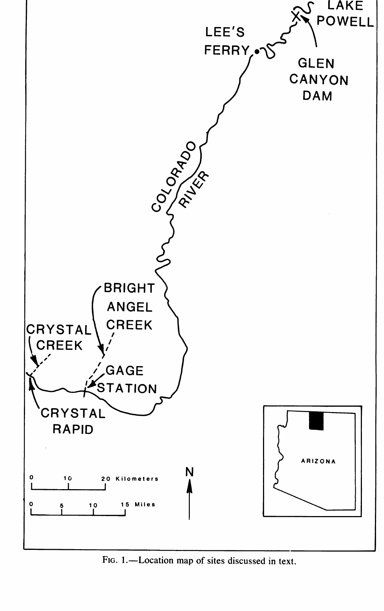

图 1. 科罗拉多河、大峡谷、Crystal Creek、Crystal Rapid、Bright Angel Creek 水文站、Glen Canyon Dam 与 Lake Powell 等地点。

Crystal Creek 在 1966 年发生泥石流，成为当地支流扇体形成史中最近的一次大型事件；主河被收窄的河段即 Crystal Rapid。约自 1965 年起，Glen Canyon Dam 下泄经过大峡谷的流量通常被控制在 30,000 ft³/s 以下，以服务发电用水。1884 年曾达约 300,000 ft³/s 的自然洪水流量，在 1983 年之前并未再通过 Crystal Rapid。1983 年 6–7 月，为避免 Lake Powell 漫过大坝，需要放流最高达 96,200 ft³/s；这促成罕见的地貌和水力过程，也提供观察主河与扇体相互作用的机会。

大峡谷这约 400 km 河段每年约有 10,000 人行舟。即使在正常受控流量下，Crystal Rapid 的巨石、浪和回流也使漂流困难。1983 年当流量升至 50,000–70,000 ft³/s，一道浪的波谷至波峰高度超过 6 m（图 3）；一名漂流者溺亡，另有数十人重伤。地质罕见事件通常只能碰巧留下记录，难以安排严格的系统观测；此前和当时经过急流的行舟者观察，为本文模型提供了重要的、部分定量的证据。

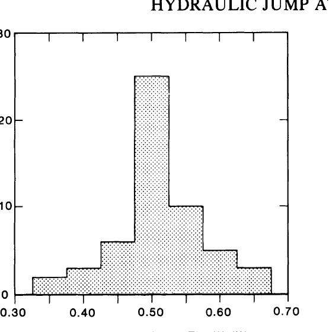

图 2. Lees Ferry 下游 400 km 河段中，59 处大型泥石流扇位置的河面宽度比 $w_2/w_0$。图据 1973 年航拍的水面宽度绘制，不能直接视为深水主河道的真实宽度。Crystal Rapid 的图上比值约为 0.33；剔除扇面浅水分流并把主河道理想化为矩形后，作者估计有效收缩比约为 0.25。河床测深不足，尚不能绘制真实河道收缩比的相应分布。

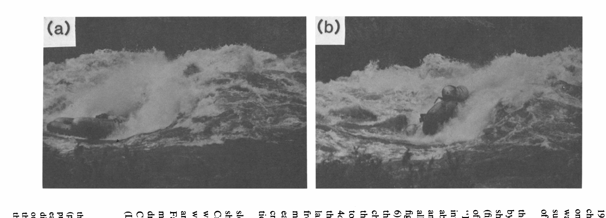

图 3. 1983 年 6 月 25 日，漂流艇进入（a）并被困于（b）Crystal Rapid 大浪的照片，原图获 Richard Kocim 许可转载。艇的浮筒直径约 1 m、中段直径约 3 m，乘员超过 30 人；据艇尺度估计，照片中的浪从波谷至波峰高于约 5–6 m。

**单位和方位。**Bright Angel 水文站以立方英尺每秒（cfs，即 ft³/s）发布科罗拉多河流量，行舟者的目测流量也沿用该单位；因此本文流量使用英制，其他变量使用公制，10,000 ft³/s 约等于 283 m³/s。河上航行的“右岸”指面向下游时的右侧，此处大体是北岸；“左岸”大体是南岸。原文的 above 和 below 分别指上游和下游，译文亦按此处理。

## Crystal Rapid 的河道几何

### 1983 年以前的河道

缺乏足够测量，1983 年以前河道的确切几何已无法恢复，只能从当时可见的水面特征推断。流量约 10,000 ft³/s 时，河面从上游约 87 m 收至扇体旁约 35 m（图 4）；在所有流量下，所见河面宽度都包含扇面上的浅水分流。即使在 96,200 ft³/s 峰值流量时，扇面浅水仍流得较缓。根据现场估计的速度、深度和淹没面积，作者认为这部分在各流量下均少于总流量的 10%。其余主要流量走扇体远端、河流南侧冲出的主槽，主槽宽度远小于水面总宽度。

南岸一条岩脊伸入主河道最窄处，进一步限制通水断面；水越过其南段，形成行舟者所谓的 Crystal “Pour-Over”（越坎水流）。岩脊突入河道，也使 Slate Creek 河口的岩脊上游与下游各形成一个回流。两个回流在各种水位下都存在，但形状随流量改变（图 4–6）。主流因此被夹在南侧回流与北侧泥石流扇之间，形成狭窄的高速河槽。虽其河床横向高低不规则，资料不足以支持复杂断面；作者在计算中假设各断面为矩形、上游平均宽 80 m、最窄处 20 m。

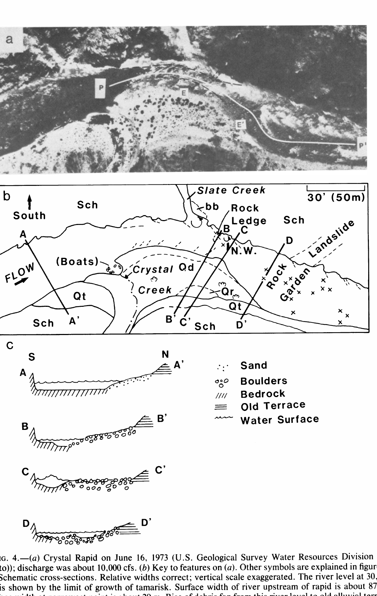

图 4. （a）1973 年 6 月 16 日约 10,000 ft³/s 的 Crystal Rapid；（b）地形和水流注释；（c）示意横断面，横向宽度比例正确，垂向夸大。主河上游水面宽约 87 m，最窄处水面宽约 29 m；扇面从该水位升至旧冲积阶地约 5.5 m。下游河道重新扩宽至超过 90 m，河底多巨石，称“乱石区”（Rock Garden）。图内 P–P′ 是当时优选行舟路线，E–E′ 标出 1983 年被高流量冲蚀的河岸段；N.W. 标示正交波。

1983 年主槽纵坡资料也少。从 Crystal Creek 至所讨论主浪北侧的一处沙滩，沿岸水面测得下降约 2.5 m；经乱石区还估计再降约 2.5–3 m。1966 年泥石流之前的 1965 年测深资料表明，从 Crystal Creek 河口至乱石区下端，河床约下降 7 m。在这段河底没有明显突降的岩坎，除南岸的 Pour-Over 外。该岩坎下游约 30 m 的主河道中央有一块大石：1983 年以前，行舟者的首要目标是避开它及其关联的“Crystal Hole”洞和浪。它在 6,000 ft³/s 时刚被淹没，据此粗估直径约 $2\pm1$ m。

### 1983 年中期以后的河道

1983 年高流量过后，表面波列改变，表明河槽形状发生变化（图 6）。急流顶部变陡尤为明显：Crystal Rapid 的大部分落差此后集中在 Slate Creek 上游。流量在 96,200 ft³/s 达峰后，1983 年多数时间没有降到约 45,000 ft³/s 以下。在这一流量下，急流入口的北侧、与 Slate Creek 相对位置出现新的强斜浪；到 1984 年末，它是全急流最大的一道浪。较低流量时，该浪向上游移动、变小，但在仅 6,000 ft³/s 时仍明显。

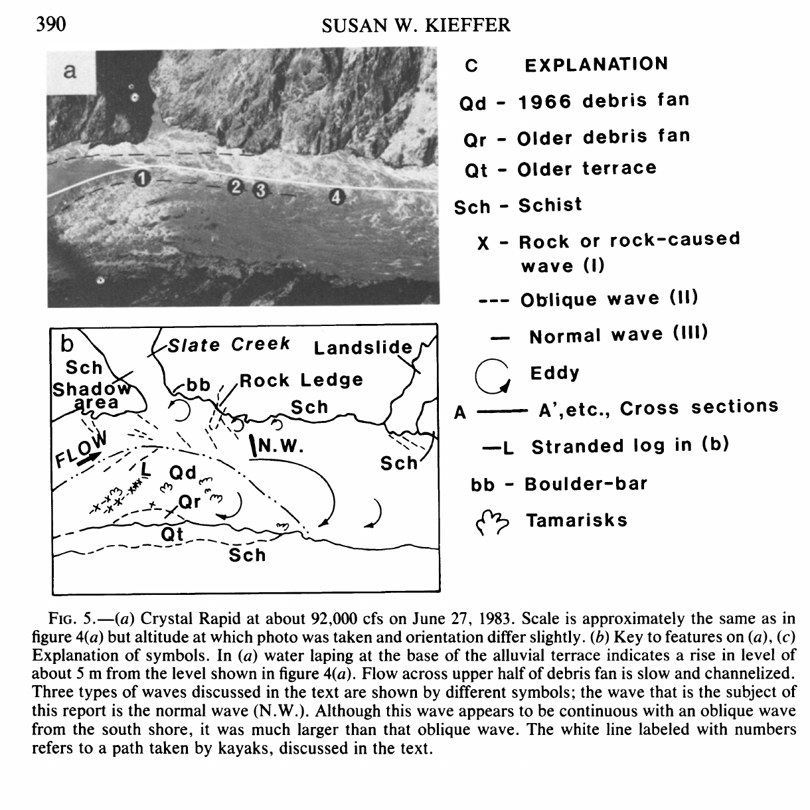

图 5. 1983 年 6 月 27 日约 92,000 ft³/s 的航拍及注释；与图 4a 的比例尺近似，拍摄高度和方向略不同。旧阶地基部被水触及，表示水位较图 4a 高约 5 m；扇体上半部仍是慢速浅槽流。图中区分岩石浪、斜浪和本文研究的正交波 N.W.；正交波看似与南岸的一道斜浪相连，但尺度更大。编号白线为皮艇行进路线。

图 6. 美国国家公园管理局提供的 1984 年 5 月 11 日航拍。N.W. 为本文讨论的正交波，其强度较 1983 年高流量时减弱；OW 为新出现、位于 Slate Creek 大回流附近的强斜浪，现已成为这一河段的重要行舟障碍。图像已按阅读方向旋正。

Crystal Rapid 本身未在各流量下测得槽内水深。作者以其上游约 16 km、Bright Angel Creek 附近水文站的资料作类比（表 1），理由是河道尺度、坡度和围岩相近。另据扇面漫水高度估计，相对 10,000 ft³/s 水位，30,000 ft³/s 时高约 1 m，50,000 ft³/s 时高约 4 m，92,000 ft³/s 时高约 5.5 m。Bright Angel 在 60,000–70,000 ft³/s 期间主槽冲深约 2.4 m，更高流量下没有继续冲深；作者由事后河床变化推测 Crystal 也发生同量级冲刷，并将其作为后续计算假设。

表 1. Bright Angel Creek 水文站的科罗拉多河资料。$A$ 为过水断面积，$Q$ 为流量，$u$ 为平均速度，$D$ 为假想 80 m 宽矩形槽的平均水深，$D_{gh}$ 为水尺读数，$D_{gb}=D_{gh}-D$ 为推算的平均水尺底高程，$H_r=D+u^2/(2g)$ 为比水头。数值按原表保留。

| 日期 | $A$（m²） | $Q$（ft³/s；m³/s） | $u$（m/s） | $D$（m） | $D_{gh}$（m） | $D_{gb}$（m） | $H_r$（m） |
|---|---:|---|---:|---:|---:|---:|---:|
| 1982-02-14 | 345.6 | 9,060；256 | 0.741 | 4.36 | 2.45 | −1.91 | 4.39 |
| 1982-07-21 | 472.0 | 20,400；577 | 1.23 | 5.96 | 3.91 | −2.04 | 6.03 |
| 1983-06-08 | 631.8 | 48,700；1,378 | 2.18 | 7.97 | 5.92 | −2.05 | 8.21 |
| 1983-06-16 | 711.0 | 57,600；1,630 | 2.29 | 8.97 | 6.52 | −2.45 | 9.24 |
| 1983-06-17 | 705.2 | 59,700；1,690 | 2.40 | 8.90 | 6.41 | −2.49 | 9.19 |
| 1983-06-18 | 733.4 | 62,300；1,763 | 2.41 | 9.25 | 6.37 | −2.88 | 9.55 |
| 1983-06-24 | 829.6 | 70,000；1,981 | 2.39 | 10.47 | 6.72 | −3.75 | 10.76 |
| 1983-06-25 | 835.2 | 71,500；2,023 | 2.42 | 10.54 | 6.69 | −3.85 | 10.84 |
| 1983-07-28 | 901.2 | 83,000；2,349 | 2.69 | 11.37 | 7.50 | −3.87 | 11.73 |

表中断面积由各测站的水深和间距求得；$Q$ 由局部宽、水深和流速积分求得；$u=Q/A$，$D=A/80$。原文说明，1983 年 6 月 29 日 04:00 的峰值流量为 96,200 ft³/s，当时仅测水位，流量由既有量测资料外推。为高流量估算，作者将表中资料拟合为 $u=(8.23\times10^{-2})Q^{0.30}$、$D=(4.27\times10^{-3})Q^{0.70}$、$H_r=(4.88\times10^{-3})Q^{0.69}$，其中 $Q$ 取 ft³/s；这几式是经验拟合，不应与式（1）–（11）的机理关系混同。

Crystal Rapid 各段流速大多未能系统测量。作者在 1983 年 6 月 27 日约 92,000 ft³/s 时拍到三条皮艇按图 5b 路线下行：点 1 上游平均约 8.5 m/s，点 1–2 为 9.8 m/s，点 3–4 为 8.7 m/s；在主浪波谷至波峰之间，艇速降至平均 3.3 m/s，再沿背坡加速至 8.5 m/s。这些是摄影所得的**艇速**，并非直接测得的局部水速。

## Crystal Rapid 的各种浪

河流经过泥石流扇时，浪可以有不同的物理成因，因此对流量变化也可能作不同响应。Crystal Rapid 的主要成因有三类：河床巨石等显著障碍物（图 7a）；收敛或不规则的岸线，或等效于岸线的强回流（图 7b）；以及过水断面随收缩和扩张而改变（图 7c）。三类浪均受弗劳德数控制：

$$
Fr=\frac{u}{\sqrt{gD}},\tag{1}
$$

其中 $u$ 是平均水速，$g$ 为重力加速度，$D$ 为平均水深。$Fr$ 是平均水速与该水深下临界波速之比；$Fr<1$、$Fr=1$、$Fr>1$ 分别对应缓流、临界流和急流，波浪现象明显不同。

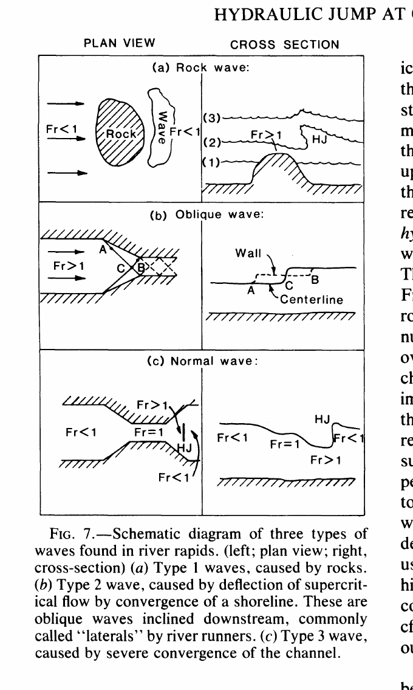

图 7. 左为俯视，右为横断／纵断示意。（a）岩石造成的浪；（b）急流受收敛岸线偏转形成下游倾斜的斜浪，行舟者常称 lateral；（c）河道强收缩造成的、近乎横跨水流的正交波与水跃。图内 HJ 指水跃。

**岩石浪。**Crystal 的第一类浪来自巨石和南岸水下岩脊延伸部。北岸直径约 0.5 m 的石头在低流量时已可能妨碍漂流艇，但主要障碍物直径约 1–2 m，包括收缩口中央的大石和乱石区顶端的“橙色石”。在上游缓流中，一块刚被淹没的石头使顶部水层变浅，而流速近似维持，于是石顶可转为急流；水流再通过石后水跃回到缓流，形成相关的浪。随流量增加，石顶水深迅速增加，速度保持近似或只缓慢增加，$Fr$ 因而下降；当它回到 1，浪被水淹平。作者举例，收缩口下游乱石区高达 2 m 的巨石浪在 10,000 ft³/s 时强、30,000 ft³/s 时中等、92,000 ft³/s 时基本消失。岩石处若本来就是急流，水深随流量的变化更难预测，波型也更复杂；北岸浅水中一些巨石呈现类似超声速物体尾迹的 V 形浪。

**斜浪与回流边界浪。**扇体使主流向南偏转、弯曲南岸又使其向北偏转，沿河可形成多道斜浪；Slate Creek 上下游突入水中的岩角也是来源。斜浪高度随 $Fr$ 增大；水流越过斜浪会显著减速，因而高速带入的可移动河床料可能沉降在下游低速区，使浪逐渐由石块稳定，长斜浪也可能由许多小石浪组成。主槽高速水流遇到缓流或静止水体，也能形成斜浪，例如高流量时主流与 Slate Creek 回流相撞。两股水流交会角或速度梯度较小时，交界可能主要表现为剪切带，行舟者称为“回流界线”（eddy fence）；交会角或速度梯度较大时可形成显著的浪，92,000 ft³/s 时主槽同类浪的瞬时高度可达约 3 m。

**收缩口后的正交波。**强收缩可使上游缓流加速，经临界流成为急流；下游扩张段产生强浪，使水流重新回到缓流。这道浪近乎与水流方向垂直，称正交波（normal wave），是一类水跃。它不一定紧贴明显障碍物，虽可能与较弱的岸边斜浪相连；位置和高度会随流量改变。1983 年 Crystal 最大的浪具有这些特征。约 20,000 ft³/s 时其波谷至波峰高约 3 m，30,000 ft³/s 时再高约 1 m；50,000–60,000 ft³/s 时行舟者报告可涌至 5–9 m，照片能证实约 5–6 m；96,000 ft³/s 时反降为约 3–4.5 m。超过 50,000 ft³/s 时，它较 1983 年以前 30,000 ft³/s 时的位置向下游移约 30 m。50,000–60,000 ft³/s 时观察者听到类似喷气机的低吼，96,000 ft³/s 时不再同样响亮，但主槽每分钟仍数次传出似炮声的巨响；声音与浪高涨落不相关，作者推测源于移动的大石。

## 正交波行为的一般分析

作者用浅水流方程分析 Crystal 的正交波，须将真实河道大幅简化（图 8a）。模型明确假设河床没有显著的局部突坎，水速变化主要来自整体河床坡降及河宽变化；扰动波长足够长，表面张力作用可忽略，水面保持大气压。模型区分六段：（0）未受收缩影响的上游均匀水流；（1）收缩口上游的汇聚段；（2）最窄断面，宽度比 $w_2/w_0$ 称河道收缩比；（3）收缩口后的扩张起始段；（4）扩张末段；（5）不受收缩影响的下游均匀水流。水跃可能隔开第 3、4 段。

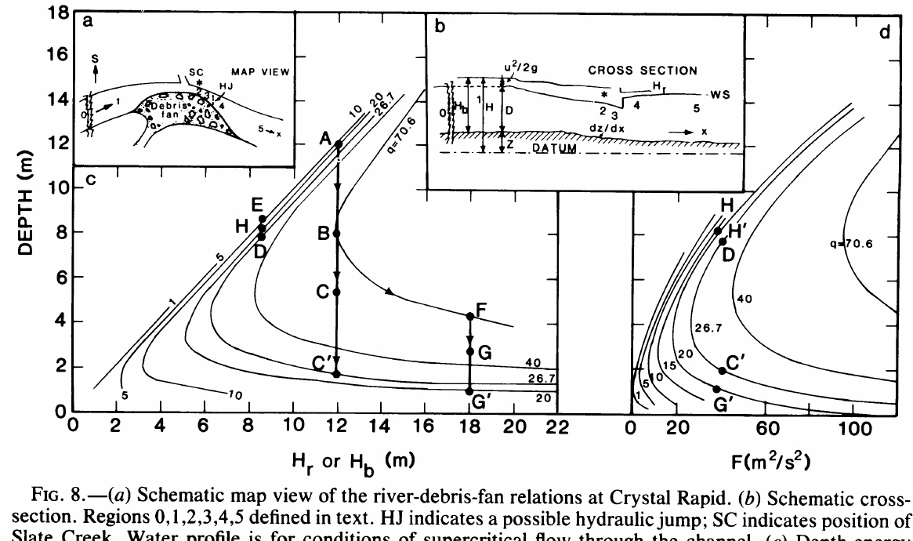

图 8. （a）河流—泥石流扇的示意俯视图，0–5 为上述水流区，HJ 为可能存在的水跃，SC 为 Slate Creek；（b）河道纵断面与水面；（c）水深—比水头图；（d）水深—动量通量相关的力图。各曲线对应不同的单位宽度流量 $q$；A–H 等路径在正文和附录中解释。

在任一断面，水流相对任意基准面的总水头为

$$
H=H_r+z,\tag{2}
$$

其中 $z$ 为河床相对基准面的高程，$H_r$ 为水流相对河床的动能水头与水深之和，即比水头（specific head／specific energy）。沿下游距离 $x$ 的能量关系为

$$
\frac{\mathrm dH}{\mathrm dx}-\frac{\mathrm dz}{\mathrm dx}=\frac{\mathrm dH_r}{\mathrm dx}.\tag{3}
$$

在水跃等不连续段以外，若可把水流视为渐变流，可用 Chézy、Manning 或 Darcy–Weisbach 关系估计水头耗散。原文在式（4）将其幅度写作

$$
\frac{\mathrm dH}{\mathrm dx}\simeq\frac{u^2n^2}{R^{4/3}},\tag{4}
$$

其中 $R$ 是水力半径，约等于水深，$n$ 是 Manning 糙率系数。科罗拉多河主槽在高流量时 $n$ 平均约 0.03，Crystal 更粗糙，作者认为可高至 0.06。令 $u\sim10$ m/s、$R\sim10$ m，得到水头变化率约 0.017，和急流上段约 150 m 内下降 2.5 m 的河床坡度量级相近。作者据此近似认为河床下降带来的势能增益与水流耗散抵消：

$$
\frac{\mathrm dH_r}{\mathrm dx}\simeq0,\qquad H_r\simeq\text{常量}.\tag{5}
$$

这一近似简化了模型，附录另用图 8c、8d 检查其影响。Bright Angel 的水深与水速量测给出表 1 的 $H_r$；依这些资料，第 0、5 段的环境水流在所列流量下均为缓流。

两个断面间的稳态连续条件是

$$
A_1u_1=A_2u_2=D_1w_1u_1=D_2w_2u_2,\tag{6}
$$

其中 $w$ 为平均河宽、$D$ 为平均水深、$Q=Au$。令单位宽度流量 $q=Q/w=Du$，则

$$
H_r=\frac{u^2}{2g}+D=\frac{q^2}{2gD^2}+D.\tag{7}
$$

给定 $H_r$ 时，式（7）关于 $D$ 有三个根，其中两个为实且正，对应图 8c 的缓流和急流分支。除水跃外若 $H_r$ 近似不变，水深的变化由 $q$ 决定；$q$ 必须小于极限 $q_{\max}$，原文式（8）为

$$
\left(\frac{q_{\max}^2}{g}\right)^{1/3}=\frac{2}{3}H_r=D_c=\frac{u_c^2}{g}\qquad(H_r\text{ 不变}),\tag{8}
$$

$D_c$、$u_c$ 是临界水深与临界速度。若 $Q/w_2>q_{\max}$，环境河流的 $H_r$ 不足以使总流量穿过最窄处，上游须形成壅水，把第 0 段的水头抬至 $H_b$（图 8b）：

$$
H_b=\frac{3}{2}\left[\frac{(Q/w_2)^2}{g}\right]^{1/3}.\tag{9}
$$

此时式（8）以 $H_b$ 替换 $H_r$。同一水头下，以临界状态分隔：缓流（$Fr<1$）水深大于 $D_c$，急流（$Fr>1$）水深小于 $D_c$。若 $Q/w_2$ 小于环境水头允许的 $q_{\max}$，第 1 段缓流经过收缩口只加速、变浅，出收缩口后再减速、加深，不必达到临界状态。若 $Q/w_2$ 超过该极限，上游壅水直至新的 $H_b$ 恰好允许该流量通过；第 0、1 段缓流在第 2 段加速至临界。若下游环境水头 $H_r$ 低于壅水水头 $H_b$，水流进入扩张段后沿急流分支扩展，再通过不连续的水跃回到环境水头。

水跃前第 3 段水深 $D_3$ 与水跃后第 4 段水深 $D_4$ 的关系，由动量守恒给出：

$$
\frac{D_4}{D_3}=-\frac{1}{2}+\left(\frac{1}{4}+2Fr_3^2\right)^{1/2},\tag{10}
$$

这里 $Fr=Fr_3$，水跃位于第 3、4 段交界。跃前跃后速度再由连续条件联系；跃后新比水头 $H'$ 满足

$$
u_4^2=2g(H'-D_4).\tag{11}
$$

跃的位置由 $H'=H_r$ 决定。作者用计算机求解，并在图 8c、8d 及附录给出图解例子。原文在式（11）前把速度联系误指为“连续方程（2）”，但式（2）为总水头定义，连续条件实际列在式（6）；译文保留公式编号，疑点见末尾备注。

## 将模型用于 Crystal Rapid

在指定流量 $Q$ 下，若已知比水头 $H_r$、上游河宽 $w_0$ 与收缩前后单位宽度流量比 $q_0/q_2$，模型的水流状态便确定。作者取第 0、5 段平均河宽 80 m，1983 年高流量开始前收缩比为 0.25，$H_r$ 用 Bright Angel 水文站表 1 的数值。首先假设全部水流都经过最窄处，于是 $q_0/q_2=w_2/w_0$；作者暂以“收缩比”称此比值，之后检验扇面漫流绕过最窄处的可能影响。图 9 显示计算的水深、水跃高度和各段速度如何随流量和收缩比变化。

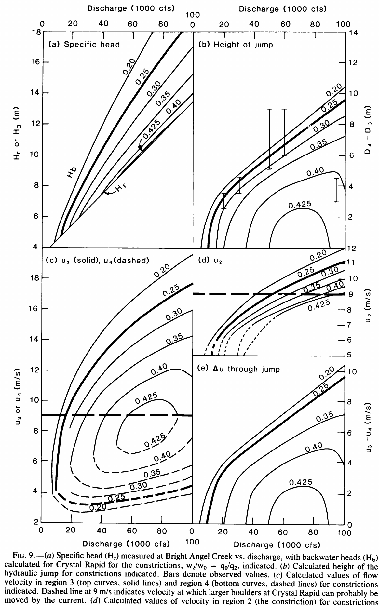

图 9. （a）Bright Angel 实测比水头 $H_r$ 与 Crystal 模型所需壅水水头 $H_b$；（b）水跃高度，竖条为观测值；（c）第 3 段跃前速度 $u_3$（实线）与第 4 段跃后速度 $u_4$（虚线）；（d）最窄处第 2 段速度 $u_2$；（e）过水跃的速度变化 $u_3-u_4$。曲线分别对应图中所标的收缩比／单位宽度流量比，粗横虚线为作者采用的约 9 m/s 大石起动阈值。

计算表明，若收缩比固定为 0.25，低于约 12,000 ft³/s 时理想化河槽应为缓流。真实急流上端的河床下降可能没有完全被能量耗散抵消，故局部仍有弱急流；图 4 在 10,000 ft³/s 时伸入急流的平顺“舌部”即提示这种状况。向下游水流通过耗散回到缓流，无须形成明显正交水跃；中槽大石仍产生图 7a 式的 Crystal Hole 石浪。

高于约 12,000 ft³/s 时，环境 $H_r$ 已不足以让全部水流通过 0.25 收缩口，需在上游形成深可达约 5 m 的壅水（图 9a）。汇聚段流动加速到临界，出收缩口成为急流，再由正交水跃回到缓流（图 9b–e）。行舟者把上游平静水体称“Crystal 湖”（Lake Crystal），然后从平顺舌部加速冲入收缩口；主水跃成为主要障碍。水跃后的下游缓流段，在低至中等流量下因乱石区露出而难行，在高流量下因石浪被淹平则可能出人意料地平顺。模型预计流量从 12,000 升至 50,000 ft³/s 时正交波向下游移动约 33 m，与观察到的约 30 m 接近。

如果河槽几何始终维持 0.25 收缩比，计算水跃高度会随流量持续增长（图 9b 粗线）。观测浪高与这种收缩口水跃模型在约 60,000 ft³/s 以前相符；再增流时，浪高却下降，没有接近固定几何条件下预期的 9–10 m。为解释下降，作者推测有效 $q_0/q_2$ 从约 0.25 升至 0.40。若扇面分流明显，绕过第 2 段的流量会使 $q_0/q_2$ 与几何比 $w_2/w_0$ 不同，即使河槽宽度不变也可能降低浪高；但扇面漫流估计最多约占总流量 10%，只能使 0.25 升到约 0.275，解释不了观察到的较大浪高下降。因此，作者认为主槽实际扩宽更有可能。

主槽若从 0.25 扩至 0.40，相当于最窄处宽约增加 12 m。可能途径有两种：南岸约束主流的回流缩小，或北岸扇体受蚀。照片显示回流尺度相对稳定，作者因此主要归因于泥石流扇侵蚀。能推动大石的流速阈值资料有限；作者外推已有研究和牵引力估计，认为移动直径 2、3、4 m 的石头分别约需 9、11、13 m/s。1983 年的模型速度恰处于这一范围：50,000 ft³/s、0.25 收缩比时，第 2 段约 9 m/s，至第 3 段可加速到 14 m/s（图 9c、9d）。这说明河道收缩对流速及可能的河岸侵蚀具有强控制作用，但这些石块阈值并非 Crystal 的直接实测。

如果主槽持续侵蚀，直至第 2 段流速降至主要巨石的起动阈值，那么模型预计在 60,000 ft³/s 时收缩比约增至 0.30，即加宽约 4 m；92,000 ft³/s 时约增至 0.40，即加宽约 12 m。前提是侵蚀在高流量持续时间内足够快。根据听到的石块碰撞声约每分钟一次、每块直径假定为 1 m，作者粗估三天可移走约 2,200 m³；若扇体远端受蚀区面积约 220 m²、高约 10 m，则最高流量维持的数日内可能后退所需的约 12 m。这是数量级估算，并非直接量测的侵蚀体积。

作者把 1966 年后扇体史分为两个时期：1983 年以前的最大流量约 30,000 ft³/s，最高岸线约到盐杉生长界；1983 年以后最大流量为 96,200 ft³/s，最高岸线约到当时保存的盐杉位置。这里的“岸线”不包含扇面慢速浅槽流，因此不等同于水尺水位。比较图 4 与图 10 的 E–E′ 岸段，并以图 5 确认高流量时该段位于收缩口和水跃之间，可见不少材料已消失；1983 年前后陡峭的河岸也被作者解释为冲出的槽壁。证据尚不足以定量证实扩宽，但支持 1983 年冲蚀显著加宽主河槽的假说。

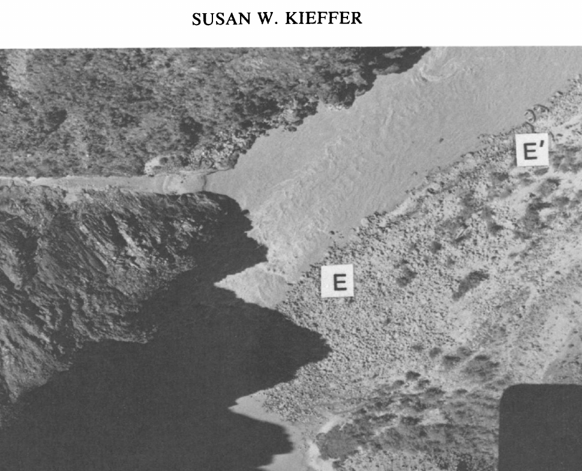

图 10. 1984 年 10 月 22 日约 6,000 ft³/s 的 Crystal Rapid 局部照片，与 1973 年约 10,000 ft³/s 的图 4a 比较。两种流量下水位近似相同，可能因为图中河床较 1973 年升高（洪后细料沉积），也可能因为河槽形状改变了流量—水深关系；作者倾向后者。图中的 E–E′ 岸段为比较侵蚀的依据。

扩宽使流速降低，第 2 段流速达到侵蚀阈值时可停止继续扩宽；但第 3 段急流在第 2 段之后仍会加速，因此即使最窄处停止受蚀，第 3 段仍可能输移巨石。模型显示，50,000 ft³/s、收缩比 0.25 时，第 2 段约 9 m/s，第 3 段水跃前约 14 m/s；60,000 ft³/s 扩至 0.30 后，第 2 段降至约 9 m/s，第 3 段仍约 13.6 m/s；90,000 ft³/s 扩至 0.40 后，第 2 段约 9 m/s，第 3 段仍约 11.6 m/s。作者据此认为，逐次更高的洪水会把槽形修整成类似喷嘴的形状，使最窄处流速维持在大石起动阈值附近，并尽量缩短高速第 3 段。92,000 ft³/s 时摄影测得皮艇从 Slate Creek 至浪谷平均约 9.8 m/s；划手路线不完全随流线，且清醒时用力划桨，所以这只能作为与所推断约 9 m/s 阈值大致相符的旁证。

过正交波时水流由第 3 段急流迅速减至第 4 段缓流。50,000 ft³/s 时模型计算的波前后速度差为 10.7 m/s（约 35 ft/s，24 mph），而在 96,000 ft³/s、收缩比约 0.41 时为 4.8 m/s。摄影测得皮艇跨浪谷—浪峰由 9.8 降至 3.3 m/s，也与模型的降速量在量级上相符。大片漂流艇撞浪骤停的照片及影片，是强减速的直观表现。作者还推测第 3 段搬运的石块会在水跃后低速第 4 段堆积；有经验的船夫报告 1983 年洪水显著改造下游乱石区，新增多块估计直径超过 2 m 的大石，定性支持这一过程。

模型尚不能解释正交波背坡为何那样陡，也未解释艇越过浪后再次加速到 8.7 m/s。大石稳定波形是一种可能，但作者于 1984 年 10 月在 6,000 ft³/s 下观察河床，未发现该位置有足够明显的堆积。皮艇沿陡背坡下行可获得部分额外速度，也可能进入了未经过主浪、但本身流速较高的水。图 11 总结作者所推定的各流量水流分区。模型算得扇体处水面随流量上升约 6.5 m，实测推估约 5.5 m；考虑模型简化、借用 Bright Angel 河床冲刷资料和高流量下地形测量不足，作者认为吻合程度较好。

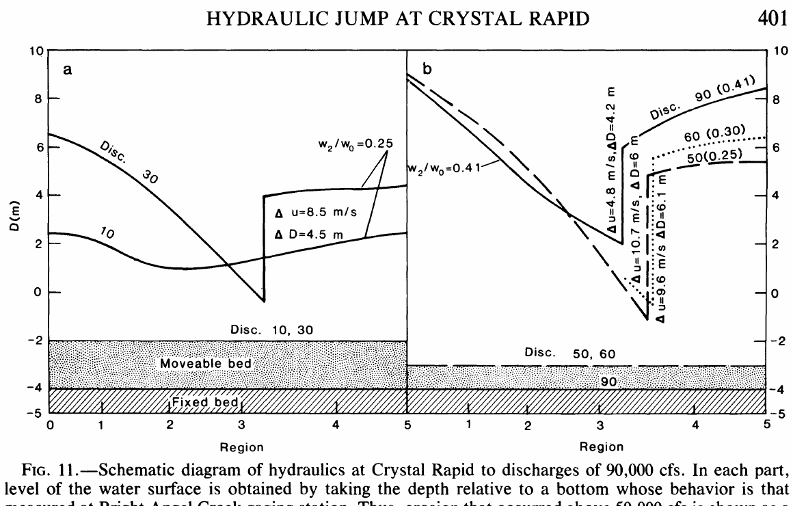

图 11. Crystal Rapid 至约 90,000 ft³/s 的示意水流分区。10,000 ft³/s 为缓流、30,000 ft³/s 出现急流，二者收缩比仍取 0.25；50,000、60,000、90,000 ft³/s 的河道依文中侵蚀假设扩宽，以使第 2 段速度约保持 9 m/s。每个急流案例还标出水跃高度和跃前后速度差。河底下降代表作者从 Bright Angel 类比的冲刷。

## 对河流泥石流扇演化的启示

科罗拉多河及其支流之间的动态相互作用，曾由 Howard、Dolan、Graf 等研究。支流峡谷附近常见的深潭—急流序列，是支流偶发大洪水在河口堆出扇体、主河偶发大洪水再改造它的结果；这两类事件的时间尺度可能约为 $10^2$–$10^4$ 年。支流洪水使主河床在扇体处升高、壅水，可暂称“湖—瀑”阶段。随后主河洪水带走扇体细料，并把部分粗料向下游搬运，使支流沉积坝受蚀变低、坝下河床因沉积升高。Crystal 在 1966–1984 年的事件支持这一总体序列；本文模型进一步解释扇体内部的收缩口和高速段如何被改造。

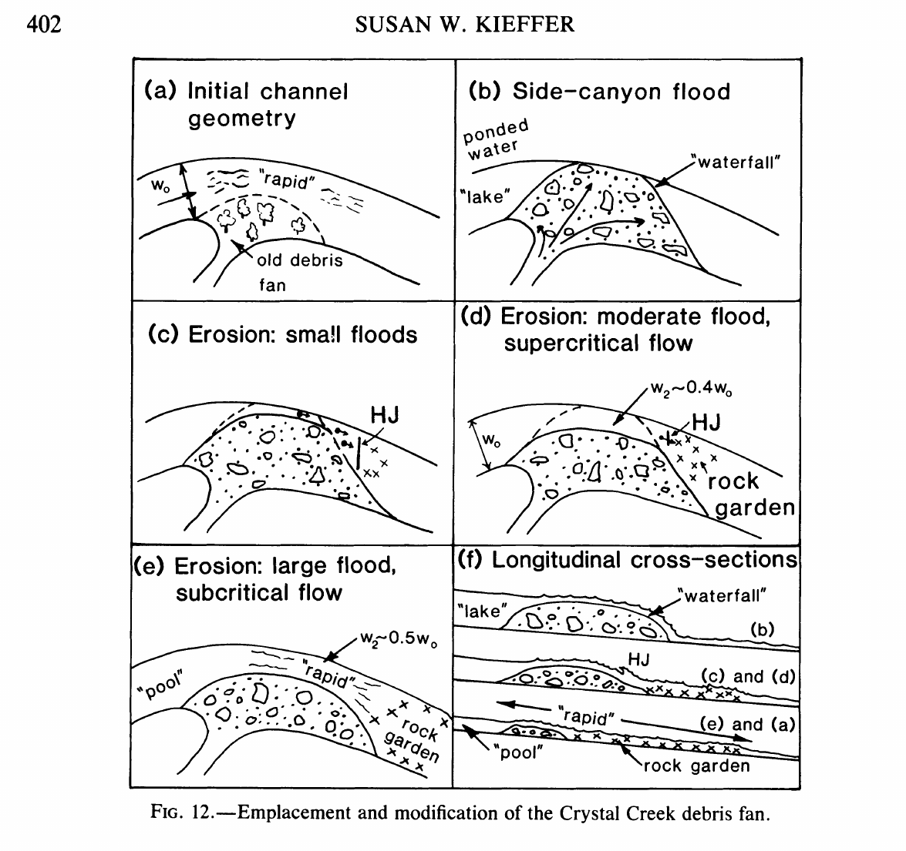

图 12. 一个可能反复发生的循环。（a）主河相对宽畅；（b）支流洪水堆出扇体，形成上游“湖”与下游“瀑”；（c）小洪水冲出窄槽；（d）中等洪水加宽、局部仍为急流与水跃；（e）大洪水进一步加宽，水流可能全程转为缓流；（f）纵断面显示主槽下切与溯源侵蚀如何同时改变坡降。图中的 HJ 为水跃，rock garden 为乱石区。

图 12 从一条相对宽畅的主槽（a）开始；突发支流洪水堆成扇体，阻断并壅起主河，扇面相当于模型中的“瀑”（b）。壅水漫过沉积坝后，一般在扇体远端冲出通道（c），开始从“瀑”演化为“急流”。若最初突破没有直接冲开大缺口，收缩比先很小。不同大小、频率的主河洪水再逐次拓宽水道：小洪水拓宽有限，仍有明显急流，如 Glen Canyon Dam 的常规年流量使 Crystal 在 1966–1983 年保持约 0.25 收缩比；中等洪水进一步加宽，使较低流量下只剩弱急流，甚至恢复缓流，如 1983 年高流量使 Crystal 在 20,000–30,000 ft³/s 下原先典型的浪变弱；罕见大洪水还可能使所有流量下均为缓流，但 Crystal 尚未达到此状态。

河槽横向扩宽的同时，槽底下切、槽头溯源侵蚀也会改变局部坡度（图 12f），并可能生成新浪。作者以 Crystal 新出现的强入口斜浪为例，提出原本散布在收缩口大部分长度内的约 2–3 m 河床落差，被横向扩宽水槽向上游溯源后集中到急流顶部一小段；这是解释该浪成因的假说。由此，Crystal 一类急流逐渐分成原始扇体，以及其下游由再搬运石块组成的乱石区。早期强收缩造成第 2、3 段高流速，大石从这些位置被带走，在正交水跃后较慢的第 4 段堆积。水跃位置随流量及收缩比改变，所以乱石区可在较长河段不断重组；Crystal 从最窄处至乱石区最远端约有 1 km。1983 年乱石区改变的目击报告与这种机制相容。

最高流量后河槽的最终形态可能有两种。其一，水道扩宽到第 2 段速度低于侵蚀阈值时便停止扩宽，但几何仍要求急流和水跃；第 3 段如果仍够快，可继续改造扇体下游。其二，扩宽过程中速度持续足以侵蚀，直到河道宽到可通过缓流。哪一种发生，取决于急流上、下游的相对水头及河床料起动阈值。作者的后续计算认为，大峡谷科罗拉多河多数扇体更可能走向第二种。演化到某一阶段，河流与扇体从“湖—瀑”格局转为“深潭—急流”格局；主河与支流的大洪水若反复出现，循环又可重新开始。

地质时间任一时刻的扇体旁主河道形状，大体反映该扇体最近一次形成之后主河**最大**洪水的冲刷结果；细粒暂时沉积可部分掩盖这种大尺度侵蚀。图 2 中多数扇体的收缩弱于 1983 年前的 Crystal，提示它们曾经历比 Crystal 更大的流量，即超过约 100,000 ft³/s。已知 1921 年有约 220,000 ft³/s 的洪水，1884 年估计约 300,000 ft³/s；扇体存在时间可能超过 $10^4$ 年，因此发生过更大洪水也有可能。作者明确限定，这些分析针对仍受支流供料的较新、活跃扇体，不适用于气候条件可能不同的更古老河岸阶地。

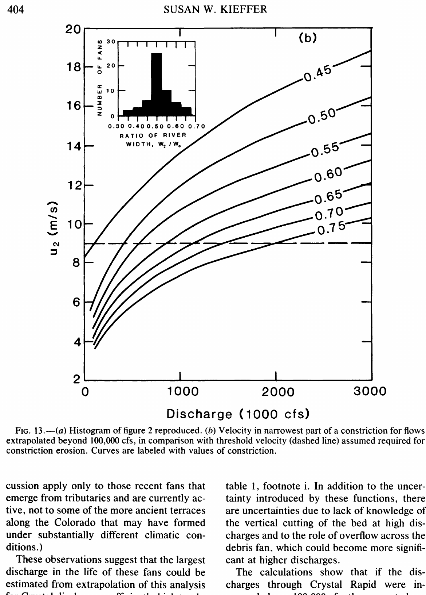

图 13. （a）重绘图 2 的收缩比分布；（b）将不同收缩比下最窄处流速 $u_2$ 随流量的关系外推超过 100,000 ft³/s，横向虚线为假定的约 9 m/s 巨石起动阈值。纵、横轴和曲线标签按原图保留。

作者将 Crystal 的模型外推到可能使河道收缩比达到 0.50 的更大流量（图 13），并假设每次洪水期间侵蚀都足够快，能把第 2 段速度降到巨石起动阈值。外推使用表 1 注释中的水深、水速、比水头幂函数，因而受到拟合函数在测量范围外的不确定性限制；高流量河床下切与扇面漫流的作用也未知。按模型，若 Crystal 流量超过 100,000 ft³/s，当前约 0.40 的收缩比不足以阻止第 2 段速度超过阈值。举例说，若流量达到 300,000 ft³/s，而收缩比仍为 0.41，$u_2$ 会达 10.6 m/s；若河槽扩宽至 0.47，速度可降回约 9 m/s，水跃和急流段将消失。要达 0.50 收缩比，流量须略高于 400,000 ft³/s（11,320 m³/s）。如果图 2 中其他扇体遵循相近机制，这便是它们形成以来大峡谷最大洪水量级的估计，不能视为直接测得的洪峰。

模型还显示，河槽加宽到约 0.45 收缩比时，即使最高流量下也不再出现显著急流，因此不再有此类正交波。这与大峡谷主河在 Crystal 以外很少有正交波的观察相符；局部急流顶部若势能增益与耗散不完全相抵，仍可能有弱急流。多数扇体的 $w_2/w_0$ 接近 0.5，考虑急流规模、扇体大小和组成及河段落差各不相同，这种一致性值得注意。但扇体间的差异可能来自石块粒径或胶结程度引起的侵蚀阈值变化、不同河段的比水头变化、洪水史与临时堵河事件差异，以及扇体年龄不同；改进洪峰估计须逐一考察。

作者最后认为，科罗拉多河能自行调整绕过扇体的河槽形状，大概解释了大峡谷约 400 km 河段多数大型扇体旁相近的收缩比。1983 年 Crystal Creek 扇体处的高速急流和侵蚀，使当地河槽更接近自然主河洪水仍频繁发生时可能形成的状态。这是建立在简化几何与阈值假设上的地貌推断。

## 致谢

作者感谢美国地质调查局亚利桑那州 Flagstaff 工作人员，特别是 E. Buell 提供 Bright Angel 水文站资料及水文学讨论；众多行舟者提供各水位的描述，Robert Melville 的照片记录尤其重要。美国国家公园管理局的 John Thomas 安排 1983 年 6 月 27 日直升机抵达现场，Curt Sauer 安排 1984 年 10 月 22–24 日在放流降至 6,000 ft³/s 时访问。作者亦感谢 E. D. Andrews、E. Buell、P. Delaney、R. Hereford、H. Shaw、R. Shreve、B. Sturtevant 的审阅和 G. Billingsley 的讨论。原文列出的主任批准日期为 1984 年 7 月 19 日。

## 附录：深度—能量图与深度—力图的算例

作者以 50,000 ft³/s（1,415 m³/s）的 Crystal 河槽作例，假设宽度由 80 m 收至 20 m。先取比水头沿程不变，则第 0 段 $q_0=17.7$ m²/s，第 2 段 $q_2=70.6$ m²/s。环境河水头 $H_r=8.4$ m，不足以让 $70.6$ m²/s 通过收缩口，于是上游壅水使水头升至 12 m（图 8c 的 A）。收缩口处水深达到临界值 8.0 m，临界速度 8.8 m/s；进入扩张段后沿 B–C–C′ 路径变为急流。C′ 处的水跃把壅水头降回下游环境头 8.4 m。

图 8d 可由跃前状态求跃后共轭状态：C′ 处跃前深 $D_3=1.9$ m，$q_3=26.7$ m²/s；对应跃后点 D 的深度为 7.9 m，水跃高度约 6 m。点 D 再投回图 8c，恰为所需的 8.4 m 水头；随后水流沿缓流分支扩张至下游环境状态 E。

若河床下降所释放的势能没有完全耗散，比水头可能沿程增加。作者用另一条极端路径 A–B–F 示范：假设水在最窄段内净增 6 m 水头，这比 Crystal 合理估计的势能增益约大一倍。在 F 点水流成为 $Fr=2.5$ 的急流，水深 4.3 m，速度 16.4 m/s；扩张段沿 F–G–G′ 到可形成水跃、把 18 m 水头降回 8.4 m 的状态。与上述方法相同，把 G′ 投到深度—力图，得到共轭水深约 8.1 m，再沿扩张段返回 E。即使在这个极端假设中，计算水跃高度与不计河床势能净增时也只差约 1–2 m。现有观测不足以区分两种模型，故正文使用 $H_r$ 近似恒定的简化情形。

## 参考文献

参考文献题名保留原文，以便追溯；书目按原文顺序列出。

- Blatt, H., Middleton, G., & Murray, R. (1972). *Origin of Sedimentary Rocks*. Englewood Cliffs, NJ: Prentice Hall, 634 pp.
- Brater, E. F., & King, H. W. (1976). *Handbook of Hydraulics*. New York: McGraw-Hill.
- Collins, R. O., & Nash, R. (1978). *The Big Drops: Ten Legendary Rapids*. San Francisco: Sierra Club Books, 215 pp.
- Cooley, M. E., Aldridge, B. N., & Euler, R. C. (1977). Effects of the catastrophic flood of December 1966, north rim area, eastern Grand Canyon, Arizona. *U.S. Geological Survey Professional Paper* 980, 43 pp.
- Dolan, R., Howard, A., & Gallenson, A. (1974). Man's impact on the Colorado River in the Grand Canyon. *American Scientist*, 62, 392–401.
- Dolan, R., Howard, A., & Trimble, D. (1978). Structural control of the rapids and pools of the Colorado River in the Grand Canyon. *Science*, 202, 629–631.
- Graf, W. L. (1979). Rapids in canyon rivers. *Journal of Geology*, 87, 533–551.
- Graf, W. L. (1980). The effect of dam closure on downstream rapids. *Water Resources Research*, 16, 129–136.
- Helley, E. J. (1969). Field measurement of the initiation of large bed particle motion in Blue Creek near Klamath, California. *U.S. Geological Survey Professional Paper* 562-G, 19 pp.
- Hereford, R. (1981). Driftwood in Stanton's Cave: A case for temporary damming of the Colorado River at Nankoweap Creek in Marble Canyon. In R. C. Euler (Ed.), *The Archaeology, Geology, and Paleobiology of Stanton's Cave*, Grand Canyon Natural History Association Monograph 6, 99–106.
- Howard, A. D., & Dolan, R. (1979). Changes in the fluvial deposits of the Colorado River in the Grand Canyon caused by Glen Canyon Dam. In R. M. Linn (Ed.), *Proceedings of the First Conference on Scientific Research in the National Parks*, U.S. National Park Service, 845–851.
- Howard, A. D., & Dolan, R. (1981). Geomorphology of the Colorado River in the Grand Canyon. *Journal of Geology*, 89, 269–298.
- Leopold, L. B. (1969). The rapids and the pools—Grand Canyon. *U.S. Geological Survey Professional Paper* 669, 131–145.
- Loh, W. H. T. (1969). Theory of the hydraulic analogy for steady and unsteady gas dynamics. In W. H. T. Loh (Ed.), *Modern Developments in Gas Dynamics*. New York: Plenum, 1–61.
- Richards, K. (1983). *Rivers: Form and Process in Alluvial Channels*. London: Methuen, p. 58.
- Rouse, H. (1950). *Engineering Hydraulics*. New York: John Wiley, 1,039 pp.
- Rouse, H., Bhoota, B. V., & Hsu, E. (1951). Design of channel expansions. *Transactions of the American Society of Civil Engineers*, 116, 347–363.
- Shoemaker, E. M., & Stevens, H. G. (1969). The Green and Colorado River canyons observed from the footsteps of Beaman and Hillers 97 years after Powell. *Geological Society of America Abstracts*, Rocky Mountain Section, p. 73.
- U.S. Geological Survey. *Water Resources Data, Arizona* (1980 and annual Water-Data Reports AZ-(year)). Tucson, AZ.
- Wolf, T. J. (1983, December 12). *High Country News*, 15(22), 10–14.

## 校订备注

- 水跃前后的局部水速是简化模型推算，92,000 ft³/s 时的 8.5、9.8、8.7、3.3、8.5 m/s 来自拍摄皮艇所得的艇速；两类速度不可逐点等同。扇体扩宽约 12 m、巨石起动阈值约 9 m/s 和史前洪峰约 400,000 ft³/s 均有模型假设及资料外推的不确定性。
- 原文式（11）前将跃前跃后速度的连续关系指向“式（2）”，但式（2）是总水头定义，连续方程列在式（6）。正文保留原式编号，按物理含义解释。
- 原文令 $x$ 向下游增加，却在式（4）把沿程耗散写成正的 $\mathrm dH/\mathrm dx$；下游总水头降低时，该有符号导数应为负。式（4）及其与河床坡度的比较只能按耗散量的绝对值理解，不能直接把所写正号代入式（3）。
- 作者把图 2 中航拍水面宽度比与理想化深水主槽收缩比明确区分；Crystal 前者约 0.33、后者估约 0.25。二者不能用于互相替代。
- 在约 10,000 ft³/s 时，正文称最窄处水面宽约 35 m，图 4 图注却称约 29 m；以约 87 m 上游宽度相除分别得到约 0.40 和 0.33。图 2 采用 0.33，模型另采用理想化主槽的 0.25；译文保留各处原数值。
