# 水跃及相关现象的现有认识：实验结果综述

Hubert Chanson，昆士兰大学土木工程系，澳大利亚布里斯班。原文：*Current knowledge in hydraulic jumps and related phenomena. A survey of experimental results*，*European Journal of Mechanics B/Fluids*，28（2009）：191–210。DOI：10.1016/j.euromechflu.2008.06.004。2007 年 12 月 10 日收稿，2008 年 6 月 12 日修订，6 月 23 日接受，7 月 1 日在线发表。本文源于作者在第 16 届澳大拉西亚流体力学会议上的大会报告［95］。

## 摘要

水跃是高速明渠流突然转变为缓流的现象。其一维流动性质可由连续性和动量原理求解。本文综述紊流水跃的近期进展：不破碎的波状水跃、正涌浪与涌潮，以及具有旋滚区的水跃中的气泡卷入。综述表明，水跃是一种复杂的紊流运动；尤其在环境与地球物理流动的尺度上，现有认识仍不充分。

**关键词：**水跃；波状水跃；正涌浪；涌潮；非恒定紊流；气泡卷入；布辛涅斯克方程；两相流性质；动力相似；尺度效应。

## 1. 引言

水跃常见于河流、渠道、工业和制造过程，甚至厨房水槽。它是明渠超临界流突然过渡到亚临界流的过程。对水平矩形渠道，忽略边界摩擦时，连续性和动量原理给出［1］：

$$
\frac{d_2}{d_1}=\frac{1}{2}\left(\sqrt{1+8Fr_1^2}-1\right).\tag{1}
$$

$$
\frac{Fr_2}{Fr_1}=\frac{2^{3/2}}{\left(\sqrt{1+8Fr_1^2}-1\right)^{3/2}}.\tag{2}
$$

下标 1、2 分别表示上游、下游流况；弗劳德数 $Fr=V/\sqrt{gd}$，$d$ 为水深，$V$ 为流速，$g$ 为重力加速度。入流水弗劳德数 $Fr_1=V_1/\sqrt{gd_1}$ 始终大于 1，水跃通常据此分类［1,2］。$Fr_1$ 略大于 1 时，自由液面平滑抬升，其后接一列静止的液面波动，形成波状水跃（图 1A）。较大的 $Fr_1$ 则产生明显的旋滚区、大尺度涡旋、显著动能耗散与含气两相流区（图 1B）。水跃的非恒定形式为正涌浪，也称平移水跃。文末附相关术语释义。

水跃流体力学的重要早期贡献包括 Bidone 的物理模型［11］、Bélanger 的动量原理理论解［1］、Darcy 与 Bazin 的实验［10］（图 2）、Boussinesq 的解［12］以及 Bakhmeteff 的研究［13］；参见综述［14］。入流雷诺数 $Re=\rho V_1d_1/\mu$ 极低时可能出现层流水跃［15］，但多数情形为紊流。图 1 给出两个紊流水跃实例。

本文以实验结果说明环境和地球物理流动中水跃的复杂特征。先讨论不破碎的波状水跃，再讨论平移水跃，即正涌浪和涌潮，最后讨论带旋滚区水跃的气泡卷入、物理模型、动力相似与尺度效应。

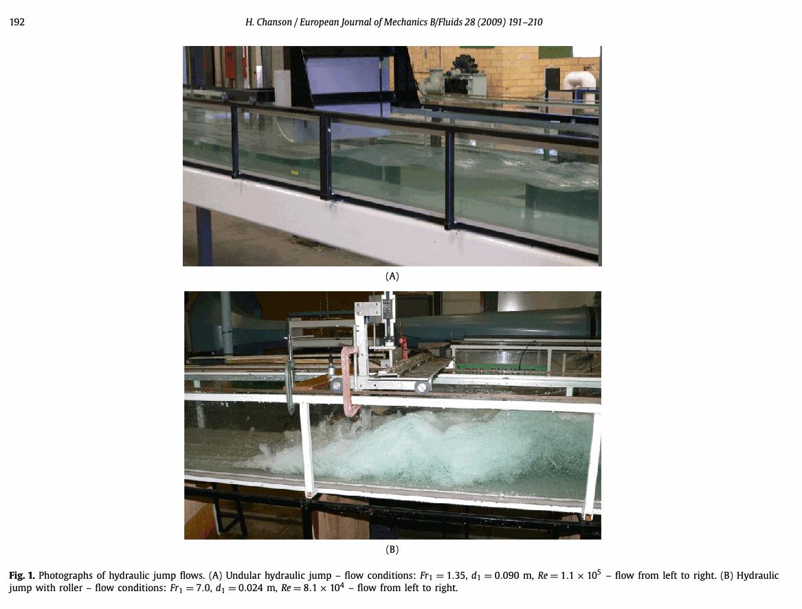

图 1. 水跃照片。（A）波状水跃，$Fr_1=1.35$、$d_1=0.090\,\mathrm m$、$Re=1.1\times10^5$；（B）带旋滚区的水跃，$Fr_1=7.0$、$d_1=0.024\,\mathrm m$、$Re=8.1\times10^4$。两图水流均由左向右。

## 2. 波状水跃

波状水跃的特征是自由液面平滑抬升，其后出现形态清楚的驻定波列（图 1A、2B、3）。天然水道和河流的河床坡度转折处有时会出现这种现象。澳大利亚北部的“晨光云”也是相关现象，有时被称为大气波状水跃［16,17］。

多数水力学与流体力学教材在明渠流章节略过波状水跃。Darcy 与 Bazin［10］、Bakhmeteff 与 Matzke［18］、Binnie 与 Orkney［19］等早期水跃研究包含部分波状水跃案例（图 2）。Fawer［20］曾清楚描述其主要特征，但这一贡献被忽视了数十年。后来的研究包括 Montes［21］、Ryabenko［22］、Chanson 与 Montes［3］、Montes 与 Chanson［4］及 Ohtsu 等［6］。这些研究表明，波状水跃可能出现于入流弗劳德数从刚超过 1 到 3～4 的范围。本文重新分析表 1 所列近期实验。

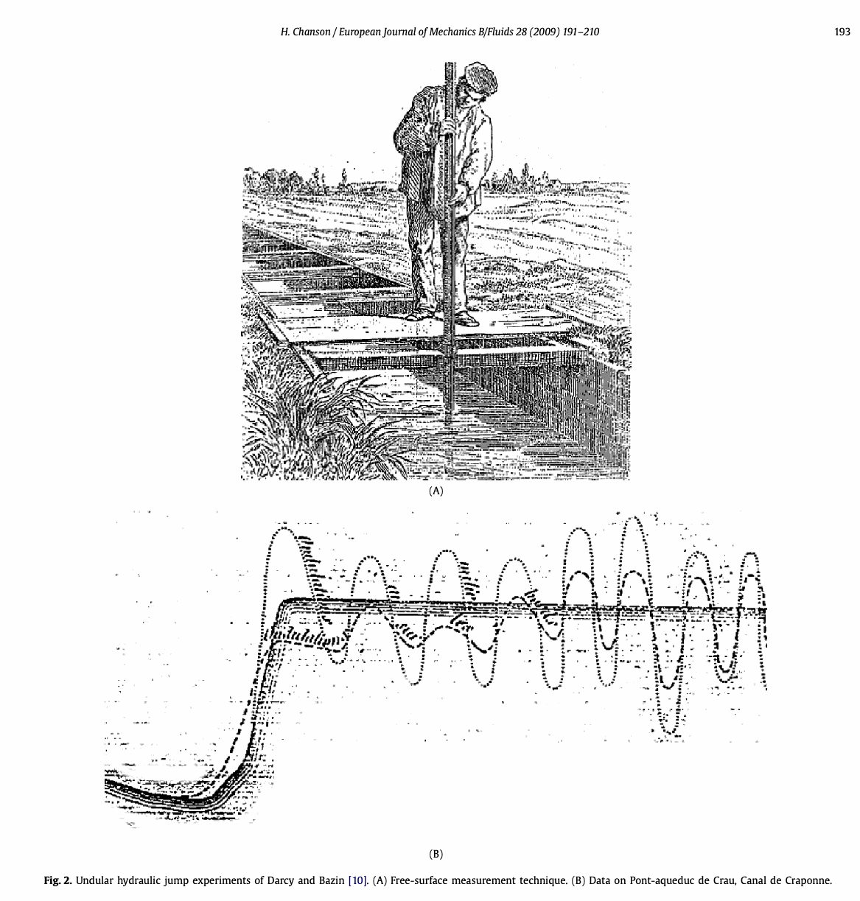

图 2. Darcy 与 Bazin［10］的波状水跃实验。（A）自由液面测量方法；（B）Pont-aqueduc de Crau、Canal de Craponne 的数据。

**表 1. 近期波状水跃实验研究。** F/D 为充分发展入流，P/D 为部分发展入流；$L$ 为渠道长，$B$ 为渠宽。

| 研究 | 渠道与入流 | 测量仪器 |
|---|---|---|
| Chanson 与 Montes［3］ | $L=20\,\mathrm m$，$B=0.25\,\mathrm m$，F/D | 普朗特–皮托管（直径 3.3 mm） |
| Montes 与 Chanson［4］ | $L=12$～$20\,\mathrm m$，$B=0.2$～$0.3\,\mathrm m$，F/D | 普朗特–皮托管 |
| Chanson［5］ | $L=20\,\mathrm m$，$B=0.25\,\mathrm m$，F/D | 皮托–普雷斯顿管（直径 3.3 mm） |
| Ohtsu 等［6］ | $L=5$～$20\,\mathrm m$，$B=0.1$～$0.8\,\mathrm m$，P/D 与 F/D | 微型螺旋桨（直径 3 mm）、普朗特–皮托管、一维激光多普勒测速仪 |
| Chanson［7］ | $L=3.2\,\mathrm m$，$B=0.5\,\mathrm m$，P/D | 普朗特–皮托管（直径 3.3 mm） |
| Lennon 与 Hill［8］ | $L=4.9\,\mathrm m$，$B=0.3\,\mathrm m$，F/D | 粒子图像测速仪 |
| Ben Meftah 等［9］ | $L=15\,\mathrm m$，$B=4\,\mathrm m$，F/D | 声学多普勒流速仪 |

### 2.1 自由液面波的特征

目视观察与详细液面测量表明，除侧壁附近外，波状水跃基本呈二维形态（图 3）。液面波动近似周期性，但纵向剖面既非正弦波也非椭圆余弦波。图 3B 是 $Fr_1=1.26$ 的无量纲液面剖面，$x$ 从上游闸门起算，$d$ 为水深，临界水深 $d_c=\sqrt[3]{Q^2/(gB^2)}$，$Q$ 为流量，$B$ 为渠宽。测量位置包括渠道中心线 $z=0$ 及三个横向位置。第一波峰上游以及有时在下游波峰紧上游，可见侧壁横波（图 3A）；它们与侧壁的夹角较小。图 4、5 分别给出第一液面波在不同 $d_c/B$ 下的振幅与波长，以及侧向激波初生时的弗劳德数和激波与侧壁的夹角。

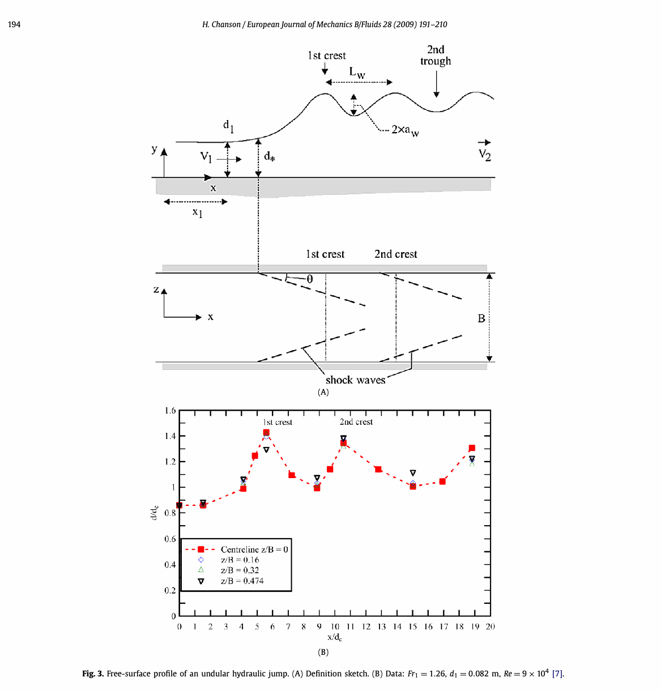

图 3. 波状水跃自由液面剖面。（A）定义示意图；（B）$Fr_1=1.26$、$d_1=0.082\,\mathrm m$、$Re=9\times10^4$ 的实验数据［7］。

**表 2.** 第一波的最大振幅 $(a_w)_{\max}/d_1$ 及对应的入流弗劳德数［23］。

| $d_c/B$ | $(a_w)_{\max}/d_1$ | $(Fr_1)_{\max}$ |
|---:|---:|---:|
| 0.14 | 0.64 | 1.68 |
| 0.17 | 0.46 | 1.58 |
| 0.22 | 0.42 | 1.51 |
| 0.225 | 0.34 | 1.47 |
| 0.28 | 0.27 | 1.39 |
| 0.35 | 0.23 | 1.275 |
| 0.40 | 0.18 | 1.30 |
| 0.46 | 0.18 | 1.275 |

波的性质随 $Fr_1$ 和相对宽深比 $d_c/B$ 而变。$Fr_1$ 刚超过 1 时，波长和振幅与布辛涅斯克方程的解［25］相近（图 4A、4B）；随 $Fr_1$ 增大，两者均偏离该解。振幅在 $Fr_1=1.3$～$1.9$ 之间达到局部最大，具体取决于宽深比（图 4A、表 2）。图 4 所示数据的最大振幅对应 $Fr_1=1.27$～$1.7$，而液面波动在 $Fr_1=1.5$～$3$ 消失（图 3）。渠道相对宽度增大、$d_c/B$ 减小时，波动消失所需的特征弗劳德数增大。综合包括俄罗斯和意大利约 4.5 m、4 m 宽渠道在内的实验，波动消失时的 $Fr_1$ 可在 1.5～4 之间，并随 $d_c/B$ 减小而增大［9,22］。

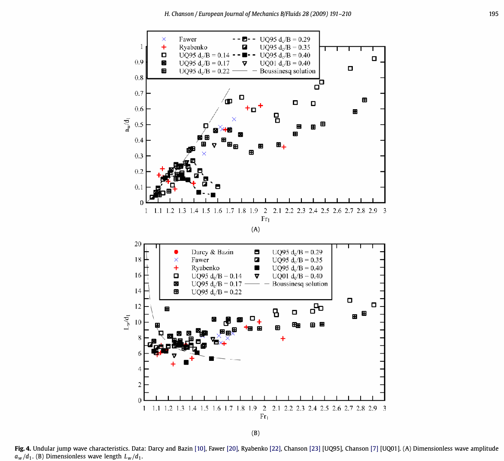

图 4. 波状水跃波形参数。数据来自 Darcy 与 Bazin［10］、Fawer［20］、Ryabenko［22］、Chanson［23］和［7］。（A）无量纲波幅 $a_w/d_1$；（B）无量纲波长 $L_w/d_1$。

侧向激波是另一个重要特征。它们起始于第一波峰上游，横穿渠道向下游传播（图 3A）。Montes［21］推测侧向激波与侧壁边界层有关：侧壁附近的流体减速，使该处比渠心更早达到临界状态。Chanson［23］则认为它们是侧壁流动分离的表现，因为在激波紧下游、液面附近观察到回流。

图 5 中，侧向激波初生处的流动弗劳德数 $Fr^*$ 和夹角 $\theta$ 均以 $Fr_1$ 为自变量。令 $Fr^*=q/\sqrt{g(d^*)^3}$，其中 $d^*$ 为侧壁激波初生处的水深（图 3A），$q$ 为单位宽度流量。斜向水跃初生于仍为超临界流的区域，数据满足：

$$Fr^*=Fr_1-0.119.\tag{3}$$

夹角随 $Fr_1$ 增大，且基本不受 $d_c/B$ 影响；实验相关式为：

$$\theta=28.1Fr_1^{0.38}.\tag{4}$$

式（4）与图 5B 的数据比较。它与超临界流激波的角度计算值在数值上接近［24,32］，趋势却相反：在超临界流中，激波在高速超临界流上方传播，$\theta$ 随弗劳德数增大而减小；波状水跃中的激波则在亚临界流上方传播，$\theta$ 随弗劳德数增大而增大。

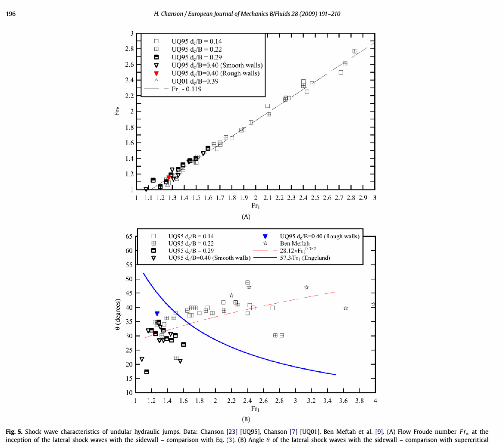

图 5. 波状水跃的侧向激波特征［7,9,23］。（A）侧壁激波初生处 $Fr^*$ 与式（3）的比较；（B）侧向激波与侧壁的夹角 $\theta$，并与超临界流激波结果比较。

### 2.2 波状水跃内的流速和压力分布

液面波动之下，波峰与波谷之间的压力场和速度场迅速重新分布。图 6 给出 $Fr_1\approx1.6$ 时的典型无量纲分布，并与布辛涅斯克方程的无黏解［4］比较。压力分布不符合静水压假设：液面向上弯曲、呈凹形时，压力梯度大于静水压梯度；液面呈凸形时则小于静水压梯度。无旋流理论可预示这一趋势［33,34］，但实验测得的偏离更大。第一波峰下的速度分布与理论预测相差显著（图 6A）。该实验中，第一波峰下存在 Montes［21］描述的回流区。更一般地，第一波峰紧上游的速度发生较大幅度的重新分布［3,7,8］，第一波的流场与后续波峰明显不同。再往下游，实验与理论的一致性改善（图 6）；表 1 各实验呈现相同趋势。

在一项实验中，研究者分别于波峰、波谷的上游和下游测量速度与压力，发现两侧始终不对称，在形状或数值上都不能精确对应［7］。在近床底 $y/d_c<0.3$ 的区域，从波峰至波谷的流动加速幅度，大于从波谷至波峰的对应减速幅度。数据还提示，第一波峰紧上游存在压力、速度场的大幅重分布，伴随逆压梯度、侧壁横波初生和明显的边界层发展。对随上游水流运动的观察者，这一区域仿佛产生下游液面波动的“准造波器”。

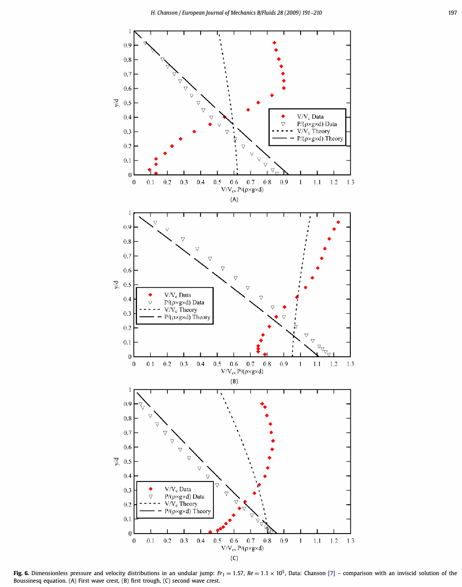

图 6. 波状水跃的无量纲压力与流速分布：$Fr_1=1.57$、$Re=1.1\times10^5$；Chanson［7］数据与布辛涅斯克方程无黏解的比较。（A）第一波峰；（B）第一波谷；（C）第二波峰。

### 2.3 讨论

一些研究者借用在静水中传播的波状涌浪来类比波状水跃，但结论有时互相冲突［25,35–37］。Montes［38］首先指出，此类比忽略了实际流况：波状水跃的渠底和侧壁上均有部分或充分发展的紊流边界层；其纵向范围很长，忽略底部和侧壁摩擦并不现实。Montes［21］与 Ryabenko［22］的独立研究否定了两者可直接类比的看法。他们还提出，波状水跃向弱水跃的过渡可能发生在 $Fr_1=1.0$～$3.6$，具体取决于上游流况、宽深比及床面粗糙度。相较之下，波状涌浪在涌浪弗劳德数超过约 1.5～1.8 时消失［2,29,30,33］。

Henderson［2］、Rajaratnam［39］、Leutheusser 与 Schiller［40］及 Chanson［5］讨论了底部、侧壁粗糙度的作用。实验［2,40］提示，与光滑床面相比，粗糙床面上的波状流可出现于更宽的弗劳德数范围。Chanson［5］还发现侧壁摩擦改变激波形成过程，并显著影响波谷下的速度分布。表 1 包含近年使用的激光多普勒测速、粒子图像测速和声学多普勒测速方法；它们仅记录速度场。由于波状流中的压力梯度不是静水压梯度，详细实验还应同时测量压力与流速。经适当标定后，传统普朗特–皮托管仍是可同时记录速度、压力、总能量及床面剪应力的仪器［5,41］。

## 3. 正涌浪与涌潮

正涌浪常见于人工渠道；河口涌潮是相关的自然现象（图 7）。正涌浪的形成和发展通常借助特征线法及圣维南方程预测［42］。形成之后，涌浪锋面前后的流况须满足连续性和动量原理［2,34,43,44］。以 $Fr=(V+U)/\sqrt{gd}$ 定义涌浪弗劳德数时，式（1）、（2）同样适用；$U$ 是相对于岸上静止观察者的锋面传播速度。充分发展的正涌浪也称平移水跃。

水力学家和应用数学家已研究正涌浪数百年；重要贡献包括 Barré de Saint-Venant［42］、Boussinesq［12］以及较近的 Lemoine［35］、Serre［36］、Benjamin 与 Lighthill［45］。若干研究讨论其发展过程［46–49］。波状涌浪的经典实验包括 Darcy 与 Bazin［10］、Favre［26］、Zienkiewicz 与 Sandover［50］、Sandover 与 Holmes［51］、Benet 与 Cunge［27］；Ponsy 与 Carbonnell［52］及 Treske［28］较完整地描述了大型梯形渠道内的正涌浪。相关综述有［45,53,54］；近期数值研究包括定常水跃［55］和向前传播的涌浪［56–58］。

迄今，大多数实验限于目视观察，有些测量自由液面。图 8A 给出包含 Dee 河涌潮数据在内的波幅，图 8B 比较波状涌浪与波状水跃的波陡 $a_w/L_w$。除少数研究［29,59,60］外，以往很少测量紊流。下文重新分析大型实验设施中获得的液面和紊流速度数据［29,30］，刻画前进锋面、其中的非恒定紊流速度场及伴随的混合过程。

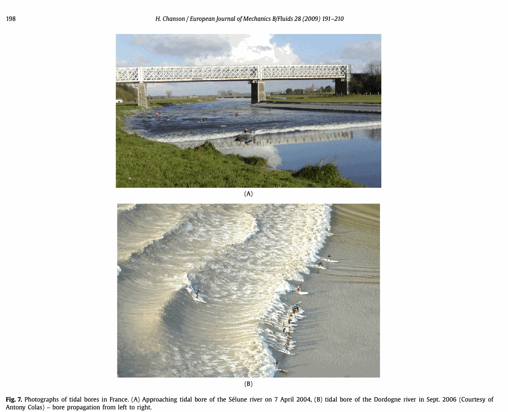

图 7. 法国河流涌潮。（A）2004 年 4 月 7 日 Sélune 河逼近的涌潮；（B）2006 年 9 月 Dordogne 河的涌潮（Antony Colas 提供）。后图锋面由左向右传播。

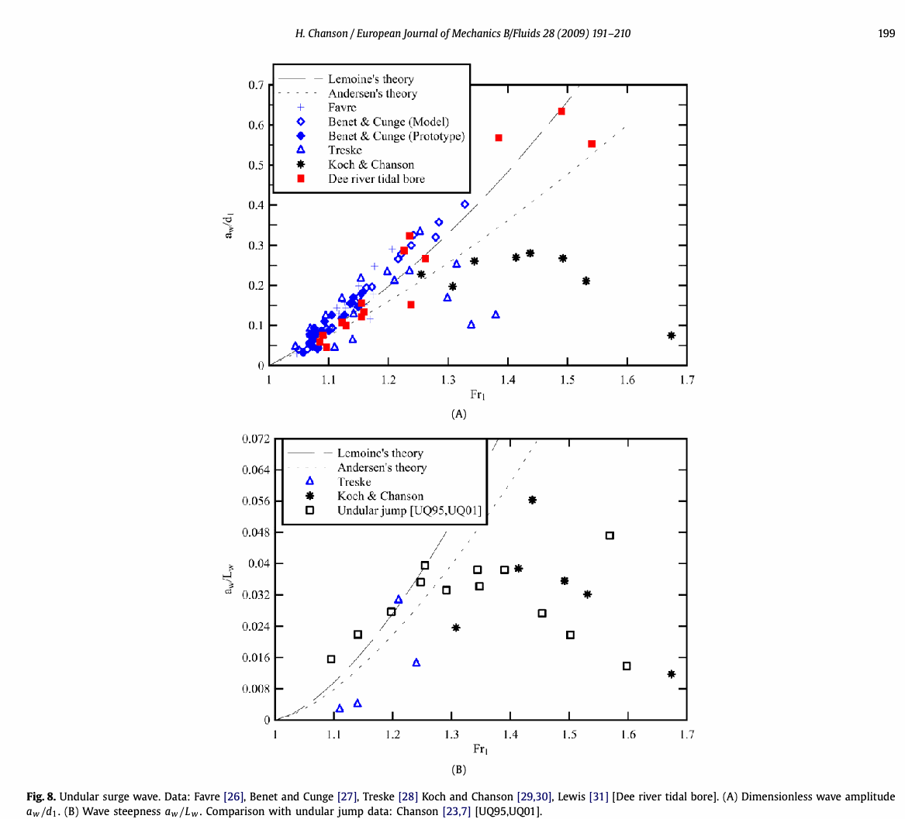

图 8. 波状涌浪波形。数据来自 Favre［26］、Benet 与 Cunge［27］、Treske［28］、Koch 与 Chanson［29,30］及 Lewis［31］的 Dee 河涌潮。（A）无量纲波幅 $a_w/d_1$；（B）波陡 $a_w/L_w$，并与波状水跃［7,23］比较。

### 3.1 涌浪和涌潮下的非恒定紊流

Koch 与 Chanson［29］测量了逆着初始稳定水流传播的波状涌浪（$Fr_1=1.4$）和带旋滚区的正涌浪（$Fr_1=1.8$）。声学多普勒流速仪固定在一处，每组实验在不同高度 $y$ 重复。图 9、10 给出锋面经过采样体积时的瞬时速度。各图列出无量纲纵向速度 $V_x/V_*$、水平横向速度 $V_z/V_*$ 及水深 $d/d_1$；$d_1$ 为初始水深，$V_*$ 为初始稳定流中渠心测得的摩阻速度（$0.044\,\mathrm{m/s}$）。时间原点设在锋面到达前 10 s，到达时 $t\sqrt{g/d_1}\approx90$。

锋面经过时，纵向速度分量迅速下降。图 9、10 横轴跨度分别为 9 s 和 11.7 s。水深突然增加，为满足质量守恒，水流速度随之降低；锋面经过也伴随显著的横向速度波动。对波状涌浪，纵向速度与液面波动同周期振荡，但两者相位相反（图 9）：波谷下速度最大，波峰下最小。所有测量高度和横向位置均见此趋势，与无旋流理论相符。带旋滚区涌浪的记录则随高度明显不同（图 10）。在 $y/d_1>0.5$ 处，锋面使纵向速度迅速下降，但旋滚区前缘下 $V_x$ 倾向于保持正值（图 10B）；在 $y/d_1<0.5$ 处，纵向速度短暂变为负值，约发生于 $104<t\sqrt{g/d_1}<150$（图 10A）。多个横向位置 $0<z/B<0.55$ 均观察到此现象。短暂的纵向反向流表明发生了非恒定流动分离，但在固定测点持续时间很短。

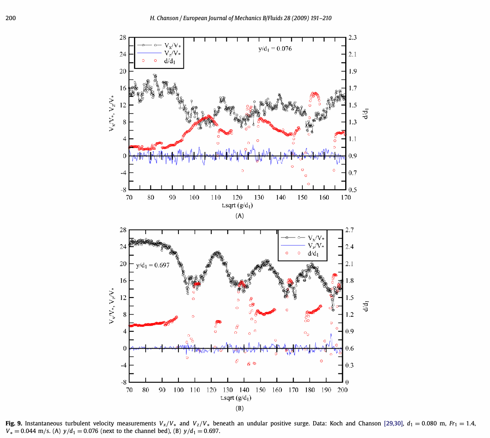

图 9. 波状正涌浪下的瞬时紊流速度 $V_x/V_*$、$V_z/V_*$［29,30］；$d_1=0.080\,\mathrm m$，$Fr_1=1.4$，$V_*=0.044\,\mathrm{m/s}$。（A）$y/d_1=0.076$，近渠底；（B）$y/d_1=0.697$。

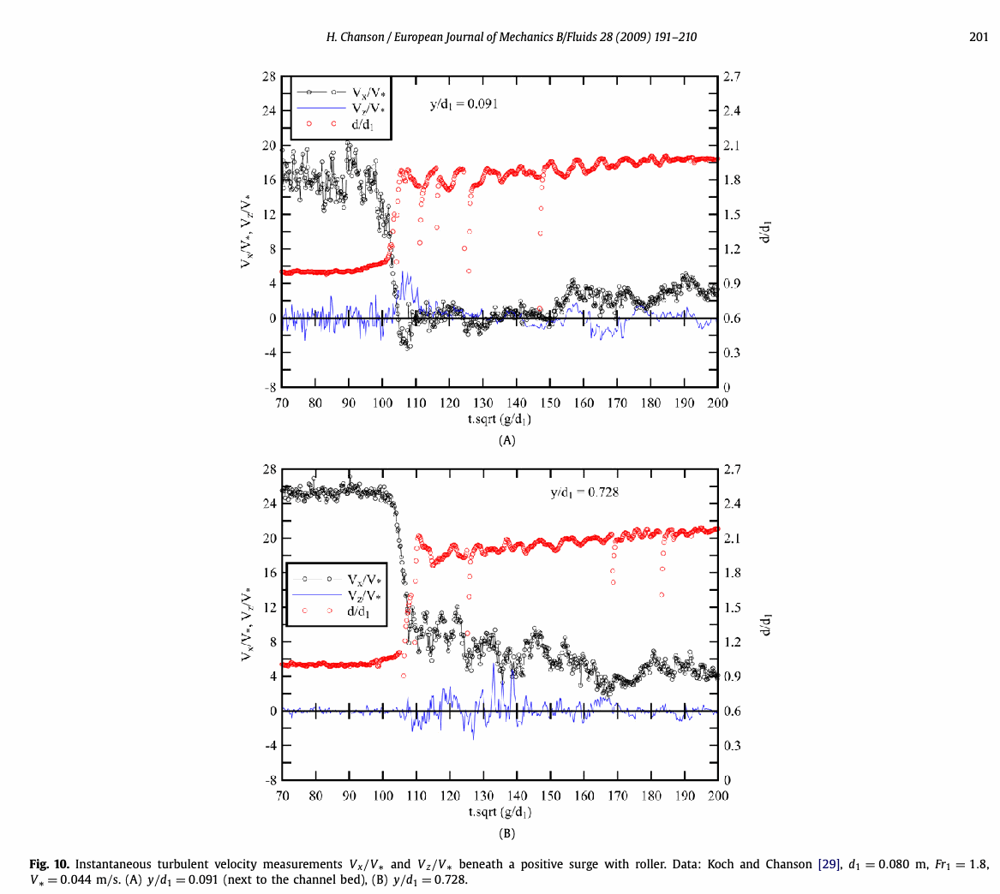

图 10. 带旋滚区正涌浪下的瞬时紊流速度 $V_x/V_*$、$V_z/V_*$［29］；$d_1=0.080\,\mathrm m$，$Fr_1=1.8$，$V_*=0.044\,\mathrm{m/s}$。（A）$y/d_1=0.091$，近渠底；（B）$y/d_1=0.728$。

瞬时雷诺应力采用可变时间间隔平均（VITA）技术计算。其截止频率的选取，使平均时间长于速度波动的特征周期，又短于平均流动性质演变的特征周期［61］。波状涌浪中，固定点测得的流动性质以约 2.4 s 的周期振荡，与液面波动周期对应。灵敏度分析后选取 1 Hz 截止频率，并对波状和破碎涌浪的纵、横向速度采用同一滤波方法。图 11、12 将瞬时剪应力与同步水深一并列出。

雷诺应力表征速度脉动造成的动量输运与混合作用。数据表明，涌潮锋面及后续流动下的紊流应力及其脉动均很大，即图 11、12 中 $t\sqrt{g/d_1}>90$ 的时段；各高度的应力均显著大于锋面到来前。波状涌浪中，最大的法向与切向应力出现在波峰下及各波峰到来之前，超过相邻波谷下的值（图 11）。带旋滚区正涌浪中，较大的法向及切向雷诺应力出现在水柱上部 $y/d_1>0.5$（图 12）。作者认为，$0.5<y/d_1<1$ 处应力的突增可能是旋滚区发展中的混合层通过所致。定常水跃及相关流动的研究也在发展中的剪切层内及邻近区域测得较大雷诺应力［62–64］。

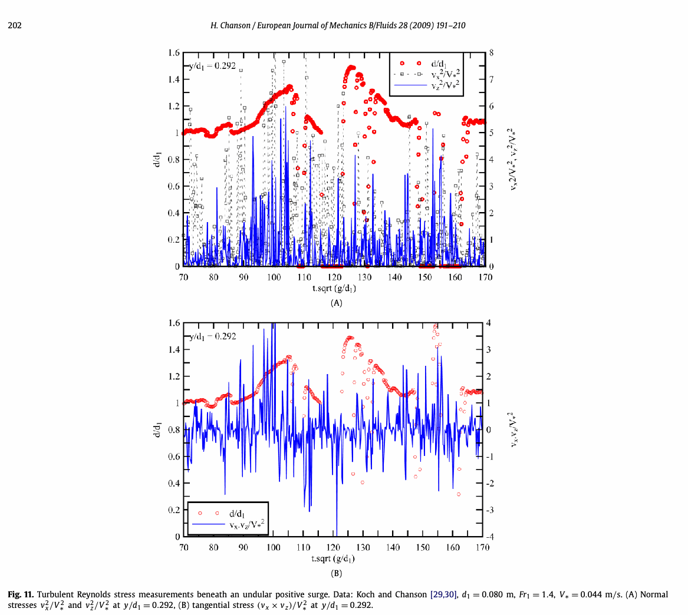

图 11. 波状正涌浪下的紊流雷诺应力［29,30］，$d_1=0.080\,\mathrm m$、$Fr_1=1.4$、$V_*=0.044\,\mathrm{m/s}$。（A）$y/d_1=0.292$ 的法向应力 $v_x^2/V_*^2$、$v_z^2/V_*^2$；（B）同高度的切向应力 $(v_xv_z)/V_*^2$。

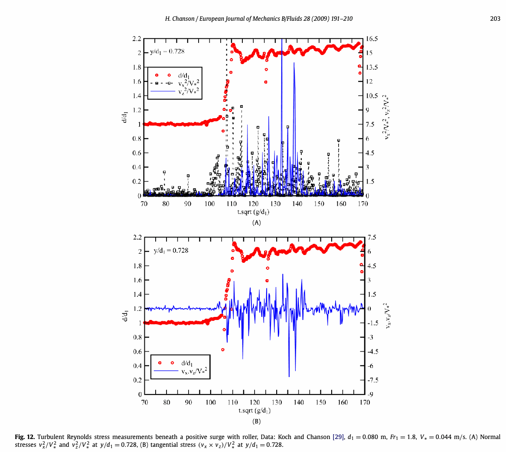

图 12. 带旋滚区正涌浪下的紊流雷诺应力［29］，$d_1=0.080\,\mathrm m$、$Fr_1=1.8$、$V_*=0.044\,\mathrm{m/s}$。（A）$y/d_1=0.728$ 的法向应力 $v_x^2/V_*^2$、$v_z^2/V_*^2$；（B）同高度的切向应力 $(v_xv_z)/V_*^2$。

### 3.2 涌潮中的紊流混合

在大潮差河口，大潮涨潮水进入狭窄漏斗形河道时可能形成涌潮（图 7）。公元前 325 年（或 326 年）的印度河涌潮曾摧毁亚历山大大帝的舰队［1,65,66］；两份记述都详细描述了涌潮过程。知名涌潮包括法国塞纳河、中国钱塘江和巴西亚马孙河的 *pororoca*。规模较小的涌潮见于英国 Severn、Dee 河，法国 Garonne、Dordogne、Sélune 河，美国阿拉斯加 Cook Inlet 的 Turnagain Arm 与 Knik Arm，加拿大芬迪湾的 Petitcodiac、Truro，以及澳大利亚 Styx、Daly 河和马来西亚 Batang Lupar 河。图 7 是 Sélune、Dordogne 河实例。

涌潮对河口和河口湾有显著影响：锋面下发生床面侵蚀、冲刷，后随波动将悬浮物向上携带，促成大量泥沙输运并在上游潮间带沉积。涌潮使河口产生强烈混合与扩散，而经典混合理论未考虑此类不连续面。野外观察显示强紊流和强混合（图 13）。测量设备在巴西 Rio Mearim［67］、澳大利亚 Daly 河［68］及英国 Dee 河［69］曾反复遭冲击、损坏。岸堤和航行也受影响：Moore 船长于 1888 年在钱塘江口锚泊时险些失去测量船及两艘汽艇［70,71］；钱塘江岸堤数百年来反复受损和漫顶［72］。巴布亚新几内亚 Fly 河和法国塞纳河还发生过涌潮及其后续波列致人溺亡的事件［73,74］。

涌潮造成的混合可在很远的上游显现。Hooghly 河涌潮能越过加尔各答港，传播 80 km 以上；规模较小的 Sée–Sélune 河涌潮持续数小时，影响超过 15 km 的河口水道（图 7A）。Rio Mearim 的观测发现，随测点位置不同，涌潮通过约 18～42 min 后，盐度与水温才急剧上升；最上游测点的滞后最长［67］。1991 年 1 月 30 日的一次涌潮还掀翻一座 150 kg 的支架，使其翻滚 1.4 km 后深埋于沙中。Daly 河河口上游 30～40 km 的测点于 2003 年 7 月 2 日在涌潮通过约 20 min 后，观察到持续约 3 min 的强紊流区，其间仪器三脚架被掀翻［68］。英国 Mersey 河的盐度于 1987 年 7 月 12 日涌潮经过约 10～15 min 后突然上升［75］。塞纳河及 Rio Mearim 还见到异常的流向反转：Rio Mearim 距底 0.7 m 的测量显示，涌潮经过后下泄流一度恢复约 30 s，随后水流再次上溯［67,76］。

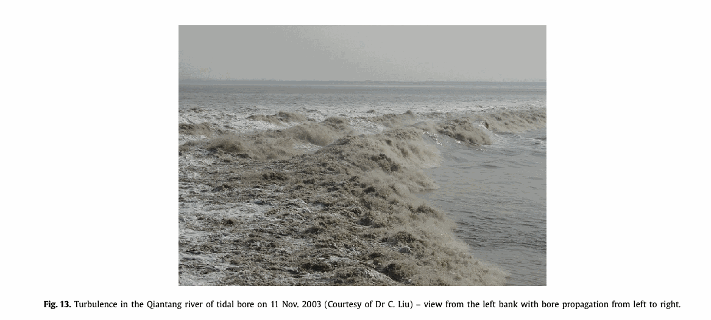

图 13. 2003 年 11 月 11 日钱塘江涌潮的紊流（C. Liu 博士提供）；由左岸拍摄，涌潮由左向右传播。

### 3.3 讨论

涌潮的存在依赖较脆弱的水动力平衡，边界条件或淡水来流改变即可扰动它。人为工程使若干涌潮消失，并损害生态系统：法国塞纳河涌潮已不复存在，墨西哥 Colorado 河涌潮在疏浚后显著减弱。航行安全虽提高，河口生态却受损。法国 Couesnon 河和加拿大 Petitcodiac 河的涌潮在上游修建拦河坝后几乎消失；后者还导致美洲西鲱、大西洋鲑、Atlantic tomcod、条纹鲈和鲟鱼等多种洄游鱼类消失［77］。

涌潮的目视记录很多，野外测量却极少，多数仅记录少量参数，时间、空间和固定点速度分辨率都较粗，而涌潮的影响范围可达数公里乃至数十公里。最近的 50 Hz 高时间分辨率速度数据揭示锋面经过时，各高度的纵向流速迅速减小，锋面下横向速度大幅波动（图 9、10）；锋面经过及其后的各高度，瞬时雷诺应力及其波动都较大（图 11、12）。由此，床面可能在锋面通过时受到侵蚀，被侵蚀物和其他标量则由锋面后的后续波列与波动平流输送。这与涌潮河口观察到的强紊流混合，以及上游河口区的淤积和沉积一致。因此，涌潮对整个河口系统有显著影响。

## 4. 水跃中的气泡卷入：动力相似与尺度效应

大量气泡卷入是带旋滚区紊流水跃的特征（图 1B）。高速入流冲击旋滚区时，将气泡及气团困入水中，继而由发展中的剪切层向下游平流输送（图 14）。水跃前缘 $(x=x_1,y=d_1)$ 是气泡和涡量的共同源，可视为流动奇点。冲击点下游的剪切区发生双重扩散：涡量与气泡以不同速率、不同方式扩散［78,79］。

早期研究侧重封闭管道内的总卷气量［80,81］。Rajaratnam［82］首先成功测量水跃内的两相流；Resch 与 Leutheusser［83］的关键研究表明，气泡卷入、动量传递和能量耗散均受入流条件强烈影响。Chanson［84］研究了部分发展入流的水跃，发现其气水性质与跌落射流卷气有相似之处。Mossa 与 Tolve［85］利用成像记录含气流结构的瞬时性质。Chanson 与 Brattberg［79］测量了较高 $Fr_1$ 水跃中剪切层及旋滚区的空隙率、气泡计数率和气水速度的垂向分布。Murzyn 等［86］研究低 $Fr_1$ 水跃的气水流动细节，Chanson［87］则描述湍涡和气泡流微观结构。但有关气水流动动力相似性以及气泡困入、平流过程的尺度效应，资料仍很少［88］。

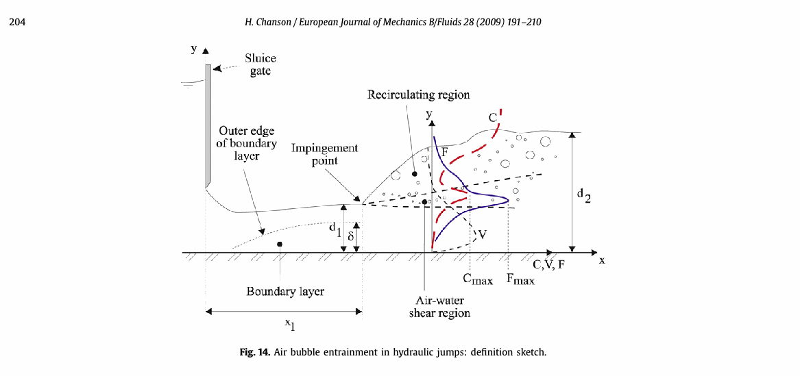

图 14. 水跃中气泡卷入的定义示意图。$C$ 为空隙率，$F$ 为气泡计数率，$V$ 为速度；$C_{\max}$ 与 $F_{\max}$ 的位置并不重合。

### 4.1 量纲分析与动力相似

对水平矩形渠道中的水跃，简化量纲分析表明，跃内位置 $(x,y,z)$ 处的两相流性质受以下因素影响：（a）空气和水的密度 $\rho_{air},\rho_w$、动力黏度 $\mu_{air},\mu_w$、表面张力 $\sigma$ 和重力加速度 $g$；（b）渠宽 $B$ 等渠道性质；（c）入流水深 $d_1$、速度 $V_1$、特征紊流速度 $u'_1$、边界层厚度 $\delta$ 等入流性质。故气水流动性质可写为：

$$
\begin{aligned}
C,F,V,u',d_{ab},\ldots
=F_1(x,y,z,d_1,V_1,u'_1,x_1,\delta,B,g,\rho_{air},\rho_w,\mu_{air},\mu_w,\sigma,\ldots).
\end{aligned}\tag{5}
$$

这里 $C$ 为空隙率，$F$ 为探针单位时间检出的气泡数，$V$ 为速度，$u'$ 为特征紊流速度，$d_{ab}$ 为气泡尺寸；$x$ 沿流向、从原文所谓“喷口”起算，$y$ 为垂向坐标，$z$ 从渠心向横向起算，$x_1$ 为上游闸门至水跃前缘的距离（图 14）。水溶液的生化性质也可能相关。若已知局部 $C$，气水混合物的密度和黏度可由水的性质与空隙率表达，因此可不单独考虑 $\rho_{air}$ 和 $\mu_{air}$。

以入流水深 $d_1$ 为特征长度，无量纲关系为：

$$
\begin{aligned}
&C,\frac{Fd_1}{V_1},\frac{V}{\sqrt{gd_1}},\frac{u'}{V_1},\frac{d_{ab}}{d_1},\ldots\\
&\quad=F_2\!\left(\frac{x}{d_1},\frac{y}{d_1},\frac{z}{d_1},\frac{V_1}{\sqrt{gd_1}},\frac{u'_1}{V_1},\frac{\rho V_1d_1}{\mu},\frac{\rho V_1^2d_1}{\sigma},\frac{x_1}{d_1},\frac{\delta}{d_1},\frac{B}{d_1}\right).
\end{aligned}\tag{6}
$$

式（6）左侧是无量纲位置处的气水流动性质，右侧依次包含无量纲入流条件和渠道几何参数。右侧第 4、6、7 项分别是入流弗劳德数、雷诺数和韦伯数。它们的无量纲组合也可替代其中某一参数；例如莫顿数仅由流体性质和 $g$ 决定：

$$Mo=\frac{g\mu^4}{\rho\sigma^3}=\frac{We^3}{Fr^2Re^4}.\tag{7}$$

模型和原型均使用空气与水时，莫顿数保持不变。Chanson［88］在其他无量纲参数固定、$Fr_1=5$ 和 8.5、$Re=70{,}000$～$95{,}000$ 的条件下检验了 $B/d_1$ 的影响。结果表明，$B/d_1\ge10$ 时，相对渠宽对两相流性质没有影响。在这些条件下，式（6）简化为：

$$
\begin{aligned}
&C,\frac{Fd_1}{V_1},\frac{V}{\sqrt{gd_1}},\frac{u'}{V_1},\frac{d_{ab}}{d_1},\ldots\\
&\quad=F_3\!\left(\frac{x}{d_1},\frac{y}{d_1},\frac{z}{d_1},Fr_1,\frac{u'_1}{V_1},Re,Mo,\frac{x_1}{d_1},\frac{\delta}{d_1}\right).
\end{aligned}\tag{8}
$$

水跃理论凸显入流弗劳德数的重要性［1］，物理模型也常采用弗劳德相似［2,44,89］。然而，气泡困入及气泡破碎、聚并受表面张力效应主导，剪切区的紊流过程则受黏性力影响［78,90］。式（8）涉及弗劳德数、雷诺数及莫顿数等多个相关参数，因此难以同时实现气泡卷入过程的动力相似。

近期实验在相同 $Fr_1$ 下考察雷诺数的影响，检验弗劳德相似对水跃两相流性质是否成立［88,91］。表 3 列出三组按无畸变弗劳德相似设计的几何相似实验。最大模型与最小模型的几何尺度比 $L_{scale}=2.0$，最大模型与中间模型之比为 1.33；此处 $L_{scale}$ 定义为原型尺寸与模型尺寸之比。实验采用相同 $Fr_1=5.1$ 或 8.5，且上游闸门到水跃前缘的无量纲距离 $x_1/d_1$ 相同。气水测量在发展中的两相流区相同无量纲断面 $(x-x_1)/d_1<20$ 进行。

**表 3.** 使用空气和水、基于无畸变弗劳德相似的水跃两相流物理模拟。

| 研究 | $x_1$（m） | $d_1$（m） | $Fr_1$ | $Re$ | $B$（m） |
|---|---:|---:|---:|---:|---:|
| Chanson［88］ | 1.0 | 0.024 | 5.1 | 68,000 | 0.50 |
| 同上 | 1.0 | 0.024 | 8.6 | 98,000 | 0.50 |
| Murzyn 与 Chanson［91,92］ | 0.75 | 0.018 | 5.1 | 38,000 | 0.50 |
| 同上 | 0.75 | 0.018 | 8.3 | 62,000 | 0.50 |
| Chanson［88］ | 0.5 | 0.012 | 5.1 | 25,000 | 0.25 |
| 同上 | 0.5 | 0.012 | 8.4 | 38,000 | 0.25 |

### 4.2 紊流水跃的两相流性质

紊流水跃伴随大尺度紊流、液面波和飞溅、能量耗散以及气泡卷入（图 1B）。气泡和气团在水跃前缘进入自由剪切层；该层的紊流生成强烈，主要涡旋的轴线水平且垂直于主流方向（图 14）。卷气机制可能有多种：若入流水在冲入下游水体前已含气，射流自由液面的含气层会越过冲击点被带入，这也称预卷气或两相流空气通量；冲击水流的自由液面附近，剪切摩擦使空气层运动，部分空气于卷入点被困住；水射流与旋滚区交汇处（水跃前缘）还会形成漏斗状诱导凹陷，闭合时将气团困入剪切流［93］。

对入流仅部分发展的水跃，紊流剪切层中的空隙率分布出现特征峰值 $C_{\max}$［79,84,86］（图 14、15A、16A）。距水跃前缘的无量纲距离 $(x-x_1)/d_1$ 增大时，$C_{\max}$ 降低，扩散层变宽。发展中的剪切层与空气扩散层相互作用复杂；作者认为，这种作用与图 15B、16B 所见气泡计数率峰值 $F_{\max}$ 有关。$F$ 是探针单位时间检出的气泡数，与气水界面面积成正比。实验表明，$F=F_{\max}$ 的位置与 $C=C_{\max}$ 的位置并不重合。

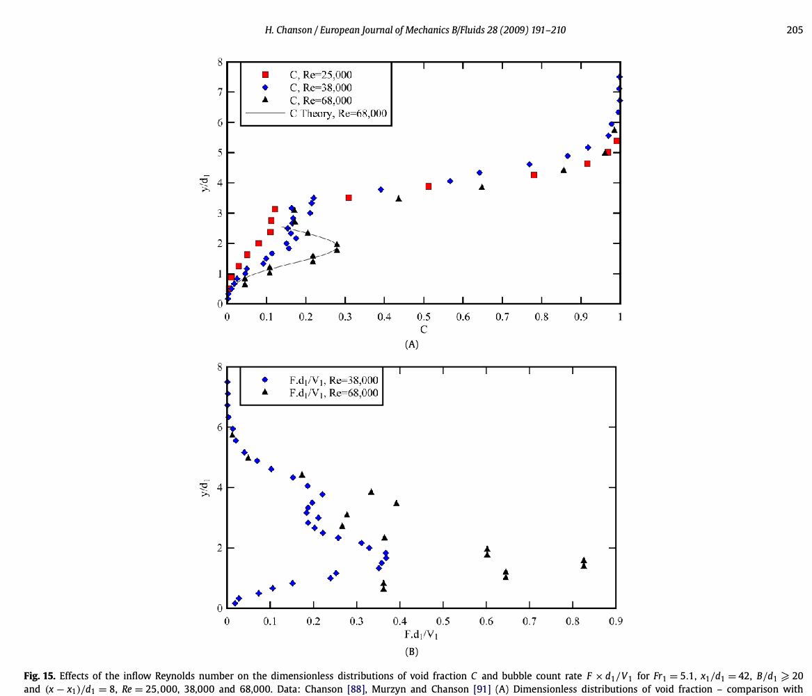

图 15. $Fr_1=5.1$、$x_1/d_1=42$、$B/d_1\ge20$、$(x-x_1)/d_1=8$ 时，入流雷诺数对无量纲空隙率和气泡计数率分布的影响；$Re=25{,}000$、$38{,}000$、$68{,}000$［88,91］。（A）空隙率及式（9）预测；（B）无量纲气泡计数率 $Fd_1/V_1$。

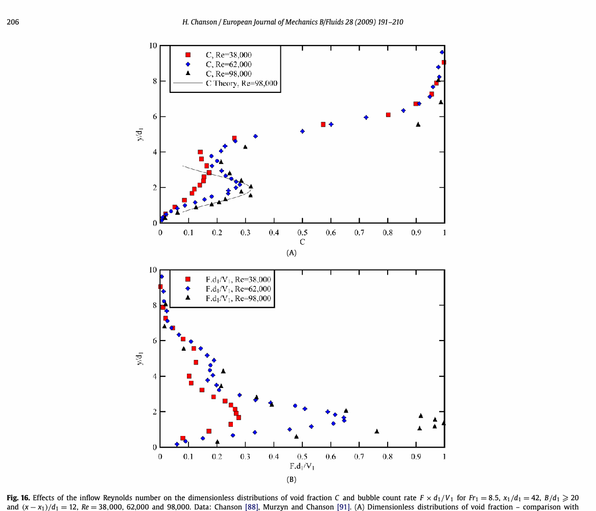

图 16. $Fr_1=8.5$、$x_1/d_1=42$、$B/d_1\ge20$、$(x-x_1)/d_1=12$ 时，入流雷诺数对无量纲空隙率和气泡计数率分布的影响；$Re=38{,}000$、$62{,}000$、$98{,}000$［88,91］。（A）空隙率及式（9）预测；（B）无量纲气泡计数率 $Fd_1/V_1$。

空气扩散层内，气泡平流–扩散方程的解析解给出空隙率剖面［78,94］：

$$
\begin{aligned}
C={Q_{air}/Q\over\sqrt{4\pi D^\#(x-x_1)/d_1}}
\bigg[&\exp\!\left(-{(y/d_1-1)^2\over4D^\#(x-x_1)/d_1}\right)\\
+&\exp\!\left(-{(y/d_1+1)^2\over4D^\#(x-x_1)/d_1}\right)\bigg].
\end{aligned}\tag{9}
$$

$Q_{air}$ 为卷入空气的体积流量，$Q$ 为水流量；无量纲扩散系数 $D^\#=D_t/(V_1d_1)$，$D_t$ 为气泡的紊流扩散系数。式（9）适用于二维受支撑跌落射流和水跃，并在图 15A、16A 中与实验比较。

对表 3 数据的比较显示，较小尺度水跃的空隙率、气泡计数率和气泡弦长通过时间分布存在显著尺度效应。相同 $Fr_1$ 下，$Re$ 越小，旋滚区脱气越快；$Fr_1=5.1$ 且 $Re<40{,}000$ 时，发展中的剪切层空隙率剖面不具自相似性（图 15A）；$Re$ 越大，无量纲气泡计数率越高（图 15B、16B）。相同 $Fr_1$ 下，气泡弦长通过时间的分布随 $Re$ 增大而更加偏斜，且不遵循弗劳德相似比例。

这些雷诺数效应在发展中的剪切层尤其明显。图 17 绘出给定 $Fr_1$ 下的 $C_{\max}$ 和 $F_{\max}d_1/V_1$ 对 $Re$ 的关系，并以虚线给出最佳拟合趋势。两者随 $Re$ 单调增大；$Fr_1=5.1$ 与 8.5 的增幅相近，且未见渐近趋势。因此，$Re=2\times10^4$ 的数据若外推到 $Re=10^5$，会有显著尺度效应；现有最高约 $Re=10^5$ 的数据，更不能直接外推至大型原型结构而忽略空隙率、气泡计数率和气泡弦长通过时间分布的尺度效应。这对土木、环境和卫生工程设计有重要影响。

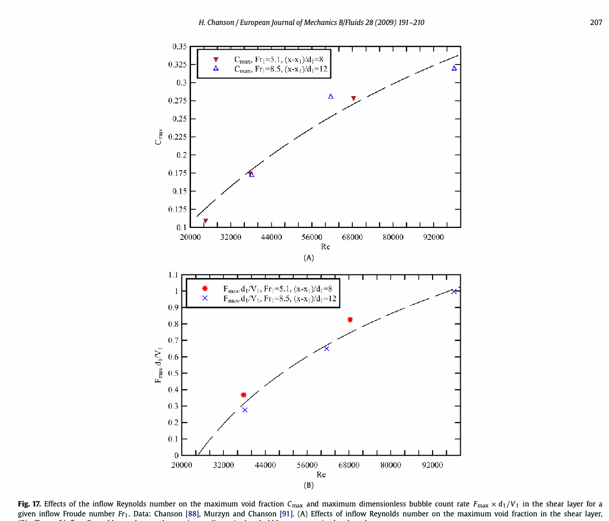

图 17. 固定入流弗劳德数时，剪切层最大空隙率 $C_{\max}$ 与最大无量纲气泡计数率 $F_{\max}d_1/V_1$ 随 $Re$ 的变化［88,91］。（A）$C_{\max}$；（B）$F_{\max}d_1/V_1$。

实际水工建筑、雨水系统和水处理设施中的水跃雷诺数可从 $10^6$ 到超过 $10^8$。图 18 所示溢洪道水跃的 $Re$ 约为 $10^7$：沿混凝土泄槽下泄的超临界流冲入较深尾水，形成水跃；悬浮泥沙使水呈褐色，旋滚区实际上是水–气–泥沙三相流。物理模型要与原型相似，须在形状、运动和力三个方面分别满足几何相似、运动相似和动力相似［89］。模型与原型的相关无量纲参数若不相同，即可能存在尺度效应。式（6）显示，水跃卷气涉及大量相关参数［88］。本研究进一步表明，除全尺度（1∶1）外，仅靠弗劳德相似无法实现水跃两相流的完全动力相似。在 $Re$ 最高约 $10^5$ 的实验设施中，卷气率（空隙率）、气水界面面积（气泡计数率）及气泡尺寸群（弦长通过时间分布）均显示黏性尺度效应（图 15～17）。

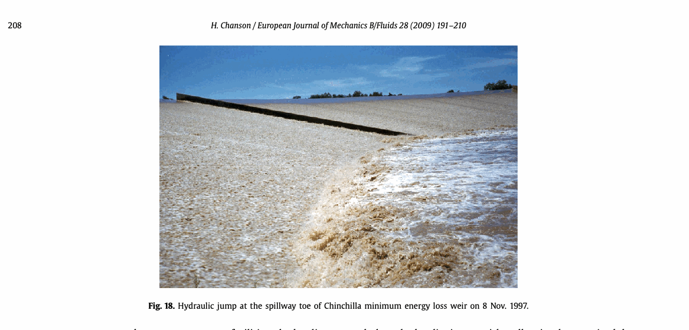

图 18. 1997 年 11 月 8 日 Chinchilla 最小能量损失堰溢洪道趾部的水跃。

## 5. 结论

明渠水跃是一段相对短而紊流强烈的流动。一维性质可由连续性和动量原理求得［1］，但对跃内紊流场，尤其对图 1、7、13、18 所示环境与地球物理过程，认识仍相当有限。

实验揭示了波状水跃的复杂性：相邻波峰和波谷间压力与速度快速重新分布；边界摩擦和自由液面运动的相互作用十分重要，也造成波状涌浪与波状水跃的基本差异。正涌浪是非恒定水跃，可用连续性和动量原理求解。涌潮是具有挑战性的环境实例；理解传播中的涌浪下方的紊流，是理解基本泥沙输运过程的关键。

带旋滚区的紊流水跃伴随强烈气泡卷入、喷雾与飞溅。量纲分析和实验证据表明，按弗劳德数相似的实验在空隙率、气泡计数率及气泡弦长通过时间分布方面有显著尺度效应；$Re$ 最高约 $10^5$ 的实验结果，不能在忽略这些效应的情况下外推至大型原型流动。

经过数百年研究，气体卷入、紊流、波状流等方面仍存在知识缺口，尤其缺乏 $Re\ge10^6$ 的地球物理尺度实验。数值模拟可能是未来方向，但涡结构与自由液面的相互作用、两相紊流都构成挑战。大涡模拟（LES）和流体体积法（VOF）可用于大 $Re$ 紊流，却缺少微观尺度分辨率，也并非总适用于两相流；直接数值模拟（DNS）能呈现较多小尺度细节，但限于相对较低 $Re$ 的紊流。未来研究可结合数值与物理实验，发展复合模型。

## 术语释义

- **Bélanger 方程：**水平渠道水跃两侧的动量方程，以 Jean-Baptiste Bélanger 命名。
- **Éteules：**法语，指涌潮锋面后的后续波列（whelps）。
- **Fawer jump：**波状水跃。
- **水跃：**高速超临界流向较慢亚临界流的驻定过渡。
- **Mascaret：**法语，涌潮。
- **Pororoca：**巴西亚马孙河的涌潮。
- **正涌浪：**水深突然增加造成的陡峭波锋；非恒定流况可按准定常流求解，也称平移水跃。
- **急变流：**流动性质在短距离内发生较大变化，如尖顶堰、闸门和水跃附近的流动。
- **旋滚区：**水力学中一系列大尺度湍涡，例如水跃旋滚区。
- **侧向激波：**高速超临界流受转向或收缩等扰动时，在自由液面上横跨渠道传播的波；又称斜水跃、马赫波、横波或对角水跃。
- **消力池：**消耗溢洪道、出口、泄槽或渠道建筑物下游水流能量的水工结构，常以水跃消能。
- **涌浪：**明渠水深突然变化；突然增深为正涌浪，突然变浅为负涌浪。
- **超临界流：**弗劳德数大于 1 的流动。
- **涌潮：**由涨潮引起、在河口发展的正涌浪。
- **波状水跃：**跃后具有驻定液面波列、且无已形成旋滚区的驻定水跃；亦称 Fawer 水跃。
- **波状涌浪：**锋面后有一列次生波的正涌浪；亦称 Boussinesq–Favre 波。
- **弱水跃：**有明显旋滚区、无液面波动且能量损失较小的水跃，通常出现在 $Fr_1$ 增大、波状水跃消失之后。
- **后续波列（whelps）：**涌潮锋面最前缘后的波；对岸上观察者，是锋面经过后可见的波列。

## 致谢

作者感谢同事、合作者和研究生，尤其是 Sergio Montes 博士、Christian Koch、Frédéric Murzyn 博士，以及 Graham Illidge 和 Clive Booth 提供的技术协助。

## 参考文献

以下保留原文文献题录的原语种及编号。

[1] J.B. Bélanger, Essai sur la Solution Numérique de quelques Problèmes Relatifs au Mouvement Permanent des Eaux Courantes, Carilian-Goeury, Paris, France, 1828 (in French).

[2] F.M. Henderson, Open Channel Flow, MacMillan Company, New York, USA, 1966.

[3] H. Chanson, J.S. Montes, Characteristics of undular hydraulic jumps. Experimen-tal apparatus and flow patterns, J. Hyd. Engrg., ASCE 121 (2) (1995) 129–144. Discussion: 123 (2) 161–164.

[4] J.S. Montes, H. Chanson, Characteristics of undular hydraulic jumps. Results and calculations, J. Hyd. Engrg., ASCE 124 (2) (1998) 192–205.

[5] H. Chanson, Boundary shear stress measurements in undular flows: Application to standing wave bed forms, Water Res. Res. 36 (10) (2000) 3063–3076.

[6] I. Ohtsu, Y. Yasuda, H. Gotoh, Hydraulic condition for undular-jump formations, J. Hyd. Res., IAHR 39 (2) (2001) 203–209. Discussion: 2002 40 (3), 379–384.

[7] H. Chanson, Physical modellingof the flow fieldinan undular tidal bore, J.Hyd. Res., IAHR 43 (3) (2005) 234–244.

[8] J.M. Lennon, D.F. Hill, Particle image velocimetry measurements of undular and hydraulic jumps, J. Hyd. Engrg. 132 (12) (2006) 1283–1294.

[9] M. Ben Meftah, F. De Serio, M. Mossa, A. Pollio, Analysis of the velocity field in a large rectangular channel with lateral shockwave, Env. Fluid Mech. 7 (6) (2007) 519–536. doi:10.1007/s10652-007-9034-7.

[10] H.P.G. Darcy, H.E. Bazin, Recherches hydrauliques, Imprimerie Impériales, Paris, France, Parties 1ère et 2ème, 1865 (in French).

[11] G. Bidone, Le Remou et sur la Propagation des Ondes, Report to Académie Royale des Sciences de Turin, séance 12 Dec., vol. XXV, 1819, pp. 21–112 & 4 plates (in French).

[12] J.V. Boussinesq, Essai sur la Théorie des Eaux Courantes, Mémoires présentés par divers savants à l’Académie des Sciences, Paris, France, vol. 23, Série 3 (1), supplément 24, 1877, pp. 1–680 (in French).

[13] B.A. Bakhmeteff,Hydraulics of Open Channels, first ed., McGraw-Hill, New York, USA, 1932, 329 p.

[14] W.H. Hager, Energy Dissipators and Hydraulic Jump, Water Science and Tech-nology Library, vol. 8, Kluwer Academic Publ., Dordrecht, The Netherlands, 1992, 288 p.

[15] J.M. Aristoff, J.D. Leblanc, A.E. Hosoi, J.W.M. Bush, Viscous hydraulic jumps, Phys. Fluids 16 (9) (2004) S4.

[16] R.H. Clarke, The morning glory: an atmospheric hydraulic jump, J. Appl. Mete-orology 11 (1972) 304–311.

[17] R.H. Clarke, R.K. Smith, D.G. Reid, The morning glory of the Gulf of Carpentaria – an atmospheric undular bore, Monthly Weather Rev. 109 (8) (1981) 1726– 1750.

[18] B.A. Bakhmeteff, A.E. Matzke, The Hydraulic jump in terms of dynamic similar-ity, Trans. ASCE 101 (1936) 630–647. Discussion: 101, 648–680.

[19] A.M. Binnie, J.C. Orkney, Experiments on the flow of water from a reservoir through an open channel. II. The formation of hydraulic jump, Proc. Roy. Soc. London Ser. A 230 (1955) 237–245.

[20] C. Fawer, Etude de Quelques Ecoulements Permanents à Filets Courbes, Thesis, Lausanne, Switzerland, Imprimerie La Concorde, 1937, 127 p. (in French).

[21] J.S. Montes, A study of the undular jump profile, in: Proc. 9th Australasian Fluid Mechanics Conference AFMC, Auckland, New Zealand, 1986, pp. 148–151.

[22] A.A. Ryabenko, Conditions favorable to the existence of an undulating jump, Gidrotekhnicheskoe Stroitel’stvo 12 (1990) 29–34 (in Russian). Translated in Hydrotechnical Construction, 1990, Plenum Publ., pp. 762–770.

[23] H. Chanson, Flow characteristics of undular hydraulic jumps. Comparison with near-critical flows, Report CH45/95, Dept. of Civil Engineering, University of Queensland, Australia, 1995, June, 202 p.

[24] F. Engelund, J. Munch-Petersen, Steady flow in contracted and expanded rect-angular channels. Some considerations concerning the shape of the water sur-face J. La Houille Blanche (Aug./Sept. 1953) 464–474.

[25] V.M. Andersen, Undular hydraulic jump, J. Hyd. Div. ASCE 104 (HY8) (1978) 1185–1188. Discussion: 105 (HY9) 1208–1211.

[26] H. Favre, Etude Théorique et Expérimentale des Ondes de Translation dans les Canaux Découverts, Dunod, Paris, France, 1935 (in French).

[27] F. Benet, J.A. Cunge, Analysis of experiments on secondary undulations caused by surge waves in trapezoidal channels, J. Hyd. Res., IAHR 9 (1) (1971) 11–33.

[28] A. Treske, Undular bores (favre-waves) in open channels – experimental stud-ies, J. Hyd. Res., IAHR 32 (3) (1994) 355–370. Discussion: 33 (3), 274-278.

[29] C. Koch, H. Chanson, An experimental study of tidal bores and positive surges: Hydrodynamics and turbulence of the bore front, Report No. CH56/05, Dept. of Civil Engineering, The University of Queensland, Brisbane, Australia, July 2005, 170 p.

[30] C. Koch, H. Chanson, Turbulent mixing beneath an undular bore front, J. Coastal Res. 24 (4) (2008) 999–1007. doi:10.2112/06-0688.1.

[31] A.W. Lewis, Field studies of a tidal bore in the River Dee, M.Sc. thesis, Marine Science Laboratories, University College of North Wales, Bangor, UK, 1972.

[32] A.T. Ippen, R.F. Harleman, Verification of theory for oblique standing waves, Trans. ASCE 121 (1956) 678–694.

[33] H. Rouse, Fluid Mechanics for Hydraulic Engineers, McGraw-Hill Publ., New York, USA, 1938, also Dover Publ., New York, USA, 1961, 422 p.

[34] J.A. Liggett, Fluid Mechanics, McGraw-Hill, New York, USA, 1994.

[35] R. Lemoine, Sur les ondes positives de translation dans les canaux et sur le ressaut ondulé de faible amplitude, J. La Houille Blanche (March–April 1948) 183–185 (in French).

[36] F. Serre, Contribution à l’etude des ecoulements permanents et variables dans les canaux, J. La Houille Blanche (Dec. 1953) 830–872 (in French).

[37] Y. Iwasa, Undular jump and its limiting conditions for existence, in: Proc. 5th Japan National Congress for Applied Mechanics, Japan, Paper II-14, 1955, pp. 315–319.

[38] J.S. Montes, Undular hydraulic jump – discussion, J. Hyd. Div., ASCE 105 (HY9) (1979) 1208–1211.

[39] N. Rajaratnam, Hydraulic jumps on rough beds, Trans. Engrg. Institute of Canada 11 (A-2) (May 1968) I–VIII.

[40] H.J. Leutheusser, E.J. Schiller, Hydraulic jump in a rough channel, Water Power & Dam Construction 27 (5) (1975) 186–191.

[41] A.T. Troskolanski, Hydrometry: Theory and Practice of Hydraulic Measure-ments, Pergamon Press, Oxford, UK, 1960, 684 p.

[42] A.J.C. Barré de Saint-Venant, Théorie et Equations Générales du Mouve-ment Non Permanent des Eaux Courantes, Comptes Rendus des séances de l’Académie des Sciences, Paris, France, Séance 17 July 1871, vol. 73, (1871), pp. 147–154 (in French).

[43] L. Rayleigh, Note on tidal bores, Proc. Royal Soc. of London, Series A containing Papers of a Mathematical and Physical Character 81 (541) (1908) 448–449.

[44] H. Chanson, The Hydraulics of Open Channel Flow: An Introduction, second ed., Butterworth–Heinemann, Oxford, UK, 2004, 630 p.

[45] T.B. Benjamin, M.J. Lighthill, On cnoidal waves and bores, Proc. Roy. Soc. London Ser. A, Math. & Phys. Sci. 224 (1159) (1954) 448–460. 210 H.Chanson/EuropeanJournalofMech

[46] R.A.R. Tricker, Bores, Breakers, Waves and Wakes, American Elsevier Publ. Co., New York, USA, 1965.

[47] D.H. Peregrine, Calculations of the development of an undular bore, J. Fluid Mech. 25 (1966) 321–330.

[48] D.L. Wilkinson, M.L. Banner, Undular bores, in: Proc. 6th Australasian Hyd. and Fluid Mech. Conf., Adelaide, Australia, 1977, pp. 369–373.

[49] A.F. Teles Da Silva, D.H. Peregrine, Nonsteady computations of undular and breaking bores, in: Proc. 22nd Int. Cong. Coastal Eng., vol. 1, ASCE Publ., Delft, The Netherlands, 1990, pp. 1019–1032.

[50] O.C. Zienkiewicz, J.A. Sandover, The undular surge wave, in: Proc. of the 7th IAHR Congress, vol. II, Lisbon, Portugal, paper D25, 1957, pp. D1–11.

[51] J.A. Sandover, P. Holmes, The hydraulic jump in trapezoidal channels, Water Power 14 (Nov. 1962) 445–449.

[52] J. Ponsy, M. Carbonnell, Etude photogrammétrique d’intumescences dans le canal de l’Usine d’Oraison (Basses-Alpes), J. Soc. Française de Photogram. 22 (1966) 18–28.

[53] J. Sander, K. Hutter, On the development of the theory of the solitary wave. A historical essay, Acta Mech. 86 (1991) 111–152.

[54] J.A. Cunge, Undular bores and secondary waves – experiments and hybrid finite-volume modelling, J. Hyd. Res., IAHR 41 (5) (2003) 557–558.

[55] P.A. Madsen, I.A. Svendsen, Turbulent bores and hydraulic jumps, J. Fluid Mech. 129 (1983) 1–25.

[56] J.G. Caputo, Y. Stepanyants, Bore formation, evolution and disintegration into solitons in shallow inhomogeneous channels, Nonlinear Processes in Geo-physics 10 (2003) 407–424.

[57] P.A. Madsen, H.J. Simonsen, C.H. Pan, Numerical simulation of tidal bores and hydraulic jumps, Coastal Eng. 52 (5) (2005) 409–433.

[58] G.A. El, R.H.J. Grimshaw, A.M. Kamchatnov, Evolution of solitary waves and un-dular bores in shallow-water flows over a gradual slope with bottom friction, J. Fluid Mech. 585 (2007) 213–244.

[59] H.H. Yeh, K.M. Mok, On turbulence in bores, Phys. Fluids, Ser. A 2 (5) (1990) 821–828.

[60] H.G. Hornung, C. Willert, S. Turner, The flow field downstream of a hydraulic jump, J. Fluid Mech. 287 (1995) 299–316.

[61] J. Piquet, Turbulent Flows. Models and Physics, Springer, Berlin, Germany, 1999, 761 p.

[62] H. Rouse, T.T. Siao, S. Nagaratnam, Turbulence characteristics of the hydraulic jump, Trans. ASCE 124 (1959) 926–950.

[63] F.J. Resch, H.J. Leutheusser, Reynolds stress measurements in hydraulic jumps, J. Hyd. Res., IAHR 10 (4) (1972) 409–429.

[64] M. Liu, Turbulence structure in hydraulic jumps and vertical slot fischways, in: Ph.D. thesis. Dept. of Civil and Env. Eng., University of Alberta, Edmonton, Canada, 2004, 313 p.

[65] Arrian, Arrian, Harvard University Press, Cambridge, USA, 1976. Translated by P.A. Brunt, 2 volumes.

[66] Quintus Curcius, The History of Alexander, Penguin, New York, 1984. Translated by J. Yardley, 332 p.

[67] B. Kjerfve, H.O. Ferreira, Tidal bores: First ever measurements, Ciência e Cultura (J. Brazilian Assoc. for the Advancement of Science) 45 (2) (March/April 1993) 135–138.

[68] E. Wolanski, D. Williams, S. Spagnol, H. Chanson, Undular tidal bore dynam-ics in the Daly Estuary, Northern Australia, Estuarine, Coastal and Shelf Sci-ence 60 (4) (2004) 629–636.

[69] J.H. Simpson, N.R. Fisher, P. Wiles, Reynolds stress and TKE production in an estuary with a tidal bore, Estuarine, Coastal and Shelf Science 60 (4) (2004) 619–627.

[70] G.H. Darwin, The Tides and Kindred Phenomena in the Solar System, Lectures delivered at the Lowell Institute, Boston, 1897 W.H. Freeman and Co. Publ., London, 1962.

[71] R.N. Moore, Report on the Bore of the Tsien-Tang Kiang, Hydrographic Office, London, 1888.

[72] Z. Dai, C. Zhou, The Qiantang bore, Int. J. Sediment Res. (1) (November 1987) 21–26. hanicsB/Fluids28(2009)191–210

[73] W.N. Beaver, Unexplored New Guinea. A Record of the Travels, Adventures, and Experiences of a Resident Magistrate amongst the Head-Hunting Savages and Cannibals of the Unexplored Interior of New Guinea, Seeley, Service & Co, Lon-don, UK, 1920, 320 p.

[74] J.J. Malandain, La Seine au Temps du Mascaret, Le Chasse-Marée, No. 34, 1988, pp. 30–45 (in French).

[75] C. Davies, Tidal River bores. Dissertation in partial fulfilment of B.A. degree, Dept. of Geography, Edge Hill College, University of Lancaster, UK, 1988.

[76] H. Bazin, Recherches Expérimentales sur la Propagation des Ondes. Mémoires présentés par divers savants à l’Académie des Sciences, Paris, France, vol. 19, 1865, pp. 495–644 (in French).

[77] A. Locke, J.M. Hanson, G.J. Klassen, S.M. Richardson, C.I. Aube, The damming of the Petiticodiac River: Species, populations, and habitats lost, Northeastern Naturalist 10 (1) (2003) 39–54.

[78] H. Chanson, Air Bubble Entrainment in Free-Surface Turbulent Shear Flows, Academic Press, London, UK, 1997, 401 p.

[79] H. Chanson, T. Brattberg, Experimental study of the air–water shear flow in a hydraulic jump, Int. J. Multiphase Flow 26 (4) (2000) 583–607.

[80] A.A. Kalinske, J.M. Robertson, Closed conduit flow, Trans. ASCE 108 (1943) 1435–1447.

[81] P. Wisner, Sur le Rôle du Critère de Froude dans l’Etude de l’Entraînement de l’Air par les Courants à Grande Vitesse, in: Proc. 11th IAHR Congress, Leningrad, USSR, paper 1.15, 1965 (in French).

[82] N. Rajaratnam, An experimental study of air entrainment characteristics of the hydraulic jump, J. Inst. Eng. India 42 (7) (March 1962) 247–273.

[83] F.J. Resch, H.J. Leutheusser, Le ressaut hydraulique : mesure de turbulence dans la région diphasique, J. La Houille Blanche (4) (1972) 279–293 (in French).

[84] H. Chanson, Air entrainment in two-dimensional turbulent shear flows with partially developed inflow conditions, Int. J. Multiphase Flow 21 (6) (1995) 1107–1121.

[85] M. Mossa, U. Tolve, Flow visualization in bubbly two-phase hydraulic jump, J. Fluids Eng., ASME 120 (March 1998) 160–165.

[86] F. Murzyn, D. Mouaze, J.R. Chaplin, Optical fibre probe measurements of bubbly flow in hydraulic jumps, Int. J. Multiphase Flow 31 (1) (2005) 141–154.

[87] H. Chanson, Bubbly flow structure in hydraulic jump, Eur. J. Mech. B/Fluids 26 (3) (2007) 367–384. doi:10.1016/j.euromechflu.2006.08.001.

[88] H. Chanson, Dynamic similarity and scale effects affecting air bubble entrain-ment in hydraulic jumps, in: M. Sommerfield (Ed.), Proc. 6th International Conference on Multiphase Flow ICMF 2007, Leipzig, Germany, July 9–13, 2007, Session 7, Paper S7_Mon_B_S7_Mon_B_3, 11 p. (CD-ROM).

[89] H. Chanson, The Hydraulics of Open Channel Flow: An Introduction, Edward Arnold, London, UK, 1999, 512 p.

[90] I.R. Wood, Air entrainment in free-surface flows, in: IAHR Hydraulic Structures Design Manual, No. 4. Hydraulic Design Considerations, Balkema Publ., Rotter-dam, The Netherlands, 1991, p. 149.

[91] F. Murzyn, H. Chanson, Free surface, bubbly flow and turbulence measurements in hydraulic jumps, Report No. CH63/07, Div. of Civil Engineering, The Univer-sity of Queensland, Brisbane, Australia, July 2007, 116 p.

[92] F. Murzyn, H. Chanson, Experimental assessment of scale effects affect-ing two-phase flow properties in hydraulic jumps, Exp. Fluids 44 (2008). doi:10.1007/s00348-008-0494-4.

[93] H. Chanson, T. Brattberg, Air entrainment by two-dimensional plunging jets: the impingement region and the very-near flow field, in: Proc. 1998 ASME Fluids Eng. Conf., FEDSM’98, Washington, DC, USA, June 21–25, 1998, Paper FEDSM98-4806, 8 p. (CD-ROM).

[94] P.D. Cummings, H. Chanson, Air entrainment in the developing flow region of plunging jets. Part 1. Theoretical development, J. Fluids Engrg., Trans. ASME 119 (3) (1997) 597–602.

[95] H. Chanson, Hydraulic jumps: Bubbles and bores. in: Proc. 16th Australasian Fluid Mechanics Conference AFMC, Gold Coast, Australia, 2–7 December, Ple-nary Address, 2007, pp. 39–53 (CD-ROM).

## 校订备注

- 原文式（5）后写“式（3）可无量纲化”为式（6），但式（3）是侧向激波经验式；从变量和所在段落看，此处应指式（5）。译文直接呈现式（6），未改动原编号。
- 原文对式（5）的 $x$ 解释为“从喷口起算”，图 14 却画出上游闸门并以其定义 $x_1$。两者几何基准不完全一致；涉及 $x/d_1$ 的复算应以原实验布置核实。
