# 淹没石块群中石块密集度对明渠紊流与泥沙输运的影响

H. W. Fang、Y. Liu、T. Stoesser。原文：*Influence of boulder concentration on turbulence and sediment transport in open-channel flow over submerged boulders*，2017 年录用稿，DOI：10.1002/2017JF004221。作者机构：清华大学水利水电工程系、英国卡迪夫大学土木工程学院。本文依据出版前作者稿 PDF 翻译；该版本尚未完成出版排版与最终校样。

## 要点

- 大型固定石块的存在显著影响淹没石块邻近的流场和紊流场。
- 石块密集度在形成从掠过流至孤立粗糙元流动的不同流态，以及预测推移质输运率方面起重要作用。
- 若使用河段平均剪应力，而非局部剪应力，推移质输运率会被低估。

## 摘要

本文研究淹没石块阵列中，石块密集度对水动力、局部及河段平均泥沙输运特性的影响。进行了四组数值模拟，改变石块的顺流向间距。提取近床面流速、雷诺剪应力及紊流事件的统计量，并用其预测推移质输运率。结果表明，不同间距的石块改变邻近流场，导致：（1）流动减速、尾流形成及涡脱落；（2）石块下游向外和向内相互作用事件增强；（3）石块周围局部床面剪应力重新分布，形成高值与低值斑块。基于局部床面剪应力预测的推移质输运率 $q_s$ 具有很强的空间变化，并高度依赖石块密集度。定量计算显示，若在所选推移质公式中纳入由固定石块形状阻力产生的剪应力，河段平均推移质输运率可能被高估多达 25 倍。若忽略床面剪应力的局部变异，河段平均推移质输运率可能被低估 11%。最后，对于石块间距较小的阵列，不应再使用以剪应力分布标准差 $\sigma$ 表征的正态分布来预测推移质输运率。

## 1. 引言

大型固定石块常见于陡峻山溪，可显著改变局部流场、紊流结构、泥沙输运率与水生栖息地［Bathurst，1987；Rickenmann，2001；Yager 等，2007；Dey 等，2011；Tsakiris 等，2014］。布有大型石块的河床可按流态划分为孤立粗糙元流、尾流干扰流及掠过流［Papanicolaou 等，2001、2002］。通常用石块间距或密集度区分三者。例如 Papanicolaou 等［2001］在水槽实验中分别用 6、2 和 1 倍石块直径的间距研究这三种流态。Ferro［1999］指出，石块密集度超过 50%，即石块占据超过一半河床时，河道流动处于掠过流流态。

为考虑这三种流态中的大型石块对推移质输运的影响，已有研究调整流动阻力（总剪应力）［Ferro，1999、2003；Canovaro 等，2007］，或调整推移质输运率公式中的临界剪应力［Bathurst 等，1987；Lenzi 等，2006；Bathurst，2007；Mao 等，2008］。水槽实验发现流动阻力是石块密集度的函数［Bathurst 等，1981；Ferro，1999；Canovaro 等，2007］。在孤立粗糙元流态下，流动阻力与石块数量成正比；在尾流干扰和掠过流流态下，已不能仅由石块数量表述流动阻力［Canovaro 等，2007］。现场和实验研究证实，粒径范围很宽的床沙（含大型石块）的临界剪应力通常远高于窄粒径范围床沙［Bathurst 等，1987；Lenzi 等，2006；Bathurst，2007；Mao 等，2008］。提出的解释包括：（a）固定石块承受水流阻力，减少可用于搬运细颗粒的剪应力［Buffington 与 Montgomery，1997；Xu 等，2008；Patel 等，2013］；（b）固定石块为可移动砾石遮挡高剪应力［Wiberg 与 Smith，1991］；（c）粗颗粒形成装甲层，限制细颗粒供应［Bathurst，2007］；（d）相对粗糙度增大时，固定石块在近床面形成较低且较均匀的速度剖面，并降低近床面紊流强度峰值［Lamb 等，2008；Recking，2009］。

对有大型石块的河流，研究者已认识到石块会显著增加斑块尺度流场和紊流强度的空间变异［Shamloo 等，2001；Parker，2008；Dey 等，2011；Ozgoren 等，2013］。就平均速度场而言，淹没石块下游的回流区形成石块尾流。大型相干流动结构支配石块附近的瞬时和局部流动［Ferro，2003；Strom 等，2007；Hajimirzaie 等，2014；Tsakiris 等，2014］，包括顶部流动分离产生的顶部涡［Hajimirzaie 等，2014］及石块正上游的近床面马蹄涡［Tsutsui 等，2008］。这些结构还显著提高紊流水平与局部紊流剪应力，并改变垂向紊流强度剖面［Hajimirzaie 等，2014］。

尽管大型石块上的流态已受到广泛关注，定量计算推移质输运时仍难处理大型固定石块造成的不参与输沙的剪应力，即压力阻力或形状阻力。一种方法是分别计算可移动河床上的表面摩擦剪应力与石块的形状阻力；已有研究用它预测含大型粗糙元河道的流速与推移质输运率［Yager 等，2007；Nitsche 等，2012；Yager 等，2012；Scheingross 等，2013；Ghilardi 等，2014］。难点之一是确定可移动泥沙的经验阻力系数 $C_m$。文献采用的常数有 0.047［Yager 等，2007］、0.44［Yager 等，2012］以及 0.12～1.27［Scheingross 等，2013］，均经率定取得，变幅约达两个数量级。其他总剪应力分配方法也有各自假设。例如 Canovaro 等［2007］假设表面摩擦剪应力与石块密集度线性相关，于是由实测的最高（100%）与最低（0%）密集度对应值内插，求取给定密集度的表面摩擦剪应力。Papanicolaou 等［2012］假定速度亏损定律适用于外层流动（$z/H>0.2$），以便用边界特性法计算表面摩擦剪应力和形状阻力。缺乏真实表面摩擦剪应力资料时须作这些假设，但把它们用于基于剪应力的公式可能造成推移质输运率的大误差［Ferguson，2003］。

除了难以将总剪应力分解为表面摩擦和形状阻力，局部表面摩擦剪应力也难测量或预测。Segura 与 Pitlick［2015］、Monsalve 等［2016］依据经验阻力系数 $C_d$ 和深度平均流速，使用二维流动模型预测空间变化的剪应力分布。模型能够再现实测水面高程，并成功预测一条天然河流的剪应力分布。不过，预测与实测的局部及断面平均流速存在差异，可能影响模型中的局部剪应力精度。淹没石块上方的垂向速度剖面还可能呈 S 形、对数律形或线性形［Byrd 等，2000；Ferro，2003］。即使深度平均流速相同，近床面流速和剪应力也可能显著不同；这表明有必要进行三维数值模拟，预测石块之间的局部床面剪应力。

本研究对不同石块间距的石块阵列上方流动进行大涡模拟（LES），回答三个问题：（1）石块阵列上的近床面紊流、剪应力及泥沙运动有多大的空间变异？（2）石块间距如何影响局部泥沙输运？（3）用局部尺度与河段尺度参数计算石块阵列上方的泥沙输运，各有多大准确度？第 2 节介绍流动及泥沙输运的数值方法；第 3 节用图示和简述呈现模拟数据与计算；第 4 节讨论对泥沙输运预测的意义；第 5 节给出结论。

## 2. 方法

### 2.1 大涡模拟

本文使用内部开发的 Hydro3D 代码进行 LES。该代码已针对复杂度相近的流动得到验证与应用［Bomminayuni 等，2011；Kim 等，2011、2013；Kara 等，2012、2015a、2015b；Bai 等，2013；Fraga 等，2016a、2016b］。它在交错笛卡尔网格上采用有限差分法。不可压缩、非定常黏性流动的滤波后 Navier–Stokes 方程为

$$\frac{\partial u_i}{\partial x_i}=0.\tag{1}$$

$$\frac{\partial u_i}{\partial t}+\frac{\partial(u_i u_j)}{\partial x_j}=-\frac{\partial p}{\partial x_i}+\frac{\partial(2\nu S_{ij})}{\partial x_j}-\frac{\partial\tau_{ij}}{\partial x_j}.\tag{2}$$

$u_i,u_j$ 为经过空间解析的速度分量，$i,j=1,2,3$ 分别对应 $x,y,z$ 方向；$x_i,x_j$ 为相应位置坐标；$p$ 为除以流体密度的空间解析压力；$\nu$ 为运动黏度；滤波应变率张量 $S_{ij}=\tfrac12(\partial u_i/\partial x_j+\partial u_j/\partial x_i)$。亚网格尺度（SGS）应力定义为 $\tau_{ij}=-2\nu_t S_{ij}$。本研究采用 Nicoud［1999］提出的壁面适应局部涡黏度（WALE）模型计算涡黏度 $\nu_t$，进而模拟 SGS 应力。

Navier–Stokes 方程的对流和扩散项用四阶精度中心差分近似。时间积分采用显式三步 Runge–Kutta 格式，具有二阶精度。分步法在每一时间步先于预测步显式求解对流和扩散项，再于校正步通过泊松方程求得压力及无散度速度场；后者用多重网格迭代求解。代码细节见 Cevheri 等［2016］。

### 2.2 计算设置

进行三组直径为 $D_c$ 的交错石块阵列模拟，改变顺流向石块间距 $\lambda$。每组计算域的流向、横向与垂向尺寸分别为 $10D_c$、$6.93D_c$、$3.83D_c$，含石块的三组计算域见图 1；另有一组无石块模拟。四组计算的河床均由一层紧密排列、直径为 $d$ 的球体人工加糙。虚拟床面高程设在床面球体顶部（$z/D_c=0$）；这些球体占 $z/D_c=-0.33$ 至 0 的范围，水深 $H/D_c=3.5$。铺在床面球体上方的大石块数量 $N_B$ 随顺流向间距而变：无穷大（无石块）、$10D_c$（大间距）、$5D_c$（中等间距）、$2D_c$（小间距）。横向间距固定为 $3.46D_c$。石块密集度 $\Gamma$ 定义为石块投影面积 $A_b$ 与总床面积 $A_t$ 之比，四组依次为 0.00%、2.27%、4.53% 和 11.33%。大石块与床面球体直径比 $D_c/d=3$。为直接隔离石块间距对水动力与泥沙输运的影响，各组水深和断面平均流速保持不变；大石块相对淹没深度 $H/D_c$ 也因而不变。不同组间的水动力及推移质预测差异仅由石块密集度引起。以水深、断面平均流速和运动黏度定义的雷诺数均较高，为 $Re=150{,}500$。四组 LES 的无量纲流况见表 1。

大间距组的设置与 Papanicolaou 等［2012］的水槽实验相近，便于验证数值方法。实验水槽长 21 m、宽 0.91 m、深 0.53 m。研究者将三层直径 $d=19.1$ mm 的玻璃球按六角形排列，在槽底构成粗糙可渗床面；其上刚性固定直径 $D_c=55$ mm 的球形石块阵列，对角间距为 $6D_c$，与本研究大间距组相同。实验与大间距模拟的有量纲流况（用水的 $\nu$）见表 2。LES 是该实验按雷诺相似放大的模型，以减少舍入误差并优化网格间距。由时间平均压力梯度 $dp/dx$ 计算的河段平均摩阻流速 $u_*=(dp/dx)^{0.5}H^{0.5}$，以断面平均流速归一化后，模拟得到 $u_*/U_{\rm bulk}=0.101$，与实验值 0.097 很接近。包括计算域与网格充分性验证在内的大间距 LES 验证见 Liu 等［2017］。

流向和横向采用周期边界条件，以模拟这两个方向上的充分发展流。水面被处理为无摩擦刚盖，施加自由滑移条件；球体、石块表面和底壁施加无滑移条件。为在球面实现无滑移，采用 Kara 等［2015c］对 Uhlmann 等［2005］直接施力浸入边界法的改进版本。

此前的网格敏感性研究［Liu 等，2017］比较了流向、横向、垂向依次为 $600\times480\times230$（细）、$480\times384\times184$（中）、$360\times288\times138$（粗）个网格点的三种网格。细网格与中网格的时间平均速度最大差异小于 $U_{\rm bulk}$ 的 2%；中网格与粗网格的速度差异大于 $U_{\rm bulk}$ 的 20%。因此，所有其他组采用最细的 $600\times480\times230$ 网格。以包含大石块形状阻力的整体摩阻流速定义壁面单位时，网格间距为 $\Delta x^+\approx\Delta z^+\approx32$、$\Delta y^+\approx28$。每组先运行 10 次过流时间以建立充分发展紊流（一次过流约相当于实际时间 0.7 s），再运行 60 次过流并收集一阶和二阶紊流统计量。

### 2.3 象限分析

为理解相干结构在淹没石块主导流动中的输沙作用，研究对速度脉动进行象限分析［Dey 等，2011］。在 $0D_y$ 测线，即图 1 的 $y/D_c=0$，选取 60 个近床面位置，记录瞬时速度时间序列。采样点沿 $x$ 每隔 $D_c/6$ 等距布设（$x/D_c=1/6,1/3,\ldots,10$），横向坐标固定为 $y/D_c=0$，高度固定为床面球体上方 $z/D_c=0.1$。瞬时速度的时间步长约 0.00035 s；共采集 50,000 个数据点，时长约 17.5 s，即 25 次过流时间。流向和垂向速度脉动分别为

$$u'=u-\langle u\rangle,\tag{3}$$

$$w'=w-\langle w\rangle.\tag{4}$$

$u,w$ 为瞬时流向和垂向速度，$\langle u\rangle,\langle w\rangle$ 为相应时间平均值。$u'$ 与 $w'$ 的联合分布划为四个象限：上抛事件（$u'<0,w'>0$）、下扫事件（$u'>0,w'<0$）、向内相互作用（$u'<0,w'<0$）和向外相互作用（$u'>0,w'>0$）。有研究提出，上抛事件的持续时间与泥沙从床面起动的通量有关［Cao，1997］。因此，在 17.5 s 时段内计算第 $j$ 个与第 $j+1$ 个上抛事件的间隔 $T_{Bj}$；对所有间隔求平均，得到平均上抛周期 $T_B=\sum_{j=1}^{j_t-1}T_{Bj}/j_t$，$j_t$ 为事件总数。为与其他研究比较，用黏性时间尺度 $\nu/u_*^2$ 无量纲化：$T_B^+=T_B/(\nu/u_*^2)$。$u_*$ 为表 1 的河段平均摩阻流速。

象限联合分布份额为

$$S_{i,H}=\frac{1}{T\langle u'w'\rangle}\int_0^T u'(x,z,t)w'(x,z,t)I_{i,H}(u',w',t)\,dt.\tag{5}$$

$T$ 为瞬时速度资料总时长；$i=1,2,3,4$ 表示象限；$H$ 为孔径阈值，本研究取 0。条件函数 $I_{i,H}$ 判别某时刻的 $u',w'$ 是否落入象限 $i$，原文写为

$$I_{i,H}(u',w',t)=\begin{cases}1,&\text{位于象限 }i\text{ 且 }|u'w'|/|u'w'|\ge H,\\0,&\text{其他情形。}\end{cases}\tag{6}$$

各类紊流事件的总占比计算为

$$P_{i,H}=\frac{\int_0^T |u'(x,z,t)w'(x,z,t)|I_{i,H}(u',w',t)\,dt}{\int_0^T |u'(x,z,t)w'(x,z,t)|\,dt}.\tag{7}$$

全部事件的 $P_{i,H}$ 之和为 1。$S_{i,H}$ 表示各事件对总雷诺剪应力的贡献，$P_{i,H}$ 表示各事件的频率。式（6）、（7）的原文疑点见文末备注。

### 2.4 泥沙输运计算

为直接考察石块密集度对局部泥沙输运的影响，依据 LES 预测的平均流场计算推移质输运率。比较三种公式：（1）Fernandez Luque 与 Van Beek［1976］公式（FLVB）；（2）Yager 等［2007］修订的 FLVB 公式；（3）依据本研究结果进一步修订的 FLVB 公式。

原 FLVB 公式为

$$q_s^*=5.7(\tau_t^*-\tau_{ct}^*)^{1.5}.\tag{8}$$

$q_s^*$ 为无量纲推移质输运率，$\tau_t^*$ 为无量纲河段平均总床面剪应力，$\tau_{ct}^*$ 为无量纲临界床面剪应力，分别定义为

$$q_s^*=\frac{q_s}{\left[(\rho_s/\rho-1)g d_{\rm avg}^{3}\right]^{0.5}},\tag{9}$$

$$\tau_t^*=\frac{\tau_t}{(\rho_s-\rho)g d_{\rm avg}},\tag{10}$$

$$\tau_{ct}^*=\frac{\tau_{ct}}{(\rho_s-\rho)g d_{\rm avg}}.\tag{11}$$

$q_s$ 为推移质输运率，$\tau_t$ 为河段平均总床面剪应力，$\tau_{ct}$ 为临界床面剪应力，$\rho_s,\rho$ 分别为泥沙与水的密度。按颗粒数量加权的平均粒径 $d_{\rm avg}=N_d d/(N_{D_c}+N_d)+N_{D_c}D_c/(N_{D_c}+N_d)$；$N_d$ 和 $N_{D_c}$ 分别为床面球体与大石块总数。

Yager 等［2007］作三项修订：（1）以可移动泥沙床面的无量纲河段平均剪应力 $\tau_m^*$ 代替总床面剪应力 $\tau_t^*$；（2）用可移动颗粒的中值粒径代替整个河床的中值粒径，计算临界剪应力 $\tau_{cm}^*$；（3）只在可移动泥沙占据的面积 $A_m$ 上计入输运。其修订式为

$$q_s^*=5.7(\tau_m^*-\tau_{cm}^*)^{1.5}\frac{A_m}{A_t}.\tag{12}$$

$A_t$ 为总床面积。类似式（10）、（11），以可移动泥沙直径 $d$ 构成的量 $(\rho_s-\rho)gd$ 对 $\tau_m,\tau_{cm}$ 无量纲化，可得 $\tau_m^*,\tau_{cm}^*$。$\tau_m$ 为可移动泥沙床面的河段平均剪应力，$\tau_{cm}$ 为平均临界床面剪应力。

式（8）、（12）主要使用河段平均量计算输运率。然而 Papanicolaou 等［2012］报告，局部床面剪应力可比河段平均值高达 1.5 倍；因此原 FLVB 公式可能显著低估局部推移质输运。为考虑床面剪应力的空间变异，进一步将式（12）中的河段平均剪应力 $\tau_m$ 换为作用于可移动泥沙上的局部剪应力 $\tau_{ml}$，并在可移动泥沙床面积上积分局部输运率，而非仅乘 $A_m/A_t$。这与把剪应力分布纳入输沙公式的其他研究相似［Yager 等，2013；Segura 与 Pitlick，2015；Monsalve 等，2016］。原文修订式写为

$$q_s^*=\int_{A_m}q_{sl}^*\,dA,\tag{13}$$

其中

$$q_{sl}^*=\begin{cases}5.7(\tau_{ml}^*-\tau_{mlc}^*)^{1.5},&\tau_{ml}^*\ge\tau_{mcl}^*,\\0,&\text{其他情形。}\end{cases}\tag{14}$$

下标 $l$ 表示“局部”。比较由式（8）、（12）、（13）计算的推移质输运率，以评估三者的相对准确度。本研究以 $z/D_c=0.1$（床面球体顶部上方 5.5 mm）处时间平均的主雷诺剪应力近似局部床面剪应力：

$$\tau_{ml}=\tau_{Rl}=-\rho\langle u'w'\rangle\big|_{z/D_c=0.1}.\tag{15}$$

在床面球体占据的面积 $A_m$ 上对 $\tau_{ml}$ 积分，得到原文所写的河段平均床面剪应力：

$$\tau_m=\int_{A_m}\tau_{ml}\,dA.\tag{16}$$

由时间平均压力梯度 $dp/dx$ 计算河段平均总床面剪应力：

$$\tau_t=(dp/dx)H.\tag{17}$$

依 Papanicolaou 等［2012］的建议，临界值取 $\tau_{cml}^*=\tau_{cm}^*=\tau_{ct}^*=0.0085$，其依据是直径 $d=19.1$ mm 的床面球体。0.0085 远小于天然砾石河床的例值 $\tau_c^*=0.045$［Buffington 与 Montgomery，1997］；不过它由 Papanicolaou 等［2012］的水槽实验测得：直径 19.1 mm 的可移动颗粒置于平坦、不可侵蚀、粗糙、多孔且由同直径玻璃球构成的河床上。所得值接近 Strom 等［2004］在直径均为 8 mm 的移动颗粒与紧密排列粗糙多孔床面上测得的值。强烈的床下渗流、单个移动颗粒明显突入水流，或颗粒和床面球体形状规整且表面光滑，都可能使临界剪应力小于渗透性较低、颗粒不规则且更粗糙的天然河床。由于本文只研究石块密集度的影响，采用 Papanicolaou 等［2012］所测临界值。

## 3. 结果

### 3.1 时间平均流动与验证

此前已验证大间距石块模拟的一阶、二阶统计精度，以及计算域和网格尺寸的充分性［Liu 等，2017］。验证将 LES 的时间平均流向速度和紊流强度与 Papanicolaou 等［2012］实验比较；此处重列部分结果，展示 LES 的可信度。图 2、3 分别给出石块中心线，即实验速度测量所在的 $0D_y$ 测线上，从 $0D_x$ 到 $9D_x$ 十个位置的时间平均流向速度 $\langle u\rangle$ 与紊流强度 $\mathrm{rms}(u')$ 的模拟和实测剖面。

石块下游先形成回流区，继而形成尾流。石块顶部以下流速较低，因此边界层在回流区下游恢复很慢。石块顶部以下（如 $z/D_c<1.0$）的流向速度，在石块上游和下游均明显降低，近床面尤为突出。仅在石块紧下游 $x/D_c=1.0$ 的近床面流向速度有小幅偏差：与实验相比，LES 略微高估 $z/D_c<1.0$ 的反向流。原因可能是实验的多孔床由三层球体构成，流体交换较强，而 LES 只在石块阵列下方设置一层床面球体。其余模拟速度剖面与实验较吻合。图 3 显示相同位置的流向紊流强度。$0D_x$～$4D_x$ 剖面的局部最大值位于石块顶部附近，源于顶部的剪切层、流动分离及其形成的紊流结构。从 $5D_x$ 到 $9D_x$，最大紊流强度则靠近粗糙河床，反映边界层恢复，流动更接近粗糙床面上方的流动［Stoesser，2010；Bai 等，2013］。总体而言，模拟剖面与实测数据较一致。

### 3.2 石块密集度对局部流场的影响

石块使其上下游流动减速，并造成回流和尾流。为量化不同密集度下的减速，依据 Dey 等［2011］提出的石块对流向速度剖面的影响在 $z/D_c<0.9$ 可观察这一结论，将无石块组与含石块组（$\lambda=10D_c,5D_c,2D_c$）在该高度以下的流向速度之差定义为速度亏损 $\Delta u$。对给定 $x$，取不同 $z$ 上的最大值 $\Delta u_{\max}$ 表征石块造成的减速。

图 4 给出三组含石块模拟在石块中心线上的 $\Delta u_{\max}$ 纵向分布。大间距（$10D_c$）组的速度降低区从石块上游 $1D_c$ 延至下游 $5D_c$，与上述边界层恢复一致。下游 $5D_x$～$9D_x$ 的 $\Delta u_{\max}$ 很小，说明石块不再影响近床面流向速度，边界层已近乎完全恢复。峰值在下游 $1D_x$，约为 $0.95U_{\rm bulk}$，与再附着位置重合。其下游 $\Delta u_{\max}$ 按指数减小，表明边界层快速恢复。球体尾流研究［Dey 等，2011；Papanicolaou 等，2012］区分近尾流和远尾流：前者有逆流，后者有近床面减速。按此定义，本文完整尾流延伸至下游 $5D_c$，与 Dey 等［2011］在完全淹没单球体下游 $1.5D_c$～$5D_c$ 观察到的远尾流一致。石块上游的近床面水流也减速，但影响范围约 $1D_c$，远小于下游约 $5D_c$。

中等间距（$5D_c$）组在中心线所有位置均有速度亏损；$\Delta u_{\max}$ 于石块下游 $4D_c$ 达到最小。从 $0D_c$ 到 $4D_c$ 的亏损由上游石块尾流造成，$4D_c$～$5D_c$ 的亏损则由水流接近下一石块造成。小间距（$2D_c$）组各处速度亏损均显著，$\Delta u_{\max}$ 为 $0.75$～$0.95U_{\rm bulk}$。其峰值大小与另外两组约相同，但位置稍向上游移，靠近石块边缘。下游石块持续扰乱尾流及边界层恢复，故流动可视为尾流干扰流态，可能接近掠过流。

图 5 展示三种间距下石块下游的三维流线，以及中间平面内的时间平均垂向速度等值图。大、中间距组的流线相似，在石块下游形成漏斗状涡。该涡在近床面最大；从石块顶部越过的水流向下冲，限制了涡的垂向范围，$0D_y$ 测线的蓝色区域显示这一点。小间距组有三项明显不同：（1）回流涡显著更小，边界不清，漏斗状涡的相干性较弱；（2）下游石块阻碍水流下冲，使越过石块的下冲弱于大、中间距组；（3）石块越密，来自横向的流体卷入似乎越不重要。这些差异表明小间距流动属于尾流干扰，甚至掠过流态。

### 3.3 石块密集度对近床面剪应力的影响

河段平均总剪应力 $\tau_t$ 由式（17）计算。无石块组的值 $\tau_{t0}=3.01$ Pa，用它将其他组剪应力无量纲化；比值超过 1 表明石块使剪应力增大。图 6 给出大间距组中心线 $1D_x,3D_x,5D_x,7D_x,9D_x$ 的无量纲垂向雷诺剪应力 $\tau_R=-\rho\langle u'w'\rangle$ 剖面。石块顶部流动分离和涡脱落形成高剪应力区，从 $1D_x$ 到 $5D_x$ 的剖面均可见。最大值出现在 $1D_x$ 的石块顶部高度，无量纲值为 4.5。各剖面靠近粗糙河床的 $z/D_c\approx0.1$ 处另有次峰；作者将它视为床面球体（床沙颗粒）上的表面摩擦剪应力，即 $\tau_{ml}=\tau_{Rl}$。

图 7 绘出四组在 $z/D_c=0.1$、沿石块中心线的局部无量纲表面摩擦剪应力 $\tau_{ml}/\tau_{t0}$。无石块组总体恒定；小幅局部波动由床面球体造成。近床面比值约 0.97，支持用 $z/D_c=0.1$ 的雷诺剪应力 $\tau_R$ 代替局部表面摩擦剪应力 $\tau_{ml}$。大间距组在下游约 $5D_x$～$9D_x$ 与无石块组近似。接近石块时，流动在上游减速使 $\tau_{ml}/\tau_{t0}$ 先略降至 0.67；接着，石块上游产生的马蹄涡使其急升至 2.26。高剪应力区只延伸至石块上游约 $0.5D_c$，说明马蹄涡仅存在于大石块下方附近的小区域。石块尾流中，紧下游 $0.5D_c$ 处表面摩擦剪应力最低，为 0.5；近尾流中明显降低，直到下游 $5D_x$。

中等间距组沿程变化与大间距相似：近尾流剪应力下降，近尾流以外接近恒定，石块上游先因减速下降，又在紧邻石块上游处因马蹄涡上升。小间距组除石块紧上游局部加速区外，$\tau_{ml}/\tau_{t0}$ 在各位置均为负，提示反向流。上游马蹄涡造成的最大剪应力约为 3.0，高于大间距组；其余位置为 $-1.3$～0。负剪应力区有泥沙沉积的机会，剪应力峰值区则可能发生侵蚀。

图 8 在 $z/D_c=0.1$ 的水平面上，以 $\Delta\tau_{ml}/\tau_{t0}$ 显示含石块组相对无石块组的表面摩擦剪应力差异。马蹄涡诱发的高剪应力区很清楚，局限于石块紧上游。小间距组近尾流的低剪应力范围大于大、中间距组。所有含石块组中，石块侧向间隙都有较宽的剪应力增强区。值得注意的是，$5D_c$ 组似乎具有各组中最高的剪应力。

图 9 给出四组无量纲表面摩擦剪应力的概率密度函数（PDF）及不同正态分布曲线。无石块组的 $\tau_{ml}/\tau_{t0}$ 集中于 0.6～1.4；含石块组分布范围约为 $-1$～2。无石块组在比值 1.0 处的最大密度约为 4。大、中、小间距组在比值分别为 1.08、1.11、1.32 处的最大密度分别约为 2.0、1.9、1.8；小间距组此处不计比值 0 处的峰。固定石块覆盖的床面上，$\tau_{ml}/\tau_{t0}=0$；石块越密，占床面积越大，因而比值 0 处的概率密度越高。图 9 正态分布的期望 $\mu$ 分别为 1.0、1.08、1.11 和 1.15，等于四组的河段平均表面摩擦剪应力比值 $\tau_m/\tau_{t0}$（图 10）。无石块组 PDF 标准差 $\sigma=0.1$；三组含石块模拟增至约 0.2。除小间距组外，其他三组的 PDF 与正态分布相似。小间距组中，正态分布无法恰当描述实际 PDF：扣除比值 0 处峰值后，最高密度位于 1.32，高于期望 1.15；而比值 $-1$～0.4 的密度较高，在相应正态分布中却接近 0。

图 10 以计算域中的石块总数为横坐标，展示各组河段平均总剪应力比值 $\tau_t/\tau_{t0}$ 与河段平均颗粒剪应力比值 $\tau_m/\tau_{t0}$，量化阵列的影响。石块数 $N_B=0,2,4,10$ 时，$\tau_m/\tau_{t0}$ 依次为 1.0、1.08、1.11、1.15；$\tau_t/\tau_{t0}$ 依次为 1.0、1.90、3.00、3.26。因此，归于石块的河段平均剪应力（即形状阻力）$\tau_B/\tau_{t0}=(\tau_t/\tau_{t0})-(\tau_m/\tau_{t0})$，依次为 0、0.82、1.89、2.11。大、中、小间距组平均每块石块的阻力指标 $(\tau_B/\tau_{t0})/N_B$ 分别为 0.41、0.47、0.21；前两组约为小间距组的两倍。原因是小间距组处于尾流干扰／掠过流态，另两组属于孤立粗糙元流态。图 4、5 表明石块之间形成低速区，回流涡受到限制；上游石块遮挡下游石块，使后者承受的流体阻力小于孤立粗糙元流态中的石块。

### 3.3 石块密集度对近床面紊流事件的影响

图 11 显示各含石块组沿中心线的近床面事件占比 $P_{i,H}$。无石块组中，向外相互作用、上抛、向内相互作用、下扫事件的占比分别为 20%、35%、15%、40%（原文未绘图）；这些原文数值合计为 110%，见文末备注。

加入石块后，$P_{i,H}$ 沿流向的空间变化增大。大、中间距组中，上抛和下扫在石块上游占主导，向内、向外相互作用较少；石块下游则是后两者的出现更频繁。在石块下游边缘，向外与向内相互作用分别占 35% 和 25%，为最常见的事件。再向下游，上抛和下扫占比持续升高，到下游 $5D_c$ 恢复到无石块组水平；此处与远尾流末端及边界层恢复位置重合。小间距组的事件组成很不同：整段尾流均由向外、向内相互作用占主导，上抛和下扫受到抑制。下游 $0.5D_c$～$1D_c$ 最常见的是向外相互作用；$1.33D_c$～$1.5D_c$ 则为向内相互作用。

图 12 绘出中心线上的无量纲紊流上抛周期 $T_B^+$。无石块组约为 96，与其他研究报告的约 100 一致［Willmarth 与 Sharma，1984；Luchik 与 Tiederman，1987］。如预期，增加石块显著延长近床面上抛周期。最大值出现在石块紧下游；$\lambda=10D_c,5D_c,2D_c$ 时分别为 320、320、390。远离石块后周期下降。大、中间距组在下游 $1.5D_c$～$2D_c$ 又出现一次上升，小间距组则没有。前两组的流动在 $2D_c$ 处再附着：再附点上游，回流水体向上游且向上运动；再附点下游，水体更可能向下游且向上运动。因此原文推断，再附点紧上游的上抛更频繁。小间距组没有再附着，所以 $T_B^+$ 剖面也没有次峰；关于“更频繁”与周期上升的关系，见文末备注。

### 3.4 石块密集度对泥沙输运率的影响

图 7、8 显示，石块阵列降低石块尾流的近床面剪应力，同时提高石块紧上游及两侧下游的近床面剪应力。用式（14）预测局部无量纲推移质输运率，并在图 13 以 $q_s^*$ 等值图展示三组含石块模拟。局部输运率与近床面剪应力相应，可划分三个区域：石块近尾流中剪应力较低，$q_s^*$ 低或为零；石块紧邻处有一条弯曲的较高输运率带；石块之间的通道中输运率升高。大、中间距组中，显著升高仅限于石块下游横向约一个石块直径、流向约三个石块直径的局部范围。小间距组中，石块间的通道几乎全域均升高。

为研究四组河段平均推移质输运率，分别用式（8）、（12）求得 $q_{s1}^*,q_{s2}^*$，再依式（13）在整个计算域积分局部 $q_s^*$，得到 $q_{s3}^*$；固定石块所占区域的局部 $q_s^*=0$，故不计入输运。参数与结果见表 3。

石块间距明显影响河段平均输运率。按 $q_{s1}^*$ 计算，原文概括为间距减小则输运率升高：无石块组为 $2.4\times10^{-4}$，大间距组为 $5.1\times10^{-3}$，至少增大一个数量级；中、小间距组约为 $1.2\times10^{-2}$，接近无石块组的 50 倍。不过表 3 的中间距值略高于小间距值，详见备注。按 $q_{s2}^*$ 计算，四组相近，均为 $1.3\times10^{-4}$～$1.5\times10^{-4}$，因为河段平均颗粒剪应力近似相同（原文此处引图 9）。按 $q_{s3}^*$ 计算，随间距减小的总体升高趋势也存在，但幅度小于 $q_{s1}^*$：无石块组为 $1.4\times10^{-4}$，大间距组为 $5.5\times10^{-4}$，不到一个数量级，约增至原来的 3 倍；小间距组相对无石块组最大约增至 9 倍。

比较 $q_{s1}^*,q_{s2}^*,q_{s3}^*$ 可量化使用河段平均剪应力与局部剪应力的差别；表 3 后两列列出 $q_{s1}^*/q_{s3}^*$ 与 $q_{s2}^*/q_{s3}^*$。总体而言，相对按局部变量计算的输运率，把河段平均总剪应力代入公式会高估，代入河段平均颗粒剪应力会低估。$q_{s1}^*/q_{s3}^*$ 在含石块组为 8.4～19.0，与其他研究发现使用总剪应力可能高估约一个数量级一致［Bathurst 等，1987；Yager 等，2007、2013］。比较河段平均表面摩擦剪应力所算 $q_{s2}^*$ 与局部近床面表面摩擦剪应力所算 $q_{s3}^*$，表中比值说明：随石块间距减小，忽略局部床面剪应力变化造成的低估，从无石块组约 10% 增至小间距组约 89%。石块越多，局部剪应力分布越复杂，因而这一变化合理。

## 4. 讨论

### 4.1 局部泥沙输运与局部紊流

高分辨率 LES 预测的固定石块周围高、低输运率区域，与圆柱周围的输运率分布明显不同［Radice 与 Tran，2012；Yager 等，2013］。最明显的是石块尾流中输运率较低（图 13），而前述两项圆柱实验在圆柱紧下游均观察到高输运率。本文还预测石块紧上游输运率较高，Yager 等［2013］却发现刚性圆柱上游的输运率低于其尾流区。固定石块的推移质资料很少，但淹没球体及半球形大型障碍物周围的侵蚀和沉积研究［Shamloo 等，2001；Dixen 等，2013；Bauri 与 Sarkar，2016］至少在定性上支持本文预测。Shamloo 等［2001］和 Dixen 等［2013］在可移动泥沙上的淹没半球上游和侧边观察到冲刷，与本文预测的高输运率相符；两者也在半球尾流观察到沉积，与 LES 预测的石块后方低输运率一致。

淹没石块与圆柱周围的局部输沙差异源于两类障碍物周围流场不同。一种可能解释是，淹没石块底部与床面球体顶部之间有快速水流通过；接近石块时流速较高，部分流体又在移动河床正上方被迫加速（图 5）。作者认为这种加速可能造成石块／半球紧邻处的侵蚀，Shamloo 等［2001］及 Dixen 等［2013］也有报告。另一可能原因是部分圆柱实验［Radice 与 Tran，2012；Yager 等，2013］使用可变形河床，本研究则为平坦床面，从而产生不同剪应力分布。这些圆柱实验的相对淹没深度也与本数值研究不同，可能改变障碍物周围的细部流动结构。本研究石块尾流的近床面流动明显是三维的；长圆柱后方最强的流动则可认为近似二维。

研究表明，障碍物周围泥沙输运的空间变化与近床面紊流变化相关［Nelson 等，1995］。石块使三个主要区域的局部近床面剪应力改变（图 8）：紧上游因马蹄涡而较高；尾流中因速度亏损而较低；横向两侧因石块下方局部加速而较高。本文所预测的推移质输运只以局部近床面剪应力为依据，因此随该应力的局部增减而相应增减。

石块密集度的影响也见于邻近处的近床面紊流事件。石块上游以下扫和上抛较重要，紧下游则以向内、向外相互作用较突出。Yager 等［2013］也发现圆柱尾流中的向内、向外相互作用增多。石块下游这些事件可能源于很局部的垂向流动［Stoesser 等，2009］。上抛是卷起泥沙的主要紊流事件［Cao，1997］。尾流中上抛周期延长，可能是其他研究所见尾流沉积的部分原因［Shamloo 等，2001；Papanicolaou 等，2012；Dixen 等，2013］。石块底面与床面球体顶部之间形成显著的相干涡结构（图 14）；这种“间隙涡”向下游并远离河床的垂向输送，可能造成石块正下方、床面球体上方的高雷诺剪应力区。已有研究指出，这类近床面相干结构有较强的悬移质卷起能力［Zedler 等，2001］。

### 4.2 由河段尺度和局部参数计算的推移质输运率

本文使用三种剪应力预测推移质输运率：河段尺度总剪应力、河段尺度表面摩擦剪应力和局部表面摩擦剪应力。与局部表面摩擦剪应力所算 $q_{s3}^*$ 相比，总剪应力所算 $q_{s1}^*$ 高估，而河段平均表面摩擦剪应力所算 $q_{s2}^*$ 低估。原文概括这两种偏差均随石块间距缩小而扩大，但表 3 中 $q_{s1}^*/q_{s3}^*$ 并不单调，见备注。式（8）、（12）、（13）中的局部输运率与近床面剪应力的关系为 1.5 次幂。因此，使用河段平均总剪应力或表面摩擦剪应力，忽略局部近床面剪应力的变异，会放大误差；小间距组局部流速和剪应力变化更大，误差因而可能增加。本研究显示，若要可靠预测大石块置于可移动河床上的泥沙输运，需要更详细的局部表面摩擦剪应力分布。

无石块、大间距和中等间距，即石块密集度低的组，局部床面剪应力可近似用正态分布表示，其期望等于河段平均表面摩擦剪应力。间距缩小时标准差增加，但若要建立它与其他流况（如相对淹没深度、不同石块尺寸与流量）的参数关系，还需更多模拟。床面剪应力的正态分布基于以下假设：紊流上抛与下扫的组合，在上游和下游方向造成同样有效的颗粒剪应力［Kleinhans 与 Van Rijn，2002］。天然河流的数值研究也得到过床面剪应力的正态分布［Monsalve 等，2016］。低密集度下，近床面紊流事件只在占总床面积很小部分的石块尾流区受到扰动（图 11），因而 PDF 近似正态分布。小间距组则不再符合正态分布，$\tau_{ml}/\tau_{t0}>1$ 区域的密度更高。这与 Segura 与 Pitlick［2015］的野外观测相符：河床有 54%～58% 的面积承受高于河段平均值的局部剪应力。

### 4.3 石块间距对泥沙输运的影响

与石块密集度相比，顺流向间距可能更有助于识别流态。小间距组处于尾流干扰或掠过流态，证据包括：（1）在 $z/D_c<0.9$，流向速度始终不能恢复至粗糙床面边界层状态（图 4）；（2）石块下游三维流线与大、中间距组明显不同（图 5）；（3）河段平均总剪应力不能再由单块石块的作用简单相加（图 10）。其他研究有类似发现［Papanicolaou 等，2001、2002；Canovaro 等，2007］。小间距组密集度 $\Gamma=11.33\%$，显然低于 Ferro［1999］及 Papanicolaou 等［2001］的 50%，也低于 Canovaro 等［2007］的 30%。不过，密集度同时反映流向和横向间距；本模拟横向间距很大，所以密集度相对较低。天然河流中，两方向间距之比随河型（如跌水型、台阶—深潭型）而可大幅变化。故作者认为，单以密集度区分流态可能不理想，顺流向间距也是重要参数。

输运率高估程度与石块间距有关。式（13）的输运计算很大程度取决于表面摩擦剪应力分布。大、中间距组的分布可用标准差约 0.2 的正态分布描述；小间距组中，标准差 0.22 的正态分布会低估表面摩擦剪应力的空间变异。它会影响表 3 的输运预测；文中以 $q_{s1}^*/q_{s3}^*$ 的相对差异为例，指出中间距组的比值高于小间距组。

## 5. 结论

粗糙河床上的石块阵列显著影响平均流动、近床面紊流及相干流动结构。用速度亏损量化的近床面减速出现在石块上下游：下游延至五倍石块直径，与 Dey 等［2011］报告的尾流长度相符；上游约延伸一倍直径。石块侧旁局部高速流产生马蹄涡和间隙涡，形成近床面高剪应力区；尾流因流速降低而具有较低剪应力。石块还改变近床面紊流事件的频率：尾流中的上抛与下扫受到抑制，向内与向外相互作用相应增强。

石块阵列的顺流向间距对上下游流场都很重要。$\lambda=10D_c$ 时，最大近床面速度亏损在石块下游五倍直径处降至零，边界层完全恢复；$\lambda=2D_c$ 时，整段尾流的最大近床面速度亏损都大于 $0.7U_{\rm bulk}$，显著影响近床面剪应力。三维流线显示，大、中间距组尾流中的涡呈漏斗形，小间距组涡的相干性较弱。这些现象表明 $\lambda=2D_c$ 时出现尾流干扰甚至掠过流，另两组则为孤立粗糙元流。

剪应力分布因流态而异：（1）正态分布能较好近似孤立粗糙元流的剪应力分布，却不能很好拟合尾流干扰流；（2）原文称河段平均总剪应力在孤立粗糙元流态下与石块数量线性相关，在尾流干扰流态下则近似指数相关。

推移质预测方面，石块尾流的剪应力较低且上抛事件较少，所以预测输运率低；紧上游因马蹄涡而预测输运率高。河段尺度上，作者认为随石块间距缩小，局部紊流增强，预测输运率提高。若与使用局部表面摩擦剪应力的预测相比，使用河段平均总剪应力会将输运率高估最多 25 倍；使用河段平均表面摩擦剪应力则会低估 11%。这强调了准确预测石块阵列上方推移质输运时，必须考虑局部剪应力分布。摘要、结论和表 3 的数值不一致，见文末备注。

## 致谢、样本与数据

本研究获中国国家自然科学基金（91647210）及国家重点研发计划（2016YFC0402407）支持。Yan Liu 获中国国家留学基金管理委员会资助；计算得到清华大学高性能计算中心支持。所有数据由内部代码 Hydro3D 生成。原文给出的数据地址为 http://www.lifangti-sediment.com/paper-resource/liuy/ 。

## 原文图表

以下图像由所给 PDF 相应图页裁取；图内英文坐标与图例保留原样，图题译为中文。

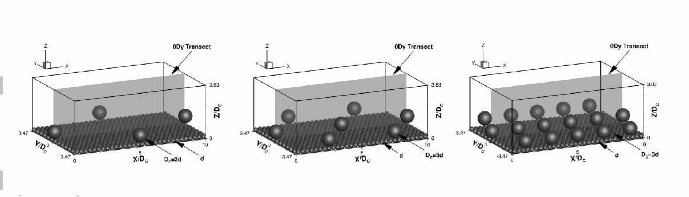

图 1. 三种石块间距 $\lambda=10D_c,5D_c,2D_c$ 的计算域。

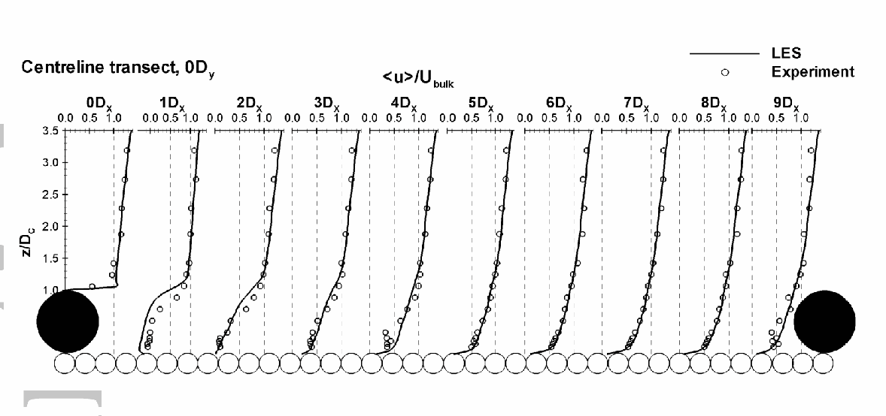

图 2. 中心线测线的归一化流向速度剖面。

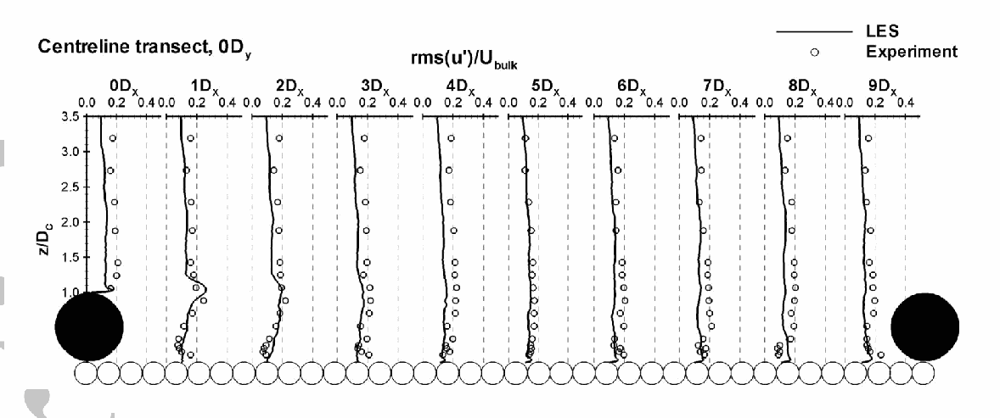

图 3. 中心线测线的归一化流向紊流强度剖面。

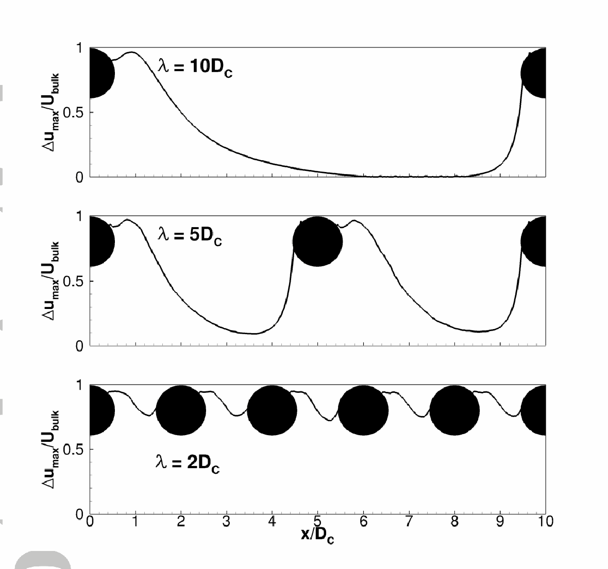

图 4. 石块阵列中心线 $0D_y$ 测线的近床面流动减速剖面。

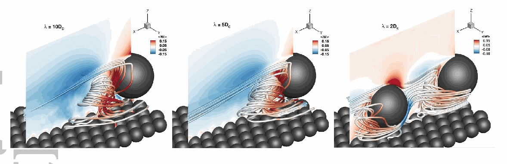

图 5. 不同石块间距模拟中，石块下游的三维流线。

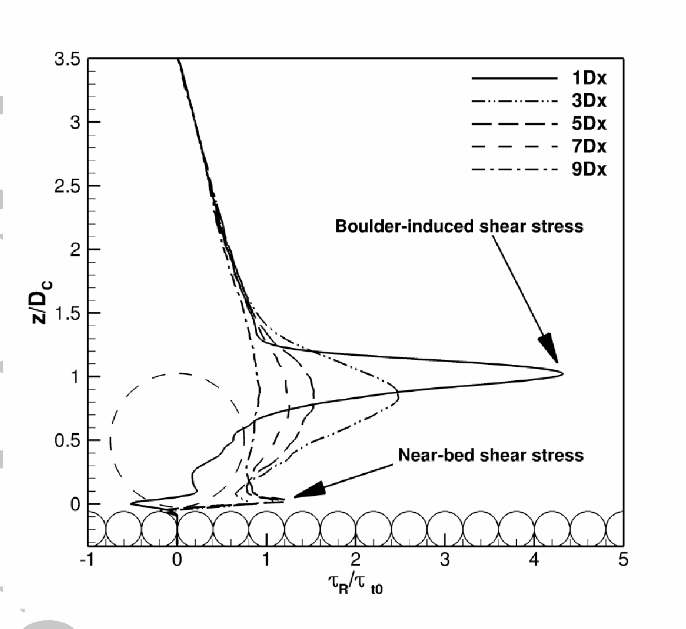

图 6. 大间距组中心线 $1D_x,3D_x,5D_x,7D_x,9D_x$ 位置的雷诺剪应力垂向剖面。

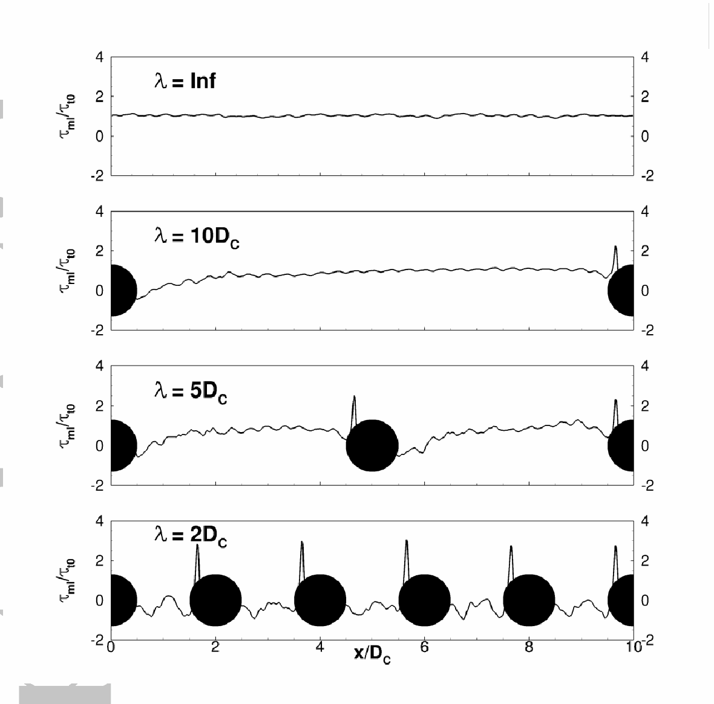

图 7. 石块中心线的近床面剪应力剖面。

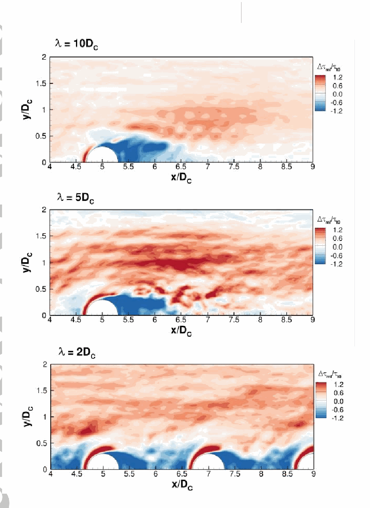

图 8. 近床面剪应力差 $\Delta\tau_{ml}/\tau_{t0}$ 等值图；从上到下分别为 $\lambda=10D_c,5D_c,2D_c$。

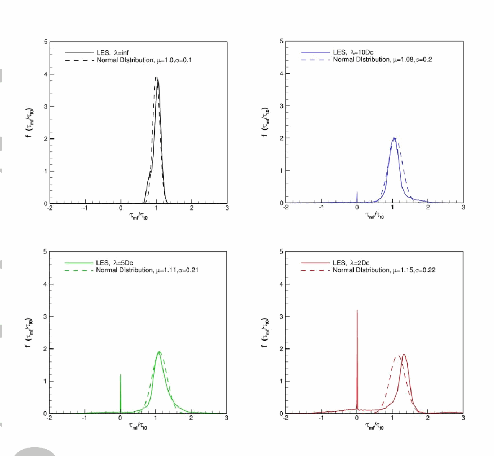

图 9. 各组 $\tau_{ml}/\tau_{t0}$ 的概率密度函数与正态分布概率密度函数比较。

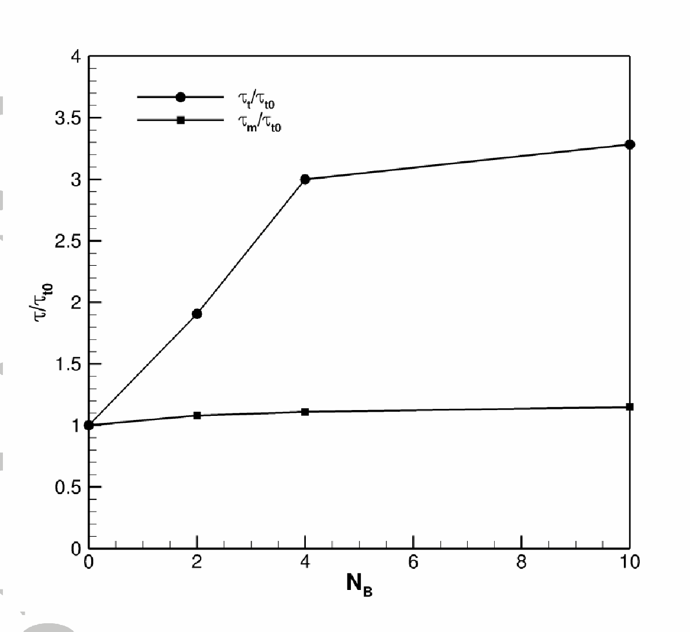

图 10. 不同石块密集度下河段平均剪应力分布。

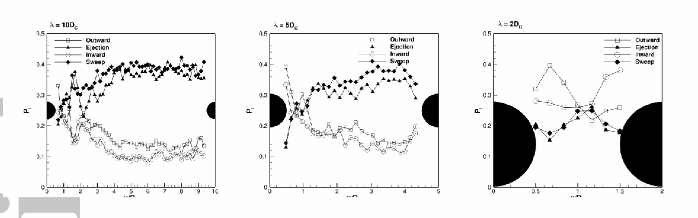

图 11. 石块阵列中心线上各类联合紊流事件的占比。

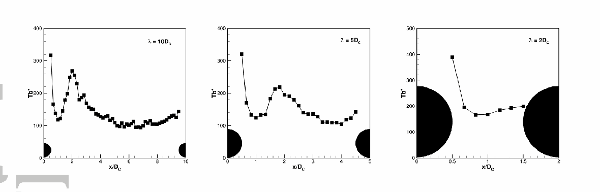

图 12. $0D_y$ 测线无量纲上抛周期分布。

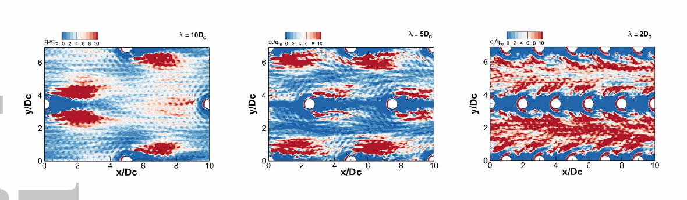

图 13. $\lambda=10D_c,5D_c,2D_c$ 各组推移质输运率等值图。

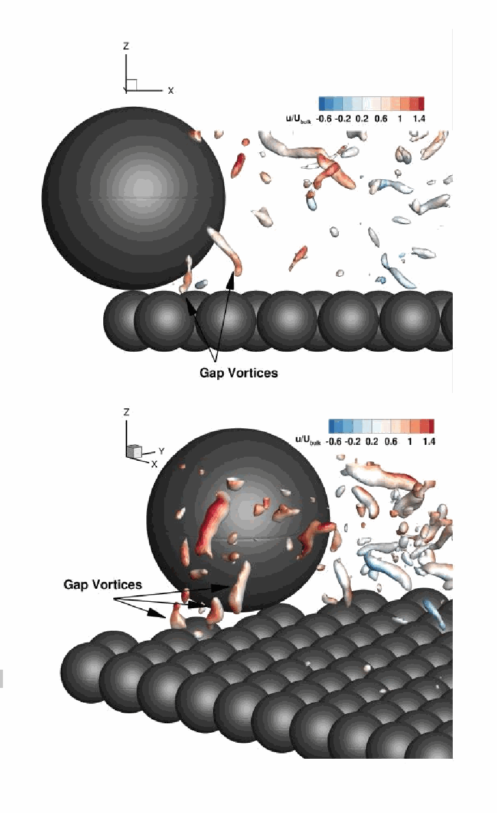

图 14. $Q=120$ 等值面，以石块附近瞬时流向速度着色。

### 表 1. 四组 LES 的流况

| 组别 | $\lambda/D_c$ | $N_B$ | $\Gamma$ | $U_{\rm bulk}$（m/s） | $H/D_c$ | $Re=UH/\nu$ | $D_c/d$ | $u_*/U_{\rm bulk}$ |
|---|---:|---:|---:|---:|---:|---:|---:|---:|
| 无石块／无限间距 | — | 0 | 0.00% | 1 | 3.5 | 150,500 | 3 | 0.078 |
| 大间距 | 10 | 2 | 2.27% | 1 | 3.5 | 150,500 | 3 | 0.101 |
| 中等间距 | 5 | 4 | 4.53% | 1 | 3.5 | 150,500 | 3 | 0.135 |
| 小间距 | 2 | 10 | 11.33% | 1 | 3.5 | 150,500 | 3 | 0.141 |

### 表 2. LES 与 Papanicolaou 等［2012］实验的流况

| 组别 | $H$（m） | $U_{\rm bulk}$（m/s） | $D_c$（m） | $d$（m） | $\nu$（m²/s） | $Re$ |
|---|---:|---:|---:|---:|---:|---:|
| LES | 3.36 | 1 | 0.960 | 0.320 | $2.23\times10^{-5}$ | 150,500 |
| 实验 | 0.193 | 0.78 | 0.055 | 0.019 | $1.0\times10^{-6}$ | 150,500 |

### 表 3. 按式（8）、（12）、（13）计算的河段平均推移质输运率

| 组别 | $\lambda/D_c$ | $q_{s1}^*$：式（8） | $q_{s2}^*$：式（12） | $q_{s3}^*$：式（13） | $q_{s1}^*/q_{s3}^*$ | $q_{s2}^*/q_{s3}^*$ |
|---|---:|---:|---:|---:|---:|---:|
| 无石块 | $\infty$ | $2.4\times10^{-4}$ | $1.3\times10^{-4}$ | $1.4\times10^{-4}$ | 1.7 | 0.90 |
| 大间距 | 10 | $5.1\times10^{-3}$ | $1.4\times10^{-4}$ | $5.5\times10^{-4}$ | 9.3 | 0.25 |
| 中等间距 | 5 | $1.3\times10^{-2}$ | $1.3\times10^{-4}$ | $7.1\times10^{-4}$ | 19.0 | 0.18 |
| 小间距 | 2 | $1.1\times10^{-2}$ | $1.5\times10^{-4}$ | $1.3\times10^{-3}$ | 8.4 | 0.11 |

## 参考文献

原文参考文献书目信息如下，题名与刊名保留英文。

- Bathurst, J. C., D. B. Simons, and R. M. Li (1981). Resistance equation for large-scale roughness. Journal of the Hydraulics Division, 107(12), 1593-1613.
- Bathurst, J. C. (1987). Critical conditions for bed material movement in steep, boulder-bed streams. International Association of Hydrological Sciences Publication, 165, 309-318.
- Bathurst, J. C. (2007). Effect of coarse surface layer on bed-load transport. Journal of Hydraulic Engineering, 133(11): 1192-1205. DOI: 10.1061/(ASCE)0733-9429(2007)133:11(1192)
- Bai, J., H. Fang, and T. Stoesser (2013). Transport and deposition of fine sediment in open channels with different aspect ratios. Earth Surface Processes and Landforms, 38(6), 591-600. DOI: 10.1002/esp.3304
- Bauri, K. P., and A. Sarkar (2016). Flow and scour around vertical submerged structures. Sādhanā, 41(9), 1039-1053.
- Bomminayuni, S., and T. Stoesser (2011). Turbulence statistics in an open-channel flow over a rough bed. Journal of Hydraulic Engineering, 137(11), 1347-1358. DOI: 10.1061/(ASCE)HY.1943-7900.0000454
- Buffington, J. M., and D. R. Montgomery (1997). A systematic analysis of eight decades of incipient motion studies, with special reference to gravel‐ bedded rivers. Water Resources Research, 33(8), 1993-2029.
- Byrd, T. C., D. J. Furbish, and J. Warburton (2000). Estimating depth‐averaged velocities in rough channels. Earth Surface Processes and Landforms, 25(2), 167-173. DOI: 10.1002/(SICI)1096-9837(200002)25:2<167::AID-ESP66>3.3.CO;2-7
- Canovaro, F., E. Paris, and L. Solari (2007). Effects of macro‐ scale bed roughness geometry on flow resistance. Water Resources Research, 43(10), 2457-2463.
- Cao, Z. (1997). Turbulent bursting-based sediment entrainment function. Journal of Hydraulic Engineering, 123(3), 233-236. DOI: 10.1061/(ASCE)0733-9429(1997)123:3(233)
- Cevheri, M., R. McSherry, and T. Stoesser (2016). A local mesh refinement approach for large‐eddy simulations of turbulent flows. International Journal for Numerical Methods in Fluids, 82, 261-285. DOI: 10.1002/fld.4217
- Dey, S., S. Sarkar, S. K. Bose, S. Tait, and O. Castro-Orgaz (2011). Wall-wake flows downstream of a sphere placed on a plane rough wall. Journal of Hydraulic Engineering, 137(10), 1173-1189. DOI: 10.1061/(ASCE)HY.1943-7900.0000441
- Dixen, M., B. M. Sumer, and J. Fredsøe (2013). Numerical and experimental investigation of flow and scour around a half-buried sphere. Coastal Engineering, 73(7), 84-105.
- Ferguson, R. I. (2003). The missing dimension: effects of lateral variation on 1-D calculations of fluvial bedload transport. Geomorphology, 56(1), 1-14.
- Fernandez Luque, R., and R. Van Beek (1976). Erosion and transport of bed-load sediment. Journal of Hydraulic Research, 14(2), 127-144. DOI: 10.1080/00221687609499677
- Ferro, V. (1999). Friction factor for gravel-bed channel with high boulder concentration. Journal of Hydraulic Engineering, 125(7), 771-778. DOI: 10.1061/(ASCE)0733-9429(1999)125:7(771)
- Ferro, V. (2003). ADV measurements of velocity distributions in a gravel-bed flume. Earth Surface Processes and Landforms, 28(7), 707-722. DOI: 10.1002/esp.467.
- Fraga Bugallo, B., and Stoesser T. (2016). Influence of bubble size, diffuser width and flow rate on the integral behavior of bubble plumes, J. Geoph. Res.: Oceans, 121(6), 3887-3904.
- Fraga Bugallo, B. Stoesser, T., Lai, C., and Socolofsky, S. (2016). A large-eddy simulation-based Eulerian-Lagrangian approach to predict bubble plume dynamics, Ocean Modelling 97, 2016, 27-36.
- Ghilardi, T., M. J. Franca, and A. J. Schleiss (2014). Bulk velocity measurements by video analysis of dye tracer in a macro-rough channel. Measurement Science and Technology, 25(3), 035003.
- Hajimirzaie, S. M., A. G. Tsakiris, J. H. Buchholz, and A. N. Papanicolaou (2014). Flow characteristics around a wall-mounted spherical obstacle in a thin boundary layer. Experiments in fluids, 55(6), 1-14. DOI: 10.1007/s00348-014-1762-0
- Kara, S., T. Stoesser, and T. W. Sturm (2012). Turbulence statistics in compound channels with deep and shallow overbank flows. Journal of Hydraulic Research, 50(5), 482-493. DOI: 10.1080/00221686.2012.724194
- Kara, S., T. Stoesser, T. W. Sturm, and S. Mulahasan (2015a). Flow dynamics through a submerged bridge opening with overtopping. Journal of Hydraulic Research, 53(2), 186-195. DOI: 10.1080/00221686.2014.967821
- Kara, S., Stoesser, T., and Sturm, T.W. (2015b). Free-surface versus rigid-lid LES computations for bridge-abutment flow, J. Hydraul. Engg. 141(9), 04015019.
- Kara, M.C., Stoesser, T., and McSherry, R. (2015c). Calculation of fluid structure interaction: methods, refinements, applications, Proc. ICE - Eng. Comput. Mech. 168(2), 59-78.
- Kim, S. J., and T. Stoesser (2011). Closure modeling and direct simulation of vegetation drag in flow through emergent vegetation. Water Resources Research, 47(10). DOI: 10.1029/2011WR010561
- Kim, D., T. Stoesser, and J. H. Kim (2013). The effect of baffle spacing on hydrodynamics and solute transport in serpentine contact tanks. Journal of Hydraulic Research, 51(5), 558-568. DOI: 10.1080/00221686.2013.777681
- Kleinhans, M. G., and L. C. V. Rijn (2002). Stochastic prediction of sediment transport in sand-gravel bed rivers. Journal of Hydraulic Engineering, 128(4), 412-425.
- Lamb, M. P., W. E. Dietrich, and J. G. Venditti (2008). Is the critical Shields stress for incipient sediment motion dependent on channel‐bed slope?. Journal of Geophysical Research: Earth Surface, 113(F2).
- Lenzi, M. A., L. Mao, and F. Comiti (2006). When does bedload transport begin in steep boulder-bed streams? Hydrological Processes, 20(16), 3517-3533.
- Liu, Y., Stoesser, T., Fang, H., Papanicolaou, A., Tsakiris, A. (2017). Turbulent flow over an array of boulders placed on a rough, permeable bed. Computers & Fluids. Accepted for publication. DOI: 10.1016/j.compfluid.2017.05.023
- Luchik, T. S., and W. G. Tiederman (1987). Timescale and structure of ejections and bursts in turbulent channel flows. Journal of Fluid Mechanics, 174, 529-552. DOI: 10.1017/S0022112087000235
- Mao, L., G. P. Uyttendaele, A. Iroumé, and M. A. Lenzi (2008). Field based analysis of sediment entrainment in two high gradient streams located in alpine and andine environments. Geomorphology, 93(3), 368-383.
- Monsalve, A., E. M. Yager, J. M. Turowski, and D. Rickenmann (2016). A probabilistic formulation of bed load transport to include spatial variability of flow and surface grain size distributions. Water Resources Research, 52(5), 3579-3598.
- Nelson, J. M., R. L. Shreve, S. R. McLean, and T. G. Drake (1995). Role of near‐ bed turbulence structure in bed load transport and bed form mechanics. Water Resources Research, 31(8), 2071-2086. DOI: 10.1029/95WR00976
- Nicoud, F., and F. Ducros (1999). Subgrid-scale stress modelling based on the square of the velocity gradient tensor. Flow, turbulence and Combustion, 62(3), 183-200. DOI: 10.1023/A:1009995426001
- Nitsche, M., D. Rickenmann, J. W. Kirchner, J. M. Turowski, and A. Badoux (2012). Macroroughness and variations in reach‐averaged flow resistance in steep mountain streams. Water Resources Research, 48(12), W12518. DOI: 10.1029/2012WR012091
- Ozgoren, M., A. Okbaz, S. Dogan, B. Sahin, and H. Akilli (2013). Investigation of flow characteristics around a sphere placed in a boundary layer over a flat plate. Experimental Thermal and Fluid Science, 44, 62-74. DOI: 10.1016/j.expthermflusci.2012.05.014
- Papanicolaou, A. N., P. Diplas, C. L. Dancey, and M. Balakrishnan (2001). Surface roughness effects in near-bed turbulence: implications to sediment entrainment. Journal of Engineering Mechanics, 127(3), 211-218.
- Papanicolaou, A. N., P. Diplas, N. Evaggelopoulos, and S. Fotopoulos (2002). Stochastic incipient motion criterion for spheres under various bed packing conditions. Journal of Hydraulic Engineering, 128(4), 369-380.
- Papanicolaou, A. N., C. M. Kramer, A. G. Tsakiris, T. Stoesser, S. Bomminayuni, and Z. Chen (2012). Effects of a fully submerged boulder within a boulder array on the mean and turbulent flow fields: Implications to bedload transport. Acta Geophysica, 60(6), 1502-1546. DOI: 10.2478/s11600-012-0044-6
- Parker, G. (2008). Transport of gravel and sediment mixtures. Sedimentation engineering: Processes, measurements, modeling, and practice, 110, 165-252. 10.1061/9780784408148.ch03
- Patel, S. B., P. L. Patel, and P. D. Porey (2013). Threshold for initiation of motion of unimodal and bimodal sediments. International Journal of Sediment Research, 28(1), 24-33.
- Radice, A. and C. K. Tran. (2012). Study of sediment motion in scour hole of a circular pier. Journal of Hydraulic Research, 50(1), 44-51.
- Recking, A. (2009). Theoretical development on the effects of changing flow hydraulics on incipient bed load motion. Water Resources Research, 45(4).
- Rickenmann, D. (2001). Comparison of bed load transport in torrents and gravel bed streams. Water resources research, 37(12), 3295-3305. DOI: 10.1029/2001WR000319
- Scheingross, J. S., E. W. Winchell, M. P. Lamb, and W. E. Dietrich (2013). Influence of bed patchiness, slope, grain hiding, and form drag on gravel mobilization in very steep streams. Journal of Geophysical Research: Earth Surface, 118(2): 982-1001. DOI:10.1002/jgrf.20067
- Segura, C., and J. Pitlick (2015). Coupling fluvial‐ hydraulic models to predict gravel transport in spatially variable flows. Journal of Geophysical Research Earth Surface, 120(5), 834-855.
- Shamloo, H., N. Rajaratnam, and C. Katopodis (2001). Hydraulics of simple habitat structures. Journal of Hydraulic Research, 39(4), 351-366.
- Stoesser, T., G. P. Salvador, W. Rodi, and P. Diplas (2009). Large eddy simulation of turbulent flow through submerged vegetation. Transport in porous media, 78(3), 347-365. DOI: 10.1007/s11242-009-9371-8
- Stoesser, T. (2010). Physically realistic roughness closure scheme to simulate turbulent channel flow over rough beds within the framework of LES. Journal of Hydraulic Engineering, 136(10), 812-819. DOI: 10.1061/(ASCE)HY.1943-7900.0000236
- Strom, K., A. N. Papanicolaou, N. Evangelopoulos, and M. Odeh (2004). Microforms in gravel bed rivers: formation, disintegration and effects on bedload transport. Journal of Hydraulic Engineering, 130(6), 554-567.
- Strom, K. B., and A. N. Papanicolaou (2007). ADV measurements around a cluster microform in a shallow mountain stream. Journal of Hydraulic Engineering, 133(12), 1379-1389. DOI: 10.1061/(ASCE)0733-9429(2007)133:12(1379)
- Tsakiris, A. G., A. T. Papanicolaou, S. M. Hajimirzaie, and J. H. Buchholz (2014). Influence of collective boulder array on the surrounding time-averaged and turbulent flow fields. Journal of Mountain Science, 11(6), 1420-1428. DOI: 10.1007/s11629-014-3055-8
- Tsutsui, T. (2008). Flow around a sphere in a plane turbulent boundary layer. Journal of Wind Engineering and Industrial Aerodynamics, 96(6), 779-792. DOI: 10.1016/j.jweia.2007.06.031
- Uhlmann, M. (2005). An immersed boundary method with direct forcing for the simulation of particulate flows. Journal of Computational Physics, 209(2), 448-476. DOI: 10.1016/j.jcp.2005.03.017
- Wiberg, P. L., and J. D. Smith (1991), Velocity distribution and bed roughness in high-gradient streams, Water Resour. Res., 27, 825– 838
- Willmarth, W. W., and L. K. Sharma (1984). Study of turbulent structure with hot wires smaller than the viscous length. Journal of Fluid Mechanics, 142, 121-149. DOI: 10.1017/S0022112084001026
- Xu, H., J. Lu, and X. Liu (2008). Non-uniform sediment incipient velocity. International Journal of Sediment Research, 23(1), 69-75.
- Yager, E. M., J. W. Kirchner, and W. E. Dietrich (2007). Calculating bed load transport in steep boulder bed channels. Water Resources Research, 43(7). DOI: 10.1029/2006WR005432
- Yager, E. M., W. E. Dietrich, J. W. Kirchner, and B. W. McArdell (2012), Prediction of sediment transport in step-pool channels, Water Resour. Res., 48, W01541, doi:10.1029/2011WR010829.
- Yager, E. M., and M. W. Schmeeckle (2013). The influence of vegetation on turbulence and bed load transport. Journal of Geophysical Research: Earth Surface, 118(3), 1585-1601. DOI: 10.1002/jgrf.20085
- Zedler, E. A., and R. L. Street (2001). Large-eddy simulation of sediment transport: currents over ripples. Journal of Hydraulic Engineering, 127(6), 444-452. DOI: 10.1061/(ASCE)0733-9429(2001)127:6(444)

## 校订备注

1. 原文摘要与结论称：采用河段平均总剪应力可“高估多达 25 倍”，采用河段平均表面摩擦剪应力会“低估 11%”。但表 3 所列最大比值 $q_{s1}^*/q_{s3}^*=19.0$；小间距组 $q_{s2}^*/q_{s3}^*=0.11$，对应约 89% 的低估。正文第 3.5 节也明确给出约 89%。这两组概括数字与表格无法直接对应，阅读结论时应优先查表。
2. 原文式（13）与式（16）分别把局部输运率、局部剪应力在面积上直接积分，却将左边称为河段平均量；两式均未写面积归一化因子，按所列式子的量纲与表 3 用法难以相容。式（14）临界剪应力下标分别写作 $mlc$ 和 $mcl$，后文又用 $cml$；译文保留原式。
3. 原文式（6）孔径条件的分子、分母同为 $|u'w'|$，其比值恒为 1，无法表达通常的象限分析孔径筛选；式（7）用 $|u'w'|$ 加权，却在正文把所得 $P_{i,H}$ 称为事件“频率”。若需复现象限分析，须查作者原始计算实现。
4. 原文无石块组的四种紊流事件占比给为 20%、35%、15%、40%，总和 110%。同一段还以“上抛周期在再附点附近增加”推断“上抛更频繁”，方向也不一致。
5. 原文称 $q_{s1}^*$ 随间距减小而增加、总剪应力法的高估随间距减小而增大；表 3 中中间距组的 $q_{s1}^*=1.3\times10^{-2}$ 和高估比值 19.0 均高于小间距组的 $1.1\times10^{-2}$ 和 8.4。因此这些关系不能解释为三组之间严格单调。
