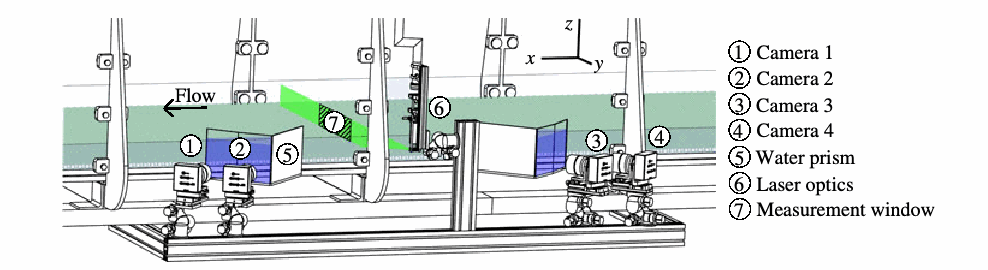
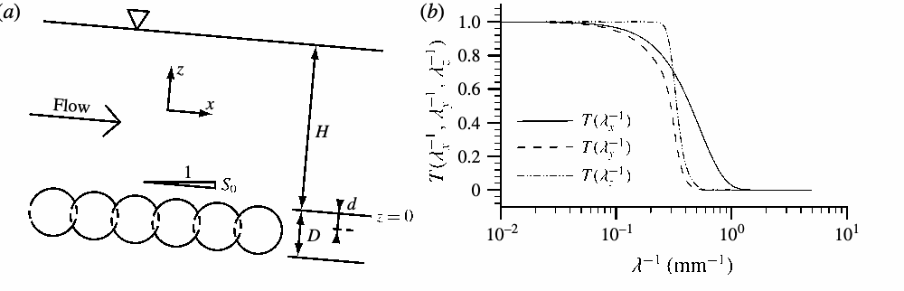
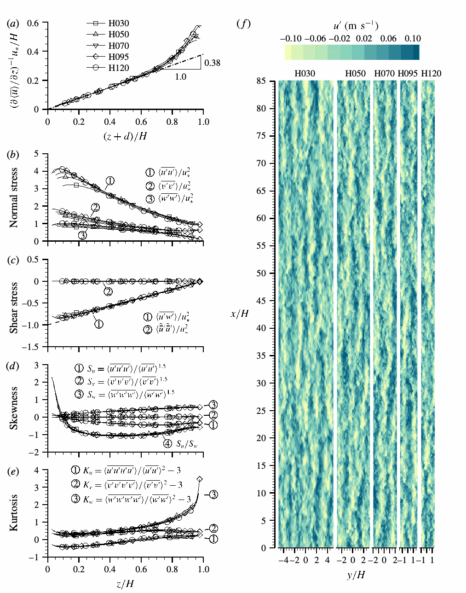
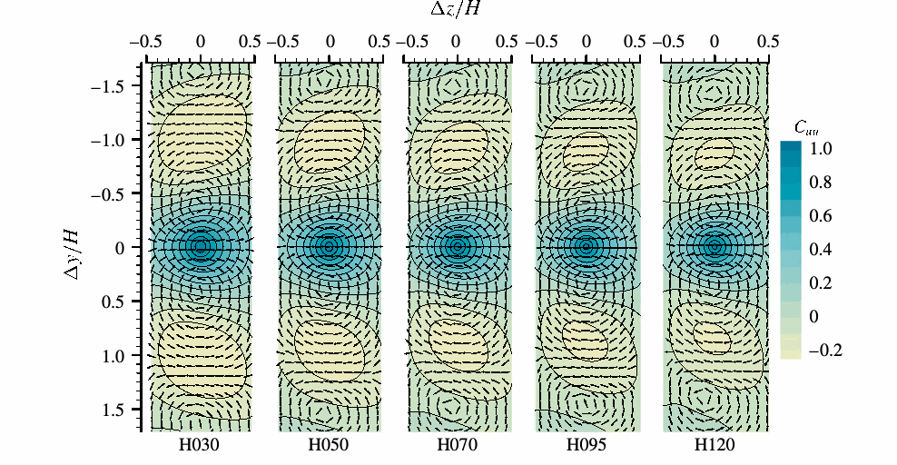
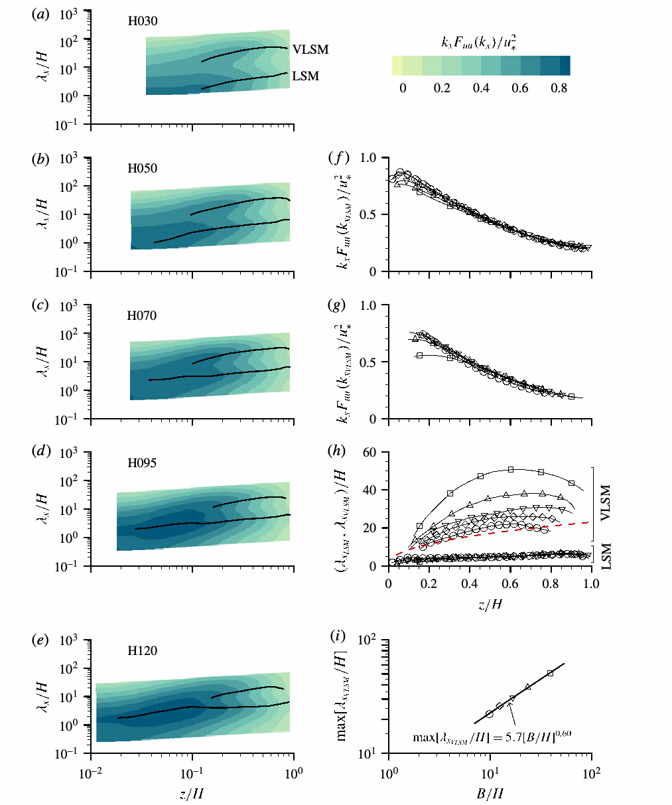
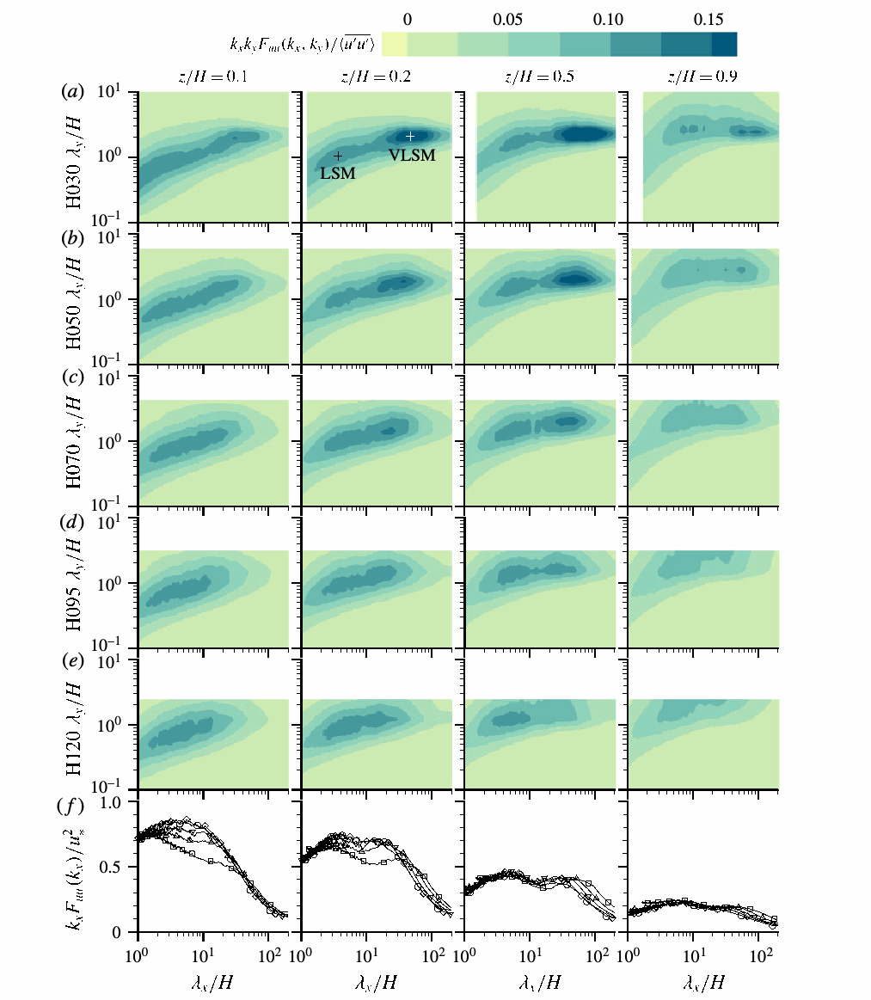

# 粗糙河床明渠流中的超大尺度运动

S. M. Cameron、V. I. Nikora、M. T. Stewart。原文：*Very-large-scale motions in rough-bed open-channel flow*，*Journal of Fluid Mechanics* 814（2017）：416–429，DOI：10.1017/jfm.2017.24。作者机构：英国阿伯丁大学工程学院。2016 年 8 月 9 日收稿，2017 年 1 月 5 日修订、1 月 7 日录用、2 月 9 日首次在线发表。原文以 CC BY 4.0 开放获取。

## 摘要

对粗糙河床明渠流（OCF）进行长时段粒子图像测速，发现流向速度的预乘谱呈双峰分布，对应大尺度运动（LSM）和超大尺度运动（VLSM）。边界层、管流及封闭水槽流中存在 VLSM 早已得到认可，但明渠中一直缺乏有力证据，本文数据填补了这一空白。明渠中的 LSM 和 VLSM 长度尺度遵循不同的标度关系：LSM 流向长度随水深缩放；VLSM 流向长度不能仅用水深缩放，还可能取决于渠宽、粗糙高度或黏性长度等尺度。LSM 的横向范围随离床高度增大而增加，VLSM 的横向尺度则维持在约两倍水深。两类运动的起源和性质尚待查明，但标度差异提示，粗糙河床明渠中的 VLSM 可能独立形成，而非 LSM 沿流向排列的结果。

**关键词：**紊流边界层；紊流。

## 1. 引言

Kim 与 Adrian［1999］发现管流的流向速度预乘谱有两个峰，并将对应尺度分别称为大尺度运动（LSM）和超大尺度运动（VLSM）。他们提出，VLSM 可能由 LSM 沿流向排列形成，而 LSM 本身也许是更小的发夹形涡的集合。此后其他流动中也发现 VLSM，但其起源仍不清楚；另有研究者提出，VLSM 可由大尺度不稳定性独立形成［如 Hwang 与 Cossu，2010］。对于边界层，Hutchins 与 Marusic［2007］提出“超结构”一词；它们可能与 VLSM 同源，却因管流、封闭水槽流和边界层的边界条件根本不同而呈现不同特征。Monty 等［2009］比较三类流动的预乘谱，发现管流与封闭水槽流十分相似；边界层的超结构则出现在对数层，在外层显著减弱。

明渠流中 VLSM 的存在尚未得到确证。明渠具有自由水面等特性，与管流、封闭水槽流和边界层明显不同；若把边界层视为外部流动，管流和封闭水槽流视为内部流动，明渠流兼有两类流动的特征，故特别适合研究 VLSM 的出现和动力学。

管流、封闭水槽流和边界层的 VLSM 与超结构研究多在光滑壁面进行。光滑壁面条件也与某些明渠相关，但实际工程中多数是粗糙河床明渠。河流和水渠的床面稳定性、泥沙输运、混合及水力阻力评估，都需要更深入理解粗糙河床明渠的紊流，因此本文聚焦这种流动。

此前明渠紊流运动的认识主要限于不超过 5～8 倍水深的尺度［Nezu 与 Nakagawa，1993；Roy 等，2004；Nezu，2005；Franca 与 Brocchini，2015］，但也有更大尺度运动的迹象。Grinvald 与 Nikora［1988］在数条低地河流中进行了最长 4 h 的流速测量，发现速度谱的低频峰。依泰勒“冻结”紊流假设换算，对应波长可达数倍渠宽或上百倍水深；他们将其解释为“水平”紊流，并显示这些运动调制水深尺度运动及近床面紊流。考虑到其他流动中 VLSM 的发现，低频峰也可能反映低、高动量的超长蜿蜒带状结构；Franca 与 Lemmin［2005］的野外数据支持后一种解释。实验室研究［如 Nezu，2005］也提示明渠中存在类似其他流动 VLSM 的长旋转运动。Adrian 与 Marusic［2012］综述了明渠中偶有报告的此类运动，指出研究紊流结构时的蜿蜒 VLSM 与明渠研究中的长条胞状运动之间联系密切，可能是同一种现象。下一步需要测量精度、分辨率和覆盖范围足够的研究，才能可靠识别、量化明渠 VLSM。若确认其存在，评估它们在河流及水力工程相关过程中的作用，可能促进理论和工程模型改进。

因此，本文用持续 2 h 的粒子图像测速（PIV）识别并量化粗糙河床明渠中的 VLSM，重点研究天然与工程中普遍存在、却研究较少的低和中等相对淹没深度流况。第 2 节介绍实验设施、仪器和流程；第 3 节报告背景水力条件、整体统计量、速度相关性、谱及紊流尺度；第 4 节总结主要发现。

## 2. 实验设置

### 2.1 明渠水槽与流况

实验在阿伯丁明渠设施（AOCF）进行。设施由宽 1.18 m、长 18 m 的循环明渠水槽，以及装有 PIV 系统和辅助仪器的电动测量架组成（图 1）。竖向板条堰调节回水曲线；固定在测量架上的超声位移传感器沿程测量水面。实验时，整个槽底及部分入流池共 19.2 m 的范围覆盖单层直径 $D=16$ mm 的玻璃球（图 2a）。用穿孔不锈钢板辅助，使球体精确排列为六角密堆；垫片将板面调平至误差不超过 $\pm0.25$ mm。

各组相对淹没深度 $H/D$ 为 1.9～7.5（表 1），摩阻流速保持 $u_*=0.042$ m/s。粗糙雷诺数 $D^+=Du_*/\nu=605$，各组相同，按 Cameron 等［2008］的依据，属于完全粗糙流。摩阻雷诺数 $H^+=Hu_*/\nu$ 为 1140～4540，与 Kim 和 Adrian［1999］管流实验的 1058～3175，以及 Hutchins 和 Marusic［2007］边界层测量的 1020～19960 有可比范围。弗劳德数远小于 1，水面平坦、无可见表面波；测得水位标准差为 0.28～0.45 mm。各组流动均匀，水面坡度与床面坡度的最大差异为 $2.5\times10^{-5}$；流量标准差不超过 $0.0002$ m³/s，表明流动稳定。

### 2.2 立体粒子图像测速

四相机立体 PIV 系统在垂直于床面、横贯水槽的平面内测量全部三个速度分量（图 1）。测量平面覆盖全水深，横向宽 330 mm，距水槽入口 12.7 m（超过 $100H$）；Stewart［2014］在等同流况下证实，此距离足以使试验断面流动充分发展。四台相机（Dalsa 4M60，2352×1728 像素，7.4 µm 像素间距，有效填充率 60%，每像素 8 位；Nikon 60 mm 镜头、f/16 光圈）相对光片对称布置：1、4 号相机为 $\pm45^\circ$，2、3 号为 $\pm38^\circ$。激光器为 Oxford Lasers 双腔 Nd:YAG，波长 532 nm、每脉冲 100 mJ；经球面和柱面透镜形成厚 2.4 mm 的光片。

示踪粒子为 Microsphere Technology Ltd 制造的镀银空心玻璃微球，直径 20～32 µm，密度 0.8～1.0 g/cm³，浓度 11 mg/L。所得粒子图像直径为 2.0 像素，图像浓度为每像素 0.02 个粒子。光路中的水棱镜减小空气—水界面的畸变和全内反射。表 1 五组流况下，每台相机以每秒 32 对图像连续记录 120 min，直接写入高速磁盘阵列。

图像分析先将各相机图像逆畸变映射到共同网格，再分别通过互相关提取二维速度矢量场。所用算法标记为 IDM-BL48-SincLP1.5-GD9：BL48 表示使用 Blackman 权重、48×48 像素的查询窗；SincLP1.5 表示每轮算法迭代后，在矢量场上应用 20×20 网格点、Blackman 加权、低通因子为 1.5 的 sinc 核；GD9 表示 9×9 像素（0.9×0.9 mm）的网格间距，相邻查询窗重叠 81.25%。算法采用迭代变形法［IDM；Astarita 与 Cardone，2005］，八轮迭代后达到满意的收敛。

图 2b 给出光片厚度与相关算法共同作用的可分离传递函数 $T(1/\lambda_x,1/\lambda_y,1/\lambda_z)$，$\lambda_x,\lambda_y,\lambda_z$ 为各方向波长。测得速度谱 $\phi_{ii}^{m}$ 与实际谱 $\phi_{ii}$ 满足 $\phi_{ii}^{m}(\boldsymbol{k})=\phi_{ii}(\boldsymbol{k})\{|T(\boldsymbol{k})|^2\}$，其中波数向量 $\boldsymbol{k}=(2\pi/\lambda_x,2\pi/\lambda_y,2\pi/\lambda_z)$。图 2b 表明，测量系统能分辨波长大于约 3 mm 的紊流，而更小尺度受衰减。此分辨率足以识别和量化本文关注的 LSM、VLSM；不过近床面的二阶整体统计量可能分辨不足，即小于 3 mm 的尺度对紊流应力的贡献会受到一定抑制。

依据相机标定得到的局部视角，将各相机的二维矢量场重建为三分量矢量场。四相机系统可对每个速度分量提供两次独立估计，计算整体统计量、相关函数和谱时用它减少测量噪声的贡献；更多细节见 Cameron 等［2013］。

## 3. 结果

### 3.1 整体统计量

本节检验测量区流动能否按二维处理、平均速度剖面是否具有对数标度区，以及相对淹没深度是否影响最高四阶的整体统计量。这些量是后文 LSM、VLSM 特征的背景，二者可能与流动的整体特性相关。

实验的宽深比很大（$B/H\gtrsim10$）。按传统认识［Nezu 与 Nakagawa，1993］，水槽中心应近似满足二维条件，即 $\partial\bar{\cdot}/\partial y=\bar v=\bar w=0$，上横线表示时间平均。不过，本研究记录时间很长、采样误差小，能在所有时间平均速度统计量中探测到周期约 $2H$ 的微弱横向波动，与二次流的存在相符。为压缩数据并抑制弱横向波动，作者在宽 $n\times2H$ 的横向范围做空间平均；H030 至 H120 五组的 $n$ 依次为 3、2、1、1、1。此平均以尖括号表示。远离侧壁时，便可合理期望 $\partial\langle\bar{\cdot}\rangle/\partial y\approx\langle\bar v\rangle\approx\langle\bar w\rangle\approx0$。粗糙元顶部以上的流向双重平均动量方程因此简化为

$$-\rho gS_0=\frac{\partial}{\partial z}\left\{-\rho\langle\widetilde{\bar u}\widetilde{\bar w}\rangle-\rho\langle u'w'\rangle+\mu\frac{\partial\langle\bar u\rangle}{\partial z}\right\}.\tag{3.1}$$

$\rho$ 为流体密度，$\mu$ 为动力黏度；瞬时第 $i$ 个速度分量分解为 $u_i=\langle\bar u_i\rangle+\widetilde{\bar u}_i+u'_i$，波浪号和撇号分别表示空间和时间脉动。离开床面后，形状诱导应力 $-\rho\langle\widetilde{\bar u}\widetilde{\bar w}\rangle$ 可衡量二次流对总动量通量的贡献。图 3c 显示，它的无量纲量 $\langle\widetilde{\bar u}\widetilde{\bar w}\rangle/u_*^2$ 很小，在 $z/H=0.5$ 约为 $-0.006$；$\langle u'w'\rangle/u_*^2$ 则接近二维明渠预期的线性趋势。因此，二次流对总动量通量的贡献极小，所研究流动区域可按二维处理。

壁面流动中，平均速度随离壁距离的对数变化的重叠区仍是理论与实验研究的重点［Adrian 与 Marusic，2012］。争论主要涉及对数区边界、冯·卡门系数 $\kappa$ 的适当数值及不同流动间是否改变。已有数据提示 $\kappa$ 可能并非普适：光滑壁管流约 0.41、边界层约 0.38、封闭水槽约 0.37［Nagib 与 Chauhan，2008］，明渠约 0.41［Nezu 与 Nakagawa，1993］。不过其测量不确定度仍较高，例如 $\pm0.02$［Bailey 等，2014］，未来数据仍可能修正这些估计。

粗糙河床流动的对数区分析还多一个自由参数：零平面位移 $d$，它设定对数律的虚拟床面高程。Nikora 等［2002］提出，从概念上可将它看作大尺度附着涡感知的床面高度，涡的尺寸因而应与离此高度的距离成线性比例。包含 $d$ 的对数律微分形式为

$$\left(\frac{\partial\bar u}{\partial z}\right)^{-1}=\frac{\kappa(z+d)}{u_*},$$

其中 $z=0$ 位于粗糙元顶部。这种“诊断”形式有利于分析实验数据，因为对数行为的小偏差容易发现；逆速度梯度与高度的线性关系，也可简明估计 $d$ 和 $\kappa$。本文先以此关系确认对数区及其边界，再求 $d$ 与 $\kappa$。低相对淹没深度（小 $H/D$）时，粗糙元可能扰乱对数层并改变 $\kappa$［Dittrich 与 Koll，1997］；$H/D$ 充分小时甚至可能不存在对数层［Jiménez，2004］。低淹没明渠缺少高质量数据，形成对数层所需条件尚未确定，本文数据可帮助澄清。

图 3a 显示，至少在 $z/D>0.5$、$z/H<0.5$ 内，对数关系能很准确地近似测量数据。用 $z/D>0.5$、$z/H<0.4$ 的逆速度梯度回归估计，H030、H050、H070、H095、H120 的 $d$ 分别为 1.8、1.8、1.6、1.1、2.0 mm，对应虚拟床面稍低于粗糙元顶部。估计值随相对淹没深度无清晰趋势，差异可能来自实验不确定度。令人意外的是，尽管各组相对淹没深度很低，数据仍支持 $\kappa\approx0.38$、上界可达 $z/H\approx0.5$ 的对数区（图 3a），远超过其他流动中预期的约 $z/H=0.15$。这一宽范围提示，低淹没条件下的对数律可能由不同于高淹没、光滑床面流动的物理机制形成，需要不同理论解释；有待其他流况、粗糙类型的精确数据进一步研究。

二阶统计量 $\langle u'u'\rangle,\langle v'v'\rangle,\langle w'w'\rangle$（图 3b）表明，近床面速度方差随淹没深度增大而有上升趋势。先前已有此现象的报告［Bayazit，1976；Dittrich 与 Koll，1997］，其物理机制仍不清楚。各组速度偏度和峰度（图 3d、e）近似重合，提示其分布可能与相对淹没深度无关。明渠偏度、峰度数据不多，但本文结果与 Hurther 和 Lemmin［2000］、Nikora 和 Goring［2000b］及 Bigillon 等［2006］在定性上相符。流向速度与床面法向速度的偏度比值在水深中部趋于 $-1.05\pm0.05$（图 3d），与 Raupach［1981］提出的三阶矩成比例关系一致。

### 3.2 大尺度条带

图 3f 的“准瞬时”速度场由时间序列按泰勒冻结紊流假设重建，可见高、低动量流体沿横向交替排列、沿流向伸长的区域，外观与 Hutchins 和 Marusic［2007］在边界层中识别的超结构很相似。无法直接从这种速度场准确辨认大条带的长度尺度，因为它们常蜿蜒、渐隐或与其他结构融合，没有清晰的起点与终点。下一节将用相关函数和谱提取特征尺度，并检验相对淹没深度的可能影响。

### 3.3 相关函数与谱

假设横向均匀，选取二点相关张量的若干分量，在图 4 绘出 $z_0=0.5H$ 的结果。原文式（3.2）为

$$C_{u_i u_j}(\Delta y,\Delta z,z_0)=\frac{\sum_y\sum_t u'_i(y,z_0,t)u'_j(y+\Delta y,z_0+\Delta z,t)}{\left\{\sum_y\sum_t[u'_i(y,z_0,t)]^2\right\}^{0.5}\left\{\sum_y\sum_t[u'_j(y+\Delta y,z_0+\Delta z,t)]^2\right\}^{0.5}}.\tag{3.2}$$

$t$ 为时间索引，$z_0$ 为参考高度，$\Delta y,\Delta z$ 为位移增量。将 $-C_{uw}$ 和 $-C_{uv}$ 作为矢量分量绘图［同 Marusic 与 Hutchins，2008］，显示流向速度脉动与重复出现、尺度约为水深的反向旋转胞状结构相关；这些结构可能与图 3f 的大尺度条带有关。采用矢量 $(-C_{uw},-C_{uv})$ 是为了与 Marusic 和 Hutchins［2008］一致；他们指出，这种图近似等于以参考点负向 $u$ 事件为条件的线性随机估计。为清楚显示图 4 中四个重复胞状结构，矢量长度统一设为 1，避免相关值大小差异削弱视觉辨识。图 4 显示，淹没深度增大时，胞状结构的横向间隔逐渐缩小，$C_{uu}$ 相关的中央瓣也缩小。它们使人联想到明渠侧壁附近的二次流图案［Nezu 与 Nakagawa，1993］。明渠二次流的起源、动力学与能量仍在研究中；一种可能性是，渠壁使蜿蜒 VLSM 优先排列，从而形成二次流［另见 Adrian 与 Marusic，2012］。

为识别流场中的主导尺度，本文采用其他 LSM、VLSM 研究使用的预乘波数谱［Kim 与 Adrian，1999；Hutchins 与 Marusic，2007；Monty 等，2009］。流向速度分量的谱为 $k_xF_{uu}(k_x)/u_*^2$，其中 $k_x=2\pi/\lambda_x$，$\lambda_x$ 为流向波长。先在频率域计算，并对 225 个各长 32 s 的时间窗求平均；又在假设横向均匀的条件下，于测量范围横向平均。以局部平均速度 $\langle\bar u\rangle$ 为对流速度，按泰勒冻结紊流假设把频率谱转换成波数谱。作者承认在大尺度应用此假设有局限，适当的对流速度也不确定；在 $z/H<0.1$ 处，它可能偏离局部平均速度［Nikora 与 Goring，2000a；Cameron 与 Nikora，2008；Stewart，2014］。因此本文谱估计可能偏离真实波数谱，但方法与其他研究一致。

图 5 的谱在外层流动中显示两个特征长度尺度，与光滑壁面管流和封闭水槽流的谱相似［Monty 等，2009］。依 Kim 与 Adrian［1999］的术语，较短尺度对应 LSM，较长尺度对应 VLSM。因结构横向蜿蜒，谱峰尺度未必直接等于紊流结构的物理长度［Hutchins 与 Marusic，2007］；但它仍提供了便于跨研究比较的一致基准。近床面 $z/H<0.1$ 的谱图由单一长度尺度主导；较大水深组则显示一个分叉点，两个尺度从此开始分开。LSM 与 VLSM 波长 $\lambda_{x\mathrm{LSM}},\lambda_{x\mathrm{VLSM}}$ 处的预乘谱峰幅度大致相同（图 5f、g）。近床面的峰幅随淹没深度变化，与前述整体速度方差趋势一致。

将所有实验中两类运动的长度尺度以水深归一化（图 5h），LSM 的估计值落在同一条曲线上；VLSM 的估计值却随淹没深度，等价地随宽深比，分层。图 5h 还给出 Monty 等［2009］根据管流和封闭水槽数据提出的经验式 $\lambda_{x\mathrm{VLSM}}/H=23(z/H)^{3/7}$。它在本文数据中构成一条下包络线，接近淹没深度最高的 H120 组。

将每组 $\lambda_{x\mathrm{VLSM}}/H$ 的最大值绘于图 5i，得到等价经验拟合：

$$\max\!\left[\lambda_{x\mathrm{VLSM}}/H\right]=5.7(B/H)^{0.60}=75(H/D)^{-0.60}=3500(H^+)^{-0.60}. $$

因为所有实验中 $B/D$ 和 $Du_*/\nu$ 都固定，$B/H$、$H/D$、$H^+$ 三种水深相关归一化量给出等价拟合，现有数据不能确定真正的控制尺度。作者推测，较小的 LSM 与相对淹没深度无关（图 5h），因此由 $H/D$ 决定 VLSM 尺度的解释似乎较不可信。其他流动中的雷诺数 $H^+$ 对 VLSM 长度影响较小［Balakumar 与 Adrian，2007］，尽管预乘谱幅度可能依赖雷诺数［Hutchins 与 Marusic，2007］。渠宽 $B$ 与 $\lambda_{x\mathrm{VLSM}}$ 同数量级，且水流宽度可能起限制作用，所以宽深比 $B/H$ 或许是最可信的尺度；仍需更多数据确认。

二维预乘谱 $k_xk_yF_{uu}(k_x,k_y)/\langle u'u'\rangle$ 表示能量在流向波长 $\lambda_x$ 和横向波长 $\lambda_y$ 上的分布。作者先在横向波数—频率混合域计算，再以泰勒假设将频率换算为流向波数。图 6 的二维谱清晰显示 VLSM：在较浅的 H030～H070 组中，能量集中于 $\lambda_y\approx2H$ 附近的窄横向尺度范围。较深的 H095、H120 组看起来有较短的 VLSM 横向波长，但也可能因为这些组的 PIV 测量窗相对于 $H$ 较小，横向波数 $k_y$ 分辨率不足。LSM 的横向尺度随高度 $z$ 增加，流向长度也随之增加；VLSM 横向尺度则看似不随 $z$ 变化。

这些数据表明，在粗糙河床明渠中，VLSM 与 LSM 的流向和横向长度遵循不同标度。这提示 VLSM 可能独立形成，而非较小 LSM 沿流向排列形成。要确定两者的标度关系与形成机制，仍需更多实验数据。

## 4. 结论

粗糙河床明渠的预乘谱在外层呈双峰，对应 LSM 与 VLSM；流向速度的瞬时场中也可见后一类运动形成的大尺度条带。二点相关提示，VLSM 可能与重复出现、水深尺度的反向旋转胞状结构有关；其形态类似时间平均流中的二次流，也可能与之相关。两类运动的能量含量大致相同，不过近床面谱形及峰幅随相对淹没深度有所变化。

以水深归一化后，LSM 的流向长度在各实验间重合，VLSM 的长度则不能重合；后者表现出对 $H^+$、$H/D$ 或 $B/H$ 的幂律型依赖。本实验保持渠宽、颗粒尺寸和摩阻流速不变，故无法唯一确定这三者哪一个引起了 VLSM 归一化长度的变化；还须进一步数据检验哪种标度最合适且有物理依据。作者现阶段只推测宽深比 $B/H$ 可能是实际控制尺度。VLSM 的横向长度在各高度约固定于 $2H$，LSM 的横向长度则随高度变化。标度差异提示两类运动可能彼此独立形成。尽管本研究相对淹没深度低，数据还支持 $\kappa\approx0.38$、上界延至 $z/H\approx0.5$ 的对数标度区。

均匀明渠流有几项区别于管流、封闭水槽流和边界层的特征：（1）边界层厚度沿流向增长，明渠水深则不变；（2）明渠侧壁、河床和自由水面交汇处的角部产生紊流各向异性，并诱发二次流；在很宽的渠道，远离侧壁处的二次流可能减弱甚至消失；（3）自由水面是可移动边界，可能显著影响流动动力学。因此，明渠是有别于其他几类流动的壁面约束紊流。明渠中 VLSM 的发现显示不同壁面流动在超大尺度上有一定共同性，并可能帮助解释 VLSM 的起源及动力学。

## 致谢

研究得到英国工程与自然科学研究理事会（EPSRC）的两项资助：“紊流诱导泥沙侵蚀与近床面输运的高分辨率数值和实验研究”（EP/G056404/1）及“粗糙河床自由水面流的床面摩擦：理论框架、粗糙流态与量化”（EP/K041169/1）。作者感谢与 I. Marusic 的讨论及三位匿名审稿人的意见。

## 原文图表

以下图像从所给 PDF 裁取，图中英文坐标、图例保留原样，图题译为中文。

图 1. 阿伯丁明渠设施的测量断面。编号依次为相机 1～4、水棱镜、激光光学器件和测量窗口；箭头示流向。

图 2. （a）水深 $H$、颗粒直径 $D$、床面坡度 $S_0$ 和对数律零平面位移 $d$ 的定义；（b）PIV 测量的传递函数。

图 3. （a～e）整体统计量；（f）$z/H=0.5$ 的“准瞬时”速度脉动分布。为使图清楚，符号每隔十个测量点显示一次。

图 4. $z_0/H=0.5$ 时的二点相关函数 $C_{uu},C_{uw},C_{uv}$。$C_{uw},C_{uv}$ 以单位长度矢量 $(-C_{uw},-C_{uv})$ 显示，以便辨认旋转结构。

图 5. （a～e）预乘谱；（f）LSM、（g）VLSM 谱峰幅度；（h）两类运动谱峰的波长；（i）VLSM 最大波长与宽深比。符号见图 3。（h）中的虚线为 Monty 等［2009］提出的 $\lambda_{x\mathrm{VLSM}}/H=23(z/H)^{3/7}$。

图 6. （a～e）二维预乘谱等值图；（f）一维预乘谱。符号同图 3。一维谱的 95% 置信区间约为所示 $k_xF_{uu}(k_x)/u_*^2$ 数值的 0.94～1.07 倍。

### 表 1. 各组实验流况

$H$ 从粗糙元顶部起算；$B$ 为渠宽，$D$ 为颗粒直径，$Q$ 为流量，$S_0$ 为床面坡度，$U=Q/(BH)$ 为断面平均流速，$u_*=\sqrt{gHS_0}$ 为摩阻流速，$R=UH/\nu$ 为整体雷诺数，$Fr=U/\sqrt{gH}$ 为弗劳德数，上标 $+$ 表示用黏性长度 $\nu/u_*$ 归一化，$g$ 为重力加速度。

| 组别 | $H$（mm） | $Q$（m³/s） | $U$（m/s） | $S_0$ | $u_*$（m/s） | $R$ | $H^+$ | $D^+$ | $H/D$ | $B/H$ | $Fr$ |
|---|---:|---:|---:|---:|---:|---:|---:|---:|---:|---:|---:|
| H030 | 30.1 | 0.0153 | 0.431 | 0.00600 | 0.042 | 11,700 | 1,140 | 605 | 1.9 | 39.2 | 0.79 |
| H050 | 50.3 | 0.0275 | 0.463 | 0.00360 | 0.042 | 21,000 | 1,900 | 605 | 3.1 | 23.5 | 0.66 |
| H070 | 70.5 | 0.0404 | 0.486 | 0.00257 | 0.042 | 30,800 | 2,670 | 605 | 4.4 | 16.7 | 0.58 |
| H095 | 94.9 | 0.0569 | 0.508 | 0.00189 | 0.042 | 43,400 | 3,590 | 605 | 5.9 | 12.4 | 0.53 |
| H120 | 120.1 | 0.0745 | 0.526 | 0.00150 | 0.042 | 56,900 | 4,540 | 605 | 7.5 | 9.8 | 0.48 |

## 参考文献

原文参考文献书目信息如下，题名与刊名保留英文。

- ADRIAN, R. J. & MARUSIC, I. 2012 Coherent structures in flow over hydraulic engineering surfaces. J. Hydraul Res. 50 (5), 451–464.
- ASTARITA, T. & CARDONE, G. 2005 Analysis of interpolation schemes for image deformation methods in PIV. Exp. Fluids 38 (2), 233–243.
- BAILEY, S. C. C., VALLIKIVI, M., HULTMARK, M. & SMITS, A. J. 2014 Estimating the value of von Kármán’s constant in turbulent pipe flow. J. Fluid Mech. 749, 79–98.
- BALAKUMAR, B. J. & ADRIAN, R. J. 2007 Large- and very-large-scale motions in channel and boundary-layer flows. Phil. Trans. R. Soc. Lond. A 365 (1852), 665–681.
- BAYAZIT, M. 1976 Free surface flow in a channel of large relative roughness. J. Hydraul Res. 14 (2), 115–126.
- BIGILLON, F., NIÑO, Y. & GARCIA, M. H. 2006 Measurements of turbulence characteristics in an open-channel flow over a transitionally-rough bed using particle image velocimetry. Exp. Fluids 41 (6), 857–867.
- CAMERON, S., NIKORA, V. & COLEMAN, S. 2008 Double-averaged velocity and stress distributions for hydraulically-smooth and transitionally-rough turbulent flows. Acta Geophys. 56 (3), 642–653.
- CAMERON, S. M. & NIKORA, V. I. 2008 Eddy convection velocity for smooth- and rough-bed open-channel flows: particle image velocimetry study. In Proceedings. of International Conference on Fluvial Hydraulics, River Flow 2008, Turkey, vol. 1, pp. 143–150. Kubaba Congress Department and Travel Services.
- CAMERON, S. M., NIKORA, V. I., ALBAYRAK, I., MILER, O., STEWART, M. & SINISCALCHI, F. 2013 Interactions between aquatic plants and turbulent flow: a field study using stereoscopic PIV. J. Fluid Mech. 732, 345–372.
- DITTRICH, A. & KOLL, K. 1997 Velocity field and resistance of flow over rough surfaces with large and small relative submergence. Intl J. Sedim. Res. 12 (3), 21–33.
- FRANCA, M. J. & BROCCHINI, M. 2015 Turbulence in rivers. In Rivers – Physical, Fluvial and Environmental Processes, pp. 51–78. Springer.
- FRANCA, M. J. & LEMMIN, U. 2005 Cross-section periodicity of turbulent gravel-bed river flows. In Proceedings of the 4th River, Coastal and Estuarine Morphodynamics: RCEM 2005, vol. 1, pp. 203–210. CRC Press.
- GRINVALD, D. I. & NIKORA, V. I. 1988 River Turbulence. Hydrometeoizdat.
- HURTHER, D. & LEMMIN, U. 2000 Shear stress statistics and wall similarity analysis in turbulent boundary layers using a high-resolution 3-D ADVP. IEEE J. Ocean. Engng 25 (4), 446–457.
- HUTCHINS, N. & MARUSIC, I. 2007 Evidence of very long meandering features in the logarithmic region of turbulent boundary layers. J. Fluid Mech. 579, 1–28.
- HWANG, Y. & COSSU, C. 2010 Self-sustained process at large scales in turbulent channel flow. Phys. Rev. Lett. 105 (4), 044505.
- JIMÉNEZ, J. 2004 Turbulent flows over rough walls. Annu. Rev. Fluid Mech. 36, 173–196.
- KIM, K. C. & ADRIAN, R. J. 1999 Very large-scale motion in the outer layer. Phys. Fluids 11 (2), 417–422.
- MARUSIC, I. & HUTCHINS, N. 2008 Study of the log-layer structure in wall turbulence over a very large range of Reynolds number. Flow Turbul. Combust. 81 (1-2), 115–130.
- MONTY, J. P., HUTCHINS, N., NG, H. C. H., MARUSIC, I. & CHONG, M. S. 2009 A comparison of turbulent pipe, channel and boundary layer flows. J. Fluid Mech. 632, 431–442.
- NAGIB, H. M. & CHAUHAN, K. A. 2008 Variations of von Kármán coefficient in canonical flows. Phys. Fluids 20 (10), 1518.
- NEZU, I. 2005 Open-channel flow turbulence and its research prospect in the 21st century. J. Hydraul. Engng 131 (4), 229–246.
- NEZU, I. & NAKAGAWA, H. 1993 Turbulence in Open Channel Flows. Balkema.
- NIKORA, V. & GORING, D. 2000a Eddy convection velocity and Taylor’s hypothesis of ‘frozen’ turbulence in a rough-bed open-channel flow. J. Hydrosci. Hydraul. Engng 18 (2), 75–91.
- NIKORA, V. & GORING, D. 2000b Flow turbulence over fixed and weakly mobile gravel beds. J. Hydraul. Engng 126 (9), 679–690.
- NIKORA, V., KOLL, K., MCLEAN, S., DITTRICH, A. & ABERLE, J. 2002 Zero-plane displacement for rough-bed open-channel flows. In Proceedings of International Conference on Fluvial Hydraulics, River Flow 2002, Belgium, vol. 1, pp. 83–91. Balkema.
- NIKORA, V., MCEWAN, I., MCLEAN, S., COLEMAN, S., POKRAJAC, D. & WALTERS, R. 2007 Double-averaging concept for rough-bed open-channel and overland flows: theoretical background. J. Hydraul. Engng 133 (8), 873–883.
- RAUPACH, M. R. 1981 Conditional statistics of Reynolds stress in rough-wall and smooth-wall turbulent boundary layers. J. Fluid Mech. 108, 363–382.
- ROY, A. G., BUFFIN-BELANGER, T., LAMARRE, H. & KIRKBRIDE, A. D. 2004 Size, shape and dynamics of large-scale turbulent flow structures in a gravel-bed river. J. Fluid Mech. 500, 1–27.
- STEWART, M. T. 2014. Turbulence structure of rough-bed open-channel flow. PhD thesis, University of Aberdeen.
