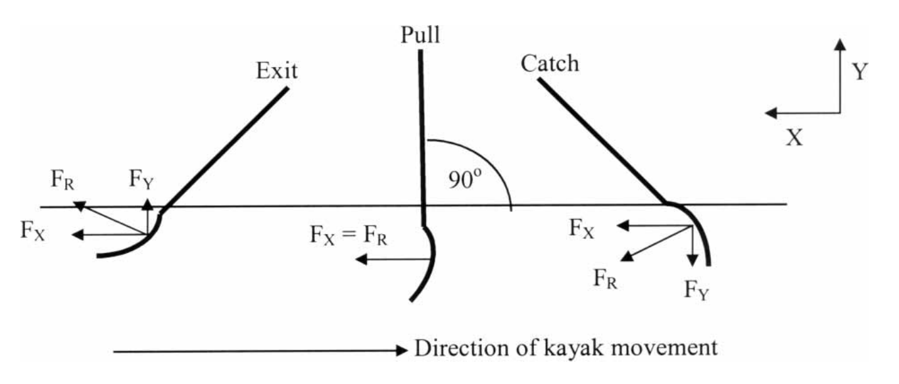
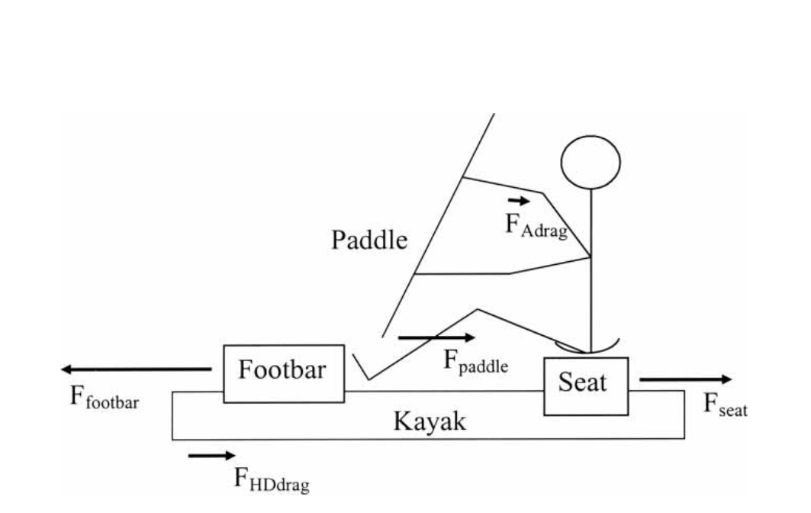
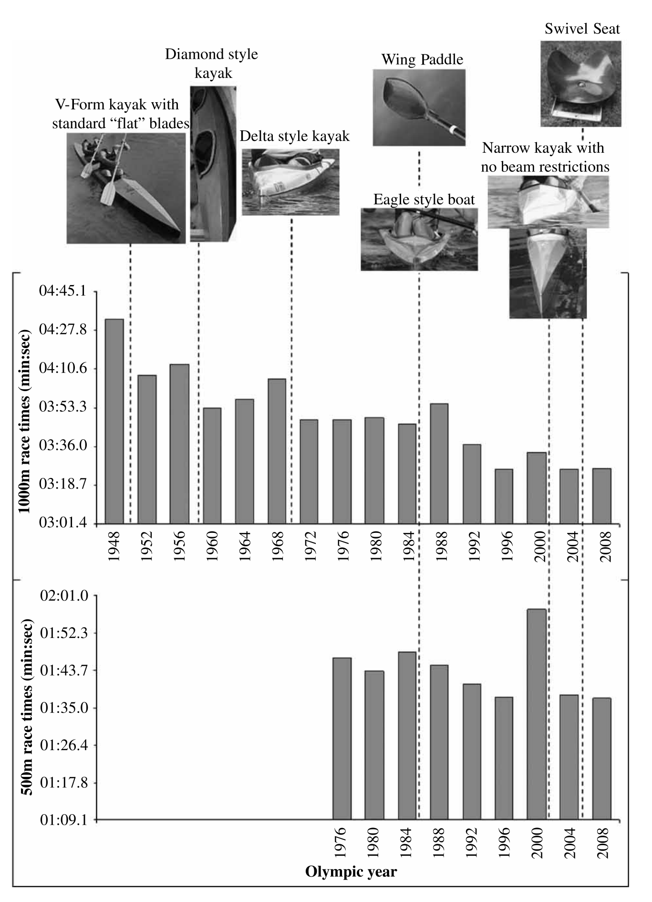

# 皮艇划桨表现的决定因素

原文：Jacob S. Michael、Richard Smith、Kieron B. Rooney，*Determinants of kayak paddling performance*，*Sports Biomechanics*，8(2)，167–179，2009。DOI：10.1080/14763140902745019。收稿：2008 年 5 月 21 日；修订：2009 年 1 月 8 日；接受：2009 年 1 月 13 日。

## 摘要

成功的皮艇划桨表现要求划手兼具力量和技术，并配备设计适当的艇与桨叶，以有效发挥前向推进功率、尽量减小不利的阻力。更深入地了解划艇的生物力学特征和器材设计，可帮助教练与运动员改善表现。研究比赛压力下发生的生物力学过程，是缩短比赛用时的重要一步。皮艇成为运动项目以来，人们对静水皮艇生物力学的理解和相关研究不断增加，这在一定程度上促进了成绩提高；这些信息也可能帮助教练为运动员制定更有针对性的训练方案。本文综述静水皮艇的生物力学原理和若干器材设计改动，并讨论它们与提高划桨表现的关系。

关键词：生物力学；力；皮艇；桨。

## 引言

广义的划艇是以人力驱动艇在水中行进，形式包括休闲划桨、皮艇球、马拉松比赛，以及奥运会的激流回旋和静水竞速两类皮划艇项目。皮艇划手坐在带甲板的艇内，双腿向前伸展，使用双叶桨推进；独木舟通常是开放式艇，划手跪姿使用单叶桨。本文聚焦奥运会 500 m 和 1000 m 静水竞速皮艇。

完成比赛距离所用的时间是皮艇表现的最终评价指标。为提高艇速，划手须在每个划桨周期产生较高的平均功率，并在桨叶上形成较大的平均力，同时具备良好的技术和充足的代谢能力。以 2008 年北京奥运会相应比赛成绩为例，500 m 和 1000 m 的用时分别为 1 min 37 s 和 3 min 26 s（Mann 和 Kearney，1980；Logan 和 Holt，1985；Sanderson 和 Martindale，1986；Aitken 和 Neal，1992；Michael 等，2008）。

划手输出功率的主要部分用于维持艇相对稳定的速度，即功率＝阻力×艇速；按阻力随速度变化的常用关系，所需功率与艇速的三次方成正比。艇速的小幅波动也影响功率需求，但程度较小。虽然尚无研究直接测量艇内脚踏杆和座椅上产生的具体力，已有关于划手技术与划桨动作模式的研究仍有助于形成科学描述。因此，需要一篇综合综述来连接运动科学研究者与运动员、教练。

## 动力学数据分析

### 生物力学因素对表现的影响

比赛中，划手需全程以最大努力推进皮艇。整段比赛的平均速度是各划桨周期平均速度的平均值；在每个周期内，划手的动态运动和经桨传递的力不断变化，使艇速发生波动。Kendal 和 Sanders（1992）及 Zumerchik（1997）报告的平均艇速为 4.63–5.38 m/s。平均艇速与完成比赛所用时间成反比。

拉桨阶段，桨叶没入水中并划动；当推进力超过水与空气的阻力时，艇加速。两次划桨之间没有推进力施加，阻力使艇减速（Mann 和 Kearney，1980）。艇的平均速度由划手产生的推进作用和艇受到的阻力共同决定（Baudouin 和 Hawkins，2002）。将艇所受的力（动力学）与艇、划手的运动（运动学）结合分析，才能判断它们对艇速的影响并寻找改进表现的办法。运动学测量虽重要，但仅描述运动，不直接说明产生运动所需的力。

### 阻力

空气和水对艇的阻力方向与艇的速度矢量相反，使半浸在水中的皮艇减速。水动力阻力是主要部分；空气阻力也会减速，但作用较小，对艇速变化的影响有限（Jackson，1995；Millward，1987）。作者将总阻力表示为：

$$
F_{TD}=F_{HD}+F_{AD},\tag{1}
$$

其中 $F_{TD}$ 为总阻力，$F_{HD}$ 为水动力阻力，$F_{AD}$ 为空气阻力。水动力阻力又由船体与水摩擦产生的摩擦阻力（表面阻力）、船体迫使水流分开而产生的压差阻力（形状阻力），以及船体使水加速、形成波浪所产生的兴波阻力组成（Pendergast 等，2005）：

$$
F_{HD}=F_{HDf}+F_{HDp}+F_{HDw}.\tag{2}
$$

$F_{HDf}$、$F_{HDp}$、$F_{HDw}$ 分别为水动力摩擦阻力、压差阻力和兴波阻力。作者认为，艇的总阻力主要来自摩擦阻力，也部分来自兴波阻力。湿表面积影响表面阻力。只有划手的推进作用克服艇、划手和桨受到的阻力，艇才能向前运动。由于划桨推进力是间歇施加的，当桨的推进分力超过阻力时艇加速，回桨阶段没有桨的推进力时艇减速。因此，改善表现需要尽量减小艇和划手的阻力，并增强有助于推进的因素。

对给定的划手功率输出，能用于提高抗阻平均速度的可调因素有限。划手体重会影响兴波阻力和艇的湿表面积；艇的浸没横截面积也影响阻力，而该面积取决于浮力与作用在艇上的垂向振荡力之间的平衡。减小湿表面积或摩擦系数可降低半浸艇体的摩擦阻力（Jackson，1995）。作者据此追问划手体型如何影响表现。为提高功率与体重之比，划手似乎应追求更精瘦的体型（Ackland 等，2003）；作者假定减重不改变该运动员的功率输出，只改变给定功率下可达到的艇速。考虑到船体设计、形状已有优化，以及国际皮划艇联合会当时的竞赛规则禁止纹理表面等船体涂层（2007 年静水竞速规则第 8.3 节），桨叶／桨力中用于推进的分量看来是需要重点提高的变量。

增大桨叶面积是提高桨力的一种办法。较大的桨叶可减少桨叶在水中滑移造成的功率损失；若桨频和桨程不变，每桨则需要更大的用力。划桨的目标是尽可能高效地达到最大速度。要维持整个比赛距离的能量需求，教练和运动员的经验性意见认为，使用大桨叶时通常会降低桨频。因此，除了优化划手的功率体重比，还需要使桨叶大小与比赛距离、技术水平、代谢能力和力量相匹配。

### 桨力

桨传递桨叶与水相互作用的力；划手又通过身体、脚踏杆和座椅把相关作用传至艇。划手经桨叶对水施力，从而产生前向运动。桨叶与水的相互作用可分解为阻力 $D$ 和升力 $L$，二者相对于桨叶与水的相对运动方向分别平行和垂直（Jackson，1995）。水对桨叶的阻力妨碍桨叶相对水运动，但它在艇的推进方向上有分量；升力则垂直于相对水流方向。传统平板桨主要利用阻力推进；研究者曾推测，常用翼桨可更有效地利用升力而非阻力产生推进力（Sanders，1998）。不过，Sanders 和 Baker（1998）指出，升力虽然对翼桨推进重要，却未必在整个划桨周期内始终是作用于桨叶的主导力。

推进方向上的升力和阻力大小随桨在艇的矢状面内的角位移而变化（Baudouin 和 Hawkins，2002）。若划手施加在桨上的力超过水对桨叶的抵抗作用，桨叶会相对水滑移，使部分功率以传给水的动能形式耗散。推动桨叶相对水运动所消耗的能量虽属于损失，却也是必要的：传给水的动量使艇获得相反方向的动量（Pendergast 等，2005）。Jackson（1995）用涡环力学解释，翼桨叶沿离艇斜向的路径运动时传入水、因而损失的能量，少于传统桨叶沿与艇平行的路径运动的情形。该研究报告翼桨使效率从 74% 增至 89%，并将其与翼桨形成较大的涡结构联系起来；作者进一步以涡结构增大解释艇的加速。

Aitken 和 Neal（1992）及 Mann 和 Kearney（1980）均提出，在拉桨阶段，当桨杆相对水面垂直时，最优桨力和艇的水平加速度峰值会出现。此时作者认为桨叶上的阻力垂直于桨叶，施加的力大部分用于水平推进（图 1）；这个姿态增大桨叶与水的接触面积，从而提高拉桨效率（Sanders 和 Kendal，1992）。由此推论，有效的划桨应尽快达到尽可能大的峰值力、尽量维持该力，然后尽快降至零。有多位作者假设，能够在更长距离内施加并保持最优力，艇的平均速度就会更高。

图 1. 桨通过推进阶段（拉桨阶段）时的力分解。$F_X$ 为 X 方向力，$F_Y$ 为 Y 方向力，$F_R$ 为合力；原图还标出入水、拉桨、出水以及艇的运动方向。图中的 $F_X$ 箭头与艇的前进方向相反，原文未明确箭头表示桨叶对水的力，还是水对桨叶的力，见文末备注。

本文将一次划桨定义为艇一侧桨叶开始入水至另一侧桨叶开始入水之间的过程，包括桨叶在水中的拉桨阶段和出水后准备下一桨的回桨阶段。使用传统桨叶时，Mann 和 Kearney（1980）发现桨叶达到竖直姿态的时点距入水时刻为 23% 的划桨时间；Plagenhoef（1979）报告为 20%–26%。Aitken 和 Neal（1992）以及 Baker（1998）将应变片装在桨杆上，测量精英划手使用翼桨时产生的力；这些研究只测力，未考察桨叶姿态。Baker（1998）的结果显示，在约 100 桨／min 时，桨叶在水中停留 0.47 s，原文将其写作划桨时间的 70%，峰值力为 375 N。两项研究的力峰值均出现在入水后约 35%–40% 的时间。Aitken 和 Neal（1992）的数据表明，力—时间曲线的最大峰值并未出现在桨叶首次看似竖直时。虽然 Plagenhoef（1979）及 Mann 和 Kearney（1980）研究的是传统桨，Kendal 和 Sanders（1992）指出翼桨仍遵循相近的划桨阶段顺序。这提示翼桨的最大力未必出现在拉桨阶段起点，可能在该阶段稍后的某一时刻出现。

### 脚踏杆与座椅处的力

划手通过对脚踏杆和座椅施力，把自身产生的功率传递给皮艇（Shephard，1987；图 2）。原文指出，当时尚无文献测量艇内产生的全部力，因此还需综合测量，以研究划手如何高效地推进艇。仅考虑推进方向的力分量，作者给出下式，用于分析划手与艇的受力：

$$
F_{paddle}+F_{footbar}-F_{seat}=m_{paddler}a_{paddler},\tag{3}
$$

$$
F_{footbar}-F_{seat}-F_{totaldrag}=m_{kayak}a_{kayak}.\tag{4}
$$

$F_{paddle}$、$F_{footbar}$ 和 $F_{seat}$ 分别为桨、脚踏杆和座椅相关的力；$m_{paddler}$、$a_{paddler}$ 是划手的质量与加速度，$m_{kayak}$、$a_{kayak}$ 是艇的质量与加速度。$F_{totaldrag}$ 为阻碍艇前进的总阻力，包括空气与水动力阻力。图 2 是原文的受力示意，图内还标出空气阻力和水动力阻力；箭头与公式的正方向及各力究竟作用于哪一个物体未得到一致说明，见文末备注。

图 2. 原文所示艇、桨、划手受力分量。Footbar 为脚踏杆，Seat 为座椅，Kayak 为皮艇，Paddle 为桨。

赛艇等相近水上项目已使用专门设计的测力系统。Caplan 和 Gardner（2005）发现，赛艇运动员对脚蹬板施加的力影响划桨有效性，从而影响艇的表现；在测得拉力和速度后，研究者报告平均功率随脚蹬板的使用方式和位置变化而增减。另有研究把测力平台和应变片装在测功仪上，测量赛艇运动员的力，并提出脚部施力与桨叶上的力直接相关（Elliott 等，1993；MacFarlane 等，1997；Buck 等，2000；Hase 等，2004）。

赛艇与皮艇存在关键结构差别：赛艇的桨经独立于运动员身体的桨架与艇机械连接，桨力可通过桨架直接传至艇；皮艇的力则须经划手身体传递（Smith 和 Loschner，2002）。赛艇运动员坐姿拉桨，桨借杠杆作用带艇前行；两种运动的驱动阶段，运动员身体仍都会向脚部传力，该力与艇驶向终点的运动方向相反。Smith 和 Loschner（2002）指出，赛艇艇速的重要变量包括桨架上的推进力、脚蹬板上的推进力，以及水和空气阻力；这些力的合力是艇的净受力。赛艇滑动座椅在推进方向上几乎无摩擦，座椅力可忽略；皮艇座椅在该方向上固定，尽管可能绕竖轴转动，仍参与构成艇的净推进力。因此，只测桨力的既有皮艇研究未能测出艇内产生的净推进力，未来还需同时测量脚踏杆和座椅的力。

## 运动学数据分析

运动学变量描述运动本身，不涉及产生运动的力，包括线位移和角位移、速度及加速度。研究者通常用运动分析与视频系统，根据附着于解剖标志点的标记轨迹记录这些数据。

### 划手与桨的运动

皮艇研究曾用视频分析寻找与有效技术相关的因素。Mann 和 Kearney（1980）、Sanders 和 Kendal（1992）等研究大多只使用单台摄像机，在二维视野中分析。这样可以测量桨叶入水与出水角度、桨程、手的轨迹及桨叶在水中的时间等表现相关信息（Sperlich 和 Baker，2000）。Kendal 和 Sanders（1992）展示双机位的益处：一台摄像机镜头轴线垂直于运动平面，从侧面拍摄；另一台镜头轴线位于艇预期运动平面内，从正面拍摄。正面数据补充侧面数据，使身体各部分的运动和桨的路径得到更完整的描述。

Baker 等（1999）用两台固定摄像机拍摄精英划手以比赛速度、使用翼桨通过长 6 m 的标定区间（约两个完整划桨周期）。研究者将八个身体部位、两个桨上标记和两个艇上标记数字化，通过直接线性变换（DLT）换算成真实三维坐标。不过，该研究是初步工作，仅比较男女划手的技术，未能就关键运动学技术因素得出结论。

综合这些视频研究，桨叶尖端和关节中心的路径被划分为四个阶段：入水、拉桨、出水和回桨。划手在艇前方较远且靠近纵轴处使桨叶入水；身体向划桨侧转动，同侧腿推脚踏杆；随后桨叶向后、向侧方运动直至出水。同侧膝、髋同时伸展，帮助髋向后移动并使躯干转动；该转动涉及胸椎、肩带和骨盆。完成出水动作后进入回桨位，同侧手略高于肩向前伸至手臂充分伸展，再使桨叶入水，开始该侧下一次划桨。对侧的划桨动作在第一侧出水动作完成时开始，并贯穿第一侧回桨阶段。原文对两侧交替动作的叙述依其划桨阶段定义保留。

上述二维关节中心轨迹仍不能准确呈现四肢的完整运动模式，方法可能过于简单，难以详细评价皮艇技术。作者认为需要可精确监测全身运动的完整分析系统，并以三维运动分析为复杂全身模型取得和研究有用的输入数据。三维关节力矩分析有助于更准确估计划手的动作模式与功率输出。三维采集允许将标记放在二维视角会遮挡的解剖标志点上，例如骶骨和左右髂后上棘；这些标记比仅观察矢状面运动更能反映骨盆节段运动学。结合适当的力数据，三维运动学还可估计额状面和横断面上的重要力与力矩。

### 艇的运动

划手交替在艇两侧划桨时，也会移动身体质量以保持艇的横向稳定。Mann 和 Kearney（1980）解释，桨入水前划手试图把桨向前伸时，划手重心比艇运动得快；入水后，重心速度下降，并在划桨过程中保持稳定。随后艇被拉至划手身体下方，艇速升至高于划手重心速度。身体重心和艇速的这些变化会引起不利运动，降低艇速及划桨效率。由于艇在低摩擦环境中运动，划手的大质量一旦加速，相对较轻的艇便可能产生放大的反作用；因此他们建议，保持划手重心在划桨过程中近乎匀速，是避免艇不规则运动的一种更经济的动作方式。

赛艇研究曾用陀螺仪测量艇的三维角速度（Wagner 等，1993；Loschner 等，2000）。以艇自身的轴线为参照，偏航（绕竖轴转动）和横摇（绕纵轴转动）对艇运动的干扰被报告为明显大于纵摇（绕横轴转动）。研究者推测，过多的艇体运动会间歇增大湿表面积，进而增加水动力阻力；若艇绕各轴保持平衡，阻力可能下降，划手每桨也可能更高效，使其以较少功维持甚至提高艇速。然而，皮艇的偏航、纵摇和横摇等不利运动对平均艇速的影响，在当时文献中尚未得到充分研究。Loschner 等（2000）提出，如能记录艇姿态，就可把它与运动员技术联系起来。另一项研究空白是艇的垂向加速度，即独立于纵摇的上下起伏；它同样会造波并耗散能量，影响整体效率。

## 皮艇器材与设计的发展

皮艇比赛的胜负差距往往很小，运动员会利用能把比赛时间缩短几分之一秒的因素。在运动员功率相同的条件下，这些因素可能来自器材或技术。静水皮艇成为竞技项目以来，桨和艇的设计屡经改进，但均须符合国际皮划艇联合会规则；竞速皮艇座椅是当时较新的改动对象。

奥运会男子单人皮艇 500 m 与 1000 m 的夺冠用时总体逐年缩短（图 3），但特殊天气会打断趋势，例如 2000 年的强逆风。某些艇或桨改型的时期出现较明显的阶跃式用时下降。作者认为器材技术进步有助于皮艇系统的整体表现，但艇与桨可能在相近时期同时改动，不能据这些时间关联判定哪项改型造成了用时下降，或两者如何共同作用。20 世纪 80 年代末桨的设计出现重大变化，比赛用时随后下降；80 年代起艇设计的快速变化也可能与表现改善有关（图 3）。此外，训练方法和技术的变化同样需要纳入解释。

图 3. 男子奥运会 K1 500 m（1976–2008 年）和 K1 1000 m（1948–2008 年）夺冠用时；图中标注若干重要设计改动。上图为 1000 m，下图为 500 m。时间轴上的变化不单独证明器材改动与成绩变化之间存在因果关系。

### 桨的发展

作者指出，当时没有直接检验桨设计对划桨成绩影响的专项研究；但已有文献提出，桨设计变化可能是促进成绩提高最成功的器材技术进步（Jackson，1995；Sanders 和 Baker，1998；Robinson 等，2002）。由一对对称平板桨叶构成的传统桨，已在很大程度上被非对称翼桨取代。翼桨叶截面类似机翼，自 20 世纪 80 年代中后期设计并改进以来，较快被视为较优设计，也改变了划桨技术并伴随成绩改善。

图 3 显示，1988 年至 1992 年奥运会之间，尤其是 1000 m 项目，夺冠用时有明显阶跃式下降，翼桨也在这一时期投入使用；作者明确指出，不能把全部成绩改善归于桨设计。多位研究者考察了翼桨带来的技术变化。传统桨主要依赖阻力，翼桨则更依赖升力；为形成可参与推进的升力，桨叶路径须具有横向分量，即与艇的运动方向垂直的分量，不能只沿传统桨的近似平行路径运动。Sanders 和 Baker（1998）认为翼桨横移形成的涡结构是成绩改善的一个重要原因；Jackson 等（1992）还提出翼桨叶本身的效率较高。

### 艇的发展

Robinson 等（2002）认为，从历史上看，比赛用时的改善与艇设计进步密切相关。计算机技术促进了竞速皮艇设计参数的优化。2000 年 11 月以前，国际皮划艇联合会对艇宽和外形设有限制，要求艇达到最低宽度；此后艇宽限制被取消，催生了新的船型。较窄船体减少了湿表面积和迎流面积，但运动员也报告，艇越窄越不稳定。

考察 20 世纪 70 年代初以来的艇设计，很难将船型影响与桨、训练方法的影响分开（图 3）。这段时期船型多次改变，却未次次伴随明显的成绩提高。解除艇宽限制之前，厂家曾利用甲板上方向外突出的“翼”满足规则要求的宽度，同时让水下船体保持很窄，形成所谓尖顶甲板（peaked deck）。这种变化可能对应成绩的逐渐改善，而非一次明显的阶跃。Robinson 等（2002）回顾自 1948 年以来的奥运成绩时，也识别出明显的阶跃变化：1952 年使用新 V 形船型后，1000 m 用时减少了 25 s；1960 年罗马奥运会，进一步改进船型后，夺冠用时又减少 19 s。图 3 直观呈现了船型设计的若干重大变化；这些历史关联仍不足以单独证明因果作用。

### 座椅的发展

国际皮划艇联合会静水竞速委员会于 2005 年 1 月 30 日重新允许比赛使用旋转座椅。这种座椅结构与标准固定座椅相近，但可绕竖轴转动；经验性意见称它可能带来更好的表现。躯干转动是划桨的重要部分，作者认为躯干在划桨中转动时，桨叶自然沿弧线路径运动，这与翼桨技术相符。Sanders 和 Baker（1998）提出，划桨时的横向运动在生理上可能更经济，因为驱动躯干转动的肌群比伸肩动作使用的肌群更大；这或可减少耗氧及局部肌肉疲劳。固定座椅上，骨盆转动时需把臀部推上座椅后部的斜面，消耗能量；旋转座椅允许骨盆转动而无需这一步，因而可能更省力。截至本文发表时，尚无研究专门检验旋转座椅在水上的特性，或其对生物力学、体能及皮艇成绩的影响。

## 结论

比赛目标是在最短时间内完成规定距离。Kendal 和 Sanders（1992）、Zumerchik（1997）指出，艇的平均速度在划桨周期内波动。每桨期间，桨叶上的推进作用使艇加速；两桨之间，水阻力使艇减速。因此，划桨参数与艇速变化是预测比赛用时的重要变量。

作者归纳两条改善表现的途径：提高推进功率，或减小划桨周期内皮艇系统所受的阻力。推进功率可通过提高效率和／或增加功率输出提高。在文中所述艇设计限制下，作者认为减阻只能通过尽量减小艇沿各轴的加速及绕各轴的转动，并优化划手的功率体重比来实现。关于效率，还需要弄清艇内和桨上的力有多少真正用于推进，以及技术如何改变这些力；座椅和脚踏杆上的最佳受力配比，及其对膝伸肌代谢能量的需求，也仍待研究。作者主张结合生理学和划桨力学数据，开展更深入的分析。

## 参考文献

参考文献条目按原文作者、年份和刊物信息保留；题名保持英文，便于检索。

- Ackland, T. R., Ong, K. B., Kerr, D. A., & Ridge, B. (2003). Morphological characteristics of Olympic sprint canoe and kayak paddlers. *Journal of Science and Medicine in Sport*, 6, 285–294.
- Aitken, D. A., & Neal, R. J. (1992). An on-water analysis system for quantifying stroke force characteristics during kayak events. *International Journal of Sport Biomechanics*, 8, 165–173.
- Baker, J. (1998). Evaluation of biomechanical performance related factors with on-water tests. In J. Vrijens (Ed.), *Proceedings of an International Seminar on Kayak-Canoe Coaching and Science* (pp. 50–66). Ghent: International Canoe Federation.
- Baker, J., Rath, D., Sanders, R. H., & Kelly, B. (1999). A three-dimensional analysis of male and female elite sprint kayak paddlers. In R. H. Sanders & B. J. Gibson (Eds.), *Scientific Proceedings of the International Society of Biomechanics in Sports – XVII International Symposium on Biomechanics in Sports* (pp. 53–56). Perth: Edith Cowan University.
- Baudouin, A., & Hawkins, D. (2002). A biomechanical review of factors affecting rowing performance: A review. *British Journal of Sports Medicine*, 36, 396–402.
- Baudouin, A., & Hawkins, D. (2004). Investigation of biomechanical factors affecting rowing performance. *Journal of Biomechanics*, 37, 969–976.
- Buck, D. P., Smith, R. M., & Sinclair, P. J. (2000). Peak ergometer handle and foot stretcher force on Concept II and Row Perfect ergometer. In Y. Hong (Ed.), *Proceedings of XVIII International Symposium on Biomechanics in Sports* (Vol. 1, pp. 622–625). Hong Kong: The Chinese University of Hong Kong.
- Caplan, N., & Gardner, T. N. (2005). The influence of stretcher height on the mechanical effectiveness of rowing. *Journal of Applied Biomechanics*, 21, 286–296.
- Elliott, E. H., Hamill, J., & Derrick, T. R. (1993). In-shoe pressure distribution during ergometer rowing in novice and experienced rowers. In J. Hamill, T. R. Derrick, & E. H. Elliott (Eds.), *Biomechanics of Sport XI* (pp. 231–232). Amherst, MA: International Society of Biomechanics in Sports.
- Fernandez-Nieves, A., & de’las Nieves, F. J. (1998). About the propulsion system of a kayak and of Basiliscus basiliscus. *European Journal of Applied Physiology*, 19, 425–429.
- Hase, K., Kaya, M., Zavatsky, A. B., & Halliday, S. E. (2004). Musculoskeletal loads in ergometer rowing. *Journal of Applied Biomechanics*, 20, 317–323.
- Jackson, P. S. (1995). Performance prediction for Olympic kayaks. *Journal of Sports Sciences*, 13, 239–245.
- Jackson, P. S., Locke, N., & Brown, P. (1992). The hydrodynamics of paddle propulsion. In M. R. Davis & G. J. Walker (Eds.), *Proceedings of the 11th Australasian Fluid Mechanics Conference* (pp. 1197–1200). Hobart: University of Tasmania.
- Kendal, S. J., & Sanders, R. H. (1992). The technique of elite flatwater kayak paddlers using the wing paddle. *International Journal of Sport Biomechanics*, 8, 233–250.
- Logan, S. M., & Holt, L. E. (1985). The flatwater kayak stroke. *National Strength and Conditioning Association Journal*, 7, 4–11.
- Loschner, C., Smith, R. M., & Galloway, M. (2000). Intra-stroke boat orientation during single sculling. In Y. Hong & D. Johns (Eds.), *Proceedings of the XVIII International Symposium on Biomechanics in Sports* (pp. 66–69). Hong Kong: The Chinese University of Hong Kong.
- MacFarlane, D. J., Edmond, I. M., & Walmsley, A. (1997). Instrumentation of an ergometer to monitor the reliability of rowing performance. *Journal of Sports Sciences*, 15, 167–173.
- Mann, R. V., & Kearney, J. T. (1980). A biomechanical analysis of the Olympic-style flatwater kayak stroke. *Medicine and Science in Sports and Exercise*, 12, 183–188.
- Michael, J., Rooney, K., & Smith, R. (2008). The metabolic demands of kayaking: A review. *Journal of Sports Science and Medicine*, 7, 1–7.
- Millward, A. (1987). A study of the forces exerted by an oarsman and the effect on boat speed. *Journal of Sports Sciences*, 5, 93–103.
- Pendergast, D., Mollendorf, J., Zamparo, P., Termin, A., Bushnell, D., & Paschke, D. (2005). The influence of drag on human locomotion in water. *Undersea and Hyperbaric Medicine*, 32, 45–57.
- Plagenhoef, S. (1979). Biomechanical analysis of Olympic flatwater kayaking and canoeing. *Research Quarterly for Exercise and Sport*, 50, 443–459.
- Robinson, M. G., Holt, L. E., & Pelham, T. W. (2002). The technology of sprint racing canoe and kayak hull and paddle designs. *International Sports Journal*, 6, 68–85.
- Sanders, R. H. (1998). Lifting performance in aquatic sports. In H. J. Riehle & M. M. Vieten (Eds.), *Proceedings of the XVI International Symposium on Biomechanics in Sports* (pp. 25–39). Konstanz: University of Konstanz.
- Sanders, R. H., & Baker, J. D. (1998). Evolution of technique in flatwater kayaking. In V. Issurin (Ed.), *Science and Practice of Canoe/Kayak High-Performance Training* (pp. 67–81). Tel Aviv: Elite Sport Department of Israel.
- Sanders, R. H., & Kendal, S. J. (1992). A description of Olympic flatwater kayak stroke technique. *Australian Journal of Science and Medicine in Sport*, 24, 25–30.
- Sanderson, B., & Martindale, W. (1986). Towards optimizing rowing technique. *Medicine and Science in Sports and Exercise*, 18, 454–468.
- Shephard, R. J. (1987). Science and medicine of canoeing and kayaking. *Sports Medicine*, 4, 19–33.
- Smith, R. M., & Loschner, C. (2002). Biomechanics feedback for rowing. *Journal of Sports Sciences*, 20, 783–791.
- Sperlich, J., & Baker, J. (2000). Biomechanical testing in elite canoeing. In J. E. Gianikellis (Ed.), *Scientific Proceedings of the XX International Symposium on Biomechanics in Sport* (pp. 44–47). Extremadura: University of Extremadura.
- Wagner, J., Bartmus, U., & de Marees, H. (1993). Three-axes gyro system quantifying the specific balance of rowing. *International Journal of Sports Medicine*, 14, S35–S38.
- Zumerchik, J. (1997). Paddlesports. In J. Zumerchik (Ed.), *Encyclopaedia of Sports Science* (pp. 321–339). New York: Macmillan Library Reference USA.

## 校订备注

- 图 1 中 $F_X$ 箭头与艇的前进方向相反，原文却把相关力分量用于解释艇的水平推进，未说明箭头代表桨叶对水施力还是水对桨叶施力。图 2 的脚踏杆、座椅和阻力箭头，与式（3）–（4）的正方向和受力主体也没有得到一致说明。译文保留原图和原式，阅读时应分别辨认作用于划手、艇、桨叶或水的力，不宜仅凭图中箭头给公式定号。
- Baker（1998）所引“约 100 桨／min、桨叶在水中 0.47 s，占划桨时间 70%”与本文随后“一次划桨”的计数定义可能采用不同口径；原文未进一步解释，数字均按原文保留。
- 2000 年前后的器材规则与赛事成绩均为本文发表时的历史叙述，文中关于器材与成绩、座椅与效率的推测均未作为已证实因果关系转述。
