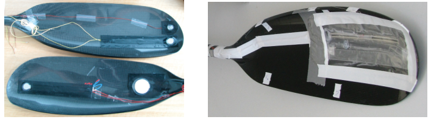
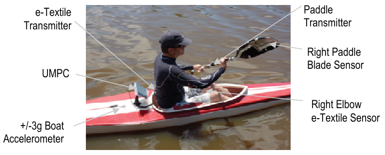
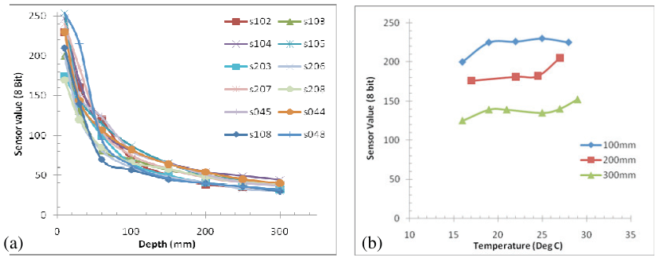
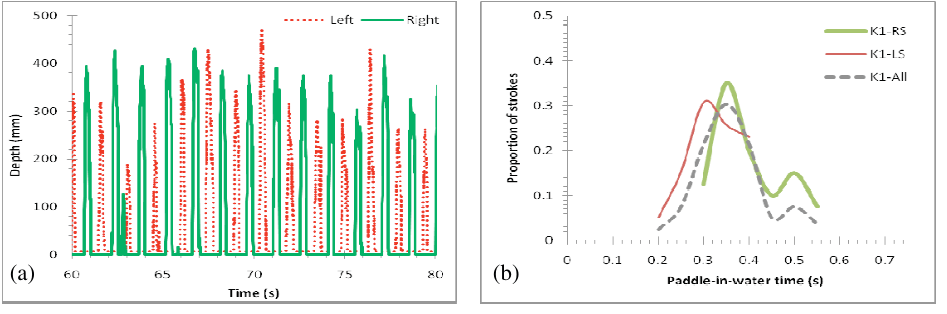
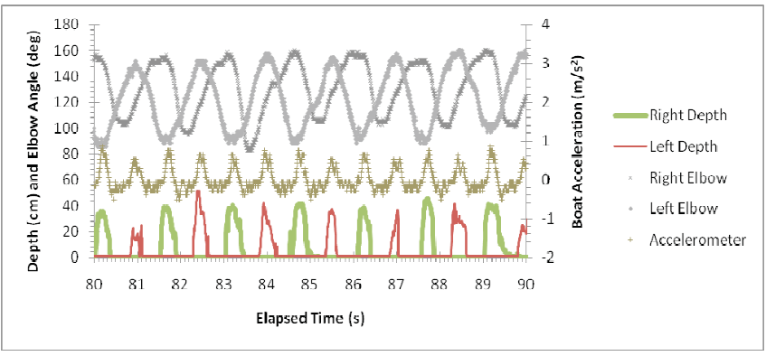
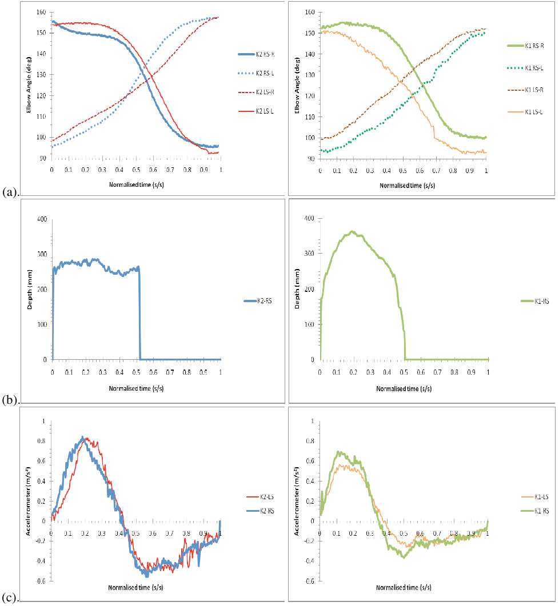

# 皮艇桨的仪器化研究：探究桨叶与水的相互作用

*Instrumentation of a kayak paddle to investigate blade/water interactions*

R.J.N. Helmera、A. Farouila、J Bakerb、I. Blanchonettea,*

a 澳大利亚联邦科学与工业研究组织（CSIRO）材料科学与工程部，澳大利亚维多利亚州 Belmont，3216  
b 澳大利亚体育学院，澳大利亚首都领地 Belconnen，2616

第五届亚太运动技术大会（APCST）  
*Procedia Engineering* 13 (2011) 501–506  
收稿：2011年3月31日；修订：2011年5月3日；录用：2011年5月4日  
DOI：10.1016/j.proeng.2011.05.121

* 通讯作者。电话：+61 3 5246 4000；传真：+61 3 5246 4057。电子邮箱：ian.blanchonette@csiro.au。

## 摘要

本研究考察了皮艇训练期间桨（paddle）上某一点承受的水动力压力（hydrodynamic pressure），以评估划桨技术及其有效性。在每片桨叶（blade）的底部安装一个力传感器（force sensor），并进行防水处理，同时尽量减少对桨叶形状的改变。此外，在皮艇外部安装加速度计（accelerometer），测量船的加速度（acceleration）；划手穿着肘部带有应变传感器（strain sensor）的电子纺织品（e-textile）服装，以监测手臂动作技术。这些设备通过一个共同的无线数据采集系统（wireless data acquisition system）实现同步。测量的划手技术数据包括桨频（stroke rate）、单次划桨时长（stroke duration）、桨叶浸没深度（depth of blade immersion）和划桨对称性（stroke symmetry）。桨叶压力传感器（pressure sensor）无法直接测量划桨力，但能够提供有用且同步的划水阶段时长（stroke pull time）测量结果，从而对技术特征进行有效描述。

© 2011 Elsevier Ltd. 出版。依据 CC BY-NC-ND 许可开放获取。论文遴选与同行评审由 RMIT University 负责。

**关键词（Keywords）：** 皮艇；桨；压力；加速度；对称性

## 1. 引言

20世纪80年代中期以前，竞速皮艇（sprint kayaking）划手通常使用平板型桨叶（flat blade）和木制皮艇。此后，随着皮艇运动员不断追求表现提升，各种皮艇和桨的设计逐渐受到青睐[1]。例如，常用皮艇桨已从具有典型翼型（airfoil）外观的翼型桨叶（wing blade），转变为目前国际赛事选手普遍使用的、外形更接近“类螺旋桨形”（propeller like）的桨叶。数学模型表明，不同桨叶的效率不同，例如，有研究报告翼型桨叶的效率比传统平板型桨叶高15%（翼型桨叶89%；平板型桨叶74%）[2]。

皮艇装备设计的持续变化带来了划手技术的变化。描述划手技术特征往往需要专门的测试环境和程序。由于装备变化以及现场测量面临的挑战，个体划桨技术的生物力学（biomechanics）特征和效率不易得到明确描述。这使得应采用何种最佳执教策略仍存在一定不确定性[3]。

本研究旨在设计一种可安装于桨叶上的潜水式力传感器，并结合其他运动表现测量设备，探索其在现场环境中测量桨叶深度、划水阶段时长（即桨叶在水时间）以及划桨力的能力。

## 2. 实验

皮艇桨叶设计以及桨叶与水相互作用的复杂性，使得潜水式力传感器的设计要求无法被明确规定。据报道，精英皮艇运动员在1000 m距离中产生的平均峰值拉力可达400 N，冲量（impulse）可达100 N.s.[4]。起步时，单次划桨的峰值力（peak force）可达800 N[5]。因此，对于名义面积例如为400 mm × 250 mm的桨叶，预期峰值压力可能高达8 kPa。桨叶完全浸没时，其尖端的静水压头（hydrostatic head），即约400 mm深处的压力，预计约为4 kPa（20ºC淡水）。

基于这些名义计算，同时考虑尽量减少对桨的干扰，选择了 Flexiforce A201-01 型、量程为1 lb-force（4.4 N）的力传感器。它厚度很小且可弯曲，因此能够贴合桨叶形状。将 Flexiforce 1 lb-f 传感器放置在精密加工的圆盘与基底（例如桨叶或直尺）之间，制成桨叶压力传感器。这样可以使传感器具有规定的受力面积，其他研究也采用过这种做法[6]。

改装后的 Flexiforce 传感器通过“浸水测试”进行深度标定（calibration）：将配有直径19 mm圆盘的传感器安装在塑料直尺上，把整个组件浸入恒温水中至已知深度（全部置于塑料袋内）。还通过浸入15–30ºC范围内的不同温度水浴，测试传感器的温度稳定性。专门挑选了少量性能相近的传感器，安装在皮艇桨叶上用于现场试验（field trial）。

为探索改装传感器在实际划桨中的灵敏度，选择了不同的安装位置和传感器受力面积。由于希望测量桨叶深度、划水阶段时长和划桨力，最初采用了两个安装在不同位置的传感器组合，以探索传感器响应。例如，一个传感器靠近桨叶下缘，另一个靠近桨杆（shaft）；尖端和桨杆侧的圆盘直径分别为18 mm和50 mm。传感器通过塑料膜封装实现防水，总线引线沿桨杆延伸至中部，在此与定制的 Bluetooth 无线单元连接。其电路按照 Flexiforce 传感器的要求配置，以250 Hz进行8位采样。图1展示了在传统桨叶上的典型组装方式。

**图1.** 安装压力传感器的桨叶。

改装后的桨用于一系列水上测试（on-water test），参与者为一名业余皮艇运动员和一名精英皮艇运动员。水上记录系统包括安装于皮艇甲板上的三轴加速度计（three-axis accelerometer，+/−3g），以及肘部装有应变传感器的电子纺织品上衣，类似于其他研究采用的上衣[7]。

现场测试所用的移动监测系统，将这三个测量系统通过 Bluetooth 连接至船载超移动个人计算机（UMPC，Viliv XC70）。计算机运行 Windows XP®，使用基于 National Instruments LabVIEW™ 套件开发的定制记录软件，类似于其他文献中讨论的系统[8]。所有设备均装在塑料压合密封袋内，以防溅水。要求皮艇运动员按符合其日常训练的节奏划桨。图2展示了水上系统在现场使用时的情况。

**图2.** 业余皮艇运动员使用中的水上监测系统。

**图中文字译注：** e-Textile Transmitter：电子纺织品发射器；Paddle Transmitter：桨上发射器；UMPC：超移动个人计算机；Right Paddle Blade Sensor：右侧桨叶传感器；Right Elbow e-Textile Sensor：右肘电子纺织品传感器；+/−3g Boat Accelerometer：船上+/−3g加速度计。

## 3. 结果与讨论

### 3.1. 传感器标定

用静水压力（hydrostatic pressure，深度）对 Flexiforce A201-01 型传感器进行标定时发现，在低压力（浅水深度）下，传感器之间存在一些显著差异，因此必须挑选特定传感器用于水上试验，见图3(a)。传感器的防水方式也影响其响应，可能与封装内部气压的变化有关。经过多次尝试，最终获得了一种在现场可靠、且在通常可预期的澳大利亚水域温度范围内保持稳定的方法，见图3(b)。

**图3.** (a) 传感器在水中的标定；(b) 传感器随水温和深度变化的稳定性。

**图中文字译注：** Sensor Value (8 Bit)：传感器读数（8位）；Depth (mm)：深度（mm）；Temperature (Deg C)：温度（℃）。(a) 图例中的 s102 等为传感器编号；(b) 图例100 mm、200 mm、300 mm表示相应水深。

### 3.2. 现场试验中的桨叶深度

每次现场测试开始时，均在正式划行前将每片桨叶垂直浸入水中，进行水上标定。图4(a)展示了一次典型现场测试中，初学者以约84桨次/分钟划桨时的桨上压力传感器变化曲线（以深度表示，mm）。结果提示静水压力占主导地位，若要区分水动力压力的变化，还需要进一步开发。

观察到皮艇运动员通常将桨叶完全浸没（约400 mm）。相邻桨次之间桨上压力的变化，归因于桨叶浸没角度的变化，也可能部分来自实际划桨力。总体而言，无法直接比较连续桨次、左侧与右侧、不同训练时段或不同皮艇运动员之间的桨上压力大小。

**图4.** (a) 安装在桨叶上的压力传感器检测到的桨上压力（深度，mm）；(b) 初学划手（K1）的左侧（LS）和右侧（RS）划水阶段时长。

**图中文字译注：** (a) Left／Right：左侧／右侧；Depth (mm)：深度（mm）；Time (s)：时间（s）。(b) Proportion of strokes：桨次比例；Paddle in-water time (s)：桨叶在水时间（s）；K1-RS／K1-LS／K1-All：K1划手的右侧桨次／左侧桨次／全部桨次。

桨叶压力传感器检测到的“桨叶在水时间”（in-water time）被认为具有代表性，可以有效描述左右侧技术特征。例如，图4(b)展示了初学划手（K1）左右侧划水阶段时长的不对称，以及各侧的变化。

### 3.3. 与其他运动表现测量的同步

图5展示了水上记录系统获得的典型现场数据。桨叶压力传感器测得的划水阶段时长，对于从其他同步的运动表现测量中识别关键指标非常有用，尤其便于识别左右侧的划桨指标。附录A（图6）比较了业余与精英皮艇运动员的技术，从中可以获得与其他文献报告相似的关键运动表现指标[3]。

**图5.** 水上记录系统获得的典型现场数据：肘部装有应变传感器的电子纺织品上衣、安装于皮艇甲板上的三轴加速度计（+/−3g），以及桨叶压力传感器；参与者为以约84桨次/分钟划桨的业余皮艇运动员。

**图中文字译注：** Depth (cm) and Elbow Angle (deg)：深度（cm）与肘角（度）；Boat Acceleration (m/s²)：船的加速度（m/s²）；Elapsed Time (s)：经过时间（s）；Right Depth／Left Depth：右侧／左侧深度；Right Elbow／Left Elbow：右肘／左肘；Accelerometer：加速度计。

## 4. 结论

桨叶压力传感器无法直接测量划桨力，但可以提供有用的划水阶段时长测量结果。将其与其他运动表现测量同步后，能够有效描述技术特征。

## 致谢

感谢 Nigel Hoschke 和 Tim Head 协助开展水上试验。

## 参考文献（References）

[1] Sanders R, Baker J. Evolution of technique in flat-water kayaking. In Issurin V, editor, Science and Practice of Canoe/Kayak High-Performance Training, . Tel-Aviv, Israel.1998, 67-81.

[2] Jackson P. Performance prediction for Olympic kayaks. Sports Sci. 1995;13: 239-245.

[3] Baker J, Rath D, Sanders R, Kelly B. A three dimensional analysis of male and female elite sprint kayak paddlers. Proc 17th Int Symp Biomech Sports 1999:49-52.

[4] Sperlich, J., & Baker, J. (2000) Biomechanical testing in elite canoeing. In Proceedings of the XXth International Symposium on Biomechanics in Sports (edited by Gianikellis, K), Cacares, Spain

[5] Baker, J. (1998) Evaluation of biomechanic performance related factors with on-water tests. In International Seminar on Kayak-Canoe Coaching and Science (edited by Vrijens, J.), pp 50-66. Gent, Belgium

[6] McLaren J., Helmer RJN, Horne SL, and Blanchonette I. Preliminary Development of a Wearable Device for Dynamic Pressure Measurement in Garments. Proc Eng 2, 2010;2:3041-3046.

[7] Helmer R, Mestrovic M, Farrow D, Lucas S, Spratford W. Smart Textiles: Position and Motion Sensing for Sport, Entertainment and Rehabilitation. Adv Sci Tech, 2008;60:144-153.

[8] Helmer R, Mestrovic M, Taylor K, Philpot B, Wilde D, and Farrow D. Physiological Tracking, Wearable Interactive Systems, and Human Performance. In Proc. 20th ICAT, 2010.

## 附录A. 精英运动员与有经验初学者的比较

**图6.** 在归一化划桨时间（normalized stroke time）下，对10次划桨取平均后的比较：(a) 右侧桨次（RS）和左侧桨次（LS）期间，左肘（-L）和右肘（-R）的平均角度；(b) 右侧桨次的平均桨叶深度；(c) 右侧桨次（RS）和左侧桨次（LS）产生的平均船体加速度。左列为精英皮艇运动员（K2），桨频70 SPM；右列为有经验的初学皮艇运动员（K1），桨频84 SPM。

**图中文字译注：** Elbow Angle (deg)：肘角（度）；Depth (mm)：深度（mm）；Acceleration (m/s²)：加速度（m/s²）；Normalised time (s/s)：归一化时间（s/s）。图例中的K2／K1分别为该图两名划手的标识；RS／LS为右侧／左侧桨次；R／L为右肘／左肘；SPM为每分钟桨次数。
