# 自由水面流动中充气艇运动的 CFD 模拟

Cemal Hasan Can Aksoy、Abdi Kükner（伊斯坦布尔技术大学，土耳其伊斯坦布尔）。原文联系邮箱：aksoyce@itu.edutr、kukner@itu.edu.tr。

原 PDF 共 18 页。年份按本目录阅读路线记为 2023，PDF 首页未标出版年份。图内英文／土耳其文保留，图注译为中文；正文节号沿用原稿，原稿未列第 2.6 节和第 4 节。页脚及参考文献处的排版模板提示不属于论文内容，未收入译文。

## 摘要

本文开展比较研究：在不同流量下进行一系列实验，用速度和加速度测量设备采集充气艇运动数据。运动几何模型代表充气艇；由于模拟中难以刻画黏弹性行为，忽略艇内空气的影响。将实验数据与计算流体力学（CFD）模拟结果比较，以评估准确性。

模拟采用雷诺平均 Navier–Stokes 方程、流体体积法（VOF）和 SST $k$–$\omega$ 紊流模型。通过重叠网格技术开展三维瞬态模拟，描述艇在流场中的运动。根据所得数据进行运动模拟，并对实验和 CFD 模拟开展不确定度分析。作者认为，不同流量下所得 CFD 结果令人满意且可以接受。

关键词：船舶设计；充气艇；剪应力；CFD；VOF 法。

## 1. 引言

充气艇由柔软、耐用的材料制成，通过注入空气或气体充气，是便携载具。与传统刚性船体不同，其结构紧凑，易于储存和运输，因此在多种应用中受到青睐，包括海上活动、水上运动、救援、军事任务和淡水水源探索。为理解及优化充气艇水动力性能，CFD 领域开展了大量研究。

CFD 是通过数学方程及数值方法分析流体运动的工程学科。对于充气艇，它可用于研究注入气体及周围流体环境影响下的行为。CFD 模拟可为水动力阻力、阻力系数、稳性和操纵性提供重要认识。本文强调用 CFD 理解充气艇水动力行为，希望支持充气艇计算模拟的发展。

Vitiello 等（2020）将实尺度 CFD 模拟与海试数据比较，对“充气艇”进行性能评估。作者认为，这种比较可客观分析性能，有助于设计与开发。

Tagliafierro 等（2021）采用光滑粒子流体动力学（SPH）方法评估“充气艇”型载具的性能。SPH 分析可用于确定水动力特性及评估性能；该研究比较 CFD 模拟结果，以考察 SPH 的可靠性和适用性。

Ludck 等（2001，原文拼写）关注相互作用数据，以研究使用“充气艇”时发生的伤害。本文引言还称，该研究旨在通过 CFD 分析改进充气救生艇的设计与安全性。

Godderidge 等（2008）研究“充气艇”型载具周围的自由水面流动 CFD 模拟。本文认为，CFD 是理解充气艇性能及其与水相互作用的有效工具，可为设计提供信息。

Cucinotta 等（2020）关注硬底充气艇的计算机辅助工程（CAE）分析，涵盖水动力性能、结构耐久性和设计优化等重要方面。

此外，研究采用包括 CFD 在内的数值方法，理解与水的相互作用及水阻力，借此改进设计、提高充气艇性能。以上对既有研究的描述按本文引言保留，其中部分研究对象与文末题名不直接对应，见校订备注。

## 2. CFD 问题设置

模拟几何模型在 SC-Flow 程序界面内创建，可直接传递到求解器。艇的几何外形圆滑，因此作者认为，它与船舶及其他水上载具在一定程度上有所不同。

### 2.1 网格生成、单元类型与布置

生成网格时，SC-Flow 采用符合程序及求解器要求的多面体单元。依据计算成本和网格无关性确定适当单元数量。在考虑偏斜度和正交性的同时，保持适当的 $y^+$ 值，生成网格。

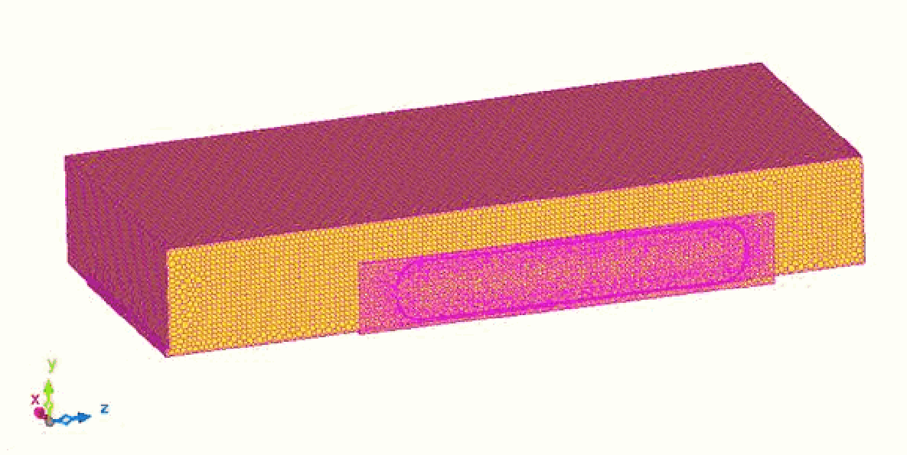

图 1. 网格结构。

图 1 显示，为更准确获得剪应力分布，艇附近采用较密网格；离开该区域后，单元数量减少。

### 2.2 壁面函数

为准确获得速度梯度，模拟按比例保持单元长宽比，并据此开展计算。主要目标是研究实尺度充气艇模型在特定来流速度下的行为，获得作用于船底的剪应力大小。为确定结果准确性，还比较实际无动力艇的运动与模拟结果。

### 2.3 表面粗糙度

船舶表面粗糙度可能对阻力很重要，但本文实尺度模拟中，由于所用材料，物体表面粗糙度及运动表面上方流场相关的粗糙影响很小。

### 2.4 流动特性

流动基本为包含固体物体的两相流；本文研究紊流自由水面流动。

### 2.5 边界条件设置

采用对称边界条件，只模拟半个模型。入口与出口距固体物体足够远，使流动能够形成稳态。

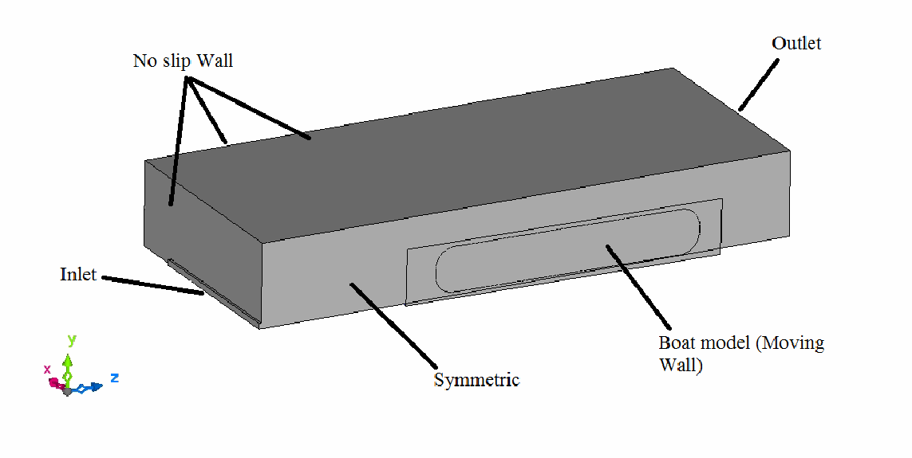

图 2. 边界条件。

艇上的运动部分采用移动壁面边界条件，静止部分采用无滑移条件。

如图 1，离开边界层及艇附近后，单元尺寸增大。为避免相邻单元间距变化过大，网格方法将质量及长宽比保持在限制范围内。

### 2.7 时间步长

时间步长按满足 CFL 条件确定：

$$
C=a\frac{\Delta t}{\Delta x}. \tag{1}
$$

考虑三种不同速度，时间步长设置为 0.001 s，以满足模拟需要。

### 2.8 收敛判据选择

收敛判据通过将迭代间差值变化维持在“第四阶”来定义。原文未给出明确残差变量及数值表达。

### 2.9 自由水面模型选择

采用流体体积法（VOF）描述自由水面，理由是其应用广泛并能获得准确结果。

### 2.10 紊流模型选择

采用 SST $k$–$\omega$ 模型。作者认为，模型与 ITTC 标准的适用要求相符，在其他文献中表现良好，因此适合作为本模拟的主要模型。

紊流模型控制方程如下。原文使用 $v$、$v_T$ 等符号，未在本文另给完整符号定义。

$$
\frac{\partial k}{\partial t}
+U_j\frac{\partial k}{\partial x_j}
=P_k-\beta^* k\omega
+\frac{\partial}{\partial x_j}
\left[(v+\sigma_k v_T)\frac{\partial k}{\partial x_j}\right]. \tag{2}
$$

式（3）按原 PDF 图像保留，以免将原式中缺少被求导变量的项擅自补成另一公式：

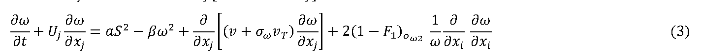

式（2）为紊动能方程，式（3）为比耗散率方程。式（3）的交叉扩散项疑点见文末备注。

### 2.11 数值格式选择

采用 SC-Flow 获得模拟结果。为得到准确结果，选择二阶格式，具体使用二阶迎风格式。

## 3. CFD 结果

在 2、5、8 m/s 三种速度下模拟。速度选择主要依据测量中观测到的流速变化。入口定义的速度未必以相同方式直接作用于船底。因此开展瞬态分析，考虑紊流影响，力求捕捉作用于艇的剪应力。

### 3.1 2 m/s 的结果

本节展示 2 m/s 下的实尺度模拟结果。

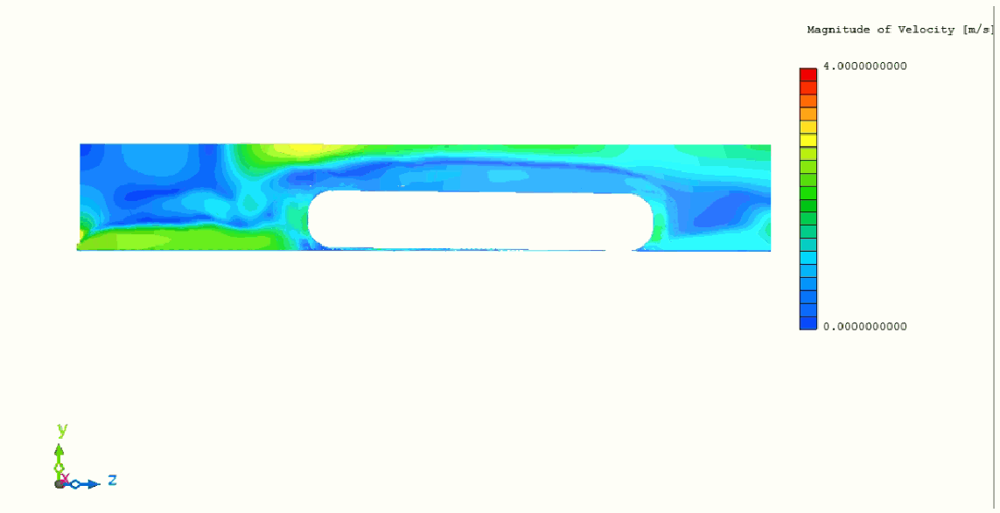

图 3. 速度等值图。

图 3 显示，遇到艇以前，流体速度方向保持与入口速度平行。流体与艇相互作用后，接触位置产生小扰动及旋涡；流体从船底通过，向出口移动，其通流状况与流体体积有关。

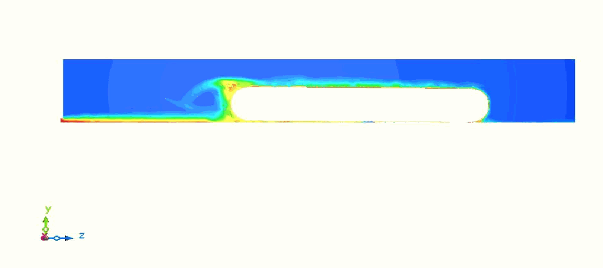

图 4. VOF 等值图。

图 4 显示流场中的 VOF 分布。入口后形成的液膜在到达艇以前较厚。与艇相互作用后，部分流体因撞击向上运动并越过艇上方，液膜开始变薄。艇后方的液膜再次变薄，流向出口。

模拟为三维；从中部截面的等值图还可观察到，中心轴线上没有明显的流动朝出口运动。

图 5. 等值面。

图 5 显示，流体与艇碰撞后，流动更复杂。此前入流比较规则；撞击后，一部分流体流向艇上部，另一部分在艇下形成薄液膜。与艇作用的流体中，大部分因撞击流向侧向间隙，在那里从动力学角度看运动较自由。

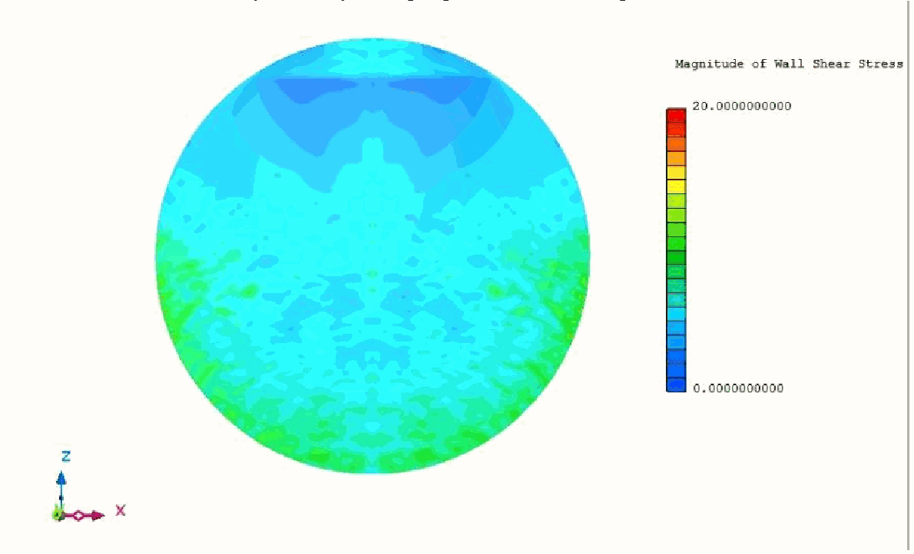

图 6. 剪应力分布。

图 6 显示船底剪应力分布。结合等值面可知，艇前表面的流速及相应剪应力较高。还应注意，正常情况下，无动力载具的运动方向与水流同向，而非逆流，评价结果时需考虑这一点。

### 3.2 5 m/s 的结果

本节展示 5 m/s 的模拟结果。随着流量增加，数值大小、流动行为及艇的运动均发生变化，因此需要比较评价。

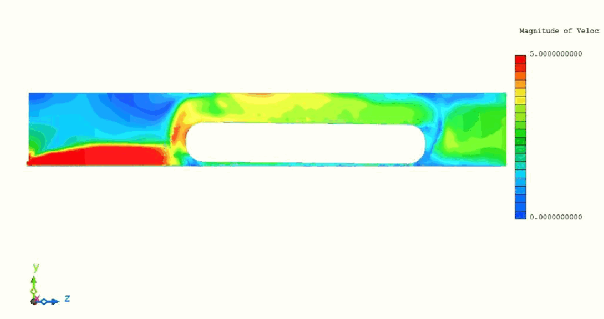

图 7. 速度等值图。

将 2 m/s 与更大流量下的速度分布比较，流量大小可能带来显著差异，但图 7 所示速度分布总体相似。如上一模拟，流体从入口到遇到艇以前，较规则地流动，未损失速度。与艇作用后，一部分流体越过充气艇，其他流体在固体物体下形成薄液膜。

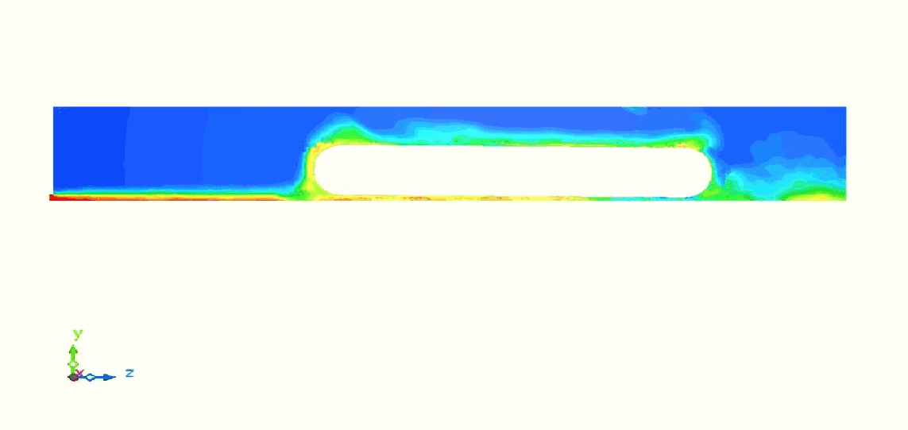

图 8. VOF 等值图。

图 8 更清楚地显示艇下方形成了明显液膜。分析为瞬态，5 m/s 时艇被抬离原位置，再周期性向下运动。因此，与 2 m/s 工况相比，液膜厚度不断变化。

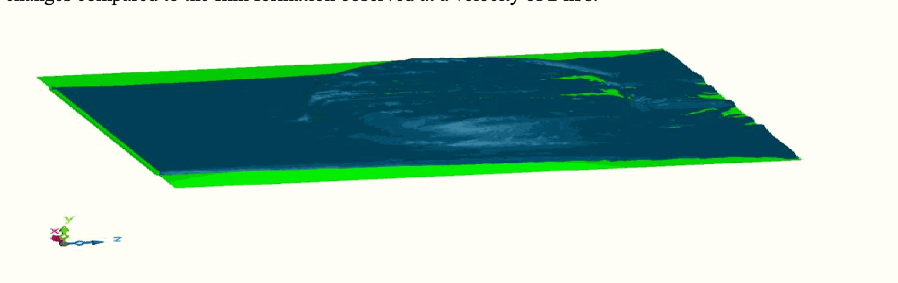

图 9. 等值面。

与前述分析相同，流体遇到艇以前较规则，作用后更复杂。但在 5 m/s 工况，艇向上的运动更明显，流体更容易从其下通过。这种流动差异也解释了，为什么物体后方的流体形态比另一工况更明显。

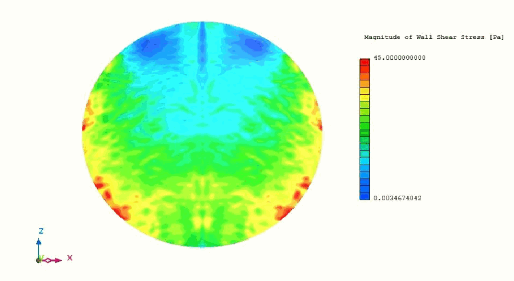

图 10. 剪应力分布。

图 10 显示，速度增大后，剪应力大小也如预期明显增大。

### 3.3 8 m/s 的结果

本节展示 8 m/s 的结果及速度增加的影响。虽然逐步增大速度，不能直接断言物体受力与速度成正比。

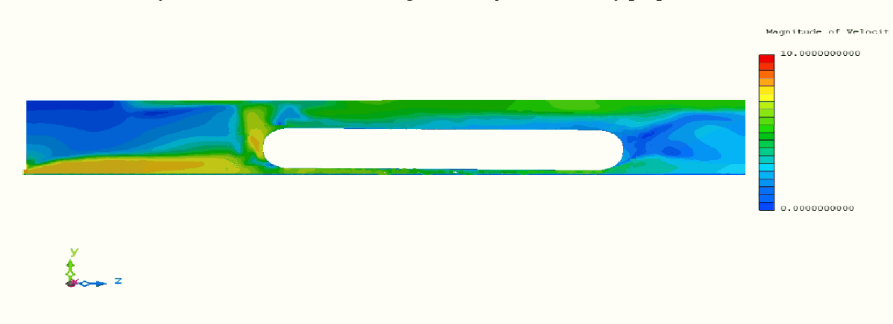

图 11. 速度等值图。

从入口到艇之间的速度分布与其他模拟相似。但与其他工况相比，艇状物体下方的流速更清晰可见，作者推测这与该速度下液膜形成更明显有关。

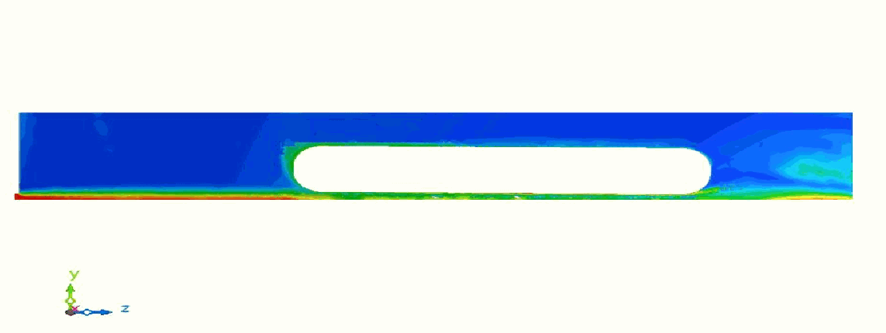

图 12. VOF 等值图。

与其他模拟相比，8 m/s 下艇底液膜更明确。作者给出的原因是，该速度下水流能完全抬起固体物体，使液膜形成。因此，因撞击而越过艇上方的流体量减少。

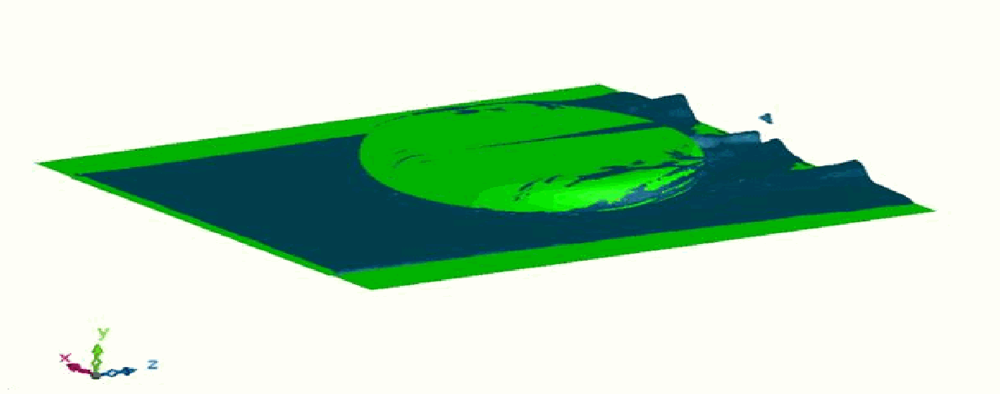

图 13. 等值面。

图 13 明显显示，艇上方的流体量减少。特别是在艇后方，可见流体从艇下方通过并朝出口运动。

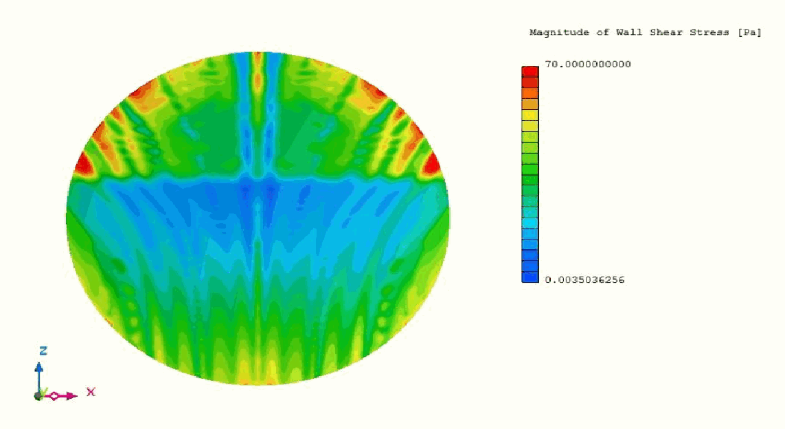

图 14. 剪应力分布。

8 m/s 的分析具有最大的剪应力数值，符合预期的速度关系。与其他分析不同，最高剪应力出现在不同区域。流动特征表明，这与 8 m/s 水流能完全抬起艇有关。

### 3.4 剪应力与摩擦系数

根据模拟确定作用于船底的剪应力，结果见表 1。原表标题称“剪应力”，单位却写 Pa·m²，后文又将其作为力使用，详见文末备注。

表 1. 速度—剪应力关系。

| 速度（m/s） | 剪应力（原表单位：Pa·m²） |
|---:|---:|
| 2 | 11.96 |
| 5 | 30.63 |
| 8 | 56.915 |

为比较表 1 并开展有意义的分析，将基于这些数值所导出的摩擦力进行运动分析。比较固定摩擦系数与采用插值中间值的结果；借助插值，为运动分析的相应区域定义适当摩擦系数，以便比较。

$$
F_m=N\mu. \tag{4}
$$

式（4）用摩擦系数定义作用力。

$$
N=mg. \tag{5}
$$

式（5）中 $m$ 为质量，$g$ 为重力加速度。结合式（4），将 $F_m$ 替换为分析所得数值，便可求出表 2 的系数。计算采用 81.5 kg；实测表明，艇与使用者总质量约为 81.5 kg。原文称此数为 weight，译文按单位写为质量。

表 2. 速度—摩擦系数。

| 速度（m/s） | 摩擦系数 |
|---:|---:|
| 2 | 0.015 |
| 5 | 0.038 |
| 8 | 0.071 |

按前述方法，计算 2—8 m/s 范围内每隔 1 m/s 的系数，得到表 3，以比较不同流速对应的摩擦系数。

表 3. 速度—摩擦系数。

| 速度（m/s） | 摩擦系数 |
|---:|---:|
| 2 | 0.015 |
| 3 | 0.023 |
| 4 | 0.030 |
| 5 | 0.038 |
| 6 | 0.049 |
| 7 | 0.060 |
| 8 | 0.071 |

表 3 用于运动分析中各区域摩擦系数的定义与比较。将这些系数应用于相应区域，作者认为可以准确模拟不同流速下变化的摩擦作用，了解介质行为。

## 5. 测量

采用 Vernier 加速度测量设备、惯性测量单元（IMU）及 DeweSoft 软件，将原始数据转换为有意义的信息。实验在具有明确几何形状的自由水面流动环境中进行，使艇能够按预期运动；作者认为，这为数据采集提供了可控且可靠的条件。

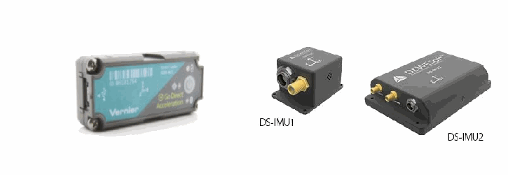

图 15. 测量设备。

图 15 展示采集加速度的设备。Vernier 可直接测加速度；结合 IMU 与 Dewesoft，可观察加速度和速度。

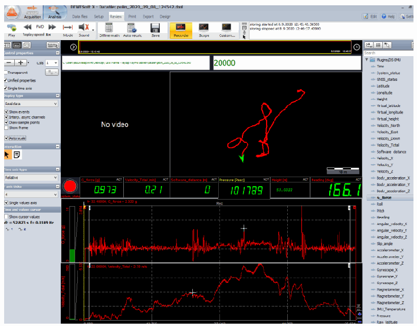

图 16. DeweSoft 界面。

图 16 显示，界面揭示艇的运动轨迹，同时记录 $x$、$y$、$z$ 方向的速度与加速度分量。

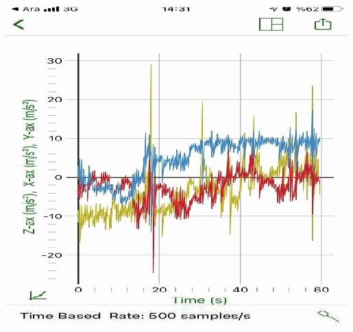

图 17. Vernier 设备界面。

Vernier 界面与 DeweSoft 相对类似。图 17 表明，设备在艇运动中采集并显示完整数据，提供图形表示，采样率为每秒 500 次，作者认为这提高了测量精度。

原文称，设备通过基于卫星的系统，在空间和时间上跟踪艇运动，确定速度与加速度分量，采集实时数据，与采用 CFD 结果的运动分析比较。该设备功能描述的范围见文末备注。

## 6. 运动模拟

考虑计算成本，采用 SolidWorks 的运动模拟功能分析艇的运动。该功能可在不同条件下模拟艇的运动与行为，提供成本较低的分析方法。工程人员可研究速度、加速度、反力等运动学和动力学量，了解艇在运动中的性能与行为。作者认为，该程序在优化计算资源的同时提供较强的模拟能力，适合经济地开展运动分析。

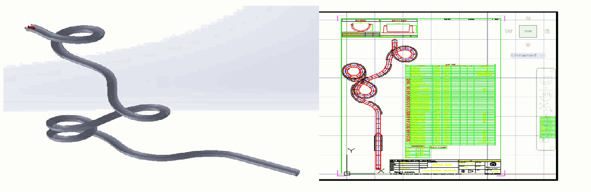

图 18. 实际结构布置与模拟几何。

运动分析采用图 18 的几何，准确表示按照布置方案制造和安装的真实结构及艇。为保证程序中的几何精度，依据制造细节传递几何，建立实际结构的精确三维模型。

准确传递艇几何后，作者认为程序可给出可靠结果，较真实地反映艇的实际行为与性能。实际艇模型设计的准确性，允许充分研究运动动力学，为后续分析和设计性能优化提供认识。

## 7. 结论

图 19 展示运动分析所得速度曲线，并与测量比较。原文称，这些曲线显示艇在不同方向（$x$、$y$、$z$）的速度随时间变化。将结果与 Vernier 及 IMU 实测比较，可评估基于 CFD 输入的运动分析的准确性和可靠性；图中实际曲线的含义见文末备注。

速度图可显示艇沿结构中的轨迹运动时速度如何变化。模拟与实测差异，可提示模拟精度以及模型可能改进的方面。

通过比较，作者认为，基于 CFD 的运动模拟能够充分表示艇的动态行为。就速度而言，结果令人满意，测量与模拟具有相似趋势。

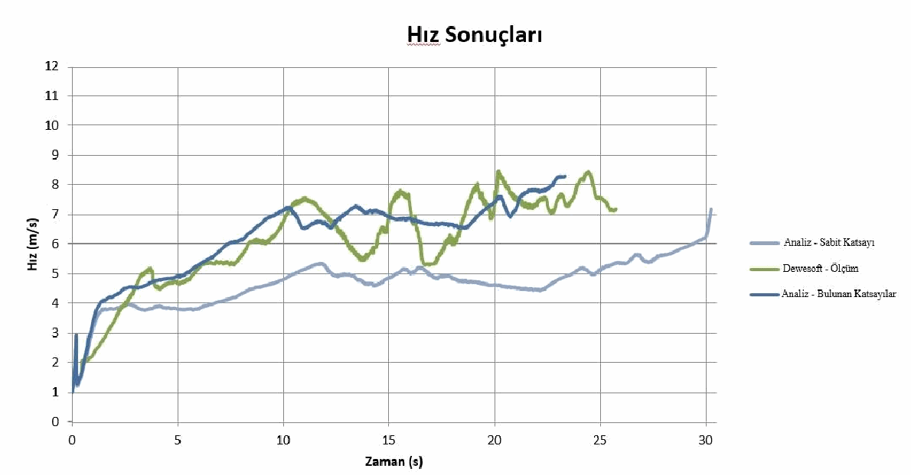

图 19. 测量与运动分析的速度结果。

图 20 展示加速度随时间变化。作者认为，这种比较能够确认模型准确性和可靠性，并有助于评估设计和性能所需的运动动力学。

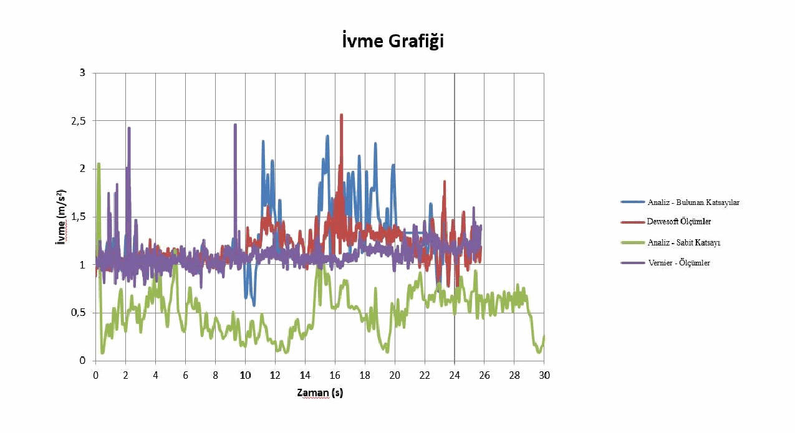

图 20. 测量与运动分析的加速度结果。

作者据速度与加速度曲线认为，CFD 所得系数可给出更准确的结果。用这些系数模拟运动，与实际运动相似，提示动力学行为接近。

分析运动持续时间，得到表 4 和表 5，以进一步考察模拟准确性及系数表示实际运动的适用性。原表采用小数逗号，译文统一为小数点。

表 4. 运动分析误差。

| 实测时间（s） | 运动分析时间（s） | 误差（%） |
|---:|---:|---:|
| 25.63 | 30.41 | 18.65 |

表 4 为采用 CFD 分析之前所用摩擦系数的结果。

表 5. 基于 CFD 的运动分析误差。原表 Hata 是土耳其语“误差”。

| 实测时间（s） | 运动分析时间（s） | 误差（%） |
|---:|---:|---:|
| 25.63 | 23.23 | 9.36 |

作者认为，用所得摩擦系数进行运动分析，结果更接近真实。改善不只体现在持续时间；借助 CFD 结果，速度和加速度的小变化及波动也计算得更准确。

## 参考文献

保留原文书目信息及原列顺序。

- Vitiello, L., & Vincenzo, S. M. R. N. B. (2020). An Overview of Stepped Hull Performance Evaluation: Sea Trial Data vs Full-Scale CFD Simulation. HSMV 2020, 58-65.
- Tagliafierro, B.; Mancini, S.; Ropero-Giralda, P.; Domínguez J. M.; Crespo A.J.C.; Viccione, G. Performance Assessment of a Planing Hull Using the Smoothed Particle Hydrodynamics Method. J. Mar. Sci. Eng. 2021, 9, 244. https://doi.org/10.3390/jmse9030244.
- Ludcke, J.A., Pearcy, M.J., Evans, J.H. Impact data for the investigation of injuries in inflatable rescue boats (IRBs). Australas. Phys. & Eng. Sci. Med. 24, 95–101 (2001). https://doi.org/10.1007/BF03178352
- Godderidge, B., Phillips, A. B., Lewis, S. G., Turnock, S. R., Hudson, D. A., & Tan, M. (2008). The simulation of free surface flows with Computational Fluid Dynamics.
- Cucinotta, F., Marchetta, M., Guglielmino, E. A CAE analysis of a novel rigid inflatable boat. Int J Interact Des Manuf 14, 7–17 (2020). https://doi.org/10.1007/s12008-019-00610-6

## 校订备注

1. 表 1 称“剪应力”，单位却为 Pa·m²，即 N；后文用它代入 $F_m=\mu mg$ 求系数。从量纲及计算看，表值作为力使用，不能当作局部壁面剪应力（Pa）。这里的系数是按 $F_m/(mg)$ 得到的运动模型等效摩擦系数，不能直接当作通常以动压及湿表面积定义的水动力表面摩擦阻力系数。
2. 原式（3）的交叉扩散项含一个未写被求导变量的 $\partial/\partial x_i$，系数排版也不明确。本文保留原式图像；不能仅凭该式复现 SST 模型。第 2.8 节“第四阶”的收敛表述也未明确残差阈值，不宜自行补写为 $10^{-4}$。
3. 原文将图 19 解释为 $x$、$y$、$z$ 三方向速度，但图例实际比较不同摩擦系数的运动分析与实测，不是三个方向分量。原文还把测量设备整体描述为卫星跟踪系统，却未区分卫星定位与 IMU／加速度计的功能。摘要称开展不确定度分析，正文可见的是表 4、5 的持续时间相对误差，未给出明确的不确定度预算或网格收敛数据。
4. 引言将若干文献统称为“充气艇”研究，但所列 Vitiello、Tagliafierro 题名分别涉及阶梯船体与滑行船体；Godderidge 题名只写自由水面 CFD。仅凭本文的引言描述，不能确认这些文献都研究柔性充气艇。本文自身也明确忽略艇内空气／黏弹性影响，图 18 对应水滑道载具；结果不提供柔性变形的验证。
