# 论皮艇运动的物理学

*On the Physics of Kayaking*

Charlie Prétot1,2、Rémi Carmigniani1、Loup Hasbroucq2、Romain Labbé3、Jean-Philippe Boucher3、Christophe Clanet2,*

1 LHSV，法国国立路桥学校（Ecole des Ponts）、法国电力集团研发部（EDF R et D），法国 Marne-la-Vallee，77455  
2 LadHyX，法国国家科学研究中心（CNRS）UMR 7646，法国综合理工学院（Ecole Polytechnique），法国 Palaiseau，91128  
3 Phyling，Drahi Xnovation Center，法国综合理工学院，法国 Palaiseau，91128  
* 通讯作者：christophe.clanet@ladhyx.polytechnique.fr

研究论文，*Applied Sciences*，2022，12，8925。  
引用信息：Prétot, C.; Carmigniani, R.; Hasbroucq, L.; Labbé, R.; Boucher, J.-P.; Clanet, C. On the Physics of Kayaking. Appl. Sci. 2022, 12, 8925. https://doi.org/10.3390/app12188925  
学术编辑：Mark King、Alessandro de Sire。  
收稿：2022年5月2日；录用：2022年9月1日；发表：2022年9月6日。

出版者声明：MDPI 对已发表地图和机构隶属关系中的司法管辖权主张保持中立。  
版权：© 2022 作者所有。被许可方：MDPI，瑞士巴塞尔。本文为开放获取论文，依照 Creative Commons Attribution（CC BY）许可的条款与条件发布（https://creativecommons.org/licenses/by/4.0/）。

## 摘要

利用安装在桨（paddle）上的传感器，可以测量皮艇运动员的推进力（propulsion force）。本文旨在将该力与船的速度（velocity）变化联系起来，提出了一个描述单人皮艇（K1 kayak）运动的通用模型。为验证模型并评估有关物理参数，安排了三种水上划行试验：无推进减速（pure deceleration）、静止起步（standing start），以及由两名国家级运动员完成的10 × 50 m测试。试验采用桨上的力传感器及视频记录。利用减速试验评估船的阻力（drag）；随后，静止起步试验表明划行时存在主动阻力系数（active drag coefficient）；最后，10 × 50 m测试呈现出速度与桨频（stroke rate）之间的三分之一次幂关系。理论较好地描述了静止起步期间的加速度（acceleration）以及速度与桨频的关系。该方法使我们能够评估描述皮艇比赛的重要参数：船的阻力、主动阻力系数、平均推进力（mean propulsive force）和推进路径长度（propulsive length）。它可以用于描述运动员的特征并监测其运动表现。

**关键词（Keywords）：** 推进；桨频；速度；阻力

## 1. 引言

在皮艇上，划手面向运动方向坐着（与赛艇划行相反），使用双叶桨（double-bladed paddle），如图1a–c所示。皮艇比赛由国际皮划艇联合会（International Canoe Federation）制定规则[1]。该组织规定夏季奥运会设有两种不同的项目：在河流上进行的激流回旋，以及在静水（flatwater）上进行的竞速。本文研究后者。K1、K2和K4表示每船皮艇运动员的人数。图1d展示了2016年里约奥运会举行的九项皮艇比赛，以及男子和女子相应的比赛距离、不同的船体尺寸和最低质量。冠军用时以红色标示，对应的平均速度（mean velocity）以蓝色标示。

Jackson[2]在其奠基性研究《Performance prediction for Olympic kayaks》中，从物理角度给出了静水皮艇比赛的主要特征：在男子和女子单人皮艇（K1）比赛中，典型船长为 $L = 5.2\ \mathrm{m}$；男子船速达到 $V = 4.83\ \mathrm{m/s}$，女子达到 $V = 4.24\ \mathrm{m/s}$；所用桨叶（blade）面积为 $A_B = 0.063\ \mathrm{m^2}$，划桨周期（stroke cycle）的频率约为 $f \approx 1\ \mathrm{Hz}$。与图1b所示的里约奥运会结果比较，可以看出这些数值的数量级仍然合理。

此后，研究者详细研究了船体（hull）[3,4]和桨[5,6]的相关水动力学（hydrodynamics），从而使形状优化成为可能。利用船长 $L$ 和速度 $V$，我们计算出雷诺数（Reynolds number）$Re_L = \rho V \cdot L/\eta = 2.5 \times 10^7$，以及弗劳德数（Froude number）$Fr = V/\sqrt{gL} = 0.67$。这两个数值表明，总阻力（total drag）$F_D$ 可以写为紊流表面摩擦阻力（turbulent skin friction）与兴波阻力（wave drag）之和[2]：

$$
F_D = \frac{1}{2}\rho V^2\left(S\cdot C_{sj} + \frac{\Omega^{5/3}}{L^3}C_{wj}\right), \tag{1}
$$

其中，$S$ 为湿表面积（wetted area），$C_{sj} = 0.0028$ 为紊流表面摩擦阻力系数，$\Omega$ 为浸没体积（immersed volume），$C_{wj} = 11$ 为兴波阻力系数（wave drag coefficient）。由于湿表面积与浸没体积满足 $S \approx 2.5\sqrt{\Omega L}$，对于运动员与船的合计质量为90 kg、速度为 $V = 4.8\ \mathrm{m/s}$ 的情况，可推得阻力 $F_D \approx 75\ \mathrm{N}$，相应的耗散功率（dissipated power）为 $P_D = F_D \cdot V \approx 360\ \mathrm{W}$。在此例中，兴波阻力，即式(1)的第二项，占总阻力的22%。

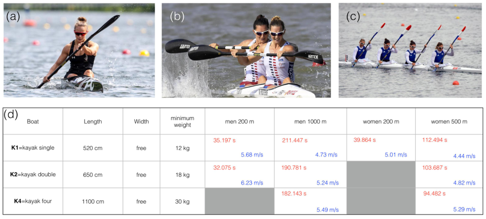

**图1.** (a) 女子K1皮艇比赛；(b) 女子K2皮艇比赛；(c) 女子K4皮艇比赛；(d) 2016年里约奥运会九项皮艇比赛及相应的船体特征。冠军用时以红色标示，相应平均速度以蓝色标示。

**图中文字译注：** Boat type：船型；Length：长度；Width：宽度；minimum weight：最低质量；men／women：男子／女子。图中比赛数据如下，红色数字对应冠军用时，蓝色数字对应平均速度：

| 船型 | 长度 | 宽度 | 最低质量 | 男子200 m | 男子1000 m | 女子200 m | 女子500 m |
|---|---|---|---|---|---|---|---|
| K1（单人皮艇） | 520 cm | 自由 | 12 kg | 35.197 s；5.68 m/s | 211.447 s；4.73 m/s | 39.864 s；5.01 m/s | 112.494 s；4.44 m/s |
| K2（双人皮艇） | 650 cm | 自由 | 18 kg | 32.075 s；6.23 m/s | 190.781 s；5.24 m/s | 无该项 | 103.687 s；4.82 m/s |
| K4（四人皮艇） | 1100 cm | 自由 | 30 kg | 无该项 | 182.143 s；5.49 m/s | 无该项 | 94.482 s；5.29 m/s |

据我们所知，现有皮艇文献中很少有研究直接测量桨上的推进力。Bjerkefors[7]研究了功率输出（power output），但使用的是测功仪（ergometer）；Klitgaard[8]则表明，测功仪与真实运动情境之间存在显著的运动学（kinematic）差异。多数水上试验关注瞬时速度（instantaneous velocity）的运动学测量[9]，或每50 m的平均桨频、划桨长度和速度[10]。已有研究评估了皮艇[11–14]和划艇[15]中桨上的力，但未将其与运动学直接联系起来。相反，Delgado[16]提出了皮艇速度变化模型，但没有对力和速度进行实验测量。

本文提出一项借助仪器化桨（instrumented paddle）、同时进行运动学和动力学（dynamic）测量的水上研究。我们的目标是通过简单的物理参数，量化并建立皮艇动力学模型。随后，借助运动方程（equation of motion），将测得的力与速度变化进行比较。论文安排如下：首先详细介绍实验装置及理论动机，随后介绍三项用于验证和解释模型的试验：无推进减速试验、静止起步试验，以及试次之间逐步提高速度的10 × 50 m测试。第一项试验描述船的阻力特征，后两项试验分别在瞬态（transient regime）和稳态（steady regime）下验证模型。

## 2. 通用模型与实验装置

### 2.1. 理论动机

本文关注K1皮艇，即船上只有一名运动员的情况。皮艇的动力学由牛顿方程描述，沿运动方向的标量形式为：

$$
M_e\frac{dV}{dt} = F_m(t) - F_D(t), \tag{2}
$$

其中，$M_e = M_t + M_a$ 是总质量（total mass）$M_t = M_k + M_b$ 与附加质量（added mass）$M_a$ 之和；$M_k$ 是皮艇运动员的质量，$M_b$ 是船的质量，附加质量表示被船带动的水的质量。在式(2)中，$F_m(t)$ 是桨叶沿运动方向施加于水的推进力（propulsive force），$F_D(t)$ 为总阻力。

我们希望评估方程中各项的贡献，并建立皮艇速度变化的简单模型。第一个实验令 $F_m(t) = 0$。该无推进减速试验使我们能够评估皮艇的阻力。第二个实验进行静止起步，测量 $F_m(t)$ 并将其与速度变化联系起来。最后，在不同速度的稳态运动中令 $M_e dV/dt = 0$，利用力平衡（force balance）揭示船速与桨频的关系。

### 2.2. 实验装置

#### 2.2.1. 运动员与船

实验在法国综合理工学院水上运动俱乐部进行，参与者是两名技术熟练的男性皮艇运动员，均使用自己的皮艇，分别记作A1和A2。运动员及其船的主要特征见图2。A1是国家级U23运动员，身高1.70 m，体质量64 kg；A2是国际级U23运动员，身高1.81 m，体质量74 kg。两人都使用 Jantex Gamma Rio M 桨叶，安装于配有应变片（strain gauge）的 Kevlight MFTech 桨杆（shaft）上，见图3。运动员可以根据个人偏好调整桨长。桨的总质量为730 g，相对于船与运动员的质量可忽略。

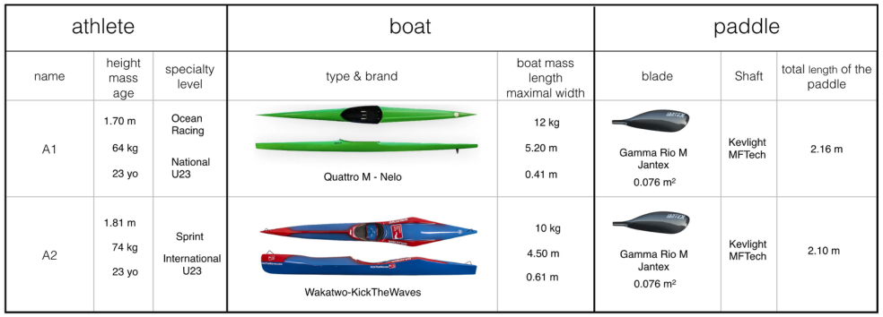

**图2.** 实验所用运动员、船与桨的主要特征。

**图中文字译注：** athlete／boat／paddle：运动员／船／桨；name：编号；height、mass、age：身高、体质量、年龄；specialty、level：专项、水平；type & brand：型号与品牌；boat mass、length、maximal width：船的质量、长度、最大宽度；blade、Shaft、total length of the paddle：桨叶、桨杆、桨总长。

| 参数 | A1 | A2 |
|---|---|---|
| 身高、体质量、年龄 | 1.70 m；64 kg；23岁 | 1.81 m；74 kg；23岁 |
| 专项、水平 | 海洋竞速（Ocean Racing）；国家级U23 | 竞速（Sprint）；国际级U23 |
| 船型号与品牌 | Quattro M - Nelo | Wakatiwo-KickTheWaves |
| 船质量、长度、最大宽度 | 12 kg；5.20 m；0.41 m | 10 kg；4.50 m；0.61 m |
| 桨叶 | Gamma Rio M；Jantex；0.076 m² | Gamma Rio M；Jantex；0.076 m² |
| 桨杆 | Kevlight MFTech | Kevlight MFTech |
| 桨总长 | 2.16 m | 2.10 m |

#### 2.2.2. 力的测量

在桨上安装应变片，并连接至固定于桨中部的数据采集卡（acquisition card），见图3。力信号以100 Hz采样率（sampling rate）记录，数据存储于船内的 MaxiPhyling 防水盒。数据采集卡与 MaxiPhyling 盒通过 Bluetooth 连接。该防水盒中还装有加速度计（accelerometer）和陀螺仪（gyrometer），用于评估偏航（yaw）、俯仰（pitch）和横滚（roll）的贡献。数据保存在盒内的SD卡上。将标定质量块挂在桨的浸没部分中心，以标定力传感器（force sensor），见图3。两侧分别标定。

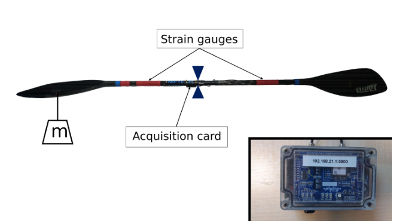

**图3.** 实验所用仪器化桨的标定。质量“m”表示标定质量。右下角展示了放在船上的 MaxiPhyling 防水盒。

**图中文字译注：** Strain gauges：应变片；Acquisition card：数据采集卡；$m$：标定质量。

#### 2.2.3. 速度的测量

使用架设在湖岸三脚架上的固定摄像机（GoPro）记录试验，采样率为每秒60帧。选定的视角能够观察到皮艇在水面上40 m的位移。我们同时跟踪船的前端 $(x_F,y_F)$ 和后端 $(x_B,y_B)$。将船的中心记为 $M$，即 $(x_M,y_M) = ((x_B+x_F)/2,(y_B+y_F)/2)$。所有坐标的定义见图4。已知船长 $L_B$（单位为米）后，可以按下式计算速度：

$$
V(t) = \frac{\sqrt{(x_M(t+\Delta t)-x_M(t-\Delta t))^2+(y_M(t+\Delta t)-y_M(t-\Delta t))^2}}{\sqrt{(x_F(t)-x_B(t))^2+(y_F(t)-y_B(t))^2}}\frac{L_{boat}}{2\Delta t}. \tag{3}
$$

坐标 $(x,y)$ 的单位为像素。我们使用此公式校正轨迹上的透视效应，并确认在时间区间 $[t-\Delta t,t+\Delta t]$ 内，船长的像素值没有变化。根据所进行的实验，采用不同的 $\Delta t$ 值，以在滤除测量噪声（noise）与捕捉速度快速变化之间取得平衡。

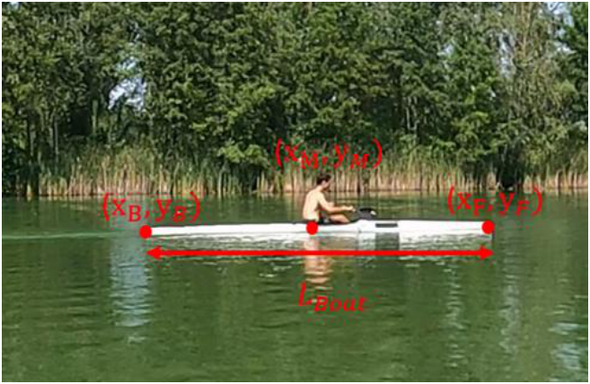

**图4.** 计算船速所用符号的说明。坐标 $(x,y)$ 的单位为像素，而 $L_{boat}$ 的单位为米。

**图中文字译注：** $(x_B,y_B)$、$(x_M,y_M)$、$(x_F,y_F)$ 分别为船后端、中心和前端的坐标；$L_{boat}$ 为船长。

## 3. 无推进减速：零推进极限，$F_m(T) = 0$

皮艇运动员停止划桨，将桨叶移出水面，在直线路径上保持固定姿势，即实现无推进减速。

### 3.1. 观察结果与速度变化

图5展示了一次无推进减速过程。经过几个划桨周期达到速度 $V_0$ 后，皮艇运动员停止划桨，并沿直线路径保持相同姿势，直至静止。

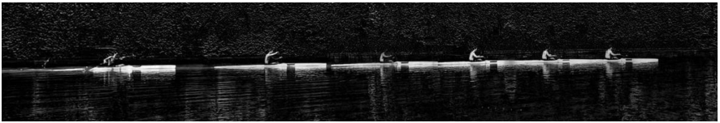

**图5.** 减速测试的连续摄影（chronophotography）图像。该测试使用L进行，通过船的减速测量有效质量（effective mass）$M_e$。相邻画面的时间间隔为 $\Delta t = 0.167\ \mathrm{s}$。

减速期间速度随时间的定量变化见图6a。可以观察到，速度下降并非线性；从初始值 $V_0 \approx 4.5\ \mathrm{m/s}$ 降至 $V_0/2$，通常需要约5 s。为描述这种减速，令式(2)取无推进极限（$F_m = 0$），得到：

$$
M_e\frac{dV}{dt} = -\frac{1}{2}\rho\,SC_D\,V^2, \tag{4}
$$

其中 $SC_D$ 为总阻力面积（drag area）。假设 $SC_D$ 几乎保持不变，由式(4)得到的理论解为：

$$
\frac{V_0}{V(t)} = 1 + \frac{t}{\tau}\qquad \tau = \frac{2M_e}{\rho\,SC_D\,V_0}. \tag{5}
$$

在此表达式中，$\tau$ 为速度下降的特征时间（characteristic time），满足 $V(t=\tau)=V_0/2$。图6b展示了相应速度比 $V_0/V(t)$ 随时间的变化，A1用黑色方块表示，A2用红色方块表示。两者均呈现出式(5)预期的理论仿射关系（affine relationship）；测得 $1/\tau \approx 0.180 \pm 0.005\ \mathrm{s^{-1}}$。因此，速度下降的特征时间为 $\tau \approx 5.55\ \mathrm{s}$。

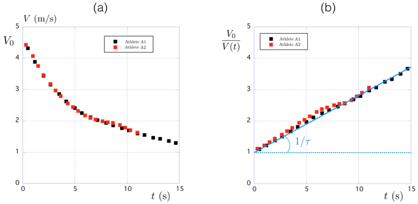

**图6.** (a) A1（黑色方块）和A2（红色方块）的速度 $V(t)$ 随时间的变化；(b) A1（$V_0 = 4.76\ \mathrm{m/s}$）和A2（$V_0 = 4.98\ \mathrm{m/s}$）的速度比 $V_0/V(t)$ 随时间的变化。

**图中文字译注：** Athlete A1／Athlete A2：运动员A1／A2；$t$：时间（s）；$V$：速度（m/s）；$1/\tau$：直线斜率。

### 3.2. 有效质量 $M_e$

由式(2)可知，皮艇运动员与船的惯性（inertia）并不只取决于 $M_t$，即运动员质量 $M_k$ 与船质量 $M_b$ 之和。附加质量可利用图7所示的椭球数据估计[17]。长轴为 $a$、短轴为 $b$ 的椭球体积为 $\Omega_{el} = 4/3\pi ab^2$。沿长轴方向运动时，附加质量是排水质量（displaced mass）的一部分，$M_a = K_{am}\rho\Omega_{el}$；常数 $K_{am}$ 取决于长宽比（aspect ratio）$a/b$，如图7b所示。对于球体（$a/b = 1$），可得到经典结果 $K_{am} = 1/2$。

对于长宽比 $a/b \approx 5.2/0.41 = 12.7$ 的皮艇（A1），得到 $K_{am} \approx 0.017$，因此附加质量可估计为 $M_a = K_{am}\cdot M_t \approx 1.3\ \mathrm{kg}$。由此推得A1对应的有效质量为 $M_e = 77.3\ \mathrm{kg}$。对A2作同样计算得到 $K_{am} = 0.0332$，因此 $M_a = K_{am}\cdot M_t \approx 2.8\ \mathrm{kg}$，从而 $M_e = 86.8\ \mathrm{kg}$。

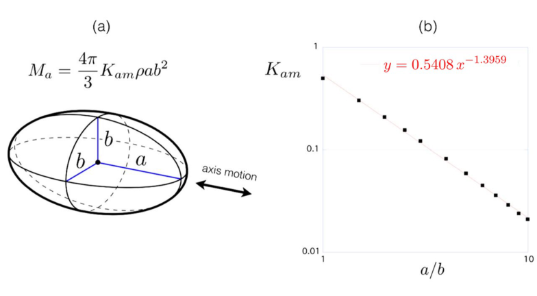

**图7.** (a) 椭球示意图；(b) 附加质量因子 $K_{am}$ 随长宽比 $a/b$ 的变化。

**图中文字译注：** axis motion：沿轴运动；$a,b$：椭球长、短半轴；图中关系为 $M_a = \frac{4K_{am}}{3}\rho\pi ab^2$，拟合标注为 $y = 0.5408x^{-1.3959}$。

### 3.3. 总阻力 $F_d$

总阻力 $F_D = 1/2\rho\,SC_D\,V^2$ 包含三个不同的部分：细长船体浸没部分上的表面摩擦阻力（skin friction）$F_s$；与船体运动产生的界面尾流（wake）有关的兴波阻力 $F_w$；以及气流绕过非流线型划手产生的空气阻力（aerodynamic drag）$F_a$[18,19]。

利用式(5)中减速时间 $\tau$ 的表达式，可以估计两名皮艇运动员的总阻力面积 $SC_D$。对于A1，代入 $\tau = 5.55\ \mathrm{s}$、$M_e = 77.3\ \mathrm{kg}$ 和 $V_0 = 4.76\ \mathrm{m/s}$，得到 $SC_D = 5.85 \times 10^{-3}\ \mathrm{m^2}$。对于A2，代入 $\tau = 5.55\ \mathrm{s}$、$M_e = 86.8\ \mathrm{kg}$ 和 $V_0 = 4.98\ \mathrm{m/s}$，得到 $SC_D = 6.38 \times 10^{-3}\ \mathrm{m^2}$。附录A表明，通过估计各项阻力的贡献，可以在理论上得到这些数值。

本节讨论忽略了风和湖中可能存在的水流的影响。如附录A所示，空气阻力占总阻力的6%，因此预计风（通常为5 km/h）对结果的影响较小。至于水流，实验在一个封闭的小湖中进行，我们认为其可忽略。

## 4. 静止起步

本节分析静止起步试验的结果，并利用力的测量及上一节获得的阻力估计，重现速度变化。在分析最初几次划桨之前，先分析单次划桨（single paddling stroke）。

### 4.1. 单次划桨

图8展示了一次单次划桨。在本例中，它对应起步后的第三桨次，见图9中的蓝色箭头。(a)中的连续画面将该桨次从桨入水（第1幅图像）到出水（第12幅图像）分解展示。图像之间的时间间隔固定为 $\Delta t = 0.05\ \mathrm{s}$，因此整个桨次持续0.55 s。桨与水面之间的夹角 $\theta$，即桨角（paddle angle），以及测得的法向力（normal force）$\mathbf{F}$，在图8b中定义。

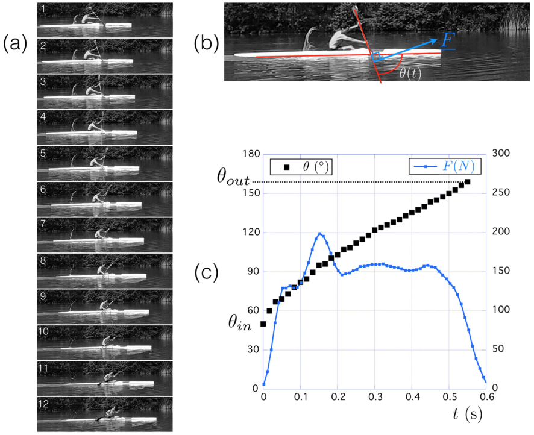

**图8.** (a) A1单次划桨的时间序列图像。相邻图像的时间间隔为 $\Delta t = 0.05\ \mathrm{s}$；(b) 桨角 $\theta$ 与法向力 $\mathbf{F}$ 的定义；(c) 桨角 $\theta$（黑色方块）和法向力大小 $F$（蓝色方块）随时间的变化。

**图中文字译注：** $\theta$（°）：桨角；$F$（N）：法向力大小；$\theta_{in}$／$\theta_{out}$：入水角／出水角；$t$（s）：时间。

桨次期间 $\theta$ 和 $F = \|\mathbf{F}\|$ 随时间的变化见图8c。就桨角而言，开始时 $\theta_{in} \approx 50°$，迅速增加到60°，随后以近乎恒定的斜率 $\omega_P = 3.2\ \mathrm{rad/s}$ 变化，直至出水角 $\theta_{out} \approx 160°$。力在桨叶入水期间（最初0.1 s）增加，在出水期间（最后0.1 s）减小，中间阶段的平均值约为155 N。不同划桨周期、运动员和测试之间，$\theta_{in}$ 与 $\theta_{out}$ 的变化很小，相对于约100°的典型变化幅度，其差异小于5°。

### 4.2. 静止起步的实验数据

要求两名皮艇运动员“尽可能快”地完成静止起步，以描述加速阶段的特征。将等时间间隔 $\Delta t = 1.66\ \mathrm{s}$ 拍摄的六幅照片叠加得到连续摄影图像，A1见图10a，A2见图10b。

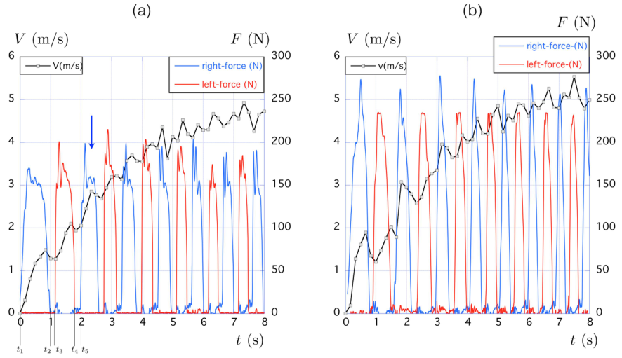

**图9.** 与图10连续摄影对应的速度（黑色实线，单位见左纵轴）和力（彩色实线，单位见右纵轴）随时间的变化。(a) A1的数据，蓝色箭头指出图8详细展示的周期；(b) A2的数据。蓝色表示右侧桨叶测得的力，红色表示左侧桨叶测得的力。$F$ 是垂直于桨叶表面的力的大小。

**图中文字译注：** right force／left force：右侧／左侧力；$V$（m/s）：速度；$F$（N）：力；$t$（s）：时间；$t_1$ 至 $t_5$ 为正文所用时间标记。

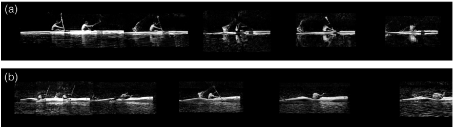

**图10.** 静止起步的连续摄影。图像之间的时间间隔为 $\Delta t = 1.67\ \mathrm{s}$：(a) A1，长度标尺为船长（5.2 m）；(b) A2，长度标尺为船长。

两名皮艇运动员对应的速度随时间变化，在图9中以黑色实线表示。灰色方块说明速度以6 Hz频率、每0.16 s测量一次。定性来看，两名运动员的速度增长过程相似，我们首先分析A1的结果（图9a）。速度在约5 s的特征时间内从0增加至5 m/s，因此相应加速度约为1 m/s²。速度信号中的波动与桨的周期性运动有关。右侧桨叶的蓝色力信号和左侧桨叶的红色力信号表明了这一点。桨叶力的最大值约为200 N。

尽管第二名皮艇运动员的最大力更大（图9b），其速度随时间的变化也呈现相同特征。该观察说明，即便船和运动员专项不同，如图2所强调的，静止起步时船的动力学仍具有需要研究的共同特征。

我们将周期（period）$T$ 定义为同一片桨叶完成完整循环、从一次入水到下一次入水所需的时间，将桨频 $f$ 定义为 $1/T$。图9标出了第一桨次的各个时间点，一个周期对应 $T = t_5-t_1$。图9显示，两名皮艇运动员的第一个周期都长于随后的周期。

还可以观察到，一个推进阶段（propulsive phase）结束与下一个推进阶段开始之间，存在无作用力的时间间隔。这对应回桨时间（recovery time）$t_0$，其间两片桨叶均在空中。在所有这些阶段，船速都会由于水和空气的摩擦而下降。对于第一个周期，$t_0 = (t_3-t_2)+(t_5-t_4)$。

图11定量展示了周期 $T$ 和回桨时间 $t_0$ 随周期编号 $n$ 的变化。第一名皮艇运动员的周期从第一个周期的2 s迅速减小至第五个周期的1 s。变化之快体现在第二个周期已为1.34 s，见图11a。回桨时间 $t_0$ 则几乎保持不变，约为 $t_0 \approx 0.31\ \mathrm{s}$。在最后几个周期中，周期的2/3用于推进阶段，1/3用于换侧（side-change），即空中阶段（aerial phase）。

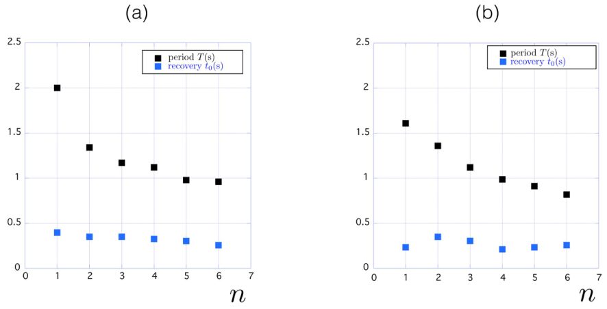

**图11.** 图9所示两次静止起步中，周期 $T$ 和回桨时间 $t_0$ 随周期编号 $n$ 的变化：(a) A1；(b) A2。

**图中文字译注：** period $T$(s)：周期 $T$（s）；recovery $t_0$(s)：回桨时间 $t_0$（s）；$n$：周期编号。

第二名皮艇运动员的变化见图11b。从初始周期（$T = 1.6\ \mathrm{s}$）至第六个周期（$T = 0.8\ \mathrm{s}$），周期同样减小为原来的一半，但变化更慢。回桨时间 $t_0$ 几乎保持不变，约为 $t_0 \approx 0.28\ \mathrm{s}$。同样，在最后几个周期中，推进阶段与空中阶段呈现2/3和1/3的比例。

### 4.3. 理论速度与实验速度的比较

已知有效质量 $M_e$（第3.2节）和总阻力 $F_D$（第3.3节），即可使用完整的式(2)，预测给定推进力 $F_m(t)$ 下速度随时间的变化。具体通过求解以下微分方程实现：

$$
M_e\frac{dV}{dt} = F(t)n\theta(t)-K\frac{1}{2}\rho SC_DV^2\qquad
\theta(t) = \theta_{in}+(\theta_{out}-\theta_{in})\frac{t-t_{in}}{t_{out}-t_{in}}. \tag{6}
$$

对于图9中的静止起步，使用初始条件 $V(t=0)=0$ 和测得的力 $F(t)$ 求解该方程。划桨动力学通过入水角 $\theta_{in}$、出水角 $\theta_{out}$ 及相应时刻 $t_{in}$、$t_{out}$ 纳入。

在式(6)中，还在总阻力 $F_D = 1/2\rho SC_DV^2$ 前引入了常数 $K \ge 1$，以表示开始划桨后船的扰动运动（perturbed motion）所带来的阻力增大[1,20]。这些运动包括纵向平移（surge）、垂向平移（heave）、横向平移（sway）、俯仰、偏航和横滚。$K$ 即主动阻力系数。

图12将通过数值积分（numerical integration）式(6)获得的速度 $V(t)$ 与实验测量值比较。A1的比较见图12a，A2见图12b。在两种情况下，蓝色实线表示零扰动极限（$K = 1$），红色实线表示最佳拟合。A1得到 $K = 1.25$，A2得到 $K = 1.1$。这意味着，相较于不划桨时测得的阻力，A1划桨时的阻力增大25%，A2增大10%。

这种差异可能与船体稳定性（boat stability）有关，A2的船更稳定。实际上，A2的船更宽（$w = 61\ \mathrm{cm}$），A1的船宽为 $w = 41\ \mathrm{cm}$。船内的陀螺仪证实了这一假设。在较高速度下，角速度（angular velocity）模的平均值 $\overline{\omega} = \frac{1}{T}\int_0^T\sqrt{\omega_x^2+\omega_y^2+\omega_z^2}\,dt$，A2达到43°/s，A1为 $\overline{\omega} = 33°/s$。这说明A1较窄的船缺乏稳定性；不过，这种更高的角速度也可能由A1较低效的技术造成。对于给定的皮艇运动员，应该存在使系数 $KSC_D$ 最小的最佳船宽。

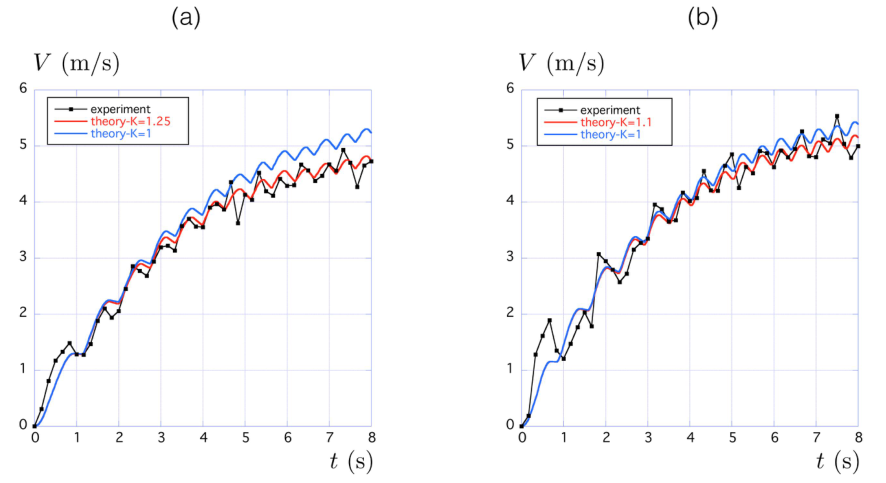

**图12.** 实验测量速度与通过数值积分式(6)获得的速度比较：(a) A1；(b) A2。

**图中文字译注：** Experiment：实验；Theory $K=1$：$K=1$时的理论结果；Theory $K=1.25$／$K=1.1$：相应主动阻力系数下的理论结果；$V$（m/s）：速度；$t$（s）：时间。

### 4.4. 平均速度的代数近似解

观察皮艇运动的另一种方式，是在右侧桨叶每次入水时拍一张照片。这样处理后，所看到的是各物理量在一个周期内取平均的运动：$\overline{\zeta} = 1/T(n)\int_{t(n)}^{t(n)+T(n)}\zeta(t)\,dt$，其中 $T(n)$ 是第 $n$ 个周期的时长，$t(n)$ 是第 $n$ 个周期开始的时刻。静止起步（图9）时的平均总力 $\overline{F}$ 和平均推进分力（propulsive component）$\overline{F_m} = \overline{Fn\theta}$ 见图13a。可以看出，这些力在最初七个周期中几乎保持恒定。

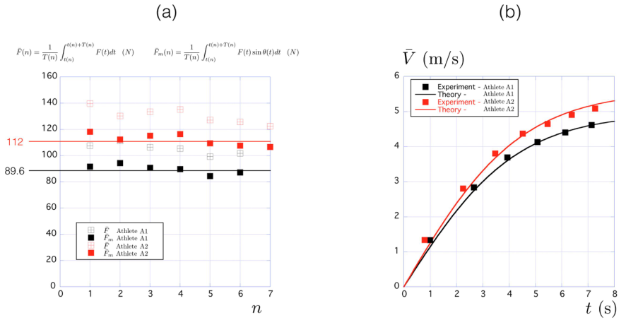

**图13.** (a) 图9所示静止起步的最初 $n$ 个周期中，平均总力 $\overline{F}$ 和平均推进分力 $\overline{F_m}=\overline{Fn\theta}$ 的变化（b）。

**图中文字译注：** Experiment - Athlete A1／A2：A1／A2的实验结果；Theory - Athlete A1／A2：A1／A2的理论结果；$\overline{F}$、$\overline{F_m}$（N）：平均总力、平均推进分力；$\overline{V}$（m/s）：平均速度；$n$：周期编号；$t$（s）：时间。图(a)中平均力的定义为 $\overline{F}(n)=\frac{1}{T(n)}\int_{t(n)}^{t(n)+T(n)}F(t)\,dt$，$\overline{F_m}(n)=\frac{1}{T(n)}\int_{t(n)}^{t(n)+T(n)}F(t)\sin\theta(t)\,dt$。

对式(6)取平均，可得到平均量的运动方程：

$$
M_e\frac{d\overline{V}}{dt} = \overline{F_m}-K\frac{1}{2}\rho SC_D\overline{V}^{\,2}. \tag{7}
$$

此处采用近似 $\overline{V^2}\approx\overline{V}^{\,2}$。当周期 $T$ 小于速度变化的特征时间时，该近似成立；这一时间定义为 $1/\tau_c = 1/V\,dV/dt$。本研究中，周期通常为1 s，速度变化的特征时间为 $\tau_c \approx 5\ \mathrm{s}$，两者支持上述近似。由于图13a还表明 $\overline{F_m}$ 恒定，式(7)可积分得到代数解：

$$
\overline{V}(t) = \overline{V}_{max}\tanh(t/\tau)\qquad
\overline{V}_{max} = \sqrt{\frac{2\overline{F_m}}{K\rho SC_D}}\qquad
\tau = \frac{M_e\overline{V}_{max}}{\overline{F_m}}, \tag{8}
$$

其中 $\tau$ 是达到最大速度 $\overline{V}_{max}$ 所需的特征时间。使用A1的参数（$\overline{F_m}=89.6\ \mathrm{N}$、$M_e=77.3\ \mathrm{kg}$、$K=1.25$、$SC_D=5.85\times10^{-3}\ \mathrm{m^2}$），得到 $\tau=4.2\ \mathrm{s}$ 和 $\overline{V}_{max}=4.95\ \mathrm{m/s}$。对A2进行同样计算（$\overline{F_m}=112\ \mathrm{N}$、$M_e=86.8\ \mathrm{kg}$、$K=1.1$、$SC_D=6.38\times10^{-3}\ \mathrm{m^2}$），得到 $\tau=4.4\ \mathrm{s}$ 和 $\overline{V}_{max}=5.6\ \mathrm{m/s}$。

实验测得的平均速度 $\overline{V}(t)$ 随时间的变化与代数解(8)的比较见图13b，两名皮艇运动员的结果均吻合较好。

## 5. 10 × 50 m试验：恒速划行

### 5.1. 实验数据

在第三类实验中，要求运动员进行十个不同试次，每次在50 m距离内保持恒定速度。要求每个试次提高速度，从第1试次的最低速度逐步增加至第10试次的最快速度。未规定桨频 $f$，而是在之后根据录像测量。50 m距离内的平均速度 $\overline{V}$ 与桨频 $f$ 的关系见图14。两名运动员均呈现相同关系：$\overline{V}=Af^{1/3}$，其中 $A\approx4.4$。

图14b展示了推进时间内的推进方向平均投影力（mean projected force）$\widetilde{F}=\int_{t_{in}}^{t_{out}}F(t)n\theta(t)\,dt/(t_{out}-t_{in})$ 的变化。$\widetilde{F}_L$ 和 $\widetilde{F}_R$ 分别对应左臂与右臂产生的力。$\theta(t)$ 的变化由试验录像获得，$F(t)$ 则由桨上的传感器给出。我们绘制了25–45 m区间内 $\widetilde{F}_L$ 和 $\widetilde{F}_R$ 的均值。左右臂的推进力数值接近。最初三个试次中，$\widetilde{F}$ 增大，随后七个试次中几乎保持不变。

一个周期内的平均力可表示为 $\overline{F}=f\left(\widetilde{F}_L(t_{out}-t_{in})_L+\widetilde{F}_R(t_{out}-t_{in})_R\right)$。假设划手的推进是对称的，这与数据吻合较好，则可将上式简化为 $\overline{F}=2\widetilde{F}(t_{out}-t_{in})/T$。此处只展示A1的结果，A2的结果相似。

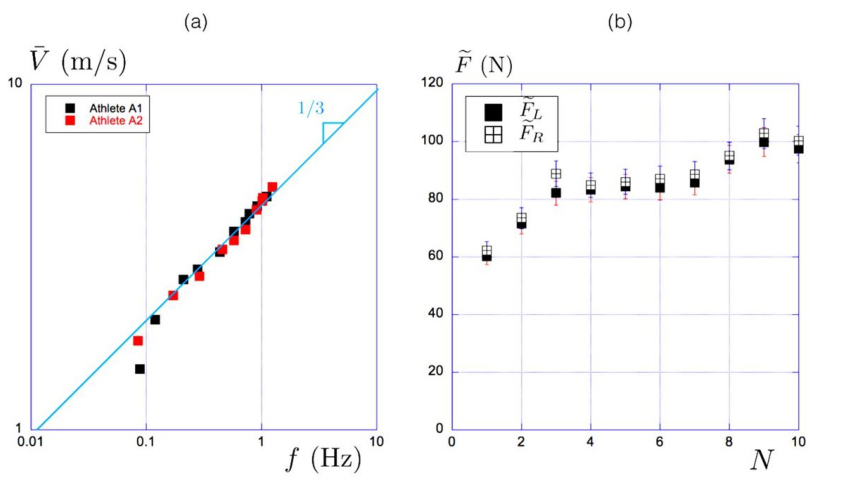

**图14.** (a) 两名皮艇运动员在稳态下的船速与桨频关系；(b) A1沿划行方向的平均推进力随试次 $N$ 的变化，力在推进时间内取平均。

**图中文字译注：** Athlete A1／Athlete A2：运动员A1／A2；$\overline{V}$（m/s）：平均速度；$f$（Hz）：桨频；$\widetilde{F}$（N）：推进方向平均投影力；$\widetilde{F}_L$／$\widetilde{F}_R$：左／右臂的对应力；$N$：试次编号；1/3：幂律斜率。

### 5.2. 船速与桨频关系模型

本节对逐步加速的10 × 50 m测试中观察到的关系 $\overline{V}=Af^{1/3}$ 建模，见图14a。我们从式(7)出发，该式对应式(2)在一个周期内的平均。一旦达到稳态，$d\overline{V}/dt=0$，因为 $V(t)=V(t+T)$：

$$
\overline{F_m}=K\frac{1}{2}\rho SC_D\overline{V}^{\,2}. \tag{9}
$$

令推进时间为 $t_P=t_{out}-t_{in}$，由于一个周期内有两个推进阶段（假设左右对称），式(9)可写为：

$$
\frac{2t_P}{T}\cdot\frac{1}{t_P}\int_{t_{in}}^{t_{out}}F(t)n(\theta(t))\,dt = K\frac{1}{2}\rho SC_D\overline{V}^{\,2}. \tag{10}
$$

如图14所示，沿运动轴方向的平均投影力 $\widetilde{F}=\int_{t_{in}}^{t_{out}}F(t)n(\theta(t))\,dt/t_P$，除最初两个试次外，近似恒定。因此将该恒定值记为 $\widetilde{F}_0$。由于桨频 $f$ 为周期的倒数，得到：

$$
f\cdot t_P\widetilde{F}_0 = K\frac{1}{4}\rho SC_D\overline{V}^{\,2}. \tag{11}
$$

此时需要找到 $t_P$ 随速度 $\overline{V}$ 变化的表达式。船与桨的水动力系数 $SC_D$ 之比较小，船的 $SC_D=6\times10^{-3}\ \mathrm{m^2}$，桨的 $SC_D=1.2\times10^{-1}\ \mathrm{m^2}$。因此，我们预计在推进期间，桨相对于水的漂移相较于船的运动很小。在桨叶近似锚定于水中（paddle anchored in the water）的极限下，桨在船体参考系（boat frame）中的速度 $V_{P/B}$ 等于船速 $\overline{V}$。将桨在船体参考系中的推进路径（propulsive path）长度定义为 $L_p$，则 $V_{P/B}=L_p/t_P$。因此，$\overline{V}$ 与 $t_P$ 的关系应接近 $1/t_P=\overline{V}/L_p$。我们利用A1的10 × 50 m测试数据，分析了推进时间倒数与平均速度的变化，见图15。

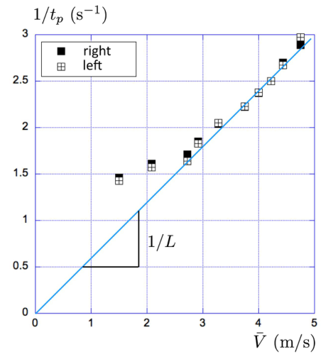

**图15.** A1进行10 × 50 m测试时，$1/t_P$ 随 $\overline{V}$ 的变化。

**图中文字译注：** right／left：右／左侧；$1/t_P$（s⁻¹）：推进时间倒数；$\overline{V}$（m/s）：平均速度；$1/L$：图中直线的斜率标注。

图15中，当速度大于2 m/s时，两臂的 $1/t_P$ 与 $\overline{V}$ 均呈线性关系。A1得到的推进路径长度为 $L_p=1.64\ \mathrm{m}$。该长度可与桨叶中心划过的弧长比较，我们预计合力（force resultant）作用于该中心。对A1，两片桨叶中心之间的距离为 $\ell\approx1.76\ \mathrm{m}$，测得桨角从50°变化至160°，对应的运动距离为 $L_p\approx0.5\ell\times\Delta\theta\approx1.69\ \mathrm{m}$，与前述测量值相差3%。利用 $t_P$ 与 $\overline{V}$ 的关系，式(11)可简化为：

$$
\overline{V}=\left(\frac{4L_p\widetilde{F}_0}{K\rho SC_D}\right)^{\frac{1}{3}}f^{\frac{1}{3}}. \tag{12}
$$

此式与第5.1节的实验数据相符。对于A1（$\widetilde{F}_0=86\ \mathrm{N}$、$L_p=1.64\ \mathrm{m}$、$K=1.25$、$SC_D=5.85\times10^{-3}\ \mathrm{m^2}$），得到 $A=4.2$；应将其与实验得到的 $A=4.4$ 比较。因此，我们以5%的精度重现了实验行为。

本节假设左右侧推进对称。在静止起步实验（图9）中，左右侧推进的模式有所不同。不过，观察图14b和图15可见，左右臂的推进时间相同，推进力均值无显著差异。由于模型在一个周期内取平均，只要推进力和推进时间的平均值相近，即使周期内的力分布不对称也不构成问题。

不过，模型也可以适用于非对称推进。这时，在式(12)中，用 $L_r\widetilde{F}_r+L_l\widetilde{F}_l$ 替换 $2L_p\widetilde{F}_0$，其中 $L_r$、$L_l$ 分别为右侧与左侧推进路径长度，$\widetilde{F}_r$、$\widetilde{F}_l$ 分别为右侧与左侧平均投影力。这个模型多出两个参数，与我们希望模型尽可能简单的目标不符，因此本文展示了采用对称假设的模型。

## 6. 结论

本文提供了量化和建立皮艇比赛动力学模型的方法。采用三项测试评估重要物理参数：无推进减速、静止起步，以及逐步加速的10 × 50 m测试。第一项测试用于评估阻力系数（drag coefficient），得到典型值 $SC_D=6\times10^{-3}\ \mathrm{m^2}$。在理论上，我们能够量化各项贡献，包括表面摩擦阻力、兴波阻力和空气阻力，并重现该值。

第二项测试使我们能够量化运动对阻力的影响，即主动阻力系数。两名皮艇运动员的阻力分别增加25%（$K=1.25$）和10%（$K=1.10$）。最后一项测试用于评估速度与桨频之间的联系。对两人均得到关系 $\overline{V}=Af^{1/3}$，并给出了各运动员参数 $A$ 的显式表达式，与实验值相符。

本研究提供了一个描述皮艇推进的通用模型。模型适用于瞬态和稳态，并可与生理模型[21]耦合，用于开发通用的比赛优化算法。本文提出的整体方法还可应用于其他以桨为基础的运动，例如划艇、赛艇，甚至游泳。它也提供了通过四个物理参数监测和描述运动员特征的方法：阻力参数（drag parameter）$SC_D$、主动阻力系数 $K\ge1$、推进方向平均投影力 $\widetilde{F}_0$ 和推进路径长度 $L_p$。

**作者贡献：** 所有作者对本文的贡献相同。R.C.建立了逐步加速测试的模型，并撰写了部分论文；L.H.负责数据分析，并收集了部分数据；C.P.开展实验、收集数据，并撰写了部分论文；R.L.和J.-P.B.制作了仪器化桨，并收集了部分数据；C.C.建立了静止起步模型，并撰写了部分论文。所有作者均阅读并同意稿件的发表版本。

**资助：** 本研究由法国国家研究署（Agence Nationale de la Recherche，ANR）资助，项目编号ANR-2020-STHP2-0006。

**机构审查委员会声明：** 两名运动员自愿参与研究，并提供了参与研究的书面同意。测量作为其常规训练的一部分进行，未增加额外任务。

**知情同意声明：** 已获得研究中所有受试者的知情同意。

**数据可用性声明：** 本文无额外数据。

**致谢：** 衷心感谢两名运动员参与现场实验。还感谢 Marc Mander 指挥官对 Sciences 2024 项目的关注，并允许皮艇运动员使用法国综合理工学院赛艇设施中心。最后，感谢 Alexandre Rosinski 在各项测试过程中提供技术帮助。

**利益冲突：** 作者声明不存在利益冲突。

## 附录A

本节旨在从理论上重现这些实验数值，并估计 $F_s$、$F_w$ 和 $F_a$ 三种力的相对贡献。

### 附录A.1. 表面摩擦阻力 $F_s$

表面摩擦阻力 $F_s$ 与运动方向相反，其大小可写为 $F_s=1/2\rho SC_sV^2$，其中 $S$ 为湿表面积，$C_s$ 为表面摩擦阻力系数（skin-friction coefficient）。该系数取决于以船长 $L$ 为特征长度的雷诺数 $Re_L=\rho VL/\eta$（图A1），以及流体密度（fluid density）$\rho$ 和动力黏度（dynamic viscosity）$\eta$。对水而言，$\rho=10^3\ \mathrm{kg/m^3}$，$\eta=10^{-3}\ \mathrm{Pa.s}$。

在 $10^4<Re_L<10^6$ 范围内，层流（laminar）系数估计为 $C_s=1.33/\sqrt{Re_L}$；在更高雷诺数下，普遍采用国际拖曳水池会议（International Towing Tank Conference，ITTC）的公式[18,22]：$C_s=(1+k)\,0.075/(\log Re_L-2)^2$。其中，$(1+k)=2.76\left(L/\Omega^{1/3}\right)^{-0.4}$ 是形状因子（shape factor），取决于船长 $L$ 与浸没体积 $\Omega$[23]。

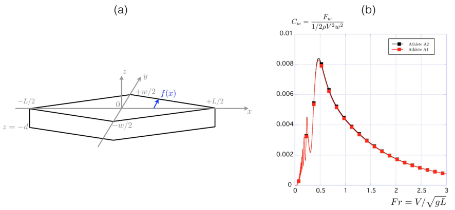

**图A1.** (a) 棱柱形船体（prismatic hull）示意图；(b) 用式(A4)计算的兴波阻力系数 $C_w$ 随弗劳德数的变化。

**图中文字译注：** $x,y,z$：坐标轴；$L$：船长；$w$：船宽；$d$：吃水深度；$f(x)$：船体轮廓；$C_w=F_w/(1/2\rho V^2w^2)$：兴波阻力系数；$Fr=V/\sqrt{gL}$：弗劳德数；Athlete A1／A2：运动员A1／A2。

皮艇的典型速度为 $V=5\ \mathrm{m/s}$，船长为 $L=5\ \mathrm{m}$，因此 $Re_L=2.5\times10^7$。取 $\Omega=80\times10^{-3}\ \mathrm{m^3}$，得到 $(1+k)=1.035$。使用该雷诺数和形状因子，上式得到 $C_s=0.0027$，与Jackson[2]估计的0.0028接近。由于湿表面积与浸没体积满足 $S=2.5\sqrt{\Omega L}$[2]，最终得到：

$$
F_s=\frac{1}{2}\rho SC_sV^2\qquad
SC_s=\frac{0.5175L^2}{(\log Re_L-2)^2}\left(\frac{\Omega}{L^3}\right)^{0.633}. \tag{A1}
$$

对于给定载荷 $\Omega=M_t/\rho$，由于对数项几乎保持恒定，可以推得表面摩擦阻力随船长 $L$ 的平方根增加，并近似随速度的平方增加。对于典型载荷 $M_t=76\ \mathrm{kg}$、船长 $L=5.2\ \mathrm{m}$ 和船速 $V=5\ \mathrm{m/s}$，式(A1)给出A1的 $SC_s=4.08\times10^{-3}\ \mathrm{m^2}$，或 $F_s=51\ \mathrm{N}$。对A2进行同样计算（$M_t=84\ \mathrm{kg}$、$L=4.5\ \mathrm{m}$、$V=5\ \mathrm{m/s}$），得到 $SC_s=4.38\times10^{-3}\ \mathrm{m^2}$，或 $F_s=54.8\ \mathrm{N}$。

### 附录A.2. 兴波阻力 $F_w$

兴波阻力的研究历史悠久，其中一种较简洁的表达形式由Mitchell公式给出[24–26]：

$$
F_w=\frac{4}{\pi}\frac{\rho g^2}{V^2}\int_1^\infty\left(I^2+J^2\right)\frac{\lambda^2\,d\lambda}{\sqrt{\lambda^2-1}}, \tag{A2}
$$

其中：

$$
I=\int\!\int\frac{df}{dx}e^{\lambda^2gz/V^2}\cos\left(\lambda gx/V^2\right)\,dx\,dz. \tag{A3}
$$

$J$ 的积分形式相似，只是以正弦代替余弦。在此兴波阻力表达式中，函数 $f(x,z)$ 表示船体形状，见图A1a。

采用不随 $z$ 变化的简化线性轮廓（图A1a），当 $x\in[-L/2,0]$ 时，$f(x)=w/L(x+L/2)$；当 $x\in[0,+L/2]$ 时，$f(x)=-w/L(x-L/2)$。在此极限下，上述兴波阻力公式简化为：

$$
F_w=\frac{1}{2}\rho V^2w^2\frac{128}{\pi}Fr^4\int_1^\infty\left(1-e^{-\lambda^2/(\beta Fr^2)}\right)^2n^4\left(\frac{\lambda}{4Fr^2}\right)\frac{d\lambda}{\lambda^4\sqrt{\lambda^2-1}}. \tag{A4}
$$

其中 $\beta=L/d$ 为船长 $L$ 与吃水深度（draft）$d$ 之比。对于图A1a的简化棱柱形船体，$\Omega=1/2Lwd$，因此 $\beta=1/2L^2w/\Omega$。利用图2中的 $L$、$w$ 和 $M_t$，计算兴波阻力系数 $C_w=F_w/(1/2\rho V^2w^2)$，并在图A1b中展示其随弗劳德数的变化。

这种非单调变化是兴波阻力的典型特征，其最大值出现在 $Fr\approx0.5$ 附近同样如此[19,26]。定量而言，对船长5.2 m、速度 $V=5\ \mathrm{m/s}$ 的船，得到 $Fr=0.70$，进而推得 $C_w=6.1\times10^{-3}$；取 $w=0.41\ \mathrm{m}$，得到 $F_w=12.8\ \mathrm{N}$。这些数值对应图2中的A1。

该兴波阻力可与Jackson根据式(1)提出的数值比较：$F_{wj}=1/2\rho V^2C_{wj}\Omega^{5/3}/L^3$。在相同速度 $V=5\ \mathrm{m/s}$ 下，得到 $F_{wj}=13.3\ \mathrm{N}$，吻合较好。

A1对应的兴波阻力面积 $w^2C_w$ 为 $1.02\times10^{-3}\ \mathrm{m^2}$（或 $F_w=12.75\ \mathrm{N}$）。对A2作同样计算，得到 $w^2C_w=2.09\times10^{-3}\ \mathrm{m^2}$（或 $F_w=26.1\ \mathrm{N}$），主要差别来自船宽。

### 附录A.3. 空气动力作用力 $F_a$

阻力的最后一个部分为空气动力贡献 $F_a$，即空气对水面以上非流线型物体（bluff body）的摩擦作用，该物体由皮艇运动员上半身和桨构成，见图A2a。用 $\mathrm{gma}_1$ 表示划手的迎风面积（frontal area），$\mathrm{gma}_2$ 表示未被遮挡的桨的迎风面积，在无风情况下有：

$$
F_a=\frac{1}{2}\rho_a\left(\mathrm{gma}_1C_{D1}+\mathrm{gma}_2C_{D2}\right)V^2, \tag{A5}
$$

其中 $\rho_a$ 为空气密度，$C_{D1}$ 和 $C_{D2}$ 分别为迎风面积 $\mathrm{gma}_1$ 与 $\mathrm{gma}_2$ 对应的阻力系数。

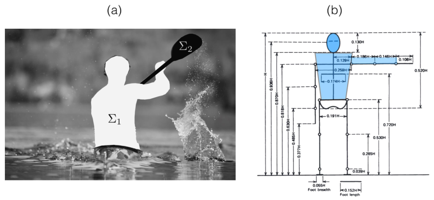

**图A2.** (a) 两个水面以上非流线型表面的识别：$\mathrm{gma}_1$ 对应皮艇运动员，$\mathrm{gma}_2$ 对应桨未被遮挡的部分；(b) 人体测量图，数据取自Drillis和Contini的研究[27]。

**图中文字译注：** 图(a)用 $\Sigma_1$ 与 $\Sigma_2$ 标识划手和桨的对应面积；图(b)中的 $H$ 表示身高，各尺寸以身高比例表示。Foot breadth：足宽；Foot length：足长。

身体迎风面积 $\mathrm{gma}_1$ 可根据Drillis和Contini的人体测量数据（图A2b）中的蓝色区域估计，得到 $\mathrm{gma}_1=0.101H^2$，其中 $H$ 为皮艇运动员的身高。对应的阻力系数为 $C_{D1}=0.7$[28]。对于桨，测得 $\mathrm{gma}_2=0.08\ \mathrm{m^2}$。令 $C_{D2}=C_{D1}$，则在 $V=5\ \mathrm{m/s}$ 时，A1的 $F_a\approx3.9\ \mathrm{N}$，A2的 $F_a\approx4.3\ \mathrm{N}$。

所用表格对应一般人群的平均质量分布。皮艇运动员上半身肌肉比下半身更发达，因此我们可能略微低估了空气动力作用力。

### 附录A.4. 理论阻力与通过减速测得的阻力比较

对于A1，$V=5\ \mathrm{m/s}$ 时的理论总力为 $F_D=F_s+F_w+F_a=51+12.75+3.9=67.7\ \mathrm{N}$，对应 $SC_D=5.4\times10^{-3}\ \mathrm{m^2}$。该值比通过减速测得的 $SC_D=5.85\times10^{-3}\ \mathrm{m^2}$ 小7.5%。考察各项阻力的相对贡献，表面摩擦阻力占75%，兴波阻力占19%，空气阻力占6%。即使上一节略微低估了空气动力作用力，它也并非总阻力的主要部分。

对于A2，$V=5\ \mathrm{m/s}$ 时的理论总力为 $F_D=F_s+F_w+F_a=54.8+26.1+4.3=85.2\ \mathrm{N}$，对应 $SC_D=6.8\times10^{-3}\ \mathrm{m^2}$。该值比通过减速测得的 $SC_D=6.38\times10^{-3}\ \mathrm{m^2}$ 大6.7%。三个部分的比例分别为：表面摩擦阻力64%、兴波阻力30%、空气阻力6%。

与A1的主要差异与船的形状有关，A2的船更宽（$w=61\ \mathrm{cm}$，A1为 $w=41\ \mathrm{cm}$），因此产生更大的兴波阻力。

我们认为，理论阻力能够在±8%的范围内估计实验测得的阻力。考虑到所采用的各种近似，尤其是船体形状的近似，这一吻合程度较好。

至于各项阻力随速度的变化，表A1列出了它们在 $V\in[1\ \mathrm{m/s}–5\ \mathrm{m/s}]$ 范围内的数值。使用A1的参数 $L=5.2\ \mathrm{m}$、$w=0.41\ \mathrm{m}$、$H=1.70\ \mathrm{m}$、$M_t=76\ \mathrm{kg}$，分别用式(A1)、(A4)和(A5)估计 $F_s$、$F_w$ 和 $F_a$。

尽管各项力的贡献随速度增加，但表A1最后一列显示，总阻力面积在整个速度范围内几乎保持恒定，$SC_D=5.7\pm0.3\times10^{-3}\ \mathrm{m^2}$。

**表A1.** 使用A1的参数 $L=5.2\ \mathrm{m}$、$w=0.41\ \mathrm{m}$、$H=1.70\ \mathrm{m}$、$M_t=76\ \mathrm{kg}$ 估计的各项阻力贡献随船速的变化。

| $V$（m/s） | $Re_L$ | $Fr$ | $SC_s$（m²） | $F_s$（N） | $C_w$ | $F_w$（N） | $F_a$（N） | $F_D$（N） | $SC_D$（m²） |
|---|---|---|---|---|---|---|---|---|---|
| 1 | $0.57\times10^7$ | 0.14 | $5.4\times10^{-3}$ | 2.7 | $12\times10^{-4}$ | 0.1 | 0.16 | 2.95 | $5.9\times10^{-3}$ |
| 2 | $1.04\times10^7$ | 0.28 | $4.7\times10^{-3}$ | 9.5 | $26\times10^{-4}$ | 0.9 | 0.62 | 11.0 | $5.5\times10^{-3}$ |
| 3 | $1.56\times10^7$ | 0.42 | $4.4\times10^{-3}$ | 20.0 | $77\times10^{-4}$ | 5.8 | 1.4 | 27.2 | $6.0\times10^{-3}$ |
| 4 | $2.08\times10^7$ | 0.56 | $4.2\times10^{-3}$ | 33.8 | $76\times10^{-4}$ | 10.2 | 2.5 | 46.6 | $5.8\times10^{-3}$ |
| 5 | $2.60\times10^7$ | 0.70 | $4.1\times10^{-3}$ | 51.0 | $61\times10^{-4}$ | 12.8 | 3.9 | 67.2 | $5.4\times10^{-3}$ |

## 参考文献（References）

1. Berglund, B.; McKenzie, D. Handbook of Sports Medicine and Science, Canoeing; Olympic Handbook of Sports Medicine Series; John Wiley & Sons: Hoboken, NJ, USA, 2018.

2. Jackson, P. Performance prediction for Olympic kayaks. J. Sport Sci. 1995, 13, 239–245. [CrossRef] [PubMed]

3. Gomes, B.B.; Conceição, F.; Pendergast, D.; Sanders, R.; Vaz, M.; Vilas-Boas, J. Is passive drag dependent on the interaction of kayak design and paddler weight in flat-water kayaking ? Sport Biomech. 2015, 14, 394–403. [CrossRef] [PubMed]

4. Gomes, B.; Machado, L.; Ramos, N.; Conceição, F.; Sanders, R.; Vaz, M.; Vilas-Boas, J.; Pendergast, D. Effect of wetted surface area on friction, pressure, wave and total drag of a kayak. Sport Biomech. 2018, 17, 453–461. [CrossRef]

5. Sumner, D.; Sprigings, E.J.; Bugg, J.D.; Heseltine, J.L. Fluid forces on kayak paddle blades of different design. Sport Eng. 2003, 6, 11–19. [CrossRef]

6. Hémon, P. Hydrodynamic characteristics of sea kayak traditional paddles. Sport Eng. 2017, 21, 189–197. [CrossRef]

7. Bjerkefors, A.; Tarassova, O.; Rosén, J.S.; Zakaria, P.; Arndt, A. Three-dimensional kinematic analysis and power output of elite flat-water kayakers. Sport Biomech. 2017, 17, 414–427. [CrossRef] [PubMed]

8. Klitgaard, K.K.; Hauge, C.; Oliveira, A.S.C.; Heinen, F. A kinematic comparison of on-ergometer and on-water kayaking. Eur. J. Sport Sci. 2020, 21, 1375–1384. [CrossRef] [PubMed]

9. Pickett, C.W.; Abbiss, C.; Zois, J.; Blazevich, A.J. Pacing and stroke kinematics in 200-m kayak racing. J. Sport Sci. 2020, 39, 1096–1104. [CrossRef]

10. Goreham, J.A.; Miller, K.B.; Frayne, R.J.; Ladouceur, M. Pacing strategies and relationships between speed and stroke parameters for elite sprint kayakers in single boats. J. Sport Sci. 2021, 39, 2211–2218. [CrossRef]

11. Helmer, R.; Farouil, A.; Baker, J.; Blanchonette, I. Instrumentation of a kayak paddle to investigate blade/water interactions. Procedia Eng. 2011, 13, 501–506. [CrossRef]

12. Gomes, B.; Viriato, N.; Sanders, R.; Conceição, F.; Vilas-Boas, J.P.; Vaz, M. Analysis of the on-water paddling force profile of an elite kayaker. In Proceedings of the ISBS-Conference Proceedings Archive, Porto, Portugal, 27 June–1 July 2011.

13. Gomes, B.B.; Ramos, N.; Conceição, F.; Sanders, R.; Vaz, M.; Vilas-Boas, J. Paddling force profiles at different stroke rates in elite sprint kayaking. J. Appl. Biomech. 2015, 31, 258–263. [CrossRef] [PubMed]

14. Gomes, B.B.; Ramos, N.; Conceição, F.; Sanders, R.; Vaz, M.; Vilas-Boas, J. Paddling time parameters and paddling efficiency with the increase in stroke rate in kayaking. Sport Biomech. 2020. [CrossRef] [PubMed]

15. Tullis, S.; Galipeau, C.; Morgoch, D. Detailed on-water measurements of blade forces and stroke efficiencies in sprint canoe. Multidiscip. Digit. Publ. Inst. Proc. 2018, 2, 306.

16. Delgado, D.; Ruiz, C. One-Dimensional Mathematical Model for Kayak Propulsion. Appl. Sci. 2021, 11, 10393 . [CrossRef]

17. Patton, K. An Experimental Determination of Hydrodynamic Masses and Mechanical Impedances; Technical Report; Navy Underwater Sound Laboratory: New London, CT, USA, 1965.

18. Fossati, F. Aero-Hydrodynamics and the Performance of Sailing Yachts: The Science Behind Sailing Yachts and Their Design; A & C Black: Valencia, CA, USA, 2009.

19. Boucher, J.; Labbé, R.; Clanet, C.; Benzaquen, M. Thin or bulky: Optimal aspect ratios for ship hulls. Phys. Rev. Fluids 2018, 3, 074802. [CrossRef]

20. Pendergast, D.; Bushnell, D.; Wilson, D.; Cerretelli, P. Energetics of kayaking. Eur. J. Appl. Physiol. Occup. Physiol. 1989, 59, 342–350. [CrossRef]

21. Keller, J.B. A theory of competitive running. Phys. Today 1973, 26, 43. [CrossRef]

22. Hadler, J. Coefficients for International Towing Tank Conference 1957 Model-Ship Correlation Line; Technical Report; David Taylor Model Basin: Washington, DC, USA, 1958.

23. Molland, A.F.; Turnock, S.; Hudson, D. Ship Resistance and Propulsion: Practical Estimation of Propulsive Power, 2nd ed.; Cambridge University Press: Cambridge, UK, 2017.

24. Michell, J. The wave resistance of a ship. Philos. Mag. 1898, 45, 106–123. [CrossRef]

25. Wehausen, J.V. The wave resistance of ships. Adv. Appl. Mech. 1973, 13, 93–245.

26. Tuck, E. The wave resistance formula of JH Michell (1898) and its significance to recent research in ship hydrodynamics. ANZIAM J. 1989, 30, 365–377.

27. Drillis, R.; Contini, R.; Bluestein, M. Body segment parameters. Artif. Limbs 1964, 8, 44–66. [PubMed]

28. Barber, H.L. Effect of Wind in the Field of Play for Elite Sprint Kayakers. Master’s Thesis, Ottawa-Carleton Institute for Mechanical & Aerospace Engineering, Ottawa, ON, Canada, 2018.
