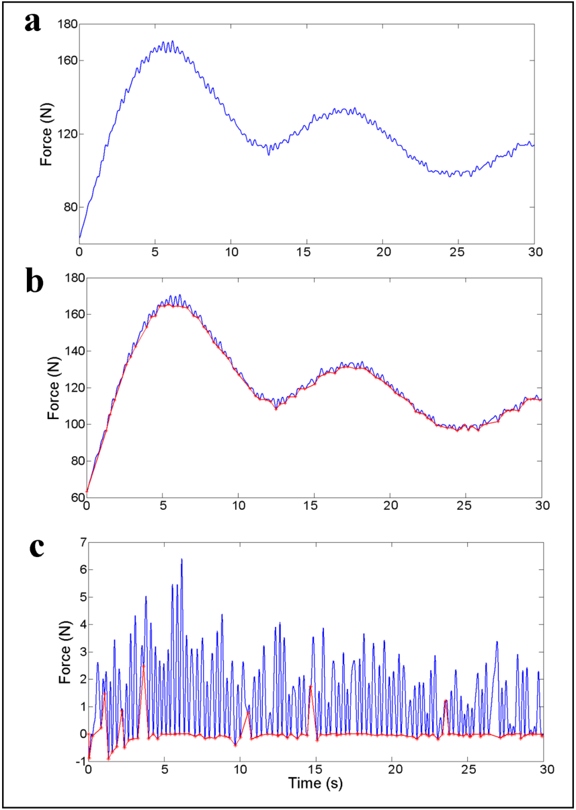
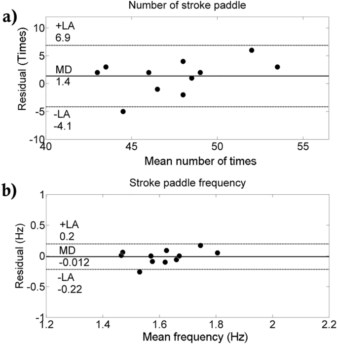
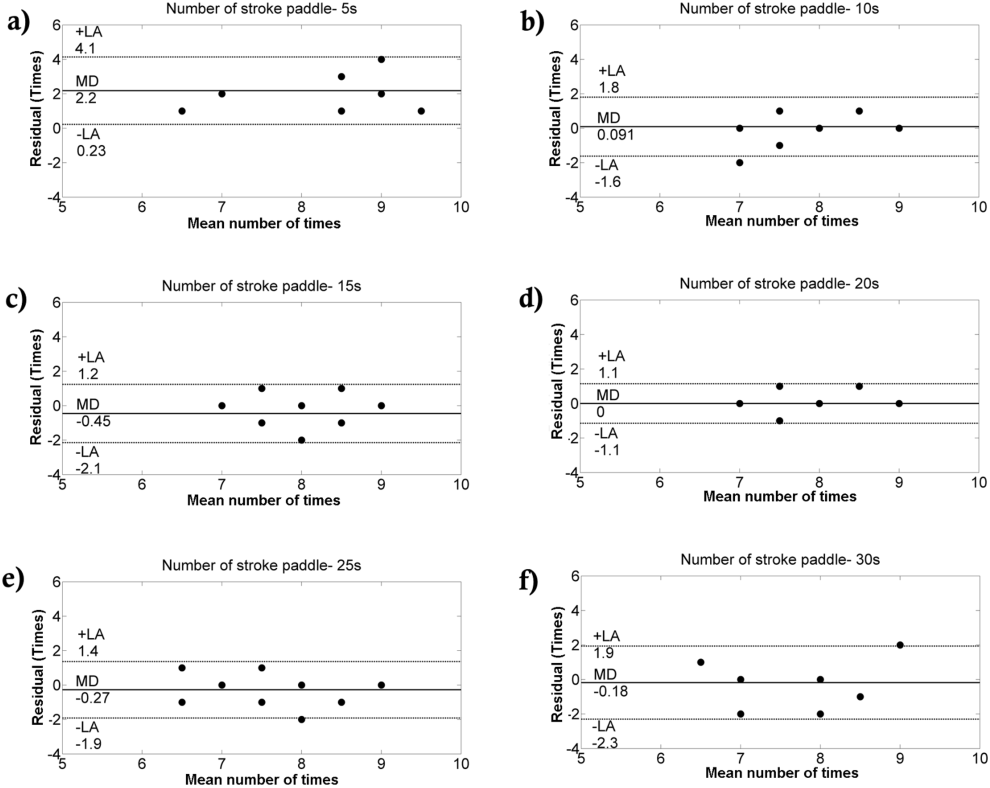
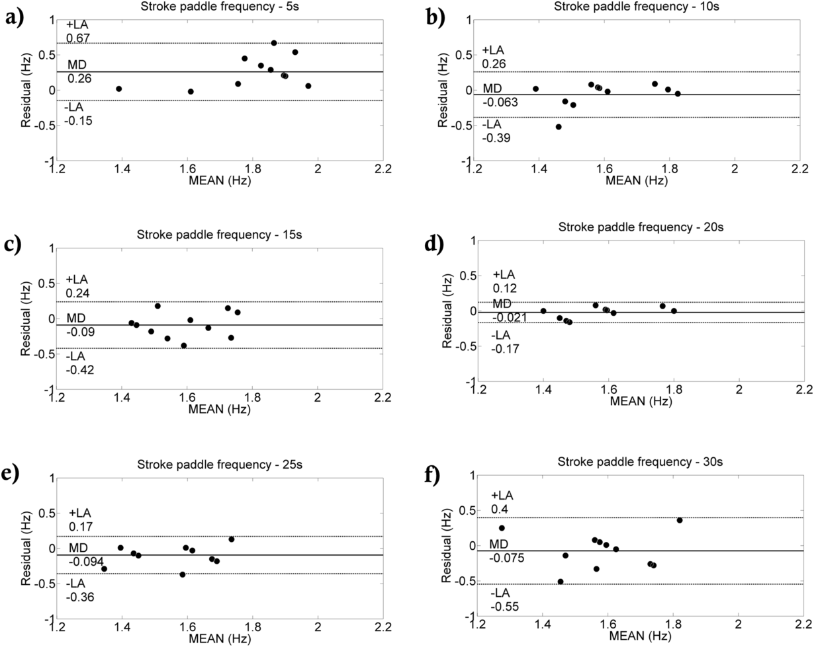
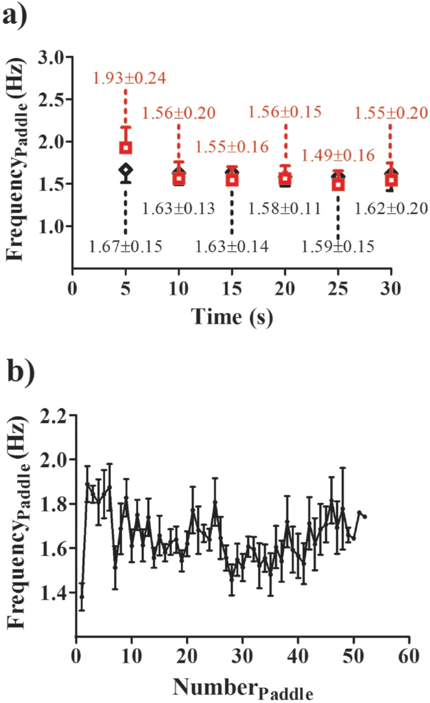

# 精英激流回旋皮艇运动员的新型划桨动作分析：与力参数的关系

*Novel paddle stroke analysis for elite slalom kayakers: Relationship with force parameters*

Leonardo Henrique Dalcheco Messias1,☯、Filipe Antônio de Barros Sousa1,☯、Ivan Gustavo Masseli dos Reis1,☯、Homero Gustavo Ferrari1,☯、Claudio Alexandre Gobatto1,☯、Camila Caputo Saldanha Serra1,☯、Marcelo Papoti2、Fúlvia Barros Manchado-Gobatto1,☯,*

1 巴西坎皮纳斯大学应用科学学院，Limeira，São Paulo，巴西。  
2 巴西圣保罗大学体育学院，Bandeirantes，Ribeirão Preto，São Paulo，巴西。  
☯ 这些作者对本研究的贡献相同。  
* 通讯作者：fulvia.gobatto@fca.unicamp.br。

研究论文，开放获取。  
引用信息：Messias LHD, Sousa FAdB, dos Reis IGM, Ferrari HG, Gobatto CA, Serra CCS, et al. (2018) Novel paddle stroke analysis for elite slalom kayakers: Relationship with force parameters. PLoS ONE 13(2): e0192835. https://doi.org/10.1371/journal.pone.0192835  
编辑：Tiago M. Barbosa，新加坡南洋理工大学。  
收稿：2017年7月4日；录用：2018年1月31日；发表：2018年2月28日。

**版权：** © 2018 Messias等。本文为开放获取论文，依据 Creative Commons Attribution License 发布，允许在任何媒介中不受限制地使用、传播和复制，但须注明原作者与来源。

**数据可用性声明：** 所有相关数据均包含于本文及其补充信息文件中。

**资助：** FBMG获圣保罗州研究资助基金会（Fundação de Amparo à Pesquisa do Estado de São Paulo）资助，编号2012/06355–2；FBMG获巴西国家科学技术发展委员会（Conselho Nacional de Desenvolvimento Científico e Tecnológico）资助，编号472277/2011–1；CAG获圣保罗州研究资助基金会资助，编号2009/08535–5；LHDM获教学、研究与推广支持基金（Fundo de Apoio ao Ensino, à Pesquisa e à Extensão）资助，编号756/13；FBMG获FUNCAMP资助，编号1403。

**利益冲突：** 作者声明不存在利益冲突。

## 摘要

本研究分为两个相互补充的部分。在第1部分，提出一种基于30秒系留全力测试（30-s all-out tethered test）力信号（force signal）的新型划桨动作分析方法，并将结果与视频记录比较。在第2部分，研究同一测试的力数据与两种方法所得划桨结果之间的关系。评估了11名男性精英激流回旋皮艇运动员（slalom kayaker），均为巴西国家队成员。

进行系留测试（tethered test），以分析力参数，包括峰值力（peak force）、平均力（mean force）和冲量（impulse）。通过视频记录分析，统计完成的桨次数 $\mathrm{V.Number}_{Paddle}$，并以该桨次数除以30（即测试总时间）计算桨频（paddle frequency）$\mathrm{V.Frequency}_{Paddle}$。新方法通过分析测力传感器（load cell）的力信号，得到完成的桨次数与桨频，分别为 $\mathrm{S.Number}_{Paddle}$ 和 $\mathrm{S.Frequency}_{Paddle}$。配对t检验（paired t-test）未发现两种方法的结果存在差异，但仅桨次数之间呈显著相关。力参数只与 $\mathrm{S.Number}_{Paddle}$ 和 $\mathrm{S.Frequency}_{Paddle}$ 相关。总体而言，考虑到理论与实际应用，我们建议将新方法作为视频记录的替代方法。

## 引言

在皮艇运动中，划桨期间力的产生（force development）对于克服空气阻力（aerodynamic resistance）和水动力阻力（hydrodynamic resistance），即阻力（drag），进而提高船速具有重要意义[1]。力对运动员表现的影响也已得到证实[2–4]。不过，关于可能影响总力产生的因素，例如划桨类型、技术与桨频，现有信息仍然较少，尤其是在皮划艇激流回旋（canoe slalom）项目中[5–8]。

为应对这些局限，我们的团队最近开发了一种专用的水上系留式测功系统（ergometer），用于评估激流回旋皮艇运动员[9]。系留式皮划艇测试系统（Tethered Canoe System，TCS）允许在应用生理测试方案的同时采集力数据。此外，我们还证实，30秒全力测试中的变量，例如峰值力、平均力和冲量，与运动员在模拟皮划艇激流回旋比赛中的表现，即比赛用时，存在显著负相关[9]。

尽管TCS已经取得进展，初步结果也具有前景，但仍有一些问题需要澄清。我们认为，下一步应研究哪些因素有助于系留测试期间力的产生。因此，TCS的30秒全力测试必须评估桨次数（number of paddle strokes）和桨频（stroke frequency）。有了这些信息，教练可以分析产生的总力是否与完成的桨次数和桨频相关。由于TCS的30秒全力测试中产生的总力与模拟比赛中的运动员表现相关[9]，有关所完成桨次及总力产生的信息，可能有助于改善激流回旋皮艇运动员的训练，进而改善表现。据我们所知，该问题尚未得到研究。

另一方面，其他皮划艇项目已开展划桨分析，即桨次数和桨频分析[3,10,11]。为获得划桨及力的产生数据，研究使用复杂设备，包括用于二维（2D）和三维（3D）运动学（kinematics）分析的多台摄像机。尽管这些设备和分析方法能通过直接测量获得重要数据，教练在日常工作中可能无法使用。虽然激流回旋教练可以记录训练过程，随后分析所完成桨次的数据，但该程序可能很耗时。

另一种方法是将加速度计（accelerometer）连接于桨杆（shaft），实时提供桨叶与水相互作用（blade/water interaction）[12]、桨频（cadence）[13]和划桨功率（stroke power）[14]的信息。不过，这些研究旨在提供获得上述变量的替代设备，因此纳入的受试者较少也可以理解。然而，考虑到激流回旋运动员在力的产生和无氧代谢（anaerobic metabolism）方面的差异[5]，新的测试程序必须在更大的样本中实施，尤其是精英运动员样本。此外，关于划桨特征，即完成的桨次数和桨频，与总力产生之间关联的研究仍然较少，尤其是在皮划艇激流回旋中。既往报告提示，这种关联可能影响激流回旋运动员的表现[5,15]。

因此，本研究提出一种替代分析方法，用于评估激流回旋运动员在30秒全力测试中完成的桨次数和桨频。同时，研究该分析结果与同一测试中产生的总力之间的关系。在第1部分，我们的目标是：a) 提出一种基于力信号的新方法，测量激流回旋皮艇运动员在30秒系留全力测试中的划桨情况；b) 将新方法结果与视频记录中统计的桨次数比较。由于新方法直接测量总力信号，我们假设其所得桨次数和桨频与视频记录方法的结果相似。

在第2部分，研究全力测试总力数据与两种方法所得划桨结果，即桨次数和桨频之间的关系。考虑到力信号方法以对时间序列（time series）中总力数据向量（force vector）的灵敏分析为基础，我们假设桨次数／桨频与TCS的30秒全力测试所得总力参数，即峰值力、平均力和冲量，存在显著相关。

## 材料与方法

### 研究设计

所有程序均围绕本研究的假设设计。在两周内对巴西国家队11名男性激流回旋皮艇运动员进行评估。每天评估时间大致相同（±1 h）。所有受试者均处于赛季前训练阶段。第1部分比较基于30秒系留全力测试力信号的新分析方法所得桨次数和桨频，与视频记录所得结果。随后，第2部分将第1部分的结果与30秒全力测试所得力参数联系起来。

#### 受试者

巴西国家队11名男性精英激流回旋皮艇运动员参加本研究，年龄19 ± 2岁，体质量71.0 ± 6.9 kg，身高175.5 ± 7.6 cm，体脂率10.2 ± 1.4%；他们属于单人皮艇组（single kayak class），即K-1。按照Jackson和Pollock[16]的方法，通过测量七处皮褶，即胸部、腋部、肱三头肌处、肩胛下部、腹部、髂上部和大腿，计算体脂率。

11名精英运动员中，有10名，即约91%，进入国际皮划艇联合会（International Canoe Federation，ICF）的皮划艇激流回旋世界排名。所有运动员均具有至少5年的国际比赛经验。不具备国际比赛经验、且不熟悉K-1组别的运动员未纳入样本。

在实验开始前，要求运动员保持各自原有的补水与饮食习惯，避免高强度体力活动，以及摄入酒精和咖啡因。事先说明实验程序的风险，运动员／家长提供书面知情同意，授权运动员参与研究。所有实验均经坎皮纳斯大学医学科学院伦理委员会批准。

### 实验程序

所有程序均使用TCS进行[9]。该系统包括一个采用惠斯通电桥（Wheatstone bridge，1/2桥）应变片（strain gauge）的测力传感器，型号CSL/ZL-MK，产地为巴西SP，量程250 kgf。在船尾下方安装一个龙骨结构，尺寸35 × 25 cm、厚度5.00 mm，以稳定测功系统。测力传感器固定于吸盘（Vonder，巴西Curitiba），吸盘固定在泳池池壁上。其中心连接一个金属钩，金属钩连接弹性绳（elastic cord）：长320 cm，外径16.60 mm，内径4.00 mm，厚度6.30 mm，生产商Altaflex，巴西SP。

一些研究在系留游泳[17–18]、系留跑步[19]或半系留跑步[20]评估中，倾向于使用不可伸长钢索（inextensible steel cable）；另一些则使用弹性绳，主要用于游泳[21–24]。选择钢索而非弹性绳，与测功系统的特征有关。例如，半系留跑步采用钢索，以平滑地面接触引起的方向变化[20]。

我们在TCS中选择弹性绳，基于以下因素：a) 弹性绳施加的逐渐增大的阻力，可能代表皮划艇激流回旋比赛中的某些情境，例如通过逆流门（upstream gate）；b) 使用弹性绳的系留全力测试中达到峰值力所需的时间，接近激流回旋比赛中通过门的平均时间[9]，从而提高评估的专项性；c) 使用弹性绳的全力测试中产生的总力，与激流回旋运动员模拟比赛中的表现相关[9]；d) 由于施加的力相对较大，完成某次划桨后，不可伸长钢索会把运动员略微向后拉，造成桨次之间的松弛，从而妨碍随后前划（forward stroke）的执行；e) 为分析力随时间的衰减，采用钢索的系留评估研究通常使用数字滤波（digital filtering）技术[17–19]，而弹性绳则起模拟滤波（analog filter）的作用。

数字信号使用USB 6008模块（National Instruments，美国TX）转换。信号以1000 Hz的高频率采集，随后使用LabView-Signal-Express 2.0（National Instruments，美国TX）处理和滤波。系统使用已知砝码进行标定（calibration），质量分别为0、5、10、15和20 kg，并通过线性方程（约 $R^2=0.99$）转换为力的单位N。

全力测试在一个室外游泳池（25 m）中完成。在进行30秒全力测试前，运动员先完成两次熟悉性练习。每名激流回旋皮艇运动员使用相同的双叶桨和同一条船，皮艇型号为arrow，长355 cm，宽61 cm，质量16 kg。尽管激流回旋运动员在比赛中使用个人配置，即船与桨[5]，我们仍选择将TCS测功系统标准化，否则将难以在未来研究中重复系留全力测试的结果。TCS所用皮艇的规格，即长度、宽度、质量，以及双叶桨，符合ICF规则。另一方面，运动员使用各自的桨。

皮艇运动员以自选节奏划桨热身5 min，随后被动恢复5 min。要求运动员先在弹性绳未受拉伸的状态下划桨10 s，然后在信号（哨声）响起后，以全力强度测试30 s。

### 第1部分：划桨分析方法之间的比较

通过两种方法分析完成的桨次数和桨频。第一种为视频记录分析，使用放置于泳池侧边的全高清视频摄像机，Sony HDR-PJ200，30×光学变焦，采集频率300 Hz。逐一分析各项测试的视频，并截取从测试开始，即哨声响起，至测试结束，即随后30 s的片段。两名有经验的研究者独立分析视频。

既往研究[9]表明，激流回旋运动员在TCS系留全力测试中只进行前划[6]。因此，第一名研究者依据以下标准统计完成的前划，记为 $\mathrm{V.Number}_{Paddle}$：a) 桨叶向前运动时；b) 上方手笔直向前移动，完成推进性划桨时；c) 桨在水中沿直线划过时[6]。

第二名研究者复核视频，对第一名研究者统计的桨次数进行双重核查。两人在全部分析中均一致，因此无需第三名研究者。整个测试的桨频记为 $\mathrm{V.Frequency}_{Paddle}$，计算方式为：

$$
\mathrm{V.Frequency}_{Paddle}=\mathrm{V.Number}_{Paddle}/30.
$$

每5 s的桨频按以下方式计算：$\mathrm{V.Frequency}_{Paddle5-s} = \text{每5 s的}\ \mathrm{V.Number}_{Paddle}/5$。

第二种划桨分析方法依赖于测力传感器测得的总力信号。所用弹性绳起模拟滤波作用，产生半连续信号，见图1。该方法统计时间序列中力数据向量的振荡（oscillation），将每个力峰定义为一次划桨。为客观识别每次振荡，编写了MatLab函数（The MathWorks Inc.，美国MA），见S2文件。

首先，对力数据向量求导，获得其变化率（rate of change，RC）。随后，MatLab函数识别RC向量中的每次符号变化（change of sign），建立新的符号变化向量（change of sign vector，CSV），记录时间序列中力的 $x,y$ 坐标。每当RC向量发生向正值的变化，即表示力数据向量开始上升，并将其定义为一次新划桨的开始。一次划桨的结束定义为下一次划桨的开始。

由于弹性绳与全力测试的特点，在测试开始阶段（直至约10 s），力数据向量一直上升。因此，对CSV向量进行线性插值（linear interpolation），使其长度与力数据向量相同，然后从力数据向量中减去该向量。接着，利用差值更清楚地识别测试期间的振荡：再次对差值求导，再识别所得RC中的符号变化，生成新的符号变化向量CSV2，见图1。

随后，利用CSV2向量获得桨次数 $\mathrm{S.Number}_{Paddle}$，以及每个桨次对应的单桨次瞬时桨频（individual stroke frequency）$\mathrm{S.Frequency}_{Paddle}$。与 $\mathrm{V.Frequency}_{Paddle}$ 不同，$\mathrm{S.Frequency}_{Paddle}$ 根据CSV2中完成一个周期所经过的时间获得：从一个低点开始（图1C中的红色星号），经过信号峰值，在下一个低点结束。这样能够计算每个桨次的桨频，而非整个努力过程或给定时段的平均桨频。

**图1.** 记录某名运动员的力信号由下降转为上升的时刻（a和b中的黑色信号），并利用这些信息建立新向量PRV（b中的灰色信号）。随后，将两个向量相减，建立第三个向量PRV2，使振荡更加清晰（c）。最后，再次记录力信号由下降转为上升的时刻，将其作为每次划桨的开始和结束。

https://doi.org/10.1371/journal.pone.0192835.g001

**图中文字译注：** Force (N)：力（N）；Time (s)：时间（s）；a、b、c为各处理步骤的子图。正文使用CSV／CSV2，图注使用PRV／PRV2，缩写按原文分别保留。

对数据进行离群值（outlier）筛查，剔除时长小于0.4 s的每个桨次。采用该阈值，是考虑到皮艇运动员不太可能每秒完成超过2桨次。因此，我们将所有小于0.4 s的信号视为系统的异常噪声，可能由单个桨次中的双重振荡，或皮艇与水相互作用引起的其他振荡造成。

两种方法还分别按5 s区间分析完成的桨次数与桨频。考虑到划桨变量预计会在全力测试过程中衰减，我们希望通过此程序研究这些方法在整个测试期间是否可靠。为实现本研究的第一个目标，比较了两种方法所得桨次数、桨频，以及每5 s的划桨变量。

### 第2部分：划桨结果与力数据之间的关系

对划桨结果与30秒系留全力测试力数据的相关性进行检验。力数据包括绝对与相对峰值力、平均力和冲量。相对结果按激流回旋皮艇运动员的体质量计算。峰值力 $\mathrm{Peak}_{Force}$ 定义为全力测试期间记录到的最高力值。平均力 $\mathrm{Mean}_{Force}$ 定义为整个力信号的均值。冲量通过梯形法对力信号的总面积进行数值积分（numerical integration）得到。

### 统计分析

所有分析使用STATISTICA 7.0统计软件包（StatSoft，美国OK）和Matlab 5.3软件（MathWorks，美国Massachusetts）。计算全部研究变量的均值（mean）和标准差（standard deviation，$s$）。分别使用Levene检验与Shapiro-Wilk检验确认方差齐性（homogeneity of variance）和正态性（normality）。采用配对t检验、变异系数（coefficient of variation，CV）和效应量（effect size，ES）[25]，比较视频记录与力信号所得变量。

按照Cohen的分类评估ES大小：当 $0\le|d|\le0.5$ 时为小效应量；当 $0.5<|d|\le0.8$ 时为中等效应量；当 $|d|>0.8$ 时为大效应量。关系分析采用Pearson积矩相关系数（Pearson product moment correlation，$r$）。采用Bland–Altman一致性分析（Bland–Altman analysis）[26]评估视频记录与力信号所得变量的一致性。

按 $\alpha=0.05(\sigma/\sqrt{n})$（即95%），为t检验的统计学显著性（statistical significance）$p$、CV、ES及关系分析计算置信区间（confidence interval，CI）[27]。所有分析的统计学显著性阈值均设为 $p<0.05$。

## 结果

### 第1部分：划桨分析方法之间的比较

比较两种方法时，未发现完成的桨次数和桨频存在差异，见表1。仅桨次数之间具有显著相关（$r=0.68$；$p=0.02$）。完成的桨次数和桨频分别呈小效应量和中等效应量，数值为0.380和0.490。总体而言，变异系数较低，CV<10%。

方法间的Bland–Altman一致性分析见图2、图3和图4。两种方法所得桨次数的一致性良好，见图2A。虽然最初5 s区间的一致性较弱（图3A），但测试其余阶段的一致性非常好（图3B、3C、3D、3E和3F）。总体来看，桨频的一致性良好（图2B、图4A、4B、4C、4D、4E和4F）。图5展示两种方法按5 s区间进行的桨频分析（5a），以及力信号方法对每个桨次进行的分析（5b）。

**表1.** 视频记录（V）与力信号（S）所得完成的桨次数（$\mathrm{Number}_{Paddle}$）和桨频（$\mathrm{Frequency}_{Paddle}$）的比较。

| 变量／方法对 | 均值 ± $s$ | $p$ | $r$ | ES | CV（%） |
|---|---|---|---|---|---|
| $\mathrm{V.Number}_{Paddle}$（n） | 48.18 ± 4.17；(2.91 ± 7.32) | | | | |
| $\mathrm{S.Number}_{Paddle}$（n） | 46.82 ± 2.99；(2.09 ± 5.25) | | | | |
| 上述桨次数的方法对比较 | | 0.16；(−0.2 ± 0.9) | 0.68*；(0.14 ± 0.91) | 0.380；(0.10 ± 1.50) | 4.53；(3.17 ± 7.95) |
| $\mathrm{V.Frequency}_{Paddle}$（Hz） | 1.61 ± 0.14；(0.10 ± 0.25) | | | | |
| $\mathrm{S.Frequency}_{Paddle}$（Hz） | 1.62 ± 0.10；(0.07 ± 0.18) | | | | |
| 上述桨频的方法对比较 | | 0.70；(−2.3 ± 3.3) | 0.58；(−0.03 ± 0.88) | 0.490；(0.01 ± 19.43) | 5.03；(3.51 ± 8.83) |

*表示显著相关。括号中为置信下限和上限；$p$ 为配对t检验的统计学显著性；$r$ 为Pearson积矩相关系数；ES为效应量；CV为变异系数。$\mathrm{V.Number}_{Paddle}$：视频记录方法获得的完成桨次数；$\mathrm{S.Number}_{Paddle}$：力信号方法获得的完成桨次数；$\mathrm{V.Frequency}_{Paddle}$：视频记录方法所得桨频；$\mathrm{S.Frequency}_{Paddle}$：力信号方法所得桨频。本分析针对测试总时间，即30 s。

https://doi.org/10.1371/journal.pone.0192835.t001

**图2.** 两种方法所得桨次数(a)与桨频(b)的Bland–Altman一致性分析。

https://doi.org/10.1371/journal.pone.0192835.g002

**图中文字译注：** Number of stroke paddle：桨次数；Stroke paddle frequency：桨频；Residual (Times)：残差（桨次数）；Residual (Hz)：残差（Hz）；Mean number of times：两种方法的桨次数均值；Mean frequency (Hz)：两种方法的桨频均值（Hz）；MD：平均差；+LA／−LA：一致性上限／下限。

**图3.** 两种方法所得每5 s区间桨次数的Bland–Altman一致性分析。所完成桨次数的一致性分别对应0–5 s(a)、5–10 s(b)、10–15 s(c)、15–20 s(d)、20–25 s(e)和25–30 s(f)。

https://doi.org/10.1371/journal.pone.0192835.g003

**图中文字译注：** Number of stroke paddle - 5s／10s／15s／20s／25s／30s：相应5 s区间的桨次数；Residual (Times)：残差（桨次数）；Mean number of times：两种方法的桨次数均值；MD：平均差；+LA／−LA：一致性上限／下限。

**图4.** 两种方法所得每5 s区间桨频的Bland–Altman一致性分析。桨频一致性分别对应0–5 s(a)、5–10 s(b)、10–15 s(c)、15–20 s(d)、20–25 s(e)和25–30 s(f)。

https://doi.org/10.1371/journal.pone.0192835.g004

**图中文字译注：** Stroke paddle frequency - 5s／10s／15s／20s／25s／30s：相应5 s区间的桨频；Residual (Hz)：残差（Hz）；MEAN (Hz)：两种方法的均值（Hz）；MD：平均差；+LA／−LA：一致性上限／下限。

**图5.** a) 视频方法（红色）与力信号方法（黑色）按5 s区间进行的桨频分析；b) 力信号方法对激流回旋皮艇运动员完成的每个桨次进行的桨频分析。所有运动员至少完成42桨次，只有一名运动员完成52桨次，因此图中最后三个点没有标准差。

https://doi.org/10.1371/journal.pone.0192835.g005

**图中文字译注：** FrequencyPaddle (Hz)：桨频（Hz）；Time (s)：时间（s）；NumberPaddle：桨次编号。

### 第2部分：划桨结果与力数据之间的关系

绝对和相对峰值力、平均力及冲量见表2。所有力结果的变异系数均较低。全部力数据，即绝对与相对峰值力、平均力和冲量，均与 $\mathrm{S.Number}_{Paddle}$ 和 $\mathrm{S.Frequency}_{Paddle}$ 呈显著正相关，范围为0.74–0.83，见表3。另一方面，视频记录的结果，即 $\mathrm{V.Number}_{Paddle}$ 和 $\mathrm{V.Frequency}_{Paddle}$，与力数据之间的关系较弱，范围为0.31–0.41。

**表2.** 30秒系留全力测试的绝对（A）与相对（R）力数据。

| 指标 | $\mathrm{A.Peak}_{Force}$（N） | $\mathrm{A.Mean}_{Force}$（N） | $\mathrm{R.Peak}_{Force}$（N·kg⁻¹） | $\mathrm{R.Mean}_{Force}$（N·kg⁻¹） | A.Impulse（N·s） | R.Impulse（N·s·kg⁻¹） |
|---|---|---|---|---|---|---|
| 均值 | 178.21 | 126.35 | 2.52 | 1.79 | 3766.05 | 53.33 |
| $s$ | 27.21 | 18.43 | 0.37 | 0.26 | 585.72 | 8.27 |
| CI–$s$（$\alpha=0.05$） | 19.01 ± 47.75 | 12.88 ± 32.34 | 0.26 ± 0.65 | 0.18 ± 0.46 | 409.25 ± 1027.90 | 5.78 ± 14.51 |
| CV（%） | 5.55 | 5.86 | 5.78 | 5.99 | 5.43 | 5.45 |
| CI–CV（$\alpha=0.05$） | 3.93 ± 9.42 | 4.15 ± 9.95 | 4.09 ± 9.81 | 3.93 ± 9.42 | 4.24 ± 10.17 | 3.86 ± 9.25 |

CI：置信下限和上限；CV：变异系数。

https://doi.org/10.1371/journal.pone.0192835.t002

**表3.** 划桨结果与力数据之间的关系。

| 力数据 | $\mathrm{V.Number}_{Paddle}$（n） | $\mathrm{S.Number}_{Paddle}$（n） | $\mathrm{V.Frequency}_{Paddle}$（Hz） | $\mathrm{S.Frequency}_{Paddle}$（Hz） |
|---|---|---|---|---|
| $\mathrm{A.Peak}_{Force}$（N） | $r=0.34$；$p=0.30$；CI=−0.33–0.78 | $r=0.76$*；$p=0.01$；CI=0.29–0.93 | $r=0.34$；$p=0.30$；CI=−0.33–0.78 | $r=0.81$*；$p=0.001$；CI=0.41–0.95 |
| $\mathrm{R.Peak}_{Force}$（N·kg⁻¹） | $r=0.31$；$p=0.34$；CI=−0.36–0.77 | $r=0.77$*；$p=0.001$；CI=0.32–0.94 | $r=0.31$；$p=0.34$；CI=−0.36–0.77 | $r=0.79$*；$p=0.001$；CI=0.36–0.94 |
| $\mathrm{A.Mean}_{Force}$（N） | $r=0.41$；$p=0.19$；CI=−0.25–0.81 | $r=0.79$*；$p=0.001$；CI=0.36–0.94 | $r=0.41$；$p=0.19$；CI=−0.25–0.81 | $r=0.83$*；$p=0.001$；CI=0.46–0.95 |
| $\mathrm{R.Mean}_{Force}$（N·kg⁻¹） | $r=0.38$；$p=0.24$；CI=−0.28–0.80 | $r=0.78$*；$p=0.001$；CI=0.34–0.94 | $r=0.38$；$p=0.24$；CI=−0.28–0.80 | $r=0.80$*；$p=0.001$；CI=0.38–0.95 |
| A.Impulse（N·s） | $r=0.37$；$p=0.25$；CI=−0.30–0.79 | $r=0.75$*；$p=0.01$；CI=0.27–0.93 | $r=0.37$；$p=0.25$；CI=−0.30–0.79 | $r=0.80$*；$p=0.001$；CI=0.38–0.95 |
| R.Impulse（N·s·kg⁻¹） | $r=0.33$；$p=0.31$；CI=−0.34–0.78 | $r=0.74$*；$p=0.01$；CI=0.25–0.93 | $r=0.33$；$p=0.31$；CI=−0.34–0.78 | $r=0.75$*；$p=0.01$；CI=0.27–0.93 |

表中给出Pearson积矩相关系数（$r$）的置信下限和上限。星号按原表保留。

https://doi.org/10.1371/journal.pone.0192835.t003

## 讨论

本研究表明，可以用一种新的直接方法采集激流回旋皮艇运动员的划桨数据。与视频记录方法相比，该方法具有多项优势，包括通过节省时间、操作简单的实用方法，测量完成的桨次数和桨频。尽管两种测试方法获得的结果相似，但只有新方法所得结果与力数据具有显著相关。因此，从理论基础和实际应用看，力信号方法比视频记录提供更好的结果，应予采用。

无论赛道和障碍如何变化，例如门的布置、水深及波浪大小[28]，激流回旋皮艇运动员都必须进行高强度努力，即划桨，以取得更好的表现[5]。与此一致，Vieira等[15]证实了模拟比赛中技术参数的可重复性。除分析多种划桨类型外，这些作者发现，两场比赛的总桨次数没有差异，具有显著相关，且变异系数较低（$p=0.37$；$r=0.81$；CV=4.53）。此外，研究还详细描述了激流回旋皮艇运动员在比赛中采用的划桨类型及其对船的作用[6]。这些研究表明，划桨数据对于改善皮划艇激流回旋运动员的表现至关重要，必须进行适当研究。

由于我们的团队已表明，激流回旋皮艇运动员的表现与30秒全力测试所得力参数之间存在显著相关[9]，我们希望研究该测试中完成的桨次数和桨频与总力产生的关系。然而，在处理这一问题之前，先研究了另一个问题，即划桨数据的采集方法。就 $\mathrm{V.Number}_{Paddle}$ 和 $\mathrm{S.Number}_{Paddle}$ 而言，我们的结果提示，两种方法均可获得该测试中完成的桨次数。最初5 s的桨次数一致性较弱（图3A）；全力测试的其余阶段，两种方法的一致性良好。

桨次数的差异可能来自分析视频时的人为偏差，也可能来自在给定时间段内确定桨次分类标准的困难。对于信号方法，测试开始时力迅速上升，较难识别桨次，因而可解释最初5 s内两种方法更大的差异。总体而言，在计算桨次数时，两种方法的一致性良好。

除完成的桨次数外，还发现 $\mathrm{V.Frequency}_{Paddle}$ 与 $\mathrm{S.Frequency}_{Paddle}$ 之间的相关不显著（$r=0.58$；$p=0.06$）。使用视频记录计算桨频时，偏差可能更加明显，因为所得桨频为给定时间段的平均频率，本研究为30 s。对每5 s区间的分析也采用类似程序，即将每5 s完成的桨次数除以5。例如，表3第一列和第三列，即 $\mathrm{V.Number}_{Paddle}$ 和 $\mathrm{V.Frequency}_{Paddle}$，相关分析具有相似的 $p$ 值和CI值。这个问题可由视频方法计算整个测试桨频的方式解释，因为桨频是以桨次数除以全力测试时间，例如30 s，间接计算得到的。我们认为，使用视频记录计算桨频比采用所提出的新方法更加困难。

相反，力信号所得的同类数据根据给定桨次的具体时间计算。通过提出该方法，我们解决了视频记录方法的一项局限，即需要统计完成的桨次数。二维和三维视频运动学分析确实能够更详细地研究划桨阶段和桨频[1]；不过，这些程序在皮划艇激流回旋日常训练中可能不具备实际可行性，从而减慢理论向实践的转化。此外，视频方法往往耗时，技术要求较高且成本较大[4]。虽然计频手表（rate watches）和手机能提供有效的实时测量，这些设备仍需要力的产生。与二维和三维视频分析相比，本文提出的新方法成本相对较低，并能在测试后立即方便地实施，减少划桨分析所需时间。此外，使用力信号方法分析时，全力测试的所有力变量与激流回旋皮艇运动员的桨频之间均呈显著正相关。

进一步体现两种方法所得桨频变量的差异的是，力和冲量参数只与 $\mathrm{S.Number}_{Paddle}$ 和 $\mathrm{S.Frequency}_{Paddle}$ 显著相关，见表3。力和冲量与 $\mathrm{V.Number}_{Paddle}$ 及 $\mathrm{V.Frequency}_{Paddle}$ 之间缺乏显著相关，使我们认为，新方法对测试中完成的桨次数和桨频的识别更稳健。

从实际应用看，可以提出假设：力量更强的运动员可能完成更快的划桨，因此具有更高的桨次数和桨频。虽然刻意加快桨频可能使划桨更快但更弱，我们认为，由于本研究运动员的水平较高，这种情况并未出现。因此，我们的结果部分支持该假设。为进一步检验，未来研究应使用已为竞速皮艇[12]和激流回旋皮艇[14]提出的其他力／功率测量设备，研究这一假设。这些研究也可比较个人配置与统一配置，即桨（paddle）、桨叶（blade）和皮艇，因为例如桨叶形状可能导致不同的效率及划桨技术[13]。

Aitken和Neal[29]提出了一种水上分析系统，用于量化皮艇运动员的力和其他特征。借助该系统，Aitken和Neal基于力与时间曲线，提供了划手平均力和冲量等数据。其他研究也提出了将力传感器安装于桨叶底部[12]，或将加速度计[13]和应变片[14]安装于手部位置附近的系统。这些研究提供了有关桨叶与水相互作用[12]、桨频[13]以及桨上的力／功率[14]的重要信息。

不过，本研究的结果具有一些独特特征：a) 我们系统所得力参数已被证实与有氧[30]、无氧[9]变量及皮艇运动员的表现[9,30]显著相关；b) 除比较力参数与划桨结果外，我们还比较了TCS与视频记录的结果；c) 本研究的TCS和所提出的分析方法专门为皮划艇激流回旋开发，现有文献也缺乏此类方法；d) 本研究提出的研究方向在更大样本中实施，其中包括巴西水平最高的运动员；e) 所提出的系统还能够实时分析力，我们也以补充材料形式提供了实现这一功能的函数。

在比赛中遇到的自然障碍中，逆流门被认为对激流回旋皮艇运动员最具挑战性[31]。Hunter[31]提出，划艇组与皮艇组通过逆流门时采用的划桨技术相似。该作者还表明，更快的运动员能够更好地通过逆流门。虽然这些情境中作用于桨叶的阻力较低，就划桨的水中阶段而言如此，但由于皮艇船体阻力较高，仍然具有挑战性。因此，既然已证实峰值力与 $\mathrm{S.Number}_{Paddle}$ 及 $\mathrm{S.Frequency}_{Paddle}$ 之间存在显著相关，旨在提高峰值力的训练可能改善运动员通过逆流门时的表现。

激流回旋皮艇运动员还必须克服其他因素，例如大量顺流门（downstream gate）、岩石和波浪。这些挑战要求运动员在短时间内具有较强的力维持能力（force maintenance）。与此一致，我们发现平均力和冲量与 $\mathrm{S.Number}_{Paddle}$ 和 $\mathrm{S.Frequency}_{Paddle}$ 显著相关。这些数据可用于训练，帮助改善激流回旋皮艇运动员的表现。此外，Zamparo等[32]表明，皮划艇激流回旋比赛中的有氧供能占比（aerobic participation）较高，为49%；这也支持通过提高力维持能力，争取更好比赛成绩的方向。

尽管我们的团队近期已针对皮划艇激流回旋的多个问题发表报告[9,30,33–34]，但尚无研究考察激流回旋皮艇运动员的划桨与总力产生的关联。为此，本文描述了力参数与桨次数及桨频之间的显著相关。这些数据为比赛策略与训练方法提供了思路。力的产生可能有助于在皮划艇激流回旋比赛中用更短时间过门和通过自然障碍，从而取得更好的表现[5]。

不过，未来研究应处理本研究的局限。例如，我们未分析左侧与右侧桨次的力产生情况。此外，本研究结果针对K-1组；若要分析其他组别，例如单人划艇组（C-1，canoe single），需要对TCS作相应调整。

总体而言，我们认为30秒系留全力测试的力信号，可以作为记录激流回旋皮艇运动员划桨数据的新型直接方法。此外，我们已表明，全力测试中完成的桨次数和桨频，与同一测试所得力参数相关。这些显著相关只在使用力信号方法时得到，提示教练应使用我们的新方法，而非视频方法，以改善激流回旋皮艇运动员的表现。

## 补充信息

**S1文件.** 包含稿件所用全部数据的数据表。“Paddle Stroke Analysis”文件夹包含30秒系留全力测试中完成的桨次数和桨频数据，还列出视频方法和信号方法的分析数据。“Forces”文件夹列出30秒系留全力测试的绝对与相对峰值力、平均力和冲量。  
(M)

**S2文件.** Matlab函数。所编写的Matlab函数用于客观识别时间序列中力数据向量的每次振荡，每个力峰定义为一次划桨。  
(XLSX)

## 致谢

感谢巴西皮划艇激流回旋队及其运动员参与本研究的各项程序。

## 作者贡献

**研究构思：** Leonardo Henrique Dalcheco Messias、Filipe Antônio de Barros Sousa、Ivan Gustavo Masseli dos Reis、Homero Gustavo Ferrari、Claudio Alexandre Gobatto、Camila Caputo Saldanha Serra、Marcelo Papoti、Fúlvia Barros Manchado-Gobatto。

**正式分析：** Leonardo Henrique Dalcheco Messias、Filipe Antônio de Barros Sousa、Ivan Gustavo Masseli dos Reis、Homero Gustavo Ferrari、Claudio Alexandre Gobatto、Camila Caputo Saldanha Serra、Marcelo Papoti、Fúlvia Barros Manchado-Gobatto。

**获得资助：** Fúlvia Barros Manchado-Gobatto。

**研究实施：** Leonardo Henrique Dalcheco Messias、Filipe Antônio de Barros Sousa、Ivan Gustavo Masseli dos Reis、Homero Gustavo Ferrari、Claudio Alexandre Gobatto、Marcelo Papoti、Fúlvia Barros Manchado-Gobatto。

**方法学：** Leonardo Henrique Dalcheco Messias、Filipe Antônio de Barros Sousa、Ivan Gustavo Masseli dos Reis、Homero Gustavo Ferrari、Claudio Alexandre Gobatto、Marcelo Papoti、Fúlvia Barros Manchado-Gobatto。

**研究资源：** Claudio Alexandre Gobatto、Fúlvia Barros Manchado-Gobatto。

**研究监督：** Claudio Alexandre Gobatto、Fúlvia Barros Manchado-Gobatto。

**验证：** Leonardo Henrique Dalcheco Messias、Filipe Antônio de Barros Sousa、Ivan Gustavo Masseli dos Reis、Homero Gustavo Ferrari、Claudio Alexandre Gobatto、Marcelo Papoti、Fúlvia Barros Manchado-Gobatto。

**初稿撰写：** Leonardo Henrique Dalcheco Messias、Filipe Antônio de Barros Sousa、Ivan Gustavo Masseli dos Reis、Homero Gustavo Ferrari、Claudio Alexandre Gobatto、Marcelo Papoti、Fúlvia Barros Manchado-Gobatto。

**审阅与编辑：** Leonardo Henrique Dalcheco Messias、Filipe Antônio de Barros Sousa、Ivan Gustavo Masseli dos Reis、Homero Gustavo Ferrari、Claudio Alexandre Gobatto、Marcelo Papoti、Fúlvia Barros Manchado-Gobatto。

## 参考文献（References）

1. Michael JS, Smith R, Rooney KB. Determinants of kayak paddling performance. Sport Biomech. 2009; 8:167–179.

2. Fleming N, Donne B, Fletcher D, Mahony N. A biomechanical assessment of ergometer task specificity in elite flatwater kayakers. J Sport Sci Med. 2012; 1:16–25.

3. Gomes BB, Ramos NV, Conceicao FA, Sanders RH, Vaz MA, Vilas-Boas JP. Paddling force profiles at different stroke rates in elite sprint kayaking. J Appl Biomech. 2015; 3:258–263.

4. McDonnell LK, Hume PA, Nolte V. An observational model for biomechanical assessment of sprint kayaking technique. Sport Biomech. 2012; 11:507–523.

5. Messias LHD, Reis IM, Ferrari HG, Manchado-Gobatto FB. Physiological, psychological and biomechanical parameters applied in canoe slalom training: a review. Int J Perf Anal Sport. 2014; 14:24–41.

6. Hunter A, Cochrane J, Sachlikidis A. Canoe slalom—competition analysis reliability. Sport Biomech. 2007; 6:155–170.

7. Sperlich J, Klauck J. Biomechanics of canoe slalom: measuring techniques and diagnostic possibilities. International Symposium on Biomechanics in Sports. 1992;1–3.

8. Hunter A, Cochrane J, Sachlikidis A. Canoe slalom competition analysis. Sport Biomech. 2008; 7:24–37.

9. Messias LH, Ferrari HG, Sousa FA, Dos Reis IG, Serra CC, Gobatto CA, et al. All-out test in tethered canoe system can determine anaerobic parameters of elite kayakers. Int J Sport Med. 2015; 36:803–808.

10. Mann RV, Kearney JT. A biomechanical analysis of the Olympic-style flatwater kayak stroke. Med Sci Sport Exerc. 1980; 12:183–188.

11. Nilsson JE, Rosdahl HG. New devices for measuring forces on the kayak foot bar and on the seat during flat-water kayak addling: A technical report. Int J Sport Phys Perf. 2014; 9:365–370.

12. Helmer RJN, Farouil A, Baker J, Blanchonette I. Instrumentation of a kayak paddle to investigate blade/water interactions. Procedia Eng. 2011; 13:501–506.

13. Croft H, Ribeiro DC. Developing and applying a tri-axial accelerometer sensor for measuring real time kayak cadence. Procedia Eng. 2013; 60:16–21.

14. Macdermid PW, Fink PW. The validation of a paddle power meter for slalom kayaking. Sport Med Int Open. 2017; 2:50–57.

15. Vieira NA, Messias LHD, Cardoso MV, Ferrari HG, Cunha SA, Terezani DR, et al. Characterization and reproducibility of canoe slalom simulated races: physiological, techinical and performance analysis. J Hum Sport Exerc. 2015; 10:835–846.

16. Jackson AS, Pollock ML. Generalized equations for predicting body density in men. Brit J Nutr. 1978; 40:497–504. PMID: 718832

17. Soncin R, Mezencio B, Ferreira JC, Rodrigues SA, Huebner R, Serrao JC, et al. Determination of a quantitative parameter to evaluate swimming technique based on the maximal tethered swimming test. Sport Biomech. 2017; 16:248–257.

18. Santos KB, Pereira G, Papoti M, Bento PCB, Rodacki A. Propulsive force asymmetry during tethered-swimming. Int J Sport Med. 2013; 34:606–611.

19. Sousa FA, Vasque RE, Gobatto CA. Anaerobic metabolism during short all-out efforts in tethered running: Comparison of energy expediture and mechanical parameters between different sprint durations for testing. Plos One. 2017; 12:e0179378. https://doi.org/10.1371/journal.pone.0179378 PMID: 28599009

20. Sousa FA, Reis I, Ribeiro L, Martins L, Gobatto C. Specific measurement of tethered running kinetics and its relationship to repeated sprint ability. J Hum Kinet. 2015; 49:245–256. https://doi.org/10.1515/hukin-2015-0127 PMID: 26839625

21. Papoti M, Vitorio R, Araujo GG, Silva ASR, Santhiago V, Martins LEB, et al. Determination of force corresponding to maximal lactate steady state in tethered swimming. Int J Exerc Sci. 2009; 2:269–279. PMID: 27182321

22. Kalva-Filho CA, Zagatto AM, Silva ASR, Castanho MY, Gobbi RB, Gobatto CG, et al. Relationships among the tethered 3-min all-out test, MAOD and swimming performance. Int J Sport Med. 2017; 38:353–358.

23. Papoti M, Silva ASR, Kalva-Filho CA, Araujo GG, Santhiago V, et al. Tethered swimming for the evaluation and prescription of resistance training in young swimmers. Int J Sport Med. 2017; 38:125–133.

24. Sousa FAB, Rodrigues NA, Messias LHD, Queiroz JB, Manchado-Gobatto FB, Gobatto CA. Aerobic and anaerobic swimming force evaluation on one single test session for young swimmers. Int J Sport Med. 2017; 38:378–383.

25. Cohen D. Statistical power analysis for the behavioral sciences. Hillsdale: Lawrence Erlbaum Associates; 1988.

26. Bland JM, Altman DG. Statistical methods for assessing agreement between two methods of clinical measurement. Lancet. 1986; 1:307–310. PMID: 2868172

27. Hopkins W G. A spreadsheet for deriving a confidence interval, mechanistic inference and clinical inference from a p value. Sport Sci. 2007; 11:16–20.

28. Nibali M, Hopkins WG, Drinkwater E. Variability and predictability of elite competitive salom-kayak performance. Eur J Sport Sci. 2011; 11:125–130.

29. Aitken DA, Neal RJ. An on-water analysis system for quantifying stroke force characteristics during kayak events. Int J Sport Biomech. 1992; 8:165–173.

30. Ferrari HG, Messias LHD, Reis IGM, Gobatto CA, Sousa FAB, Serra CCS, et al. Aerobic evaluation in elite slalom kayakers using tethered canoe system: a new proposal. Int J Sport Phys Perf. 2017; 12:864–871.

31. Hunter A. Canoe slalom boat trajectory while negotiating an upstream gate. Sport Biomech. 2009; 8:105–113.

32. Zamparo P, Tomadini S, Didone F, Grazzina F, Rejc E, Capelli C. Bioenergetics of a slalom kayak (k1) competition. Int J Sport Med. 2006; 27:546–552.

33. Manchado-Gobatto FB, Vieira NA, Messias LHD, Ferrari HG, Borin JP, Andrade VC, et al. Anaerobic threshold and critical velocity parameters determined by specific tests of canoe slalom: Effects of monitored training. Sci Sport. 2014; 29:55–58.

34. Messias LH, Ferrari HG, Reis IG, Scariot PP, Manchado-Gobatto FB. Critical velocity and anaerobic paddling capacity determined by different mathematical models and number of predictive trials in canoe slalom. J Sport Sci Med. 2015; 14:188–193.
