# 河床台阶处能量耗散和水跃流态对河道非均匀性的响应建模

Joshua R. Wyrick、Gregory B. Pasternack。原文：*Modeling energy dissipation and hydraulic jump regime responses to channel nonuniformity at river steps*，*Journal of Geophysical Research*，113（2008），F03003，doi:10.1029/2007JF000873。2007 年 7 月 12 日收稿，2008 年 3 月 3 日修订，4 月 25 日接受，7 月 23 日发表。作者当时均属美国加州大学戴维斯分校土地、空气与水资源系；Wyrick 后任职于 Rowan University 土木与环境工程系。

## 摘要

河床台阶是基岩河流地貌演化的重要驱动因素，但此前尚未研究台阶上下游河道几何变化对水跃流态与能量耗散的影响。与台阶相伴的水跃及其流态是台阶形态动力学的主要控制因素，而水跃流态又受本文新概念框架所列多种变量控制。本文建立简约的半解析数值模型，考虑流量、水跃淹没程度和台阶处非均匀河道形态，定量计算能量耗散并划分水跃流态。虽然台阶理论仍有局限，模型可以模拟天然台阶在多种条件下的响应。模型显示，随着流量增大和／或台阶高度减小，水跃流态和能量耗散对河道非均匀性的敏感性提高。无论流量处于何种范围，造成水跃淹没程度增大的河道条件均使能量耗散降低。模型也支持沟谷侵蚀中的常见观察：下游河道展宽会促进溯源侵蚀点向上游迁移。新算法可辅助台阶相关河道工程，也可用于地貌演化模型。

**引用信息：** Wyrick, J. R., and G. B. Pasternack（2008），*Journal of Geophysical Research*，113，F03003，doi:10.1029/2007JF000873。

## 1. 引言

### 1.1 背景

**［2］**地貌演化模型才开始计入冲积沟谷中溯源侵蚀点的迁移［Flores-Cervantes 等，2006］；然而，从基岩山顶到大型冲积河流，各类河床台阶下方的床面如何受升力与阻力冲刷，仍知之甚少［Pasternack 等，2007］。既往台阶水文地貌过程实验多简化为二维水槽或缩尺模型［McCarthy 与 O’Leary，1978；Mason 与 Arumugam，1985；Lenzi 等，2002；Frankel 等，2007］，天然台阶却常有复杂的三维流动，且位于断面形状沿程变化的河道中。世界瀑布数据库收录了 949 处高约 100～1000 m、估计流量约 150～42,500 m³/s 的瀑布，直观呈现了天然台阶的过程和形态多样性。本文将河床台阶定义为河床高程沿下游方向垂直或近垂直的跌落，可与瀑布、跌水、裂点、沟头陡坎等称谓对应。研究采用控制体积方法，让上下游条件约束台阶内部过程，以探讨不同复杂程度台阶的流体力学。

**［3］**目前，均匀冲积沟谷中溯源侵蚀点迁移的研究，为地貌演化模型方程提供了最成熟的基础；但这些方程只针对有显著跌水潭的一部分天然台阶，且未纳入水流作用于基底的升力。常用床面剪应力方程假设流量越大，台阶下游床面剪应力越高，因此沟谷台阶迁移越快［Alonso 等，2002；Flores-Cervantes 等，2006］。水槽试验并非始终证实这一预期，尽管必须考虑实验误差：Slattery 与 Bryan［1992］报告迁移率总体随流量增加；Robinson 与 Hanson［1996］却观察到更高流量下迁移率更低；Bennett 等［2000］在九次试验中未发现统计显著关系，但最高流量对应的迁移率最低。对基岩河流，剪应力模型的研究通常发现河床下切局限在坡度变陡的裂点附近［Seidl 与 Dietrich，1992；Stock 与 Montgomery，1999］。基于日本非垂直瀑布的地貌研究，Hayakawa 与 Matsukura［2003］提出瀑布面上的侵蚀应力与流量平方成正比。

**［4］**考虑任意台阶时，至少有两种机制说明台阶底部床面剪应力未必随流量增大。其一，台阶边缘在平面上呈三维形状时（如马蹄形、斜向跌水和迷宫堰），水流可随水位变化而汇聚或发散。Pasternack 等［2006、2007］发现，低流量时越过马蹄形瀑布的水流强烈汇聚，产生较大剪应力；流量增大时，汇聚减弱足以使局部剪应力净下降。他们还在保持水跃流态不变时观察到，更高流量对应更低的向下作用应力，并指出前述沟谷侵蚀数学方法不能准确预测这些数值。

**［5］**其二，台阶下游床面速度受水跃流态控制，而水跃流态可随流量变化，因而床面剪应力也可能在流量增加时下降［Pasternack 等，2006］。部分地貌研究讨论过水跃对流动和河道演化的作用。水跃是超临界流迅速转为亚临界流，受河道几何及流量变化控制，但控制程度尚不清楚。水槽可用台阶下游闸门独立于流量调节水跃流态：降低闸门使下游排水受阻，尾水加深；自然河道相应的尾水控制来自河道尺寸、形状和流量。第 2.4 节说明水跃流态，第 2.2 节说明水力几何。目前尚无研究覆盖所有水跃流态，系统考察台阶下游的升力和阻力。溢洪道趾部水跃可产生削弱并侵蚀结构的水动力；实验表明，水跃下湍流压力脉动和强升力可掀起床料，而水跃紧下游的高阻力可将其输走。沟谷裂点迁移实验尚未系统调节水跃流态。跌水潭加深会减小射流对潭底的冲击力；作者还推测，随着流量增加，水跃或跌水潭越淹没，射流减速越可能抑制床面压力脉动及其上的升力脉动。因此，裂点退缩率未必随流量单调增加。水跃流态很可能是台阶力学的重要方面，但主要受河道几何控制；缺少实验资料也为新理论留下空间。

**［6］**以往未研究台阶上下游河道几何的变化对台阶水力过程的影响。少数工程溢洪道研究把下游河道展宽作为消能手段，但人工坝与溢洪道通常只考察寻求单一最优设计的狭窄条件范围。天然河道则可在台阶处以任意程度展宽或收窄，形成不同的水舌轨迹（越过垂直落差的水流轮廓）和水跃条件，甚至不形成水跃。这些差异对能量耗散、床面冲刷和台阶迁移的综合影响尚不清楚。

**［7］**因此，理解和预测台阶冲刷的关键限制之一，是弄清其流体力学怎样随水位而变。本研究用数值模型探索河道水力几何及流量如何决定台阶处的水跃流态与能量耗散，分别预测：（1）河道几何固定、流量变化；（2）流量固定、河道几何变化；（3）台阶上游几何相对于下游变化时的响应。方法是将已有解析式和经验式耦合成简约模型，属于纯理论框架。模型虽有假设和限制，仍能从机理上说明台阶侵蚀为何不只由流量决定，并指出下一步研究的关键缺口。

**［8］**结果也适用于包含天然或人工台阶的水资源问题。地貌演化模型可用这一新方法预测变断面河道的台阶侵蚀。模型目前不直接预测冲刷，而预测水跃流态与能量耗散；两者都是台阶下游床面冲刷的重要控制因素。拆坝、鱼道和白水公园等河流修复或工程项目常使用台阶，却未充分考虑河道几何对结构安全和功能的影响。该模型可为提高此类水工结构安全性提供工具。

### 1.2 台阶概念框架

**［9］**台阶底部冲刷中水跃流态的作用尚未被充分理解，很少有台阶实验跨越全部可能水跃流态。为指导水资源管理及最终预测台阶形态动力学，作者建立涵盖独立变量与响应过程的概念模型，将主要作用归为五类（图 1）。台阶演化可表现为冲刷坑形成、台阶向上游退缩及几何形态变化，受跨尺度且相互依赖的水文和地质变量驱动。流域变量包括来水量、输沙量与河道地质；台阶可位于层理良好的沉积基岩，也可位于破裂的均质火成基岩。泥沙供给是近期剪应力模型的重要补充。流域变量控制河道变量，包括断面几何、河床坡度和台阶纵向间距。用一系列断面代表复杂三维河道形态：山地河流的河宽和断面积沿程起伏，尽管受流量增加影响，总体趋于下游增大。流域变量也影响台阶高度、平面边缘形状、坡度与粗糙度；台阶高度可受台阶间距影响。

**［10］**台阶形态变量均影响水舌轨迹和水跃流态；台阶粗糙度则只通过水舌轨迹间接影响流态。两者在概念框架中居核心位置：水舌轨迹控制台阶趾部附近射流对基岩的冲刷；水跃流态控制射流冲击点下游掀起并悬浮基岩材料的湍流升力。直线型跌水边缘的水舌轨迹已有充分研究，三维平面边缘形状的轨迹则只在近期开始研究。自由跌落处可能出现无水跃的超临界流、被推离趾部的非淹没水跃、最优水跃、淹没水跃、站立浪，以及无水跃的亚临界流。流量和下游尾水水深强烈影响水跃流态，后者又受上下游河道形态控制。边缘平面形状偏离直线时，水舌相互干扰，可使相同流量和河道条件下的水跃流态改变。轶事观察还显示风向和风力可能影响水舌，但尚无研究系统检验。

**［11］**射流冲击、湍流压力脉动、阻力和升力等台阶水力过程，改变冲刷坑的尺寸与形状、台阶几何以及向上游退缩速度，从而驱动河道形态动力学。上游退缩取决于台阶顶部相对于台阶面及趾部的可蚀性和侵蚀力。冲刷坑形状与相伴水跃流态影响台阶下游水流的侵蚀能力。以往研究发现冲刷深度受台阶形态和供沙量影响；反过来，台阶形态变化又可影响河道几何和台阶自身形态。

**［12］**上述概念框架用于整理以往研究、推动各联系的定量化，并凸显知识缺口。观察大型瀑布和山地急流即可看到天然台阶形态的多样与复杂。处理这种天然多样性，是台阶科学理解中最重要的缺口；本文重点研究带台阶的河道地貌单元内，展宽和收窄如何影响流体力学。

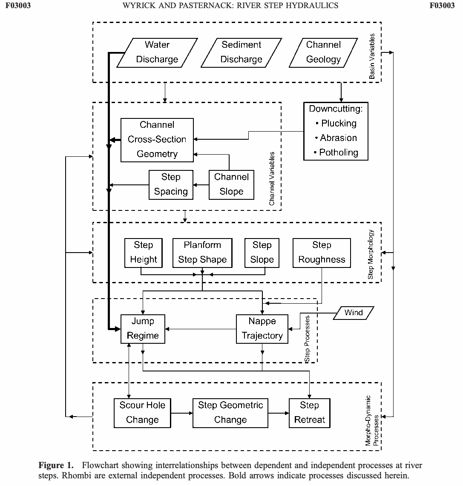

图 1. 河床台阶处独立过程与响应过程的关系流程图；菱形表示外部独立过程，粗箭头表示本文讨论的过程。

## 2. 台阶系统分析

**［13］**现阶段无法把第 1.2 节的全部过程纳入数值模型，但概念框架可为最终建立机理预测模型指路。第一步从台阶本身出发，以台阶形态及周边河道变量充分刻画台阶水力过程。以下定量形式与以往针对沟谷的模型差异很大，且有不确定性；第 3 节的结果仍可说明天然河道断面空间变化可能怎样影响台阶长期演化。

### 2.1 欧拉描述下的控制方程

**［14］**为进入更广泛的三维问题，先考虑水平矩形明渠清水流中，跨越宽顶河床跌坎及其下游区域的控制体积，在稳定状态下的能量与动量守恒（图 2）。平均流况满足经典水力关系：

$$E_{up}=H+P=h_{tail}+h_{v,tail}=E_{tail}+h_L.\tag{1}$$

$$h_d=h_L+h_{v,tail}=h_L+\frac{q^2}{2g h_{tail}^2}.\tag{2}$$

$$q=v_i h_i.\tag{3}$$

$$h_c=\left(\frac{q^2}{g}\right)^{1/3}.\tag{4}$$

$$Fr_i=\sqrt{\frac{q^2}{g h_i^3}}.\tag{5}$$

$$q=\left(\frac23\right)^{3/2}C_b\sqrt g\,H^{3/2}.\tag{6}$$

$E_i$、$h_i$ 分别为图 2 所示位置 $i$ 的总能量和水深；$H$ 为以宽顶台阶顶面为基准的上游断面比能，$P$ 为台阶高度，$q$ 为单位宽度流量，$h_L$ 为控制体积内总水头损失，$g$ 为重力加速度，$v_i$ 为断面平均速度；宽顶堰流量系数 $C_b=0.848$。下标 $up$ 指台阶上游断面，$tail$ 指台阶及相伴水跃下游的控制断面（图 2）。式（4）～（6）按矩形断面推得，对其他形状的宽河道只是近似；下文新数值模型最终不使用这些式子，从而消除了这一限制。

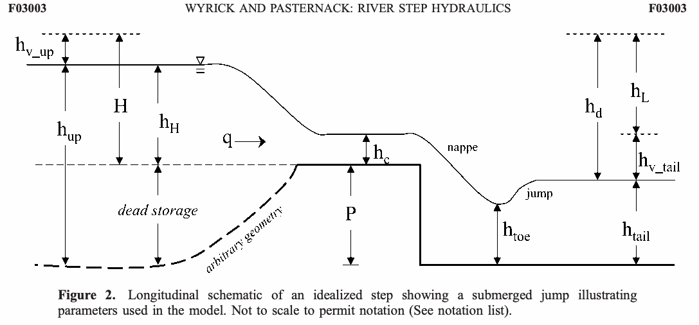

图 2. 理想化台阶纵剖面，示意淹没水跃及模型变量；为清楚标注，未按比例绘制。

**［15］**以往利用动量守恒分离经典水跃和跌坎处非淹没水跃的水头损失；这两类情形均有可识别的上游超临界断面和下游亚临界断面。Bélanger 方程也曾扩展至非棱柱形渠道的非淹没水跃。然而水跃淹没时，超临界射流在水下，无法测得该方程要求的上游超临界水深。因此本文覆盖所有水跃流态的模型不使用经典 Bélanger 方程，也不能单独分离水跃本身的能量耗散。

**［16］**临界水深常被用来无量纲化变量，但定位临界点会引入误差；定义上游比能和总能量更实用可靠。无量纲能量变量 $(H+P)/H$ 同时反映流量和台阶高度。保持台阶高度或水流条件之一不变，通过几何缩放可得到不同能量条件。较高的 $(H+P)/H$ 对应相对较高的台阶和较少的过流。台阶高度固定时，流量增加也会使台阶上水头增加，因此 $(H+P)/H$ 下降表示流量和能量输入增加；若 $P=0$，该比值趋近 1。

**［17］**本文把“淹没”定义为尾水水深 $h_{tail}$ 足以使水跃前缘上移到自由跌落水舌趾部的上游；水舌趾部是台阶下游水面剖面的坡折点。按式（1）～（6），给定 $(H+P)/H$ 和无量纲淹没变量 $h_d/H$ 时，所得 $h_L/(H+P)$ 及上下游断面的流动运动学与台阶几何无关。但淹没程度和水跃流态仍取决于台阶边缘平面形状、台阶坡度等几何因素。

**［18］**传统工程通常求解式（1）～（6），寻找减少结构损坏的最优溢洪道与跌坎设计，却未涵盖天然河道上游能量和下游淹没程度可能远离最优值的广泛条件。许多基岩河流的台阶射流冲击裸露基岩后，仍以超临界流向下游运行；也有许多台阶因跌水潭而形成淹没水跃。经典工程理论可为认识三维天然瀑布提供基础，但天然系统的独特性仍须研究。Pasternack 等［2006］在更广的非经典 $h_d/H$ 与 $(H+P)/H$ 范围求取 $h_L/(H+P)$。自然河流临近台阶的上游 $Fr$ 并非独立变量，因而不是天然系统的控制变量。其结果表明，任意给定 $(H+P)/H$ 的最大相对能量耗散，出现在下游水深恰为临界水深、且无水跃时；此时流动由超临界转为临界，$h_{toe}<h_{tail}$。尾水低于临界水深后，$h_L/(H+P)$ 下降，流动效率增加，直到 $h_{toe}=h_{tail}$。因此天然台阶的流速与耗散模型必须允许任意尾水水深。

### 2.2 河道参数化

**［19］**Pasternack 等［2006］虽把经典式（1）～（6）用于非经典的自然河流问题，其模型仍假设均匀矩形河道，因为他们的宽顶马蹄形瀑布水槽采用这种形状。本文替换式（4）～（6），使模型允许任意上下游断面形态，减轻或消除矩形河道、二维跌坎及 $(H+P)/H$ 与 $h_d/H$ 相互独立的假设。所用方法是河流科学另一分支的经典经验关系——固定断面的水力几何关系，源于河道形态理论。这些描述几何的经验式满足质量守恒，河流地貌学也广泛使用；它们无须矩形断面假设。本文以其从上游河道条件求流量，并增添控制台阶所在地貌单元的河道变化方程，使上述两个无量纲变量直接联系。尽管台阶边缘形状和水舌轨迹会影响水跃流态，计算上下游断面间的净能量损失时并不必需；忽略它们仍是模型的重要局限，但模型足以说明断面几何变化的作用。

**［20］**按经典河道形态理论，固定断面的过水宽度、水深和速度可用体积流量 $Q$ 的幂函数描述［Leopold 与 Maddock，1953］：

$$w=aQ^b,\tag{7a}$$

$$h=cQ^f,\tag{7b}$$

$$v=kQ^m.\tag{7c}$$

$w,h,v$ 分别为平均过水宽度、水深和断面平均速度；$a,c,k$ 为经验系数，$b,f,m$ 为经验指数，主要控制断面形状。质量守恒要求 $b+f+m=1$ 且 $ack=1$。本文把六者统称为模型参数。带台阶基岩河流尚无通用取值，但冲积河流已有特定取值：文献中的 $b$ 约 0.04～0.6，$f$ 约 0.20～0.65；$a$ 约 3～19、均值 9.74，$c$ 约 0.474～0.73、均值 0.51。本文分别在台阶上、下游设置一个断面，以水力几何关系刻画其尺寸和形状。对实际台阶应用时，可用当地监测资料拟合这些系数和指数。

**［21］**解释结果须先理解系数、指数的几何含义［Dingman，2007］。系数固定时，指数改变使断面形状有规律地变化（图 3）。$b=f$ 时为三角形断面；$b\to0$ 时，宽度不随流量增加，在几何上趋于矩形断面；$b<f$ 时，断面向上凹。$f\to0$ 时，水深不随流量增加，几何上趋于无限宽断面；$b>f$ 时，断面向上凸（图 3 阴影区）。当 $b\ne f$ 时，增大 $f$ 使断面向内弯，增大 $b$ 使其向外弯。$b$、$f$ 同时趋近 0 时，速度指数 $m$ 上升；若流量增加而宽、深都不变，能坡必须升高和／或粗糙度降低。通常认为粗糙度随流量增加而降低。弯曲河道的河谷坡降高于河槽坡降，出槽水流的能坡可高于槽内水流。

**［22］**给定指数和断面形状后，系数决定尺度。$a$ 增大使两岸水平展开，例如增大三角形断面两岸的夹角，湿润断面更扁；$c$ 增大使两岸垂向拉伸、河道更深；在相同流量下，$k$ 增大关联于河床更陡和／或更光滑。

**［23］**指数变化对应弯曲、系数变化对应拉伸，几何方式不同，但对断面平均水深与河宽的影响相似。例如在式（7a）中单独增大 $a$ 或 $b$，都会使大于 1 的给定流量下河宽增大，也使宽度–流量关系的切线斜率增加（图 4）。因此，虽然几何方式不同，两类参数变化对宽、深的简单统计量可产生相近结果。

**［24］**水力几何关系也能描述辫状或多股河道；波托马克河的 Great Falls 即与多股河道相伴。然而多股河道的参数不唯一，难以解释。虽然这些关系是经验式，却适于简约地探索台阶处河道非均匀性；实地也易量化：低水位时测绘台阶上下游断面，随后以自动水位记录仪获取当地水位–流量响应。天然台阶中跨水跃多相流的精确、基于物理过程的三维水动力模型尚未实现，因此缺少严格的物理替代方法。

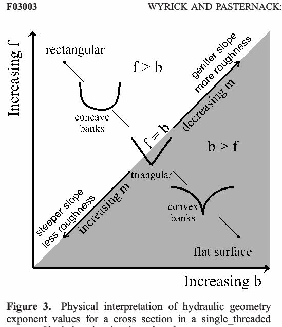

图 3. 单股河流断面中水力几何指数的物理含义；阴影区为 $b>f$。

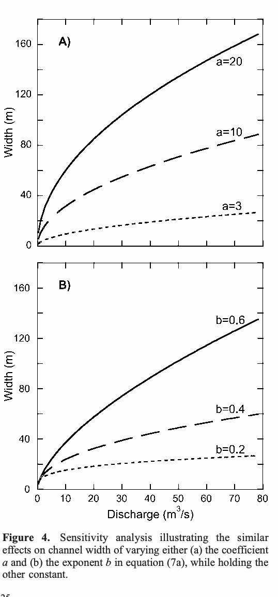

图 4. 保持式（7a）另一参数不变时，（A）改变系数 $a$、（B）改变指数 $b$ 对河宽的相似影响。

### 2.3 河道非均匀性

**［25］**给定独立的台阶高度、上游水深，以及式（7a）、（7b）的上游指数 $b_{up},f_{up}$ 和系数 $a_{up},c_{up}$，即可用下列方程确定相对淹没程度与台阶水头损失。$up$、$tail$ 分别指台阶上游断面和台阶及其水跃下游的控制断面（图 2）。

**［26］**变形式（7b），上游流量为：

$$Q=\left(\frac{h_H}{c_{up}}\right)^{1/f_{up}},\tag{8}$$

其中 $h_H$ 是台阶顶面以上的有效水深，且

$$h_H=h_{up}-P.\tag{9}$$

式（8）不假定矩形断面。

**［27］**即使上下游断面对应的有效台阶高度有别，$h_H$ 的定义仍相同，但计算水深的方式可能不同。$h_{up}=0$ 至 $P$ 的水体相当于不影响台阶动力过程的“死水库容”；填满前不会形成尾水。图 2 用任意形状的上游渠底表示此库容：它可以在跌坎前向上隆起，也可以平坦，这些形状均不影响模型方程。实际应用应以上游台阶顶面高程而非通常的河床底高程为基准，建立上游水力几何关系。

**［28］**下游潭池出口控制断面的尾水水深为：

$$h_{tail}=c_{tail}Q^{f_{tail}}=c_{tail}\left(\frac{h_H}{c_{up}}\right)^{f_{tail}/f_{up}}=c_{tail}\left(\frac{h_H}{c_{up}}\right)^{1/f_{ratio}}.\tag{10}$$

$f_{ratio}=f_{up}/f_{tail}$。$f_{ratio}=1$ 为上下游深度指数相同的均匀河道，与 Pasternack 等［2006］的假设一致。$f_{ratio}<1$ 表示较宽、较接近三角形的上游河道进入较窄、较深的峡谷，下游水深随流量增加得比上游快（图 5、6）；山地河流中此类情况很多。也可通过降低上游 $c$、提高下游 $c$ 产生类似宽深变化，但其几何方式是拉伸。式（10）中 $c_{up}$ 还被 $f_{ratio}$ 调整，与 $f_{ratio}$ 的直接作用协同影响尾水；例如 $c_{up}=0.51$、$f_{ratio}=0.50$ 时，$c_{up}^{1/f_{ratio}}=0.26$，分母变小使给定流量下 $h_{tail}$ 增大。$f_{ratio}>1$ 表示相反情况：河道由较窄、近三角形断面进入更宽、更扁的断面（图 7、8）。若 $c_{up}=0.51$、$f_{ratio}=1.5$，则 $c_{up}^{1/f_{ratio}}=0.64$；相同幅度变化下，系数的作用小于 $f_{ratio}<1$ 时。两类情形的台阶均位于过渡区，因此受非均匀性影响。第 2.5 节的敏感性分析覆盖广泛参数范围。

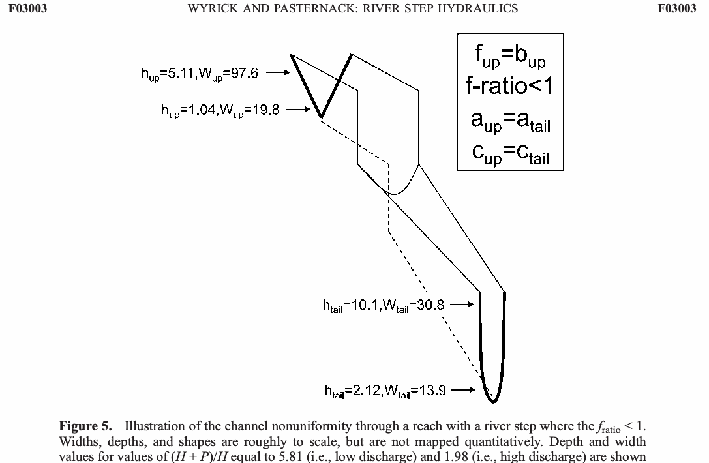

图 5. $f_{ratio}<1$ 的台阶河段示意。宽、深和形状大致按比例绘制，但未定量测绘；图示 $(H+P)/H=5.81$（低流量）和 1.98（高流量），$f_{up}=b_{up}=0.4$、$f_{ratio}=0.5$。

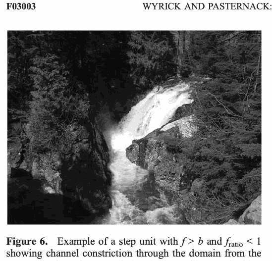

图 6. 美国华盛顿州 Upper South Fork Snoqualmie River 的台阶河段：$f>b$、$f_{ratio}<1$，朝上游拍摄，可见河道收窄。

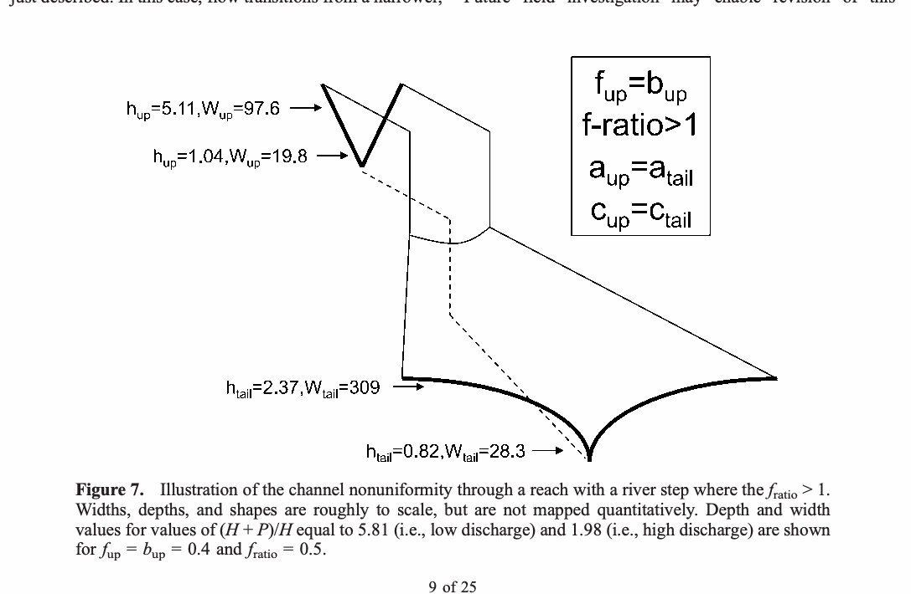

图 7. $f_{ratio}>1$ 的台阶河段示意；宽、深和形状大致按比例绘制。原图注仍写 $f_{up}=b_{up}=0.4$、$f_{ratio}=0.5$，而图内明确标为 $f_{ratio}>1$；具体数值疑点见文末备注。

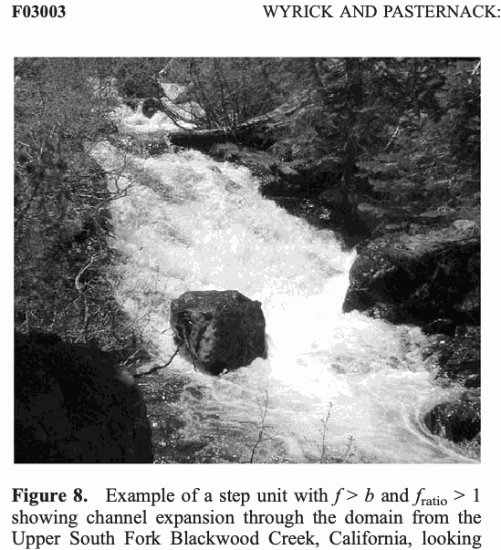

图 8. 美国加利福尼亚州 Upper South Fork Blackwood Creek 的台阶河段：$f>b$、$f_{ratio}>1$，朝上游拍摄，可见河道展宽。

**［29］**利用式（8）的流量和水力几何关系，可求上下游河宽：

$$w_{up}=a_{up}Q^{b_{up}},\tag{11a}$$

$$w_{tail}=a_{tail}Q^{b_{tail}}.\tag{11b}$$

台阶附近固定断面上的 $b,f,m$ 相互作用尚缺足够资料，无法精确约束 $b$。概念上，$f$ 增大时断面趋近矩形，$b$ 应下降（图 3）；Dingman［2007］对三种水力方程也得到这种关系。因此本文假设上游与下游 $b$ 的比值 $b_{ratio}$ 等于 $f_{ratio}$ 的倒数。未来野外研究可修订这一假设；作者预期它主要影响数值幅度，不会造成阈值式变化。

**［30］**断面平均速度与速度水头按式（7c）计算：

$$v_{up}=k_{up}Q^{m_{up}},\qquad v_{tail}=k_{tail}Q^{m_{tail}}.\tag{12}$$

$$h_{v,up}=\frac{v_{up}^2}{2g},\qquad h_{v,tail}=\frac{v_{tail}^2}{2g}.\tag{13}$$

由质量守恒可得各断面的 $k=1/(ac)$、$m=1-(b+f)$；这些关系不要求矩形断面。

**［31］**上游比能 $H$ 即作用于台阶的有效水头（图 2）：

$$H=h_H+h_{v,up}.\tag{14}$$

由此可把淹没变量 $h_d$ 和水头损失 $h_L$ 分别写为 $h_d/H$、$h_L/(H+P)$，并结合上游无量纲能量 $(H+P)/H$，描述河床台阶的欧拉流体力学。

### 2.4 水跃流态判别方程

**［32］**多数既有水跃流态阈值只采用弗劳德数，依据是在无床面台阶的矩形水槽内用上游闸门施加可变 $Fr$ 的经典水跃观察。对非均匀河道的跌坎，还须计入水跃淹没程度。已发表方程中，只有美国垦务局［1948b］针对二维曲线堰顶跌坎、Pasternack 等［2006］针对矩形宽顶跌坎的式子包含这一因素（图 9）。前者为经验且无量纲的阈值；后者为半解析，仅处理临界 $Fr$ 与最优水跃两个流态边界。Leutheusser 与 Birk［1991］描述过尖顶堰的类似流态，但未定量。可修订 Pasternack 等模型以求尖顶堰的临界 $Fr$ 阈值；典型三维跌坎边缘配置仍需更多研究。

**［33］**鉴于可用方程有限，本文采用美国垦务局［1948b］曲线堰顶的四条经验边界（图 9）。最上方曲线之上，越过台阶的水流到下游控制断面仍为超临界流；下一条曲线划出水跃恰位于台阶趾部的最优条件。两者之间为被推离趾部的非淹没水跃：控制体积内有可测的超临界区及其向亚临界区的快速过渡。再下方曲线划出淹没足以称为“完全淹没”的水跃，但原文献没有给该称谓明确定义；作者把它解释为具有强上游回流的淹没水跃。图 9 最下方直线之下无水跃，可能仍有站立浪，也可能完全没有近临界流态的液面表现。美国垦务局框架没有单独划出站立浪区，是一个缺点。总体上，这套定量框架可区分各类具有不同射流冲击力、湍流压力脉动、床面阻力及升力的水跃。

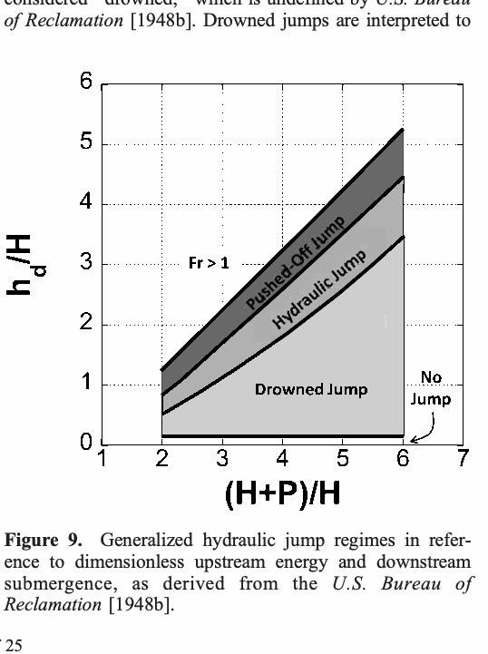

图 9. 以无量纲上游能量及下游淹没程度表示的水跃流态，基于美国垦务局［1948b］。

**［34］**对 $2\le(H+P)/H\le6$，四个流态边界如下；括号内为 Leutheusser 与 Birk［1991］的相应称谓：

被推离趾部的水跃（swept-out jump）：

$$\frac{h_d}{H}=1.003\left(\frac{H+P}{H}\right)-0.744.\tag{15}$$

最优水跃：

$$\frac{h_d}{H}=0.838\left(\frac{H+P}{H}\right)-0.868.\tag{16}$$

完全淹没水跃（plunging nappe）：

$$\frac{h_d}{H}=0.176\left(\frac{H+P}{H}\right)^{1.679}.\tag{17}$$

无水跃（surface nappe）：

$$\frac{h_d}{H}=0.16.\tag{18}$$

这些式子对台阶趾部或其下游的水跃流态给出合理刻画。若以 Pasternack 等［2006］的式子替换式（15）、（16），曲线仅有很小变化，概念差异也很小。

**［35］**重要限制之一是，这些方程不考虑台阶边缘的非均匀平面形状（马蹄形、垂直于河岸、与河岸斜交等）；Pasternack 等［2006］已描述尼亚加拉瀑布一类马蹄形边缘的偏离。它们也不考虑突然展宽或收窄、台阶与跌水潭粗糙度、潭深、基岩抗蚀性和强风造成的流态偏离。影响因素众多，除逐一研究典型形状外，尚不清楚如何进一步推广这些方程。本文仍可首次估计主要河道非均匀形式的影响。

### 2.5 模型实现

**［36］**作者把式（1）、（2）、（8）～（14）编入 Excel 2003，考察上下游几何、流量与台阶高度变化怎样影响台阶流动、水跃流态和能量耗散。关键独立变量是 $(H+P)/H$、$f_{ratio}$；$f_{up},b_{up},a_{up},c_{up}$ 为关键参数。所分析的无量纲响应为 $h_d/H$（指示水跃流态）、$h_L/(H+P)$（能量损失）和 $h_{v,tail}/(H+P)$（下游动能）。

**［37］**计算从 $\{a_{up},c_{up},b_{up},f_{up},f_{ratio},h_H,P\}$ 的初值开始；台阶高度 $P$ 任取 5。先由上游水深及水力几何参数按式（8）求流量，再按式（11a）、（14）求上游宽度与比能；给定 $f_{ratio}$ 后求下游水力几何参数，并由式（10）～（14）求下游水深、宽度和比能。随后用式（1）、（2）求水头损失 $h_L$ 与淹没变量 $h_d$，并按上游比能及总能量无量纲化。

**［38］**模型对 $f_{up},b_{up}\in\{0.2,0.25,0.4\}$ 的九种组合，绘制响应量与 $(H+P)/H$ 的关系，以考察各指数绝对值的影响。高于 0.4 的 $f$ 或 $b$ 不产生与 0.4 实质不同的结果，故未展示。每组 $b,f$ 使用 $f_{ratio}\in\{0.5,0.75,0.9,1.0,1.25,1.5\}$。这些组合产生约 3～104,000 的流量、12～400 的上游宽度及 0.8～5.5 的上游水深。各变量具有通常的物理量纲，但作者有意省略具体单位，以便用任何单位体系模拟不同河道。分析据此捕捉模型对指数及天然台阶的基本响应和敏感性。

**［39］**为考察式（7a）～（7c）的系数，研究在文献报告的 $a,c$ 范围内进行敏感性分析：保持上游 $b,f$ 固定，改变各 $f_{ratio}$ 下的 $a,c$，并设 $a_{up}=a_{tail}$、$c_{up}=c_{tail}$。分析两组 $f_{up}=b_{up}=0.2$ 和 $f_{up}=b_{up}=0.4$。未来模型或可依据解释这些参数来源的理论求值，本文则旨在刻画参数取值对台阶水力过程的影响。

**［40］**模型目前完全是理论性的。与分布式水文、三维水动力及地貌演化模型相似，实验能力尚不足以验证全部组成部分，也没有覆盖参数范围的现成数据。实证检验需可改变台阶上下游河道几何的实验设备，或找到覆盖各组合的天然站点，并精确测量各水力量与能量耗散；后者尤其困难。模型是对经典水力学和地貌学方程的重组，因而在技术上有依据；它初步揭示非均匀河道的耗散与水跃流态，并指出值得进一步实验的变量。作者已尽量事先说明全部假设与限制。

## 3. 结果

**［41］**理解台阶处非均匀性对水跃及耗散的影响，须先看宽、深如何随流量和 $f_{ratio}$ 变化（图 10）。在 $f_{up}$ 与 $f_{ratio}$ 固定时，$b_{up}$ 增大使下游宽深比增大（如图 10g、10h、10i）；在 $b_{up}$ 与 $f_{ratio}$ 固定时，$f_{up}$ 增大使其减小（如图 10i、10f、10c）。总体上，河宽指数 $b_{up}$ 对下游宽深比的影响大于水深指数 $f_{up}$。

**［42］**当 $f_{up}=b_{up}$ 且 $f_{ratio}=1$ 时，下游宽深比在所考察的流量范围保持不变（图 10c、10e、10g 中的菱形点），符合预期。$f_{ratio}$ 增大使下游宽深比增大（圆点），减小则使之下降（三角点）；流量越大，两种响应越明显。

**［43］**全范围的指数结果支持图 5、7 对 $f_{ratio}$ 的几何解释。若 $f_{up}=b_{up}=0.4$、$f_{ratio}=0.5$，断面跨台阶向更凹的形状弯曲和拉伸（图 5），下游水深随流量增加得远快于宽度（图 10c 中的圆点）。上游参数相同而 $f_{ratio}=1.5$ 时，断面向更凸的形状弯曲和拉伸（图 7）；下游宽度对流量的响应大于水深（图 10c 中的三角点）。图 5、7 所示两种流量下的尺寸说明变化速率：低 $f_{ratio}$ 例中，两种流量对应的上游宽度之比约为 5，下游降至 2.2；高 $f_{ratio}$ 例则由上游的 5 增至下游的 11。由此，调节模型的 $f_{ratio}$ 可模拟台阶处非均匀河道的收窄和展宽。以下考察台阶对流量和不同非均匀形式的水跃与能量响应。

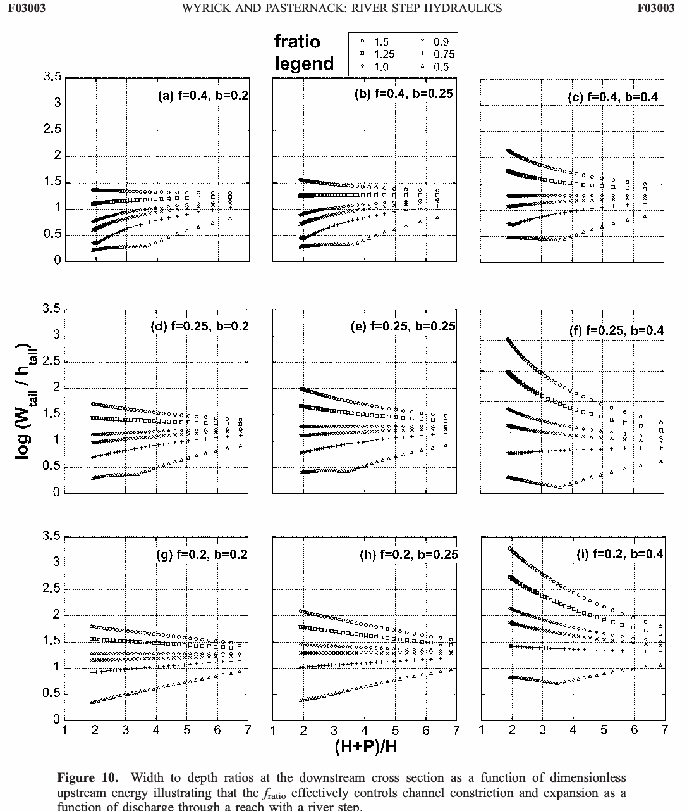

图 10. 下游断面宽深比随无量纲上游能量的变化；$f_{ratio}$ 控制台阶河段在不同流量下的收窄或展宽。

### 3.1 能量输入的作用

**［44］**对 $f,b$ 较大的均匀河道，本模型重现 Pasternack 等［2006］所示流量增加时台阶的基本响应。例如 $f_{ratio}=1$、$f_{up}=b_{up}=0.4$（图 11c 菱形点）。$(H+P)/H$ 高时，台阶相对较高，跌水在趾部形成水跃。不论几何组合如何，最低能量输入下的相对能量损失最高：高落差将势能转为动能，台阶底部水跃无法把大部分动能再恢复为势能（图 12c）；到达下游断面时，动能大幅耗散，占总能量低于 0.1%（图 13c）。随着 $(H+P)/H$ 下降，尾水加深、落差减小，水跃逐渐淹没；当其趋近 1，水跃先让位于站立浪，最终液面完全不显现台阶。随着水跃淹没，可供耗散的势能减少，台阶水头损失下降（图 12c）。同时，上游动能随能量输入增加，下游动能也有类似趋势（图 13c）。但 $h_d/H\to0$ 时，台阶完全淹没，下游水深反过来控制上游水深，简单水力几何关系不再适用。这是均匀河道的经典二维台阶行为；天然山地河流的断面却高度非均匀，边缘形状也呈三维，留下广泛流态待解释。

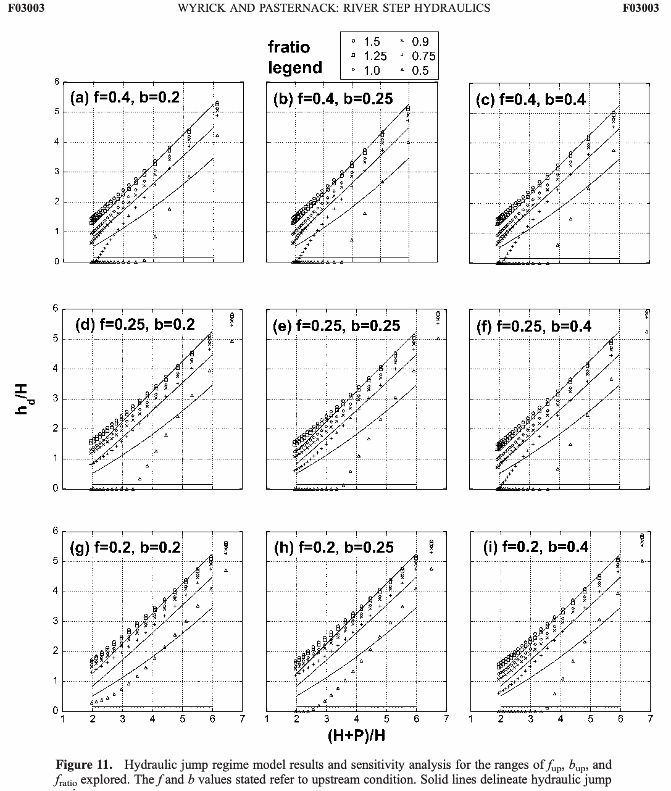

图 11. 在所考察 $f_{up},b_{up},f_{ratio}$ 范围内的水跃流态模型结果与敏感性；图注 $f,b$ 均指上游值，实线划分水跃流态。

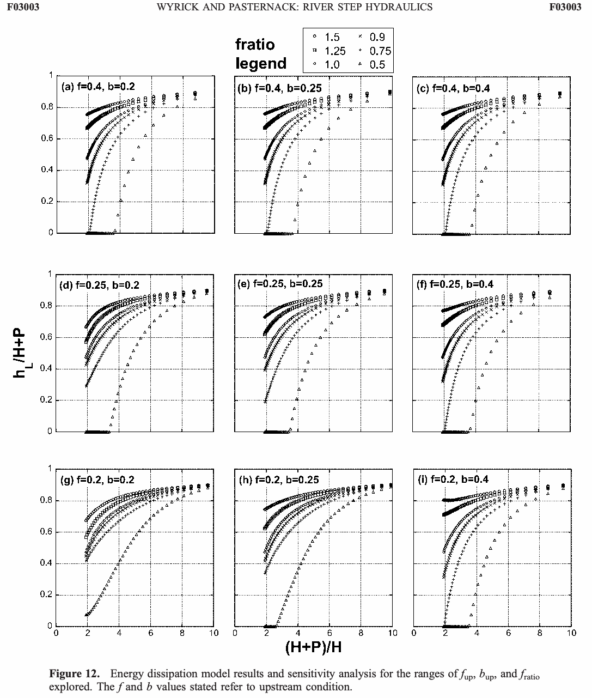

图 12. 在所考察 $f_{up},b_{up},f_{ratio}$ 范围内的能量耗散模型结果与敏感性；图注 $f,b$ 均指上游值。

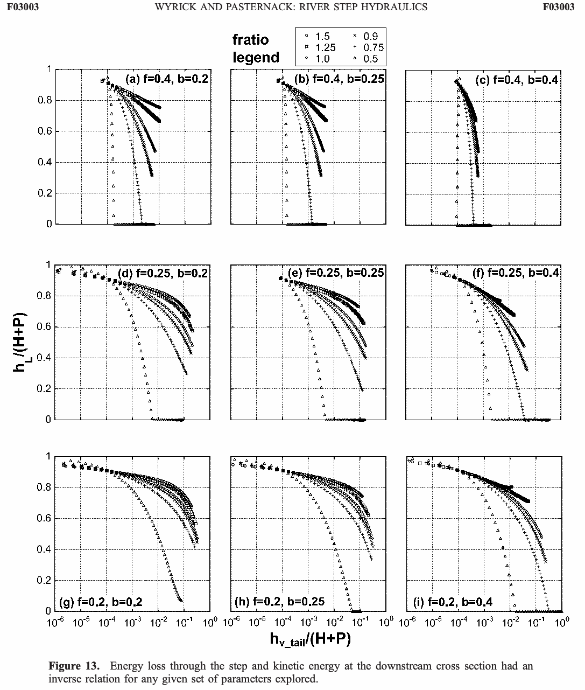

图 13. 给定任一组所考察参数时，台阶水头损失与下游断面动能呈反向关系。

### 3.2 河道非均匀性

**［45］**以 $f_{up}=b_{up}=0.2$ 为例（表 1），若 $f_{ratio}=1.5$，则 $b_{ratio}=1/1.5\approx0.67$；$f_{ratio}=f_{up}/f_{tail}$，故 $f_{tail}$ 降至约 0.13；$b_{ratio}$ 为 $f_{ratio}$ 的倒数，故 $b_{tail}$ 从 0.2 升至 0.3。表 1 列出模型明确使用的水力指数范围。

**表 1.** 水力几何指数对台阶水力影响的敏感性分析所用值。各行由 $f_{tail}=f_{up}/f_{ratio}$、$b_{tail}=b_{up}f_{ratio}$ 求得；原表数值的四舍五入方式予以保留。

| $f_{up}$ | $b_{up}$ | $f_{ratio}$ | $b_{ratio}$ | $f_{tail}$ | $b_{tail}$ |
|---:|---:|---:|---:|---:|---:|
| 0.4 | 0.2 | 1.5 | 0.667 | 0.267 | 0.3 |
| 0.4 | 0.2 | 1.25 | 0.800 | 0.320 | 0.25 |
| 0.4 | 0.2 | 1 | 1.000 | 0.400 | 0.2 |
| 0.4 | 0.2 | 0.9 | 1.111 | 0.444 | 0.18 |
| 0.4 | 0.2 | 0.75 | 1.333 | 0.533 | 0.15 |
| 0.4 | 0.2 | 0.5 | 2.000 | 0.800 | 0.1 |
| 0.25 | 0.2 | 1.5 | 0.667 | 0.167 | 0.3 |
| 0.25 | 0.2 | 1.25 | 0.800 | 0.200 | 0.25 |
| 0.25 | 0.2 | 1 | 1.000 | 0.250 | 0.2 |
| 0.25 | 0.2 | 0.9 | 1.111 | 0.278 | 0.18 |
| 0.25 | 0.2 | 0.75 | 1.333 | 0.333 | 0.15 |
| 0.25 | 0.2 | 0.5 | 2.000 | 0.500 | 0.1 |
| 0.2 | 0.2 | 1.5 | 0.667 | 0.133 | 0.3 |
| 0.2 | 0.2 | 1.25 | 0.800 | 0.160 | 0.25 |
| 0.2 | 0.2 | 1 | 1.000 | 0.200 | 0.2 |
| 0.2 | 0.2 | 0.9 | 1.111 | 0.222 | 0.18 |
| 0.2 | 0.2 | 0.75 | 1.333 | 0.267 | 0.15 |
| 0.2 | 0.2 | 0.5 | 2.000 | 0.400 | 0.1 |
| 0.4 | 0.25 | 1.5 | 0.667 | 0.267 | 0.375 |
| 0.4 | 0.25 | 1.25 | 0.800 | 0.320 | 0.313 |
| 0.4 | 0.25 | 1 | 1.000 | 0.400 | 0.25 |
| 0.4 | 0.25 | 0.9 | 1.111 | 0.444 | 0.225 |
| 0.4 | 0.25 | 0.75 | 1.333 | 0.533 | 0.188 |
| 0.4 | 0.25 | 0.5 | 2.000 | 0.800 | 0.125 |
| 0.25 | 0.25 | 1.5 | 0.667 | 0.167 | 0.375 |
| 0.25 | 0.25 | 1.25 | 0.800 | 0.200 | 0.313 |
| 0.25 | 0.25 | 1 | 1.000 | 0.250 | 0.25 |
| 0.25 | 0.25 | 0.9 | 1.111 | 0.278 | 0.225 |
| 0.25 | 0.25 | 0.75 | 1.333 | 0.333 | 0.188 |
| 0.25 | 0.25 | 0.5 | 2.000 | 0.500 | 0.125 |
| 0.25 | 0.4 | 1.5 | 0.667 | 0.167 | 0.6 |
| 0.25 | 0.4 | 1.25 | 0.800 | 0.200 | 0.5 |
| 0.25 | 0.4 | 1 | 1.000 | 0.250 | 0.4 |
| 0.25 | 0.4 | 0.9 | 1.111 | 0.278 | 0.36 |
| 0.25 | 0.4 | 0.75 | 1.333 | 0.333 | 0.3 |
| 0.25 | 0.4 | 0.5 | 2.000 | 0.500 | 0.2 |
| 0.2 | 0.25 | 1.5 | 0.667 | 0.133 | 0.375 |
| 0.2 | 0.25 | 1.25 | 0.800 | 0.160 | 0.313 |
| 0.2 | 0.25 | 1 | 1.000 | 0.200 | 0.25 |
| 0.2 | 0.25 | 0.9 | 1.111 | 0.222 | 0.225 |
| 0.2 | 0.25 | 0.75 | 1.333 | 0.267 | 0.188 |
| 0.2 | 0.25 | 0.5 | 2.000 | 0.400 | 0.125 |
| 0.2 | 0.4 | 1.5 | 0.667 | 0.133 | 0.6 |
| 0.2 | 0.4 | 1.25 | 0.800 | 0.160 | 0.5 |
| 0.2 | 0.4 | 1 | 1.000 | 0.200 | 0.4 |
| 0.2 | 0.4 | 0.9 | 1.111 | 0.222 | 0.36 |
| 0.2 | 0.4 | 0.75 | 1.333 | 0.267 | 0.3 |
| 0.2 | 0.4 | 0.5 | 2.000 | 0.400 | 0.2 |
| 0.4 | 0.4 | 1.5 | 0.667 | 0.267 | 0.6 |
| 0.4 | 0.4 | 1.25 | 0.800 | 0.320 | 0.5 |
| 0.4 | 0.4 | 1 | 1.000 | 0.400 | 0.4 |
| 0.4 | 0.4 | 0.9 | 1.111 | 0.444 | 0.36 |
| 0.4 | 0.4 | 0.75 | 1.333 | 0.533 | 0.3 |
| 0.4 | 0.4 | 0.5 | 2.000 | 0.800 | 0.2 |

**［46］**再看上游 $f_{up}=b_{up}=0.4$（图 11c）。以 $f_{ratio}=1$ 为基线，在给定流量和台阶高度下增大 $f_{ratio}$，下游断面向外弯曲和伸展，水深减小、宽度增加，水跃逐渐显露。$f_{ratio}=1.5$ 时，超临界区扩大，直到 $(H+P)/H<3$ 时下游控制体积内不再出现水跃。反之，$f_{ratio}<1$ 时，下游断面向内弯曲收窄，尾水加深，给定 $(H+P)/H$ 下水跃逐渐淹没，最后甚至无水跃或站立浪的液面表现。例如 $f_{ratio}=0.5$ 且 $(H+P)/H<3.76$ 时，台阶在液面上不再显现。若 $f_{up},b_{up}$ 同时减小，速度指数 $m$ 必须增大，水流加速使给定流量下宽、深减小；因此所有 $f_{ratio}$ 下的水跃均趋于显露（图 11c、11e、11g）。例如 $f_{ratio}=0.75$ 时，$f_{up}=b_{up}=0.4$ 在 $2<(H+P)/H<6$ 有多种水跃流态，而两者为 0.25 时仅有被推离趾部和最优两类水跃。

**［47］**对所有几何组合，$f_{ratio}>1$ 的非均匀河道比 $f_{ratio}<1$ 的相对水头损失更大（图 12）。台阶耗散的主要来源是上下游断面的势能差：动能难以恢复为势能，倾向于经多尺度湍流和床面相互作用耗散。$f$ 较高时，下游动能低于总能量的 1%（图 13a～13c）。因此，相比人工台阶的有限条件，河道非均匀性对天然台阶周围多样流况有关键作用。

### 3.3 上游河道几何变化

**［48］**比较不同 $f_{up},b_{up}$ 的结果（图 11、12）可见，当固定断面的水力几何响应不再以水深变化为主，即 $f$ 较低时，传统台阶行为概念失效。因系统对 $f,b$ 的敏感性还依赖 $f_{ratio}$，以下按后者逐一说明。最极端的是 $f_{ratio}=1.5$（图 11 圆点）：所有河道几何下，在高 $(H+P)/H$ 时水跃均被推至趾部下游；$(H+P)/H$ 下降时，水跃愈发显露，趾部下游超临界区延长，最终整个下游断面维持超临界流、没有水跃。完全超临界的阈值由河道几何决定；$f$ 或 $b$ 增大时，它在较低的 $(H+P)/H$ 出现。因此 $f_{ratio}=1.5$ 时，水跃流态对 $f,b$ 的绝对值相对不敏感，但能量损失和动能仍敏感（图 12、13）。总体上 $f,b$ 较高时水头损失更大；但 $b=0.4$ 时，$f$ 降低反而使水头损失增大。这与 $f$ 和／或 $b$ 增大时动能总体降低的模式对应。

**［49］**$f_{ratio}=1.25$（图 11 方形点）且 $f,b$ 均较低时，水跃流态类似前述情形：低 $(H+P)/H$ 时下游全段转为超临界流。但 $f,b$ 较高时，全部 $(H+P)/H$ 范围内都存在被推离趾部的水跃；水头损失的响应与 $f_{ratio}=1.5$ 类似。

**［50］**与 $f_{ratio}\ge1$ 时水跃显露流态对上游 $f,b$ 不敏感相比，$f_{ratio}\le1$ 时流态行为对此二者十分敏感。例如 $f=0.4$、$f_{ratio}=0.75$ 时，不论 $b$ 如何，$(H+P)/H$ 下降使水跃越来越快地淹没。$b=0.4$、$f_{ratio}=0.75$ 时亦类似，但 $f=0.2$ 例外：水深响应太弱，水跃仅从被推离趾部转为最优状态，不再转为淹没水跃（图 11i）。固定 $f=0.2$、$f_{ratio}=0.75$，使 $b$ 从 0.4 降到 0.2，断面从向上凸弯向三角形，且河床坡度和／或粗糙度的水位依赖性明显增大。下游断面因而能更快输水，尾水降低，给定 $(H+P)/H$ 下水跃更显露（图 11g～11i）。$f_{ratio}=0.75$ 时，上游 $b$ 或 $f$ 增大通常使水头损失降低（图 12），因为对应的尾水更深。

**［51］**$f_{ratio}=0.5$（图 11 三角点）时，下游壅水对上游的影响很强，所有 $b,f$ 取值下淹没程度都非线性地快速增加；$(H+P)/H=2$ 时，除非 $b,f$ 都不高于 0.2（图 11g），液面上已看不到台阶特征。该例中水力几何意味着流量增加主要表现为速度增大，从而延缓台阶完全淹没。随着 $(H+P)/H$ 降低，其水头损失比其他 $f_{ratio}$ 系统下降得快。除最低的 $b,f$ 值外（图 12g），该损失对两指数变化不敏感，其响应与水跃流态响应相仿。

### 3.4 模型对几何系数的敏感性

**［52］**水力几何系数 $a,c$ 对台阶力学的作用，与改变 $f_{ratio}$ 的作用相似（图 14～17），也符合前述几何解释。$f_{ratio}=1$ 的结果可单独看系数影响。若 $f_{up}=b_{up}=0.2$、$f_{ratio}=1$，随流量增加（即 $(H+P)/H$ 下降），减小 $a$ 或 $c$ 都使水跃流态更偏超临界（图 14）；在系数固定时，减小 $b$ 或 $f$ 也有类似作用（图 11）。保持其他系数和指数不变，单独减小 $a$ 或 $c$，会使 $k$ 增大；物理上意味着河床更陡和／或更光滑，水更快从台阶区输走，尾水下降，水跃更显露。这种响应在不同 $f_{ratio}$ 下均出现。

**［53］**若 $f_{up}=b_{up}=0.4$，模型对系数的敏感性明显弱于两者为 0.2 时（图 16）。在这些较高指数下，对所有受试 $a,c$ 组合，当 $f_{ratio}<0.9$，流量增加均使水跃更淹没。结果说明，能坡和床面粗糙度对流量高度敏感的河道，比主要通过水深和／或宽度对流量响应的河道，更受系数具体取值影响。

**［54］**流态对系数与指数变化的相似响应，在能量损失关系中也存在（比较图 12、15、17）。$f_{up}=b_{up}=0.2$ 时，系数越高，尾水水深和速度越低，能量损失越小（图 15）。两指数为 0.4 时，系数导致的能量损失变动范围较窄（图 17）。因此，虽然系数使断面拉伸、指数使其弯曲，两者均可影响台阶响应。

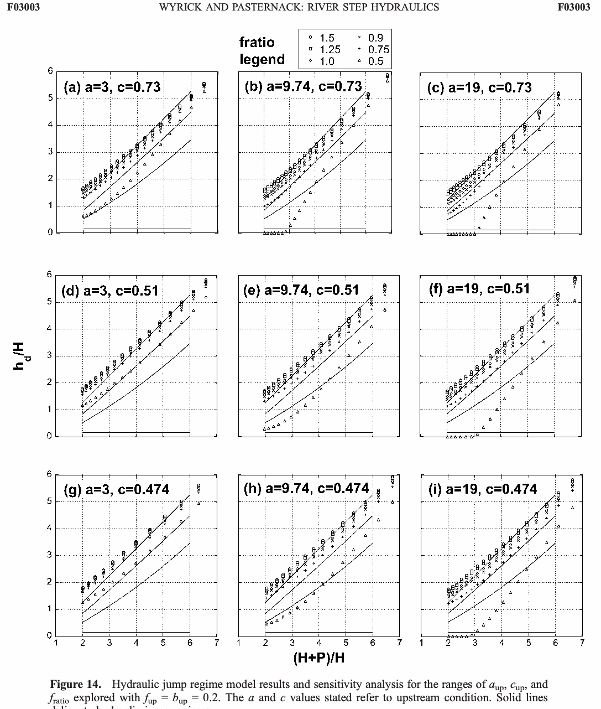

图 14. $f_{up}=b_{up}=0.2$ 时，不同 $a_{up},c_{up},f_{ratio}$ 下的水跃流态；实线为流态边界。

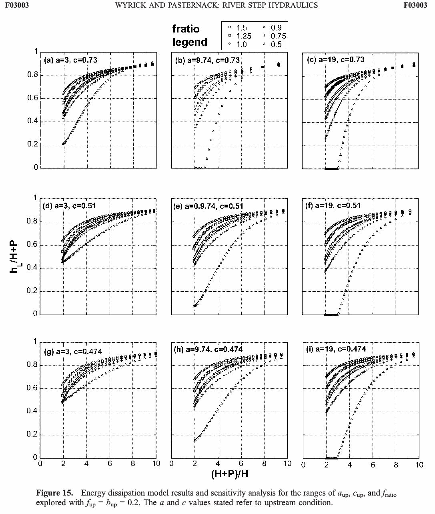

图 15. $f_{up}=b_{up}=0.2$ 时，不同 $a_{up},c_{up},f_{ratio}$ 下的能量耗散。

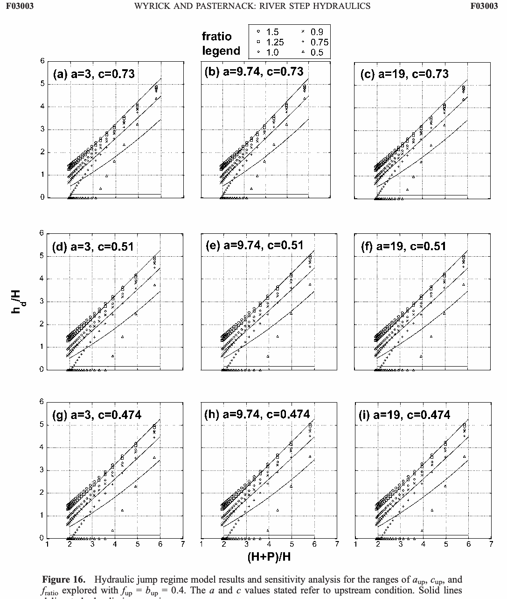

图 16. $f_{up}=b_{up}=0.4$ 时，不同 $a_{up},c_{up},f_{ratio}$ 下的水跃流态；实线为流态边界。

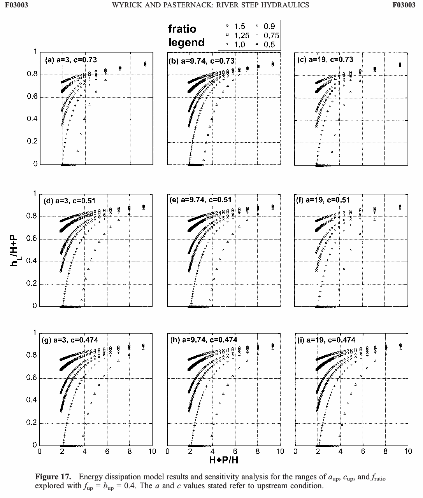

图 17. $f_{up}=b_{up}=0.4$ 时，不同 $a_{up},c_{up},f_{ratio}$ 下的能量耗散。

## 4. 讨论

### 4.1 能量、速度与侵蚀

**［55］**给定任一组模型参数及 $f_{ratio}$，下游断面速度与台阶水头损失呈反向关系（图 13），这对侵蚀机制有意义。低流量下台阶相对高，耗散占总能量的 80%～95%。水越过边缘后加速，冲击趾部下游床面；垂直台阶的水舌剖面在最低流量时最陡，有利于直接水力侵蚀。在所考察参数范围，低流量下主要为被推离趾部或最优水跃，因此下落射流可穿过尾水，冲击并侵蚀河床，促成跌水潭。但低流量下 $H$ 较低，水越过边缘时速度不高，即使加速，趾部速度仍相对高 $H$ 情况较低；大量能量已耗散，抵达下游断面时速度很低（图 13）。流量增加则提高上游速度、尾水水深和尾水速度，使水舌剖面更平缓、能量损失降低，这些都源于更高的比能。水跃可随 $f_{ratio}$ 而更显露或更淹没。不同流态似有不同冲刷机制，但现有文献不足以比较被推离趾部与最优水跃的相对冲刷强度。一旦水跃完全淹没，射流撞击及床面升力应力变化很可能都减弱。较高的能量损失、趾部速度和水跃显露有利于床面冲刷；较低损失、水跃淹没及更水平的水舌则削弱冲刷。所以即使河道配置不变，流量改变也能使冲刷机制和强度大幅变化。

**［56］**与单个台阶随流量变化的情况相比，改变河道形态的影响也高度显著。对全部受试参数，在尾水动能给定时增大 $f_{ratio}$（或作等效系数调整），会大幅提高水头损失，同时维持较高尾水速度（图 13）。例如固定下游断面动能占总能量 5%，并采用图 9e、10e 的其他参数，$f_{ratio}$ 从 0.5 增至 1、1.5 时，能量损失依次从 0 增至总能量的 63%、76%（图 18）。$f_{ratio}$ 和能量损失增加时，水跃更显露；由于 $H$ 不变，水舌剖面角度不变。不同因素和冲刷机制在此协同促进床面侵蚀。总体而言，河道几何变化强烈控制台阶的冲刷机制。

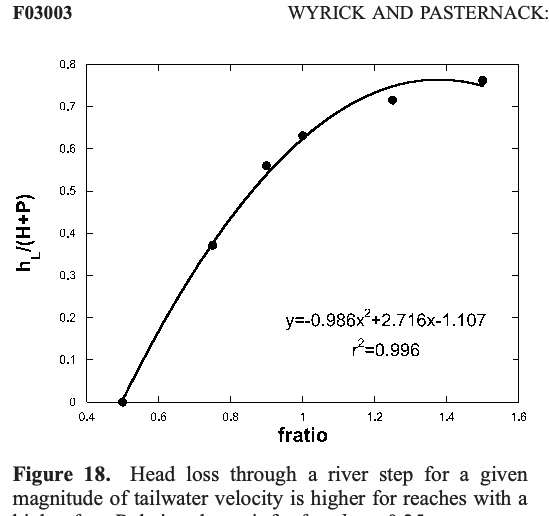

图 18. 给定下游尾水动能占总能量 5% 时的台阶水头损失；$f_{up}=b_{up}=0.25$、$a_{up}=a_{tail}=9.74$、$c_{up}=c_{tail}=0.51$。较高 $f_{ratio}$ 对应较高尾水速度和水头损失。

### 4.2 峡谷入口的裂点

**［57］**高原向低地过渡的峡谷是裂点常见地貌位置，有观察显示裂点恰位于谷地和河道骤然收窄的峡谷上游入口。以局地坡度和流域面积计算冲刷、模拟高原退缩的地貌演化模型，通常预测高流量时退缩更快；本研究结果却显示，情况可能恰好相反，冲刷率也可能与流量无关。高原进入基岩峡谷处的裂点，在跨台阶单元内经历谷地收窄；漫滩洪水期间流量增大，尾水可迅速加深并淹没台阶，使作用于趾部最有效的冲刷机制失效。即使台阶太高而不能完全淹没，也可能淹没到足以保护床面，减轻射流冲刷和推移质撞击冲刷。这一重要地貌实例表明，新模型可补充现有地貌演化算法；基岩河道裂点的冲刷绝非坡度与流域面积的简单幂函数。

### 4.3 模型应用

**［58］**用简约半解析模型考察非均匀河道台阶的流体力学，揭示了支配台阶行为的非经典响应。模型虽为广泛科学问题而建立，若对具体场地拟合参数，也可用于多种管理与工程应用。场地拟合需在基准条件下、跨多个流量观测台阶上下游河宽和水深。当地水力几何关系确定后，所需的独立输入仅为上游水深，模型便易于按场地检验：可将理论水跃流态和能量损失与实验或观测比较。当地模型经充分验证后，可测试替代河道形态方案，评估其相对于目标的流态与耗散。常见目标包括降低游泳者、划船者溺水风险，减慢沟谷裂点迁移，以及建设适合游憩的白水公园。

**［59］**Leutheusser 与 Birk［1991］指出，具有完全淹没水跃（亦称 *plunging nappe*）的溢流结构有溺水风险，并分析了避免风险的工程条件；许多天然台阶也有同类风险。设计目标是在预期流量与尾水水深范围内，使台阶保持其他水跃流态。他们提出的方案只能调整台阶高度；本文模型则允许多种几何调整。若无法改变台阶高度，一个可能方案是提高河道 $f_{ratio}$，使台阶趾部在预期流量范围内维持最优水跃状态。

**［60］**模型目前不直接预测冲刷量或裂点迁移速率，但可作为推断和河道设计的基础。相较于以阻力关联冲刷，把冲刷与能量耗散联系的优势在于：已有阻力模型预测冲刷的表现较差，且未考虑第 4.1 节的机制和取舍；新模型的能量耗散预测则纳入不同过程及水跃流态。模型显示，裂点处 $f_{ratio}$ 越高，河道形态越促使高能量耗散（图 12），因而与该过程相关的趾部冲刷和裂点迁移可能更快。若目标是减缓迁移，几何调整方向便与第［59］段避免溺水风险的方向相反：减小 $f_{ratio}$ 可在相同尾水速度下减少台阶耗散（图 12、18），并使给定流量下的水跃更淹没（图 11）。方案是否可行取决于场地实际 $f_{ratio}$ 以及可改造程度。

**［61］**第三类应用是日益普及的游憩白水公园。公园反复采用的主要工程特征是在台阶处收窄河道，产生用于皮划艇技巧活动的站立浪或水跃（图 19）。目前主要凭实践经验设计；模型可用于预先预测和控制水跃流态，从而节省成本。拆坝、河流修复和鱼类通道也有类似用途：若台阶水跃流态未知，或忽略台阶能量耗散相关的冲刷而无法准确预测地貌单元稳定性，都可能危及人员安全。

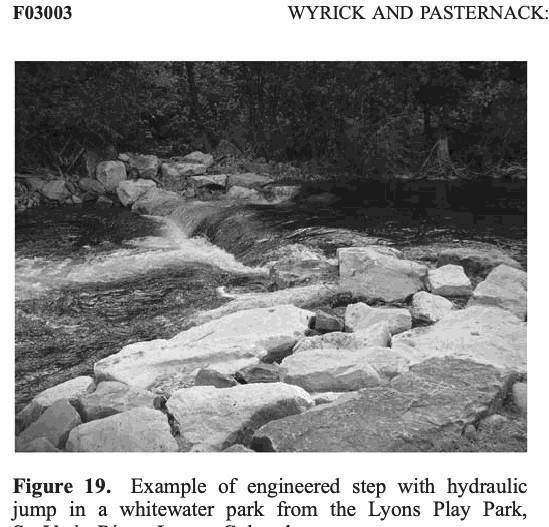

图 19. 美国科罗拉多州 Lyons 镇 St. Vrain River 的 Lyons Play Park 中，设有水跃的人工台阶。

### 4.4 改进台阶理论的路线

**［62］**新模型的假设和限制已在全文说明。虽然考察了广泛参数，裂点附近河道的水力几何实测数据仍不足；基岩河流 $f_{ratio}$ 与 $b_{ratio}$ 的确切关系未知，不同 $f_{ratio}$ 的台阶相对数量及其与构造抬升率、地质的关系也未知。总体上，应重新调查并重视天然台阶的真实多样性，弥补只依据冲积河流、沟谷和人工溢洪道过程的现有模型。

**［63］**当前模型最明显的不足是水跃流态式（15）～（18）严格说仅适用于曲线堰顶、矩形二维跌坎。美国垦务局［1948b］建议的最优与完全淹没水跃之间的划分看来主观性较强，而且这些阈值未单列站立浪流态。因此，今后应优先研究基岩河流台阶单元的水力几何，以及不同典型台阶的水跃流态动力学。

**［64］**图 1 的概念框架还提示数值模型以外的研究方向。最重要的是量化水跃流态和能量耗散对台阶形态动力学的作用。以往主要研究射流对跌水潭的冲刷；也有研究证明压力脉动和升力对台阶下游冲刷重要，但未计入推移质撞击。机载激光条带测绘已能在难抵达峡谷获取米级地形资料，作者推测地貌演化模型有望纳入河道非均匀性相关的裂点机制。台阶粗糙度和风是概念框架中另一些较易着手的因素。

## 5. 结论

**［65］**本文首次用简约模型，定量研究河床台阶上下游河道几何变化及流量如何决定水跃流态和能量耗散。给定流量和台阶形态，$f_{ratio}$ 增大使水跃更显露。$f_{ratio}>1$ 的非均匀河道，水跃流态对 $f$、$b$ 参数相对不敏感：在全部 $(H+P)/H$ 范围，主要为被推离趾部的水跃或超临界流；但 $f$ 或 $b$ 增加时，台阶水头损失更高。$f_{ratio}<1$ 的河道则对 $f,b$ 高度敏感，可从被推离趾部的水跃变化到完全淹没水跃；其水头损失随 $f$ 或 $b$ 增大而下降。$f_{ratio}>1$ 时，整个 $(H+P)/H$ 范围的损失都较高；$f_{ratio}<1$ 时，河道受到下游壅水约束，$(H+P)/H$ 降低会使损失显著下降。不论几何如何，相对台阶高度较高时，势能损失主导流态的能量变化。

**［66］**模型的限制表明，$h_d/H\to0$ 时，下游水深控制上游水深，简单的上游固定断面水力几何式失效。流量、河道几何与地质抗蚀性共同作用下，高耗散的显露水跃可引发冲刷、形成跌水潭，因而天然基岩台阶处显露水跃的出现比例可能受到限制。仅用一个下游断面刻画台阶趾部控制作用也可能不足，需要三维地形与水动力模型。尽管如此，本文简约解析方法为后续理论研究提供了合理的预测基础。

**［67］**更好理解山地河流、特别是河床台阶的水文地貌过程，将推进对山地河流水力学、水生生态及河道演化的认识，并帮助评估河道工程、指导河流恢复和城市溪流修复。既往河道演化模型通常忽视水跃；而任何尺寸的台阶，包括大型木材阻塞和砾石坝形成的台阶，都可能伴随不同水跃流态。因此，研究复杂台阶过程也有助于理解许多其他河道特征。

## 符号说明

| 符号 | 含义 |
|---|---|
| $a$ | 水力几何的河宽系数 |
| $b_{up},b_{tail}$ | 上游、下游水力几何河宽指数 |
| $c$ | 水力几何的水深系数 |
| $C_b$ | 宽顶堰流量系数 |
| $E,E_{up},E_{tail}$ | 总流动能量、上游总能量、下游总能量 |
| $f_{up},f_{tail}$ | 上游、下游水力几何水深指数 |
| $f_{ratio}$ | $f_{up}/f_{tail}$ |
| $Fr$ | 弗劳德数 |
| $g$ | 重力加速度 |
| $H$ | 台阶上游断面比能 |
| $h_b$ | 台阶边缘处水深 |
| $h_c$ | 临界水深 |
| $h_d$ | 水跃淹没变量 |
| $h_H$ | 以台阶顶面为基准的水深 |
| $h_{up},h_{tail}$ | 上游水深、下游尾水水深 |
| $h_{toe}$ | 水跃趾部处水深 |
| $h_L$ | 水头损失 |
| $h_v,h_{v,up},h_{v,tail}$ | 速度水头、上游速度水头、下游速度水头 |
| $k_{up},k_{tail}$ | 上游、下游水力几何速度系数 |
| $m_{up},m_{tail}$ | 上游、下游水力几何速度指数 |
| $P$ | 台阶高度 |
| $Q,q$ | 体积流量、单位宽度流量 |
| $v,w$ | 流速、过水宽度 |

**致谢。** 本研究由美国国家科学基金会水文项目资助，协议编号 EAR-0207713；论文观点、发现和结论属于作者，不必然代表基金会。作者感谢 Greg Tucker、Itai Haviv、Paul Carling、Kurt Frankel、Noah Snyder、Marc Parlange、Keith Richardson 及匿名审稿人的反馈。

## 参考文献

以下保留原文题录的原语种及顺序。

- Ackers,P., W. White,J. Perkins,andA. Harrison (1978),Weirs andFlumes for Flow Measurement, 327 pp., John Wiley, Chicester, N. Y.

- Alexandrowicz, Z. (1994), Geologically controlled waterfall types in the Outer Carpathians, Geomorphology, 9(2), 155–165, doi:10.1016/0169- 555X(94)90073-6.

- Alonso, C. V., S. J. Bennett, and O. R. Stein (2002), Predicting head cut erosion and migration in concentrated flows typical of upland areas, Water Resour. Res., 38(12), 1303, doi:10.1029/2001WR001173.

- Andrews, E. D. (1984), Bed-material entrainment and hydraulic geometry of gravel-bed rivers in Colorado, Geol. Soc. Am. Bull., 95(3), 371–378, doi:10.1130/0016-7606(1984)95<371:BEAHGO>2.0.CO;2.

- Balachandar, R., J. A. Kells, and R. J. Thiessen (2000), The effect of tail- water depth on the dynamics of local scour, Can. J. Civ. Eng., 27(1), 138–150, doi:10.1139/cjce-27-1-138.

- Bennett, S. J., C. V. Alonso, S. N. Prasad, and M. J. M. Ro¨mkens (2000), Experiments on headcut growth and migration in concentrated flows typical of upland areas, Water Resour. Res., 36(7), 1911–1922, doi:10.1029/2000WR900067.

- Betson, R. P. (1979), A geomorphic model for use in streamflow routing, Water Resour. Res., 15(1), 95–101, doi:10.1029/WR015i001p00095.

- Bollaert, E., and A. Schleiss (2003), Scour of rock due to the impact of plunging high velocity jets. Part I: A state-of-the-art review, J. Hydraul. Res., 41(5), 451–464.

- Bormann, N. E., and P. Y. Julien (1991), Scour downstream of grade- control structures, J. Hydraul. Eng., 117(5), 579–594, doi:10.1061/ (ASCE)0733-9429(1991)117:5(579).

- Carling, P. A. (1995), Flow-separation berms downstream of a hydraulic jump in a bedrock channel, Geomorphology, 11(3), 245–253, doi:10.1016/0169-555X(94)00052-S.

- Chanson, H. (1999), The Hydraulics of Open Channel Flow: An Introduc- tion, 495 pp., Edward Arnold, London, U. K.

- Chanson, H. (2002), The Hydraulics of Stepped Chutes and Spillways, 384 pp., A.A. Balkema, Lisse, Netherlands.

- Chaudry, M. H. (1993), Open-Channel Flow, 483 pp., Prentice-Hall, Englewood Cliffs, N. J.

- Dingman, S. L. (2007), Analytical derivation of at-a-station hydraulic- geometry relations, J. Hydrol. Amsterdam, 334, 17–27, doi:10.1016/ j.jhydrol.2006.09.021.

- Dury, G. H. (1976),Discharge prediction,presentand former, from channel dimensions, J. Hydrol. Amsterdam, 30, 219–245, doi:10.1016/0022- 1694(76)90102-5.

- Falvey, H. T. (2003), Hydraulic Design of Labyrinth Weirs, 162 pp., Am. Soc. of Civ. Eng., Reston, Va.

- Fiorotto, V., and A. Rinaldo (1992), Fluctuating uplift and ling design in spillway stilling basins, J. Hydraul. Eng., 118(4), 578–596, doi:10.1061/ (ASCE)0733-9429(1992)118:4(578).

- Fiorotto, V., and P. Salandin (2000), Design of anchored slabs in spillway stilling basins, J. Hydraul. Eng., 126(7), 502–512, doi:10.1061/ (ASCE)0733-9429(2000)126:7(502).

- Flores-Cervantes, J. H., E. Istanbulluoglu, and R. L. Bras (2006), Development of gullies on the landscape: A model of headcut retreat resulting from plunge pool erosion, J. Geophys. Res., 111, F01010, doi:10.1029/2004JF000226.

- Frankel, K. L., F. J. Pazzaglia, and J. D. Vaughn (2007), Knickpoint evolu- tion in a vertically bedded substrate, upstream-dipping terraces, and Atlantic slope bedrock channels, Geol. Soc. Am. Bull., 119, 476–486, doi:10.1130/B25965.1.

- Garde, R. J., and K. G. Ranga Ragu (1985), Mechanics of Sediment Trans- portation and Alluvial Stream Problems, John Wiley, New York.

- Gasparini, N. M., K. X. Whipple, and R. L. Bras (2007), Predictions of steady state and transient landscape morphology using sediment-flux- dependent river incision models, J. Geophys. Res., 112, F03S09, doi:10.1029/2006JF000567.

- Grant, G. E. (1997), Critical flow constrains flow hydraulics in mobile-bed streams: A new hypothesis, Water Resour. Res., 33(2), 349–358, doi:10.1029/96WR03134.

- Hanson, G. J., K. M. Robinson, and K. R. Cook (1997), Headcut migration analysis of a compacted soil, Trans. ASAE, 40(2), 355–361.

- Hayakawa, Y., and Y. Matsukura (2003), Recession rates of waterfalls in Boso Peninsula, Japan, and a predictive equation, Earth Surf. Processes Landforms, 28(6), doi:10.1002/esp.519.

- Henderson, F. M. (1966), Open Channel Flow, Macmillan, New York.

- Kieffer, S. W. (1987), The rapids and waves of the Colorado River, Grand Canyon, Arizona, U.S. Geol. Surv. Open File Rep. 87–96, U.S. Geol. Surv., Reston, Va.

- Lenzi, M. A., A. Marion, F. Comiti, and R. Gaudio (2002), Local scouring in low and high gradient streams at bed sills, J. Hydraul. Res., 40(6), 731–739.

- Lenzi, M. A., A. Marion, and F. Comiti (2003), Local scouring at grade- control structures in alluvial mountain rivers, Water Resour. Res., 39(7), 1176, doi:10.1029/2002WR001815.

- Leopold, L. B., and T. J. Maddock (1953), Hydraulic geometry of stream channels and some physiographic implications, U.S. Geol. Surv. Prof. Pap. 252, U.S. Geol. Surv., Reston, Va.

- Leutheusser, H. J., and W. M. Birk (1991), Downproofing of low flow structures, J. Hydraul. Eng., 117(2), 205–213, doi:10.1061/ (ASCE)0733-9429(1991)117:2(205).

- Marion, A., M. Tregnaghi, and S. Trait (2006), Sediment supply and local scouring at bed sills in mountain streams, Water Resour. Res., 42, W06416, doi:10.1029/2005WR004124.

- Mason, P. J., and K. Arumugam (1985), Free jet scour below dams and flip buckets, J. Hydraul. Eng., 111(2), 220–235.

- McCarthy, M. F., and P. M. O’Leary (1978), The growth and decay of a hydraulic jump, J. Hydrol. Amsterdam, 39(3–4), 273–285, doi:10.1016/ 0022-1694(78)90005-7.

- Montgomery, D. R., and J. M. Buffington (1997), Channel-reach morphology in mountain drainage basins, Geol. Soc. Am. Bull., 109(5), 596–611, doi:10.1130/0016-7606(1997)109<0596:CRMIMD>2.3.CO;2.

- Moore, W. L. (1943), Energy loss at the base of a free overfall, Trans. Am. Soc. Civ. Eng., 108, 1343–1360.

- Mossa, M., A. Petrillo, and H. Chanson (2003), Tailwater level effects on flow conditions at an abrupt drop, J. Hydraul. Res., 41(1), 39–51.

- Munson, B. R., D. F. Young, and T. H. Okiishi (2006), Fundamentals of Fluid Mechanics, 5th ed., 769 pp., John Wiley, Hoboken, N. J.

- Negm, A. M. (2000), Generalization of Belanger equation, paper presented at4thInternationalConferenceonHydroscienceandEngineering,Seoul, Korea, 26–29 Sept.

- Ohtsu, I., Y. Yasuda, and M. Ishikawa (1999), Submerged hydraulic jumps below abrupt expansions, J. Hydraul. Eng., 125(5), 492–499, doi:10.1061/(ASCE)0733-9429(1999)125:5(492).

- Pasternack, G. B., C. R. Ellis, K. A. Leier, B. L. Valle´, and J. D. Marr (2006), Convergent hydraulics at horseshoe steps in bedrock rivers, Geomorphology, doi:10.1016/j.geomorph.2005.08.022.

- Pasternack,G.B.,C.R.Ellis,andJ.D.Marr(2007),Jetandhydraulicjump near-bed stresses below a horseshoe waterfall, Water Resour. Res., 43, W07449, doi:10.1029/2006WR005774.

- Ram, K. V. S., and R. Prasad (1998), Spatial B-jump at sudden channel enlargements with abrupt drop, J. Hydraul. Eng., 124(6), 643–646, doi:10.1061/(ASCE)0733-9429(1998)124:6(643).

- Rhoads, B. L. (1991), A continuously varying parameter model of down- stream hydraulic geometry, Water Resour. Res., 27(8), 1865–1872, doi:10.1029/91WR01363.

- Robinson, K. M., and G. J. Hanson (1996), Gully headcut advance, Trans. ASAE, 39(1), 33–38.

- Seidl, M. A., and W. E. Dietrich (1992), The problem of channel erosion into bedrock, Catena Suppl., 23, 101–124.

- Singh, V. P. (2003), On the theories of hydraulic geometry, Int. J. Sediment Res., 18(3), 196–218.

- Sinha, S. K., F. Sotiropoulos, and A. J. Odgaard (1998), Three-dimensional numerical model for flow through natural rivers, J. Hydraul. Eng., 124(1), 13–24, doi:10.1061/(ASCE)0733-9429(1998)124:1(13). 25 o

- Sklar, L. S., and W. E. Dietrich (2004), A mechanistic model for river incision into bedrock by saltating bed load, Water Resour. Res., 40, W06301, doi:10.1029/2003WR002496.

- Slattery, M. C., and R. B. Bryan (1992), Hydraulic conditions for rill incision under simulated rainfall: A laboratory experiment, Earth Surf. Processes Landforms, 17, 127–146, doi:10.1002/esp.3290170203.

- Smart, G. M. (1999), Turbulent velocity profiles and boundary shear in gravel bed rivers, J. Hydraul. Eng., 125, 106–116, doi:10.1061/ (ASCE)0733-9429(1999)125:2(106).

- Smith, C. D. (1976), Hydraulic design for an outlet structure, Proc. Am. Soc. Civ. Eng., 2, 1179–1198.

- Snyder, N. P., and L. L. Kammer (2008), Dynamic adjustments in channel width in response to a forced diversion: Gower Gulch, Death Valley National Park, Calif. Geol., 25, 187–190.

- Stein, O. R., and P. Y. Julien (1993), Criterion delineating the mode of headcut migration, J. Hydraul. Eng., 119(1), 37–50, doi:10.1061/ (ASCE)0733-9429(1993)119:1(37).

- Stein, O. R., and D. A. LaTray (2002), Experiments and modeling of head- cut migration in stratified soils, Water Resour. Res., 38(12), 1284, doi:10.1029/2001WR001166.

- Stein, O. R., P. Y. Julien, and C. V. Alonso (1993), Mechanics of jet scour downstream of a headcut, J. Hydraul. Res., 31(6), 723–738.

- Stewardson, M. (2005), Hydraulic geometry of stream reaches, J. Hydrol. Amsterdam, 306(1–4), 97–111, doi:10.1016/j.jhydrol.2004.09.004.

- Stock, J. D., and D. R. Montgomery (1999), Geologic constraints on bedrock incision using the stream power law, J. Geophys. Res., 104(B3), 4983–4993, doi:10.1029/98JB02139.

- U.S. Bureau of Reclamation (1948a), Model studies of spillways: Boulder Canyon Project, Final Rep. Part VI Bull. 1, Denver, Colo.

- U.S. Bureau of Reclamation (1948b), Studies of crests for overfall dams: Boulder Canyon Project, Final Rep. Part VI Bull. 3, Denver, Colo.

- Valle, B. L., and G. B. Pasternack (2002), TDR measurements of hydraulic jump aeration in the South Fork of the American River, California, Geomorphology, 42, 153–165, doi:10.1016/S0169-555X(01)00083-6.

- Valle,B.L.,andG.B.Pasternack(2006a),Airconcentrationsofsubmerged and unsubmerged hydraulic jumps in a bedrock step-pool channel, J. Geophys. Res., 111, F03016, doi:10.1029/2004JF000140.

- Valle, B. L., and G. B. Pasternack (2006b), Submerged and unsubmerged natural hydraulic jumps in a bedrock step-pool mountain channel, Geomorphology, 82, 146–159, doi:10.1016/j.geomorph.2005.09.024.

- Vischer,D.L.,andW.H.Hager(1998),DamHydraulics, JohnWiley,New York.

- White, M. P. (1943),Energy loss at the base of a free overfall—Discussion, Trans. Am. Soc. Civ. Eng., 108, 1361–1364.

- Wilcock, D. N. (1971), Investigation into the relations between bedload transport and channel shape, Geol. Soc. Am. Bull., 82, 2159–2176, doi:10.1130/0016-7606(1971)82[2159:IITRBB]2.0.CO;2.

- Wohl, E. E., and T. Grodek (1994), Channel bed-steps along Nahal Yael, NegevDesert,Israel,Geomorphology,9(2),117–126,doi:10.1016/0169- 555X(94)90070-1. University of California, 1 Shields Avenue, Davis, CA 95616, USA.

## 校订备注

- 原文图 7 内明确标为 $f_{ratio}>1$，正文也用该图说明河道展宽，但图 7 图注的最后却印成 $f_{ratio}=0.5$。译文保留这一图注数值并标出矛盾；复用图中参数前需核对原始模型。
- 第［43］段将图 10c 的“圆点”配给较低 $f_{ratio}$、将“三角点”配给较高 $f_{ratio}$；图 10 图例却显示圆点为 1.5，三角点为 0.5。译文按正文保留，两者不可同时用于识别曲线。
- 摘要涉及裂点迁移的趋势，但本文模型仅计算水跃流态和能量耗散，未直接预测冲刷或迁移速率；相关地貌判断是基于模型的机理推断。
