# 突然展宽下游的浅水混合层

Lei Han、Emmanuel Mignot、Nicolas Rivière。原文：*Shallow mixing layer downstream from a sudden expansion*，*Journal of Hydraulic Engineering*，143（5）（2017）：04016105，DOI：10.1061/(ASCE)HY.1943-7900.0001274。本文所用 PDF 是 HAL 存档版本（HAL ID：hal-01724987，2018 年 11 月 21 日提交），正文页脚保留作者 2014 年 10 月 3 日的稿件日期。作者所属机构为法国里昂大学／里昂国立应用科学学院 LMFA 实验室。

## 摘要

本文研究明渠侧向突然展宽下游，主流与回流区交界处的混合层，重点考察以床面摩擦数表征的浅水性与侧壁造成的横向约束如何相互作用。研究在几何相同、床面摩擦数差异很大的四种流况下详细测量速度场，确定混合层内的平均速度、雷诺应力、宽度、沿程增长率和特征振荡频率。回流区上游段的混合层与经典无横向约束混合层相似；在此区段，浅水性改变纵向速度剖面形状，使平均速度梯度的高值区延伸、雷诺应力降低，却几乎不影响混合层展宽率。接近再附点时，展宽率突然下降，混合层行为截然不同。该变化与混合层内二维涡的动力学有关：局部床面摩擦数远低于文献所报临界值，因此不是床面摩擦对涡的直接抑制；更可能是相干结构与侧壁相互作用，而相互作用方式又受浅水性影响。床面摩擦的直接抑制也不能解释回流区长度的大幅变化。因此须区分以混合层宽度为尺度、控制局部混合层特性的“局部浅水性”，以及以展宽宽度为尺度、控制回流区长度的“整体浅水性”。

**关键词：**浅水流；混合层；回流区；后向台阶；涡。

## 1. 引言

水流离开侧壁发生分离后，会形成回流区，直至下游重新附着于壁面。常见几何包括前向及后向台阶、突然展宽和圆柱或平板等障碍物。回流区的净流量为零：分离流线附近的顺流向速度较小，侧壁附近则有负向回流。天然河流中，这类低速区域易使标量物质和泥沙沉积，因此影响输运。以往研究多关注再附点位置，即回流区长度。

主流与回流区之间的纵向速度具有强横向梯度，形成垂向混合层。Pope［2008］将混合层定义为不同速度的两股均匀、近似平行水流之间形成的湍流。深水明渠混合层的综述［Mignot 等，2014a、2014b］指出：混合层宽度沿下游增大，湍涡被平流输送；剪切与速度梯度导致混合层内湍流生成最强，其中心线附近达到最大，两侧迅速降低，强度沿程减小。本文的混合层形成于浅水侧向突然展宽（SSE）后的主流与回流区交界，既受侧壁的横向约束，又受床面的垂向约束，并非自由混合层。

### 横向约束的影响

明渠侧向突然展宽与后向台阶初看具有相似横向约束：台阶上下游壁面互相平行，下游过流断面突然增大，回流区由两面互相垂直的壁面和一条分离流线围成。后向台阶实验表明，紧靠分离点的混合层轴线与入流平行，下游则以越来越大的角度靠近侧壁。回流区上游段因此类似自由混合层，湍流活动在中心线最强；接近再附点时，侧壁改变混合层，最大雷诺应力和湍流生成位置不再位于壁面附近。此前文献没有详细讨论该偏移距离，本文将予分析。

### 垂向约束的影响

明渠突然侧向展宽的混合层远少于后向台阶得到研究。主要差别在于水深有限、沿回流平面法向存在垂向约束：尺寸大于水深的涡不能沿垂向伸长，只能主要在水平面运动，大涡趋于准二维。混合层增长与其中二维相干结构有关，它们在上游产生，向下游尺寸增大。然而床面的无滑移条件与自由液面零垂向速度、水平近似自由滑移的条件共同造成强垂向速度梯度，并在近底区产生额外湍流。因此，浅水性会限制混合层宽度的沿程增长：深水混合层的展宽率沿程恒定，浅水混合层上游段可有相同展宽率，下游段则逐渐减小［Uijttewaal 与 Booij，2000］。

Chu 等［1983、1991］从深度平均浅水方程的线性稳定性与湍动能分析提出床面摩擦数 $S$，又称稳定参数。它比较床面摩擦通过耗散湍动能造成的稳定作用，与混合层横向剪切通过生成湍动能造成的不稳定作用。对两股不同速度的平行入流并排进入的简单浅水混合层，线性稳定性分析提出临界床面摩擦数 $S_c$：$S>S_c$ 时底部摩擦抑制不稳定性增长，$S<S_c$ 时影响可忽略。不同理论和实验给出的 $S_c$ 约 0.06～0.145：无黏理论约 0.12，考虑湍流后有 0.06，其他分析约 0.12～0.145；按宽度增长测得的值为 0.08～0.09。

Van Prooijen 与 Uijttewaal［2002］质疑单一临界值的概念。上述值来自最不稳定模态，而他们关注能量密度最高、与实际相干结构对应的主导模态，区分三种状态：（i）主导模态增长；（ii）主导模态衰减、其他模态仍增长；（iii）$S>S_c$ 时所有模态衰减。其分析可再现实验，并解释文献临界值离散。可是它需要拟合流向各处横向速度剖面的函数，本文突然展宽流况缺乏所需资料。为概述混合层流态，本文仍采用临界床面摩擦数概念，并以局部 $S$ 达到约 $O(0.1)$ 作为浅水性显著稳定混合层的判断尺度。

### 浅水侧向突然展宽的特例

据作者所知，早期只有 Babarutsi 等［1989］用沿流向的一维流速探针、Talstra［2011］用液面粒子图像测速研究 SSE 下游混合层。这些混合层与经典混合层有相似处：纵向速度脉动在分离流线上最大，向两侧减小。不同的是，慢速的回流区侧流速几乎为零，且混合层中心线朝下游弯曲，直到再附点。

Babarutsi 等［1989］尝试从局部混合层特性外推到回流区整体长度 $L$（图 1）。以展宽宽度 $d$ 为整体横向尺度、展宽断面水深 $h_0$ 为垂向尺度，他们定义整体床面摩擦数：

$$S_d=\frac{c_{f0}d}{2h_0}.\tag{1}$$

$c_{f0}$ 为展宽断面摩擦系数。他们以 $S_d=0.05$～0.1 为两种整体流态的过渡：$S_d<0.05$ 称“深水流”，$L/d=8$；$S_d>0.1$ 称“浅水流”，$L/d=0.6/S_d$。Chu 等［2004］分别称之为“非摩擦”与“摩擦”模式，并据新增实验将后一关系修订为 $L/d=0.7/S_d$。

里昂大学 LMFA 的新实验［Chatelain 等，2014］在展宽比 $R_b=(B-d)/B=0.75$ 时获得 16 组 $L/d$ 对 $S_d$ 数据（图 2）。曲线呈钟形，与上述两种渐近模式不同：$S_d\approx0.01$ 附近 $L/d$ 最大，在更低或更高 $S_d$ 下均缩短。不过，结果仍证明回流区长度这一整体行为随整体床面摩擦数变化。Talstra［2011］的三组 SSE 实验显示初始展宽率类似自由混合层，主回流与涡脱落之间存在相互作用；数值模拟还检验了二次流和上游扰动。但该研究的展宽比在各实验间变化，而此比值已知会影响展宽下游流动，因此无法单独判断浅水性的作用。

### 研究问题

已有文献分别充分描述受横向约束的深水混合层（强调三维湍流与壁面再附点），以及无横向约束的浅水混合层（强调浅水性对宽度增长的影响）。同时受侧壁和浅水约束的 SSE 混合层仍研究不足，尤其在再附点附近两种约束可能相互作用。文献还使用两种“浅水性”参数：以混合层宽度为横向尺度的局部 $S(x)$ 控制混合层宽度及二维大尺度结构演变；以展宽宽度为尺度的整体 $S_d$ 描述回流区长度。两者之间以及回流区长度与相邻混合层之间的联系尚须确认。

本文首先测量、刻画 SSE 下游混合层，并与较简单流况比较，区分再附点附近浅水性和侧壁约束的共同作用；其次检验局部混合层过程，尤其相干结构，能否解释回流区长度随 $S_d$ 改变的整体行为。为此选取跨越深水与浅水整体流态的四组实验。下文“深水”指垂向约束可忽略，“无界”指横向约束可忽略，“自由”指同时深水且无界。

## 2. 实验

实验在法国里昂大学 LMFA 的明渠水槽进行（图 1）。水槽总长 $L_t=8\,\mathrm m$，纵坡 0.18%，对称矩形断面总宽 $B=0.8\,\mathrm m$，PVC 表面的典型粗糙高度 $\varepsilon\approx5\times10^{-5}\,\mathrm m$。右岸上游沿 $L_b=3.56\,\mathrm m$ 设置宽 $d=0.2\,\mathrm m$ 的不透水矩形块，故 $R_b=(B-d)/B=0.75$。坐标原点在展宽断面侧壁，$x$ 沿流向、$y$ 横向。循环系统的两台电磁流量计分别测量 5～40 L/s（不确定度 0.2 L/s）和 0～5 L/s（不确定度 0.025 L/s）。上游格栅、蜂窝整流器（孔宽 0.5 cm）使入流稳定，液面上的挤塑聚苯乙烯浮板抑制可能的自由液面振荡；下游经消力池接可调节尾门，以精确控制尾水水深。

采用安装在自动移动记录架上的 Nortek Vectrino+ 侧视声学多普勒流速仪测量速度场，架体由 LabVIEW 与计算机连接。在浅水条件下可测纵、横向速度 $u,v$，且 $u=\bar u+u'$；上横线为时间平均，撇号为脉动。为增强声学反向散射，在上游水箱加入直径约 50 µm 的空心玻璃微球和微气泡。用相空间阈值法剔除 ADV 原始数据尖峰；各点以 30 Hz 采样 180 s，保证时间收敛；计算法向雷诺应力所需的速度方差时，按频谱方法扣除仪器噪声。测量网格覆盖展宽下游约千个点，范围 $0<x<1.3L$、$0<y<3.5d$；回流区 $y<1.5d$ 分辨率 2×4 cm，主流区 $y>1.5d$ 为 4×4 cm（图 3）。速度在高于床面 $0.4h_0$ 处测量；$h_0,U_0$ 是展宽断面 $x=0,y=1.5d$ 处水深和纵向平均速度。水深由移动架上的 Baumer 超声探头测量，不确定度 0.15 mm。

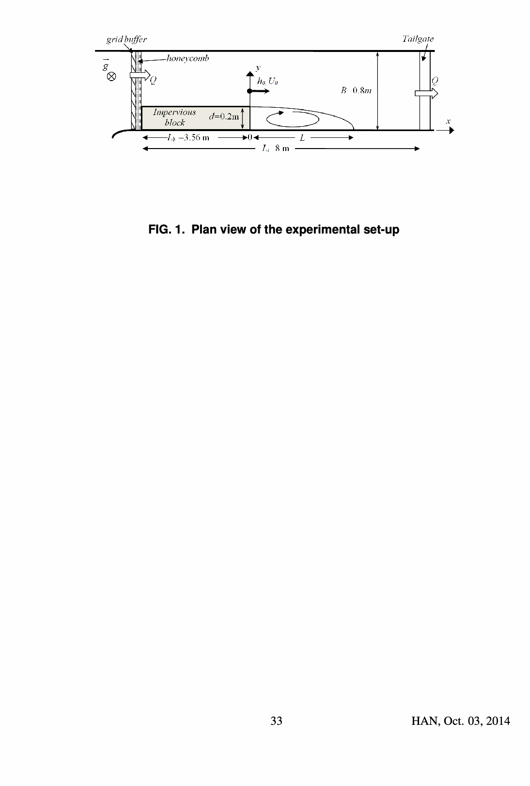

图 1. 实验装置平面图，标示河道、展宽宽度及坐标。

## 3. 流动描述

### 3.1 实验流况选取

图 2 汇列此前 16 组 $L/d$ 对 $S_d$ 数据。$L$ 定义为从展宽断面到侧壁附近纵向平均速度由回流区负值转为下游正值的位置的距离。钟形曲线在 $S_d\approx0.01$ 达到最大 $L/d$，两侧都缩短。本研究选择四组：F1 为钟形左侧的深水流（$S_d<0.01$），F2 为右侧、与 F1 回流区长度相近的浅水流（$S_d>0.01$）；它们用于详细混合层分析。F3 位于钟形顶端，为过渡流；F4 在较粗糙床面（增设铝制花纹板）上形成另一浅水流。参数见表 1。

**表 1. 各实验流况。** $S_{max}$ 为所测局部床面摩擦数最大值。

| 流况 | $Q$（L/s） | $U_0$（m/s） | $h_0$（m） | $c_{f0}$ | $S_d$ | $L$（m） | $L/d$ | $S_{max}$ | $Fr_0$ | $Re_0$ |
|---|---:|---:|---:|---:|---:|---:|---:|---:|---:|---:|
| F1 深水 | 20 | 0.23 | 0.156 | 0.0049 | 0.0032 | 1.29 | 6.45 | — | 0.19 | $9.4\times10^4$ |
| F2 浅水 | 4.05 | 0.36 | 0.021 | 0.0068 | 0.032 | 1.16 | 5.80 | 0.009 | 0.79 | $2.8\times10^4$ |
| F3 过渡 | 16.15 | 0.55 | 0.050 | 0.0050 | 0.01 | 1.99 | 9.95 | 0.003 | 0.79 | $9.4\times10^4$ |
| F4 浅水 | 2.363 | 0.20 | 0.022 | 0.0195 | 0.089 | 0.86 | 4.3 | 0.025 | 0.43 | $1.6\times10^4$ |

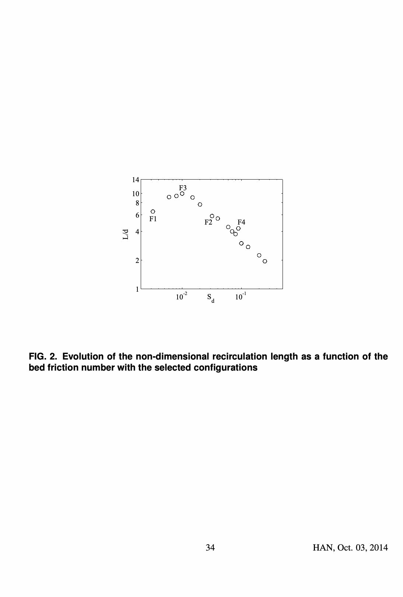

图 2. 无量纲回流区长度 $L/d$ 随整体床面摩擦数 $S_d$ 的变化及 F1～F4 的位置。

### 3.2 平均流动性质

上游中心线的水深、水平平均速度及雷诺应力在接近展宽断面时不再变化，确认入流已充分发展。展宽下游 $z=0.4h_0$ 的平均速度场见图 3。流动于 $x/L=0,y/d=1$ 分离，速度矢量近似平行于 $x$ 轴；在 $x/L=1$ 再附，此处近壁纵向平均速度由负转正。相干结构通过使再附点随时间摆动。在 $y/d<1,x/L<1$ 存在主回流胞，$x=y=0$ 的角部还有小型次级回流胞；外侧 $y/d>1.5$ 的水流向回流区偏转，纵向减速。

图 4 同时绘出若干断面的 $\bar u/U_0$ 与分离流线。F2 的分离流线比 F1 更快靠近侧壁。两组流况在回流区的速度剖面相似，也与 Talstra［2011］相近；但外侧差异很大：浅水 F2 穿过分离流线后迅速加速，$y/d>1.1$ 几乎均匀；深水 F1 的平均纵向速度沿 $y$ 方向较缓慢地增加，直到 $y/d>1.5$，图示区内未见均匀平台。该差异与 Babarutsi 等［1989］对深浅流的比较一致，也说明 SSE 剖面显著偏离无界混合层的自相似速度剖面，受到侧壁约束和浅水性的强烈影响。

图 5 的无量纲横向平均速度梯度，在 $x/L<0.8$～0.9 时于分离流线附近最大；再往下游，即使分离流线已经再附于侧壁，最大梯度位置仍远离侧壁。梯度在展宽断面最大，向再附点减小，高梯度区域则向横向扩展。这与其他混合层中的梯度形状相符，证实分离流线沿途存在混合层；但 F2 的最大梯度更大，F1 的高梯度区横向范围更宽。

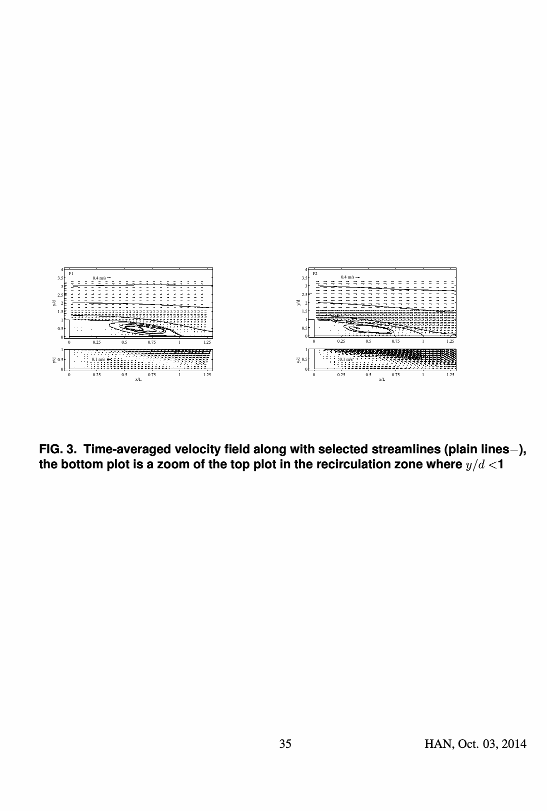

图 3. 时间平均速度场与选定流线；下图放大 $y/d<1$ 的回流区。

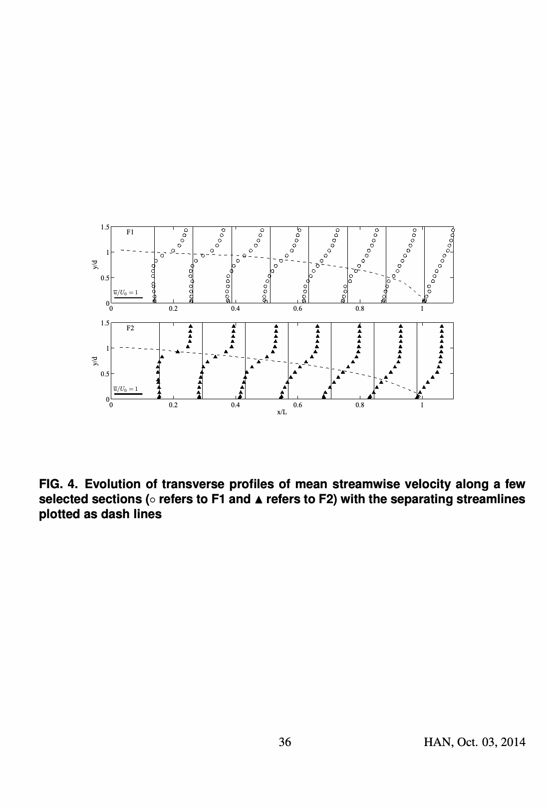

图 4. 若干断面的纵向平均速度横向剖面及分离流线；原图符号区分 F1、F2。

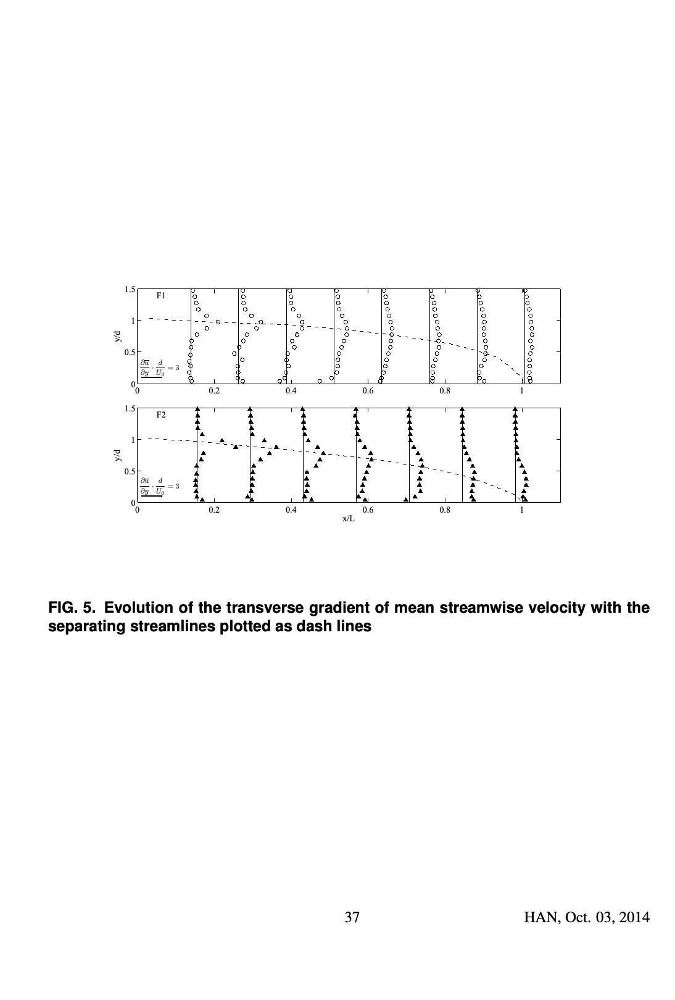

图 5. 纵向平均速度横向梯度的沿程变化；虚线为分离流线。

### 3.3 雷诺应力张量

图 6 给出二维雷诺应力张量的三个无量纲分量 $\overline{u'^2}$、$\overline{v'^2}$ 和 $-\overline{u'v'}$。三者分布相似：在 $y/d<0.8$～0.9 的分离流线附近达最大，在回流区和外侧主流区趋于零；应力在混合层上游段增加，于 $x/L\approx0.3$～0.5 达峰后向下游减小。这与已有 SSE、深水及浅水无界混合层数据一致。接近再附点时，最大应力仍在距侧壁一定距离的 $y/d\approx0.3$～0.5 处。

表 2 对比 F1、F2 与文献中自由混合层、后向台阶、浅水无界混合层和 SSE 的峰值应力。各流况的纵向法向应力均高于横向法向应力和剪应力；后两者通常约为前者的 40%～50% 和 35%，Talstra［2011］的若干数据略超出此范围。对突然展宽流况，$S_d$ 增大时最大应力趋于减小。总体而言，雷诺应力强度与深水、无界混合层呈相似行为。

图 7 比较各断面最大速度梯度、雷诺应力和分离流线的位置。在 $x/L<0.8$、远离侧壁时，以最大速度梯度位置定义的混合层中心线，基本与最大应力位置及分离流线重合，横向约束可忽略。约从 $x/L=0.8$ 起，中心线与分离流线分开：中心线保持距壁 $y/d=0.6$（F1）或 0.3（F2）。F1 受较弱垂向约束而有更宽的混合层，因此再附断面中心线离壁更远；这初步表明浅水性会影响横向约束的表现。

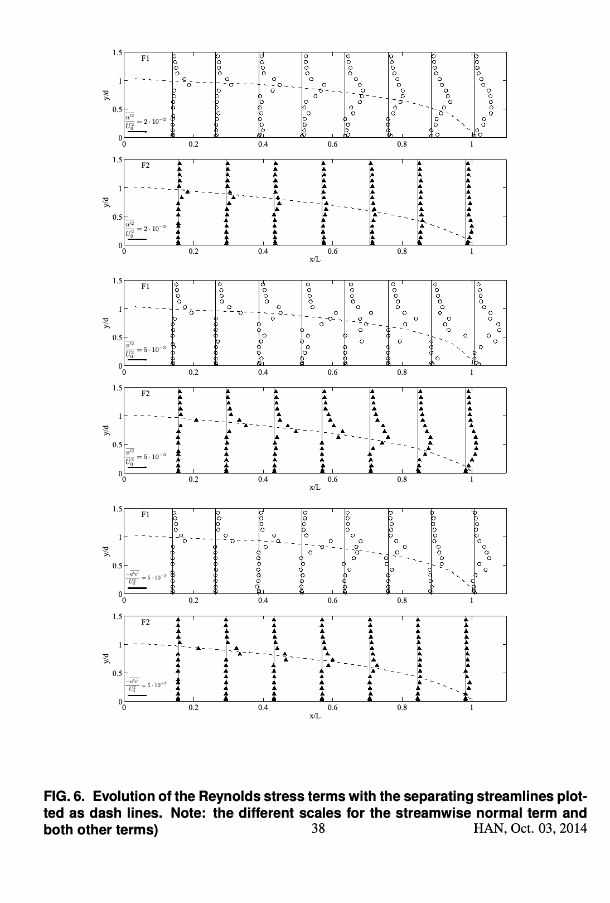

图 6. 无量纲雷诺应力分量分布；虚线为分离流线，纵向法向项与其余项采用不同刻度。

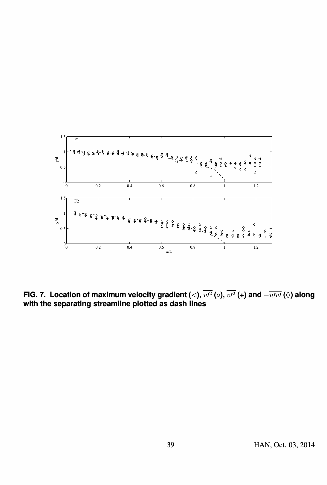

图 7. 最大速度梯度、法向应力及剪应力位置与分离流线的比较；原文图目录中两个法向项的符号重复，图内标识以原图为准。

**表 2.** 最大雷诺应力与文献数据比较，$\Delta U_0$ 为混合层起始处的外侧速度差。FML：自由混合层；BFS：后向台阶；SUM：浅水无界混合层；SSE1：Babarutsi 等［1989］的两组数据；SSE2：Talstra［2011］的案例 1～3；SSE3：本文 F1、F2。

| 指标 | FML | BFS | SUM | SSE1 组 1 | SSE1 组 2 | SSE2 案例 1 | SSE2 案例 2 | SSE2 案例 3 | SSE3 F1 | SSE3 F2 |
|---|---:|---:|---:|---:|---:|---:|---:|---:|---:|---:|
| $S_d$ | — | — | — | 0.0098 | 0.098 | 0.022 | 0.015 | 0.007 | 0.0032 | 0.032 |
| $\overline{u'^2}/\Delta U_0^2$（%） | 3.1 | 2.7 | 2.97 | 5.4 | 2.25 | 0.5 | 0.9 | 1.2 | 2.38 | 1.2 |
| $\overline{v'^2}/\Delta U_0^2$（%） | 1.9 | 1.5 | 1.36 | — | — | 0.3 | 0.7 | 0.4 | 0.88 | 0.6 |
| $-\overline{u'v'}/\Delta U_0^2$（%） | 0.925 | 1 | 1.04 | — | — | 0.2 | 0.4 | 0.2 | 0.74 | 0.5 |
| $\overline{v'^2}/\overline{u'^2}$（%） | 61 | 56 | 46 | — | — | 80 | 78 | 25 | 37 | 50 |
| $-\overline{u'v'}/\overline{u'^2}$（%） | 30 | 37 | 35 | — | — | 40 | 44 | 17 | 31 | 42 |

## 4. 混合层特征

### 4.1 定义

混合层宽度取最大斜率厚度：

$$\delta(x)=\frac{\Delta U(x)}{\left|\partial\bar u(x)/\partial y\right|_{max}}.\tag{2}$$

该定义常用于浅水混合层，与其他定义不同，无须混合层两侧都有速度平台。不过它需要外侧速度差 $\Delta U=U_1-U_2$；$U_1$ 是主流侧、$U_2$ 是回流侧的外侧速度。混合层宽度的沿程增长通常按速度差与中心速度 $U_c=(U_1+U_2)/2$ 的比值写为：

$$\frac{d\delta}{dx}=\alpha\frac{\Delta U(x)}{U_c(x)}.\tag{3}$$

$\alpha$ 为展宽率系数；自由混合层的文献值约 0.06～0.11，也有 0.085。结合式（2），局部床面摩擦数为：

$$S(x)=\frac{c_f U_c(x)}{2h\left|\partial\bar u(x)/\partial y\right|_{max}}=\frac{c_fU_c(x)\delta(x)}{2h\Delta U(x)}.\tag{4}$$

### 4.2 文献中的混合层沿程展宽

式（3）显示，$\delta(x)$ 的演变取决于 $\Delta U(x)$ 和 $U_c(x)$ 的沿程变化。对第一类无横向约束浅水混合层，在特定假设下，深度平均动量方程得到 $\Delta U$ 随 $x$ 指数下降；若再令 $U_c$ 恒定，则 $\delta$ 的增长率随 $x$ 指数下降，与实验中混合层宽度趋稳相符。第二类是在浅水直河段中有初始横向速度梯度的野外流况：$\Delta U$ 线性下降，若 $U_c$ 恒定，$\delta$ 呈抛物线式变化；采用固定 $\alpha=0.11$ 时与野外测量相符。同类流况也有分别观察到速度差指数衰减和线性衰减的实例。第三类是明渠汇流处弯曲的混合层：$\Delta U$ 线性下降、$U_c$ 线性上升，因此 $\delta$ 可用对数关系描述；$\alpha=0.09$ 时与实验值合理接近。

本文 SSE 为第四类。主流侧较快的外侧速度 $U_1(x)$ 在每个断面 $y/d=1.5$ 处测量。对回流侧 $U_2$，有研究取剖面中最小的负速度；Talstra［2011］则取零，表示净流量为零的回流区平均纵向速度。本文采用后一约定：$U_2=0$，所以 $\Delta U=U_1$、$U_c=U_1/2$，$\Delta U/U_c=2$ 沿整个混合层恒定，式（3）化为：

$$\frac{d\delta}{dx}=\alpha\frac{\Delta U}{U_c}=2\alpha.\tag{5}$$

Talstra 采用不同定义 $U_c(x)=U_1(x=0)/2\approx U_0/2$，故没有得到式（5）的形式。

### 4.3 本实验的混合层宽度

图 8 给出测得的 $\delta$。四组流况在展宽断面均有相近初值 $\delta_0/d\approx0.12$。深水 F1 的 $\delta$ 在 $x/L$ 至 0.7 左右以前近似线性增加，$\alpha\approx0.07$，之后线性增长率骤降。浅水 F2、F3、F4 同样先线性增长，但斜率较小；更浅的 F2、F4 最低，$\alpha\approx0.06$。在 $x/L\approx0.5$～0.7 处展宽率突降，且下降幅度大于 F1，曲线出现平台，$\delta$ 基本不再增加。

这一突降不能归因于床面摩擦。在本文 $\Delta U/U_c=2$ 的定义下，式（4）可写成 $S(x)=\delta c_f/(4h)$；若 $c_f,h$ 沿混合层近似恒定，得到：

$$S(x)=\frac{\delta(x)c_{f0}}{4h_0}.\tag{6}$$

F1 的展宽率突变发生在 $S(x)=0.012$，F2～F4 的平台发生在 $S(x)=0.003$～0.025（表 1 中 $S_{max}$），均显著低于文献临界尺度 $S_c=O(0.1)$。因此，无论考虑主导模态还是最不稳定模态，都不预期床面摩擦直接抑制这些相干结构的尺寸。

作者将展宽率变化归因于混合层与 $y=0$ 侧壁的相互作用，即受浅水性影响的横向约束。图 9 将混合层中心线 $y_c$（最大速度梯度位置）与两侧估计边界 $y_c\pm\delta/2$ 绘出，假设边界对称。深水和浅水两类流况的回流区下游端均约在混合层边界与侧壁相交处，即 $x/L=1$ 时 $y_c-\delta/2\approx0$。深水 F1 在再附点处 $\delta$ 更大，中心线因而离壁更远。横向受约束层流混合层的直接数值模拟也曾显示，宽度增长可在某一沿程位置因侧壁突然停止。

综上，SSE 混合层在上游 $x/L\lesssim0.6$～0.7 类似自由混合层，展宽率恒定；下游则转为受横向约束的行为，展宽率骤降，且深浅流况不同。这由浅水性造成的大涡准二维化、以及大涡与侧壁的相互作用共同决定，后者又受浅水性影响。

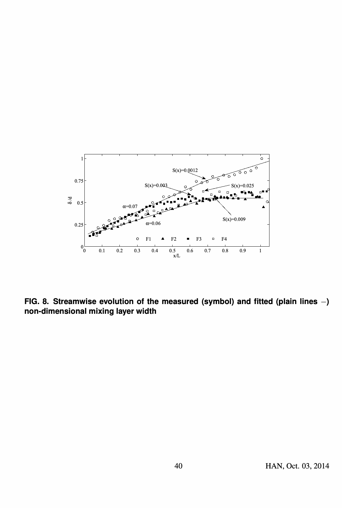

图 8. 测得及拟合的无量纲混合层宽度沿流向的变化。

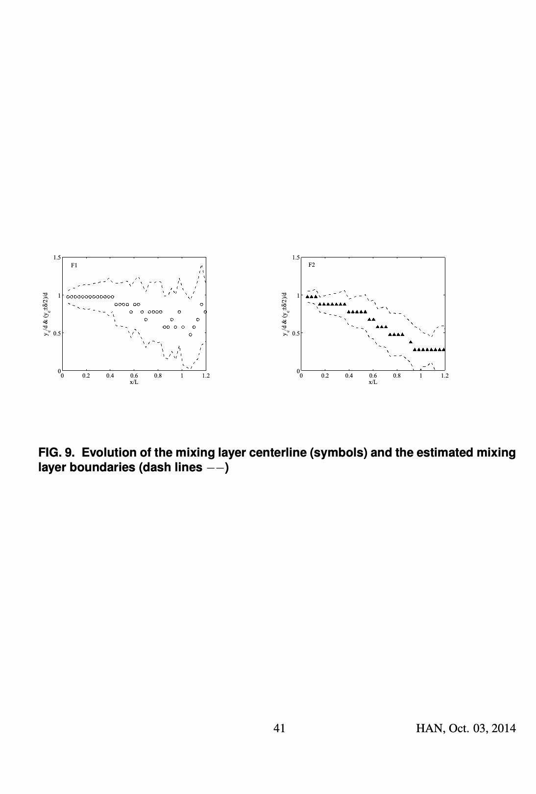

图 9. 混合层中心线测量值及估计的两侧边界。

## 5. 混合层相干结构的作用

### 5.1 相干结构及特征频率

为估计混合层中随流运动的相干结构特征频率，图 10 给出中心线 $x/L=0.2$ 处横向速度 $v$ 的能谱；图 11 则沿中心线每隔 $L/13$ 给出相似频谱，并标出各断面峰值。约 0.7～7 Hz 范围可见以 $-5/3$ 级联为特征的主要惯性区。低频段的主导涡通过频率 $f_p$ 随浅水性而异：在 $x/L=0.2$，浅水 F2 约 0.6 Hz，深水 F1 约 0.3 Hz。F1 向下游逐步下降至 $x/L=0.5$ 的约 0.1 Hz，再附断面更低；F2 下降较慢，分别约为 0.4 Hz、0.2 Hz。这与既有实验一致，也暗示浅水流的大涡动力学与深水流不同。

浮在液面的锯末经定时曝光照片可直接显示涡旋。浅水 F2（图 12）出现竖直涡轴的二维涡，沿程平流时尺寸增大，各涡的行为较可重复；再附位置可辨，却随涡位置绕 $x/L=1$ 波动。深水 F1（图 13）也能辨认较大的竖直轴涡，但轨迹和尺寸更不稳定，再附点较难确定。

沿中心线 $y=y_c$ 在 $x/L=0.2,0.5,0.8,1$ 计算横向速度脉动自相关函数 $R_{vv}$（图 14），把相邻峰值时间差 $\tau$ 作为大尺度相干结构的特征时间。F1 信号更复杂，与照片显示的低重复性一致；两组仍有相同趋势。首先，$\tau$ 随 $x/L$ 增大，说明二维涡纵向增长。其次，$x/L=0.2$ 的信号相干性较下游弱，对应涡旋的初始发展。最后，F2 的 $\tau$ 明显短于 F1，与能谱峰频率差异一致。

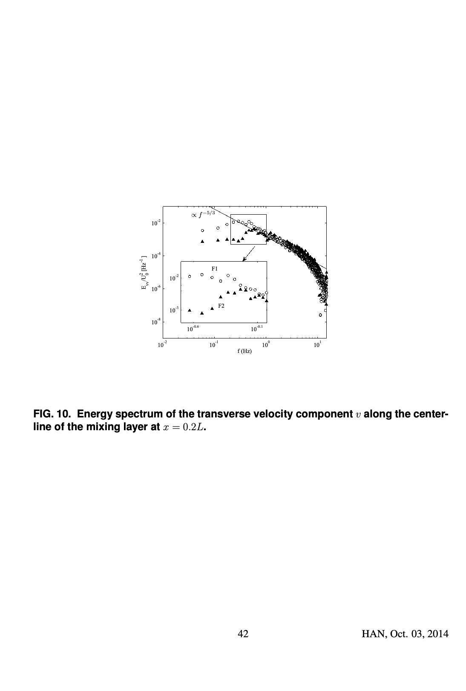

图 10. $x/L=0.2$、混合层中心线处横向速度的能谱。

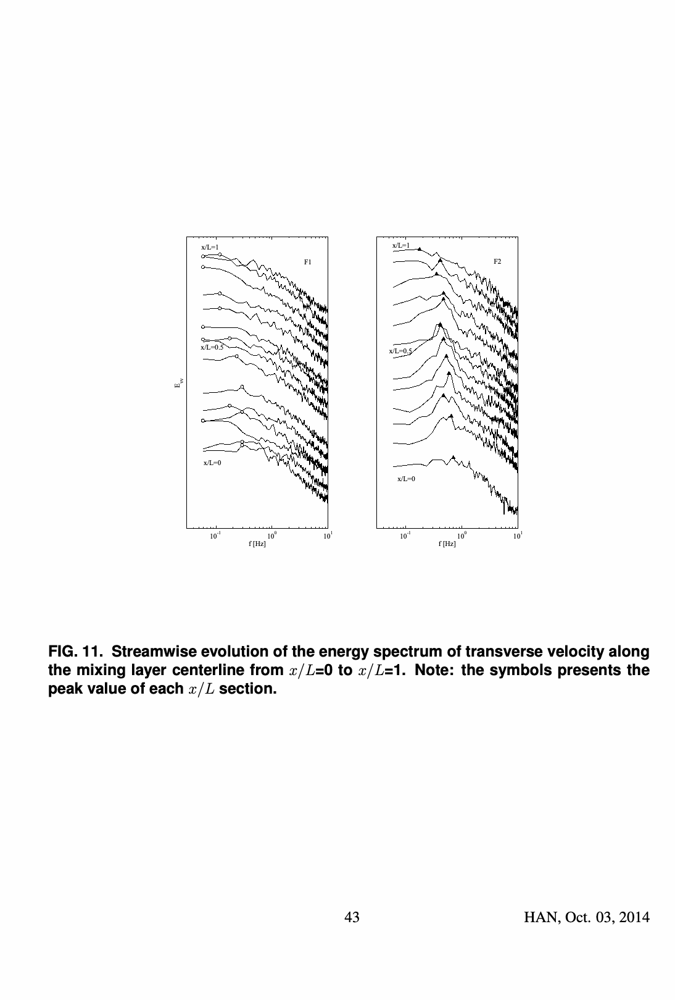

图 11. 从 $x/L=0$ 到 1，中心线横向速度能谱的沿程变化；符号标示各断面峰值。

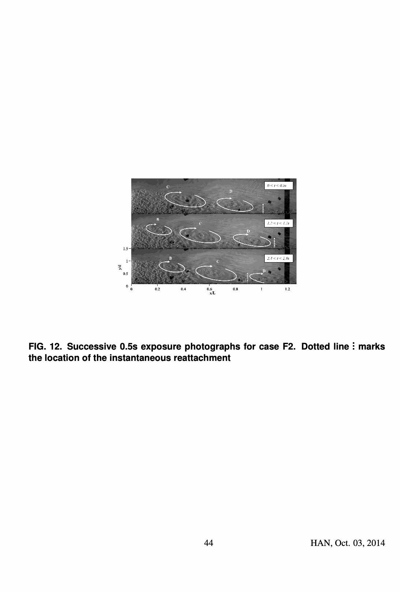

图 12. 浅水 F2 的连续 0.5 s 曝光照片；虚线标出瞬时再附位置。

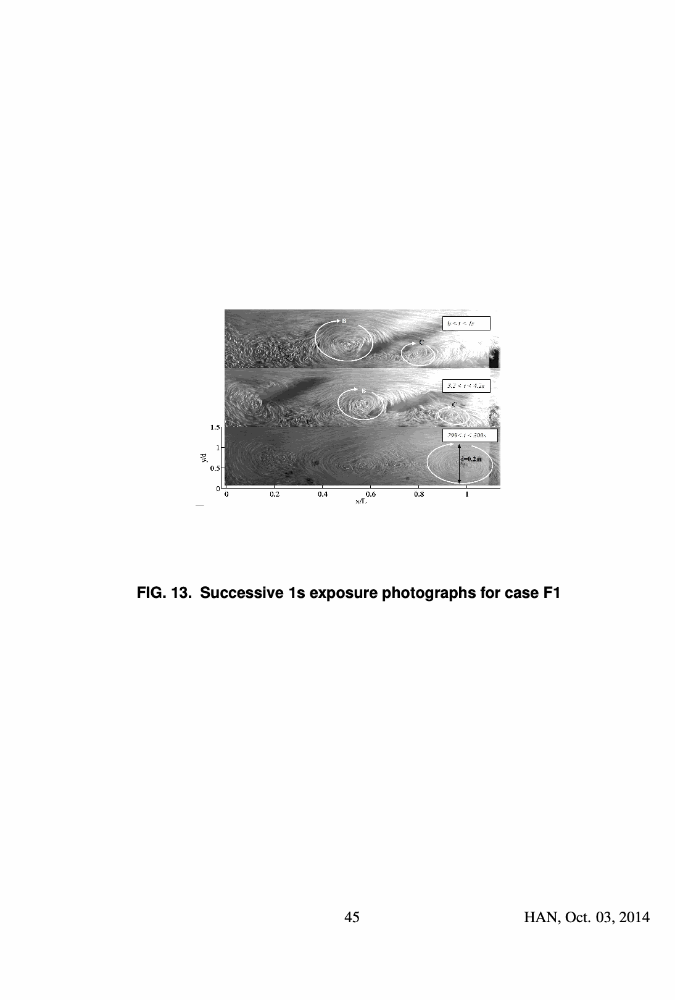

图 13. 深水 F1 的连续 1 s 曝光照片。

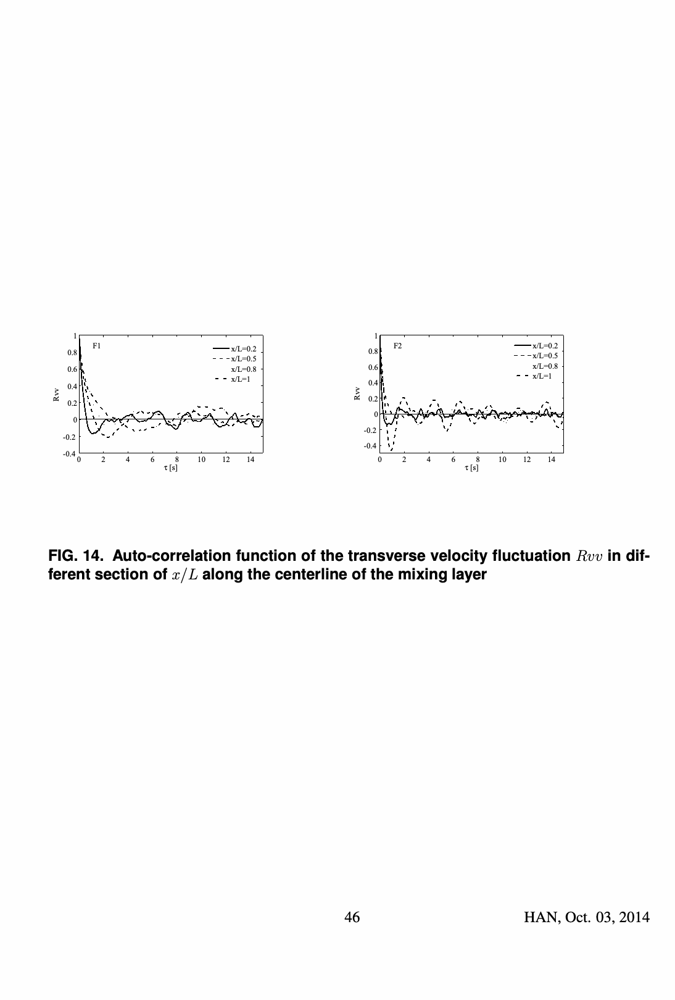

图 14. 中心线各 $x/L$ 断面的横向速度脉动自相关函数 $R_{vv}$。

### 5.2 相干涡与混合层宽度

表 3 将 F2 在两个位置的照片测量与 ADV 测量（包括自相关）比较。照片估计的涡横向尺寸与平均速度场推得的混合层宽度 $\delta$ 接近；连续照片所示涡心位移推得的对流速度，与局部平均速度接近，表中 ADV 范围分别代表最大梯度位置两侧；照片估计的涡通过频率与同处能谱峰频率接近。照片估计的纵向尺寸也与积分尺度 $\Lambda$ 相近；$\Lambda$ 由最大梯度两侧局部平均速度乘以 $R_{vv}$ 的特征时间得到。F1 在 $x/L\approx0.5$ 的比较（表 4）一致性略差，主要因照片定量困难，但仍支持：接近再附点时混合层宽度的特殊演变，与相干涡撞击侧壁有关。

**表 3.** F2 在两个位置的涡旋与混合层特征。

| 指标 | $x/L\approx0.4$ 照片 | $x/L\approx0.4$ ADV | $x/L\approx0.7$ 照片 | $x/L\approx0.7$ ADV |
|---|---:|---:|---:|---:|
| 横向尺寸（m） | 0.09 | $\delta=0.07$ | 0.12 | $\delta=0.11$ |
| 对流速度（m/s） | 0.25 | 0.14～0.24 | 0.2 | 0.13～0.2 |
| 频率（Hz） | 0.59 | 0.6 | 0.44 | 0.47 |
| 纵向尺寸（m） | 0.3 | $\Lambda=0.24$～0.36 | 0.36 | $\Lambda=0.31$～0.42 |

**表 4.** F1 在 $x/L\approx0.5$ 的涡旋特征。

| 指标 | 照片 | ADV |
|---|---:|---:|
| 厚度（m） | 0.2 | $\delta=0.13$ |
| 对流速度（m/s） | 0.06 | 0.08～0.12 |
| 频率（Hz） | 0.13 | 0.18 |
| 纵向尺寸（m） | 0.25～0.44 | $\Lambda=0.35$～0.61 |

图 15 同时绘出无量纲混合层宽度 $\delta/d$ 与涡旋纵向积分尺度 $\Lambda/d$。两者沿程行为相似：F1 先线性增加、后斜率变小；F2 先线性增加、后出现平台。按左右不同纵轴读取，$\delta$ 约为纵向积分尺度的 1/3.5。此比值与照片的涡纵、横直径之比（图 12、表 3）以及无界浅水混合层的实验和数值结果对应。Talstra［2011］报告约 2 的比值，可能与他采用矢量势函数的空间相关、而非本文时间自相关有关。

两类涡的纵、横尺寸都随混合层发展而增大。对相干结构明显呈二维的 F2，其纵向尺度与混合层宽度沿程变化尤其相符：上游线性增长，接近再附点时因与侧壁相互作用出现平台。F1 的涡纵向尺度测量离散很大，不能得出同样确定的结论。整体浅水性 $S_d$ 对涡尺寸的影响与对混合层宽度的影响相似：两流况在 $x/L\lesssim0.6$～0.7 时演变相近；更下游时，浅水 F2～F4 的混合层与涡均停止增大，深水 F1 则继续、但更缓慢地增大。侧壁相互作用受浅水性影响，可能还与深水 F1 中二维涡特征减弱有关；F1 水深约为 F2 的 7.4 倍。

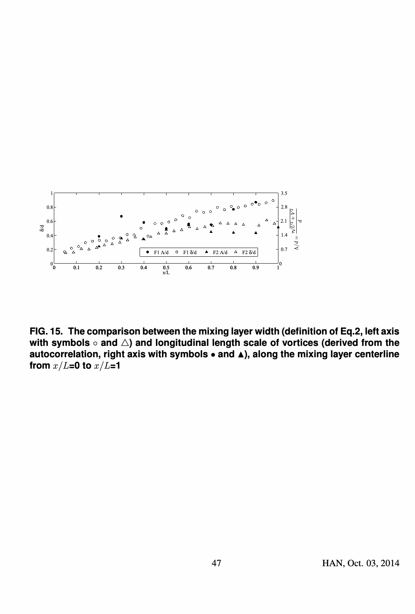

图 15. 沿中心线 $x/L=0$～1 的混合层宽度（式（2），左轴）与自相关推得的涡旋纵向尺度（右轴）比较。

## 6. 讨论与结论

本文实验刻画了浅水侧向突然展宽下游，主流与回流区交界处的混合层；它在垂向受床面和自由液面约束，在横向受侧壁约束。四组几何相同、浅水性不同的流况涵盖回流区行为：深水 F1、过渡 F3、浅水 F2，以及床面摩擦数更高的浅水 F4。研究目标一是通过对比浅水无界或深水受侧壁约束的简单混合层，辨析两种约束的共同影响；目标二是检验回流区长度等整体行为与局部混合层行为之间的联系。

关于第一目标，SSE 混合层上游段具有经典混合层特征：中心线处速度梯度和雷诺应力最大，两侧迅速下降，且中心线与源于上游拐角的分离流线重合；宽度由分离角点起近似线性向下游增加。下游段则不同：浅水流况的展宽停止，深水流况展宽放慢。全实验范围的局部床面摩擦数太小，床面摩擦似乎不能直接抑制相干结构。更可能的原因是再附点附近相干湍流结构与侧壁相互作用；这种作用在深浅流中有所不同，可能与水深增加时涡的二维性减弱有关。

关于第二目标，已有资料及本文均表明，整体浅水性 $S_d$ 强烈影响回流区长度 $L/d$。但不能把这种整体效应直接归因于局部混合层相干结构受床面摩擦抑制：本实验没有观察到此类抑制，也未发现整体 $S_d$ 与局部 $S(x)$ 的明确关系。换言之，图 2 中划分“深水流”和“浅水流”的整体临界 $S_d$，不能直接对应到式（6）中表明相干结构开始受床面摩擦显著抑制的局部临界 $S(x)$。不过，$S_d$ 确实同时影响回流区长度及相干结构的尺寸与演变。今后需用粒子图像测速等技术，沿混合层更详细跟踪结构，特别是再附点附近不同整体浅水性下与侧壁的相互作用，才能判断大尺度涡是否导致展宽下游回流区长度随浅水性大幅变化。

## 符号说明

| 符号 | 含义 |
|---|---|
| $S,S_d,S_c$ | 局部、整体、临界床面摩擦数 |
| $c_f$ | 摩擦系数 |
| $d$ | 展宽宽度（m） |
| $h$ | 水深（m） |
| $B$ | 渠道总宽度（m） |
| $R_b=(B-d)/B$ | 展宽比 |
| $u,v$ | 纵向、横向速度（m/s） |
| $U_1,U_2$ | 混合层两侧外侧速度（m/s） |
| $U_c$ | 中心平均速度（m/s） |
| $\Delta U$ | 外侧速度差（m/s） |
| $f_p$ | 主导涡的峰值通过频率（Hz） |
| $Q$ | 入口流量（L/s） |
| $L,L_b,L_t$ | 回流区长度、上游块体长度、渠道总长（m） |
| $\delta$ | 混合层宽度（m） |
| $\alpha$ | 混合层宽度增长率系数 |
| $\Lambda$ | 涡的纵向积分尺度（m） |

## 参考文献

以下保留原文题录的原语种及顺序。

- Alavian, V. and Chu, V. (1985). “Turbulent exchange flow in shallow compound channel.” Proc., 21st Congress of IAHR Melbourne, (CD-ROM), Melbourne, Australia, 446–451.

- Babarutsi, S., Ganoulis, J., and Chu, V. (1989). “Experimental investigation of shallow recirculat- ing flows.” J. Hydraul. Eng. 115(7), 906–924.

- Bell, J. and Mehta, R. (1990). “Development of a two-stream mixing layer from tripped and un- tripped boundary layers.” AIAA J. 28(12), 2034–2042.

- Biancafiore, L., Gallaire, F., and Pasquetti, R. (2011). “Influence of confinement on a two- dimensional wake.” J. Fluid. Mech. 688, 297–320.

- Booij, R. and Tukker, J. (2001). “Integral model of shallow mixing layers.” J. Hydraulic Research 39(2), 169–179.

- Chandrsuda, C. and Bradshaw, P. (1981). “Turbulence structure of a reattaching mixing layer.” J. Fluid. Mech. 110, 171–194.

- Chatelain, M., Han, L., Riviere, N., and Mignot, E. (2014). “Physics of shallow recirculation zones downstream lateral expansions.” Proc., Int. Conference on Fluvial Hydraulics - River Flow 2014, (CD-ROM), Lausanne, Switzerland, 701–709.

- Cheng, Z. and Constantinescu, G. (2014). “Spatial development of a constant-depth shallow mix- ing layer in a long channel.” Proc., Int. Conference on Fluvial Hydraulics - River Flow 2014, (CD-ROM), Lausanne, Switzerland, 155–164.

- Chu, V. and Babarutsi, S. (1988). “Confinement and bed friction effects in shallow turbulent mixing layers.” J. Hydraul. Eng. 114, 1257–1274.

- Chu, V., Liu, F., and Altai, W. (2004). “Friction and confinement effects on a shallow recirculating flow.” Journal of Environmental and Engineering Science 3(5),463–475.

- Chu, V., Wu, J., and Khayat, R. (1983). “Stability of turbulent shear flows in shallow channels.” Proc. of the 20th Congress of IAHR, (CD-ROM), Moscow, Russia, 128–133.

- Chu, V., Wu, J., and Khayat, R. (1991). “Stability of transverse shear flows in shallow open chan- nels.” J. Hydraul. Eng. 117(10), 1370–1388.

- Constantinescu, G. (2013). “Les of shallow mixing interfaces :a review..” Envir. Fluid Mech. 14(5), 971–996.

- Engelhardt, C., Kruger, A., Sukhodolov, A., and Nicklisch, A. (2004). “A study of phytoplankton spatial distributions, flow structure and characteristics of mixing in a river reach with groynes.” Journal of Plankton Research, 26(11), 1351–1366.

- Goring, G. and Nikora, V. (2002). “Despiking acoustic doppler velocimeter data.” J. Hydraul. Eng. 128(1), 117-126.

- Hertzberg, J. and Ho, C. (1995). “Three-dimensional vortex dynamics in a rectangular sudden expansion.” J. Fluid Mech. 289, 1-27.

- Jovic, S. and Driver, D. (1994). “Backward-facing step measurement at low reynolds number, reh=5000.” NASA Tech. Mem. 108807.

- Kasagi, N. and Matsunaga, A. (1995). “Three-dimensional particle-tracking velocimetry measure- ment of turbulent statistics and energy budget in a backward facing step flow.” International Journal of Heat and Fluid flow 16, 477–485.

- Lesieur, M. (1997). Turbulence in Fluids. Kluwer Academic, Norwell, U.S.A.

- Li, X. and Djilali, N. (1995). “On the scaling of separation bubbles.” JSME Int. J. Series B 38(4), 541–548.

- Loucks, R. and Wallace, J. (2012). “Velocity and velocity gradient based properties of a turbulent plane mixing layer.” Journal of Fluid Mechanics, 699, 280–319.

- Lyn, D. and Rodi, W. (1994). “The flapping shear layer formed by flow separation from the forward corner of a square cylinder.” J. Fluid Mech. 267, 353–376.

- Mignot, E., Doppler, D., Riviere, N., Vinkovic, I., Gence, J., and Simoens, S. (2014a). “Double averaging analysis and local flow characterization of near bed turbulence in gravel-bed channel flows.” J. Hydraul. Eng. 140(3), 280–290.

- Mignot, E., Vinkovic, I., Doppler, D., and Riviere, N. (2014b). “Mixing layer in open-channel junction flows.” Envir. Fluid Mech. 14(5), 1027–1041.

- O’Connor, B., Hondzo, M., and Harvey, J. (2010). “Predictive modeling of transient storage and nutrient uptake: implications for stream restoration.” Journal of Hydraulic Engineering, 136(12).

- Pope, S. (2008). Turbulence flows. Cambridge University Press, Cambridge, United Kingdom.

- Riviere, N., Badin, B., Bomchil, Y., and Proust, S. (2008). “Recirculation zones downstream open channel expansions.” 4th Edition of the International Conference on Fluvial Hydraulics River Flow 2008, Izmir, Turkey, 2233–2238.

- Riviere, N., Gautier, S., and Mignot, E. (2011). “Experimental characterization of flow reattach- ment downstream open channel expansions.” Proceedings of the 34th World Congress of the In- ternational Association for Hydro- Environment Research and Engineering, Barton, Australia, 3745–3752.

- Sukhodolov, A., Schnauder, I., and Uijttewaal, W. (2010). “Dynamics of shallow lateral shear layers: experimental study in a river with a sandy bed.” Water Resour. Res. 46, W11519.

- Talstra, H. (2011). “Large-scale turbulence structures in shallow separat- ing flows.” Ph.D. thesis, Technische Universiteit Delft, Delft, Netherlands, <http://repository.tudelft.nl/view/ir/uuid%3A922e297b-19b9-4399-808d-23e837401a52/>.

- Uijttewaal, W. and Booij, R. (2000). “Effects of shallowness on the development of free-surface mixing layers.” Phys. Fluids 12(2), 392–402.

- Van Prooijen, B. and Uijttewaal, W. (2002). “A linear approach for the evolution of coherent struc- tures in shallow mixing layers.” Phys. Fluids 4(12), 4105–4114.

- Voulgaris, G. and Trowbridge, J. (1998). “Evaluation of the acoustic doppler velocimeter (adv) for turbulence measurements.” J. Atmos. Oceanic Technol. 15, 272–289.

- White, B. and Nepf, H. (2007). “Shear instability and coherent structures in shallow flow adjacent to a porous layer.” J. Fluid Mech. 593, 1–32.

- Wygnanski, I. and Fiedler, H. (1970). “The two-dimensional mixing region.” J. Fluid Mech. 41(2), 327–361.

## 校订备注

- 本 PDF 为 2017 年期刊论文的 HAL 存档稿，稿件页脚仍显示 2014 年日期；不能把页脚日期当作正式发表年份。
- 原文表 2 的 SSE1 有两组无独立标签的数据，译文分别记为“组 1／组 2”；SSE2 的“案例 1～3”与 SSE3 的 F1／F2 按原表多层表头对应。
