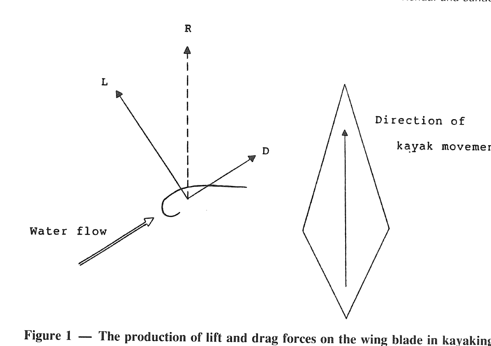
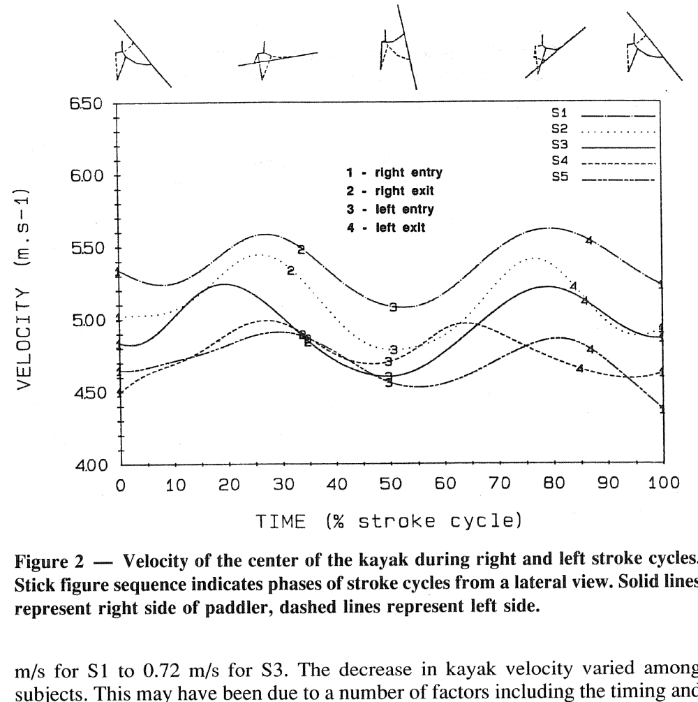
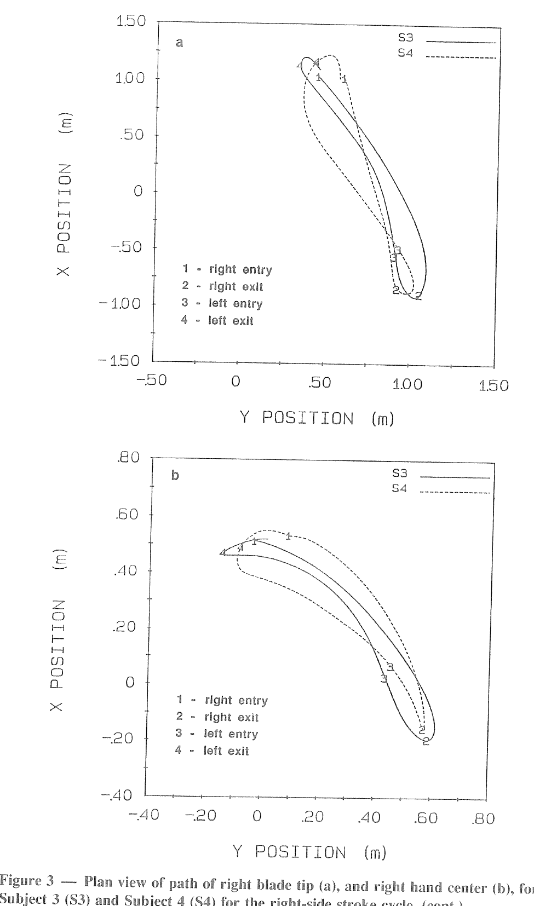
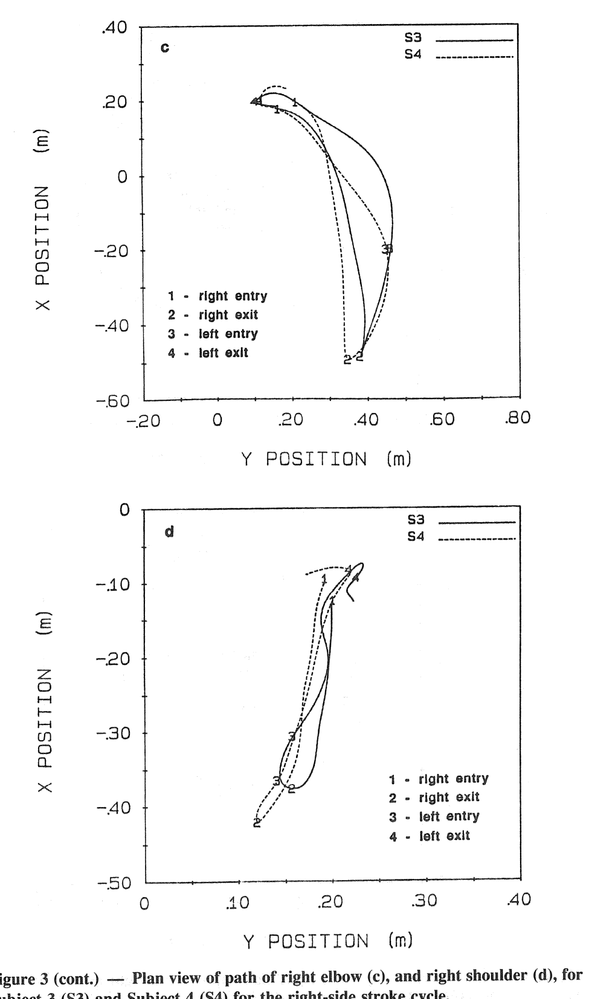
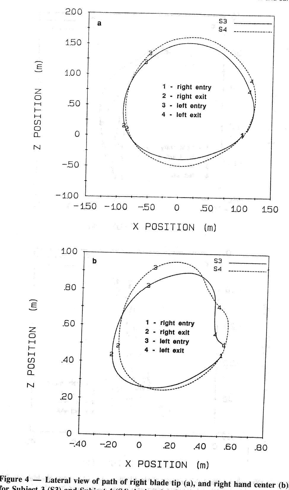
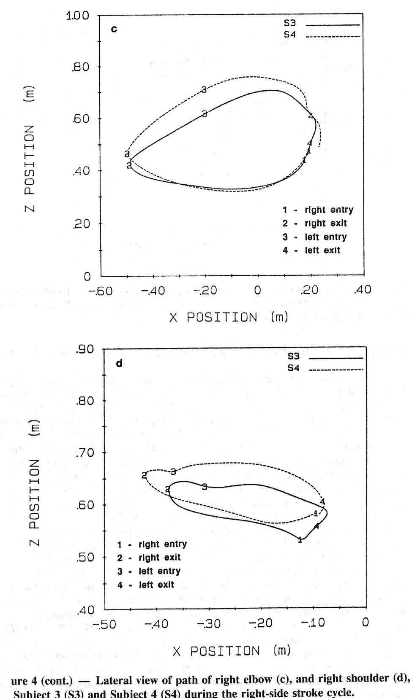
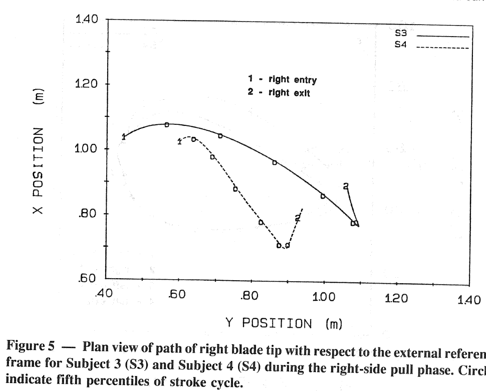

# 精英静水皮艇划手使用翼桨的技术

原文：Selina J. Kendal、Ross H. Sanders，*The Technique of Elite Flatwater Kayak Paddlers Using the Wing Paddle*，*International Journal of Sport Biomechanics*，8，233–250，1992。

## 摘要

研究分析新西兰精英皮艇划手使用挪威式翼桨时的技术，寻找与竞技成功有关的因素。五名男性划手由两台高速摄影机拍摄，研究者根据胶片确定桨叶尖端和关节中心的路径。艇速为 4.63–5.38 m/s，划桨频率为 1.93–2.26 周期／s。按以往比赛成绩分类，成绩较好的划手动作模式和桨叶路径彼此相似，并与成绩较差者不同；他们不同试次间的桨叶尖端和关节中心路径也较一致。成绩较好的划手使桨叶在艇的更前方、离艇纵轴更近的位置入水；相对于水，桨叶向艇外侧移动较长距离，向后移动较短距离。

## 引言

在奥运会静水皮艇项目中达到国际水平需要高超技术，运动员也持续改进动作与器材。最初在瑞典研制的翼桨因其翼型形状得名，被认为有助于改善使用者的表现。瑞典翼桨后来在挪威得到改进，新设计被国际皮艇划手采用。传统桨的划桨技术已有多项描述性分析（Kearney 等，1979；Mann 和 Kearney，1980；Mann 等，1978；Plagenhoef，1971、1979），但有关翼桨技术的科学报告仍少；翼桨技术与传统桨技术确有差别（Thompson，1985）。

Anderson（1988）认为，翼桨叶沿离艇斜向的路径运动，水流经过其翼型表面时产生用于推进的升力（图 1）。Colman 等（1989）比较一名划手使用传统桨与翼桨的动作，发现翼桨的横向运动使较多水体只移动较短距离，艇在拉桨阶段的前进距离则比传统桨更长。Issourin（1989）观察翼桨叶的运动模式，发现在整个划桨过程中桨叶相对来流的迎角较小，并认为小迎角对产生升力推进分量重要。

图 1. 翼桨叶上的升力 $L$、阻力 $D$ 及其合力 $R$；图中分别标出相对水流和艇的运动方向。图示受力对象是桨叶。

Sanders 和 Kendal（文中列为待刊）研究使用瑞典翼桨、水平从初学者到精英的划手，以侧面和正面影像共同描述身体节段及桨路径。他们发现，较好的表现主要与较高划桨频率有关，而非较长桨程；优秀划手通过缩短拉桨时间和空中滑行时间提高频率。本研究则聚焦挪威式翼桨，寻找成功技术相关因素，并提供精英划手数据供非精英划手比较。研究检验划桨频率、拉桨时间、滑行时间、桨程、拉桨行程、滑行距离、前伸距离、后伸距离和桨叶滑移与平均艇速的关系；关节中心轨迹相对运动中的艇中心描述，桨叶尖端轨迹则分别相对艇中心和水描述。既往有关桨叶和关节轨迹的研究使用的是传统桨，作者表示当时尚无精英划手使用挪威式翼桨的相应描述。

## 方法

### 受试者与艇的准备

五名新西兰男性国际比赛划手 S1–S5 参加研究，年龄 22–37 岁，平均 26 岁。按此前比赛成绩，S3 与 S5 最成功。每名受试者完成五次拍摄试次：在自己选择的、超过 50 m 的距离内加速，进入拍摄区前达到最大速度。所有人使用自己的艇和挪威式翼桨。

研究者在艇侧、与座舱两端对齐的位置贴上白胶带和黑色圆点，用作侧面影像的比例尺；两个标记的中点视为艇中心。带上下左右标记的木制 T 形杆倒置固定在船体上表面，与船头保持测得的距离，用来确定正面影像的比例尺。桨杆两端也设标记，并测量标记至桨叶尖端的距离。

### 数据采集

两台相位同步的 Photosonics 16 mm 高速摄影机均配 Angenieux 12–150 mm 变焦镜头。侧面摄影机的镜头轴线垂直于运动平面，距离约 20 m；正面摄影机的镜头轴线位于艇的预定运动平面内，要求划手朝镜头正向划来，艇到镜头的距离在一次试次中约从 20 m 缩短到 10 m。标称拍摄频率为 100 帧／s，快门角为 90°，有效曝光时间 1/400 s。

如果连续两桨（一侧右桨、随后一侧左桨）未完整进入侧面画面，或艇未直接朝正面摄影机运动，该试次不作分析。除 S2 仅分析一次外，其余受试者各分析四次。研究者用 Calcomp 9100 数字化仪，自右侧桨叶入水前 10 帧至右侧桨叶再次入水后 10 帧，逐帧标定数据。侧面标定点包括外部参考点、艇艉和艇艏标记、左右桨标记、头顶、第七颈椎及左右肩、肘、腕和手中心；正面标定点包括外部参考点、T 形杆四个标记、头顶、身体下部中线点、左右桨标记及左右肩、肘、手中心。胶片坐标输入 Foman 分析程序，计算运动学变量。

### 参考系与变量

各标记的 X、Y、Z 坐标经二阶 Butterworth 数字滤波器处理，最优截止频率均在 5–7 Hz，以减小数字化随机误差。X 是近似沿艇运动方向、垂直于侧面摄影机光轴的水平轴：相对一个划桨周期开始时的艇中心为**外部参考系**，相对持续运动的艇中心为**内部参考系**。Y 为垂直于艇运动平面的水平轴，由正面影像取得，并依据侧面影像所定的 X 位移逐时调整比例尺；Y 坐标相对运动中的艇中心表示。Z 为艇运动平面内的竖轴，由侧面影像取得，也相对运动中的艇中心表示。

分析的变量为左右侧划桨周期的平均艇速、划桨频率、拉桨时间、滑行时间、桨程、拉桨行程和滑行距离；只在右侧周期分析的前伸距离、后伸距离和滑移；以及右侧桨叶尖端、右肩、右肘、右手关节中心的路径。由艇中心位置计算瞬时艇速，再求每侧周期的最高速度、最低速度、速度下降量和达到最高速度的时间。下降量定义为该周期最高与最低速度之差；达到最高速度的时间从桨叶入水算起。

因变量平均艇速等于划桨频率与桨程的乘积。划桨频率是单次划桨时间的倒数；单次时间由同侧入水至出水的拉桨时间，和同侧出水至对侧入水的滑行时间组成。桨程是从一侧入水至对侧入水期间艇中心的前进距离，包括相应的拉桨行程和滑行距离。拉桨行程又涉及入水时桨叶尖端相对艇中心的水平位置（前伸距离）、出水时的位置（后伸距离）及滑移。**滑移**是桨叶在水中期间，相对外部参考系沿 X 轴的水平位移；负值表示桨叶相对水向后移动。

右桨叶尖端路径从其右侧入水算至再次右侧入水。由桨上参考标记位置加上已测量的标记至尖端距离，计算尖端位置。尖端轨迹在内部参考系下分别用侧视 X–Z 和俯视 X–Y 表示，并在外部参考系下用俯视 X–Y 表示；右肩、肘、手中心轨迹均在内部参考系下以侧视与俯视表示。为便于受试者间比较，研究者用五次样条插值，求出划桨周期各百分位的轨迹及艇速。各变量计算试次均值和标准差；以平均艇速为表现指标，采用简单回归和 Pearson 积差相关分析检验其他变量与它的关系。

## 结果与讨论

### 速度

表 1、2 列出右侧与左侧划桨周期的艇速。各人平均艇速的总体范围为 S4 的 4.63 m/s 至 S1 的 5.38 m/s；最高速度为 4.80–5.55 m/s，最低速度为 4.41–5.31 m/s。作者报告，平均艇速较高者的最高和最低艇速也较高，给出的回归参数分别为 $r=0.92, R^2=0.98, p<0.01$ 和 $r=1.04, R^2=0.98, p<0.01$；原文参数符号与数值见文末备注。图 2 显示两次连续划桨的速度变化。按既往比赛成绩最成功的划手，并未在本研究的短距离试次中达到最高的平均艇速；作者推测可能因为试次距离远短于比赛距离，尚不清楚高艇速、高频率能否维持全程。

表 1. 右侧划桨周期各人试次均值 M 与标准差 SD；达到最高速度的时点以周期百分比表示。

| 受试者 | 统计量 | 平均艇速（m/s） | 最高艇速（m/s） | 最低艇速（m/s） | 速度下降（m/s） | 最高速度时点（%） |
|---|---|---:|---:|---:|---:|---:|
| S1 | M | 5.38 | 5.55 | 5.31 | 0.25 | 25 |
| S1 | SD | 0.08 | 0.09 | 0.07 | 0.06 | 1.03 |
| S2 | M | 5.14 | 5.45 | 5.02 | 0.43 | 26 |
| S3 | M | 4.97 | 5.24 | 4.88 | 0.44 | 21 |
| S3 | SD | 0.05 | 0.06 | 0.07 | 0.10 | 1.03 |
| S4 | M | 4.77 | 4.98 | 4.61 | 0.34 | 25 |
| S4 | SD | 0.06 | 0.13 | 0.04 | 0.08 | 0.71 |
| S5 | M | 4.71 | 4.88 | 4.52 | 0.44 | 28 |
| S5 | SD | 0.18 | 0.13 | 0.09 | 0.08 | 0.65 |

表 2. 左侧划桨周期各人试次均值与标准差，列定义同表 1。

| 受试者 | 统计量 | 平均艇速（m/s） | 最高艇速（m/s） | 最低艇速（m/s） | 速度下降（m/s） | 最高速度时点（%） |
|---|---|---:|---:|---:|---:|---:|
| S1 | M | 5.29 | 5.49 | 5.11 | 0.36 | 29 |
| S1 | SD | 0.07 | 0.06 | 0.04 | 0.03 | 1.32 |
| S2 | M | 5.06 | 5.41 | 4.79 | 0.62 | 26 |
| S3 | M | 5.03 | 5.31 | 4.59 | 0.72 | 29 |
| S3 | SD | 0.05 | 0.04 | 0.01 | 0.04 | 0.63 |
| S4 | M | 4.63 | 4.80 | 4.53 | 0.28 | 21 |
| S4 | SD | 0.07 | 0.06 | 0.07 | 0.03 | 2.93 |
| S5 | M | 4.65 | 4.83 | 4.41 | 0.42 | 31 |
| S5 | SD | 0.09 | 0.06 | 0.08 | 0.06 | 0.87 |

图 2. 两次连续划桨中艇中心的速度；上方动作小图为侧视，实线表示划手右侧，虚线表示左侧。1 为右侧入水，2 为右侧出水，3 为左侧入水，4 为左侧出水。

各受试者两侧周期的最高速度、到达该速度的时点以及速度下降量均不完全对称。作者推测，这可能与身体优势侧和非优势侧的力量及协调差别有关。从拉桨末期到滑行阶段，艇速下降量为 S1 的 0.25 m/s 至 S3 的 0.72 m/s；个人间差异可能受最高速度的时点和幅度、桨叶离水时长、艇湿表面积及艇相对目标航线的角度影响。阻力通常随速度平方增大，但本研究未发现最高速度与滑行阶段降速量之间存在关系，这提示速度以外的因素也明显影响滑行阻力。艇在拉桨阶段加速，在桨叶出水前已开始减速，滑行阶段继续减速；所有受试者的最高速度都出现在出水前，最低速度接近对侧桨叶再次入水的时刻。作者据此认为，拉桨末端有一段时间的桨力不足以维持艇速。

### 划桨频率、拉桨时间和滑行时间

划桨频率由 S5 的 1.93 周期／s 到 S1 的 2.26 周期／s（表 3）。S1 既有最高平均艇速，也有最高频率，但样本内未发现频率与平均艇速的关系。Anderson（1988）曾提出翼桨形成更长、更慢、更有力的划桨，因而降低频率；本研究部分受试者的翼桨频率却接近 Plagenhoef（1979）所报告的传统桨频率。它们能否在比赛全程维持，尚不清楚。

表 3. 左右侧划桨周期平均后的各人试次均值 M 与标准差 SD。拉桨和滑行时间后的括号为占总周期时间的百分比。

| 受试者 | 统计量 | 平均艇速（m/s） | 频率（周期／s） | 周期时间（s） | 拉桨时间（s，%） | 滑行时间（s，%） |
|---|---|---:|---:|---:|---:|---:|
| S1 | M | 5.33 | 2.26 | 0.44 | 0.30（70） | 0.13（30） |
| S1 | SD | 0.09 | 0.02 | 0.00 | 0.00（1.7） | 0.00（1.7） |
| S2 | M | 5.10 | 2.00 | 0.50 | 0.33（65） | 0.18（35） |
| S2 | SD | 0.06 | 0.04 | 0.01 | 0.01（2.0） | 0.02（2.0） |
| S3 | M | 5.00 | 1.96 | 0.51 | 0.36（71） | 0.15（29） |
| S3 | SD | 0.06 | 0.02 | 0.01 | 0.00（0.7） | 0.01（0.7） |
| S4 | M | 4.70 | 2.03 | 0.49 | 0.34（69） | 0.15（28） |
| S4 | SD | 0.12 | 0.02 | 0.01 | 0.01（0.7） | 0.00（0.7） |
| S5 | M | 4.68 | 1.93 | 0.52 | 0.37（72） | 0.15（28） |
| S5 | SD | 0.16 | 0.02 | 0.01 | 0.01（0.6） | 0.00（0.6） |

拉桨时间由 S1 的 0.30 s 到 S5 的 0.37 s，占周期时间的 65%（S2）至 72%（S5）。这些比例接近以传统桨测得的结果：Plagenhoef（1979）根据精英选手数据将理想值定为 69%；Mann 和 Kearney（1980）报告 66%–80%，平均 71.5%。S1 的艇速最高且拉桨时间最短，但本研究未发现拉桨时间与艇速的关系。作者报告拉桨时间与总周期时间存在关系，参数写作 $r=1.07, R^2=0.84, p=0.018$，并认为缩短拉桨时间有助于缩短周期；$r$ 的写法见文末备注。滑行时间为 0.13–0.18 s，占周期的 28%–35%；它与艇速或总周期时间均未见显著关系，周期长的人不一定滑行更久。

### 桨程、拉桨行程、滑行距离与前后伸距离

桨程为 S4 的 2.32 m 至 S3 的 2.55 m，与艇速未见显著关系。拉桨行程为 1.61–1.81 m，与艇速或桨程均未见关系；作者指出，过度延长拉桨行程若降低桨频，反而可能不利。滑行距离为 S5 的 0.67 m 至 S2 的 0.88 m，也未发现与艇速相关。前伸距离为 S1 的 0.92 m 至 S3 的 1.08 m，与艇速未见关系；作者认为刻意再增大前伸可能降低桨频，划手应控制在入水后能立即产生较大推进力的范围。后伸距离为 S1、S2 的 0.75 m 至 S5 的 0.93 m，同样未见与艇速相关。桨叶越过艇中心后的拉桨末期艇速已下降，因此更长后伸只延长拉桨时间，未提高艇速；较短后伸可减少在效率较低阶段耗费的时间。

表 4. 各人试次均值 M 和标准差 SD；滑移为相对外部参考系沿 X 方向的带符号位移。

| 受试者 | 统计量 | 桨程（m） | 滑行距离（m） | 拉桨行程（m） | 前伸（m） | 后伸（m） | 滑移（m） |
|---|---|---:|---:|---:|---:|---:|---:|
| S1 | M | 2.36 | 0.70 | 1.66 | 0.92 | 0.75 | −0.10 |
| S1 | SD | 0.02 | 0.04 | 0.04 | 0.03 | 0.08 | 0.05 |
| S2 | M | 2.49 | 0.88 | 1.68 | 0.99 | 0.75 | −0.07 |
| S2 | SD | 0.01 | 0.08 | 0.01 | 0.00 | 0.00 | 0.00 |
| S3 | M | 2.55 | 0.74 | 1.81 | 1.08 | 0.88 | −0.13 |
| S3 | SD | 0.03 | 0.02 | 0.01 | 0.03 | 0.02 | 0.01 |
| S4 | M | 2.32 | 0.71 | 1.61 | 1.03 | 0.78 | −0.20 |
| S4 | SD | 0.04 | 0.02 | 0.02 | 0.03 | 0.06 | 0.05 |
| S5 | M | 2.43 | 0.67 | 1.76 | 1.03 | 0.93 | −0.22 |
| S5 | SD | 0.01 | 0.02 | 0.02 | 0.05 | 0.05 | 0.01 |

### 桨叶滑移

滑移为 S2 的 −0.07 m 至 S5 的 −0.22 m（表 4）。本研究没有发现滑移与艇速的显著关系，但艇速最高的 S1、S2 也是滑移最小者。作者认为，技术较好的划手可能通过桨叶横移获得升力，减少桨叶相对水向后移动的需求；减小滑移或可在不延长拉桨时间的情况下增加拉桨行程，因为桨叶提出水面前艇已前进得更远。这些机制属于作者的推测，不能仅由此样本确证。

### 桨叶尖端与关节中心的路径

图 3、4 分别给出 S3 与 S4 一次代表性试次中桨叶尖端和右侧关节中心轨迹的俯视 X–Y 与侧视 X–Z 图。二人分别代表以往比赛成绩最好与最差的划手。内部参考系下的轨迹用于比较；入水时点在不同试次间的部分差异可能来自透视误差，因为侧面分析假定划手和艇各处到摄像机成像平面的距离相同。侧面摄影机距运动平面约 20 m，作者估计误差小于 3%，认为不妨碍试次间和受试者间比较。

图 3. S3 和 S4 右侧划桨周期内桨叶尖端（a）、右手（b）、右肘（c）、右肩（d）中心的俯视轨迹；实线与虚线按原图图例对应受试者。1–4 依次表示右侧入水、右侧出水、左侧入水和左侧出水。

图 4. S3 和 S4 的桨叶尖端（a）、右手（b）、右肘（c）、右肩（d）中心的侧视 X–Z 轨迹；标记定义同图 3。

**桨叶路径。**表 5 给出右侧拉桨阶段相对外部参考系的桨叶位置。桨叶在艇较前方、靠近纵轴处入水：X 坐标为 S1 的 0.92 m 至 S3 的 1.07 m，Y 坐标为 S3 的 0.44 m 至 S4 的 0.63 m。入水后，桨叶相对艇向侧方（+Y）和后方（−X）运动至出水；相对外部参考系，X 位移为 −0.07 至 −0.22 m，Y 位移为 0.37–0.70 m。作者引用 Anderson（1988）认为横向分量可产生前向升力。出水时外部参考系中的 X 位置为 S5 的 0.81 m 至 S3 的 0.94 m，Y 位置为 S5 的 0.97 m 至 S2 的 1.24 m。

表 5. 右侧拉桨阶段桨叶在 X、Y 方向相对外部参考系的位置，含试次均值 M 和标准差 SD。

| 受试者 | 统计量 | 入水 X（m） | 入水 Y（m） | 出水 X（m） | 出水 Y（m） | X 位移（m） | Y 位移（m） |
|---|---|---:|---:|---:|---:|---:|---:|
| S1 | M | 0.92 | 0.51 | 0.82 | 1.07 | −0.10 | 0.56 |
| S1 | SD | 0.01 | 0.02 | 0.03 | 0.01 | 0.03 | 0.03 |
| S2 | M | 1.00 | 0.54 | 0.93 | 1.24 | −0.07 | 0.70 |
| S3 | M | 1.07 | 0.44 | 0.94 | 1.01 | −0.13 | 0.57 |
| S3 | SD | 0.01 | 0.01 | 0.02 | 0.02 | 0.01 | 0.02 |
| S4 | M | 1.03 | 0.63 | 0.83 | 0.99 | −0.20 | 0.37 |
| S4 | SD | 0.01 | 0.02 | 0.01 | 0.03 | 0.02 | 0.03 |
| S5 | M | 1.03 | 0.48 | 0.81 | 0.97 | −0.22 | 0.48 |
| S5 | SD | 0.02 | 0.02 | 0.02 | 0.01 | 0.01 | 0.01 |

按以往比赛成绩，S3、S5 的 X、Y、Z 桨叶轨迹在各试次间较一致；S4 等成绩较差者的轨迹尤其在回桨阶段变化较大。S3 比 S4 在艇更前方、离艇纵轴更近处入水，拉桨时桨叶向外侧移动也更远（图 3a）。侧视图显示，回桨时桨叶先移至入水点前方，再回到入水点；S3 拉桨时桨叶没有 S4 那样深，回桨时也没有抬得那么高，在左侧桨叶出水时其右侧桨叶更靠近入水位置（图 4a）。

图 5 在外部参考系下对比 S3 与 S4 的右桨叶路径。S3 的横向位移较大，相对水向后的位移较小；作者推测，较大的横移或产生更多前向升力，使 S3 的艇速高于 S4。S4 等划手的桨叶在水中向后移动较远。表 4、5 的滑移与路径数据一致：滑移较小的 S1、S2 横向位移较大；滑移较大的 S4、S5 横向位移较小。作者推测，若桨叶不持续横移，它便相对水向后滑移，划手在这段可能更多依靠阻力而非升力推进。

图 5. S3、S4 在右侧拉桨阶段的桨叶尖端路径；圆圈表示划桨周期的每个第 5 百分位。X 为前后方向，Y 为横向。

所有受试者的桨叶入水后相对外部参考系先稍向前（+X）移动，再向后（−X）移动。作者指出，刚浸入水时的前移可能产生额外阻力而非推进力，但是否如此还取决于横移产生的升力；艇速增加的延迟支持这段可能效率较低。出水前桨叶也立即向前移动，可能同样增加阻力；出水前艇速下降与这一解释相符。

**手中心路径。**俯视图中，入水时手大致位于艇纵轴线上，随后向后（−X）、向外（+Y）移动，拉桨结束时位于艇中心后方。回桨时手向前（+X），跨过艇纵轴，再回到入水位置。侧视图中，桨叶入水时手下降，拉桨时向后，出水时上升；回桨时手抬到肩以上并向前伸，然后降至入水位置。所有受试者大体遵循这一模式。除 S1、S4 外，各人的手轨迹在试次间较一致。与 S4 相比，S3 入水时手更靠近艇纵轴、拉桨时向外移动更远；回桨初期向前更远，随后跨艇纵轴的横向距离也更大。侧视图中，S3 的手回桨高度低于 S4，左侧桨叶出水时也更接近右侧入水位置。

**肘中心路径。**入水时肘位于艇中心前方，先向外（+Y）再向后（−X）；回桨时先向外并向前，再向内跨至艇中心，最后向外回到入水位置。S3 入水时的肘比 S4 更靠近纵轴，出水时则在更外侧；S3 回桨时肘向前更远，然后才向内移动，但抬高程度低于 S4。左侧桨叶出水时，S3 的右肘位置也更低，略高于其入水位置（图 3c、4c）。

**肩中心路径。**俯视图显示，肩在拉桨初期向后（−X），随后随躯干转动向艇纵轴（−Y）移动；回桨时向外（+Y）并向前（+X）。侧视图显示，拉桨时肩向后上方，回桨时向前下方移动。各受试者的基本路径相近；与 S4 相比，S3 的肩在回桨时后移较少、上抬较低（图 3d、4d）。

## 总结

五名受试者使用翼桨时的平均艇速为 4.63–5.38 m/s，频率为 1.93–2.26 周期／s，桨程为 2.32–2.55 m。左右侧艇速曲线均不对称；桨叶出水前出现推进力不足、艇速下降的阶段。以往比赛成绩较好的划手，在不同试次中具有较一致、彼此相似的桨叶尖端和关节中心路径，而与成绩较差者不同：入水位置更靠前、靠近艇纵轴；桨叶向外横移更多，相对水向后滑移较少；回桨初期桨叶向前移动较远，再向艇纵轴回到入水位置。作者认为，成绩较好的划手可能更依靠横移产生的升力而非后移产生的阻力推进；本文样本与设计只能支持这一解释为推测。

## 参考文献

原文参考文献共 11 条，保留作者与出版信息；部分扫描字符以可辨识的原题名整理。

- Anderson, F. (1988, Dec.). Winging it: A revolution in kayak paddles. *Canoe*, p. 127.
- Colman, V., Van Oost, F., Persyn, U., & Deldaele, D. (1989). Practical applications of PC software in kayak. In J. Vrijens, J. Verstuyft, & D. de Clercq (Eds.), *International Seminar on Kayak-Canoe Coaching and Sciences* (pp. 93–99). Budapest: International Canoe Federation.
- Hay, J. G. (1985). *The Biomechanics of Sports Techniques*. Englewood Cliffs, NJ: Prentice Hall.
- Issourin, V. (1989). Biomechanical aspects of kayak related to strength. In J. Vrijens, J. Verstuyft, & D. de Clercq (Eds.), *International Seminar on Kayak-Canoe Coaching and Sciences* (pp. 83–91). Budapest: International Canoe Federation.
- Kearney, J. T., Klein, L., & Mann, R. (1979). The elements of style: An analysis of the flatwater canoe and kayak stroke. *Canoe*, 7(3), 18–20.
- Mann, R. V., & Kearney, J. T. (1980). A biomechanical analysis of the Olympic-style flatwater kayak stroke. *Medicine and Science in Sports and Exercise*, 12(3), 183–188.
- Mann, R. V., Kearney, J. T., & Kaufmann, D. A. (1978). A biomechanical analysis of Olympic flatwater kayak paddlers. *Medicine and Science in Sports*, 10(1), 63.
- Plagenhoef, S. (1971). *Patterns of Human Motion*. Englewood Cliffs, NJ: Prentice Hall.
- Plagenhoef, S. (1979). Biomechanical analysis of Olympic flatwater kayaking and canoeing. *Research Quarterly*, 50, 443–459.
- Sanders, R. H., & Kendal, S. J. (in press). A description of Olympic flatwater kayak stroke technique. *Australian Journal of Science and Medicine in Sport*.
- Thompson, A. (1985). *Flatwater Kayak Racing*. Unpublished manuscript.

## 校订备注

- 表 1、2 某些“速度下降”均值与同一行的“最高速度－最低速度”不等，例如表 1 的 S3 为 5.24−4.88＝0.36 m/s，但下降栏写 0.44 m/s。表 4 中 S2 的滑行距离 0.88 m 加拉桨行程 1.68 m 为 2.56 m，与所列桨程 2.49 m 不符；译文保留原表数值。
- 正文将拉桨时间与周期时间的参数写作 $r=1.07, R^2=0.84$，还把平均艇速与最高、最低艇速的参数分别写作 $r=0.92, R^2=0.98$ 和 $r=1.04, R^2=0.98$。Pearson 相关系数 $r$ 不应大于 1，且 $0.92^2$ 不等于 0.98；译文照录原页，不据此作新的统计推断。
- 摘要与总结称按既往比赛成绩较好的划手平均艇速更高，但结果节明确说他们在本研究短距离试次中没有取得最高平均艇速；S1、S2 的试次艇速高于 S3、S5。两种“成功”口径不同，不能将比赛名次与试次艇速混为一谈。
